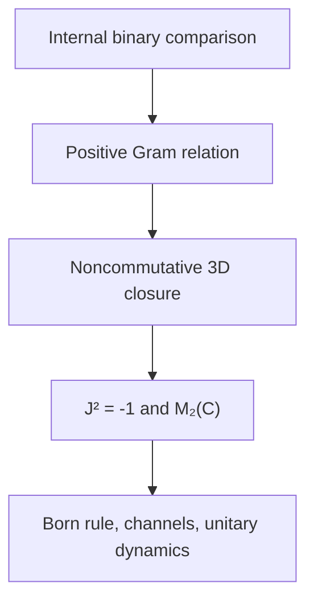

# 本轮新候选：C118-IBRC

> 参考输入：AI 撰写的理论工作稿，由用户在本会话提供（2026-11-05，Asia/Singapore）。Lean 是仓库的数学真源；本文仅为参考文稿，未作形式化认证。

### 内生二元关系闭合公理（Internal Binary Relation Closure）

我先把仓库的最新状态固定下来，再进行这一轮回溯。这样可以避免把理论草稿、已经形式化的结果、纯理论摄取和仍开放的命题混在一起。

截至查询时，仓库默认分支仍是 `dev`，GitHub 返回的最新提交是 [f7ba557](https://github.com/the-omega-institute/trureturing/commit/f7ba557ae2a5d2c3a3a519e0713d65ac86af2973)，时间为 2026 年 11 月 4 日 13:12 UTC，即新加坡时间约 21:12。最近一批与量子和内生关系最相关的进展如下。

| 项目进展 | 当前结果 | 验证边界 |
|---|---|---|
| [C122：整体源相干旋转与精确放大](https://github.com/the-omega-institute/trureturing/pull/26468) | 已合并；`CoherentUniformAmplification.lean` 的两个公开定理已通过 Lean | 100 个声明，标准三公理闭包；环境丢弃、Petz、资源编译和失败恢复仍有开放子句 |
| [周期 MPS 秩轨迹与相位恢复](https://github.com/the-omega-institute/trureturing/pull/26455) | 已合并；exact-head CI 与 dev push CI 通过 | 密度、轨道成员、行列式/偏迹判据和 Reg 审计仍未完全关闭 |
| [Gaussian Rényi 强次可加性](https://github.com/the-omega-institute/trureturing/pull/26454) | 已合并；选定 Lean 模块构建通过，required CI 通过 | 部分 DTR 登记仍是 `Unregistered` 或 `Undeclared` |
| [Bubble eigenstate 构型计数](https://github.com/the-omega-institute/trureturing/pull/26451) | 已合并；Lean 构建和 \(6\le L\le26\) 穷举核对通过 | 镜像登记存在未完成审计 |
| [二维七阶投影环面设计反例](https://github.com/the-omega-institute/trureturing/pull/26465) | 已合并；正式反驳结果和 required 检查通过 | 该结果是具体问题反例，不等同于整个量子起源理论完成 |
| [C117 共同来源、自指与观察者序列](https://github.com/the-omega-institute/trureturing/pull/26461) | 已作为理论源摄取 | 新增 22 个 residual-open 原子；没有 Lean 证明或完整覆盖声明 |
| [FourPath continuation IV](https://github.com/the-omega-institute/trureturing/pull/26475) | 已摄取并合并 | 新增 21 个 residual-open 原子；这是理论摄取，不是 Lean 完成 |

仓库已有的 [有限密度态与量子通道定义](https://github.com/the-omega-institute/trureturing/blob/dev/D5/S3/Quantum/Foundation/FiniteStateChannel.lean) 已经明确给出：

\[
\operatorname{DensityState}(n)
=
\{\rho\in M_n(\mathbb C):\rho\succeq0,\ \operatorname{Tr}\rho=1\},
\]

以及完全正保迹通道和通道复合。

这说明当前项目的真正方向已经非常清楚：不是继续把每个量子结果孤立地增加为一个公理，而是寻找一个更底层的内部关系约束，使得密度态、Born 规则、Kraus 通道、相干旋转、纠缠和观察窗口都成为同一个关系结构的不同投影。

---

## 一、先反着推：如果不需要这个公理，会发生什么

用户提出的“如果不确定为什么需要这个公理，就反过来检查不遵守它的后果”，可以直接转化为一组必要性测试。

### 1. 如果只保存概率，不保存二元复比较

假设系统只保存

\[
|\langle x,y\rangle|^2
\]

而不保存完整的复比较值 \(\langle x,y\rangle\)。

复共轭映射 \(K\) 满足

\[
|\langle Kx,Ky\rangle|^2
=
|\langle x,y\rangle|^2,
\]

所以它也保存全部转移概率。但是

\[
K(ix)=-iK(x),
\]

它不是复线性的。

因此，只保存概率只能得到“长度和夹角的影子”，不能确定量子振幅的相位方向，也不能区分线性酉变换和反酉变换。

这说明量子关系不能只作用在单个对象 \(x\) 上，必须作用在一对对象 \((x,y)\) 上，并保存完整的有向比较值。

---

### 2. 如果二元关系不要求正定

取一个形式上的关系矩阵

\[
G=
\begin{pmatrix}
1&2\\
2&1
\end{pmatrix}.
\]

对向量 \(c=(1,-1)\)，有

\[
c^\ast Gc=-2<0.
\]

因此 \(G\) 不能是任何内积矩阵，也不能解释为概率振幅的 Gram 矩阵。

如果没有正定性，就没有非负范数，没有 Hilbert 空间，也没有正概率。

所以“关系矩阵必须对所有有限关系组合正定”不是装饰，而是从“概率不能为负、距离平方不能为负”反推出来的必要条件。

---

### 3. 如果同一个结果拆开再合并时，关系不保持可加

只要求二结果归一化而不要求一般拆分可加，可以构造非 Born 型概率。

C117 中给出了一个明确形式：对二能级效果

\[
E=\alpha I+\mathbf b\cdot\boldsymbol\sigma,
\]

定义

\[
\widetilde w(E)=\alpha+4b_z^3.
\]

它可以保持某些二结果概率约束，但对于投影 \(P_z\)，有

\[
\widetilde w(P_z)=1,
\]

而

\[
2\widetilde w(P_z/2)=\frac58.
\]

也就是说，一个结果被拆成两个相同的半结果后，再合并回来，概率改变了。

这直接破坏了“同一个内部事件只是换了分辨率”的要求，也就不能推出 Born 规则。

因此，二元关系不仅要比较两个历史，还必须在内部粗粒化时满足

\[
\mathfrak R(x_1\oplus x_2,y)
=
\mathfrak R(x_1,y)+\mathfrak R(x_2,y).
\]

---

### 4. 如果过程只保存成功分支，不保存失败记录

设一个成功分支由

\[
K^\ast K=E<I
\]

描述。

那么

\[
\operatorname{Tr}(K\rho K^\ast)
=
\operatorname{Tr}(\rho E)
\]

一般小于 \(1\)。

这只是一个不增迹操作，不是完整量子过程。若把失败记录抹去，下一步过程会看到一个没有补全的输入，复合关系变成

\[
V_c(V_b^\ast V_b-I)V_a^\ast,
\]

因此无法再保证整体比较守恒。

这说明“完整内部记录”不是工程实现细节，而是量子通道能够复合的数学条件。

---

### 5. 如果三维提升没有非平凡闭合条件

若去掉非平凡性，令所有

\[
D_a=0,
\]

那么任意维度都可以满足“没有方向旋转”的条件。此时可以得到经典实空间，但不会得到复相位。

即使要求某些坐标方向有旋转，若不要求对所有线性合成方向都成立，也可以取

\[
W=\mathbb R^3\oplus\mathbb R,
\qquad
D_{a}b=(a'\times b',0),
\]

其中 \(a'\) 是前三个坐标。

取

\[
a=e_1+e_4,\qquad b=e_2,\qquad z=e_1-e_4,
\]

则

\[
z\perp a,\qquad z\perp b,
\]

但

\[
[D_a,D_b]z=e_2\neq0.
\]

所以如果只检查坐标对、不检查所有合成方向，就会偷偷留下第四个不受约束的方向。

因此，三维不是先验写入的空间维数，而是“对每一个二元关系及其有限合成都要求同样闭合”之后的最小有限结果。

---

### 6. 如果两个局部系统没有共享同一个内部复中心

两个局部 qubit 如果各自拥有一个独立的复方向 \(J_A,J_B\)，但不要求

\[
J_A=J_B,
\]

那么实张量积会出现额外分支：

\[
M_2(\mathbb C)\otimes_{\mathbb R}M_2(\mathbb C)
\cong
M_4(\mathbb C)\oplus M_4(\mathbb C).
\]

局部观测可能完全相同，但整体还有一个无法由局部读出确定的超选扇区。

所以复合系统必须共享一个由整体内部关系产生的复中心，而不能让每个局部观察者各自携带一个互不相容的“虚数方向”。

---

## 二、本轮候选公理：内生二元关系闭合

### 定义 1：整体与内部记录

令 \(\Omega\) 表示一个完整内部整体。它不是外部上帝视角，而是由以下对象共同组成：

- 有限历史或记录 \(x,y,\ldots\)；
- 历史之间的合法接续；
- 记录的并接和粗粒化；
- 完整过程；
- 失败分支与未读内部记录；
- 允许观察的有限窗口；
- 这些对象之间的比较关系。

令

\[
\mathcal R_\Omega(x,y)
\]

表示整体内部对两个记录 \(x,y\) 的完整比较。

这里的比较不是单纯的相似度，也不是只取模平方，而是包含：

1. 长度；
2. 方向；
3. 相对相位；
4. 是否来自同一个完整记录；
5. 两个记录如何在整体中共同延续。

---

### 公理候选 C118-IBRC

#### 内生二元关系闭合公理

对于 \(\Omega\) 中任意有限记录族

\[
X=(x_1,\ldots,x_n),
\]

定义它们的关系矩阵

\[
G_X=
\bigl(\mathcal R_\Omega(x_i,x_j)\bigr)_{i,j}.
\]

要求：

\[
\boxed{
\begin{aligned}
&\mathcal R_\Omega(y,x)
=
\mathcal R_\Omega(x,y)^\dagger,\\[2mm]
&\sum_{i,j}
c_i^\dagger\,
\mathcal R_\Omega(x_i,x_j)\,
c_j
\ge0
\qquad
\text{对所有有限 }X\text{ 与系数 }c_i,\\[2mm]
&\mathcal R_\Omega(1,1)=1,\\[2mm]
&\mathcal R_\Omega(x_1\oplus x_2,y)
=
\mathcal R_\Omega(x_1,y)
+
\mathcal R_\Omega(x_2,y),\\[2mm]
&\mathcal R_\Omega(Tx,Ty)
=
\mathcal R_\Omega(x,y)
\qquad
\text{对所有包含完整记录的合法过程 }T.
\end{aligned}
}
\tag{IBRC}
\]

最后再加上非经典分支的最小闭合条件：

> 整体中至少存在一个非交换的二元关系回路；它的所有线性合成仍满足同一个旁观方向闭合条件，并且这个闭包是有限、非零、不可再分的。

这条要求不是把三维空间写进公理，而是说：如果整体真的具有非平凡相位和不可交换关系，那么这个关系的最小闭包必须完整地闭合。

在局部切空间 \(W\) 中，它具体表现为：

\[
D_a\in\mathfrak{so}(W),
\qquad
D_a a=0,
\qquad
D\neq0,
\]

以及对所有由关系生成的 \(a,b\) 和所有

\[
z\perp a,\qquad z\perp b,
\]

要求

\[
[D_a,D_b]z=0.
\tag{1}
\]

这就是 C118 的“二元关系—三维有限提升”版本。

这里最重要的是：

\[
\text{公理不再是外部输入的物理规则，而是 }\Omega\text{ 中对象能够共同存在的约束。}
\]

“公理”只是一个内部对象要被纳入整体时必须满足的关系条件。

---

## 三、三维有限提升定理

### 定义 2：二元关系的切向闭包

令

\[
V=\mathbb R e\oplus W,
\qquad e=(1,0),
\]

其中 \(W\) 是所有非标量关系方向。

对每一个方向 \(a\in W\)，内部关系回路产生一个反对称算子

\[
D_a:W\to W.
\]

条件为：

\[
D_a\in\mathfrak{so}(W),
\qquad
D_a a=0,
\qquad
a\mapsto D_a
\text{ 实线性}.
\]

由线性和 \(D_a a=0\)，对任意 \(a,b\) 有

\[
D_a b=-D_b a.
\]

因此 \(D_a b\) 是两个方向之间的第三种关系方向。

---

### 定理 1：最小非平凡闭包必为三维

若满足：

1. \(D\neq0\)；
2. \(D_a\in\mathfrak{so}(W)\)；
3. \(D_a a=0\)；
4. \(D_a\) 对 \(a\) 线性；
5. 对所有合成方向满足式 \((1)\)：

\[
[D_a,D_b]z=0
\quad
(z\perp a,b),
\]

则存在 \(\kappa>0\)，使得

\[
[D_a,D_b]
=
-\kappa[L_a,L_b],
\]

其中

\[
L_a x=(a\cdot x)e-(e\cdot x)a
\]

在 \(W\) 上等价地写成

\[
[L_a,L_b]x
=
(b\cdot x)a-(a\cdot x)b.
\]

进一步有

\[
D_a^2x
=
\kappa\bigl((a\cdot x)a-\|a\|^2x\bigr),
\tag{2}
\]

以及

\[
D_aD_bx
=
\kappa\bigl((a\cdot x)b-(a\cdot b)x\bigr).
\tag{3}
\]

选定方向后，存在叉积，使得

\[
D_ab=\sqrt\kappa\,(a\times b).
\tag{4}
\]

并且

\[
\dim W=3.
\]

#### 证明

对线性无关的 \(a,b\)，交换子 \([D_a,D_b]\) 是反对称算子。由旁观条件，它在

\[
\operatorname{span}(a,b)^\perp
\]

上为零，因此它只能作用在二维平面

\[
\operatorname{span}(a,b)
\]

内。

二维平面上的反对称算子只有一个独立方向，所以存在一个标量 \(\lambda(a,b)\)，使

\[
[D_a,D_b]
=
\lambda(a,b)[L_a,L_b].
\]

现在取一组正交基 \(e_i\)，并对基向量作任意线性合成。因为公理要求对所有合成标签都成立，\(\lambda(a,b)\) 不能依赖于具体坐标对。比较线性合成中的每一对基方向，得到一个共同常数 \(\lambda\)。

非平凡性排除 \(\lambda=0\)。由反对称性和范数关系可知 \(\lambda<0\)，写成

\[
\lambda=-\kappa,
\qquad
\kappa>0.
\]

由交换子作用在 \(a\) 上得到式 \((2)\)，再通过极化得到式 \((3)\)。

取两个正交单位向量 \(u,v\)，定义

\[
w=\frac{D_uv}{\sqrt\kappa}.
\]

由式 \((2)\) 和反对称性：

\[
w\perp u,\qquad w\perp v,\qquad \|w\|=1.
\]

于是 \(u,v,w\) 三个方向正交。

另一方面，式 \((2)\) 给出

\[
D_w^2=\kappa(P_w-I),
\]

其中 \(P_w\) 是 \(w\) 方向投影。

但是在 \(u,v\) 平面上直接计算又有

\[
D_w^2=-\kappa(P_u+P_v).
\]

两式相等，因此

\[
\kappa(P_w-I)
=
-\kappa(P_u+P_v),
\]

从而

\[
I=P_u+P_v+P_w.
\]

所以 \(u,v,w\) 已经覆盖全部 \(W\)，得到

\[
\dim W=3.
\]

证毕。

---

### 这个定理真正说明了什么

三维不是“物理学家选择了三维”，而是：

1. 一个二元关系必须产生第三个方向；
2. 第三个方向不能引入新的旁观残余；
3. 对所有合成关系仍然要闭合；
4. 非平凡闭包不能无限增加方向。

因此最小非平凡关系闭包只能是：

\[
\text{两个方向}
\longrightarrow
\text{第三个方向}
\longrightarrow
\text{三个方向已经闭合}.
\]

这就是三维有限提升。

---

## 四、三维关系为什么产生复数

在三维空间中，定义

\[
e_1e_2=Je_3,\qquad
e_2e_3=Je_1,\qquad
e_3e_1=Je_2,
\]

并要求

\[
e_i^2=1,
\qquad
e_ie_j+e_je_i=0
\quad(i\neq j).
\]

于是

\[
J=e_1e_2e_3,
\]

并且

\[
J^2=-1.
\]

所以 \(J\) 不是从外部添加的“虚数单位”，而是三个内部关系方向按顺序闭合后的有向体积元素。

令

\[
\mathbb C_J
=
\{a+bJ:a,b\in\mathbb R\}.
\]

由于 \(J^2=-1\)，它自然同构于 \(\mathbb C\)。

对任意

\[
(\alpha,a),(\beta,b)\in
\mathbb C_J\oplus\mathbb C_J^3,
\]

定义乘法

\[
(\alpha,a)(\beta,b)
=
\left(
\alpha\beta+a\cdot b,\,
\alpha b+\beta a+J(a\times b)
\right).
\tag{5}
\]

结合律的关键正是三维向量恒等式

\[
(a\times b)\times c
=
b(a\cdot c)-a(b\cdot c).
\]

这个恒等式正是前面三维关系闭合的代数版本。

因此，三维有向关系闭合产生一个八维实结合 \(*\)-代数：

\[
\operatorname{Cl}_{3,0}\cong M_2(\mathbb C).
\]

它的最小左理想是

\[
H\cong\mathbb C^2.
\]

这就是 qubit 振幅空间。

所以本轮的起源链条是：

\[
\boxed{
\text{二元关系}
\longrightarrow
\text{三维有向闭合}
\longrightarrow
J^2=-1
\longrightarrow
M_2(\mathbb C)
\longrightarrow
\mathbb C^2.
}
\]

---

## 五、最简几何结构：Lorentz 锥与 Bloch 球

三维关系闭合的自伴部分可以写成

\[
X=sI+\mathbf r\cdot\boldsymbol\sigma,
\]

其中

\[
s\in\mathbb R,\qquad
\mathbf r\in\mathbb R^3.
\]

其特征值为

\[
s+\|\mathbf r\|,
\qquad
s-\|\mathbf r\|.
\]

因此正元条件恰好是

\[
s\ge\|\mathbf r\|.
\]

得到 Lorentz 型正锥：

\[
\mathcal C
=
\{(s,\mathbf r):s\ge\|\mathbf r\|\}.
\]

归一化截面 \(s=1\) 是 Bloch 球：

\[
\mathcal B
=
\{\mathbf r\in\mathbb R^3:\|\mathbf r\|\le1\}.
\]

纯态位于边界：

\[
\|\mathbf r\|=1.
\]

混合态位于内部：

\[
\|\mathbf r\|<1.
\]

对于纯方向 \(\mathbf n\)，对应投影

\[
P_{\mathbf n}
=
\frac12(I+\mathbf n\cdot\boldsymbol\sigma).
\]

状态

\[
\rho_{\mathbf r}
=
\frac12(I+\mathbf r\cdot\boldsymbol\sigma)
\]

对该投影的概率为

\[
\operatorname{Tr}(\rho_{\mathbf r}P_{\mathbf n})
=
\frac{1+\mathbf r\cdot\mathbf n}{2}.
\tag{6}
\]

因此：

- 点积 \(\mathbf r\cdot\mathbf n\) 是二元关系的无向部分；
- 叉积 \(\mathbf r\times\mathbf n\) 是关系的有向部分；
- 三重积

\[
(\mathbf r\times\mathbf n)\cdot\mathbf m
\]

是“关系之间的关系”，即三个方向之间的有向面积或体积；
- \(J\) 是这个有向三维闭合在代数中的相位元素。

纯态空间是 \(S^2\)，但振幅空间是 \(\mathbb C^2\)。因此：

\[
SU(2)\longrightarrow SO(3)
\]

是一个二重覆盖。Bloch 球看到的是方向，\(\mathbb C^2\) 还保留了方向背后的相位和符号。



---

## 六、从 C118 推出现有量子力学公理

下面区分“由 C118 直接推出的内容”和“仍需作为内部定义或资源条件加入的内容”。

---

### 定理 2：正关系矩阵产生 Hilbert 空间

定义零关系空间

\[
\mathcal N
=
\{x:\mathcal R_\Omega(x,x)=0\}.
\]

在商空间

\[
\mathcal H_0
=
\mathcal A_\Omega/\mathcal N
\]

上定义

\[
\langle[x],[y]\rangle
=
\mathcal R_\Omega(x,y).
\]

由于 IBRC 的正定条件，对任意有限组合有

\[
\left\|
\sum_i c_i[x_i]
\right\|^2
=
\sum_{i,j}
c_i^\dagger
\mathcal R_\Omega(x_i,x_j)
c_j
\ge0.
\]

因此这是半内积；商掉零空间后成为内积。有限维情况下不需要额外完备化，无限维时取完备化得到 Hilbert 空间。

这一步得到：

\[
\boxed{
\text{二元正关系}
\Longrightarrow
\text{Hilbert 空间}.
}
\]

这里 Hilbert 空间不是先验容器，而是关系矩阵所有有限组合的几何完成。

---

### 定理 3：完整关系守恒推出线性和等距性

设完整过程

\[
V:H\to K
\]

满足

\[
\langle Vu,Vv\rangle
=
\langle u,v\rangle
\]

对所有 \(u,v\in H\) 成立。

令

\[
A=V(u+v),
\qquad
B=Vu+Vv.
\]

由关系守恒：

\[
\|A\|^2=\|u+v\|^2,
\qquad
\|B\|^2=\|u+v\|^2,
\]

并且

\[
\langle A,B\rangle
=
\langle u+v,u\rangle+
\langle u+v,v\rangle
=
\|u+v\|^2.
\]

所以

\[
\|A-B\|^2=0,
\]

从而

\[
V(u+v)=Vu+Vv.
\]

同样，对任意内部标量 \(\lambda\)：

\[
V(\lambda u)=\lambda Vu.
\]

因此

\[
V
\]

自动是线性等距映射，不需要把“线性”另写成独立公理。

这就是 C118 比传统量子公理更简洁的地方：线性不是起点，而是二元关系守恒的结果。

---

### 定理 4：状态与 Born 规则

令 \(\mathcal E\) 为效果集合：

\[
\mathcal E
=
\{E=E^\ast:0\le E\le I\}.
\]

定义内部状态评价

\[
\omega(E)
=
\mathcal R_\Omega(1,E).
\]

由粗粒化关系可得：

\[
\omega(I)=1,
\]

并且对于

\[
E,F\ge0,
\qquad
E+F\le I,
\]

有

\[
\omega(E+F)
=
\omega(E)+\omega(F).
\]

由正定性，

\[
\omega(E)\ge0.
\]

在有限维矩阵代数 \(M_d(\mathbb C)\) 中，每个正归一化线性泛函都存在唯一密度矩阵 \(\rho\)，使

\[
\omega(E)
=
\operatorname{Tr}(\rho E),
\qquad
\rho\succeq0,
\qquad
\operatorname{Tr}\rho=1.
\]

因此 Born 规则不是外部输入，而是：

\[
\boxed{
\text{内部二元关系}
+
\text{结果的可加拆并}
\Longrightarrow
\text{正线性状态}
\Longrightarrow
\operatorname{Tr}(\rho E).
}
\]

对于纯态投影

\[
\rho=P_\psi=|\psi\rangle\langle\psi|,
\qquad
E=P_\phi=|\phi\rangle\langle\phi|,
\]

得到

\[
\operatorname{Tr}(P_\psi P_\phi)
=
|\langle\phi,\psi\rangle|^2.
\]

这就是通常的 Born 平方律。

---

### 定理 5：完整记录推出 Kraus 形式和 CPTP 通道

令完整过程为

\[
V:H\to H_{\mathrm{out}}\otimes R,
\]

其中 \(R\) 是内部记录空间，并满足

\[
V^\ast V=I.
\]

选取记录基 \(\{|j\rangle\}\)，定义

\[
K_j
=
(I\otimes\langle j|)V.
\]

于是

\[
V\psi
=
\sum_jK_j\psi\otimes|j\rangle.
\]

由 \(V^\ast V=I\)：

\[
\sum_jK_j^\ast K_j=I.
\tag{7}
\]

如果暂时忽略内部记录 \(R\)，得到

\[
\Phi(\rho)
=
\operatorname{Tr}_R(V\rho V^\ast)
=
\sum_jK_j\rho K_j^\ast.
\tag{8}
\]

因为同一个完整关系可以张量到任意参考系统，\(\Phi\) 在任意参考下都保持正性，所以它是完全正的；由式 \((7)\) 保迹。

因此：

\[
\boxed{
\text{完整比较守恒}
\Longrightarrow
\text{等距记录实现}
\Longrightarrow
\text{Kraus 表示}
\Longrightarrow
\text{CPTP 通道}.
}
\]

这与仓库当前的 [FiniteStateChannel.lean](https://github.com/the-omega-institute/trureturing/blob/dev/D5/S3/Quantum/Foundation/FiniteStateChannel.lean) 完全对接。

---

### 测量后态：必须区分“可推出”和“选择定义”

C118 能推出：

- 概率；
- 效果；
- 全部 Kraus 仪器；
- 失败分支；
- 完整记录；
- 条件化后的状态。

但仅凭成功概率 \(E\)，不能唯一确定测量后态。因为

\[
T_1(\rho)=\sqrt E\,\rho\,\sqrt E
\]

与

\[
T_2(\rho)=U\sqrt E\,\rho\,\sqrt E\,U^\ast
\]

有相同成功概率，但后态不同。

因此 Lüders 规则不能诚实地说成“由 Born 规则自动推出”。它需要一个内部的最小扰动选择原则。

定义有限均衡纯态测试集 \(P_s\)，满足

\[
\sum_s w_sP_s\otimes P_s
=
\frac{I+F}{d(d+1)},
\]

其中 \(F\) 是交换算子。对给定效果 \(E\) 的仪器

\[
T(\rho)=\sum_aK_a\rho K_a^\ast,
\qquad
\sum_aK_a^\ast K_a=E,
\]

定义内部保留量

\[
R(T)
=
\sum_s w_s\operatorname{Tr}[P_sT(P_s)].
\]

可以证明

\[
R(T)
=
\frac{
\operatorname{Tr}E+
\sum_a|\operatorname{Tr}K_a|^2
}{
d(d+1)
}.
\]

Cauchy–Schwarz 给出

\[
\sum_a|\operatorname{Tr}K_a|^2
\le
\bigl(\operatorname{Tr}\sqrt E\bigr)^2.
\]

等号当且仅当所有 \(K_a\) 都是 \(\sqrt E\) 的同一方向倍数。因此唯一的内部最大保留实现是

\[
T_E(\rho)
=
\sqrt E\,\rho\,\sqrt E.
\]

所以更准确的表述是：

\[
\boxed{
\text{C118 推出概率和全部仪器；}
\quad
\text{Lüders 更新来自内部最小扰动选择。}
}
\]

---

### 定理 6：复合系统和纠缠

若两个局部系统：

1. 都由同一个内部关系整体产生；
2. 都共享同一个 \(J\)；
3. 作为保单位 \(*\)-代数嵌入联合系统；
4. 两个局部像彼此交换；
5. 共同生成联合代数；

则乘法映射

\[
a\otimes b
\longmapsto
\iota_A(a)\iota_B(b)
\]

是一个复 \(*\)-同态。

对于矩阵代数，它给出

\[
M_d(\mathbb C)\otimes_{\mathbb C}M_m(\mathbb C)
\cong
M_{dm}(\mathbb C).
\]

因此联合 Hilbert 空间为

\[
H_A\otimes H_B.
\]

其中包含非乘积纯态。例如两个 qubit 的 Bell 态

\[
|\Phi^+\rangle
=
\frac{|00\rangle+|11\rangle}{\sqrt2}.
\]

它的两个局部约化态都为

\[
\frac{I}{2},
\]

但整体态是纯态且不可分解。

这正好连接仓库已有的 [LocalMarginalCorrelationBlindSpot.lean](https://github.com/the-omega-institute/trureturing/blob/dev/D5/S3/Quantum/Entanglement/LocalMarginalCorrelationBlindSpot.lean)：只看局部边缘不能恢复整体相关关系，必须保留联合二元关系。

---

### 定理 7：可逆运动与 Hamiltonian

若一个确定过程 \(V\) 及其逆过程都满足完整关系守恒，那么它不能丢失记录，也不能压缩到真子空间。

在有限维同维情况下，

\[
V^\ast V=I,
\qquad
VV^\ast=I,
\]

所以 \(V\) 是酉算子。

于是状态演化为

\[
\rho\longmapsto U\rho U^\ast.
\]

若进一步定义一个连续单参数群

\[
U_{t+s}=U_tU_s,
\qquad
U_0=I,
\]

则存在自伴算子 \(H\)，使

\[
U_t=e^{-itH/\hbar}.
\]

于是

\[
\rho_t
=
e^{-itH/\hbar}\rho_0e^{itH/\hbar},
\]

并满足

\[
\frac{d\rho_t}{dt}
=
-\frac{i}{\hbar}[H,\rho_t].
\]

纯态满足

\[
i\hbar\frac{d}{dt}|\psi_t\rangle
=
H|\psi_t\rangle.
\]

这里必须保留一个边界：

\[
\hbar
\]

是时间单位和生成元之间的换算常数，不能从 IBRC 单独确定其经验数值。连续时间群本身也必须作为内部可实现结构加入，不能由离散门序列自动推出。

---

## 七、标准量子公理与 C118 的对应关系

| 通常量子力学公理 | C118 中的来源 | 是否完全自动推出 |
|---|---|---|
| 复 Hilbert 空间 | 正关系 Gram 完成；三维有向闭合产生 \(J^2=-1\) | 在有限非经典分支中推出 |
| 叠加原理 | 完整二元关系守恒推出加法和齐次性 | 推出 |
| 自伴可观测量 | 内部 \(*\)-代数的自伴部分 | 定义后推出 |
| Born 规则 | 效果粗粒化可加性与正关系 | 推出 |
| 密度矩阵 | 有限矩阵代数上的正归一化泛函 | 推出 |
| POVM | 全部正效果分解 | 推出 |
| Kraus 仪器 | 完整等距过程展开内部记录 | 推出 |
| CPTP 通道 | 忽略记录后的完全正保迹映射 | 推出 |
| Lüders 更新 | 最大保留量的内部选择原则 | 需要明确选择定义 |
| 张量积 | 共享同一个内部 \(J\) 的交换代数闭包 | 在复合闭包条件下推出 |
| 纠缠 | 联合矩阵代数中的非乘积纯态 | 推出 |
| 酉演化 | 完整过程及逆过程都守恒 | 推出 |
| Schrödinger 方程 | 另给连续单参数群 | 需要连续时间结构 |
| \(\hbar\) | 时间单位和生成元单位换算 | 不能由关系公理确定 |
| 具体 Hamiltonian | 具体内部动态关系 | 不能由关系公理唯一确定 |
| 物理空间三维 | 局部二元关系块的三维闭合 | 只能推出关系块三维，不能直接推出物理空间三维 |

---

## 八、C118 比 C117 更简洁在哪里

C117 已经明确写出六类条件：

1. 三维关系几何；
2. 效果拆并；
3. 有限复合闭包；
4. 完整过程保比较；
5. 观察窗口共同细化；
6. 理想测量和时间命名。

本轮 C118 把它们压缩成一个关系对象：

\[
\mathcal R_\Omega(x,y).
\]

然后只要求这个关系对象同时满足三种内部稳定性：

\[
\boxed{
\begin{aligned}
&\text{有限关系组合保持正定；}\\
&\text{关系粗粒化保持可加；}\\
&\text{完整内部扩展保持二元比较。}
\end{aligned}}
\]

三维关系、复数、Born 规则、Kraus 通道、张量积和酉运动都是这三个稳定性的不同层次。

C117 的六个条件仍然是有用的展开版；C118 是它的压缩版。

但不能夸大“简洁”：单独一条

\[
\mathcal R(Tx,Ty)=\mathcal R(x,y)
\]

并不能排除经典概率空间或实 Hilbert 空间。要获得复量子分支，仍然必须要求非平凡、有限、旁观闭合的非交换回路。

这不是候选的缺陷，而是一个必要性结论：

> 如果不加入任何非交换性，经典理论与实量子理论始终是合法模型；不存在只靠“内生”二字就自动选择复量子力学的证明。

---

## 九、C118 的完整重构定理

### 定理 8：有限内生关系的量子重构

设 \(\Omega\) 满足 C118-IBRC，并满足以下闭包条件：

1. 存在非零非交换二元种子；
2. 种子的所有线性合成满足旁观方向闭合；
3. 内部记录空间允许有限正交分解；
4. 局部系统共享同一个内部复中心；
5. 所有有限投影角代数和有限张量积都属于 \(\Omega\)。

则：

1. 最小非交换关系块的切向空间是 \(\mathbb R^3\)；
2. 其关系代数包含 \(J\)，满足 \(J^2=-1\)；
3. 最小矩阵代数同构于 \(M_2(\mathbb C)\)；
4. 任意有限角代数同构于某个 \(M_d(\mathbb C)\)；
5. 状态同构于密度矩阵；
6. 效果概率满足 Born 迹公式；
7. 完整过程同构于等距记录实现；
8. 忽略记录得到 CPTP 通道；
9. 可逆完整过程同构于酉共轭；
10. 连续可逆群给出 Hamiltonian 交换子演化；
11. 局部系统共享中心时，联合系统是复张量积；
12. 联合系统中自然出现纠缠态。

#### 证明

- 第 1、2、3 项由三维有限提升定理和 Clifford 闭包得到；
- 第 4 项由 \(M_2(\mathbb C)\) 的有限张量积和非零投影角代数得到；
- 第 5、6 项由正关系矩阵产生的有限 GNS 表示和有限矩阵代数上的正泛函表示得到；
- 第 7、8 项由完整二元比较守恒和内部记录展开得到；
- 第 9、10 项由过程和逆过程的关系守恒以及连续单参数群得到；
- 第 11、12 项由共享 \(J\) 的交换 \(*\)-嵌入和联合代数生成性得到。

证毕。

这个定理是一个**条件重构定理**，不是“已经证明现实宇宙必定服从 C118”。

它证明的是：

> 一旦一个有限内部整体同时具有正的二元比较、可加粗粒化、完整记录守恒和最小非交换三维闭合，那么通常有限维量子力学的数学结构会从这些关系中出现。

---

## 十、本轮对白话完整描述

整体里没有一个站在外面的尺子，只有整体内部的记录，以及记录之间怎样互相比较。任意两条历史都必须留下完整的关系：它们有多长、方向是否一致、相位怎样转过来、从哪里共同出发、以后还能不能一起接续。把两条关系放在一起，会得到一个关系矩阵；这个矩阵的任何有限组合都不能产生负的长度平方，所以它自动长成一个 Hilbert 空间。把一个结果拆成两块再合回来，关系不能改变，于是概率必须按关系线性相加，Born 规则就从内部记账中出现。若一个过程把全部旧记录搬到新的内部记录里，并且两条历史之间的比较完全不变，那么这个过程自动是线性的等距映射；暂时不读那些记录，就得到 Kraus 算子和量子通道。现在从一对真正不交换的关系开始，沿着它们的回路会被迫带出第三个方向；如果连所有合成关系都要求旁观方向不受暗中推动，那么第三个方向已经足够，第四个方向就无法独立存在。三个方向按顺序围成一个有向体积，这个体积平方等于负一，于是复数不是从外面塞进来的，而是三维关系自己闭合后产生的内部相位。三维的自伴部分就是一个锥，归一化以后是 Bloch 球；球面是纯态，球内是混合态，点积给出概率，叉积给出相位方向，三重积给出关系之间的关系。量子力学因此不是先摆好一个 Hilbert 空间再规定怎样测量，而是一个整体为了让内部关系能够同时可比较、可拆分、可复合、可逆和不丢记录，唯一留下的最小非经典几何。

---

## 十一、这个候选与仓库当前工作的真正接点

C118 不是脱离仓库另起炉灶，而是把当前几个已经存在的方向压缩到同一条主线上：

1. [C117 理论稿](https://github.com/the-omega-institute/trureturing/blob/dev/docs/develop/theory/AURIC_COMMON_SOURCE_SELF_REFERENCE_AND_OBSERVER_SEQUENCES_C117.md) 已经明确提出
   \[
   \langle Vu,Vv\rangle=\langle u,v\rangle
   \]
   作为完整过程的二元比较守恒。

2. [FiniteStateChannel.lean](https://github.com/the-omega-institute/trureturing/blob/dev/D5/S3/Quantum/Foundation/FiniteStateChannel.lean) 已经把密度态、完全正映射、保迹和通道复合固定为正式对象。

3. [CoherentUniformAmplification.lean](https://github.com/the-omega-institute/trureturing/blob/dev/D5/S3/Quantum/Recovery/CoherentUniformAmplification.lean) 已经证明整体源上的相干旋转，而不是只对某一个未知输入态进行逐态论证。

4. [LocalMarginalCorrelationBlindSpot.lean](https://github.com/the-omega-institute/trureturing/blob/dev/D5/S3/Quantum/Entanglement/LocalMarginalCorrelationBlindSpot.lean) 已经给出“局部边缘相同但整体相关不同”的严格例子，证明完整关系不能被局部读口替代。

5. [C122 的 exact amplification](https://github.com/the-omega-institute/trureturing/blob/dev/D5/S3/Quantum/Recovery/CoherentUniformAmplification.lean) 说明：只要完整来源、反射、记录和相干接口都在内部提供，就可以把一个整体关系搬运到另一个完整表示。

因此，本轮真正应该形式化的不是又一个孤立的 Born 定理，而是一个新的基础层：

```text
InternalBinaryRelation
    ├── PositiveGram
    ├── CoarseGrainingAdditivity
    ├── CompleteExtensionIsometry
    └── MinimalNoncommutative3DClosure
```

然后让已有的：

```text
DensityState
QuantumChannel
KrausRepresentation
CoherentAmplification
TensorComposition
BornRule
```

成为这个基础层的消费者。

---

## 十二、仍然开放的严格边界

这轮理论可以把量子公理压缩得更简洁，但以下内容不能被偷换成已经证明：

1. C118 目前是本轮理论候选，不是仓库中已经编译并冻结的新 Lean 模块；
2. C117 当前在仓库中主要以理论摄取和 residual-open 原子存在，PR #26461 明确没有进行 Lean 证明；
3. 从项目原生 Rule110、FIB ATOM 或其他协议中构造满足三维旁观闭合的实际关系种子，仍需要独立证明；
4. C118 推出的是有限维量子结构，不能仅凭此确定现实宇宙的物理空间维数；
5. \(\hbar\)、具体 Hamiltonian、粒子种类和宇宙初态没有从关系公理唯一推出；
6. Born 规则可以从正的可加效果关系推出，但 Lüders 更新仍需要内部最小扰动选择；
7. 数学上存在所有 CPTP 通道，不代表某个具体有限门菜单已经物理实现全部通道；
8. 观察窗口的共同极限需要一致性、共尾覆盖和完整相关记录，不能只依赖局部边缘；
9. “一切在 \(\Omega\) 内生”是一个严格的数学建模原则，不是自动证明“物理宇宙就是该模型”。

本轮最简洁、也最稳固的结论可以写成：

\[
\boxed{
\text{量子结构}
=
\text{正的内生二元关系}
+
\text{可加粗粒化}
+
\text{完整关系守恒}
+
\text{最小非交换三维闭合}.
}
\]

在这个表达中：

\[
\begin{aligned}
\text{三维闭合}
&\Longrightarrow J^2=-1,\\
\text{正关系}
&\Longrightarrow \text{Hilbert 空间},\\
\text{可加粗粒化}
&\Longrightarrow \text{Born 规则},\\
\text{完整关系守恒}
&\Longrightarrow \text{线性等距与 Kraus 通道},\\
\text{共享内部中心}
&\Longrightarrow \text{复张量积与纠缠},\\
\text{可逆连续闭包}
&\Longrightarrow \text{酉演化与 Hamiltonian}.
\end{aligned}
\]

这就是本轮从“外部公理”回溯到“整体内部关系约束”的完整候选。
