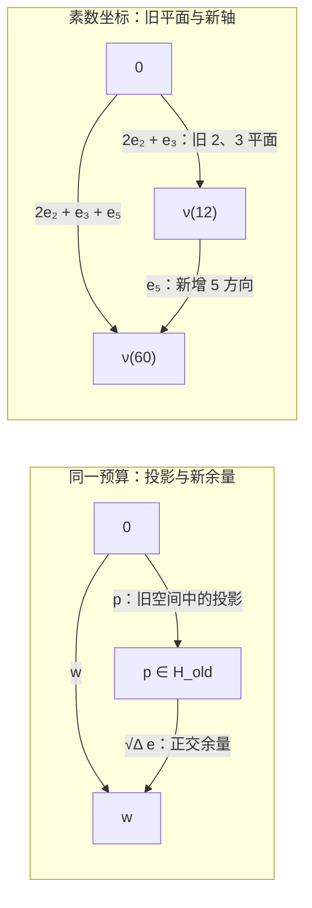

# 配平关系、有限规则与内生相位：从素数的无界发现，回溯量子关系的有限闭合

> 来源：用户于 2026-11-05（Asia/Singapore）在本会话提供的 AURIC C135 LaTeX 研究工作稿；原稿未另署作者或模型。本文为参考输入，Lean 是仓库的数学真源；本次仅转换 Markdown，未作形式化认证。正文中的固定快照、项目核读叙述与理论结论均保留原稿口径；一幅双面板 TikZ 图转换为 Mermaid 示意图。

AURIC C135\
从素数的无界发现，回溯量子关系的有限闭合\
一个候选；整数配方；仿射全分类；相位的零、一、三维闭合\
固定源码：`664de5498694`；2026 年 11 月 5 日 03:24:54（新加坡）

**本轮判断。** 不断发现新素数，说明可见内容与坐标可以无界增加；它本身不证明每次增加都需要一条新公理。 本轮把两者分开：用同一条二元配平规则容纳任意多份有限记录， 再检验哪些相位结构已经由实际读口决定。 底层规则是否具有最终、唯一的物理解释，仍是另外的问题。

本轮只给非空标签集 $X$ 和处处有限的实比较 $c(x,y)$，要求 $c(x,x)=0$。 原始标签不预给原点、聚合运算、切向门、复数或实振幅空间。 令 $L_0=\{r\in\mathbb Z^{(X)}:\sum_xr_x=0\}$ 为有限配平整数清单，定义

$$
R_c(r,s)=-\frac12\sum_{x,y}r_xs_yc(x,y),\qquad Q_c(r)=R_c(r,r).
$$

唯一主候选为

$$
\boxed{\quad 2R_c(r,s)\le Q_c(r)+Q_c(s)\qquad(r,s\in L_0).\quad}
$$

它恰好选择全部模型

$$
\boxed{\quad c(x,y)=\|F(x)-F(y)\|^2+h(y)-h(x).\quad}
$$

这里 $F$ 取值于实 Hilbert 仿射空间，$h$ 是保留在原表中的端点势； 最小仿射几何由 $c$ 唯一确定，只有坐标原点可改。 整数配方的预算先迫出互易，再由有理清分母与有限多项式连续性得到实正几何。

**新的闭合位置。** 新增记录只有两项：旧张成空间内的投影，以及一个非负的正交余量。 维数可以无限增加，延伸规则不必增加。 在有限、实不可约的实际读口块中，共同反自伴方向的维数只可能为 $0,1,3$： 两条独立相位相乘自动生成第三条，第四条与前三条同时相容则只能为零。 这接回标准的实、复、四元数分类；复数型仍须由实际读口选出。

**与前轮及最新仓库的关系。** 预算形式本身属于已知正核判据，仓库 C130 及相关稿已使用它。 本轮的回溯在于原点、原 $A$ 和原实振幅不再作为初始对象， 并完整保留端点势、全部 $A$ 的恢复纤维及非复数型边界。 最新 C133 续篇 V 已从无结合律的二元配方与三相关系重建复几何； 本轮不宣称在每一复杂度指标上都比该路线更强。 两边都保留无界有限配方的全称关系，数学包络不自动供应实际操作。

**一句白话。** 新发现可以永远增加，但每次都只需把新内容分成旧关系能解释的影子和剩下的正交余量； 然后再问，所有真实读口共同允许什么转向。

## 1　固定最新前沿：本轮究竟退回哪一层

本轮只固定一次默认分支 `dev`： [`664de5498694`](https://github.com/the-omega-institute/trureturing/commit/664de54986944b49cda0200e15020602fc8dae65)， 提交时间为 2026 年 11 月 4 日 19:24:54 UTC（新加坡时间 11 月 5 日 03:24:54）。 比较基线是 C134 固定的 `85a80900fe52`。 两个未截断的 `docs` 递归树给出 17 个文档路径变化；提交比较端点报告新增可达提交 222 个，但本次没有取得完整分页，不能将这个数字写成逐提交核验结果。下面只消费实际读到的具体条款，不以下载完成或标题代替正文核读，也不据此声称 Lean 内核已验证这些新纸笔证明。

### 1.1　最新候选已比旧正核表述更原始

[C130 定义 2.1–2.2、定理 2.3](https://github.com/the-omega-institute/trureturing/blob/664de54986944b49cda0200e15020602fc8dae65/docs/develop/theory/AURIC_C130_MUTUAL_READOUT_BOUND_QUANTUM_RELATIONS.md) 已从任意复二元表和全部有限高斯整数配方，以

$$
2\Re B(f,g)\leq \Re B(f,f)+\Re B(g,g)
$$

推出 Hermitian 正核及 Hilbert 表示。因而本轮不能把一般的二元预算、从整数测试延伸到正性、商去零型或 Hilbert 完成本身记作新发现。

更需要比较的是新入库的 [C133 续篇 V 定义 1.1、假设 1.2、定理 1.3](https://github.com/the-omega-institute/trureturing/blob/664de54986944b49cda0200e15020602fc8dae65/docs/develop/theory/AURIC_C133_THREE_READ_CLOSURE_VISIBLE_COMPLEX_GEOMETRY_CONTINUATION_V.md)。 其原始数据只有一个带双侧单位 $1$ 的二元运算集合 $M$、一个满足 $U1=1$ 的任意标记 $U$，以及处处有限的 $c:M^2\to[0,\infty)$，$c(a,a)=0$。 原运算并不预设结合、交换、消去或逆元；$U$ 不预设保持运算或三阶周期。 唯一配平式是

$$
\sum_{k=0}^{2}c(a\cdot U^ku,b\cdot U^kv)
   =3c(a,b)+3c(u,v),\qquad a,b,u,v\in M.
$$

该文给出完整纸笔证明：它等价于存在复 Hilbert 空间和 $F$，使

$$
F1=0,\quad F(a\cdot b)=Fa+Fb,\quad
F(Ua)=\omega Fa,\quad c(a,b)=\|Fa-Fb\|^2,
\qquad \omega=-\tfrac12+i\tfrac{\sqrt3}{2}.
$$

结合、交换、逆元及 $U^3=1$ 只在比较的可见商上产生；原树的括号、次序和档案继续保留。 其证明先在可能非对称、非正定的双线性空间保留乘法缺陷，经全部有限历史的 Fourier 平均与有界性排除缺陷，随后才得到平方范数和复结构。这不是可以忽略的旧版本细节。

[C133 续篇 IV 推论 3.1](https://github.com/the-omega-institute/trureturing/blob/664de54986944b49cda0200e15020602fc8dae65/docs/develop/theory/AURIC_C133_THREE_READ_CLOSURE_VISIBLE_COMPLEX_GEOMETRY_CONTINUATION_IV.md) 还已明确得到条件负型后果：

$$
\sum_i\lambda_i=0
\quad\Longrightarrow\quad
\sum_{i,j}\lambda_i\lambda_j c(a_i,a_j)
=-2\Bigl\|\sum_i\lambda_iFa_i\Bigr\|^2\leq0.
$$

本轮在所核读的相关文档中没有发现以任意非对称实费用、零总量整数配方为原始数据，并以端点势差刻画全部纤维的同一候选；这只是有边界的来源比较，不是文献优先权结论。

因此 C135 的准确回溯是：暂不输入原点、内部聚合、相位标记或原复数系数，从配平比较重建实仿射前体，再分类仍未被这份前体决定的结构。 删除这些输入也删除了直接选出复结构的能力；不能无条件说它比 C133 V 更强，或已经用更少前提取得同样的全部结论。 真正需要证明的是前体模型类、端点势差纤维以及后续复结构的选择条件，而非给成熟正性换名。

### 1.2　C123 的协变桥已经推进，不能沿用旧的未决状态

[C123–C128 原卷新 §§57–62](https://github.com/the-omega-institute/trureturing/blob/664de54986944b49cda0200e15020602fc8dae65/docs/develop/theory/AURIC_NATIVE_RECIPROCAL_COMPARISON_AND_FINITE_ENDPOINT_QUANTUM_C123.md) 新增了同一原数据上的全对象协变证明及单对标定。这里的前件必须完整保留：定义 41.1 的全语境响应商、全部有限 EJA 原载体及指定 $q,L,\circ,D$，原 P/G、整个原指针上的 AC、精确 $N_u$、X/Xs、全事件 R、原细化与遗忘、具名支持双返回，以及所有旧输出、经典标签、失败和合法有限历史。 X 要求含幺 Jordan 嵌入保持原 $D$、交叉 $D=0$、乘积张成和每对实际准备的实际乘积。 全事件 R 对每条原事件及其原细记录、标签、失败、返回和有限接续，供应足够大的同设备、同记录实际参考执行，并在完整原联合准备锥上保正；它并非只对少数探针或选中的新词成立。

在这个背景中，令 $F_A(a,b)=D^A_ab$。新增关系为

$$
\mathrm Z:\quad \alpha(x)=0\Longrightarrow\alpha(D_ax)=0,
\quad x\in C_A,\ \alpha\text{ 为原实际准备};
\qquad
\mathrm{SC}:\quad D_aa=0.
$$

定理 57.2 证明 Z 与 SC 已推出

$$
[K,D_a]b-D_{Ka}b=0
\quad\text{对全部原对象、实际联合、}K\in\mathfrak k_A, a,b\in E_A.
$$

高秩分量使用 Nagy 的斜延拓分类；原实际乘积准备排除仅在秩二联合分量藏有缺陷的可能。 定理 60.1 又用同一个原 AC 指针准备给出更短的秩二碰撞证明。 这些证明保持原 $D$，没有用后来造出的叉积代替它，也没有加入独立动力同态或实际量子比特；推导协变本身不消费旧迹标定 S。

定理 61.2 进一步在同一背景、Z、SC 下证明，原 S 等价于一对原元素的条件 S2：

$$
\exists x\ne0:\quad d\circ x=\tfrac12x,\qquad
4q_P\bigl(F(d,x),F(d,x)\bigr)=q_P(x,x).
$$

它也等价于该非零横向元满足 $4F(d,F(d,x))=-x$。 同一 $d,x$ 随后生成一个数学三维 Bloch 截面；这并不自动供应新的实际附接对象。 命题 62.2 保留了必要的尺度反事实：在同一完整背景中，$D=t\delta$ 对任意实 $t$ 满足 Z、SC 和协变，S2 则恰要求 $t^2=1$。 所以标定已局部化，却没有从定义中自动消失。

同一背景加 S2 经定理 58.2、61.2 接回有限复代数、原质量 Born 评价、已声明联合的复张量、全事件 CP/TNI 与完整测试 TP；平方根词、原记录及返回仍各自消费精确调用和合法连线。 连续物理时钟、作用量单位、旧器件输出校准和任意独立仪器组装并未一并得到。 [新增 $\Omega Q$-010 §10](https://github.com/the-omega-institute/trureturing/blob/664de54986944b49cda0200e15020602fc8dae65/docs/develop/theory/OMEGAQ_010_ONE_TRANSVERSE_COMMUTATOR_RELATION.md) 已经明确接入这一更新，不能再单独引用其旧 §8.4 的“未决桥”作为当前最终状态。 其自身的横向交换子秩一判据仍依赖完整有限预测空间、紧有效群、循环来源和完整导出理想；只在这些前件下得到三维单体几何，不凭该单体结果供应全部联合和时钟。

### 1.3　无限实例不等于无限条基本规则

[C117 续卷 §42.1](https://github.com/the-omega-institute/trureturing/blob/664de54986944b49cda0200e15020602fc8dae65/docs/develop/theory/AURIC_COMMON_SOURCE_SELF_REFERENCE_AND_OBSERVER_SEQUENCES_C117_CONTINUATION.md) 已作出与本轮直接相关的区分：两个固定追加生成元、三个固定原字零关系可以构成有限呈示，但其合同仍量化全部无界有限配方、事件平衡、完整总和、总等距和校准语境。 有限查询不能认证这些全称律，准确非零残差却能反驳相应前件。 C135 同样只有一条预算模式，却量化任意大小的有限零总量整数配方；其简短不是固定大小试验的完备性，也不是实际世界必满足这条模式的证明。

素数类比也有准确的已有边界。 [《素数观察者动力学》§§7–10、189](https://github.com/the-omega-institute/trureturing/blob/664de54986944b49cda0200e15020602fc8dae65/docs/develop/theory/FORMAL_PRIME_OBSERVER_DYNAMICS.md) 把有限素数幂读数合成模数 $M$，在 $\{0,\ldots,N-1\}$ 上分离全部整数的条件是 $M\ge N$；固定有限模数不能识别无界整数。 但一个素数的无限精度也能分离整数，因此“有限素数”不等于“有限信息”。 把全部对象写成素数坐标还需要分离性、相容像、粘合及结构自然性；素因子分解或地址编码本身不能证明所有物理对象来自某个指定高维投影。

最新固定提交还带来一个具体的实际操作边界。 [记录恢复续卷 I §8](https://github.com/the-omega-institute/trureturing/blob/664de54986944b49cda0200e15020602fc8dae65/docs/develop/theory/RECURSIVE_RELATIONAL_OBSERVATION_MEASUREMENT_RELATIVE_QUANTUM_BOUNDARY_CONTINUATION_I.md) 在指定十六位合法源、固定原门、计算基投影和有限确定反馈菜单下，保留全部原程序及读数记录，证明任何允许的有限接续与该文固定的同历史局部 Petz 恢复目标之间均有

$$
\operatorname{TV}(\overline P_C,P_\chi)
\ge\frac{16-7\sqrt5}{11}>0.
$$

菜单保持相邻双占据缺陷为零，而该特定目标赋予相应事件正质量；下界与每份有限预算大小无关。 这说明不断增加同一菜单内的调用未必补出缺失的实际操作。它不否定所有恢复，也不是一般量子起源定理。

**白话。** 现在要回溯的不是“再发现一个更神秘的总公理”。仓库已经能让三相配方自己长出复几何，也已经把某些全域动力要求压成原来两种关系和一对元素的标定。这一轮再往前退：先不指定怎么聚合、绕哪个原点、往哪边转，只让两份数量配平的关系相互对照，看看这一步到底锁定什么、还剩什么。无穷多个素数可以服从一条有限规则；同样，无穷多个有限比较也可以受一条模式约束。真正尚需解释的是，这条模式为何适用于实际世界，以及没有被它锁定的相位、组合和器件由什么原关系继续决定。

## 2　配平关系：无指定原点的唯一候选与完整分类

本轮把主条件放在原始标签间的二元读数上，不先指定内部旋转、单位元素或原标签的加法。 为比较两份有限记录，只引入形式的整数记账。 这些整数加减不改写原历史的串接次序；不同历史仍是不同标签。 派生的实向量包络是证明工具，不被自动认作原程序已供应的相干制备域。

#### 定义 2.1：二元原读数与整数配平配方

取任意非空集合 $X$，以及有限实值函数 $c:X\times X\to\mathbb R$，满足 $c(x,x)=0$。 不预给 $c$ 的对称性、非负性或三角不等式。 记 $\delta_x$ 为标签 $x$ 的形式单位，定义

$$
L_0=\left\{r\in\mathbb Z^{(X)}:\sum_xr_x=0\right\},
 \qquad
 R_c(r,s)=-\frac12\sum_{x,y}r_xs_yc(x,y),
 \qquad Q_c(r)=R_c(r,r).
$$

上标 $(X)$ 表示有限支撑，故全部和都是有限和。 $r\in L_0$ 可理解为两份总件数相同的有限记录之差。 实值读数的算术与次序仍在表达层中；本轮没有把任意实数读数的可计算性当成已证明。

#### 定义 2.2：C135：配平互读预算

本轮唯一主候选为

$$
\boxed{\quad
 2R_c(r,s)\le Q_c(r)+Q_c(s),
 \qquad r,s\in L_0.
 \quad}
\tag{C135}
$$

候选只约束二元原表 $c$ 所定义的两份配平比较。 它没有选择某个观察者为原点，也没有另外给定相位操作。

### 2.1　整数比较已经迫出实正几何

#### 引理 2.3：整数接触引理

式 (C135) 当且仅当 $R_c$ 的实双线性延拓在

$$
V_0=\left\{r\in\mathbb R^{(X)}:\sum_xr_x=0\right\}
$$

上对称正半定。此时对全部 $r,s\in V_0$，

$$
Q_c(r)+Q_c(s)-2R_c(r,s)=Q_c(r-s)\ge0.
\tag{1}
$$

**证明。**

取 $s=0$，先得全部整数配方的 $Q_c(r)\ge0$。 固定 $g,h\in L_0$，将预算中的两项取为 $ng+h$ 与 $ng$，其中 $n\in\mathbb Z$。 整数双线性直接给

$$
Q_c(h)+n\bigl[R_c(g,h)-R_c(h,g)\bigr]\ge0
 \qquad(n\in\mathbb Z).
$$

正负整数 $n$ 无界，一次项只能为零，故整数配方间互读对称。 这一步使用有限实值读数的阿基米德性；没有将值域替换成含无穷小的任意有序域。

任意有理配平配方乘以公共正整数分母即属于 $L_0$，所以正性及对称性延拓到有理配方。 对任意实配方，固定其有限支撑，并选其中一个标签作为该有限计算的临时锚； 其余系数用有理数逼近，锚的系数取负合计，保持总量为零。 有限二次多项式的连续性给出实配方正性，对称性也随双线性延拓成立。 这一步是读数多项式的实数结论，不供应新的实际制备。 反向，对称正半定形式展开即得式 (1)，限制回整数配方便得到候选。

$\square$

由此才定义

$$
\mathcal N=\{r\in V_0:Q_c(r)=0\}.
$$

正性与一次扰动给 $\mathcal N=\operatorname{rad}R_c$：若 $Q_c(r)=0$，则 $Q_c(r+ts)=2tR_c(r,s)+t^2Q_c(s)\ge0$ 对任意实 $t$，迫使 $R_c(r,s)=0$。 因此 $H_{\rm alg}=V_0/\mathcal N$ 是实内积空间；需要时取其 Hilbert 完备化 $H$。 原整数配方中的零差是 $L_0\cap\mathcal N$。 不可把实包络中存在的某个非整数配方直接宣称为原档案中实际可调用的记录。

预算余量为零，恰好意味着 $[r]=[s]$；这只标记当前配平读口的等价，不删除两个原始标签及其完整历史。 本轮所谓一个条件，指一个普遍关系模式。 它仍检查任意大的有限整数配方，不能由固定数量的实验或固定窗口大小完成全域认证。

### 2.2　原二元表的全部解：平方距离加端点势差

#### 定理 2.4：无原点的完整表示

候选成立，当且仅当存在实 Hilbert 空间 $H$、映射 $\eta:X\to H$ 和函数 $h:X\to\mathbb R$，使

$$
\boxed{\quad
 c(x,y)=\|\eta(x)-\eta(y)\|^2+h(y)-h(x).
 \quad}
\tag{2}
$$

可要求 $\eta(X)$ 的闭仿射包为全部目标空间。 在此最小表示下，仿射几何唯一到仿射等距，$h$ 唯一到加常数。 不要求 $\eta$ 单射，也不要求原 $c$ 非负。

**证明。**

假设候选成立。临时选 $o\in X$，定义

$$
\eta_o(x)=[\delta_x-\delta_o]\in H,
 \qquad
 G_o(x,y)=R_c(\delta_x-\delta_o,\delta_y-\delta_o)
 =\frac12\{c(x,o)+c(o,y)-c(x,y)\}.
$$

引理 2.3 使 $G_o$ 成为 Gram 核。 设 $D(x,y)=c(x,y)-c(y,x)$；$G_o$ 对称给出

$$
D(x,y)=D(x,o)+D(o,y).
\tag{3}
$$

故取 $h_o(x)=D(o,x)/2$，有 $D(x,y)/2=h_o(y)-h_o(x)$。 另一方面，

$$
\|\eta_o(x)-\eta_o(y)\|^2
 =Q_c(\delta_x-\delta_y)
 =\frac12\{c(x,y)+c(y,x)\}.
$$

两式合并即为式 (2)。 $V_0$ 由这些差生成，故所构造的表示最小。

反向，若式 (2) 成立， 端点势差在零总量配方上完全相消；平方距离展开后，只留下

$$
R_c(r,s)=
 \left\langle\sum_xr_x\eta(x),\ \sum_ys_y\eta(y)\right\rangle
 \qquad(r,s\in V_0).
$$

它对称正半定，因此满足候选。

任意两个最小表示的平方距离都等于原表的对称部分。 选锚后，极化恒等式从这些距离恢复全部 Gram 内积， 于是标签差的有限线性组合之间存在唯一等距映射，并延拓到完备化； 撤去锚后就是仿射等距。 原表的反对称部分已确定全部 $h(y)-h(x)$，所以 $h$ 只差常数。

$\square$

对称平方距离部分与条件负型核的标准 Hilbert 表示一致[\[9\]](#ref-sejdinovic2013)； 这里没有把该经典表示宣称为新结果。 本节所需的任意有向原表、端点规范与整数配方前端均已在上述证明中直接处理。

该证明还给出三元关系的必要闭合：

$$
\boxed{\quad
 D(x,y)+D(y,z)+D(z,x)=0.
 \quad}
\tag{4}
$$

反过来，全部三角环的这个恒等式恰好使 $D$ 成为端点势差。 但它本身不蕴含平方距离的正性；完整候选还检查所有有限配平方向。 只检查 $Q_c\ge0$ 也不能取代主预算，因为二次自读会自动消去任意反对称表， 未必只消去式 (4) 允许的端点势差。

这个三元条件还给出明确的失败证书。 令

$$
\Delta=c(x,y)+c(y,z)+c(z,x)-c(y,x)-c(z,y)-c(x,z).
$$

取 $g=\delta_x-\delta_z$、$h=\delta_y-\delta_z$，则 $R_c(g,h)-R_c(h,g)=-\Delta/2$。 两份整数配方 $ng+h$ 与 $ng$ 的预算余量为 $Q_c(h)-n\Delta/2$。 若 $\Delta\ne0$，选同号且足够大的整数 $n$，就得到严格超支。 这里检验的是原实费用表的有向环差，不是尚未建立的量子连接或其几何相位。

#### 推论 2.5：有限标签的完整解锥

若 $|X|=n<\infty$，选锚后全部合法原表与

$$
\operatorname{Sym}_{n-1}^{+}(\mathbb R)\times\mathbb R^{n-1}
$$

一一对应。具体地，令锚对应的 $G$ 行列为零、$h(o)=0$，则

$$
c(x,y)=G_{xx}+G_{yy}-2G_{xy}+h(y)-h(x).
$$

最小实几何维数为 $\operatorname{rank}G$。 $n=1$ 时只有零表；一般 $R_c=0$ 当且仅当原表是纯端点势差， 它可以是非零原表。

**证明。**

从主定理取锚 Gram 矩阵和势函数即得参数； 反向该公式给所有原表，二者互逆。 Gram 秩等于张成空间维数。 零比较形式对应零 Gram 矩阵，公式便只剩端点势差。

$\square$

#### 命题 2.6：与最新三相入口的严格前体关系

仓库 C133 续篇 V 所得到的每个三相表示，在忘去聚合、单位和标记后都满足 C135。 反向不成立：即使允许在同一个原标签集上另选聚合和标记，也并非每个 C135 模型都能满足该三相式。

**证明。**

该三相表示的原成本为 $c(x,y)=\|F(x)-F(y)\|^2$，作为实距离取 $h=0$ 就满足本节主定理。 反向取两个标签，两个非对角成本均为一，对角为零；它是实直线上的平方距离，故满足 C135。 若这个同一有限表满足三相式，取成本最大的一对 $(a,b)$，又置增量对 $(u,v)=(a,b)$。 右边为 $6$，左边只有三个至多为一的项，矛盾。 数学上扩大标签域再供应新标记是另一种扩张，不等于原标签和原菜单已有这些操作。

$\square$

### 2.3　锚的移动与不可见端点项的精确范围

#### 命题 2.7：锚改变只产生仿射平移

对两个临时锚 $o,p$，在同一个规范构造的 $H$ 中，

$$
\eta_p(x)=\eta_o(x)-\eta_o(p),\qquad
 h_p(x)=h_o(x)-h_o(p).
$$

所以平方距离与原表均不变。 完全不选锚时，可将几何写成仿射空间

$$
\mathcal A_c =
 \left\{a\in\mathbb R^{(X)}:\sum_xa_x=1\right\}/\mathcal N,
$$

其平移空间为 $H_{\rm alg}$。

**证明。**

第一式是形式标签差相减；第二式由 式 (3) 得到。 总量一的两份配方之差属于 $V_0$， 加上 $\mathcal N$ 不改变总量，故所述商是定义良好的仿射空间。

$\square$

#### 命题 2.8：完整端点规范核

两个零对角实表 $c,c'$ 给出相同的全部配平二元读数，当且仅当存在 $\phi:X\to\mathbb R$，使

$$
c'(x,y)-c(x,y)=\phi(y)-\phi(x).
$$

该命题不要求任一原表先满足候选。

**证明。**

令 $b=c'-c$。若全部配平读数相同，取 $r=\delta_x-\delta_o$、$s=\delta_y-\delta_o$，得到 $b(x,y)=b(x,o)+b(o,y)$。 零对角又给 $b(x,o)=-b(o,x)$； 令 $\phi(x)=b(o,x)$ 即得结论。 反向代入定义，两个端点项分别含因子 $\sum r_x$ 或 $\sum s_y$，均为零。

$\square$

因此端点势差只是这一类配平比较看不出的数据。 若原来源另有实际读口能够单独读取端点项，那些读口必须保留， 不能因为当前比较的规范自由就宣布原端点数据不存在。

### 2.4　非负原费用仍允许方向差，细分来源才可能消除它

#### 命题 2.9：非负性的精确条件

记 $d(x,y)=\|\eta(x)-\eta(y)\|$。 在式 (2) 下，全部有向原费用非负， 当且仅当

$$
|h(y)-h(x)|\le d(x,y)^2
 \qquad(x,y\in X).
\tag{5}
$$

定义链能伪距离

$$
\varepsilon(x,y)=
 \inf_{\substack{x=x_0,\ldots,x_m=y\\m\ge1}}
 \sum_{i=1}^m d(x_{i-1},x_i)^2 .
$$

同一条件也等价于 $|h(y)-h(x)|\le\varepsilon(x,y)$。 若每对端点都有链能趋零的实际细分链，$h$ 必为常数，原表便成为对称平方距离。

**证明。**

同时使用 $c(x,y)\ge0$ 与 $c(y,x)\ge0$，正好得到 式 (5)。 沿任意有限链对势差求和，得到绝对势差不超过该链能，取下确界即可。 反向由一条边的链知 $\varepsilon(x,y)\le d(x,y)^2$。 若链能可趋零，则任意两点势差只能为零。 $\varepsilon$ 的非负性、对称性及三角不等式由反向和拼接有限链得到， 但它可能在 $d(x,y)>0$ 的点对间仍为零。

$\square$

例如两个标签间 $d^2=1$、势差为 $1/2$， 两个方向费用分别为 $3/2$ 和 $1/2$，全部非负而并不对称。 若来源确实提供线段的任意等分点，则 $m$ 等分的链能为 $d(x,y)^2/m$， 从而势差消失。形式上画出线段并不等于原来源已供应这些中间标签。

**白话。** 先不要指定谁是原点，也不要先给世界一只旋转门。 只拿原来的两两读数，把同样多的记录放到比较两侧；任何两份配平比较的互读， 都不能超过它们自读的平均。若交换比较次序会留下偏差，把同一份比较重复足够多次， 偏差就会超支，所以互读只能一致。剩下的自读随后成为距离的平方。 原来的有向读数还可以带着一笔“起点扣掉、终点加上”的端点差； 它在完整配平时相消，却仍作为原记录留下。换一个观察者作临时原点，只改变坐标。 复相位能否出现，再由这些读数共同允许的内部变化来决定。

## 3　同一个扩展规则：三维余量、无限记录与素数

本节只在前文已经取得的实正比较空间中工作。 原内容仍是标签；整数配平关系、派生实包络和实际可执行操作继续区分。 选择旧标签 $o$ 只为写坐标，令 $v_i=\eta_o(x_i)$。 它不是物理真空或绝对观察者原点。

### 3.1　一个新记录的完整相容条件

#### 定理 3.1：保留旧表的 Gram 扩展

设旧比较表 $G=(\langle v_i,v_j\rangle)_{i,j=1}^n\succeq0$。 一个新记录拟给交叉读数 $b_i=\langle v_i,w\rangle$ 与自读 $d$。 在互易比较表上，扩展合法当且仅当

$$
\boxed{\quad
 b\in\operatorname{Ran}G,\qquad
 \Delta=d-b^{\mathsf T}G^+b\ge0.
 \quad}
\tag{6}
$$

这里 $G^+$ 是 Moore–Penrose 逆，合法指 $\widehat G=\left(\begin{smallmatrix}G&b\\b^{\mathsf T}&d\end{smallmatrix}\right)\succeq0$。 此时新记录可实现为

$$
w=p+\sqrt{\Delta}\,e,\qquad
 p=\sum_i(G^+b)_i v_i,\qquad e\perp\operatorname{span}\{v_i\},\quad \|e\|=1,
$$

其中 $\Delta=0$ 时无需增加 $e$，而 $\|p\|^2=b^{\mathsf T}G^+b$。 新表的秩等于 $\operatorname{rank}G+\mathbf1_{\{\Delta>0\}}$。

**证明。**

若扩展正，对任意 $z\in\operatorname{ker}G$ 及实 $t$，

$$
2t z^{\mathsf T}b+t^2d\ge0.
$$

取正负小 $t$ 得 $z^{\mathsf T}b=0$，故 $b\in(\operatorname{ker}G)^\perp=\operatorname{Ran}G$。 令 $y=G^+b$，则 $Gy=b$，并有精确平方配平

$$
\begin{pmatrix}x\\t\end{pmatrix}^{\mathsf T}
 \widehat G
 \begin{pmatrix}x\\t\end{pmatrix}
 =(x+ty)^{\mathsf T}G(x+ty)+t^2\Delta.
\tag{7}
$$

取 $x=-y,t=1$ 得 $\Delta\ge0$；反向由该式立即得正性。 所给 $p$ 满足全部旧交叉读数，自读为 $b^{\mathsf T}G^+b$。 添上所述正交余量即可实现扩展，秩公式也随之成立。

$\square$

范围条件不可被余量不等式替代。例如 $G=\operatorname{diag}(1,0)$、$b=(0,1)^{\mathsf T}$ 时，旧零方向却对新记录有非零互读。 无论把 $d$ 取多大，扩展都失败；只检查 $d-b^{\mathsf T}G^+b\ge0$ 会漏掉这个矛盾。 定理也等价于新记录与每份旧实配方共用同一预算：

$$
2x^{\mathsf T}b\le x^{\mathsf T}Gx+d\quad(\forall x),
 \qquad
 x^{\mathsf T}Gx+d-2x^{\mathsf T}b=(x-y)^{\mathsf T}G(x-y)+\Delta.
$$

这一步已在互易正空间中，不能拿一个单向的新交叉表替代原候选对全部配平关系的检验。

#### 推论 3.2：新余量与旧参照无关

保留全部旧标签时，$\Delta$ 是新内容到旧仿射张成空间的距离平方； 把坐标原点改成任意旧标签，$\Delta$ 不变。

**证明。**

旧方向空间记为 $H_{\rm old}$。 改锚的平移量 $a$ 属于它，且保留全部旧标签使该方向空间不变。 若 $P$ 为正交投影，则 $(I-P)(w-a)=(I-P)w$，故余量不变。

$\square$

### 3.2　三元提升：定义闭合与真实新增量

取两个已配平的方向 $u,v$，记 $a=Q(u),b=Q(v),\gamma=R(u,v)$。 把第三项按定义取为 $u+v$，得到

$$
\Gamma=
 \begin{pmatrix}
 a&\gamma&a+\gamma\\
 \gamma&b&b+\gamma\\
 a+\gamma&b+\gamma&a+b+2\gamma
 \end{pmatrix},
 \qquad
 z^{\mathsf T}\Gamma z
 =Q\bigl((z_1+z_3)u+(z_2+z_3)v\bigr)\ge0.
\tag{8}
$$

方向 $(1,1,-1)$ 为零，正是第三项等于前两项之和的定义关系。 这是定理 3.1 的 $\Delta=0$ 情形，不需另添一条三元公理。

若第三项是真正的新记录 $w$，旧二元表正定，且 $R(u,w)=r,R(v,w)=s,Q(w)=d$，则完整三元条件为

$$
\Delta
 =d-\frac{br^2-2\gamma rs+as^2}{ab-\gamma^2}\ge0.
\tag{9}
$$

当旧两轴正交归一时，就是 $d\ge r^2+s^2$。 新增法向的长度为 $\sqrt\Delta$；预算本身不选择法向的正负。 若 $\Delta=0$，新记录落在旧平面；若 $\Delta>0$，保留一个新方向。 一般旧空间可以任意高维，图只展示其投影 $p$ 与余量张成的局部关系， 没有把确定全部旧交叉读数的任务压缩成三个原子样本。

#### 例 3.3：三点均能实现，四点却不相容

在四个原内容上取对称成本

$$
c=
 \begin{pmatrix}
 0&1&3&1\\
 1&0&1&3\\
 3&1&0&1\\
 1&3&1&0
 \end{pmatrix}.
$$

每个三点子表都是边长 $1,1,\sqrt3$ 的非退化欧氏三角形的距离平方。 但对整数配平关系 $r=(1,-1,1,-1)$， $Q_c(r)=-\tfrac12r^{\mathsf T}cr=-2$。 更直接地，取 $f=\delta_1-\delta_2$、$g=\delta_4-\delta_3$， 则 $Q_c(f)=Q_c(g)=1$、$R_c(f,g)=2$，预算左边为 $4$，右边为 $2$。 因此，全部原子三点视图合法仍不足以认证整体； 两份复合关系已经给出严格失败证书。

这个现象没有固定的窗口上界。 对任意 $k\ge2$，令 $n=k+1$、$\varepsilon=2/(2k-1)$，取

$$
G_k=(1+\varepsilon)I_n-\varepsilon\mathbf1\mathbf1^{\mathsf T}.
$$

任意大小 $m\le k$ 的主子表最小本征值为 $1-\varepsilon(m-1)\ge1/(2k-1)>0$； 全表沿 $\mathbf1$ 的本征值却为 $-1/(2k-1)$。 这些是方向的 Gram 表，并非把原成本矩阵要求为正。 加一个参照标签 $0$，取零对角，且对 $1\le i,j\le n$、$i\ne j$ 令 $c(0,i)=c(i,0)=1$、$c(i,j)=2(1+\varepsilon)$。 任意至多 $k+1$ 个内容都可实现：含 $0$ 时使用至多 $k$ 阶正主子表， 不含 $0$ 时是等距正单纯形；全部 $k+2$ 个内容却不相容。 所以原内容窗口也没有一个固定大小的充分上界。

### 3.3　同一规则可以容纳无限记录

#### 定理 3.4：相容有限窗口的整体实现

设有限内容窗口形成有向族，覆盖全部标签；各窗口的成本在重叠处一致， 且各自满足同一 C135 候选。 则这些成本合成一个满足 C135 的整体，并有一个仿射 Hilbert 实现。 在已固定参照后，其最小闭线性张成实现唯一到保持标签的等距映射。

**证明。**

任意两份整数配平关系的支撑都有限，有向性使其落在同一个窗口中； 该窗口中的预算就是整体预算。 由前文的实延拓与零差商取得内积空间，再取完备化。 若两个实现的 Gram 读数相同，把有限线性组合逐项对应， 范数相同使映射良定义、等距；它延伸到两个最小闭包之间。

$\square$

对可数记录，另一种完全明确的构造是逐步应用定理 3.1： 第 $n$ 步加入 $p_n+\sqrt{\Delta_n}e_n$。 每一步仍是同一范围条件与同一非负余量条件。 $\Delta_n>0$ 的次数可以无限，比较空间的秩也可无界； 这没有要求新增规则类型。 甚至 $\Delta_n=4^{-n}$ 也给无限秩，有限的余量总和本身不保证有限维。

这里的整体结论以全部有限窗口兼容为前件。 任何有限观察都不能单独认证尚未提供的未来窗口。 新日志条目也未必增加线性秩：$\Delta_n=0$ 的记录仍可有自己的时间和来源。 因此，规则长度、档案长度、可见线性维数和计算成本是四个不同量。

### 3.4　素数例：无限坐标来自一条固定规则

#### 定理 3.5：素因子坐标及其精确读出

令 $\mathcal P$ 为素数集。映射

$$
\nu:\mathbb N_{>0}\longrightarrow\bigoplus_{p\in\mathcal P}\mathbb N,\qquad
 \nu(n)=(v_p(n))_p
$$

是乘法幺半群到坐标加法幺半群的同构。 整除对应逐坐标不等式，$\gcd,\operatorname{lcm}$ 分别对应逐坐标最小值与最大值。 在有限支撑实空间上，定义

$$
\ell(x)=\sum_p x_p\log p.
$$

则 $n=\exp(\ell(\nu(n)))$；$\ell$ 在有理坐标子空间上单射， 在实坐标空间上不单射。

**证明。**

正整数的素因子分解由对整数递归分解取得存在性。 Euclid 引理说素数整除乘积就整除某一因子，由此逐项约去得到唯一性； 其余坐标运算随即成立。 若有限有理关系 $\sum_p q_p\log p=0$，清分母并指数化， 唯一分解给所有 $q_p=0$。 但对两个不同素数 $p,q$， $(\log q)e_p-(\log p)e_q\ne0$，其 $\ell$ 读数为零。

$\square$

#### 推论 3.6：乘法定义关系的完整整数商

令 $\mathcal L=\{r\in\mathbb Z^{(\mathbb N_{>0})}:\sum_n r_n=0\}$，并令

$$
\mathcal M=
 \operatorname{span}_{\mathbb Z}\{\delta_{mn}-\delta_m-\delta_n+\delta_1:m,n\ge1\}.
$$

则

$$
\mathcal L/\mathcal M\cong\bigoplus_{p\in\mathcal P}\mathbb Z,
 \qquad [r]\longmapsto\sum_n r_n\nu(n).
$$

每一个素数方向都由同一个乘法定义关系的商给出，无需逐个增加关系类型。

**证明。**

对素因子分解反复使用定义关系，得 $`\delta_n-\delta_1\equiv
\sum_pv_p(n)(\delta_p-\delta_1)\pmod{\mathcal M}`$。 所以这些素数方向生成商；映射把它们送到不同的整数坐标单位，故也线性独立。

$\square$

素数无穷并不需要逐个增加规则：若只列出有限个素数， 它们乘积加一的任一素因子都不在原列表中[\[8\]](#ref-euclid)。 一个固定的试除程序也能依次枚举素数。 观察者日志可以不断增加，而该生成规则的描述不随每个新素数改写。 这没有给出求坐标或发现素数的统一低成本保证。 上述高维坐标是乘法结构的精确表示； 普通加法仍须另算，例如 $\nu(2)+\nu(3)=\nu(6)$，而 $\nu(2+3)=\nu(5)$。 精确一维读出在离散整数格上可以单射，因而“投影”本身也不等于信息丢失； 改变到实包络、限制精度或限制可用计算，都需要另外说明。 下文所选的 $\ell^2$ 完备化也不使 $\ell$ 自动成为有界读口： $\|e_p\|=1$ 而 $\ell(e_p)=\log p$ 无界，所以它没有相应的连续延拓。

为了给出一个可画的正比较模型，*明确选择*素数坐标正交归一，并取

$$
k(n,m)=\sum_p v_p(n)v_p(m),\qquad
 c(n,m)=\|\nu(n)-\nu(m)\|^2.
\tag{10}
$$

对任意配平关系 $r$， $Q_c(r)=\|\sum_n r_n\nu(n)\|^2\ge0$，且互读对称，故候选成立。 这里以整数 $1$ 作方便的算术参照，$\nu(1)=0$ 只来自乘法单位的定义。 它不宣称有一个被物理选定的空历史。 任意正权重 $w_p$ 也可给 $k_w(n,m)=\sum_p w_pv_p(n)v_p(m)$； 素因子分解本身没有选择这些权重或复相位。

#### 定理 3.7：同一整数零关系，不同实几何

把式 (10) 的成本记为 $c_\infty$，另取

$$
c_1(n,m)=(\log n-\log m)^2.
$$

两者都满足 C135，且整数零关系集合完全相同，恰为 $\mathcal M$； 但其最小实 Hilbert 实现分别为无限维的 $\ell^2(\mathcal P)$ 与一维的 $\mathbb R$。

**证明。**

两表都是明确特征映射的平方距离，所以合法。 对 $r\in\mathcal L$， $Q_{c_1}(r)=(\sum_n r_n\log n)^2$。 它为零当且仅当 $\prod_n n^{r_n}=1$，由唯一分解又等价于 $\sum_n r_n\nu(n)=0$，即 $Q_{c_\infty}(r)=0$。 推论 3.6 说明该核正是 $\mathcal M$。 在实包络中，第一张表的素数特征是全部正交单位向量； 第二张表的全部特征是实数，且 $\log2\ne0$，所以两个最小空间分别如述。

$\square$

两张原成本表的数值不同，不是同一完整读口的两个不等价实现； 每张表各自仍满足前文的最小表示唯一性。 这个例子准确说明：完整乘法定义的整数零关系，加上同一个普遍预算， 仍不能唯一选择度量、实维数或复相位。

若已知坐标集为有限的 $S\subset\mathcal P$，则新内容的正交余量是

$$
\Delta_S(n)=\sum_{p\notin S}v_p(n)^2.
$$

在这个已选模型中，它为零当且仅当 $n$ 的素因子都属于 $S$。 该式使用完整素因子坐标，不凭公式自动提供一个低成本分解算法。 特别地，已知 $e_2,e_3$ 时，

$$
\nu(60)=2e_2+e_3+e_5,\qquad
 p=\nu(12)=2e_2+e_3,\qquad
 G=I_2,\quad b=(2,1)^{\mathsf T},\quad d=6,\quad\Delta=1.
$$

$$
H_{\rm old}\cap\operatorname{span}\{p,w\},\qquad
d=\|p\|^2+\Delta,\qquad \|p\|^2=b^{\mathsf T}G^+b.
$$

$$
\nu(60)=\nu(12)+e_5,\qquad 6=5+1,\qquad\Delta=1.
$$

**图 1：** 左图只画新记录的旧投影与正交余量张成的平面，不限制旧空间的维数。 右图按显式选择的素数正交单位坐标绘制：旧 $2,3$ 平面保留，新增 $5$ 方向。 坐标与范数用于展示同一扩展规则，未被认作由算术唯一推出的物理度量。

这个核的最小完备空间是 $\ell^2(\mathcal P)$，因为素数本身给出全部正交单位向量。 每个固定整数只有有限个非零坐标，观察窗口收齐它的素因子后即能精确重建该向量； 全部整数合起来仍需无界秩。 同时，$\sum_p e_p$ 不属于 $\ell^2$：任取 $N$ 个素数，其正交投影的范数平方已是 $N$。 可以另选可求和的权重写出许多单位向量，例如按递增素数 $p_j$ 取 $\sum_{j\ge1}2^{-j/2}e_{p_j}$。 但这些选择不是由上述算术关系唯一给出。 因此，共同的无限关系整体、它的 Hilbert 实现与一个被选定的归一本体态， 是需要分别论证的三个命题。

**白话。** 每发现一份新内容，先问它与旧内容已经共有多少关系。共有的部分投影回旧空间， 剩下的读数只要非负，就留作一个新的正交余量；余量为零，也不删除这次发生的记录。 素数可以一颗颗出现，却仍按同一条因子规则占据坐标。 一个新素数让观察者多看见一个方向，不要求乘法改一条新法律。 同样，比较空间可以一直长大，而每次扩展仍只用同一个配平预算。 三维图展示的是一次旧投影与新方向的关系；全部历史是否相容，仍由所有有限配方的同一条规则检验。

## 4　消去预定变化后：全部 C134 提升与内生相位

本节研究本轮没有预先给定的操作，究竟有哪些可以从已经重建的读数中恢复。 为得到完整矩阵分类，先限制在一个有限维实配方包络 $V$。 它可以来自前节的有限标签窗口，也可以是原来源已经明确供应的有限比较空间。 实包络中的线性操作不自动保持原整数配方格，更不自动属于原实际门菜单。

### 4.1　C134 的原始操作可被精确消去

#### 引理 4.1：固定正读数上的 C134

设 $R$ 为实对称正半定形式，$Q(f)=R(f,f)$，$A:V\to V$ 实线性。 则 C134 的双向预算

$$
2R(f,g)+2|R(f,Ag)|
 \le Q(f)+Q(g)+Q(Ag)
 \qquad(f,g\in V)
$$

当且仅当

$$
R(Af,g)+R(f,Ag)=0\qquad(f,g\in V).
$$

因此在同一个实载体上，普通互读预算等价于“存在某个 $A$ 使 C134 成立”， 其中 $A=0$ 始终是一个提升。

**证明。**

双向预算分别在 $f=g+Ag$ 与 $f=g-Ag$ 处给出 $Q(g\pm Ag)\le Q(g)+Q(Ag)$。 两侧相加等号成立，因此分别取等，得到 $R(g,Ag)=0$； 将 $g$ 换成 $f+g$ 并极化，得到所述相容关系。 反向，每个符号的预算余量正是 $Q(f-g\mp Ag)\ge0$。

为使存在性陈述不依赖旧稿，再从任意原实双线性形式核对一次。 普通互读预算取第二项为零给正性， 比较 $ng+h$ 与 $ng$ 又迫出互易，故它等价于对称正半定。 若某个 $A$ 通过原 C134，仍先由 $g=0$ 得 $Q\ge0$。 令 $h_\pm=g\pm Ag$；前述取等论证不依赖对称性， 故 $Q(h_\pm)=Q(g)+Q(Ag)$。 再把第二配方取成 $ng$、第一配方取成 $nh_\pm+v$， 每个符号的余量成为 $Q(v)+n[R(h_\pm,v)-R(v,h_\pm)]$。 任意整数 $n$ 迫使两项互易；由 $h_++h_-=2g$，得到全空间互易。 于是原 $R$ 对称正半定。 反向为任意正对称 $R$ 取 $A=0$ 即可，完成精确的存在性等价。

$\square$

所以本轮省去 $A$ 是一次可审查的变量消去。 它保留全部可恢复操作的解空间，不会反过来证明某个原来指定的实际操作必然合法。 对整数配平前端，应先按引理 2.3 形成实包络， 再使用本节的实线性提升结论。

### 4.2　全部提升的精确纤维

取总读数 $R_1$ 和实际事件族 $\{R_e\}$。 假设这些实形式都已通过互读预算，且每个事件属于一个完整测试， 其各分支合计为 $R_1$。 于是 $0\le Q_e\le Q_1$。 令

$$
\mathcal N=\operatorname{rad}R_1,\qquad H=V/\mathcal N,
$$

并以总读数给 $H$ 实正内积。 各事件在同一商上有唯一效果 $E_e$，满足

$$
R_e(f,g)=\langle[f],E_e[g]\rangle,\qquad
 0\le E_e\le I.
$$

这里包含总效果 $I$；完整测试满足效果合计为 $I$。 效果表示由零差包含、Cauchy–Schwarz 与有限维 Riesz 表示得到。

#### 定义 4.2：实际读数允许的变化

定义

$$
\mathfrak a_{\mathcal R} =
 \{A\in\operatorname{End}_{\mathbb R}(V):
 R_e(Af,g)+R_e(f,Ag)=0\ \forall e,f,g\},
$$

$$
\mathfrak g_{\mathcal E} =
 \{K\in\operatorname{End}_{\mathbb R}(H):
 K^*=-K,\ [K,E_e]=0\ \forall e\}.
$$

前者是全部实际事件共用的 C134 提升，后者是其可见部分。 两者都以交换子为 Lie 括号。

#### 定理 4.3：全部共同提升的分裂正合列

每个 $A\in\mathfrak a_{\mathcal R}$ 保持 $\mathcal N$， 并诱导唯一的 $K\in\mathfrak g_{\mathcal E}$。 它们构成正合列

$$
0\longrightarrow\operatorname{Hom}_{\mathbb R}(V,\mathcal N)
 \longrightarrow\mathfrak a_{\mathcal R}
 \longrightarrow\mathfrak g_{\mathcal E}
 \longrightarrow0 .
\tag{11}
$$

该列在选定线性截面后分裂，但截面不是原来源自动指定的数据。 具体地，任取 $V=\mathcal N\oplus H$ 的线性识别， 全部提升恰为

$$
\boxed{\quad
 A=
 \begin{pmatrix}
 B&C\\
 0&K
 \end{pmatrix},
 \quad
 B\in\operatorname{End}_{\mathbb R}(\mathcal N),\
 C\in\operatorname{Hom}_{\mathbb R}(H,\mathcal N),\
 K\in\mathfrak g_{\mathcal E}.
 \quad}
\tag{12}
$$

**证明。**

总读数的相容性给 $R_1(An,v)=-R_1(n,Av)=0$，故 $A\mathcal N\subseteq\mathcal N$。 商算子 $K$ 反自伴。 各事件的相容性在商上成为 $\langle x,(E_eK-KE_e)y\rangle=0$，所以 $K$ 与每个 $E_e$ 交换。

投影到商上的核，恰为像落入 $\mathcal N$ 的全部线性操作。 每个这种操作在所有 $R_e$ 的两侧都读为零，因而确实属于 $\mathfrak a_{\mathcal R}$。 对任意可见 $K$，取商映射 $\pi:V\to H$ 的线性截面 $s$， 令 $A=sK\pi$，就得到所需提升。 而 $[sK\pi,sL\pi]=s[K,L]\pi$，所以是 Lie 代数分裂。 以这个分解写出全部矩阵，正好得到式 (12)。

$\square$

零读数也被完整保留：若 $R_1=0$，则所有事件形式为零， $H=0$、$\mathcal N=V$，全部 $A\in\operatorname{End}_{\mathbb R}(V)$ 都是不可见提升。 一般情况下，原档案内部的 $B,C$ 可以非零；它们不被商上的相位结论删除。

若某个指定 $A$ 不属于提升纤维，失败可由有限的两份配方见证。 确有事件与向量 $g$ 使 $R_e(g,Ag)\ne0$； 否则对角极化会给全部斜相容。 取 $\sigma$ 使 $\sigma R_e(g,Ag)>0$，再令第一份配方为 $f=g+\sigma Ag$，对应的 C134 预算即严格超支。

### 4.3　共同复相位的存在条件

#### 命题 4.4：可逆斜变化与复结构

有限非零 $H$ 上，存在与全部实际效果交换的正交复结构 $J^2=-I$，当且仅当 $\mathfrak g_{\mathcal E}$ 含可逆元素。 对任意这样的 $K$，

$$
J=K(-K^2)^{-1/2}
$$

给出一个共同复结构。 若 $\dim_{\mathbb R}\mathfrak g_{\mathcal E}=1$ 且含可逆元素，则共同复结构恰为 $\{J,-J\}$。

**证明。**

共同正交复结构满足 $J^*=-J$，自身就是可逆斜变化。 反向，$-K^2$ 正定，实谱演算给其平方根与 $K$ 及全部 $E_e$ 交换； 代入直接得 $J^2=-I$、$J^*J=I$。 一维情形中，任意另一个共同复结构必为 $aJ$， 其平方为 $-I$ 迫使 $a=\pm1$。

$\square$

该命题没有保证可逆元素存在。 若全部实际效果是完整实矩阵效果，则共同斜交换空间就是零； 在奇数实维上，每个反对称矩阵都不可逆。 只知“每个方向都能被某个操作推动”也不够： $\mathfrak{so}(3)$ 没有共同固定向量，但每个成员仍有静止轴。

共同相位唯一到正负号，也不保证事件域完整。 例如 $H=\mathbb R^n\otimes\mathbb R^2$ 上只供应全部 $S\otimes I_2$， 其中 $S$ 为实对称效果，$n\ge2$。 这些效果的共同斜交换空间为 $\mathbb R(I_n\otimes J_2)$，却缺少一般复 Hermitian 效果的虚部。 本例在实意义下可约；下一节明确说明不可约假设能进一步推出什么。

### 4.4　关系的关系：两根相位轴怎样生成第三根

#### 定义 4.5：实际效果的实不可约性

设 $0<\dim_{\mathbb R}H<\infty$。 若只有 $0,H$ 两个实子空间同时被全部实际自伴效果保持， 称效果族实不可约。 这是一项可检验的来源结构条件，不是主预算自动给出的结论。

#### 定理 4.6：不可约读口的完整相位分类

实际效果族实不可约时，记其完整实交换代数为

$$
\mathcal D=\{T\in\operatorname{End}_{\mathbb R}(H):[T,E_e]=0\ \forall e\}.
$$

则

$$
\mathcal D=\mathbb RI\oplus\mathfrak g_{\mathcal E},
 \qquad
 \dim_{\mathbb R}\mathfrak g_{\mathcal E}\in\{0,1,3\}.
$$

对应的实星代数分别为 $\mathbb R,\mathbb C,\mathbb H$。 共同正交复结构分别为：没有、恰好两个 $\pm J$、 或者一个二维单位球面 $S^2$。

**证明。**

**先由实际不可约性取得标量自伴部分。** 若 $T\in\mathcal D$，各 $E_e$ 自伴使 $T^*\in\mathcal D$。 若 $T=T^*$，其每个实特征子空间被全部 $E_e$ 保持； 不可约性使 $T$ 只能有一个特征值，故 $T=aI$。 任意 $T$ 分成自伴与反自伴两部分，因此 $\mathcal D=\mathbb RI\oplus\mathfrak g_{\mathcal E}$。

**再在斜变化之间建立正比较。** 令 $d=\dim_{\mathbb R}H$。 对 $K,L\in\mathfrak g_{\mathcal E}$，算子 $KL+LK$ 自伴且属于 $\mathcal D$， 因而是标量。取迹确定该标量，得到

$$
KL+LK=-2(K,L)_{\mathfrak g}I,
 \qquad
 (K,L)_{\mathfrak g}=-\frac1d\operatorname{Tr}(KL).
\tag{13}
$$

这是真正内积，因为 $(K,K)_{\mathfrak g}=d^{-1}\operatorname{Tr}(K^*K)>0$ 对非零 $K$ 成立。 特别地，$K^2=-(K,K)_{\mathfrak g}I$； 任意非零斜变化都可逆，单位斜变化即正交复结构。

**两根正交相位轴必带出第三根。** 若斜空间至少二维，取正交单位 $J_1,J_2$。 式 (13) 给 $J_1J_2=-J_2J_1$。 令 $J_3=J_1J_2$，则 $J_3^*=-J_3$、$J_3^2=-I$， 并且与全部实际效果交换。 直接计算反交换子，得 $J_3$ 分别正交于 $J_1,J_2$。

**第四根正交轴不可能存在。** 若 $L$ 同时正交于 $J_1,J_2,J_3$， 则它与 $J_1,J_2$ 分别反交换，因而与乘积 $J_3=J_1J_2$ 交换； 但它又必须与 $J_3$ 反交换，所以 $LJ_3=0$。 $J_3$ 可逆，故 $L=0$。 因此斜维数只能是 $0,1,3$，不存在二维或更高的情形。

零维时 $\mathcal D=\mathbb RI$；一维时由 $J^2=-I$ 得复数乘法； 三维时 $J_1,J_2,J_3$ 的乘法恰为四元数乘法。 最后，任意共同复结构都属于斜空间，并由其平方条件恰好成为单位向量， 所以三种相位集合分别如定理所述。

$\square$

这是有限维实不可约交换代数 $\mathbb R/\mathbb C/\mathbb H$ 分类的自包含证明， 与标准实 Hilbert 表示论中的相应结果一致[\[10\]](#ref-moretti2017)； 本轮的用途是确定消去预设相位后仍留下哪些结构，未主张新的分类优先权。

这是一种精确的三元提升： 两条独立相位关系的复合成为第三条关系；要求第四条同时独立， 会在“交换”与“反交换”之间发生直接矛盾。 它没有从主预算唯一选择复数；它准确列出仍可能存在的实、复和四元数三种不可约关系结构。 四元数型中，交换代数的单位范数元素通过共轭旋转相位球面而保持全部原实际效果不变， 因此仅凭这些效果不能指定球面上的某个优先相位轴。 原来源若再供应能区分方向的关系，可以缩小这个交换代数，但那项关系必须保留。

定理要求有限非零空间上的*实*不可约性。 复一维系统的全部自伴效果只是实标量；把它作为实二维空间看时可约， 所以不能把该例直接代入不可约分类。 对复维至少二的完整复矩阵效果，其实交换代数确为 $\mathbb C$。 即便交换代数已是 $\mathbb C$，有限的一组效果也可能只生成该代数的交换关系， 未实际供应每一只效果或每一个测量仪器。 从“代数上由原效果生成”到“原菜单实际能调用”，仍须来源证明。

**白话。** 先把实际能读到的全部关系保留下来，再问哪些内部改变会同时不扰动这些读数。 所有答案构成一个完整空间，不必先挑一只门。 其中如果有处处转得动的方向，就能把速度归一成复相位； 如果没有，就保留它没有共同相位的事实。 在一个不能再分开的实际读口块里，一根相位轴给复数， 两根独立轴会通过复合带出第三根，形成四元数； 第四根又与前面的复合冲突，所以不能继续独立增加。 这里终止的是这一层关系的分类，不是世界所有新内容的发现。 原始档案中的不可见变化、整数配方的实际限制以及尚未供应的测量，都继续留在原来源中。

## 5　从实际事件重建有限量子理论

本节把来源条件和数学结论逐一连接。取同一 $X$ 上的总比较 $c_*$，以及实际完整测试中的事件比较 $c_e$。 每张表都对整数配平清单满足本轮候选；完整合计为 $\sum_e c_e=c_*$。 它们的配平型记作 $R_e$，实包络上的总型记作 $g$，总零差为 $N$。 只在本节明确的有限可见空间 $H=V_0/N$ 上讨论矩阵与生成元。

### 5.1　原点无关的效果表示

#### 定理 5.1：完整事件给出效果

每个实际事件存在唯一实自伴算子 $E_e$，使

$$
R_e(r,s)=g([r],E_e[s]),\qquad
 0\le E_e\le I,\qquad \sum_e E_e=I.
$$

若保留一个实际配平准备 $r$ 且 $Q_*(r)>0$，则

$$
p_r(e)=\frac{Q_e(r)}{Q_*(r)}
$$

非负且完整和为一。将此数识别为物理事件概率，需原来源的事件权重接口。

**证明。**

整数候选先给各 $R_e$ 的对称正性，并延伸到共同实包络。 由完整合计有 $0\le Q_e\le Q_*$；Cauchy–Schwarz 使 $N\subseteq\operatorname{rad}R_e$。 因此每个形式下降到同一 $H$。有限维 Riesz 表示给 $E_e$， 二次型界给其自伴正收缩性质；表示唯一性给合计为单位。 最后除以正的总量即得归一。零总量时全部分支为零，不定义 $0/0$。

$\square$

本轮不再预给所有事件共同使用的 $A$；它们共同容许的 $K$ 由上一节的 $\mathfrak g_{\mathcal E}$ 计算。 原始有向 $c_e(x,y)$ 还可以带有端点势，不能把一个可能为负的有向差额直接称为概率。 临时选 $o\in X$，记总读口表示为 $F(x)=[\delta_x-\delta_o]$。 取各表的表示后，有

$$
c_e(x,y)=g(Fx-Fy,E_e(Fx-Fy))+h_e(y)-h_e(x).
$$

归一使用配平自读 $Q_e$，端点势保留在原表中。 换仿射坐标原点并不改变 $\sum_xr_xF(x)$，因为 $\sum r_x=0$。 但若改变实际准备清单的端点，通常就改变了准备；不能把两者混同。

### 5.2　复数型、完整效果与 Born 律

若一个实际实不可约块的共同交换代数是 $\mathbb RI\oplus\mathbb RJ$，则 $J^2=-I$、$J^*=-J$，且全部实际效果与 $J$ 交换。 定义第一变量共轭线性的复内积

$$
B(u,v)=g(u,v)+i g(Ju,v).
$$

它正定，且 $J$ 正好是乘以 $i$。任一实际复射线投影 $P_v$，其中 $\|v\|=1$，给

$$
p_u(P_v)=g(v,u)^2+g(Jv,u)^2=|B(v,u)|^2\qquad(\|u\|=1).
$$

这是相位平面内两根正交实轴的投影平方和。 共同复结构的存在或唯一性不等于全部复效果实际可用；以下定理显式要求全效果域。

#### 定理 5.2：全效果评价与密度态

在有限复空间中，若 $p$ 覆盖全部 $0\le E\le I$，对同一效果同值， 非负、$p(I)=1$，并在 $E+F\le I$ 时可加，则有唯一 $\rho\ge0$、$\operatorname{Tr}\rho=1$，使

$$
p(E)=\operatorname{Tr}(\rho E).
$$

其凸极点恰为秩一密度矩阵。

**证明。**

可加性给有理齐次，正性给单调；以有理数夹逼得到实齐次。 对任意正矩阵 $A$，取充分大 $t$ 定义 $p(A)=t p(A/t)$，齐次性保证与 $t$ 无关。 公共缩放给正锥可加性，再以正负分解延伸成自伴空间上的实线性泛函。 迹配对给唯一自伴 $\rho$；秩一投影上的非负性给 $\rho\ge0$，单位值给迹一。 秩至少二时可在两个正特征权间作正负微调，故非极点； 秩一态的正分解只能支持同一条射线，故为极点。

$\square$

这一全效果形式包含复二维情形[\[11\]](#ref-busch2003)。 在 $\mathbb C^2$ 上，

$$
\rho=\frac12\begin{pmatrix}1+z&x-iy\\x+iy&1-z\end{pmatrix},\qquad
 \rho\ge0\iff x^2+y^2+z^2\le1.
$$

本征值为 $(1\pm\sqrt{x^2+y^2+z^2})/2$，故纯态是球面。 该三维是密度态的坐标维数，不是原空间、相位轴空间或物理时空维数。

#### 例 5.3：唯一复相位仍不供应全效果评价

在 $\mathbb R^2\oplus\mathbb R^2$ 上令 $J_2=\left(\begin{smallmatrix}0&-1\\1&0\end{smallmatrix}\right)$， 只供应三组二值测试 $(I\pm Z)/2,(I\pm X)/2,(I\pm Y)/2$，其中

$$
Z=\begin{pmatrix}I&0\\0&-I\end{pmatrix},\quad
 X=\begin{pmatrix}0&I\\I&0\end{pmatrix},\quad
 Y=\begin{pmatrix}0&-J_2\\J_2&0\end{pmatrix}.
$$

与 $Z$ 交换先给分块，与 $X$ 交换使两块相同，与 $Y$ 交换使该块为 $aI+bJ_2$。 所以共同交换代数恰为复数型，且该效果族实不可约，但实际菜单仍只有六只效果。 若仅给这三组标签另定义抽象评价，每个正号概率一、负号概率零会满足各组非负归一； 它却要求 Bloch 坐标 $(1,1,1)$，相应矩阵有负本征值 $(1-\sqrt3)/2$。 故这种评价不能延伸为全效果正评价。 这不是从本轮正总读数实际制备出来的概率反例，而是说明组内归一与相位唯一并不足以替代全域相容。

### 5.3　同一配平候选选择完全正过程

#### 定理 5.4：来源核的预算与 CP 等价

假设原来源已经给出复线性 $\Phi:M_d(\mathbb C)\to M_m(\mathbb C)$、矩阵乘法与完整参考标签。 在这些标签的自由复空间 $W$ 上，定义半双线性型

$$
B_\Phi((a,u),(b,v))=\langle u,\Phi(a^*b)v\rangle,\qquad R_\Phi=\Re B_\Phi.
$$

将 $W$ 视为实标签集，取有向零对角比较

$$
c_\Phi(f,g)=R_\Phi(f,f)+R_\Phi(g,g)-2R_\Phi(f,g).
$$

则 $c_\Phi$ 满足本轮整数配平候选，当且仅当 $\Phi$ 完全正。 成立时有有限 Kraus 表示 $\Phi(x)=\sum_\nu K_\nu xK_\nu^*$，$K_\nu:\mathbb C^d\to\mathbb C^m$。

**证明。**

对配平整数清单，行列自项消去，故 $R_{c_\Phi}(r,s)=R_\Phi(\sum r_ff,\sum s_gg)$。 特别取 $r=\delta_f-\delta_0$、$s=\delta_g-\delta_0$，候选恰要求 $R_\Phi$ 对称正半定。 半双线性型可由其实部恢复：$B_\Phi(f,g)=R_\Phi(f,g)+iR_\Phi(if,g)$， 因此这等价于 $B_\Phi$ 为 Hermitian 正形式。 固定矩阵单位的第一行指标，取标签 $(E_{pi},e_\mu)$，其 Gram 就是 $[\Phi(E_{ij})]_{i,j}$。将这个正 Choi 矩阵分解为 $\sum_\nu w_\nu w_\nu^*$， 写 $w_\nu=\sum_i e_i\otimes K_\nu e_i$，逐块即得 Kraus 公式。 该公式的任意矩阵放大保持正性。反向由完全正性作用于正块矩阵 $[a_i^*a_j]$， 再以向量族评价，得到整个来源核为正，故本轮候选成立。

$\square$

这给出有限 Choi–Kraus 表示[\[12\]](#ref-watrous2018)。 这里只在已存在的复数型和来源乘法接口上应用同一预算； 原始任意标签集自身没有自动变成全矩阵代数。

### 5.4　仪器、联合与可逆时间的闭合

#### 命题 5.5：完整仪器和理想投影支

有限细分支 $K_{e,\nu}$ 若满足 $\sum_{e,\nu}K_{e,\nu}^*K_{e,\nu}=I$，则

$$
\mathcal T_e(\rho)=\sum_\nu K_{e,\nu}\rho K_{e,\nu}^*,\qquad
 p_e=\operatorname{Tr}\mathcal T_e(\rho)
$$

给出完整量子仪器，且只在 $p_e>0$ 时定义条件态。 若某支同空间效果为投影 $P$，并保持 $\operatorname{Ran}P$ 中每条纯射线，则该支为 $P\rho P$。

**证明。**

Kraus 形式给各支 CP，完整和给总迹保持及各支迹不增。 投影支满足 $\sum_\nu K_\nu^*K_\nu=P$，故 $K_\nu(I-P)=0$。 纯射线保持使每个 $K_\nu v$ 与 $v$ 共线；对基向量及其两两和比较， 得 $K_\nu=c_\nu P$。当 $P\ne0$，$\sum|c_\nu|^2=1$；$P=0$ 时全部项为零。 两种情况均得到所述更新。

$\square$

仅有结果可重复性不排除结果子空间内的旋转；因此没有把 Lüders 更新从效果本身冒领出来。

#### 命题 5.6：独立全矩阵联合

若两个复全矩阵代数通过保单位星代数嵌入进入一个非零联合代数， 两像交换且共同生成，则联合代数恰为 $M_d(\mathbb C)\otimes M_m(\mathbb C)\cong M_{dm}(\mathbb C)$。

**证明。**

$a\otimes b\mapsto\iota_1(a)\iota_2(b)$ 为满星同态。 定义域是简单矩阵代数，其核为零或全部；保单位且联合非零排除后者。

$\square$

Kraus 形式对串接及并接闭合；完整局部保迹过程不改变另一边缘。 原档案的聚合、整数配方相加、空间独立联合是不同接口，不能直接互换。

#### 命题 5.7：可逆过程与有限薛定谔动力学

同维 CPTP 过程若有 CPTP 左逆，必为酉共轭。 连续一参数 CPTP 群因此具有自伴生成元 $H$，可写为

$$
\mathcal T_t(\rho)=e^{-itH/\hbar}\rho e^{itH/\hbar},\qquad
 i\hbar\dot\rho=[H,\rho].
$$

**证明。**

两过程的 Kraus 项记为 $M_i,N_j$。恒等通道的 Choi 秩一给 $N_jM_i=c_{ji}I$。固定一个非零 $M_i$，左逆保迹保证某乘积非零； 同维使该 $N_j$ 可逆，故全部 $M_i$ 共线。合并为一个 $M$ 后，$M^*M=I$ 使其为酉。 连续有限维群有生成元 $\mathcal L$；其星自同构性质给保星导子。 令 $D_0=\sum_k\mathcal L(E_{k1})E_{1k}$，由导子律可核对 $[D_0,E_{ij}]=\mathcal L(E_{ij})$。保星性使 $D_0+D_0^*$ 为中心； 改取反自伴部分并写作 $-iH/\hbar$ 即得所述演化。

$\square$

选定纯态相位代表后得 $i\hbar\dot\psi=H\psi$。 共同交换相位 $J$ 自己不改变当前全部读数，而一般可观测 Hamiltonian 会改变它们。 时间来源、具体 Hamiltonian、物理常数、粒子目录和时空对称没有由配平预算确定。 对于自伴 $X,Y$，已建立的正形式 $\operatorname{Tr}(\rho B^*C)$ 的二阶 Gram 正性还给 $\operatorname{Var}_\rho X\,\operatorname{Var}_\rho Y\ge\tfrac14|\operatorname{Tr}(\rho[X,Y])|^2$； 具体正则交换关系仍属于原动力学内容。

**白话。** 先由完整真实结果把总读数分成零到一之间的效果，再让这些效果共同决定什么相位可以存在。进入由读口选出的复数型后，两个正交方向的平方和成为 Born 读数；全效果的一致评价成为密度态；来源比较的正性成为完全正过程。完整细分支给更新，独立联合给张量，可逆连续过程给酉时间。每一步都接在自己的实际接口上，原点、形式包络和相位名称都不能代替接口的供应。

## 6　无界发现、有限闭合与整体的相容性

### 6.1　同一个有限窗口中，相位回溯能否停止

上一节把量子规则接回了明确的来源接口。现在可以给“是否永远需要更深一条公理”一个有限、可证明的回答。 固定总读口、同一个非零有限可见空间 $H$，只增加这个空间上的实际效果； 不能把读口增加与空间扩维混作同一操作。

#### 定理 6.1：相位关系的有限见证与三型单调性

令 $n=\dim_\mathbb RH$，$d=n(n-1)/2$。 对任意实际效果族 $\mathcal E$，存在至多 $d$ 个来自该族的效果，使它们的共同斜交换空间恰等于 $\mathfrak g_{\mathcal E}$。 若效果族已经实不可约，则继续增加效果时，共同斜交换空间的维数只能保持或沿

$$
3\longrightarrow1\longrightarrow0
$$

下降，也允许直接从 $3$ 降到 $0$；严格下降至多两次。

**证明。**

从 $S_0=\mathfrak{so}(H)$ 开始。若当前由有限选中效果确定的子空间 $S_j$ 还大于全部效果的交， 选 $K\in S_j\setminus\mathfrak g_{\mathcal E}$，就有某个实际 $E$ 使 $[K,E]\ne0$。 加入该 $E$ 后子空间维数至少下降一，故至多 $d$ 次后停止于精确全交。 这里是存在性构造，没有给未知无限菜单一个可计算停止判据。 效果增加只会缩小交换空间；既有不可约族的共同不变子空间已经只有零与全空间， 增加效果不能创造新的共同不变子空间。因此上一节的 $0,1,3$ 分类在每一步都适用，得所述链。

$\square$

若有限已知效果已经使 $\mathfrak g=0$，它们就是排除共同非静止相位的有限证书。 若当前还有一个 $J$，尚未读到的效果仍可能与它不交换；有限成功样本不能认证所有未来效果。 新的读口若揭示旧总读口看不见的方向，$H$ 已改变，上述固定窗口的两次界不适用。 这正好区分*同一结构的关系型可以闭合*与*观察内容仍可无界扩展*。

### 6.2　有限关系模板并不等于有限样本认证

本轮只有一条预算模板，原点、切向算子和复数都不是初始符号。 但其输入域是任意大的有限配平整数清单，具有无界重复与无界支撑。 因此本轮的简化指标是原始结构签名和关系类型， 不宣称关系的所有量化实例、验证成本、完成维数都同时减少。

无穷多个素数和有限素数定义可以同时成立；试除与枚举的程序也是固定的。 同理，一个正核可以有无限秩，而每一步都由同一个 Gram 延伸公式检验。 这两个例子都没有证明所有物理规律必有一个最终的有限表达， 也没有证明公理回溯必须无限。 它们证明的是：从“发现永远增加”到“基本规则永远增加”的推论没有逻辑必然性。

定理 3.7 还表明，全部素数乘法的整数零关系， 可以同时容许无限维指数几何和一维对数几何。 这里两张完整数值比较表不同；相同的是整数定义等式。 所以要把公理锁成定义间的约束，必须说明所保留的定义包含哪些实际数值关系， 不能只保留表达式相等，再期待它自动选出唯一度量、维数或相位。

#### 命题 6.2：已定义的相容类与原来源的归属不同

将满足 C135 的原始比较表称为配平相容表，则这种表当且仅当具有 $c(x,y)=\|F(x)-F(y)\|^2+h(y)-h(x)$ 的完整表示。 任意原始比较表是否属于此类，仍需检验其 C135 条件； 类的定义与表示定理并不证明每张实际比较表都属于它。

**证明。**

第一句是前述主等价定理。 第二句由本稿的四点反例直接见证：其零对角、非负对称和每个三点窗口均保持， 但一份有限配平清单有负自读，故不属于相容类。

$\square$

原始双向 $c$ 中的势差、档案、括号与记录均仍存在。 配平核忽略端点势，只是在这个比较接口中忽略； 若另一个实际读口能读到势差，就必须把它作为新的源数据加入，不能用“规范”一词删去它。

### 6.3　整体与观察者的拼接条件

若观察者窗口有共同标签、相同旧比较数值，并且每个有限并窗口都通过本轮预算， 则这些有限表在有向并上给同一仿射 Hilbert 表示。 每个窗口的闭包是整体空间的子空间，换坐标锚只作平移。 若只有各自局部表而没有交叉比较，同一局部数据一般允许许多整体。 若只有两两或三元窗口的兼容，前述四点反例仍会阻止整体存在。

#### 命题 6.3：条件化的观察者逼近

在已建立的同一 Hilbert 表示中，令 $H_1\subseteq H_2\subseteq\cdots$ 为闭子空间，$P_n$ 为正交投影。 对任意已给向量 $\omega$，

$$
\|\omega-P_n\omega\|^2
 =\|\omega-P_{n+1}\omega\|^2+\|(P_{n+1}-P_n)\omega\|^2.
$$

并且 $P_n\omega$ 收敛到 $P_{H_\infty}\omega$，其中 $H_\infty=\overline{\bigcup_nH_n}$；只有 $\omega\in H_\infty$ 才收敛到 $\omega$ 本身。

**证明。**

右侧两个向量正交，其和等于左侧误差，给平方恒等式。 $\|P_n\omega\|^2$ 单调有界；对 $m\ge n$，投影的勾股关系给 $\|P_m\omega-P_n\omega\|^2=\|P_m\omega\|^2-\|P_n\omega\|^2$，故为 Cauchy。 其极限属于 $H_\infty$，而残差与各 $H_n$ 正交，故极限是所述投影。

$\square$

这条定理没有事先保证两个观察者的表可以拼接，也没有从比较核选出唯一归一态 $\omega$。 素数模型中的整个 $\ell^2(\mathcal P)$ 与某个单位向量是两个不同对象。 共同整体可以首先是一套关系结构；若要它还具有唯一的本体量子态，就须增加并检验相应来源关系。 不同观察者采用不同准备差、读口或延伸顺序，并不单凭这些名称就保证他们收敛到同一向量。

### 6.4　Zeckendorf、方向差与三元闭环

项目三值缺口

$$
\delta(a,b)=\beta(a)+\beta(b)-\beta(a+b)\in\{-1,0,1\}
$$

保留其原来的数位定义和来源证明。展开相消即得

$$
\delta(a,b)+\delta(a+b,c)=\delta(b,c)+\delta(a,b+c).
$$

本轮端点方向差 $h(y)-h(x)$ 也在每个三角闭环相消。 这两者都展示*二元缺口在三元合成中受约束*，但它们并非同一对象： 一个来自数位相加，另一个来自同一原始有向比较表的配平核。 要从前者推出 C135，仍须供应实际标签映射与读口对应并证明预算。 保持同一数位算术，再接一个不定的比较表，便能保留全部缺口恒等式而破坏 C135。

日志追加所提供的偏序也不等于本轮的正锥、相位方向或事件熵。 共同相位若是一维，其正负仍同时相容；端点势可以给有向差额，但它不是三角环路中的相位曲率。 每一种方向都要保留自己的定义和可读证据。

### 6.5　本轮完成的范围与下一条精确来源命题

本轮完成了四项闭合：原点无关的有向比较全分类；新增记录的全部正延伸； 被撤去的原变化的完整恢复纤维；有限实不可约读口的实、复、四元数型分类。 在复数型及完整事件、过程与联合接口齐备时，第五节已闭合有限量子理论。 这不把标准数学表示定理改记为新的自然规律，也不把未知的实际接口视为已供应。

量子起源的下一项可审查命题因此是： *在项目同一原始档案和实际事件中，定义一张处处有限的原比较表， 证明所有有限配平整数清单满足预算，确定真实效果的共同交换代数， 并证明它在目标不可约块中恰为复数型。* 任一步失败时，保留原标签及明确的有限反证；不通过换表、删档案或另选不可见结构消除失败。

### 6.6　本轮完整白话

**白话。** 素数可以一个接一个被发现，但乘法并没有每次换一套规则；新素数只是让旧坐标里还没有的一条方向显出来。量子关系也先这样看：把两份记录的总份数配平，不先指定谁是世界原点，再要求它们的互读不超过各自自读的平均。只用这一条，比较就会长出平方距离；原始读数里还可以留有一笔从起点带到终点的差额，它在配平时相消，档案中仍然保留。加入新内容时，先找它落在旧关系上的影子，剩下的若非零，就增加一条正交方向；以后仍用同一个规则。最后让全部真实读口自己决定相位：没有共同转向就保留实数型，只有一条就得到复相位，两条独立转向会合成第三条而闭合成四元数型。新内容可以无穷，关系类型可以在一个窗口内闭合；要认出我们世界的复量子结构，还须从实际读口证明它落在哪一型。

## 参考文献

\[1\] The Omega Institute, *trureturing*，本轮固定默认分支 `dev` 提交 [`664de5498694`](https://github.com/the-omega-institute/trureturing/commit/664de54986944b49cda0200e15020602fc8dae65)， 2026-11-05 03:24:54 Asia/Singapore。 [相对 C134 固定比较](https://github.com/the-omega-institute/trureturing/compare/85a80900fe528b1d85ca8b34e3d792fd4c19196c...664de54986944b49cda0200e15020602fc8dae65)。 核读范围和形式化边界见第 1 节；未声称逐提交或全仓证明认证。

\[2\] The Omega Institute, [*C130: Mutual Readout Bound and Quantum Relations*](https://github.com/the-omega-institute/trureturing/blob/664de54986944b49cda0200e15020602fc8dae65/docs/develop/theory/AURIC_C130_MUTUAL_READOUT_BOUND_QUANTUM_RELATIONS.md)， 定义 2.1–2.2、定理 2.3。复二元核及有限高斯整数配方上的互读预算；不将该机制重新主张为本轮发现。

\[3\] The Omega Institute, [*C133 续篇 V：无结合律的双端三相比较*](https://github.com/the-omega-institute/trureturing/blob/664de54986944b49cda0200e15020602fc8dae65/docs/develop/theory/AURIC_C133_THREE_READ_CLOSURE_VISIBLE_COMPLEX_GEOMETRY_CONTINUATION_V.md)， 全文，尤其定义 1.1、定理 1.3、§§2–4 的缺陷消除与 §6 的量子接口。 [续篇 IV 推论 3.1](https://github.com/the-omega-institute/trureturing/blob/664de54986944b49cda0200e15020602fc8dae65/docs/develop/theory/AURIC_C133_THREE_READ_CLOSURE_VISIBLE_COMPLEX_GEOMETRY_CONTINUATION_IV.md) 已有条件负型后果。

\[4\] The Omega Institute, [*Native Reciprocal Comparison and Finite Endpoint Quantum C123*](https://github.com/the-omega-institute/trureturing/blob/664de54986944b49cda0200e15020602fc8dae65/docs/develop/theory/AURIC_NATIVE_RECIPROCAL_COMPARISON_AND_FINITE_ENDPOINT_QUANTUM_C123.md)， 定义 41.1 的完整背景及新增 §§57–62。 [*OmegaQ-010*](https://github.com/the-omega-institute/trureturing/blob/664de54986944b49cda0200e15020602fc8dae65/docs/develop/theory/OMEGAQ_010_ONE_TRANSVERSE_COMMUTATOR_RELATION.md) §10 接入新协变闭合；旧未决段落不能代替该最终更新。

\[5\] The Omega Institute, [*Common Source, Self-Reference and Observer Sequences C117, continuation*](https://github.com/the-omega-institute/trureturing/blob/664de54986944b49cda0200e15020602fc8dae65/docs/develop/theory/AURIC_COMMON_SOURCE_SELF_REFERENCE_AND_OBSERVER_SEQUENCES_C117_CONTINUATION.md)， §§41–42，尤其有限呈示、无界实例与实际比较供应的区分。

\[6\] The Omega Institute, [*Formal Prime Observer Dynamics*](https://github.com/the-omega-institute/trureturing/blob/664de54986944b49cda0200e15020602fc8dae65/docs/develop/theory/FORMAL_PRIME_OBSERVER_DYNAMICS.md)， §§7–10、189；有限模窗口、精度和粘合前件。 [*DeficitThreeValued.lean*](https://github.com/the-omega-institute/trureturing/blob/664de54986944b49cda0200e15020602fc8dae65/D5/S1/Deficit/DeficitThreeValued.lean) 为项目三值缺口既有来源；本轮未重新核验其全部 Lean 依赖。

\[7\] The Omega Institute, [*Recursive Relational Observation: Measurement-Relative Quantum Boundary, continuation I*](https://github.com/the-omega-institute/trureturing/blob/664de54986944b49cda0200e15020602fc8dae65/docs/develop/theory/RECURSIVE_RELATIONAL_OBSERVATION_MEASUREMENT_RELATIVE_QUANTUM_BOUNDARY_CONTINUATION_I.md)， §8，固定合法源与同历史恢复目标的菜单相对误差下界。

\[8\] Euclid，*Elements*，Book IX，Proposition 20。 [D. E. Joyce 整理的原命题译文及图解](https://mathcs.clarku.edu/~djoyce/elements/bookIX/propIX20.html)。 任意有限素数集合以同一个有限证明步骤得到集合外的素因子。

\[9\] D. Sejdinovic, B. Sriperumbudur, A. Gretton and K. Fukumizu, *Equivalence of distance-based and RKHS-based statistics in hypothesis testing*, *The Annals of Statistics* **41**(5), 2263–2291 (2013). [arXiv:1207.6076v3](https://arxiv.org/pdf/1207.6076)， Proposition 3、Lemma 12、Definition 13、Proposition 14。 引用其对称负型距离与正核的标准对应；本稿自行处理任意有向零对角表和整数前端。

\[10\] V. Moretti and M. Oppio, *Quantum theory in real Hilbert space: How the complex Hilbert space structure emerges from Poincaré symmetry*, *Reviews in Mathematical Physics* **29**, 1750021 (2017). [arXiv:1611.09029v4](https://arxiv.org/pdf/1611.09029)， Theorem 5.3 的实不可约交换代数三分及第 2 节的复化。 本稿给有限维初等证明，不借用其另外依赖 Poincaré 对称与质量条件的物理选择结论。

\[11\] P. Busch, *Quantum states and generalized observables: a simple proof of Gleason’s theorem*, *Physical Review Letters* **91**, 120403 (2003). [arXiv:quant-ph/9909073v3](https://arxiv.org/pdf/quant-ph/9909073)。 全效果非负一致可加评价的密度态表示；不代替实际全效果域的供应。

\[12\] J. Watrous, *The Theory of Quantum Information*, Cambridge University Press (2018). [作者公开第 2 章](https://cs.uwaterloo.ca/~watrous/TQI/TQI.2.pdf)，Theorem 2.22。 有限 Choi、Kraus 与 Stinespring 表示。
