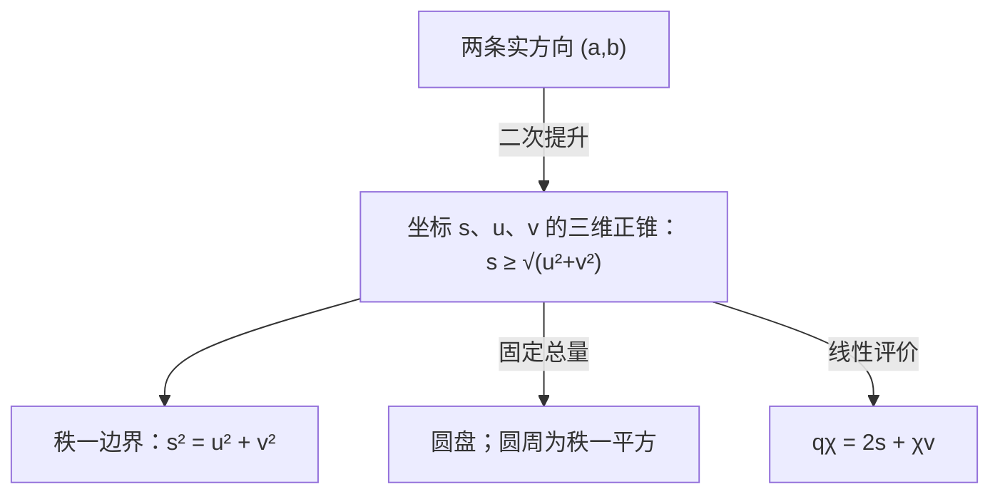
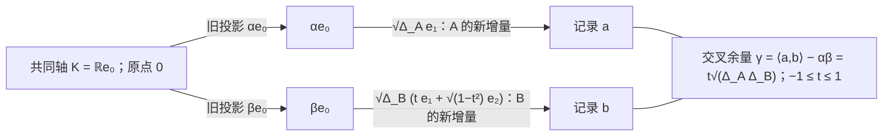

# 正反闭合：从有序记录到量子比较几何

> 来源：用户于 2026-11-05（Asia/Singapore）在本会话提供的 AURIC C136 LaTeX 研究工作稿；原稿未另署作者或模型。本文为参考输入，Lean 是仓库的数学真源；本次仅转换 Markdown，未作形式化认证。正文中的固定快照、项目核读叙述与理论结论均保留原稿口径；两幅 TikZ 图转换为 Mermaid 示意图。

AURIC C136\
无穷生成元、一条关系模式与观察者的未知交集\
一个候选；有序比较词；正性迫出的交换商；完整恢复边界\
固定源码：`0b9f2dda45b8`；2026 年 11 月 5 日 04:16:19（新加坡）

**本轮结论。** 新素数不断出现，并不迫使基本规则不断增加。这里还可以再退一步： 不把整份历史的读数预先定义成成对项的二次合计，甚至不先让比较词交换， 只给任意群 $G$ 上处处有限的非负自读 $q:G\to[0,\infty)$，要求

$$
\boxed{\quad q(uv)+q(uv^{-1})=2q(u)+2q(v)\qquad(u,v\in G).\quad}
 \tag{C136}
$$

群可以由原始记录的形式比较词构造；逆词表示对照方向反转。 它不预先代表实际设备的逆门，也不删除原档案的次序和括号。

该关系先使所有交换子在此自读中不可见，再给唯一的正双可加极化， 最后得到 $q(g)=\|F(g)\|^2$、$F(gh)=F(g)+F(h)$ 的最小实 Hilbert 表示。 因此二次型和可见交换律都从同一候选产生。 正反合计的方程属于经典二次函数理论；本轮不将标准定理改称新自然定律。 相对 C135，撤去的是预先写死的成对二次扩张； 相对仓内 C133 续篇 II，撤去的是预给可加相位标记，并允许原比较群先不交换。 这不是对仓内任意 magma 三相路线在所有前件上的严格净减弱。

**必须保留的两项自由。** 自读重建规范的对称比较，却不能恢复一张原始有向表的反对称部分。 全部相同自读的有向提升允许任意反对称项；只有另满足 C135 的提升，才把它限制成端点势差。 同样，两个观察者在共同读到的部分一致，并不决定全部真实交集。 两边剩余方向的全部合法互读，由一个收缩算子参数化；单位奇异方向恰对应未被局部数据排除的额外交集。

**公理怎样变成定义关系。** 把全部正反等式作为形式符号之间的关系，取正读口共同忽略的部分后， 得到 $\operatorname{Sym}^2(G_{\mathrm{ab}}\otimes_{\mathbb Z}\mathbb R)$。 同一有限关系模式容纳任意多生成元；实际比较几何仍由其上的正评价选择。 有限整数平方生成的锥与它的闭包须分开，数学完成也不自动供应全部实际准备。

**量子重构的准确范围。** 实际完整事件给效果；共同交换代数选出复数型后，平方投影与完整正评价给 Born 律和密度态。 保原比较与相位的细过程给 Kraus 仪器，独立全矩阵联合给张量，可逆连续过程给酉动力学。 各接口均在正文单独列明。若把 C136 直接施加于实际量子门的时间接续， 它会抹掉交换子；若自读还全局有界，则只能为零。这一反例限制了候选的物理归属。

**一句白话。** 把第二份对照正着接上一次、反着接上一次，两次读数合起来，关系的偏向相消，只剩原来两份量各两次； 这一条反复使用，就让比较长成平方几何。新内容可以继续增加，尚未读出的交叉关系也仍须保留。

## 1　最新前沿与本轮真正撤去的输入

本轮固定默认分支 `dev` 的 [`0b9f2dda45b8`](https://github.com/the-omega-institute/trureturing/commit/0b9f2dda45b880862865f2c34ba94bf8ff1063ee)： 提交时间为 2026 年 11 月 4 日 20:16:19 UTC，即新加坡时间 11 月 5 日 04:16:19。 相对 C135 的 `664de5498694`，比较端点返回全部 22 个新增可达提交和 107 个变更路径； 两个未截断的 `docs` 递归树只有三个文档文件发生变化。 本节核读了新增五点桥全文 260 行、C123 原卷新增 538 行和 FIB 边界卷新增 445 行。 这些读数界定来源范围，不表示对全部提交、全部旧依赖或 Lean 内核作了重新认证。

### 1.1　一元读数已有前驱，新的群入口也有经典来源

[C133 整数续篇定义 1.1、定理 2.1](https://github.com/the-omega-institute/trureturing/blob/0b9f2dda45b880862865f2c34ba94bf8ff1063ee/docs/develop/theory/AURIC_C133_THREE_READ_CLOSURE_VISIBLE_COMPLEX_GEOMETRY_CONTINUATION_II.md) 已经从阿贝尔历史群 $A$、有限非负一元读数 $q$ 和可加标记 $U$ 出发， 用三向式推出平行四边形关系、双可加正配对和最小复 Hilbert 表示。 因此，撤去预给二元形式、以整数为起点、极化和 Hilbert 完成本身，均不是本轮首次提出。

本轮进一步不预给比较词的交换律或相位标记，只在一个群 $G$ 上取有限 $q:G\to[0,\infty)$，要求

$$
q(uv)+q(uv^{-1})=2q(u)+2q(v).
$$

非负性将使交换子在这个读口中不可见，随后才取得可见阿贝尔化。 群运算在这里是*形式比较词的组合*；把它直接解释为实际量子门的时间串接，会遇到后文的退化反例。 原始有序记录仍保留，读数商不删除其身份。 这项原始签名缩减也不预留上一入口由 $U$ 选出的复方向，复数型须由后续实际关系确定。

群方程本身已有研究：de Place Friis–Stetkær， [*On the quadratic functional equation on groups*](https://doi.org/10.5486/pmd.2006.3270) 研究同一方程，其定理 1.2 归源于 Aczél 的阿贝尔群极化。 本稿区分这项成熟理论、非负入口的自含证明及本轮的关系包络与来源对应，不主张方程或极化的历史优先权。 对已取得的相关卷和新增文本作关键词、公式与上下文检索，未发现同一非负群入口的完整表述； 这只说明本次有界核读范围，不构成全仓或全文献不存在的结论。

### 1.2　无固定标记原点的五点桥：整体闭合仍须支付正性

新入库的 [《任意标记的五点正性桥梁与仿射复几何》](https://github.com/the-omega-institute/trureturing/blob/0b9f2dda45b880862865f2c34ba94bf8ff1063ee/docs/develop/theory/AURIC_C133_UNANCHORED_MARKER_FINITE_POSITIVITY_BRIDGE.md) 撤去了 C133 续篇 V 的 $U1=1$。其原数据仍有带双侧单位的任意 magma、任意 $U$、有限非负零对角 $c$，以及完整关系

$$
\sum_{k=0}^2c(a\cdot U^ku,b\cdot U^kv)
 =3c(a,b)+3c(u,v).\tag{R}
$$

定义 $\mathrm N_5$ 为对称性及*每个至多五标签配置*上的全部实零总量系数负型。 定理 1.3 在 (R) 下证明：$\mathrm N_5$、全部乘法四点缺陷属于双侧根空间、完整有限负型及下列仿射复表示等价：

$$
F1=0,\quad F(ab)=Fa+Fb,\quad F(Ua)=\omega Fa+t,\quad
 c(a,b)=\|Fa-Fb\|^2,\qquad t=F(U1).
$$

其中 $\omega=-\tfrac12+i\tfrac{\sqrt3}{2}$。 四点缺陷的自读先由三个非负项合计为零消去；加入第五标签的小实扰动，再消去每个交叉读口。 该文没有证明五点最优，也没有把所有五点配置缩成选定的五个样本。 任意深度的有限原配方仍在量词中，(R) 是局部条件通向整体的实际闭合前件。

原配方 $V_U(a)=U(a\cdot U^21)$ 在表示中给 $F(V_Ua)=\omega Fa$， 不需在原数据上另添减法。旋转中心 $t/(1-\omega)$ 未必是实际标签的像； 平移坐标使标记成为纯旋转时，聚合会带回相应常数项。 定理 6.2 的过程扩张明确限于输入、输出的*最小可见空间*， 每个实际事件核仍须自己的表示条件，实际参考执行仍须同记录接口。

尤其，问题 7.1 仍未证明 (R) 单独推出 $\mathrm N_5$。 本轮也没有解决这个缺口：若从任意原比较表定义

$$
Q_c(r)=-\tfrac12\sum_{x,y}r_xr_yc(x,y),\qquad \sum_xr_x=0,
$$

那么即使该二次型不定号，它也自动满足平行四边形恒等式。 本轮输入的非负性因而不能由这项恒等式倒推回任意原 $c$。 同样，自读不能恢复被遗忘的交替比较；后文将给出其完整恢复纤维。

### 1.3　原指针的一式标定与闭准备的统一近零入口

[C123 原卷新增 §§63–75](https://github.com/the-omega-institute/trureturing/blob/0b9f2dda45b880862865f2c34ba94bf8ff1063ee/docs/develop/theory/AURIC_NATIVE_RECIPROCAL_COMPARISON_AND_FINITE_ENDPOINT_QUANTUM_C123.md) 保持旧 3357 行为完整前缀。§§63–66 在定义 41.1 的*全部*非 $D$ 原背景、Z、SC 下，先不作标定而证明唯一共同 $\kappa\ge0$：

$$
J_d^2=-\kappa I_{W_d},\qquad
 [D_a,D_b]=-\kappa[L_a,L_b],\qquad
 W_d=E_{1/2}(d),\quad J_d=2D_d|_{W_d}.
$$

零分支使所有原 $D$ 为零；正分支使所有非经典原简单块成为复矩阵自伴块。 原标定进一步写成同一完整指针上的单式

$$
\mathrm{SJ}:\qquad D_d^2=L_d^2-L_d.
$$

它在该背景中与原 S、单对 S2 等价，恰选 $\kappa=1$； 完整 $D=t\delta$ 反事实族仍表明这个尺度不是定义自动固定的。 原 $W_d$ 成为 $\mathbb{CP}^{r-1}$ 的切空间，伙伴角为 $\mathbb{CP}^{r-2}$； 三维 Pauli 截面嵌在更大射影几何中，不自动供应实际角对象。

§§67–75 另命名闭准备背景 $\mathsf B_{\rm cl}$， 将每个所需原对象及实际联合的精确有限正准备生成改为 $\overline{\operatorname{cone}(\mathcal P_A)}=C_A^*$， 并加入同一原关系的统一证书

$$
|\alpha(D_ax)|^2\le K(A,a)\alpha(x)\alpha(u_A)
 \quad(\alpha\in\mathcal P_A,\ 0\le x\le u_A).
$$

$K(A,a)$ 有限，且独立于准备、效果与逼近指标。 在保单位已由原联合接口独立供应后，定理 68.1 使这个证书等价于同一原算子的保单位序导子性质； 反向可取 $K(A,a)=\|(D_a)^2\|_{u_A\to u_A}$。 闭生成而只检查实际零接触不够：正文的二维正锥反例给比值 $t^2/(1-t)\to\infty$。

原 AC、比较群、X/Xs、全事件 R、原记录和返回等接口仍按各自完整范围保留。 加入 SC 与逐字原标定后，新背景接回有限复重构、原质量 Born 评价、已声明联合及全事件 CP。 这是*闭生成加统一近零*对*精确有限生成加零接触*的前提交换， 没有把旧候选改名，也没有证明全体物理假设或实际认证成本无条件减少。 这条最新路线说明：逼近整体时，准确零关系有时必须升级为跨所有逼近的统一数量约束。

### 1.4　同一原来源的有限共同实现，仍有准确余量

第三项变更是 [FIB 边界几何附录 III 新 §153](https://github.com/the-omega-institute/trureturing/blob/0b9f2dda45b880862865f2c34ba94bf8ff1063ee/docs/develop/theory/FIB_ATOM_RECURSIVE_HOLOGRAPHIC_BOUNDARY_GEOMETRY_CONTINUATION_III_APPENDIX_III.md)。 在定义 153.1 完整继承的原 $H^1\times\mathbb R$ 来源、完整算子和分析供应下， 定理 153.2 构造*同一个*整个原空间上的 Borel 四分割， 同时达到全部原边缘、全部有序两时标签概率，以及 $013,103,031$ 三个有序三元系数。 其三元余量属于 $H_0^{\otimes3}$，27 个环境坐标中只消去了指定三个，另外 24 个尚未指定； 这不宣称它们非线性独立或可共同达到。原完整 64 个联合方程仍保留全部量词。 本次核读了该新增证明，没有重新认证所有继承分析供应。

**白话。** 仓库正在同时做两件清楚的事：把比较入口往前退，也把原来未付清的整体相容条件接回来。 这一轮再退一步，只问一份有序比较词和它的反向配合怎样改变自读；互读、可见交换与平方几何随后出现。 但已有数值表中的负方向，不能靠把它改叫“自读”而消失；原始相位、记录、完整联合与实际读口也各有来源。 公式可以更短，留下的关系必须仍然足够说明究竟压掉了什么、保留了什么。

## 2　唯一候选：先给自读，再由二元闭合产生互读

本轮保留完整原历史标签，允许它们生成一个自由的形式比较词群， 或使用来源已指定的任意群 $G$。群不预设交换；单位 $e$ 是空比较， 逆元是形式反向比较，并不因此供应物理逆门。 原始读数只有一个处处有限的 $q:G\to[0,\infty)$， 暂不指定二元形式、相位标记或实数准备。 标签内部的时序、括号和档案仍然保留。

#### 定义 2.1：C136：二向分合不留下额外自读

对任意两份形式比较 $r,s\in G$，要求

$$
\boxed{\quad q(rs)+q(rs^{-1})=2q(r)+2q(s).\quad}
 \tag{C136}
$$

非负值域是明确保留的来源前件；唯一额外关系是上述等式。

这条关系是经典二次函数方程的群版本[\[6\]](#ref-jordan1935), [\[7\]](#ref-friis2006)。相对 C133 续篇 II，本轮撤去原加性相位标记 $U$， 也不预设比较群交换：交换性将在读数的可见商上产生。 相对 C135，本轮也不再预先用原二元表作双线性求和； 完整历史的自读是否只含二次关系，现在要由等式检验。 这些是原始签名和来源边界的回溯，不是对经典表示定理的优先权主张。

### 2.1　完整表示与零关系的语境闭合

#### 定理 2.2：全部自读模型

C136 成立，当且仅当存在实 Hilbert 空间 $H$ 和群同态 $T:G\to(H,+)$，使

$$
q(r)=\|Tr\|^2.
$$

取 $\overline{\operatorname{span}_\mathbb RT(G)}=H$ 时，表示在保持所有 $Tr$ 的线性等距意义下唯一。 特别地，$q$ 通过阿贝尔化 $A=G/[G,G]$ 因子化。 将 $A$ 写成加法群后，唯一的规范互读为

$$
b(\bar r,\bar s)=\frac{q(rs)-q(rs^{-1})}4
       =\frac{q(rs)-q(r)-q(s)}2;
$$

它对称、各槽加性、正半定，并满足 $b(\bar r,\bar r)=q(r)$。

**证明。**

在 C136 中依次取 $r=s=e$、$r=e$、$r=s$，得到 $q(e)=0$、$q(r^{-1})=q(r)$、$q(r^2)=4q(r)$。 对比 $(r,s)$ 与 $(s,r)$ 的等式，注意 $q(sr^{-1})=q(rs^{-1})$，得到 $q(rs)=q(sr)$。

令 $[r,s]=rsr^{-1}s^{-1}$。把 C136 用于 $rs,r^{-1}s^{-1}$， 利用上述循环交换读数，得到

$$
q([r,s])+q(r^2s^2)=4q(rs).
$$

再将 $s$ 换成 $s^{-1}$，两式相加，并将 C136 用于 $r^2,s^2$，即得

$$
q([r,s])+q([r,s^{-1}])=0.
$$

两项非负，故任一交换子 $c$ 均满足 $q(c)=0$。 对任意 $g$，序列 $a_n=q(gc^n)$ 满足 $a_{n+1}+a_{n-1}=2a_n$，因而是 $n\in\mathbb Z$ 的仿射函数。 其处处非负迫使斜率为零，所以 $q(gc)=q(g)$。 逐个去掉交换子及其逆元，证明 $q$ 通过 $A$ 因子化。

现在在 $A$ 上采用加法记号。定义式给 $b$ 对称且各槽为奇，再由 C136 得

$$
b(r+s,t)+b(r-s,t)=2b(r,t).
$$

交换 $r,s$ 并用奇性，得到 $b(r+s,t)-b(r-s,t)=2b(s,t)$；两式相加即得加性。 因而 $q(nr)=n^2q(r)$，且有限整数和的自读等于其 Gram 二次式。

令 $V=A\otimes_\mathbb Z\mathbb R$。加性形式 $b$ 唯一延伸为 $V$ 上的实双线性形式。 对任意固定有限元族，有理系数二次式可清除分母，归结为某个整数清单的非负自读； 再用有限多项式的连续性得到实系数正性。商掉零空间并完成即得 $H,T$。 这里没有要求原群可除，也没有供应实际分数或实数准备。 极化式确定全部向量间的内积，故最小表示唯一。 反向由 Hilbert 空间的平行四边形恒等式立即成立。

$\square$

这个实 Hilbert 载体由整数关系实化构造。若原来源另有实数缩放或拓扑， 本定理不自动证明 $T$ 保持它们。 例如任意不连续的加性函数 $h:\mathbb R\to\mathbb R$ 给 $q(x)=h(x)^2$， 满足加法群上的 C136，却未必相对原来的实缩放二次齐次。 原缩放、连续性或时间标定仍须自己的来源关系。

#### 推论 2.3：一个零差锁定全部加性语境

在 C136 下，

$$
q(rs^{-1})=0
 \quad\Longleftrightarrow\quad
 q(arb)=q(asb)\quad\text{对所有 }a,b\in G.
$$

零自读集合是正规子群，且其像与任意比较的规范互读均为零。 若一组已声明的定义词 $m_\alpha$ 自读为零， 则它们生成的正规关系在所有左右比较语境中均不可区分。

**证明。**

由表示定理，$q(rs^{-1})=0$ 恰为 $Tr=Ts$，故加上两侧的 $Ta,Tb$ 后范数相等。 反向取 $a=e,b=s^{-1}$。零集合是 $\operatorname{ker}T$，并有 $b(m,u)=\langle Tm,Tu\rangle=0$；生成关系的结论随加性得到。

$\square$

这把“定义相等后还要逐个检查所有比较语境”收为一个可证明的闭合结论。 它只涉及所定义的比较接口，不把原档案本身或其他实际读口一并商掉。 同时，有限阶元与所有有界重复方向必不可见： $r^n=e$（$n\ne0$）或 $\sup_{n\in\mathbb Z}q(r^n)<\infty$ 均迫使 $q(r)=0$。 所以本轮 $q$ 是未归一自读，不能令所有整数重复的 $q$ 都是零到一之间的概率。 若 $G=[G,G]$，则全部 $q$ 为零。若把此律直接施加于有限阶物理门的时间复合， 这些门也都会被判为零；因此不能把形式比较词的合成与一般量子门时间复合等同。

#### 命题 2.4：非负性的来源不能省略

若仅给实值 $q$ 和 C136 等式，则 $q\ge0$ 等价于： 对每个 $r$，序列 $\{q(r^n):n\in\mathbb Z\}$ 有实下界。 在阿贝尔群上，不带正性的全部模型是任意对称双加性形式的对角。

**证明。**

将群等式用于 $r^n,r$，由 $q(e)=0$ 得递推解 $q(r^n)=n^2q(r)$。 若 $q(r)<0$，重复便趋于负无穷；反向非负自明。 阿贝尔群上的极化证明不使用正性；例如 $q(n)=-n^2$ 满足等式而不能给正几何。

$\square$

因此，可以把非负性替换成重复时有下界的稳定条件， 但日志份数递增本身并不证明这项数值条件。

### 2.2　三份历史、二次关系和真正的较高阶自由

#### 定理 2.5：第三差分的精确边界

在导出的阿贝尔群 $A$ 上，对任意实值 $f:A\to\mathbb R$，定义

$$
\begin{split}
 I_3(r,s,t)={}&f(r+s+t)-f(r+s)-f(r+t)-f(s+t)\\
             &+f(r)+f(s)+f(t)-f(0).
\end{split}
$$

全部群三元组满足 $I_3=0$，当且仅当

$$
f(r)=f(0)+B(r,r)+\ell(r),
$$

其中 $B$ 对称双加性，$\ell$ 加性。 因此再有 $f(0)=0$ 和 $f(-r)=f(r)$，才恰得到 C136 的等式。

**证明。**

令 $d(r,s)=f(r+s)-f(r)-f(s)+f(0)$。 计算得 $d(r+s,t)-d(r,t)-d(s,t)=I_3(r,s,t)$。 故 $I_3=0$ 恰使对称的 $d$ 双加性。 取 $B=d/2$、$\ell(r)=f(r)-f(0)-B(r,r)$，后者的加性差为零。 反向逐项展开即可。偶性消去 $\ell$，零点值消去常数。

$\square$

非负性在整数群上不能代替偶性： $f(n)=n^2+n$ 处处非负，全部第三差分为零，却有 $f(1)=2,f(-1)=0$。 这时自读为零的 $-1$ 在加性语境中不再保持零差。 若另外固定 $f(0)=0$，并供应任意整数分母的根比较， 则 $f(\pm r/n)\ge0$ 给 $|\ell(r)|\le B(r,r)/n$，迫使线性项为零； 自由整数清单本身没有这项供应。

三阶干涉的消失与量子测度层级已有标准关系[\[8\]](#ref-sorkin1994)。 这里要从“没有三阶缺口”取得全群正几何，仍必须量化任意群清单。只对互不相交事件检查时， 令

$$
D=\begin{pmatrix}1&2&0\\2&1&0\\0&0&1\end{pmatrix},
 \qquad \mu(A)=\boldsymbol1_A^{\mathsf T}D\boldsymbol1_A
 \quad(A\subseteq\{1,2,3\}).
$$

全部 $\mu(A)$ 非负，互不相交事件的第三差分也为零， 但 $(e_1-e_2)^{\mathsf T}D(e_1-e_2)=-2$。 有限事件子集上的二阶加性不能替代全部带符号比较上的正性。

#### 例 2.6：原子距离相同，完整历史自读仍可不同

两个原标签的配平群为 $\mathbb Zg$。取 $\epsilon>0$，

$$
q_0(ng)=n^2,\qquad
 q_\epsilon(ng)=n^2+\epsilon n^2(n^2-1)^2.
$$

两者有限、非负、偶，且在 $0,\pm g$ 上完全相同。 因而全部两标签原子差的距离相同。 但 $q_\epsilon(2g)=4+36\epsilon$，违反 $q(2g)=4q(g)$，不能来自同一二次比较。 其 $I_3(g,g,g)=468\epsilon$ 也直接见证较高阶自由。

更一般地，对任意有限查询整数集，令 $M$ 包含其非零绝对值，并设

$$
\widetilde q(n)=n^2+\epsilon n^2\prod_{m\in M}(n^2-m^2)^2.
$$

若 $M$ 为空可先加入 $1$。此函数在全部已查询点与 $n^2$ 相同， 却是更高次数的非负偶多项式，故不满足 C136。 有限查询不能认证这个无界全称关系；已知的有限呈示或公式约束则是另外的来源数据。

### 2.3　自读能恢复什么原始有向表

为与 C135 在同一原表上精确比较，本小节取阿贝尔特例 $A=L_0(X)=\{r\in\mathbb Z^{(X)}:\sum r_x=0\}$。 这是一般群定理的一个应用，并不要求原历史标签的内部时间复合可交换。 由满足 C136 的 $q$ 定义规范原子距离

$$
d_q(x,y)=q(\delta_x-\delta_y).
$$

它是 Hilbert 平方距离，允许不同原标签在当前读口下重合。 对任意处处有限、零对角的原有向表 $c$，仍定义

$$
R_c(r,s)=-\frac12\sum_{x,y}r_xs_yc(x,y),
 \qquad Q_c(r)=R_c(r,r).
$$

#### 定理 2.7：全部原表纤维与旧预算的精确子纤维

原表满足 $Q_c=q$ 当且仅当

$$
\boxed{c(x,y)=d_q(x,y)+a(x,y),\qquad a(y,x)=-a(x,y).}
$$

这里 $a$ 可以是任意有限反对称表。 其中满足 C135 全部互读预算的表，恰为

$$
\boxed{c(x,y)=d_q(x,y)+h(y)-h(x).}
$$

等价地，$a$ 的每个三角环量 $a(x,y)+a(y,z)+a(z,x)$ 为零。

**证明。**

以 $r=\delta_x-\delta_y$ 评价 $Q_c=q$，得到 $(c(x,y)+c(y,x))/2=d_q(x,y)$，即第一种形式。 反向反对称项在 $\sum r_xr_ya(x,y)$ 中相消； 平方距离表示与配平条件又给 $Q_{d_q}=q$。

若旧预算成立，将 $ng+h$ 与 $ng$ 对比，可得 $q(h)+n(R_c(g,h)-R_c(h,g))\ge0$ 对所有整数 $n$ 成立， 从而 $R_c$ 对称。 取 $g=\delta_x-\delta_z,h=\delta_y-\delta_z$， 得到三角环量为零。选临时锚 $o$，令 $h(x)=a(o,x)$， 三角式给 $a(x,y)=h(y)-h(x)$。 反向端点项在配平互读中相消，留下正形式 $b$， 预算余量就是 $q(r-s)\ge0$。

$\square$

若 $1\le |X|=n<\infty$，固定同一个 $q$ 后，全部原表纤维维数为 $n(n-1)/2$；C135 相容的端点子纤维维数为 $n-1$。 两者之差

$$
\frac{(n-1)(n-2)}2
$$

就是自读未定的独立环量数。以 $o$ 为锚，可用

$$
\kappa_o(x,y)=a(x,y)+a(y,o)+a(o,x)\qquad(x,y\ne o)
$$

作这些坐标。减去 $h(y)-h(x)$ 后，所有连向 $o$ 的边为零， 剩余边恰为 $\kappa_o$，故坐标独立且完备。 端点改记不能改变这些三角环量。

#### 例 2.8：所有原费用为正，自读也正，仍存在环量

取三个原标签 $0,1,2$，非对角 $d_q=1$， 令 $a(0,1)=a(1,2)=a(2,0)=\epsilon$， 反向为 $-\epsilon$，其中 $0<\epsilon<1$。 全部非对角 $c=d_q+a$ 都正，而 $Q_c(r)=\tfrac12\sum_{i=0}^2r_i^2$ 对 $\sum r_i=0$ 成立。 但是三角环量为 $3\epsilon$。 取 $g=\delta_0-\delta_2,h=\delta_1-\delta_2$， 旧预算对 $ng+h,ng$ 的余量是 $1-3n\epsilon$； 任一整数 $n>1/(3\epsilon)$ 就给出有限反证。

因此，自读重建规范互读，不等于证明每个既有互读恰为该规范形式。 C136 的未标相位前体保留全部原 $a$ 档案； 若目标还要求原表满足 C135，就必须证明环量为零，不能用更换比较表代替。

**白话。** 先只问一份完整比较历史有多少自读，再把两份比较同向接起来、反向接起来。两次合读的总量若始终等于各自自读总量的两倍，换序的缺口就会在这个读口下消失，互读和平方距离才由此确定。一个零差随后在所有左右比较里都保持为零，定义替换不再需要每个语境另立规则。但原来从甲到乙、从乙到甲的有向账本，还可能绕三角留下一笔环量；自读看不见它，必须原样保留并另行检验。

## 3　把关系模式收成一个通用二次包络

上一节给出了每一张自读表的表示。现在把所有可能的自读表一起组织， 精确回答“是否每发现一个新内容就要增加一条新公理”。

#### 定义 3.1：原关系包络及其共同可见商

对任意群 $G$，先给每个 $g\in G$ 一个形式实向量符号 $\langle g\rangle$， 再只商去同一种线性关系

$$
\langle gh\rangle+\langle gh^{-1}\rangle
 -2\langle g\rangle-2\langle h\rangle=0.
$$

所得原实向量空间记为 $\mathcal E(G)$。 令 $\mathcal C$ 为全部 $\langle g\rangle$ 的有限非负实组合锥， 并定义

$$
\mathcal C^*=\{\lambda\in\mathcal E(G)^*:\lambda(\mathcal C)\ge0\},
 \quad
 \mathcal I=\bigcap_{\lambda\in\mathcal C^*}\operatorname{ker}\lambda,
 \quad
 \mathcal U(G)=\mathcal E(G)/\mathcal I.
$$

$\mathcal U(G)$ 只商去所有相容正评价共同不可见的方向。 符号的数量可以无穷，原关系模式只有这一种。

#### 定理 3.2：关系包络的完整识别

令 $V=G_{\mathrm{ab}}\otimes_\mathbb Z\mathbb R$，则有规范同构

$$
\boxed{\mathcal U(G)\cong\operatorname{Sym}^2_\mathbb R(V),\qquad
 \langle g\rangle+\mathcal I\longmapsto \bar g_\mathbb R\odot\bar g_\mathbb R,}
$$

其中 $u\odot v=(u\otimes v+v\otimes u)/2$。 满足 C136 的自读表，恰为这个包络上在全部 $\langle g\rangle+\mathcal I$ 上非负的实线性泛函。 若 $\dim_\mathbb RV=m<\infty$，则 $\dim_\mathbb R\mathcal U(G)=m(m+1)/2$。

**证明。**

阿贝尔化后的平方张量满足原关系，给出线性映射 $\pi:\mathcal E(G)\to\operatorname{Sym}^2(V)$。 群像 $\bar g_\mathbb R$ 张成 $V$；对任意 $g,h$， $`\pi(\langle gh\rangle-\langle g\rangle-\langle h\rangle)
=2\bar g_\mathbb R\odot\bar h_\mathbb R`$，故 $\pi$ 满。 任意自读 $q$ 唯一延伸为自由符号空间上的线性泛函； 它能下降到 $\mathcal E(G)$ 恰好是 C136 等式， 在全部 $\langle g\rangle$ 上非负恰好是 $q\ge0$。 表示定理 2.2 说明每个这样的正泛函 均由 $V$ 上的正半定形式通过 $\pi$ 拉回，故 $\operatorname{ker}\pi\subseteq\mathcal I$。

若 $z\notin\operatorname{ker}\pi$，则非零对称张量 $\pi z$ 的全部分量落在某个有限维子空间中。 存在实线性函数 $\ell$，使 $(\ell\otimes\ell)(\pi z)\ne0$： 在有限基下，这就是说一个非零实二次多项式不能处处为零。 将 $\ell$ 线性延伸到 $V$，其秩一形式 $B(u,v)=\ell(u)\ell(v)$ 非负，拉回便得某个 $\lambda\in\mathcal C^*$ 满足 $\lambda(z)\ne0$。 故 $\mathcal I\subseteq\operatorname{ker}\pi$。两者相等，得到同构及泛函刻画。 最后，$m$ 维空间的对称平方有对角 $m$ 项和交叉 $m(m-1)/2$ 项。

$\square$

若 $G$ 本身阿贝尔，向量值极化 $\mathcal B(g,h)=(\langle g+h\rangle-\langle g-h\rangle)/4$ 直接给 $\mathcal E(G)\cong\operatorname{Sym}^2(G\otimes\mathbb R)$， 此时 $\mathcal I=0$。对一般群，上述同构针对共同可见商； 没有把未经正评价商的原 $\mathcal E(G)$ 预先认作对称平方。 单个实际 $q$ 还可能看不见更多方向，须再保留自己的零空间。

#### 例 3.3：正评价商确实排除了原等式未排除的方向

令 $G=\mathbb Z^3\times\mathbb Z^3$，以三维叉积定义

$$
(x,z)(y,w)=(x+y,z+w+x\times y).
$$

叉积双线性直接给结合律，单位为 $(0,0)$，逆元为 $(-x,-z)$。 实值函数 $f(x,z)=x\cdot z$ 满足群二次等式： 展开 $f(gh)$ 与 $f(gh^{-1})$ 时，叉积项均因垂直于 $x,y$ 而消失。 但是 $f$ 可以为负，也不通过阿贝尔化因子化。 具体取

$$
a=(e_1,0),\quad b=(e_2,0),\quad
 c=[a,b]=(0,2e_3),\quad g=(e_3,0).
$$

则 $f(g)=0$ 而 $f(gc)=2$。 三个基方向还给 $f(abg)=1$、$f(agb)=-1$，尽管各单项和各两项合成都读零； 第三项的换序暴露了相反符号的余量。 所以 $\langle gc\rangle-\langle g\rangle$ 在原 $\mathcal E(G)$ 中非零； 全部非负解却由表示定理给其读数为零，故它属于 $\mathcal I$。 这说明先保留原关系，再商去共同不可见方向的步骤有实际数学内容。

具体地，在阿贝尔化后的有限自由窗口中，对基 $e_1,\ldots,e_m$ 和整数 $n_i$， 共同可见符号都有正常式

$$
\left\langle\sum_i n_ie_i\right\rangle
 =\sum_i n_i^2\langle e_i\rangle
 +\sum_{i<j}n_in_j
 \bigl(\langle e_i+e_j\rangle-\langle e_i\rangle-\langle e_j\rangle\bigr).
$$

因此，给定这条全称关系后，不需要为三项、四项、五项历史各加一套读数法则。 它们共享同一个二次包络。但实际采用哪个正线性泛函，仍是数值来源的选择。

#### 命题 3.4：源定义关系在包络中一次闭合

若 $M\triangleleft G$ 由指定定义词 $m_\alpha$ 正规生成，则满足 C136 且 $q(m_\alpha)=0$ 的全部自读，恰好是 $(G/M)_{\mathrm{ab}}\otimes_\mathbb Z\mathbb R$ 上的正半定对称双线性形式的对角，拉回到 $G$ 后的结果。 在共同可见二次包络中，这等价于将 $M$ 在 $V$ 中的实像 与任意方向的对称乘积全部置零。

**证明。**

推论 2.3 使 $M\subseteq\operatorname{ker}T$， 故 $T$ 通过 $G/M$ 因子化，相应形式通过其阿贝尔化的实张量空间。 反向拉回任意这样的正形式即满足所有要求。 线性商 $V\to V/\operatorname{span}_\mathbb RM$ 在对称平方上的核由 $m\odot v$ 张成，给出包络表述。

$\square$

正性在这里有实质作用：若省去它，不定形式可以让 $B(m,m)=0$ 而 $B(m,v)\ne0$，零自读定义差便会在其他比较中重新显现。 同时，张量实化会消去 $(G/M)_{\mathrm{ab}}$ 的挠元；这说明实数平方读口对哪些来源关系不可分， 并不删除原档案。

### 3.1　二元关系的精确三维提升：一个平方锥

在导出的实二维比较平面中，取向量坐标 $(a,b)$。它在通用二次包络中的像是

$$
M(a,b)=\begin{pmatrix}a^2&ab\\ab&b^2\end{pmatrix}.
$$

两条一阶坐标及其关系恰给三条二阶坐标 $a^2,ab,b^2$。 令

$$
s=\frac{a^2+b^2}{2},\qquad u=\frac{a^2-b^2}{2},\qquad v=ab,
$$

便有 $s\ge0$、$s^2=u^2+v^2$。 允许正组合和数学完成后，全部实正半定矩阵恰为

$$
M=\begin{pmatrix}s+u&v\\v&s-u\end{pmatrix},
 \qquad \boxed{s\ge\sqrt{u^2+v^2}.}
$$

证明只需其特征值 $s\pm\sqrt{u^2+v^2}$。 这个三维圆锥的边界是秩一平方，内部是正定组合； 固定 $\operatorname{Tr}M=1$ 即 $s=1/2$，得到圆盘 $u^2+v^2\le1/4$，秩一部分是其圆周。 原整数平方锥与这个完成后的圆锥的区别，将在下一小节精确分类。

**图 1：** 两条实方向的二次关系形成三维正锥。固定总量得到圆盘，边界对应单一实平方。 图中纵轴是自读总量坐标，未被解释成物理时间；圆锥中的线性评价给原平面中的二次读数。

最初的表达式现在有精确位置：

$$
q_\chi(a,b)=a^2+\chi ab+b^2
 =\operatorname{Tr}\left[\begin{pmatrix}1&\chi/2\\\chi/2&1\end{pmatrix}M(a,b)\right]
 =2s+\chi v.
$$

交叉项 $ab$ 对原两坐标是双线性的，对提升后的第三坐标 $v$ 则是线性读出。 系数矩阵的特征值为 $1\pm\chi/2$，所以全域非负恰为 $|\chi|\le2$。 原平面等值集 $q_\chi=1$ 在 $\chi=0$ 时为圆，$0<|\chi|<2$ 时为椭圆， $\chi=\pm2$ 时退化成 $a\pm b=\pm1$ 两条平行直线。 若圆指的是准备归一化 $a^2+b^2=1$，这个圆当然继续保留； 在其上 $\chi=2$ 的正规化效果读数为 $(a+b)^2/2$，正是沿 $45$ 度射线的投影平方。 一般取 $E_\chi=\tfrac12\left(\begin{smallmatrix}1&\chi/2\\\chi/2&1\end{smallmatrix}\right)$， 则 $|\chi|\le2$ 时 $0\le E_\chi\le I$。

若另外供应与实际事件相容的复结构，二阶复 Hermitian 矩阵还含一个虚交叉坐标：

$$
M_{\mathbb C}=\begin{pmatrix}s+u&v-iw\\v+iw&s-u\end{pmatrix},
 \qquad M_{\mathbb C}\ge0\iff s\ge\sqrt{u^2+v^2+w^2}.
$$

这是四维实正锥，迹一截面为三维 Bloch 球； 实二维的三维锥本身没有自动供应新增的相位坐标 $w$。

### 3.2　整数可生成的正锥，与完成后的正锥

在阿贝尔化后的有限自由窗口 $\mathbb Z^m$ 中，将包络表示为实对称矩阵，定义原整数平方锥

$$
\mathcal C_\mathbb Z=
 \left\{\sum_{j=1}^k\lambda_jz_jz_j^{\mathsf T}:
 k<\infty,\ \lambda_j\ge0,\ z_j\in\mathbb Z^m\right\}.
$$

这个锥已经允许非负实系数，但尚未取极限。 不能把它与全部正半定矩阵未经证明地等同。

#### 定理 3.5：原整数平方锥的精确边界

有限维中，

$$
\boxed{\mathcal C_\mathbb Z
 =\{A\ge0:\operatorname{Ran}A\text{ 有一组有理向量基}\},\qquad
 \overline{\mathcal C_\mathbb Z}=\operatorname{Sym}^+_m(\mathbb R).}
$$

特别地，全部正定矩阵都在原锥中，但某些秩一正矩阵只在闭包中。

**证明。**

若 $A=\sum_j\lambda_jz_jz_j^{\mathsf T}$，删去零系数后， $\operatorname{ker}A$ 恰为全部 $z_j$ 的共同正交补，故其像由整数向量张成。

反之，若 $A\ne0$ 的像有有理基，将这些基列成满列秩有理矩阵 $S$。 存在实正定矩阵 $B$，使 $A=SBS^{\mathsf T}$： 可取 $L=(S^{\mathsf T}S)^{-1}S^{\mathsf T}$， $B=LAL^{\mathsf T}$。 选择有理可逆矩阵 $T$ 充分接近 $B^{1/2}$，则 $D=T^{-1}BT^{-\mathsf T}$ 充分接近单位矩阵，从而严格对角占优。 它有显式正分解

$$
\begin{split}
 D={}&\sum_i\left(D_{ii}-\sum_{j\ne i}|D_{ij}|\right)e_ie_i^{\mathsf T}\\
 &+\sum_{\substack{i<j\\D_{ij}\ne0}}|D_{ij}|
 (e_i+\operatorname{sgn}(D_{ij})e_j)
 (e_i+\operatorname{sgn}(D_{ij})e_j)^{\mathsf T}.
\end{split}
$$

乘回 $ST$ 后，出现的向量均为有理向量，逐项清除分母即可成为整数平方的正组合。 $A=0$ 取空和。 最后，$A+\varepsilon I$ 正定而在原锥中，令 $\varepsilon\downarrow0$ 即得全部正半定闭包。

$\square$

例如 $(1,\sqrt2)^{\mathsf T}(1,\sqrt2)$ 是正半定秩一矩阵， 其像是一条没有非零有理向量的直线，故不属于 $\mathcal C_\mathbb Z$。 它仍可由原锥中的矩阵逼近。 因此，原有限整数组合、数学完成和实际可制备集合必须分别记录。

有限维线性泛函连续，故在 $\mathcal C_\mathbb Z$ 上非负当且仅当在其闭包上非负。 以迹配对表示后，它恰对应一个正半定 Gram 矩阵。 这解释了为什么只把整数清单作为输入，仍能得到完整实正几何的数学表示； 它不把闭包中的每一点自动加入实际准备菜单。

**白话。** 现在可以先不选一张具体几何图，只把每份历史放进同一种关系模板。两份历史的分合关系会把所有读数符号收成一个二次包络：里面可以有无穷多个方向，但没有每增加一个方向就增加一种新算式。真正的读口，是在这个包络上选一份非负评价。定义相等的零差会连同它在全部比较中的影响一起归零；仍未指定的数值评价，则继续保留为不同可能的几何。

## 4　素数坐标的全部二次几何与无穷发现

### 4.1　乘法群给出无限生成元，不指定唯一度量

取正有理数的乘法群 $G_{\mathrm{arith}}=\mathbb Q_{>0}^{\times}$。 唯一分解给群同构

$$
\nu:G_{\mathrm{arith}}\longrightarrow\bigoplus_{p\in\mathcal P}\mathbb Z,
 \qquad \nu(r)=(v_p(r))_{p\in\mathcal P},\qquad \nu(rs)=\nu(r)+\nu(s).
$$

每个向量只有有限支撑；负指数表示分母，未引入无限素数乘积。 本轮候选在这一实际算术例子中写成

$$
q(rs)+q(r/s)=2q(r)+2q(s).
$$

素数是乘法群的一组生成元，故它们不是同一维数下不断增加的新公理。 欧几里得的一个固定证明步骤已经保证生成元不能由任何有限素数表穷尽[\[9\]](#ref-euclid)。

#### 定理 4.1：所有算术二次读数

$G_{\mathrm{arith}}$ 上满足 C136 的有限非负函数，恰好由素数集合上的实对称正半定核 $\Gamma$ 给出：

$$
q(r)=\sum_{p,s\in\mathcal P}v_p(r)v_s(r)\Gamma_{ps}.
 \tag{4.1}
$$

这里正半定指每个有限主矩阵正半定；所有和均有限。 核唯一，且

$$
\Gamma_{ps}=\frac{q(ps)-q(p/s)}4.
$$

**证明。**

由核心表示定理，$b$ 是指数群上的正双可加型，令 $\Gamma_{ps}=b(e_p,e_s)$。 双可加展开得到 (4.1)。对任意有限整数向量的非负性，经有理清分母和有限多项式连续性给实 Gram 正性。 反向以任意这样的核定义 $q$，平方展开直接给候选及非负性。极化公式给唯一性。

$\square$

因此，素数的乘法定义只指定坐标如何相加；比较读口还要指定 $\Gamma$。 例如 $\Gamma_{ps}=\delta_{ps}$ 给无穷多正交方向， 而 $\Gamma_{ps}=(\log p)(\log s)$ 给一维读数 $q(r)=(\log r)^2$。 两者在整数指数群上的零元都只有 $r=1$；后者的实完成却是一维。 这是由于实系数允许新的线性关系，并非同一完整数值表有两个不同的最小表示。

### 4.2　哪条额外关系真正迫出素数正交

#### 定理 4.2：互素合成可加的精确含义

在定理 4.1 的全部模型中，下列两条件等价：

1.  对所有互素正整数 $m,n$，$q(mn)=q(m)+q(n)$；

2.  对不同素数 $p\ne s$，$\Gamma_{ps}=0$。

此时存在任意非负权重 $w_p$，使

$$
q(r)=\sum_pw_pv_p(r)^2.
$$

若每个 $w_p>0$，最小比较空间必为无限维。

**证明。**

对不同素数应用第一条件，并用 (4.1)，得 $2\Gamma_{ps}=0$。 反向互素正整数的素数支撑不交，所有交叉项消失。 正性给 $w_p=\Gamma_{pp}\ge0$；若全部严格为正，任意有限组素数像都非零且正交，维数无上界。

$\square$

所以“每个新素数增加独立方向”的图像可以被精确证明， 但其中承担独立性的是*互素合成在这个读口中可加*。 一维对数平方读口满足 C136，却不满足该附加关系：

$$
q(mn)-q(m)-q(n)=2\log m\log n>0\qquad(m,n>1).
$$

算术没有因此矛盾；不同读口在测不同的关系。

#### 命题 4.3：素数重命名不变仍不能唯一选出度量

若 C136 读数在任意有限素数置换下不变，则恰有两个参数 $\alpha,\beta\ge0$，使

$$
q(r)=\alpha\sum_pv_p(r)^2+\beta\left(\sum_pv_p(r)\right)^2.
$$

若再令每个素数 $q(p)=1$，则 $\alpha+\beta=1$，仍有一整段选择。 再加互素合成可加，才得到 $\beta=0$、$\alpha=1$。

**证明。**

置换不变性使核的对角恒为 $a$、非对角恒为 $b$。 每个 $n$ 阶主矩阵为 $(a-b)I_n+b\mathbf1\mathbf1^{\mathsf T}$。 二阶差方向给 $a-b\ge0$；全一方向对任意 $n$ 给 $a+(n-1)b\ge0$，因此 $b\ge0$。 取 $\alpha=a-b,\beta=b$ 即得；反向二项均为正半定形式。 归一与互素结论直接代入。

$\square$

当 $\alpha>0$ 时仍有无限维独立部分；当 $\alpha=0,\beta>0$ 时所有素数在此读口中同像，只有一维。 这显示对称性可以显著压缩参数，但没有自动给出互不相关性。 任意素数置换在这里是乘法来源的额外对称；它通常不保持整数加法，不能当成完整算术已经具有的对称。

### 4.3　同一条延伸式可以被使用无限次

对已知有限 Gram 矩阵 $G\succeq0$，新方向的交叉列为 $b$、自读为 $d$。 其正延伸的完整条件仍是

$$
\begin{pmatrix}G&b\\b^{\mathsf T}&d\end{pmatrix}\succeq0
 \quad\Longleftrightarrow\quad
 b\in\operatorname{Ran}G,\qquad \Delta=d-b^{\mathsf T}G^+b\ge0.
 \tag{4.2}
$$

这里 $G^+$ 是 Moore–Penrose 逆。先在 $\operatorname{ker}G$ 上检验二次型，强制 $b\perp\operatorname{ker}G$； 再令 $y=G^+b$，配方

$$
(x+ty)^{\mathsf T}G(x+ty)+t^2\Delta
$$

给出充分性与必要性。新方向的表示就是旧投影加 $\sqrt\Delta$ 倍单位法向。 当 $\Delta>0$ 时秩增加一，$\Delta=0$ 时不增。

在互素正交读口中，新素数 $p$ 有 $b=0$，所以 $\Delta=w_p$。 重复发现素数只需反复使用 (4.2)，不必反复添加新的规则类型。 即使 $w_{p_j}=4^{-j}$，总新增平方量可和，非零方向数仍然无限。 可和的预算、有限维数与有限信息不是同一性质。

### 4.4　规则闭合、数值自由与有限认证

本轮的普遍关系包络解释了同一规则为何可以覆盖无界生成元； 它没有从纯定义指定核 $\Gamma$ 的数值，也没有给未知无限来源一个有限停止认证。 例如只观察有限多个素数时，它们的全部已知 Gram 可以保持不变， 而下一个素数的 $b,d$ 仍在 (4.2) 的整个集合中选择。 在已知规则为真的前提下，给定有限生成元上的完整 Gram 表，就决定这个有限生成窗口； 若规则本身尚未建立，有限查询外仍可以修改一个原始自读，使闭合失效。

完整的共同结构可以是一个无限 Hilbert 空间，而不是该空间中某个指定单位向量。 例如 $\sum_pe_p$ 不属于 $\ell^2(\mathcal P)$。 把它改为带可平方求和权重的向量是额外选择，不由素数的唯一分解给出。 因此“整体关系已经存在”和“有唯一的全局归一量子态”需要分别定义与证明。

**白话。** 素数的乘法像一张坐标表：旧素数的指数相加，新素数就在表上多开一栏，规则始终相同。 至于新栏是不是与旧栏垂直，算术本身还没有说；若实际比较还满足互素合成时量相加，垂直性才被迫出来。 一条规则可以管理无限栏，比较数值仍是结构的一部分，观察者也仍须获得这些数值。

## 5　两个观察者：共同记录怎样拼成整体

本节只使用已经从二次闭合得到的有限实 Hilbert 比较空间。 两个观察者的原始档案继续保留；本节的交集指当前读数可分辨的向量空间， 不把它等同于全部原档案的交集。

#### 定义 5.1：已确认的共同部分与联合模型

设两窗口的比较空间为 $H_A,H_B$，共同记录已经确定一个等距识别的子空间 $K$。 写成正交直和

$$
H_A=K\oplus U,\qquad H_B=K\oplus V.
$$

联合模型是一个实 Hilbert 空间 $H$ 及等距线性嵌入 $i_A,i_B$， 二者在 $K$ 上相等。若两像张成 $H$，称此模型对其交叉读数为最小表示。 这里不预设两像的完整交集恰为 $K$。

例如原标签窗口 $A,B$ 有非空交集 $S$，两份 $q$ 在 $L_0(S)$ 上一致， 则共同零型也一致。将其商空间分别嵌入两窗口，便得到上述 $K$。 非空共同标签让两个差分载体有已声明的共同锚； 没有这项数据时，相对仿射位置仍未指定，不能从各自局部图自行补出它。

#### 定理 5.2：全部两窗口拼接

上述最小联合模型，在保持两份旧嵌入的等距意义下，恰由全部收缩

$$
C:V\longrightarrow U,\qquad \|C\|\le1
$$

分类。唯一尚未给定的交叉读数为

$$
\langle i_A(k+u),i_B(\ell+v)\rangle
 =\langle k,\ell\rangle+\langle u,Cv\rangle.
$$

故同一组局部读数容许的整体二次型为

$$
\|i_A(k+u)+i_B(\ell+v)\|^2
 =\|k+\ell\|^2+\|u\|^2+\|v\|^2+2\langle u,Cv\rangle.
\tag{1}
$$

**证明。**

在任意联合模型中，令 $C=P_Ui_A^*i_B|_V$。 因为 $i_B(V)$ 与共同 $K$ 正交，$i_A^*i_B(V)$ 确实落在 $U$； 各映射均为收缩，故 $\|C\|\le1$，并给出所述交叉式。

反向给定收缩 $C$，令 $D=(I_V-C^*C)^{1/2}$，构造

$$
H_C=K\oplus U\oplus\operatorname{Ran}D,\qquad
 i_A(k,u)=(k,u,0),\qquad i_B(k,v)=(k,Cv,Dv).
$$

由 $\|Cv\|^2+\|Dv\|^2=\|v\|^2$，两映射均等距且在 $K$ 上一致。 从 $i_B(0,v)$ 减去 $i_A(0,Cv)$ 得 $(0,0,Dv)$，故两像张成整个 $H_C$。 任一同参数模型的生成向量具有同一 Gram 表， 零范数关系相同，因此按这些生成向量定义的映射延伸为唯一等距同构。

$\square$

收缩条件本身也可直接反推。残差块的正性要求

$$
\|u\|^2+\|v\|^2+2\langle u,Cv\rangle\ge0.
$$

取 $u=-Cv$ 得 $\|Cv\|\le\|v\|$；反向完成平方为

$$
\|u+Cv\|^2+\langle v,(I-C^*C)v\rangle\ge0.
$$

因此此处没有多加一项独立几何律：收缩恰是两份旧正读数的全部正拼接条件。

#### 定理 5.3：未确认交集的精确自由度

联合模型中的完整可见交集为

$$
i_A(H_A)\cap i_B(H_B)
 =i(K)\oplus
 \{(0,Cv,0):v\in\operatorname{ker}(I-C^*C)\}.
$$

记 $k=\dim K$、$p=\dim U$、$q=\dim V$， $m=\dim\operatorname{ker}(I-C^*C)$，则

$$
\dim H_C=k+p+q-m,\qquad
 \dim\bigl(i_A(H_A)\cap i_B(H_B)\bigr)=k+m.
$$

每个 $0\le m\le\min(p,q)$ 都有实现。

**证明。**

等式 $(k,u,0)=(\ell,Cv,Dv)$ 恰要求 $k=\ell$、$u=Cv$、$Dv=0$。 在 $\operatorname{ker}D$ 上，$C$ 保范数，故额外交集与该核等维。 又 $\operatorname{ker}D=\operatorname{ker}(I-C^*C)$，秩零度公式给联合维数。 选一个秩 $m$ 的部分等距 $C$，在正交补上置零，即实现每个所述 $m$。

$\square$

当 $U$ 或 $V$ 为零时唯一收缩是零，公式仍成立。 $C=0$ 给正交拼接，交集只有已确认的 $K$，但联合张成维数在全部选择中*最大*。 “对固定交叉读数的最小表示”不能误写成“所有可能整体中维数最小”。 若以后测得完整的有限交叉 Gram 表，就能确定 $C$，其单位奇异值给出额外共享方向。 这提供有限可见交集的内部证据，无需声称观察者已经包含另一方的全部原始结构。

### 5.1　一条共同轴与两个新增量的三维提升

取 $K=\mathbb Re_0$，两方各增加一条可见方向。将两个记录写为

$$
a=\alpha e_0+\sqrt{\Delta_A}\,e_1,
 \qquad
 b=\beta e_0+\sqrt{\Delta_B}
       \bigl(t e_1+\sqrt{1-t^2}\,e_2\bigr),
 \quad -1\le t\le1,
$$

其中 $e_0,e_1,e_2$ 正交归一，$\Delta_A,\Delta_B\ge0$ 是各自旧投影外的自读余量。 于是两份局部记录恰容许区间

$$
\bigl|\langle a,b\rangle-\alpha\beta\bigr|
 \le\sqrt{\Delta_A\Delta_B}.
\tag{2}
$$

这就是一维残差间收缩 $C=t$；可令 $t=\cos\theta$。 两边余量都正时，$|t|<1$ 给两条独立创新方向；$t=\pm1$ 则把它们识别成同一直线。 任一余量为零时，交叉余量必须为零，$t$ 本身不再可辨。

**图 2：** 相同共同轴和相同局部自读，仍容许一族交叉关系。 新增交叉读数决定残差夹角；仅凭两份局部图，不知道两条新方向是否其实重合。 图中三维用于展示这一有限提升，不代表物理时空维数。

若式 (2) 失败，令 $\gamma=\langle a,b\rangle-\alpha\beta$。 当 $\Delta_A>0$ 时，残差组合 $b_{\perp}-(\gamma/\Delta_A)a_{\perp}$ 的平方为 $\Delta_B-\gamma^2/\Delta_A<0$。 将它写回有限原历史的实线性组合，再作有理近似并清除分母， 便得到一份有限整数清单的负自读证书。 当 $\Delta_A=0$ 而 $\gamma\ne0$ 时，沿该零方向取足够大的某一符号系数同样反驳正性。

### 5.2　整体相位也需要拼接关系

若两窗口已有正交复结构 $J_A,J_B$，在共同不变空间 $K$ 上一致， 则 $U,V$ 也不变，记其限制为 $J_U,J_V$。

#### 命题 5.4：指定复结构的拼接判据

上述联合模型具有同时限制为 $J_A,J_B$ 的正交复结构，当且仅当

$$
C J_V=J_U C.
$$

**证明。**

在交叉向量 $u,v$ 上，斜性要求 $\langle J_Uu,Cv\rangle+\langle u,CJ_Vv\rangle=0$，恰为所述等式。 反向该等式使 $\operatorname{diag}(J_K,J_U,J_V)$ 对式 (1) 为斜， 且平方为 $-I$；它保持零型并下降到联合商空间。

$\square$

例如 $K=0$，$U=V=\mathbb R^2$，两方均取 $J=\left(\begin{smallmatrix}0&-1\\1&0\end{smallmatrix}\right)$， 但实际交叉收缩是 $C=\operatorname{diag}(1/2,0)$，则实联合严格正，却有 $CJ\ne JC$。 局部各有复相位，仍不足以证明它们是同一整体的指定复相位。 实 Gram 表还保持空间反射，图中的第三轴朝向也没有由正性单独选定。

**白话。** 两个观察者已经对上的记录，确定一块共同底板。各自在底板之外看见的新方向， 还可以彼此重合、垂直，或形成别的夹角；所有允许的夹角正好受一个收缩界控制。 两份局部图相同，并不把未读到的夹角锁死。等交叉读数真正出现，才知道多大一部分原来是共享的。 若两方还各有一套复相位，交叉关系也必须与它们相容，才能接成同一整体相位。 这样可以从内部记录一步步拼整体，同时保留尚未确定的关系。

## 6　从二次比较到有限量子理论的完整接口

本节固定有限维的最小可见比较空间。C136 自身只选择实正二次几何； 实际事件、相位、过程与独立联合在下列定义中逐项供应。 所有表示均保留原记录，不把形式词的乘法误作量子过程的时间接续。

### 6.1　完整事件、相位与效果

#### 定义 6.1：完整事件来源

同一原比较群 $G$ 上，每个事件有有限非负自读 $q_e$，且分别满足 C136。 完整有限测试满足 $\sum_e q_e=q_*$，其中 $q_*$ 是总自读。 只有在原来源将事件份额解释为权重时，才把其归一读数称为概率。

#### 定理 6.2：同一总空间上的效果表示

设 $F:G\to H$ 是总自读的最小表示。每个事件存在唯一实自伴算子 $E_e$，使

$$
q_e(g)=\langle F(g),E_eF(g)\rangle,\qquad
 0\le E_e\le I,\qquad \sum_eE_e=I.
$$

当 $q_*(g)>0$ 时，$p_g(e)=q_e(g)/q_*(g)$ 非负且完整和为一。

**证明。**

各 $q_e$ 的极化为正双可加型，且其和为总型。 在共同实包络中，$0\le q_e\le q_*$。 Cauchy–Schwarz 使总零型包含于各事件根空间，故各型下降到 $H$。 有限维 Riesz 表示给唯一 $E_e$；二次型界给正收缩，完整合计给单位。 零总量时所有分支均为零，不定义 $0/0$。

$\square$

#### 定义 6.3：由实际读口决定的共同相位

令 $\mathcal E$ 为全部已声明实际效果，置

$$
\mathcal D=\{T\in\operatorname{End}_{\mathbb R}H:[T,E]=0\ (E\in\mathcal E)\},
 \qquad \mathfrak g=\{K\in\mathcal D:K^*=-K\}.
$$

正交复结构是其中满足 $J^2=-I$ 的元素。 这类相位保持当前全部效果，并不等于一般会改变读数的 Hamiltonian。

#### 定理 6.4：有限不可约块的三型

若 $H\ne0$ 且 $\mathcal E$ 实不可约，则

$$
\mathcal D\cong\mathbb R,\mathbb C,\mathbb H,
 \qquad \dim_{\mathbb R}\mathfrak g=0,1,3.
$$

相应复结构集合为空、一对 $\{J,-J\}$、或单位球面 $S^2$。

**证明。**

共同交换的自伴算子的特征空间都对全部效果不变，所以它只能是实标量。 由星稳定性，$\mathcal D=\mathbb RI\oplus\mathfrak g$。 对 $K,L\in\mathfrak g$，自伴的 $KL+LK$ 是标量，取迹得

$$
KL+LK=-2(K,L)I,\qquad
 (K,L)=-\frac{\operatorname{Tr}(KL)}{\dim_{\mathbb R}H}.
$$

这是正内积，且 $K^2=-\|K\|^2I$。 若有两根正交单位元 $J_1,J_2$，则 $J_3=J_1J_2$ 仍斜、平方为 $-I$， 并与前两元正交。任何与三者都正交的 $L$，因与 $J_1,J_2$ 反交换而与 $J_3$ 交换， 又因正交而与 $J_3$ 反交换，故 $LJ_3=0$，即 $L=0$。 所以维数只有 $0,1,3$；所得乘法分别为实数、复数、四元数乘法。

$\square$

该三分为经典实表示论结果[\[10\]](#ref-moretti2017)。 C136 不迫使实际效果不可约，也不迫使它们选出复数型。 在固定有限 $H$ 上，增加效果只会缩小 $\mathfrak g$；已不可约时只能沿 $3\to1\to0$ 下降，严格下降至多两次。 若新读口揭开新的可见方向，$H$ 改变，此界不适用。 复结构唯一到正负也不供应全部实际效果。

### 6.2　平方读数、Born 规则与密度态

当实际来源已经供应与全部效果相容的正交复结构 $J$ 时，令

$$
B(u,v)=g(u,v)+i g(Ju,v),\qquad i u=Ju,
$$

其中 $g$ 是总实内积。直接检查 $B$ 第一变量共轭线性、第二变量线性， $B(u,u)=g(u,u)>0$ 对非零 $u$ 成立。 所有与 $J$ 交换的实际效果是复自伴正收缩。 前述不可约复数型是读口将 $J$ 固定到正负的一种充分条件； 一般块中须另有实际相位供应。例如复一维模型在实二维上的全效果都为实标量， 其效果族实可约，不能套用不可约三分来宣称相位已被唯一选定。 对单位 $v$ 的实际复射线投影 $P_v$，该射线在实空间中是 $\operatorname{span}_{\mathbb R}\{v,Jv\}$，所以单位 $u$ 满足

$$
p_u(P_v)=g(v,u)^2+g(Jv,u)^2=|B(v,u)|^2.
$$

平方律同时来自自读的二次表示和完整事件的归一。

#### 定理 6.5：全效果的一致评价

若 $p$ 在全部 $0\le E\le I$ 上非负、同效果同值、$p(I)=1$， 并在 $E+F\le I$ 时可加，则唯一有 $\rho\ge0$、$\operatorname{Tr}\rho=1$，使

$$
p(E)=\operatorname{Tr}(\rho E).
$$

极点恰为秩一态。有限自伴可观测量 $A=\sum_j a_jP_j$ 的评价为 $\operatorname{Tr}(\rho A)$。

**证明。**

可加性先给有理齐次，正性给单调，有理夹逼再给实齐次。 对任意正矩阵 $A$ 取大 $t$，以 $t p(A/t)$ 定义其值；齐次使选择无关。 公共缩放给正锥可加，再以正负分解延伸到自伴矩阵的实线性泛函。 迹配对给唯一自伴 $\rho$，所有秩一投影的非负值约束给 $\rho\ge0$，单位值给迹一。 秩至少二时可在两项正特征权之间作正负小扰动，故非极点； 秩一正分解只能支持同一条射线，故为极点。最后对谱分解用线性性。

$\square$

全效果条件覆盖复二维情形[\[11\]](#ref-busch2003)，不由仅几个测试的组内归一推出。 在 $\mathbb C^2$ 中

$$
\rho=\frac12\begin{pmatrix}1+z&x-iy\\x+iy&1-z\end{pmatrix},
 \qquad \rho\ge0\iff x^2+y^2+z^2\le1.
$$

因此 Bloch 球由正锥截面产生；这一三维与原比较词、时空维数各有不同含义。

### 6.3　实际细过程怎样成为 Kraus 仪器

#### 定义 6.6：细过程的完整成对校准

输入、输出各有比较群及 C136 自读，最小表示为 $F_{\rm in},F_{\rm out}$。 实际有限细分支是标签映射 $T_j:G_{\rm in}\to G_{\rm out}$，保形式单位，且

$$
\sum_j q_{\rm out}\bigl(T_j(g)^{-1}T_j(h)\bigr)
 =q_{\rm in}(g^{-1}h)\qquad(g,h\in G_{\rm in}).
 \tag{6.1}
$$

这里要求所有原成对比较；没有要求 $T_j$ 本来就是群同态或矩阵。 原细记录、分支标签与接续仍保留。 若原粗事件 $e$ 由细分支 $j\in e$ 组成，还要求同一来源校准 $q_e(g)=\sum_{j\in e}q_{\rm out}(T_j(g))$。 此项保证后续分组恢复原事件读数。

#### 定理 6.7：保比较的细分支表示

式 (6.1) 迫使存在唯一实线性 $K_j:H_{\rm in}\to H_{\rm out}$，满足

$$
K_jF_{\rm in}(g)=F_{\rm out}(T_j(g)),\qquad
 \sum_jK_j^*K_j=I.
$$

若实际相位校准还给 $K_jJ_{\rm in}=J_{\rm out}K_j$，则 $K_j$ 为复线性， 按上述原事件校准有 $\sum_{j\in e}K_j^*K_j=E_e$，并给完整量子仪器

$$
\mathcal T_e(\rho)=\sum_{j\in e}K_j\rho K_j^*,\quad
 p_e=\operatorname{Tr}\mathcal T_e(\rho),\quad
 \rho_e=\mathcal T_e(\rho)/p_e\quad(p_e>0).
$$

**证明。**

令 $Y(g)=\bigoplus_jF_{\rm out}(T_j(g))$。 保单位给 $Y(1)=0$，成对校准给 $\|Y(g)-Y(h)\|^2=\|F_{\rm in}(g)-F_{\rm in}(h)\|^2$。 实极化使两组生成向量的所有 Gram 相等，故任一输入零线性组合在输出也为零。 由此在最小实张成空间上得到唯一等距线性映射 $K$，取其坐标即 $K_j$。 共同相位关系使各 $K_j$ 复线性。Kraus 形式的任意矩阵放大均保正， 归一给总迹保持及各支迹不增。只在非零分支概率下定义条件态。 原粗事件的校准与效果表示唯一性给 $\sum_{j\in e}K_j^*K_j=E_e$， 故这些概率与原事件份额一致。

$\square$

因此，比较词在可见层交换，并不要求 $K_j$ 作为过程彼此交换。 例如 $H=\frac1{\sqrt2}\left(\begin{smallmatrix}1&1\\1&-1\end{smallmatrix}\right)$、 $X=\left(\begin{smallmatrix}0&1\\1&0\end{smallmatrix}\right)$ 都保总范数， 但 $XH\lvert 0\rangle=\lvert +\rangle$、$HX\lvert 0\rangle=\lvert -\rangle$，两者由同一个 $\lvert +\rangle\langle +\rvert$ 效果区分。 此处字母 $H$ 只在这个矩阵例中表示 Hadamard 门。 形式记录的合并与这些过程的时间接续是两个不同的二元接口。

#### 命题 6.8：投影支的精确更新条件

在同一输入、输出空间上，若某支的效果是投影 $P$，并保持 $\operatorname{Ran}P$ 内每条纯射线， 则该支恰为 $P\rho P$。

**证明。**

$\sum_jK_j^*K_j=P$ 使所有 $K_j(I-P)=0$。 保持每条纯射线使每个 $K_jv$ 与 $v$ 共线；比较基向量与两两和，得 $K_j=c_jP$。 若 $P\ne0$，$\sum_j|c_j|^2=1$；$P=0$ 时所有项为零。两者均给结论。

$\square$

单有结果可重复性，仍允许在结果子空间内部旋转，所以不能省略射线保持前件。

### 6.4　自读对一张预给过程表的盲区

上面的细过程定理直接使用原标签的全部成对校准与相位。 若只有某个预给复线性表的自读，还不能据此认证原表是物理过程。

#### 命题 6.9：过程的全部自读等价类

给定任意复线性 $\Phi:M_d(\mathbb C)\to M_m(\mathbb C)$，定义

$$
\Phi^\sharp(A)=\Phi(A^*)^*,\qquad
 \Phi_h=\tfrac12(\Phi+\Phi^\sharp),\qquad
 \Phi_a=\tfrac1{2i}(\Phi-\Phi^\sharp).
$$

二者均保星，且 $\Phi=\Phi_h+i\Phi_a$。 在标签 $(a,u)$ 的自由复空间 $W$ 上定义半双线性型

$$
B_\Phi((a,u),(b,v))=\langle u,\Phi(a^*b)v\rangle,\qquad
 q_\Phi(w)=\Re B_\Phi(w,w).
$$

将 $W$ 作为实加法比较群，则 $q_\Phi$ 满足 C136 的非负要求，当且仅当 $\Phi_h$ 完全正。 原 $\Phi$ 本身完全正还须消去 $i\Phi_a$；若已知 $\Phi$ 保星，则非负自读恰等价于原 $\Phi$ 完全正。 对另一张同型原表 $\Psi$，$q_\Phi=q_\Psi$ 当且仅当 $\Phi_h=\Psi_h$； 所以固定全部自读后，未定部分恰为任意 $i\Lambda$，其中 $\Lambda$ 复线性且保星。

**证明。**

二次方程对任意半双线性型的实自读恒成立。由定义有

$$
B_{\Phi^\sharp}(f,g)=\overline{B_\Phi(g,f)},\qquad
 q_\Phi(w)=B_{\Phi_h}(w,w).
$$

$\Phi_h$ 保星使该型 Hermitian。 取固定矩阵单位行指标的标签，其 Gram 为 $[\Phi_h(E_{ij})]_{ij}$。 型正则此 Choi 矩阵正，将其分解成秩一正和并重排列向量，即得 $\Phi_h(A)=\sum_\nu L_\nu A L_\nu^*$，故完全正。 反向完全正作用于任意正块矩阵 $[a_i^*a_j]$，再以向量族评价，给全型非负。 最后完全正必保星，故原表完全正时 $\Phi_a=0$。 Hermitian 极化从全部 $q_\Phi$ 唯一恢复 $B_{\Phi_h}$； 再取 $a=I,b=A$ 及任意 $u,v$，恢复 $\Phi_h(A)$ 的全部矩阵元，证明等价类刻画。

$\square$

#### 命题 6.10：原成对读数的校准恰补回保星性

对上述原过程表，令

$$
g_q(f,g)=\frac{q_\Phi(f+g)-q_\Phi(f-g)}4.
$$

全部原成对比较满足

$$
\Re B_\Phi(f,g)=g_q(f,g)\qquad(f,g\in W)
$$

当且仅当 $\Phi$ 保星。 因此，在 $q_\Phi\ge0$ 的前提下，此校准恰使原 $\Phi$ 完全正。

**证明。**

由前述分解，$g_q=\Re B_{\Phi_h}$。 若校准成立，差型 $A=B_\Phi-B_{\Phi_h}$ 的实部在全部成对标签上为零。 又 $A(if,g)=-iA(f,g)$，故在 $(if,g)$ 上的同一校准也使原差型的虚部为零。 于是两型相等，取 $a=I,b=A_0$ 及任意向量标签即得 $\Phi=\Phi_h$。 反向保星时 $B_\Phi$ 为 Hermitian，实极化直接给该校准。 最后使用上一命题的非负自读判据。

$\square$

例如 $\Phi=(1+i)\operatorname{id}$ 与恒等过程具有完全相同的全部自读， 但 $\Phi(I)=(1+i)I$ 不是正矩阵，原 $\Phi$ 不是量子通道。 甚至保单位和保迹仍不足：在二阶矩阵上令 $\Lambda(A)=\operatorname{Tr}(\sigma_z A)\sigma_z$、$\Phi=\operatorname{id}+i\Lambda$， 其中 $\sigma_z=\operatorname{diag}(1,-1)$。则 $\Lambda$ 保星、$\Lambda(I)=0$、$\operatorname{Tr}\Lambda(A)=0$， 所以 $\Phi$ 保单位且保迹，自读也等于恒等过程； 但 $\Phi(\lvert 0\rangle\langle 0\rvert)=\lvert 0\rangle\langle 0\rvert+i\sigma_z$ 非自伴。 因此从有向表退回自读时，过程层也必须保留被忘却的数据。 Choi–Kraus 的标准表示[\[12\]](#ref-watrous2018)不消除这一来源区别。

命题 6.10 给出保持同一原过程表的校准条件， 无需事后用 $\Phi_h$ 替换原表。

### 6.5　独立联合、可逆时间与理论闭合

#### 命题 6.11：完整独立联合的张量表示

两个复全矩阵代数经保单位星嵌入进入非零联合代数，若两像交换且共同生成， 则联合代数恰为 $M_d(\mathbb C)\otimes M_m(\mathbb C)\cong M_{dm}(\mathbb C)$。

**证明。**

$a\otimes b\mapsto\iota_1(a)\iota_2(b)$ 是满星同态。 定义域是简单矩阵代数，核只能是零或全部；保单位且联合非零排除全部。

$\square$

这类独立联合不同于两个观察窗口的重叠拼接，也不同于比较词的合并。 在已声明张量上，Kraus 仪器串接与并接闭合，局部保迹过程不改变另一边缘。 纠缠是联合态的性质，也不能直接定义成可见子空间的交集。 例如 $\psi=(\lvert 00\rangle+\lvert 11\rangle)/\sqrt2$ 是纯联合态，而两边缘均为 $I_2/2$； 若它是乘积纯态，边缘必纯，故它确为纠缠态。 相应独立局部代数 $M_2\otimes I$ 与 $I\otimes M_2$ 的交只有标量单位。

#### 命题 6.12：可逆过程的有限量子动力学

同维 CPTP 过程若有 CPTP 左逆，则为酉共轭。 连续一参数 CPTP 群有自伴生成元 $A$，满足

$$
\mathcal T_t(\rho)=e^{-itA/\hbar}\rho e^{itA/\hbar},\qquad
 i\hbar\dot\rho=[A,\rho].
$$

**证明。**

两过程的 Kraus 项记为 $M_i,N_j$。恒等通道的 Choi 秩一给 $N_jM_i=c_{ji}I$。 对某个非零 $M_i$，逆过程保迹使至少一个乘积非零；同维使相应 $N_j$ 可逆， 故全部 $M_i$ 共线。合并成一个 $M$ 后，$M^*M=I$，所以 $M$ 酉。 有限维连续群有生成元 $\mathcal L$；星自同构给保星导子。 令 $D_0=\sum_k\mathcal L(E_{k1})E_{1k}$，导子律直接给 $[D_0,E_{ij}]=\mathcal L(E_{ij})$。 保星性使 $D_0+D_0^*$ 为中心，改取反自伴部分并写成 $-iA/\hbar$ 即得。

$\square$

选择纯态相位代表后得到 $i\hbar\dot\psi=A\psi$。 时间参数、作用量单位与具体生成元仍由来源指定。 对自伴 $X,Y$，正形式 $\operatorname{Tr}(\rho B^*C)$ 的二阶 Gram 正性给

$$
\operatorname{Var}_\rho X\,\operatorname{Var}_\rho Y
 \ge\frac14|\operatorname{Tr}(\rho[X,Y])|^2;
$$

正则交换关系、时空、场的统计与规范群没有由 C136 单独选出。 反过来，标准有限复量子模型以向量加法为比较群、范数平方为自读、 实际效果与 Kraus 分支为上述接口，全部满足本节条件。 这证明该条件化理论包含完整有限量子模型，而不冒称候选已经供应所有物理接口。

**白话。** 先用正反闭合得到平方几何，再让全部真实结果把总量拆成效果。 这些效果若共同选出复相位，平方投影就成为 Born 读数；全效果的一致评价成为密度态。 真正的细过程还要保全部成对比较和相位，才成为 Kraus 仪器。 重叠观察者用交叉读数拼接，独立系统用张量联合，可逆连续过程给酉时间。 每一层都保留原记录，也都明确使用哪一项真实关系。

## 7　回溯在哪里闭合，哪里仍有实际问题

### 7.1　三种不同的无穷

本轮可以严格区分三种增长。第一是原始标签或素数生成元增加； 第二是已经给出的关系产生更多推论；第三是实际数值与操作供应增加。 一条固定关系模式容许第一种无穷，二次包络使第二种在结构类型上闭合， 但这两件事都没有自动完成第三种。

在有限自由窗口中，一份自读的全部数值由一个正半定矩阵确定； 不同窗口的矩阵可以始终服从同一个正反关系。 窗口变大需要更多参数，不必需要新的方程种类。 反过来，若只给有限次数查询，较高阶扰动例仍能保持所有已知数值而在未知处违背规律。 因此关系模板的有限性，不等于有限样本认证，也不等于低计算成本。

#### 命题 7.1：相容有限窗口的整体表示

设 $G$ 是一族有限生成子群 $G_i$ 的有向并，每个 $G_i$ 有满足 C136 的 $q_i$。 若限制到交集时它们一致，则存在唯一函数 $q:G\to[0,\infty)$ 限制为各 $q_i$， 且它满足 C136，因而有最小 Hilbert 表示。

**证明。**

一致性使 $q(g)=q_i(g)$ 与选择无关。 任意 $r,s$ 都包含在某个共同窗口；该窗口同时包含 $rs,rs^{-1}$，故原等式在整体成立。 表示定理即可应用。

$\square$

这是已经供应了全部有限并窗口及其读数时的存在定理。 若只给每个观察者自己的表、没有交叉比较，第五节的收缩球仍是实际未定自由。 如果某个有限交叉读数失败，就已有具体反证； 如果至今都成功，仍不能据此宣称尚未读到的全部交叉关系已经被认证。

### 7.2　没有上帝视角时，交集能知道到什么程度

第五节精确化了观察者交集的可知边界。 共同底板 $K$ 是已经由记录确认的部分；真正的额外交集由 $\operatorname{ker}(I-C^*C)$ 决定。没有交叉读数时，不同 $C$ 保持全部局部读数， 当两边剩余空间 $U,V$ 均非零时，还可以使交集从只有 $K$ 变成更大的空间。 这给“局部观察不能知道完整交集”一个同数据、异结论的证明。

但“必须完全包含另一个观察者才能确定任何交集”过强。 在固定有限窗口中，完整交叉 Gram 表就能确定 $C$，从而确定该窗口的可见交集； 两者可以都只包含整体的一部分。 这里判定的是具名有限窗口，不是未被读出的全部原始观察者结构。 同样，各自具有复结构也不自动保证它们能拼接；还需 $CJ_V=J_UC$。

两份局部状态也不足以决定联合态。 例如上一节的 Bell 纯态和 $\frac12\lvert 00\rangle\langle 00\rvert+\frac12\lvert 11\rangle\langle 11\rvert$ 具有相同边缘，联合状态却不同。 这说明整体相容、整体几何、具体归一态都是需要分别供应的关系层。

### 7.3　定义内生化的精确成果

通用包络确实把候选写成定义之间的约束： 原符号满足一种线性关系，正锥指定哪些评价允许， 所有正评价共同不可见的方向被识别为同一个可见定义。 其完整结果是

$$
\mathcal U(G)\cong\operatorname{Sym}^2(G_{\rm ab}\otimes_\mathbb Z\mathbb R).
$$

这里没有预选一张度量、某个观察原点或一根相位轴。 但正评价 $\lambda$ 的实际数值仍须来自原读口； 不同 $\lambda$ 就是不同几何，正如素数指数平方与对数平方。

若把项目的整体 $\Omega$ 理解为全部实际档案、定义关系和读口的共同结构， 则这些约束可以作为该结构的内部组成。 形式商对象由构造满足约束，而原实际档案能否保读数地映入它， 恰好仍要求原 $q$ 满足 C136。 这个要求有明确的有限失败证书，并未因改写成定义而消失。 “所有内容在整体中”因此不单独决定整体究竟选哪个正评价、哪个复数型或哪套动力学。

若还要求整体由唯一归一态 $\omega$ 描述，则必须给出选态关系。 已知公共 Hilbert 空间及 $\omega$ 后，设 $H_n$ 是嵌套闭子空间，$P_n$ 为相应正交投影，则

$$
\|\omega-P_n\omega\|^2
 =\|\omega-P_{n+1}\omega\|^2
  +\|(P_{n+1}-P_n)\omega\|^2.
$$

因而误差单调下降，$P_n\omega$ 收敛到 $P_{\overline{\cup_nH_n}}\omega$；只有该闭包含有 $\omega$ 才逼近它本身。 证明是相邻投影误差正交，以及 $\|P_m\omega-P_n\omega\|^2=\|P_m\omega\|^2-\|P_n\omega\|^2$ 给 Cauchy 性。共同整体、归一选择和穷尽性均在命题前件中，没有由命名获得。

### 7.4　一条候选的反事实检查表

| 撤去哪项关系 | 已证明的后果或剩余自由 |
|:---|:---|
| 非负或重复有下界 | 由三维叉积构造的群可保二元方程，却藏有随次序变号的三项读数。 |
| 二次闭合 | 原子距离完全相同，完整历史仍可含未测的高阶扰动。 |
| 原有向互读校准 | 同一自读容许任意反对称环量；旧 C135 只容许端点势差。 |
| 互素合成自读可加 | 素数方向不必正交，一维对数平方仍是合法模型。 |
| 观察窗口的交叉读数 | 完整交集与整体维数在收缩参数中变化。 |
| 过程的保星或全互读校准 | 原过程可带任意不可由自读发现的 $i\Phi_a$，即使保单位、保迹仍会失败。 |
| 复数型与实际量子接口 | 只得到比较几何，未选择全效果、张量联合、仪器及物理时间。 |

每一行都作用在明确的两类对象或其比较上，失败证据保留原数据。 这就是本轮对“如果不确定公理，就反着推”的完整实行。

### 7.5　本轮完整白话

**白话。** 先把每份记录原样留下，连同它的次序，只问这份比较能读出多少量。 把第二份对照正着接上一次、反着接上一次，两次合读若总等于各自自读的两倍， 而任意有限比较都不会读出负量，那么换序留下的缺口就在这个读口中消失， 互读、平方距离和零差替换会一起长出来。 所有历史可以共用这一条关系模板：新素数、新记录可以不断增加，基本算式不必跟着增加。 新方向是否正交，要看实际合成读数；两个观察者的新方向是否重合，要看真正读到的交叉关系。 自读看不见的方向账与原始次序仍须保留，不能偷偷改成零。 再让全部真实事件选出复相位，让过程保比较与相位、让独立系统按实际接口联合， 才得到 Born 读数、量子操作和酉演化。 所以回溯可以在关系类型上闭合，观察内容和未定数值仍可以无穷； 我们要证明的是原来这些读口共同满足什么关系，而不是每见到一个新内容就再加一种规则。

## 参考文献

\[1\] The Omega Institute，*trureturing*，固定默认分支 `dev` 提交 [`0b9f2dda45b8`](https://github.com/the-omega-institute/trureturing/commit/0b9f2dda45b880862865f2c34ba94bf8ff1063ee)， 2026-11-05 04:16:19 Asia/Singapore。 [相对 C135 固定版本的比较](https://github.com/the-omega-institute/trureturing/compare/664de54986944b49cda0200e15020602fc8dae65...0b9f2dda45b880862865f2c34ba94bf8ff1063ee)。 实际核读范围与证明边界见第 1 节。

\[2\] The Omega Institute， [*C133 整数续篇：三向配平，从整数比较到二次量子几何*](https://github.com/the-omega-institute/trureturing/blob/0b9f2dda45b880862865f2c34ba94bf8ff1063ee/docs/develop/theory/AURIC_C133_THREE_READ_CLOSURE_VISIBLE_COMPLEX_GEOMETRY_CONTINUATION_II.md)， 定义 1.1–1.3、定理 2.1、式 (2.9)、§§3–5；既有一元自读、阿贝尔历史群与可加相位来源。

\[3\] The Omega Institute， [*任意标记的五点正性桥梁与仿射复几何*](https://github.com/the-omega-institute/trureturing/blob/0b9f2dda45b880862865f2c34ba94bf8ff1063ee/docs/develop/theory/AURIC_C133_UNANCHORED_MARKER_FINITE_POSITIVITY_BRIDGE.md)， 全文；定理 1.3、命题 2.4、5.3、定理 6.2、问题 7.1。 完整 (R) 下的五点桥与仿射复表示；(R) 单独迫出五点正性仍未由该卷证明。

\[4\] The Omega Institute， [*Native Reciprocal Comparison and Finite Endpoint Quantum C123*](https://github.com/the-omega-institute/trureturing/blob/0b9f2dda45b880862865f2c34ba94bf8ff1063ee/docs/develop/theory/AURIC_NATIVE_RECIPROCAL_COMPARISON_AND_FINITE_ENDPOINT_QUANTUM_C123.md)， 新增 §§63–75；共同尺度、SJ 标定与闭准备加统一近零入口。 各结论保留原定义 41.1 或新具名 $\mathsf B_{\rm cl}$ 的完整前件。

\[5\] The Omega Institute， [*FIB Atom Recursive Holographic Boundary Geometry, Continuation III, Appendix III*](https://github.com/the-omega-institute/trureturing/blob/0b9f2dda45b880862865f2c34ba94bf8ff1063ee/docs/develop/theory/FIB_ATOM_RECURSIVE_HOLOGRAPHIC_BOUNDARY_GEOMETRY_CONTINUATION_III_APPENDIX_III.md)， 新增 §153，尤其定理 153.2；同一原分割的全部有序二元及指定三个三元系数。 本轮未重新认证其全部继承分析供应。

\[6\] P. Jordan and J. von Neumann, *On inner products in linear, metric spaces*, *Annals of Mathematics* **36**(3), 719–723 (1935). [原论文公开副本](https://www.mathematik.uni-muenchen.de/~michel/jordan-von_neumann_-_parallelogram_identity.pdf)，Theorem I。 经典平行四边形与内积表示；本稿的原入口为群而非已给实向量范数空间。

\[7\] P. de Place Friis and H. Stetkær, *On the quadratic functional equation on groups*, *Publicationes Mathematicae Debrecen* **69**(1–2), 65–93 (2006). [DOI:10.5486/pmd.2006.3270](https://doi.org/10.5486/pmd.2006.3270)； [出版者论文](https://publi.math.unideb.hu/load_doc.php?p=1111&t=pap)。 §1、Theorem 1.2 及非阿贝尔解与双加性解的区分；本稿给非负入口的初等证明。

\[8\] R. D. Sorkin, *Quantum mechanics as quantum measure theory*, *Modern Physics Letters A* **9**, 3119–3127 (1994). [arXiv:gr-qc/9401003v2](https://arxiv.org/pdf/gr-qc/9401003)， 三阶干涉与量子测度层级。 互不相交事件上的二阶可加，不代替本稿全部带符号比较的正性。

\[9\] Euclid，*Elements*，Book IX，Proposition 20。 [D. E. Joyce 整理的原命题译文](https://mathcs.clarku.edu/~djoyce/elements/bookIX/propIX20.html)。 一个固定有限步骤为任意有限素数表产生表外素因子。

\[10\] V. Moretti and M. Oppio, *Quantum theory in real Hilbert space: How the complex Hilbert space structure emerges from Poincaré symmetry*, *Reviews in Mathematical Physics* **29**, 1750021 (2017). [arXiv:1611.09029v4](https://arxiv.org/pdf/1611.09029)，Theorem 5.3。 本稿只消费不可约交换代数三分，不借入其额外物理对称前件的结论。

\[11\] P. Busch, *Quantum states and generalized observables: a simple proof of Gleason’s theorem*, *Physical Review Letters* **91**, 120403 (2003). [arXiv:quant-ph/9909073v3](https://arxiv.org/pdf/quant-ph/9909073)。 全效果一致正评价的密度态表示；实际全效果供应须单列。

\[12\] J. Watrous，*The Theory of Quantum Information*, Cambridge University Press (2018). [作者公开第 2 章](https://cs.uwaterloo.ca/~watrous/TQI/TQI.2.pdf)，Theorem 2.22。 有限 Choi、Kraus 与 Stinespring 表示；保留本稿原过程的保星与互读校准边界。
