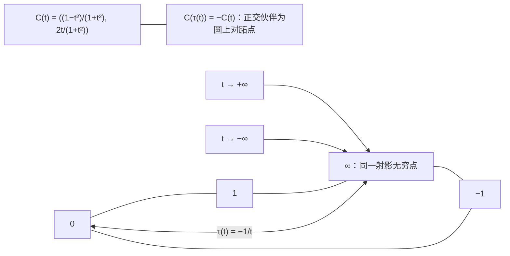
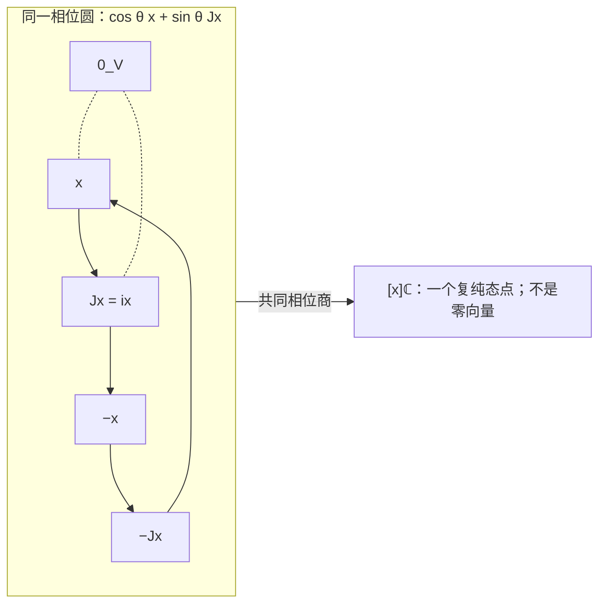

# 零读极性、射影圆与相位纤维

> 来源：用户于 2026-11-05（Asia/Singapore）在本会话提供的 AURIC C137 LaTeX 研究工作稿；原稿未另署作者或模型。本文为参考输入，Lean 是仓库的数学真源；本次仅转换 Markdown，未作形式化认证。正文中的固定快照、项目核读叙述与理论结论均保留原稿口径；两幅 TikZ 图转换为 Mermaid 示意图。

AURIC 量子关系研究　C137

从二元消零恢复共形几何，再作有限三维相容提升

2026 年 11 月 5 日　Asia/Singapore

**本轮结论。** 在至少三条独立实方向的同一线性比较载体上，若每份非零参照的消零方向构成超平面， 零关系互易且没有非零自零，就唯一确定一个正定内积的共形类。 不需再给全部非零读数；选一个内部单位即可恢复长度、夹角、平方律与 Hilbert 完成。 二维中连续的伙伴对合并不足够，第三方向负责检查关系之间的相容性。

**唯一候选的展开。** 对射影方向的二元关系 $Z$，令 $H_x=\{0\}\cup\{y\ne0:Z([x],[y])\}$。 要求

$$
\boxed{H_x\text{ 是实超平面},\qquad
 y\in H_x\iff x\in H_y,\qquad x\notin H_x\quad(x,y\ne0).}
$$

本稿把这项无自零的互易零超平面条件称为 C137，三个展开前件均保留其原义。 其数学结构是经典椭圆极性；本文给所需直接证明，不主张该经典分类的历史优先权。

**用户图像的准确落点。** 正负无穷可以是同一射影圆接缝的两种接近；正交对合可以交换零与无穷。 若另有一致的复相位 $J$，$x$ 与 $Jx=ix$ 在实互读上正交，却属于同一复射线， 其整条相位圆可以被读成一个点。圆的存在、选定绕行方向和将相位取商是三个不同操作。

**简化的范围。** 相对 C136，本轮压缩的是*同一已恢复实线性载体上的数值几何输入*。 若从原有序比较群重新开始，实线性载体与完整实方向仍须来源供应；不能宣称全部前件无条件更弱。 实零互读也不等于复跃迁概率为零。实际概率、原过程和联合系统的重构条件逐项列出， 另以非 Born 模型、稠密有理零记录及局部不相容图给出反向证书。

## 1　最新进展与本轮回溯的位置

本轮固定默认分支 `dev` 的 [`ba97bbfd0aab`](https://github.com/the-omega-institute/trureturing/commit/ba97bbfd0aab3adfa5f6a3d6621495ef96c06597)， 提交时间为 2026 年 11 月 4 日 20:48:44 UTC，即新加坡时间 11 月 5 日 04:48:44。 相对 C136 的 `0b9f2dda45b8`，比较端点给出全部 41 个新增可达提交， 但文件清单达到 300 项上限，因此不能把 300 当作全部变更路径数。 另行比较两个均未截断的 `docs` 递归树， 唯一变动是无关本轮量子问题的回文密度文档；C136 已核读的量子理论文档在该范围中均未改变。 本轮直接相关的新进展在原结果的形式化接入，而不是又新增了一项量子物理前提。

### 1.1　同一原表上的互读预算，现在有正式源码对应

新入库的 [`IntegerMutualReadout`](https://github.com/the-omega-institute/trureturing/blob/ba97bbfd0aab3adfa5f6a3d6621495ef96c06597/Blueprint/D5/S3/Quantum/Completion/IntegerMutualReadout.md) 给出 C130 定理 2.3 的形式化对应。 原始数据是任意标签类型 $X$ 和任意复值表 $K:X\times X\to\mathbb C$， 不先假设 $K$ 共轭对称。对全部有限支撑配方定义

$$
B_K(f,g)=\sum_{x,y}\overline{f_x}K(x,y)g_y.
$$

其主定理在*同一张原表*上等价以下条件： 高斯整数配方的全部预算、$\mathbb Q+i\mathbb Q$ 配方的全部预算、复配方的全部预算， 以及原 $K$ 为 Hermitian 正型。其中预算为

$$
2\Re B_K(f,g)\le\Re B_K(f,f)+\Re B_K(g,g).
$$

支撑大小与整数系数大小都没有共同上界。

证明先在固定有限支撑上清除全部有理分母，再用有限多项式的连续性延伸到复系数。 把同一配方乘成 $tf$ 与 $(t+i)f$，预算余量成为 $\Re B_K(f,f)+2t\Im B_K(f,f)$；对所有实 $t$ 非负便迫出自读实值， 继而恢复原表的 Hermitian 对称性。零配方给出正性；反向预算余量就是 $B_K(f-g,f-g)\ge0$。 这里的复系数与有限求和仍是明确前件，不能把这个结果读成从零关系已经生成复标量或实际相干准备。

### 1.2　一条观察日志与覆盖全部有限问题的区别

同时入库的 [`HistoryKernelConverse`](https://github.com/the-omega-institute/trureturing/blob/ba97bbfd0aab3adfa5f6a3d6621495ef96c06597/Blueprint/D5/S3/Quantum/Completion/HistoryKernelConverse.md) 补齐 C129 平方余量扩张律的奇异反向与有限覆盖接口。 对同一原复表 $K$，原扩张律等价于全部有序有限 Gram 表正半定， 也等价于全体有限支撑复配方的正型；重复标签、零对角、奇异旧块和零余量均保留。 若实际扩张块是

$$
M=\begin{pmatrix}G&b\\b^*&d\end{pmatrix}\ge0,
$$

其交叉列必须在 $G$ 的值域中。写 $b=Gc$ 后， 对 $(-c,1)$ 作正合同得到 $d-c^*Gc\ge0$，从而恢复实际平方余量及全部原块。

原文进一步定义从空表逐步保留这些实际块等式的认证链。 若*每个有限标签集*都包含在某条这样的链中，就可推出全域扩张律； 不同有限集可以使用不同链，不要求一条可数日志覆盖整个标签类型。 单一日志只认证它已表示的标签，有限覆盖量词不能省略。 这与本轮的主题吻合：整体可以由一种有限关系统一描述， 但一个观察者手中有限的实例不因此自动覆盖全部关系。

本轮连续核读了这两个 Blueprint 全文（78 行与 66 行）及对应 Lean 源码全文（432 行与 295 行）。 四个新增文件由比较响应中的完整新增补丁恢复，并与返回的 Git blob 标识逐一核对一致。 上述是固定源码的语义核读；没有重新运行 Lean，也没有重新认证其全部导入依赖。

### 1.3　圆、相位纤维与手性的已有边界

项目已有的 [C131 §§4.2–4.4、§6.6](https://github.com/the-omega-institute/trureturing/blob/ba97bbfd0aab3adfa5f6a3d6621495ef96c06597/docs/develop/theory/AURIC_C131_THREE_DIRECTION_SELF_CALIBRATION_QUANTUM_GEOMETRY.md) 已给出本轮所需的三个边界。 首先，在已给复结构 $J$ 时，$u,Ju,v$ 的三实方向窗口若有非零正交余量 $w$， 就必须补入第四实方向 $Jw$ 才对同一 $J$ 闭合。 其次，两个复振幅的单位球是 $S^3$；把公共相位圆商掉才得到 $\mathbb{CP}^1\simeq S^2$。 最后，整体复共轭交换两侧相位并保持候选成立，因此没有选出绝对物理手性或日志时间箭头。

[V24 定理 3.1–3.2](https://github.com/the-omega-institute/trureturing/blob/ba97bbfd0aab3adfa5f6a3d6621495ef96c06597/docs/develop/theory/AURIC_TWO_BASIS_STATES_THREE_CHANNELS_PHASE_CHIRALITY_AND_RECURSIVE_SQUARE_LAW_V24.md) 还明确区分：Hopf 纤维是一整圈 $U(1)$，而 $SU(2)\to SO(3)$ 的纤维是两个点。 选定坐标的右手约定，也不决定一个未知态位于哪个半球； 同一 Pauli 读口下，$|0\rangle$ 与 $|1\rangle$ 的前两个均值都为零，而第三个均值相反。 本轮重新核读了这些具体命题与证明，不将标准 Hopf 几何或该边界再次当作新结果。

本轮改问：在一个明确给定的实线性载体上，只保留二元比较的*零关系*， 何种全域相容性能够恢复共形内积？ 这缩减的是数值几何输入；预给实线性载体、维数条件与全域相容量词仍是显式前件。 它与 C136 的任意有序比较群入口不同，不能仅因字面公式较短，就声称全部前件无条件更弱。 同样，C133 五点桥的 $R\Rightarrow\mathrm N_5$ 缺口没有因此被解决； 本轮要分别证明射影几何、正度量、复相位和实际读出之间所需的关系。

**白话。** 这次仓库把两件旧事接得更牢：一张原始互读表怎样被预算约束成正几何， 以及一份份有限记录怎样在覆盖条件下共同认证整体。 圆和球的关系也已有准确边界：相位圆、两个相反方向和球面上的点，属于不同层次。 本轮继续往前退，只保留“哪两个方向互相读不到”的关系， 再问它能否把长度比例和角度找回来；所有额外需要的结构都按原来的身份保留。

## 2　零、无穷与圆：比较关系、坐标图册和定向

这一节把直觉中可成立的对应逐一固定。实射影直线、射影对合及圆的双覆盖都是经典结构， 本节给出本稿所需的直接证明。官方几何讲义中的相应陈述可见 [Springborn 等《Geometry I》§5.2、§5.5.1](https://www3.math.tu-berlin.de/geometrie/Lehre/WS18/GeometryI/GeometryI_W18.pdf)。 这些结构本身不宣称产生物理时间或宇称破缺。

### 2.1　同一个无穷点的两种接近，不是两个新状态

#### 定义 2.1：方向与射影坐标

二维实空间的射影点是非零向量的实比例类

$$
[a:b]=\{(\lambda a,\lambda b):\lambda\in\mathbb R\setminus\{0\}\}.
$$

当 $a\ne0$ 时取坐标 $t=b/a$；其余方向为 $[0:1]$，记作 $\infty$。 因此 $\mathbb{RP}^{1}=\mathbb R\cup\{\infty\}$。

若分别保留 $-\infty,+\infty$，通常的序拓扑给闭区间 $[-\infty,+\infty]$，并不是圆。将这两个端点识别，才得到一个圆。 在射影直线上，$t\to+\infty$ 与 $t\to-\infty$ 都接近同一个 $[0:1]$， 而接近的局部分支不同。更换仿射图册，可以把任意另一个射影点选为无穷点。

#### 命题 2.2：圆坐标与双角

映射

$$
C(t)=\left(\frac{1-t^2}{1+t^2},\frac{2t}{1+t^2}\right),\qquad
 C(\infty)=(-1,0)
$$

给出 $\mathbb{RP}^1\cong S^1$ 的同胚。若 $[a:b]=[\cos\theta:\sin\theta]$，则

$$
C([a:b])=(\cos2\theta,\sin2\theta).
$$

因而从有向单位向量圆到无向射影方向圆的映射是二重覆盖。

**证明。**

直接计算两坐标平方和为 $1$。若圆上 $(X,Y)\ne(-1,0)$，则 $t=Y/(1+X)$ 给逆映射；剩余一点恰对应 $\infty$。 $t$ 从正负两侧趋于无穷时，$C(t)$ 都趋于 $(-1,0)$，故延拓连续。 紧空间到 Hausdorff 空间的连续双射是同胚。双角式来自 $a^2-b^2=\cos2\theta$、$2ab=\sin2\theta$； $\theta$ 与 $\theta+\pi$ 恰给同一射影方向。

$\square$

**图 1：** 零与无穷是同一个射影圆上的不同点；正负无穷是同一点的两种接近。 标准正交对合在此圆上交换对跖点。图的绕行方向来自所用有序坐标，射影圆本身没有选定它。

### 2.2　平行与正交：转动一个参照后可以互换

先在已给标准内积的实二维平面中，记

$$
J(a,b)=(-b,a).
$$

于是 $J^2=-I$，并且

$$
\det(x,Jy)=\langle x,y\rangle.
$$

因此对非零 $x,y$，

$$
\boxed{x\perp y\ \Longleftrightarrow\ x\parallel Jy.}
$$

这是两种二元关系之间的精确转换。平行对应同一射影点，正交对应其经 $J$ 转换后的另一点； 把第二个参照转直角后，两种判定相同。它不把原来的两种关系直接等同。 单纯重标记全部状态也不能将二者互换：平行关系有自反性，而正定几何中的非零方向没有自正交。

在斜率图册 $t=b/a$ 中，正交伙伴为

$$
\tau(t)=-\frac1t,\qquad \tau(0)=\infty,\quad\tau(\infty)=0.
$$

它满足 $C(\tau(t))=-C(t)$。若用相对夹角的 $\cot\theta$ 作参数， 平行落在无穷，正交落在零；改用 $\tan\theta$ 就交换两者。 所以“零与无穷互换”可以成立，其具体位置取决于图册。 此外，正交直线的仿射交点可以在任意位置； 内积为零与交点位于原点是不同陈述。

### 2.3　二维的准确结果：射影伙伴决定共形度量，但不决定手性

#### 定理 2.3：无不动点射影对合的全部模型

设 $W$ 为二维实向量空间，$\tau:\mathbb P(W)\to\mathbb P(W)$ 是非恒等射影变换， 满足 $\tau^2=\operatorname{id}$，且没有不动点。 则存在唯一的正定对称双线性形式共形类 $[g]=\{cg:c>0\}$，使

$$
\tau([x])=\mathbb P(x^{\perp_g}).
$$

它恰有两个满足 $J^2=-I$ 的线性提升 $J,-J$；两者给出相同的 $\tau$ 和 $[g]$， 却给出相反的平面定向。

**证明。**

取 $\tau$ 的线性代表 $A\in\mathrm{GL}(W)$。 由于 $A^2$ 保持每条一维子空间，它为标量矩阵 $\lambda I$。 对二维的 Cayley–Hamilton 等式与 $A^2=\lambda I$ 作比较， 非恒等性给 $\operatorname{Tr}A=0$、$\lambda=-\det A$。 没有实不动点即没有实特征方向，故 $\det A>0$。 令 $J=A/\sqrt{\det A}$，便有 $J^2=-I$。

任选 $e\ne0$，$e,Je$ 线性无关；规定这个基正交归一即可定义正定 $g$。 在该基中，$J$ 是标准直角转动，所以 $g(x,Jx)=0$ 对所有 $x$ 成立。 若另一正定对称形式的矩阵为 $\left(\begin{smallmatrix}a&c\\c&b\end{smallmatrix}\right)$， 同一零关系要求 $c\xi^2+(b-a)\xi\eta-c\eta^2=0$ 对任意 $\xi,\eta$ 成立， 从而 $c=0,a=b>0$。因此共形类唯一。

同一射影变换的两个线性代表成非零实比例。 要求提升的平方为 $-I$，比例只能是 $\pm1$。 从 $(e,Je)$ 换成 $(e,-Je)$ 反转定向，但正交伙伴没有改变。 在标准基中的反射也保持 $\tau$ 却交换 $J,-J$， 故现有数据没有办法自然选定其中一个符号。

$\square$

若 $g$ 的矩阵为 $\left(\begin{smallmatrix}\alpha&\beta\\\beta&\gamma\end{smallmatrix}\right)>0$， 对应的伙伴公式为

$$
\tau(t)=-\frac{\alpha+\beta t}{\beta+\gamma t}.
$$

因此，这里必须保留“射影变换”的要求；任意圆上的无不动点对合并不够。

#### 例 2.4：二维连续零关系不必来自二次度量

在 $\mathbb R\cup\{\infty\}$ 上定义

$$
\tau(0)=\infty,\quad\tau(\infty)=0,\qquad
 \tau(t)=
 \begin{cases}
   -1/t^2,&t>0,\\[2pt]
   1/\sqrt{-t},&t<0.
 \end{cases}
$$

这是连续、没有不动点的对合。 令 $Z(p,q)$ 恰当且仅当 $q=\tau(p)$，则 $Z$ 对称、无自零， 且每个零邻域都是射影超平面—在二维载体中，这仅仅是一点。 但是它不来自任何正定双线性形式。

**证明。**

分正负代入可得 $\tau^2(t)=t$；有限非零 $t$ 的符号被交换，且 $0,\infty$ 互换，故没有不动点。 在零点，两侧像趋于同一射影无穷点；在无穷点，两侧像趋于零，故连续。 若它为射影变换，交换 $0,\infty$ 就迫使 $\tau(t)=k/t$。 $\tau(1)=-1$ 进一步给 $k=-1$，但其 $\tau(2)=-1/4\ne-1/2$。 前一定理说明任何正定度量的正交伙伴都是射影变换，故得反例。

$\square$

这解释了为什么下一节需要至少三个独立实方向：第三方向可以检查不同二元平面里的关系是否来自同一个线性关联。 在实三维中，一个方向的正交对象是一个平面，射影化后是一条线； 不能把二维中的“每点唯一伙伴”直接沿用为三维中的全局点对合。

### 2.4　二元方向的三坐标提升

#### 命题 2.5：射影圆的二次锥表示

映射

$$
[a:b]\longmapsto[X:Y:Z]
 =[a^2-b^2:2ab:a^2+b^2]
$$

将 $\mathbb{RP}^1$ 嵌入射影平面，像恰为实非退化圆锥曲线

$$
X^2+Y^2=Z^2.
$$

每个实像点都有唯一的 $Z=1$ 代表，形成单位圆。 这个提升增加了表示的环境坐标，未改变被表示方向空间的一维性。

**证明。**

各坐标为相同次数的齐次式，故定义与非零代表的选择无关； 平方和等式由展开直接得到。 实圆锥曲线上的点若 $Z=0$ 则 $X=Y=0$，不构成射影点，故可令 $Z=1$。 由命题 2.2 的逆映射，每个单位圆点恰对应一个 $[a:b]$， 因此映射单射且满到所声明圆锥曲线。

$\square$

圆的存在与给圆选一个绕行方向是两件事。忘掉定向仍然留下整个圆； 即使把一个点附上正负两个标签，也只得到两个离散点，不会得到连续的圆。 在已具有 $U(1)$ 作用的复理论中，全部 $e^{i\theta}\psi$ 可以属于同一个射影态， 于是圆轨道被读成一点。那是对已有连续相位自由的商，而非从一个点加上手性标签产生相位。 同样，按反射识别圆的两种走向，所得典型商为闭区间，而非一点。

**白话。** 把一条线的两头接起来，可以得到一个圆；正负无穷因此成为同一个点的两种接近。 把一个参照转直角，原来的正交判定就能改写成平行判定，零与无穷也随之交换。 但是圆上的点、方向之间的关系、沿圆走的方向仍各有内容。 本轮真正可以往前退的地方，是只记录“哪两种方向互相读零”， 再让第三个方向检查这些零关系能不能共同来自一个整体。 若能，长度比例和夹角就有机会由零关系恢复；手性和连续相位则要看原始关系还保留了什么。

## 3　唯一候选：互易的零读超平面

本节明确固定一个实线性比较载体 $V$，$\dim_\mathbb RV\ge3$；原始档案仍在这个载体之外保留其标签、时序与来源。 可以把 $V$ 取为 C136 已恢复的同一可见实线性载体，然后忘去其全部非零数值，只问哪些实比较消零。 若直接从原始群重新开始，实线性组合及其全部方向就是本轮新的前件，不能称其为 C136 自动不需的更弱输入。 此处没有预给内积、范数、概率、相位方向或正定矩阵。

#### 定义 3.1：C137：原零关系构成无自零的互易超平面族

给定射影方向之间的二元关系 $Z$。对非零 $x\in V$，令

$$
H_x=\{0\}\cup\{y\ne0:Z([x],[y])\}.
$$

唯一候选是：每个 $H_x$ 为实线性超平面，且

$$
\boxed{\quad y\in H_x\iff x\in H_y,\qquad x\notin H_x\quad(x,y\ne0).\quad}
 \tag{C137}
$$

这项几何条件展开为三个可审查前件：零集的超平面闭合、互易性、无自零。 将与零向量的关系约定为真。$Z$ 是实互读的零关系，尚不是量子跃迁概率为零。

**白话。** 先不问两个比较读出多少，只问它们是否抵成零。对一份非零参照，所有能抵成零的方向恰铺满一个少一维的平面；互换参照仍然抵零，而参照自己不能抵掉自己。

### 3.1　完整分类：零关系决定度量，只剩一个单位

#### 定理 3.2：C137 的全部模型

设 $V$ 是任意实向量空间，$\dim V\ge3$。C137 成立当且仅当存在正定对称实双线性形式 $g$，使

$$
Z([x],[y])\iff g(x,y)=0.
$$

同一 $Z$ 所允许的全部形式恰为 $cg$，$c>0$。选内部非零参照 $e$ 并令 $g(e,e)=1$ 后，$g$ 唯一。 因此 $q(x)=g(x,x)$ 满足 C136 的加法形式

$$
q(x+y)+q(x-y)=2q(x)+2q(y),
$$

并给唯一的相应 Hilbert 完成。全称量词覆盖全部实方向，不声称实际有限样本已认证此候选。

#### 引理 3.3：实射影基本引理

在 $V,W$ 具有相同有限实维数 $n\ge3$ 时，将射影直线映到射影直线的射影双射 $f:\mathbb P(V)\to\mathbb P(W)$ 由可逆实线性映射诱导。

**证明。**

用一个射影标架规范化前后坐标，使 $f$ 固定各坐标方向、仿射原点及全部坐标单位点。 具体可用坐标点及 $[e_0+\cdots+e_d]$ 作标架；坐标单位点由关联交点

$$
[e_0+e_i]=\mathbb P(\operatorname{span}\{e_0,e_i\})\cap
 \mathbb P(\operatorname{span}\{e_0+\cdots+e_d,\ e_j:j\ne0,i\})
$$

恢复。无穷远超平面也被保持。 在 $d=n-1\ge2$ 维仿射片中，坐标平行线族被保持，故映射逐坐标写成 $(x_1,\ldots,x_d)\mapsto(\sigma_1(x_1),\ldots,\sigma_d(x_d))$，其中各 $\sigma_i$ 为双射并固定 $0,1$。 任意两坐标组成的平面中，对角线 $y=x$ 被保持，故各函数相同，记为 $\sigma$。 平行线 $y=x+b$ 的像经过 $(0,\sigma(b))$ 且有同一无穷远方向，给 $\sigma(x+b)=\sigma(x)+\sigma(b)$；直线 $y=mx$ 的像经过 $(0,0)$ 和 $(1,\sigma(m))$，给 $\sigma(mx)=\sigma(m)\sigma(x)$。所以 $\sigma$ 是实数域自同构。 正实数为非零平方，故 $\sigma$ 保序；它固定有理数，有理夹逼迫使 $\sigma(x)=x$。 每个无穷远点由仿射平行线的方向确定，故也被固定。撤去规范化即得结论。 这证明的是实射影线性刚性，并不从纯拓扑圆导出实数域。标准射影框架见[\[6\]](#ref-goldman2009), [\[7\]](#ref-springborn2021)。

$\square$

**定理 3.2 的证明。**

先设 $n=\dim V<\infty$。对线性子空间 $U$ 定义

$$
U^\perp=\bigcap_{u\in U\setminus\{0\}}H_u,
$$

空交取 $V$。每个 $H_u$ 已含零向量。 若 $x_1,\ldots,x_k$ 为 $U$ 的基，由互易性和每个 $H_v$ 的线性，

$$
U^\perp=\bigcap_{i=1}^kH_{x_i}.
$$

若非零 $z\in U\cap U^\perp$，互易性给每个 $x_i\in H_z$，从而 $z\in H_z$，矛盾。 一方面 $k$ 个超平面的交维数至少为 $n-k$；另一方面交空间与 $U$ 直和，维数至多为 $n-k$。因此

$$
\dim U^\perp=n-\dim U,\qquad (U^\perp)^\perp=U.
$$

于是 $[x]\mapsto H_x$ 是点到超平面的双射。若 $U=\operatorname{span}\{x,y\}$， $z\in U$ 等价于 $H_z\supseteq U^\perp$，所以此映射把一条射影线恰送到一个超平面束。 把超平面束看作对偶射影空间中的直线，应用引理，得到可逆线性映射 $A:V\to V^*$，使 $H_x=\operatorname{ker}(Ax)$。令 $B(x,y)=(Ax)(y)$。

互易性说 $B(x,\cdot)$ 和 $B(\cdot,x)$ 具有相同核。因而每个非零 $x$ 都是 $A^{-1}A^{\mathsf T}$ 的特征向量。一个线性算子若每个向量都是特征向量，比较独立的 $x,y,x+y$ 即知它只能是标量算子。 故 $A^{\mathsf T}=\lambda A$，再转置得 $\lambda^2=1$。 $\lambda=-1$ 会使全部 $B(x,x)=0$，被无自零排除；所以 $B$ 对称。 对称形式若有正、负两个方向，其某个二维截面必有非零零向量；无自零因此迫使 $B$ 定号。 选择正号即得 $g$。

若 $g,h$ 具有相同零关系，则对每个 $x\ne0$，$h(x,\cdot)$ 与 $g(x,\cdot)$ 成比例。 相应相对线性算子的每个向量都是特征向量，故 $h=cg$，且正性给 $c>0$。 反向所有正定形式显然满足候选。

一般无限维 $V$ 中，限制到任意三维子空间仍满足候选：$H_x$ 与该子空间的交是避开 $x$ 的超平面。 有限维结果给每个至多三维窗口的正定形式。第 4.2 节的比例拼接定理将它们恢复为全局唯一正定形式， 不使用一个预给全局基或一个覆盖所有标签的观察者日志。范数完成得到 Hilbert 空间。

$\square$

### 3.2　数值怎样从消零配比恢复

对非零 $y$，存在唯一实数 $a(x\mid y)$ 使

$$
x-a(x\mid y)y\in H_y.
$$

它由 $V=\mathbb Ry\oplus H_y$ 唯一确定，不预先使用数值内积。 恢复出的形式满足

$$
a(x\mid y)=\frac{g(x,y)}{g(y,y)},\qquad
 P_yx=a(x\mid y)y.
$$

若 $g(x,y)\ne0$，两个消零配比给出长度比：

$$
\frac{q(x)}{q(y)}=\frac{a(x\mid y)}{a(y\mid x)}.
$$

若 $x,y$ 均非零且两者消零，则以 $x+y$ 为共同中介；它与两者的互读均非零。 尤其对于 $Z([u],[v])$，唯一满足

$$
Z([u+v],[u-t v])
$$

的 $t$ 恰为 $q(u)/q(v)>0$。实际确定这样的实数根是一个读口任务，不能用形式存在代替有限精度执行。

#### 推论 3.4：尺度无关的投影量

零关系与线性组合共同决定

$$
\mathcal P_\mathbb R([x],[y])=a(x\mid y)a(y\mid x)
   =\frac{g(x,y)^2}{g(x,x)g(y,y)}\in[0,1].
$$

它与 $g$ 的总体正尺度无关。相应射影距离是 $d([x],[y])=\arccos\sqrt{\mathcal P_\mathbb R([x],[y])}$。 这里首先得到几何投影量；其是否等于实际事件频率仍须事件评价接口。

**证明。**

由正形式的 Cauchy–Schwarz 不等式得到取值区间；将 $g$ 同乘常数，分子分母抵消。 将向量归一化后识别正负，距离就是单位球面两代表之间的最小球面距离，故满足三角不等式。

$\square$

#### 命题 3.5：规范几何与任意原数值读口不同

C137 唯一确定规范正形式的共形类，但不能仅由零记录证明一个任意原数值读口等于该形式。 例如 $r(x,y)=g(x,y)^3$ 与 $g$ 具有完全相同的零关系，原自读 $r(x,x)=q(x)^3$ 却不满足二次闭合。

**证明。**

立方保留恰好同一个零点；对非零 $x$，原自读在 $2x$ 上变为 $64r(x,x)$， 而二次闭合要求 $4r(x,x)$。因此，原数值读口的可加性或与规范几何的标定仍是独立接口。 若来源已经是 C136 所恢复的双线性模型，这项模型约束已成立，零关系才恰好替代数值至整体尺度。

$\square$

### 3.3　逐条反向删除前件

#### 命题 3.6：三类失败均有明确证书

候选的三个展开条件各有独立作用。

**证明。**

删去无自零，取 $B=\operatorname{diag}(1,1,-1)$。其零关系互易且每个非零零集为超平面， 但 $x=(1,0,1)$ 自读为零而未对全部对象消零；不能得到正几何。

删去互易性，取 $B(x,y)=x^{\mathsf T}(I+\epsilon K)y$， $K_{12}=1,K_{21}=-1$，其余为零，$\epsilon\ne0$。 各零集为超平面，$B(x,x)=\|x\|^2>0$； 但 $x=e_1,y=(-\epsilon,1,0)$ 满足 $B(x,y)=0$、$B(y,x)=-2\epsilon$。

删去超平面闭合，在 $\mathbb R^3$ 定义 $Z([x],[y])\iff\sum_i x_i^3y_i^3=0$。 它射影良定义、互易且无自零，因为 $\sum_i x_i^6>0$。 对 $x=(1,1,1)$，零集含 $u=(1,1,-\sqrt[3]2)$ 和 $v=(1,-1,0)$， 却不含 $u+v=(2,0,-\sqrt[3]2)$，后者读数为 $6$。

$\square$

#### 推论 3.7：二维的精确边界

二维连续、互易、无自零的零线族不必来自内积，例见第 2.4 节。 它来自正定形式，当且仅当其方向配对是射影对合；也当且仅当它能扩张为某个三维空间上的 C137 零关系。

**证明。**

前一等价由射影圆章节的二维分类。正定形式可直和一个正平方形成三维扩张； 反向将三维定理所得形式限制回原平面。

$\square$

若原线性载体还有不可见方向，应先明确其原零空间 $N$ 并保留原标签， 再将候选施加于可见商 $V/N$。不能把某个非零原历史的身份直接删去， 也不能将有限秩退化的来源强行声称有三条独立可见方向。

**白话。** 这一轮实际少给的是全部非零读数。只要所有消零方向在共同的线性空间里以同一种方式互相配合， 长度的比例和夹角便被锁定，只剩“用哪一份比较作一单位”。第三条方向负责检查不同平面的消零规则能否共同成立。 但线性组合的定义、全部实方向的供应，以及原始哪些对象确实消零，仍是明确保留的来源。

## 4　任意三维窗口的拼接，与零读来源的准确边界

### 4.1　一个比例关系，统一所有有限提升

#### 引理 4.1：相同零关系只留一个尺度

实向量空间上的两个正定对称双线性形式若具有完全相同的零配对，则相差一个正数倍。 此结论也适用于无限维代数向量空间。

**证明。**

对任意 $x\ne0$，两非零线性泛函 $B(x,-),C(x,-)$ 核相同，故 $C(x,-)=\lambda(x)B(x,-)$，且 $\lambda(x)>0$。 若 $B(x,y)\ne0$，由对称性得 $\lambda(x)=\lambda(y)$。 若 $x,y\ne0$ 且 $B(x,y)=0$，取 $z=x+y$，则 $B(x,z)=B(x,x)>0$、$B(y,z)=B(y,y)>0$，再得相同比例。

$\square$

#### 定理 4.2：全部三维窗口的全局闭合

设 $V\ne0$ 是任意实向量空间，并给定*同一个*二元关系 $\perp_0$。 假设其在每个至多三维子空间 $W$ 上，恰为某个正定对称双线性形式 $h_W$ 的零关系。 则存在全局正定对称双线性形式 $B$，精确表示 $\perp_0$，并且只差一个正尺度。 当 $\dim V\ge3$ 时，只须量化全部三维子空间。

**证明。**

对 $x,y\ne0$，在包含它们的至多三维空间中定义

$$
R(x,y)=\frac{h_W(x,x)}{h_W(y,y)}.
$$

若改用另一窗口，其形式在 $\operatorname{span}(x,y)$ 上具有相同零关系， 故由引理 4.1，这个比值不变。 任意三个非零向量都落在一个至多三维窗口中，所以

$$
\boxed{R(x,z)=R(x,y)R(y,z).}
$$

固定一个 $e\ne0$，令 $q(0)=0$、$q(x)=R(x,e)$。 对任一窗口 $W$ 及其中任意 $y\ne0$，上式给

$$
q(x)=\frac{q(y)}{h_W(y,y)}h_W(x,x)\quad(x\in W).
$$

因而 $q$ 在每个窗口内是同一个正比例的二次型。令

$$
B(x,y)=\frac{q(x+y)-q(x-y)}4.
$$

所有加性检验只涉及至多三个向量，实齐次检验只涉及两个向量， 故均在某个窗口中成立。正定性、对称性及零关系也由窗口继承。 唯一性再用引理。较小子空间能扩充为三维空间，给出最后一句。

$\square$

本定理可将前节的三维极性表示推广到无限多个可见方向：先得到代数内积，再作 Hilbert 完成。 它没有自动保持原来源另给的拓扑，也没有把形式实线性组合变成实际可执行的准备。 若原数据满足全局的零超平面、对称和无非零自零条件，其在包含 $x\ne0$ 的窗口内仍给超平面， 因为 $x\notin Z_x$，窗口不可能整个落入 $Z_x$。所以三维表示与本定理可以逐字衔接。

### 4.2　反向检验：三张局部图为什么可能拼不起来

取 $V=\mathbb R^3$。在 $(e_1,e_2)$ 平面给 $\operatorname{diag}(1,a)$ 的零关系， 在 $(e_2,e_3)$ 平面给 $\operatorname{diag}(1,b)$ 的零关系， 在 $(e_1,e_3)$ 平面给 $\operatorname{diag}(1,c)$ 的零关系，其中 $a,b,c>0$。 三张图在公共坐标轴上没有冲突；一维正形式都没有非零零配对。 但它们能被同一个全局正形式表示，*恰当且仅当*

$$
\boxed{c=ab.}
$$

确实，坐标轴两两正交使全局形式必须为 $\operatorname{diag}(w_1,w_2,w_3)$， 局部比例唯一性给 $w_2/w_1=a$、$w_3/w_2=b$、$w_3/w_1=c$。 反向取 $\operatorname{diag}(1,a,ab)$ 即可。例如 $a=2,b=3,c=5$ 不能共同实现。

一般地，完整比较图上的正比例 $r_{ij}$ 能写成 $w_j/w_i$， 恰当且仅当 $r_{ii}=1$、$r_{ji}=r_{ij}^{-1}$，且每个三角形满足

$$
r_{ij}r_{jk}r_{ki}=1.
$$

必要性是约分；充分性取 $w_i=r_{0i}$，用三角形 $0,i,j$ 即得。 权重只差一个共同尺度。对非完整图，须检查全部相关回路， 不能无条件只查图中已有的三角形。 这就是上一证明中的比例关系，成为“关系之间的关系”。

#### 例 4.3：坐标三元组不等于全部三维子空间

四阶对称矩阵取对角 $1$、全部非对角 $-2/5$。 任一三阶坐标主块的特征值为 $1/5,7/5,7/5$，全部正定； 整个矩阵却有特征值 $-1/5$，并给 $q(1,1,1,1)=-4/5$。 所以“所有三维窗口”必须包括任意实际线性配方所在的子空间， 不是只检查选定基底的所有三元子集。

### 4.3　稠密的整数、有理准备，仍可能遗漏全部角度

#### 例 4.4：同一有理零关系，不同实度量

在 $\mathbb R^2$ 上令

$$
B_\alpha(x,y)=x_1y_1+\alpha x_2y_2,\qquad \alpha>0\text{ 无理}.
$$

只使用 $x,y\in\mathbb Q^2$ 时，

$$
B_\alpha(x,y)=0
 \iff x_1y_1=x_2y_2=0.
$$

因此 $B_{\sqrt2}$ 与 $B_{\sqrt3}$ 在*全部*有理输入上给出相同零关系， 而它们并不成比例，且已经具有相同的标定 $B_\alpha(e_1,e_1)=1$。 两个形式都连续，$\mathbb Q^2$ 也稠密；这两件事仍不足以恢复完整实零关系。 在主定理的任意有限维 $n\ge3$ 中，可改用 $\operatorname{diag}(1,\alpha,1,\ldots,1)$。 全部有理输入上的零条件恰为 $x_2y_2=0$ 且 $\sum_{i\ne2}x_i y_i=0$，仍与所选正无理数 $\alpha$ 无关。

这个现象甚至可以没有任何非零有理零配对。取 $t=\sqrt[3]2$ 或 $\sqrt[3]3$，令

$$
\Gamma_t=\begin{pmatrix}1&t\\t&1+t^2\end{pmatrix}>0,
 \qquad \det\Gamma_t=1.
$$

对有理向量 $x,y$，其互读为

$$
(x_1y_1+x_2y_2)+t(x_1y_2+x_2y_1)+t^2x_2y_2.
$$

$1,t,t^2$ 在 $\mathbb Q$ 上线性无关，故读数为零迫使全部三个系数为零， 继而迫使 $x=0$ 或 $y=0$。 这两个非比例的连续正度量，在全部非零有理输入上都只回答“非零”。

这不是实零超平面定理的反例：在这个有理来源中，原零集合根本不一定是有理超平面。 它精确指出了本轮入口的供应要求：必须给出完整实方向上的零关联， 或者另外证明所供定量近零数据足以确定其延拓。 稠密的可准备标签、读数的连续性、以及稠密标签上的*零或非零*记录，三者合在一起也没有完成这项供应。 仅把已观测精确零对取闭包，同样不能恢复例 4.4 中遗漏的实零方向。

### 4.4　零互读、量子正交与概率，具有不同的类型

取得实内积 $B$ 后，若原关系另供应正交复结构 $J$，则

$$
\langle u,v\rangle_{\mathbb C}=B(u,v)+iB(Ju,v),
 \qquad
 \langle u,v\rangle_{\mathbb C}=0
 \iff B(u,v)=B(Ju,v)=0.
$$

对 $u\ne0$，右侧在实载体中是*余维二*的零空间； 前节候选的 $B(u,v)=0$ 则是实超平面。 尤其 $B(u,Ju)=0$，但 $u$ 与 $Ju$ 表示同一个复纯态射线。 因此本轮 $\perp_0$ 必须解释为*实互读为零*，不能直接改名为零量子跃迁概率。

#### 例 4.5：量子比特的零关系与二结果归一化仍不选择 Born

只考虑 $\mathbb C^2$ 的单位纯态与二结果正交投影测量。设

$$
t=|\langle \phi,\psi\rangle|^2,\qquad
 f(t)=\frac{t^2}{t^2+(1-t)^2},\qquad
 p_f(\phi\mid\psi)=f(t).
$$

它连续，保留全部原零概率与确定概率射线，并且 $f(t)+f(1-t)=1$，所以每个二结果投影测量仍归一化。 但是 $f(1/4)=1/10\ne1/4$，故不是 Born 规则。 这个模型没有承诺混合准备的仿射性或全部效果上的可加评价。 这些额外关系，或足够丰富且已实际供应的高维共同扩张，才有机会排除它。

**白话。** 三张各自正确的局部图，还要彼此认得同一个尺度：沿三条边绕一圈，比例必须回到一。 一旦所有三维窗口都这样相容，就可以把无限多方向接成同一幅正几何。 但只拿能执行的整数、有理配方询问“是不是恰好为零”，可能永远错过真实的零方向； 即使零几何齐备，也还要区分实互读的零、复跃迁的零和事件的实际权重。 因此，三维提升完成的是一个有准确输入范围的闭合证明，不能替代尚未供应的相位与概率关系。

## 5　一条相位圆怎样成为一个点，以及手性还缺什么

本节把相位供应写成同一零关系的内部自同构。它是量子分支的附加来源， 不是 C137 对任意实模型自动产生的对象。定理 3.2 已确定共形正形式 $[g]$。

#### 定义 5.1：相容的原四分之一转

来源给出实线性算子 $J:V\to V$，满足

$$
J^2=-I,\qquad Z([Jx],[Jy])\iff Z([x],[y]).
$$

所有需要作复线性解释的实际效果、过程，还须与相应 $J$ 相容。

#### 定理 5.2：只保持零关系的四分之一转，已经等长

上述 $J$ 自动满足

$$
g(Jx,Jy)=g(x,y),\qquad g(Jx,y)=-g(x,Jy),\qquad g(x,Jx)=0.
$$

以 $ix=Jx$ 定义复标量，

$$
h(x,y)=g(x,y)+i g(Jx,y)
$$

成为第一槽共轭线性的正定复内积。算子 $R_\theta=\cos\theta I+\sin\theta J$ 形成等长相位圆作用，并延伸到 Hilbert 完成。

**证明。**

$g_J(x,y)=g(Jx,Jy)$ 正定且具有同一零关系，故 $g_J=\lambda g$，$\lambda>0$。 再次应用 $J$ 得 $g(-x,-y)=\lambda^2g(x,y)$，所以 $\lambda=1$。 由 $J^{-1}=-J$ 得斜伴随关系，自读的交叉项因此为零。 逐槽验证 $h(Jx,y)=-ih(x,y)$、$h(x,Jy)=ih(x,y)$ 及 Hermitian 对称性，且 $h(x,x)=g(x,x)>0$。 $R_\theta$ 的群律、等长性由 $J^2=-I$ 和斜伴随关系直接展开。

$\square$

### 5.1　“平行又正交”可以准确地发生在不同关系层

#### 命题 5.3：同一个复态的实正交代表

对 $x\ne0$，向量 $x,Jx$ 实正交，同时复线性相关，并表示同一复射线：

$$
g(x,Jx)=0,\qquad Jx=ix,\qquad [Jx]_\mathbb C=[x]_\mathbb C.
$$

其全部单位范数代表为 $\{e^{i\theta}x/\|x\|:\theta\in\mathbb R\}$，是一条圆。 相反，复正交要求两个实消零条件：

$$
h(x,y)=0\iff g(x,y)=g(Jx,y)=0.
$$

**证明。**

前一组由上一条定理及复数标量定义得到。$x,Jx$ 等长且正交，故 $\cos\theta x+\sin\theta Jx$ 正是它们平面中的等长圆；相同复射线的单位代表恰好相差模一标量。 后一等价是复数实部和虚部同时为零。特别地 $h(x,Jx)=i\|x\|^2\ne0$。

$\square$

**图 2：** 实正交的 $x$ 与 $Jx$ 位于同一相位圆，并投到同一个复射线点。选择 $J$ 给出圆参数方向；改成 $-J$ 反转方向，圆本身仍在。圆商成点依据的是相位识别关系。

这个表述保留了用户图像的核心：同一份内容可以在带相位的层面表现为圆， 在忽略公共相位的层面表现为点。点不是给圆“取消手性”后得到的维数变化；两者由指定的商映射联系。 物理上是否可作公共相位识别，须由实际效果全部相位相容来供应。

### 5.2　方向选择并不自动成为整体复结构

#### 命题 5.4：三维闭合与四维自由

三维实空间上不存在 $J^2=-I$。在四维正定空间里，即使固定整体定向，也有不同的相容 $J$。

**证明。**

三维时行列式给 $(\det J)^2=\det(-I)=-1$，矛盾。 四维取正交基 $e_1,\ldots,e_4$。令

$$
J_1e_1=e_2,\ J_1e_2=-e_1,\ J_1e_3=e_4,\ J_1e_4=-e_3,
$$

$$
J_2e_1=e_3,\ J_2e_3=-e_1,\ J_2e_2=-e_4,\ J_2e_4=e_2.
$$

两者正交、平方为 $-I$，且反对易。因此 $J_\theta=\cos\theta J_1+\sin\theta J_2$ 仍正交且平方为 $-I$。 这是一族连续不同的复结构，其诱导定向相同；尤其从 $J_1$ 连到 $-J_1$。

$\square$

若已有 $u\ne0$ 与 $Ju$，另一个方向的余量 $w\perp\operatorname{span}\{u,Ju\}$ 非零， 则 $Jw$ 与 $u,Ju,w$ 全部正交且非零，所以三实方向必须补到四实方向才能对 $J$ 闭合。 这项界限在仓库 C131 已有完整证明，不能将 Bloch 三读出坐标误认作只有三个实振幅方向。

### 5.3　两个复方向的有限三读出与 Hopf 纤维

在一个复二维子空间中选正交单位基，取归一向量 $\psi=(\alpha,\beta)$。 令

$$
\mathbf n(\psi)=\bigl(2\Re(\bar\alpha\beta),\,2\Im(\bar\alpha\beta),\,|\alpha|^2-|\beta|^2\bigr).
$$

直接计算 $\|\mathbf n\|^2=(|\alpha|^2+|\beta|^2)^2=1$。 同一个 $\mathbf n$ 确定 $|\alpha|^2,|\beta|^2,\bar\alpha\beta$， 因此其全部归一原像恰差共同相位；两极也保留完整相位圆。 取 $\alpha=\cos(\vartheta/2),\beta=e^{i\phi}\sin(\vartheta/2)$ 又给满射。 由此得到

$$
S^1\longrightarrow S^3\longrightarrow \mathbb{CP}^1\cong S^2.
$$

这里 $S^3$ 是 $\mathbb C^2$ 中的*单位向量集*，完整 Hilbert 空间仍是 $\mathbb C^2$。 这项标准 Hopf 表示及其量子含义见[\[8\]](#ref-mosseri2001)；仓库 C131、V24 也已使用它。 全局相位的 $S^1$ 纤维与 $SU(2)\to SO(3)$ 的两点核 $\{\pm I\}$ 是不同映射。

#### 命题 5.5：不能在整个量子球上连续选一个相位代表

上述 Hopf 映射没有连续全局截面。

**证明。**

在 $\alpha\ne0$ 的图取 $z=\beta/\alpha$ 及 $s_N(z)=(1,z)/\sqrt{1+|z|^2}$；在 $\beta\ne0$ 的图取 $w=\alpha/\beta$ 及 $s_S(w)=(w,1)/\sqrt{1+|w|^2}$。 重叠处 $w=1/z$；写 $z=re^{i\phi}$，得到

$$
s_S(1/z)=e^{-i\phi}s_N(z).
$$

若存在全局连续截面，它在两个闭半球上分别与这两个截面相差连续的模一函数。 各函数在赤道的限制都可延伸到圆盘，因而绕数为零；其比值的绕数也为零。 但上式过渡函数的赤道绕数为 $-1$，矛盾。

$\square$

这是一个连续选相位的拓扑障碍，不是“任何观察者都不可能知道任何全局事实”的定理。 图册切换中的零与无穷也不是物理态奇点：$z=0$ 是 $[1:0]$，$z=\infty$ 是 $[0:1]$，两者均为非零复射线，且各有完整圆纤维。

### 5.4　从零与无穷的配对，直接恢复交比投影量

复二维平面中的正交伙伴为

$$
\tau(z)=-\frac1{\bar z},\qquad \tau(0)=\infty,\quad\tau(\infty)=0.
$$

它是反全纯对合；实切片上退为 $t\mapsto-1/t$。 采用交比约定

$$
\operatorname{cr}(z,w;z',w')=
 \frac{(z-z')(w-w')}{(z-w')(w-z')}.
$$

#### 命题 5.6：极性与交比决定几何平方量

在不含无穷和退化分母的坐标域中，

$$
\boxed{\quad
 \frac1{\operatorname{cr}(z,w;\tau z,\tau w)}
 =\frac{|1+\bar zw|^2}{(1+|z|^2)(1+|w|^2)}
 =|h(\psi_z,\psi_w)|^2,
 \quad}
$$

其中 $\psi_z=(1,z)/\sqrt{1+|z|^2}$。 公式以连续延拓覆盖全部射线：同一射线取值 $1$，正交射线取值 $0$。

**证明。**

$z-\tau z=(1+|z|^2)/\bar z$，而 $(z-\tau w)(w-\tau z)=|1+z\bar w|^2/(\bar z\bar w)$。 约去公共因子即得交比式；归一内积式直接展开。 对无穷使用另一图，或用连续的秩一投影重叠完成边界。

$\square$

于是几何平方量可以只从射影组合与极性恢复，整体度量尺度被消去。 第 4.5 条反例仍表明：实际概率可以是这个量的其他函数， 若没有足够的事件可加性，不能只把交比公式命名成 Born 定律就宣称完成物理推导。

### 5.5　手性可由什么三元关系读取

对三个单位复向量，令 $P_j=\lvert \psi_j\rangle\langle \psi_j\rvert$，定义有序三环量

$$
\mathcal B_{123}=\operatorname{Tr}(P_1P_2P_3)
 =h(\psi_1,\psi_2)h(\psi_2,\psi_3)h(\psi_3,\psi_1).
$$

各标签独立改相位时，端点因子成对抵消；全部复共轭使 $\mathcal B_{123}$ 共轭。 若在 qubit Bloch 坐标中 $P_j=(I+\mathbf n_j\cdot\boldsymbol\sigma)/2$，利用 $`(\mathbf a\cdot\boldsymbol\sigma)(\mathbf b\cdot\boldsymbol\sigma)
=(\mathbf a\cdot\mathbf b)I+i(\mathbf a\times\mathbf b)\cdot\boldsymbol\sigma`$，得

$$
\mathcal B_{123}=\frac{1+\mathbf n_1\cdot\mathbf n_2+\mathbf n_2\cdot\mathbf n_3+\mathbf n_3\cdot\mathbf n_1
 +i\mathbf n_1\cdot(\mathbf n_2\times\mathbf n_3)}4.
$$

例如 $`\psi_1=\lvert 0\rangle,\psi_2=\lvert +\rangle=(\lvert 0\rangle+\lvert 1\rangle)/\sqrt2,
\psi_3=(\lvert 0\rangle+i\lvert 1\rangle)/\sqrt2`$，全部两两投影概率为 $1/2$，但

$$
\mathcal B_{123}=\frac{1+i}{4};
$$

把第三态共轭，三个二元概率不变，而三环量变为 $(1-i)/4$。 这准确定位一个两两概率不能决定、可由*原有序相位读口*区分的三维定向量。 它并未供应实际三环实验，也不把相对复定向等同于物理空间宇称、粒子种类或时间箭头。

**白话。** 一条圆可以由同一份内容的不同相位代表组成，整条圆在射线层面就是一个点。 在这条圆上转直角，实向量正交了，复态却没变；换成另一条真正复正交的射线，则两个实读数都要为零。 顺、逆方向是额外的相位选择。两两概率看不见它时，一个有顺序的三环还能留下有向体积的符号， 但必须真的有读取这个三环的内部关系。

## 6　由零几何到有限量子理论：原事件、原过程与时间

本节固定有限维可见实载体 $V$，其 $g$ 由 C137 恢复，且来源供应前节的相容 $J$。 于是 $\mathcal H=(V,J,h)$ 为复 Hilbert 空间，$q(x)=g(x,x)=h(x,x)$。 下列事件、准备、分支及联合关系都是明确的*原来源条件*； C137 没有仅凭零关联替这些接口供应实际执行、全部效果或事件频率。

### 6.1　完整事件与全部效果评价

#### 定义 6.1：原事件的二次权重

完整有限测试的每个原事件 $e$ 有 $q_e:V\to[0,\infty)$，满足

$$
q_e(x+y)+q_e(x-y)=2q_e(x)+2q_e(y),\qquad
 \sum_e q_e(x)=q(x),\qquad q_e(Jx)=q_e(x).
$$

量词覆盖已声明载体上的全部比较配方。若来源将这些数值解释为实际事件权重， 才把 $q_e(x)/q(x)$（$x\ne0$）解释为概率。

#### 命题 6.2：原权重的唯一效果表示

每个原事件唯一对应复自伴效果 $E_e$，且

$$
q_e(x)=h(x,E_ex),\qquad 0\le E_e\le I,\qquad \sum_e E_e=I.
$$

**证明。**

极化 $b_e(x,y)=(q_e(x+y)-q_e(x-y))/4$，二次方程使它对称、双加性。 正性对有理组合给 Cauchy–Schwarz，结合 $q_e\le q$ 得 $|b_e(x,y)|\le\|x\|\|y\|$。因此加性形式连续，进而实双线性。 有限维内积表示给唯一自伴 $E_e$；形式界给 $0\le E_e\le I$，合计给单位。 $J$ 不变性给 $J^*E_eJ=E_e$，故 $E_eJ=JE_e$，成为复自伴效果。

$\square$

#### 定理 6.3：全效果评价、密度态与 Born

一个原准备若对*全部*效果 $0\le E\le I$ 给出同效果同值的非负评价 $p$， 满足 $p(I)=1$，以及 $E+F\le I$ 时的 $p(E+F)=p(E)+p(F)$， 则唯一存在 $\rho\ge0$、$\operatorname{Tr}\rho=1$，使

$$
p(E)=\operatorname{Tr}(\rho E).
$$

若该准备还确定一条非零原射线 $[\psi]$，并以实际确定性 $p(P_\psi)=1$ 校准， 则 $\rho=P_\psi=\lvert \psi\rangle\langle \psi\rvert/h(\psi,\psi)$，且

$$
p_\psi(P_\phi)=
 \frac{|h(\phi,\psi)|^2}{h(\phi,\phi)h(\psi,\psi)}.
$$

在二者张成的复二维平面中，这恰为前节极性所确定的归一交比量。

**证明。**

可加性先给有理齐次，正性给单调，有理夹逼再给实齐次。 对 $A\ge0$，以足够大的 $t$ 定义 $L(A)=t p(A/t)$；齐次使选择无关，公共缩放给可加性。 再作正负分解，得到自伴矩阵空间上的实线性泛函。迹配对给唯一自伴 $\rho$； 秩一投影评价非负给 $\rho\ge0$，单位评价给迹一。 若 $p(P_\psi)=1$，则 $\operatorname{Tr}\rho(I-P_\psi)=0$。 正性迫使 $\rho$ 支持于这一条射线，迹一遂给 $\rho=P_\psi$。 最后取秩一投影的迹即得公式；退化的同射线、正交边界分别为 $1,0$。

$\square$

这个全效果条件包括复二维情形[\[10\]](#ref-busch2003)； 例 4.5 表明仅给零关系和二结果归一化不足。 任一密度矩阵反向定义满足上述条件的评价，故分类完整。 其极点为秩一态：秩至少二时可在两项正特征值之间作微小相反扰动； 秩一正分解只能支持同一射线。 锐利事件的投影分解 $I=\sum_jP_j$ 与实结果标签 $a_j$ 给自伴可观测量 $A=\sum_j a_jP_j$，平均值为 $\operatorname{Tr}(\rho A)$。

### 6.2　同一原细分支怎样成为 Kraus 仪器

输入、输出已有相应有限空间 $V_{\rm in},V_{\rm out}$、形式 $q_{\rm in},q_{\rm out}$ 及相位 $J_{\rm in},J_{\rm out}$。 有限多个实际细分支在这些可见载体上的原读出为映射 $F_j:V_{\rm in}\to V_{\rm out}$，$F_j(0)=0$。 不预先假设 $F_j$ 线性。要求原完整成对校准

$$
\sum_j q_{\rm out}\bigl(F_j(x)-F_j(y)\bigr)=q_{\rm in}(x-y)
 \qquad(x,y\in V_{\rm in}),
 \tag{P}
$$

以及原相位校准 $F_j(J_{\rm in}x)=J_{\rm out}F_j(x)$。 原粗事件 $e$ 由指定细记录 $j\in e$ 组成时，还给

$$
q_e(x)=\sum_{j\in e}q_{\rm out}(F_j(x))\qquad(x\in V_{\rm in}).
 \tag{E}
$$

这些等式须作用于全部原比较配方；只在一组基底上对角匹配，不能确定同一事件的交叉项。 若要恢复原过程在混合态上的作用，还保留原混合与串接接口：实际经典随机混合以相同权重仿射组合全部效果评价， 原分支的串接尊重这种混合，并使用同一输出空间的完整效果评价。

#### 定理 6.4：原过程的完整表示

上述原映射自身为复线性算子 $K_j=F_j$，满足

$$
\sum_jK_j^*K_j=I,\qquad \sum_{j\in e}K_j^*K_j=E_e.
$$

相应原事件仪器为

$$
\Phi_e(\rho)=\sum_{j\in e}K_j\rho K_j^*,\qquad
 p_e=\operatorname{Tr}\Phi_e(\rho),\qquad
 \rho_e=\Phi_e(\rho)/p_e\quad(p_e>0).
$$

**证明。**

令 $Y(x)=\bigoplus_jF_j(x)$。保零与 (P) 给全部距离及全部实 Gram 配对相同。 因此任一输入线性恒等式在输出也成立：其差的平方由这些 Gram 项展开为零。 故 $Y$ 是实线性等距嵌入，各坐标 $K_j$ 实线性且合计 $\sum_jK_j^*K_j=I$。 原相位校准使其复线性。(E) 在全部 $x$ 上成立，极化及效果表示唯一性便给第二式。 各原纯分支的输出评价为 $K_j\lvert \psi\rangle\langle \psi \rvert K_j^*$。原混合与串接相容性使它唯一仿射延伸为所示密度矩阵公式。 Kraus 形式在任意矩阵放大下保正；第一式给总迹保持，第二式恢复同一个原粗事件的权重。

$\square$

Choi–Kraus 的标准表示与完全正性对应见[\[11\]](#ref-watrous2018)。 只在非零事件概率下取条件态，原记录、分支分组与实际时间接续均保留。

#### 命题 6.5：Lüders 更新的准确前件

在同一个输入、输出空间上，若某原事件效果为投影 $P$，并保持 $\operatorname{Ran}P$ 内的每条纯态射线， 则该事件仪器恰为 $\rho\mapsto P\rho P$。

**证明。**

$\sum_jK_j^*K_j=P$ 使各 $K_j(I-P)=0$。 射线保持使 $\sum_j\lvert K_jv\rangle\langle K_jv\rvert$ 支持于 $\mathbb Cv$， 正性遂迫使每个 $K_jv$ 与 $v$ 共线。 比较基向量及两两和，得 $K_j=c_jP$。 $P\ne0$ 时 $\sum_j|c_j|^2=1$；$P=0$ 时各支为零。两者都给结论。

$\square$

单有结果可重复性仍允许在结果子空间内部旋转，因而不能删去射线保持条件。

### 6.3　完整独立联合给张量结构

#### 命题 6.6：联合代数的表示

若两个复全矩阵代数经保单位星嵌入进入非零联合代数，两像相互交换且共同生成该代数， 则联合代数为 $M_d(\mathbb C)\otimes M_m(\mathbb C)\cong M_{dm}(\mathbb C)$。

**证明。**

$a\otimes b\mapsto\iota_1(a)\iota_2(b)$ 是满星同态。 定义域为简单矩阵代数，核只能为零或全部；保单位且联合非零排除后一种。

$\square$

这些是独立联合的来源条件，不是两个观察者共有部分的定义。 在这样的联合上，Kraus 仪器对串接及张量并接闭合；局部保迹过程保持另一边缘。 联合密度态允许纠缠，全部这些陈述均在已声明的有限复模型内。

### 6.4　保持零关系的连续时间：射线已经幺正，总量尚可漂移

#### 定理 6.7：零保持流的全部尺度自由

设原过程 $A_t:V\to V$ 为连续实线性一参数群，并对所有 $t\in\mathbb R$ 保持 $Z$、与 $J$ 交换。 则存在唯一实常数 $\gamma$，使

$$
g(A_tx,A_ty)=e^{2\gamma t}g(x,y),\qquad
 U_t=e^{-\gamma t}A_t
$$

为连续复幺正一参数群。因此原射线轨迹已经等于幺正轨迹。 原绝对总量满足 $q(A_tx)=q(x)$（全部 $t,x$），恰当且仅当 $\gamma=0$。

**证明。**

$g_t(x,y)=g(A_tx,A_ty)$ 正定且具有同一个零关系，故 $g_t=\lambda_t g$，$\lambda_t>0$。 群律给 $\lambda_{t+s}=\lambda_t\lambda_s$，连续性使 $\log\lambda_t=2\gamma t$。 于是 $U_t$ 等长、保持群律并与 $J$ 交换，故复幺正。 非零实比例不改变射线。总量条件由 $q(A_tx)=e^{2\gamma t}q(x)$ 立即判定。

$\square$

有限维连续矩阵群有生成元，故 $U_t=e^{tK}$，其中 $K^*=-K$。 取作用量单位 $\hbar>0$，令 $\mathsf H=i\hbar K=\mathsf H^*$，便得

$$
U_t=e^{-it\mathsf H/\hbar},\qquad
 i\hbar\dot\psi=\mathsf H\psi,\qquad
 i\hbar\dot\rho=[\mathsf H,\rho].
$$

若只给全部原射线上的一参数作用，$\mathsf H$ 只确定到实标量单位的添加； 时间参数、作用量单位和具体生成元仍由原来源供应。 例如 $A_t=e^{\gamma t}I$ 对任意 $\gamma$ 都保持零关系与相位， 所以绝对范数守恒不能由这些零数据单独选出。 有限量子态的射影与 Hamilton 几何的标准对应见[\[9\]](#ref-ashtekar1997)。

反向，在满足 C137 维数前提的标准有限复模型中，取实部内积的零关系、乘 $i$、原效果与原 Kraus 分支， 全部满足上述条件；低维子块可取恢复后空间的限制。这里完成的是有明确原接口的有限条件重构。

**白话。** 消零关系先锁定角度和长度比例；原结果再以相容的二次权重拆开总量。 完整效果的一致评价才把几何平方量固定为实际 Born 概率。 原过程保全部成对比较与相位，便成为同一批 Kraus 分支；实际独立联合给张量结构。 连续时间若保持消零关系和相位，其射线轨迹已经幺正，但整个振幅仍可统一放大或缩小。 这一项最后的尺度自由，恰由原绝对总量校准消去。

## 7　有限标定、无限素数与内生闭合

### 7.1　模型已经成立之后，几条零关系足够标定它

#### 定理 7.1：有限零标定的锐利数目

在已认证为正定双线性模型的固定 $n$ 维载体上，若只用指定比较对的精确零约束将共形度量唯一确定， 至少需要 $m-1=n(n+1)/2-1$ 条独立零约束；这个数目可达。 任意有限个额外非零判断不会降低此必要数目。

**证明。**

每条 $g(x,y)=0$ 在 $m$ 维空间 $\operatorname{Sym}_n(\mathbb R)$ 上是一条齐次线性方程。 若独立方程少于 $m-1$，解空间维数至少二。它已有一个正定解，正定锥的开放性允许沿另一个不成比例的解方向作足够小扰动。 有限个非零条件是开条件，小扰动仍保持它们，故不能唯一恢复共形类。

充分性可在目标形式的正交单位基 $e_1,\ldots,e_n$ 中给出：要求全部 $g(e_i,e_j)=0$（$i<j$）， 再要求 $g(e_1+e_j,e_1-e_j)=0$（$j=2,\ldots,n$）。前者迫矩阵对角，后者迫各对角相同，故只剩 $cI$。 方程数恰为 $n(n-1)/2+n-1=m-1$。

$\square$

三维时是五条独立零标定。它们的作用是标定已进入模型类的未知度量， 并不认证任意来源本来就满足全称超平面闭合，也不消除寻找这些精确零对的实际成本。 一般约束的稳定性还依赖其线性独立程度；几乎相依的条件会放大测量误差。

### 7.2　素数作为生成元：新增内容不要求新增规则种类

取素数集合 $\mathcal P$，令 $V_{\mathcal P}=\mathbb R^{(\mathcal P)}$ 为有限支撑实线性空间。 对正有理数 $r$，素数分解给有限支撑向量

$$
\nu(r)=\sum_{p\in\mathcal P}v_p(r)e_p,
 \qquad \nu(rs)=\nu(r)+\nu(s).
$$

这里明确选择了保持素数形式方向线性独立的载体。 若来源存在额外不可见关系，应先给出其原关系商，而不能把这个选择推广为全部 C136 原始模型。

#### 命题 7.2：零关系的全部素数几何

在 $V_{\mathcal P}$ 上，全部 C137 模型恰为实核 $\Gamma=(\Gamma_{ps})$ 的零关系， 其中每个有限主矩阵正定；同一完整零关系对应的全部核只差一个总体正尺度。 相应自读为

$$
q(\nu(r))=\sum_{p,s}v_p(r)v_s(r)\Gamma_{ps}.
$$

**证明。**

取 $\Gamma_{ps}=g(e_p,e_s)$。有限支撑非零向量的正性恰等于全部有限主矩阵正定； 反向有限求和定义正定形式。其尺度分类由主定理得到。

$\square$

仅声明不同素数方向消零，给 $\Gamma_{ps}=0$（$p\ne s$），仍留下全部正权重 $w_p=\Gamma_{pp}$。 对不同素数 $p\ne s$，这些权重的比例可由混合比较的消零点读取：

$$
Z([e_p+e_s],[e_p-t e_s])\iff t=w_p/w_s.
$$

任意三个素数的比值必须满足同一个闭合式

$$
R(p,s)R(s,t)=R(p,t).
$$

因此，新素数可以不断增加，但比例的拼接规则不必增加种类。

#### 定理 7.3：有限置换的零对称已经是等长对称

若原关系另有全部素数有限置换的零对称，即相应线性置换均保持 $Z$， 则全部模型恰为

$$
g(x,y)=\alpha\sum_p x_py_p+\beta\Bigl(\sum_p x_p\Bigr)\Bigl(\sum_p y_p\Bigr),
 \qquad \alpha>0,\ \beta\ge0.
$$

若不同素数方向还彼此消零，则 $\beta=0$，几何只剩整体正尺度。 选一个内部素数方向为单位后，得到 $q(\nu(r))=\sum_pv_p(r)^2$。

**证明。**

任何零对称置换 $P$ 由共形唯一性给 $g(Px,Py)=\lambda_Pg(x,y)$。 有限置换有有限阶 $k$，所以 $\lambda_P^k=1$；正性给 $\lambda_P=1$。 于是全部对角相同、全部非对角相同，矩阵为 $\alpha I+\beta\mathbf1\mathbf1^{\mathsf T}$。 两个坐标之差给 $\alpha>0$；任意大的有限全一向量给 $n\alpha+n^2\beta>0$，迫使 $\beta\ge0$。 反向这些系数使每个有限主块正定且置换不变。原子交叉零关系恰排除 $\beta$。

$\square$

这些置换是形式乘法分解结构的对称，不普遍保持整数加法。 该附加来源不能仅凭“都是素数”而自动补入，也不证明关于素数分布或 zeta 零点的新结论。 无穷多个独立方向还不选出其中唯一归一态：例如 $\sum_pe_p$ 并不是等权 $\ell^2$ 完成中的向量。

### 7.3　定义约束和观察者：锁定关系，不补造来源

可将原档案 $X$ 的形式线性比较写成

$$
V=\mathbb R^{(X)}/\operatorname{span}\{r_\alpha\},
$$

其中 $r_\alpha$ 是来源实际声明的定义关系，档案标签另行保存。 商空间中的 C137 零关系把定义间的相容约束锁定为唯一的共形正几何；实际来源是否满足约束仍须验证。

两个完整线性窗口间若已有保零线性双射 $T$，则 $g_B(Tx,Ty)=c g_A(x,y)$；共同非零参照校准单位。 局部记录不确定未取得的交叉关系，局部相位也不保证联合相容。 仓库 HistoryKernelConverse 的有限覆盖仍要求每个所需有限标签问题确有认证来源。

观察者可各自用非零比较定单位、用相位记录定圆的方向，可比较性要求转换关系相容。 相位选向、档案前缀的时间方向和物理空间手性是不同结构，须分别说明其实际接口。

本轮的两种有限闭合是三元窗口锁定比例、有限零条件标定已知模型；它们容许无限生成元和无限观察过程， 但不证明全部物理关系可被有限系统穷尽。Hilbert 载体也不自动供应唯一宇宙态 $\omega$、 所有观察者对它的稠密覆盖或具体哈密顿量。

### 7.4　本轮完整白话

**白话。** 把一份比较当作参照，先不问读出多少，只问哪种配合恰好抵成零。 在一个平面里，零方向和无穷方向可以通过转直角互换，正负无穷也可以接成同一个圆上的接缝； 但这个圆还没有替我们选择顺时针还是逆时针。加入第三条方向后，不同平面的消零配比必须彼此对上， 绕一圈回来不能多出一个倍率。只要所有这样的关系都相容，长度的比例、夹角与平方几何就被锁定， 只剩用哪份比较作一单位。如果内部还给出一个一致的四分之一转，同一内容的相位就沿着圆变化； 圆上相隔直角的两个代表实正交，却仍是同一个复态，整条相位圆可以被读成一个点。 新素数、新历史可以一条条加入，仍然使用同一套消零和拼接关系。 实际概率、过程和物理手性，则要由相应的事件、相位和日志关系继续约束，不能从图像中补造。

## 参考文献

\[1\] The Omega Institute，*trureturing*，固定默认分支 `dev` 提交 [`ba97bbfd0aab`](https://github.com/the-omega-institute/trureturing/commit/ba97bbfd0aab3adfa5f6a3d6621495ef96c06597)， 2026-11-05 04:48:44 Asia/Singapore。 [相对 C136 的固定版本比较](https://github.com/the-omega-institute/trureturing/compare/0b9f2dda45b880862865f2c34ba94bf8ff1063ee...ba97bbfd0aab3adfa5f6a3d6621495ef96c06597)。 本轮源码核读范围与未重跑 Lean 的边界见第 1 节。

\[2\] The Omega Institute， [*Integer mutual-readout budgets*](https://github.com/the-omega-institute/trureturing/blob/ba97bbfd0aab3adfa5f6a3d6621495ef96c06597/Blueprint/D5/S3/Quantum/Completion/IntegerMutualReadout.md)， 定义 1.1–1.3、定理 1.4 及对应 [Lean 源码](https://github.com/the-omega-institute/trureturing/blob/ba97bbfd0aab3adfa5f6a3d6621495ef96c06597/D5/S3/Quantum/Completion/IntegerMutualReadout.lean)。 同一原复核上的高斯整数、有理复与复数预算等价原 Hermitian 正型。

\[3\] The Omega Institute， [*Singular History Extensions and Certified Finite Covers*](https://github.com/the-omega-institute/trureturing/blob/ba97bbfd0aab3adfa5f6a3d6621495ef96c06597/Blueprint/D5/S3/Quantum/Completion/HistoryKernelConverse.md)， 定理 1.1–1.2、定义 1.3–1.4、定理 1.5 及对应 [Lean 源码](https://github.com/the-omega-institute/trureturing/blob/ba97bbfd0aab3adfa5f6a3d6621495ef96c06597/D5/S3/Quantum/Completion/HistoryKernelConverse.lean)。 奇异扩张与有限覆盖均保留全部原比较表。

\[4\] The Omega Institute， [*C131: Three Direction Self Calibration Quantum Geometry*](https://github.com/the-omega-institute/trureturing/blob/ba97bbfd0aab3adfa5f6a3d6621495ef96c06597/docs/develop/theory/AURIC_C131_THREE_DIRECTION_SELF_CALIBRATION_QUANTUM_GEOMETRY.md)， §§4.2–4.4、§6.6；四实方向闭合、Hopf 商、三环相位与手性来源边界。

\[5\] The Omega Institute， [*Two Basis States, Three Channels, Phase Chirality and Recursive Square Law V24*](https://github.com/the-omega-institute/trureturing/blob/ba97bbfd0aab3adfa5f6a3d6621495ef96c06597/docs/develop/theory/AURIC_TWO_BASIS_STATES_THREE_CHANNELS_PHASE_CHIRALITY_AND_RECURSIVE_SQUARE_LAW_V24.md)， 定理 3.1–3.2、命题 3.3；相位圆纤维、二重覆盖与未知半球的不同含义。

\[6\] William M. Goldman，*Projective Geometry on Manifolds*，2009 年 6 月 2 日讲义， ICTP 2010 学校材料。[作者讲义公开版本](https://indico.ictp.it/event/a09156/session/73/contribution/42/material/0/0.pdf)， §§2.6、3.1–3.2，尤其印刷第 22–23 页的极性与定号形式。

\[7\] Boris Springborn，*Geometry I*，TU Berlin，2018/19 冬季课程，2021 年 3 月 17 日版本； 讲义由 Alexander Bobenko、Thilo Rörig 与 Boris Springborn 编写。 [官方讲义](https://www3.math.tu-berlin.de/geometrie/Lehre/WS18/GeometryI/GeometryI_W18.pdf)， §5.2 的射影直线与圆、§5.5.1 的射影对合。

\[8\] R. Mosseri and R. Dandoloff，*Geometry of entangled states, Bloch spheres and Hopf fibrations*， *Journal of Physics A* **34**, 10243–10252 (2001)。 [arXiv:quant-ph/0108137](https://arxiv.org/pdf/quant-ph/0108137)，§2。 其中 $S^3$ 精确指复二维空间中的归一向量球面，而非整个 Hilbert 向量空间。

\[9\] A. Ashtekar and T. A. Schilling，*Geometrical Formulation of Quantum Mechanics*。 [arXiv:gr-qc/9706069](https://arxiv.org/pdf/gr-qc/9706069) (1997)。 复射影态空间、相容度量与辛结构，以及 Hamilton 流的几何量子表述。

\[10\] P. Busch，*Quantum states and generalized observables: a simple proof of Gleason’s theorem*， *Physical Review Letters* **91**, 120403 (2003)。 [arXiv:quant-ph/9909073v3](https://arxiv.org/pdf/quant-ph/9909073)。 全效果正可加评价的密度态表示；不是仅对 qubit 二结果投影测量作归一。

\[11\] J. Watrous，*The Theory of Quantum Information*，Cambridge University Press (2018)。 [作者公开第 2 章](https://cs.uwaterloo.ca/~watrous/TQI/TQI.2.pdf)，Theorem 2.22。 有限 Choi、Kraus 与 Stinespring 表示；本稿另行保留同一原过程的全部比较与相位标定。
