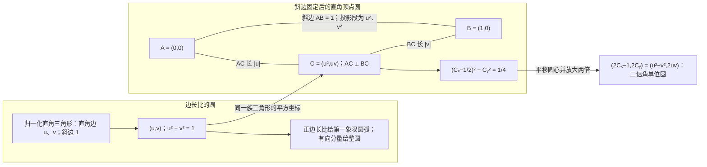
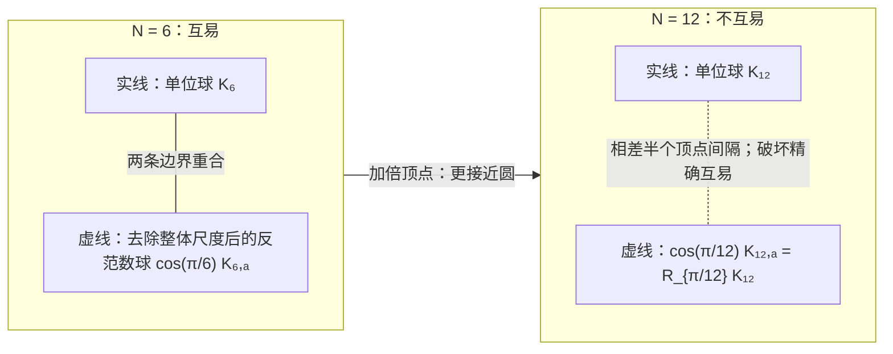

# 互不减关系、凸多边形与三维平方闭合

> 来源：用户于 2026-11-05（Asia/Singapore）在本会话提供的 AURIC C138 LaTeX 研究工作稿；原稿未另署作者或模型。本文为参考输入，Lean 是仓库的数学真源；本次仅转换 Markdown，未作形式化认证。正文中的固定快照、项目核读叙述与理论结论均保留原稿口径；两幅 TikZ 图转换为 Mermaid 示意图，每幅保留两个面板。

AURIC 量子关系研究　C138

从直角三角形的平衡，回溯到一个二元互易条件

2026 年 11 月 5 日　Asia/Singapore

**本轮结论。** 先允许原等量轮廓是一般中心对称凸形，用它给出的实际范数 $N$ 定义二元关系： 沿另一份比较的正、负方向都不能使自己缩短。 在至少三条独立实方向的同一来源中，只要求这种关系互易，就迫使*原* $N^2$ 是正定二次形式。 原尺子、零超平面、勾股式及全部归一化圆一起恢复，原始单位也保留。

**本轮唯一候选。**

$$
x\perp_N y\quad:\!\Longleftrightarrow\quad
 N(x+ty)\ge N(x)\quad(\forall t\in\mathbb R),
 \qquad
 \boxed{x\perp_Ny\ \Longrightarrow\ y\perp_Nx.}
$$

这里的范数、实线性载体和 $\dim_\mathbb RV\ge3$ 是明示来源。 主表示采用 Kakutani–James 的经典三维刻画，给出投影归约、全域极化及后续推论；经典凸体依赖明确列出。

**几何与反例。** 归一化直角三角形的边长比 $(u,v)$ 落在单位圆上；固定斜边后的直角顶点为 $(u^2,uv)$， 再平移缩放恰得到 $(u^2-v^2,2uv)$。 二维正 $4k+2$ 边形也满足全部互易却不满足平方律，正 $4k$ 边形有显式反向缩短见证。 原六边形接上一条实轴后，可以保留水平互易与所有竖直截面欧氏，斜截面仍暴露失败。 因此三维相容是实质条件，素数边数不能替代它。

**简化与来源的计账。** C137 输入完整零关系，本轮输入原范数并从中*定义*零关系，二者的全部输入不可直接比较。 在已给范数的同一来源中，独立几何条件确实压成一项互易； 复相位、全效果概率、原过程、联合和时间的来源关系随后逐项重构。 无限标签可复用有限阶关系；有限读口的平方预算同时说明，局部三维不意味着整个载体只有三维。

## 1　最新仓库与本轮需要继续回溯的部分

本轮固定默认分支 `dev` 的 [`66c49bfe9a12`](https://github.com/the-omega-institute/trureturing/commit/66c49bfe9a1295ceea872b6e6a1d8146fb351237)， 提交时间为 2026 年 11 月 4 日 21:28:20 UTC，即新加坡时间 11 月 5 日 05:28:20。 相对 C137 的 `ba97bbfd0aab`，完整比较给出三个新增可达提交和九个变更文件， 均属 Hardin A185765 六列二元数组的避迹递推。 本轮读到的新增 [Blueprint](https://github.com/the-omega-institute/trureturing/blob/66c49bfe9a1295ceea872b6e6a1d8146fb351237/Blueprint/D5/S3/Combinatorics/TraceAvoidingArrays/HardinA185765Recurrence.md) 以三个有限等式认证残差，并用线性转移把九阶递推传播到全部声明指标。 这里核读了该 Blueprint 全文，未重新运行 Lean，也未把这个计数递推当作新的量子前提。

两个提交的整个 `docs` 子树标识相同；缓存中的完整递归树有 1375 项且未截断。 因此，本轮涉及的量子和多边形理论文档在此区间没有改动。 以下旧文均以当前子树的 Git blob 标识重新核对，并按明示范围重读。

### 1.1　三角形的平衡已经有明确的预算类型

项目 [《内生分类、相对补集与多边形几何》](https://github.com/the-omega-institute/trureturing/blob/66c49bfe9a1295ceea872b6e6a1d8146fb351237/docs/develop/theory/AURIC_FIB_ATOM_INTRINSIC_CLASSIFICATION_AND_POLYGON_GEOMETRY.md) §§2–4 区分共同原点的差弦与连续边的和弦，并给出

$$
\|u\pm v\|^2=a^2+b^2\pm2g(u,v),
 \qquad \det(u,v)^2=a^2b^2-g(u,v)^2.
$$

在固定两边 $a,b$ 的任务里，$g=0$ 恰使面积最大； 若改为固定三边平方和，最大面积对应等边三角形。 所以“平衡”必须带着所固定的量，直角并不在所有优化任务中占同一位置。 这些公式在原文中以已给欧氏标定为前件；本轮要研究这种标定如何由更弱的比较条件恢复。

同文 §4 给出另一种有限相容性：三角核 $K$ 对严格凸多边形的全部剖分给出同一合计， 当且仅当每个凸四元组满足

$$
K(a,b,c)+K(a,c,d)=K(a,b,d)+K(b,c,d).
$$

这是三角片的翻边相容关系，不单独推出欧氏长度或量子概率。 原文还给出只检查正方形会漏过的明确反例。

### 1.2　素数边数、圆极限与黄金三角已有不同的入口

同一多边形文档 §§9–10 已证明：固定外半径时，正 $N$ 边形面积以 $O(N^{-2})$ 余量趋向圆； 素数边数不因此获得面积优势。在顶点循环 $\mathbb Z/N\mathbb Z$ 中， 每个非零步长都走遍全圈当且仅当 $N$ 为素数，但任意凸素数边形仍可剖分为 $N-2$ 个三角形。 对正素数边形，精确有理中心权重唯一为均匀权重；换成实权重，中心纤维的局部维数是 $N-3$。 原文同时保留精确计数与有限精度的边界，未把循环的不可分性等同于几何不可分性。

[V17](https://github.com/the-omega-institute/trureturing/blob/66c49bfe9a1295ceea872b6e6a1d8146fb351237/docs/develop/theory/AURIC_SUM_PRODUCT_LOGARITHMS_AND_QUANTUM_PYTHAGOREAN_GEOMETRY_V17.md) §8 的平方重量唯一性明确使用已给 Hilbert 几何、全部相关酉对称和正交可加性； §12.2 则在实际供应 Fibonacci 融合 $d^2=1+d$ 后选出 $a=\varphi^{-1}$、$b=\varphi^{-1/2}$ 的归一三角 $a^2+b^2=1$。 一般归一三角仍有连续多个解；具体黄金比例来自该融合或相应自相似关系。

[《多边形闭合、约数体与 5040 的关联边界》](https://github.com/the-omega-institute/trureturing/blob/66c49bfe9a1295ceea872b6e6a1d8146fb351237/docs/develop/theory/AURIC_FIB_DIVISOR_POLYGON_ASSOCIATION_BOUNDARY_GEOMETRY.md) §5 把秩生成式 $[5]_t[3]_t(1+t)^2$ 的因子接到单位根的圆周相消， 但 §6 的关联读出体是一个非正六棱柱。 边数相同不供应相同的旋转群或相同的范数；这里的六边形不能直接认作后文的正六边形单位球。

### 1.3　本轮压缩的准确范围

[C130 §4](https://github.com/the-omega-institute/trureturing/blob/66c49bfe9a1295ceea872b6e6a1d8146fb351237/docs/develop/theory/AURIC_C130_MUTUAL_READOUT_BOUND_QUANTUM_RELATIONS.md) 已从有限相位预算的外接多边形走到全部相位的圆盘； 再允许相反缩放，才从半和界得到精确乘积界 $|B(f,g)|^2\le Q(f)Q(g)$。 原文的连续相位来自已给复配方模型，没有从“看起来是圆”直接授予实际相位控制。

[C127 §2.4](https://github.com/the-omega-institute/trureturing/blob/66c49bfe9a1295ceea872b6e6a1d8146fb351237/docs/develop/theory/AURIC_C127_UNIT_TWO_NULL_DECOMPOSITION_COMPLETE_QUANTUM_RECORDS.md) 也已用 $Q(x)=\|x\|_4^2$ 指出：没有非平凡零历史，并不等于已有平方几何。 因此，本轮若从一般范数的沿线最小关系出发，必须证明这项关系确实排除非 Hilbert 范数。 减少独立的关系条件，与预先供应一个实线性空间及其范数，是两项分别记录的工作。 后者若已由同一来源给定，就可讨论前者的压缩；不能把新的输入隐藏在较短的候选句子中。

**白话。** 项目已经把许多图像的适用范围分开了：三角形在什么预算下最平衡，多边形怎样拼接， 素数在哪种循环任务里特殊，有限边怎样逼近圆，黄金比例又由哪条递归选出。 这轮继续向前退，追问圆和平方尺子是否必需预先输入，还是可以由双方同意的比较规则恢复。 旧来源继续保留，新的简化只在同一接口上计算。

## 2　直角三角形、圆与二元二次提升

本节先把直觉放进已标定的欧氏图像，明确本轮要恢复的目标；下一节才从一般凸形尺度出发证明它。 因此，本节的勾股式和面积式不作为下一节的隐含来源。

### 2.1　一个三角形给一个点，全部归一分解给一段圆

给非退化直角三角形两条直角边 $a,b>0$、斜边 $c>0$，令

$$
u=\frac ac,\qquad v=\frac bc.
$$

勾股式等价于 $u^2+v^2=1$。一份三角形仍是一份三角形，其边长比对应第一象限单位圆上的一个点。 遍历全部正边长比得到开四分之一圆弧；加入退化端点得到闭圆弧，允许有向分量才得到整圆。 公共缩放 $(a,b,c)\mapsto(\lambda a,\lambda b,\lambda c)$ 被这次归一化消去。

#### 命题 2.1：Thales 圆与同一二次提升

在固定斜边 $A=(0,0)$、$B=(1,0)$ 的表示中，取

$$
C=(u^2,uv),\qquad u^2+v^2=1.
$$

则 $|AC|=|u|$、$|BC|=|v|$，且 $AC\perp BC$。所有这些 $C$ 位于以 $AB$ 为直径的圆上， 并有

$$
\left(C_x-\frac12\right)^2+C_y^2=\frac14,
 \qquad (2C_x-1,2C_y)=(u^2-v^2,2uv).
$$

后一对坐标就是同一个实射影方向的二倍角表示。

**证明。**

$|C|^2=u^4+u^2v^2=u^2$， $|C-B|^2=(u^2-1)^2+u^2v^2=v^2$，而 $C\cdot(C-B)=u^2(u^2+v^2-1)=0$。 圆方程由 $C_x^2+C_y^2=C_x$ 得到；又 $2u^2-1=u^2-v^2$。 写 $u=\cos\theta,v=\sin\theta$，便得到 $(\cos2\theta,\sin2\theta)$。

$\square$

**图 1：** 两幅圆记录同一族归一化直角三角形。左图记录边长比，右图记录固定斜边后的直角顶点。 右图圆心平移再放大两倍，恰给 $(u^2-v^2,2uv)$；平方坐标在这里有明确投影意义。

恢复未归一化变量，这个三坐标提升为

$$
[a:b]\longmapsto[X:Y:Z]
 =[a^2-b^2:2ab:a^2+b^2],\qquad X^2+Y^2=Z^2.
$$

非零实方向有 $Z>0$，所以可令 $Z=1$ 得圆。它是一个一维对象的三齐次坐标表示； 与下一节三条独立比较的三维载体分别使用。

### 2.2　交叉项消失的平衡，以及不同预算的极值

为免与向量 $x$ 混同，把最初二次式的参数写成 $\chi$：

$$
Q_\chi(a,b)=a^2+\chi ab+b^2,
 \qquad G_\chi=\begin{pmatrix}1&\chi/2\\\chi/2&1\end{pmatrix}.
$$

其特征值为 $1\pm\chi/2$，故正等量线 $Q_\chi=c^2>0$ 在 $|\chi|<2$ 时是椭圆，$\chi=0$ 时是圆， $\chi=\pm2$ 时退化为 $(a\pm b)^2$，$|\chi|>2$ 时形式不定。 因此 $\chi=2$ 并不产生圆；它表示两条单位方向完全同向时的秩一极限。 $ab$ 对两个参数分别线性，对参数对 $(a,b)$ 则为二次项。

若 $e,f$ 是两条欧氏单位方向，则

$$
\|ae+bf\|^2=a^2+2ab\,g(e,f)+b^2,
 \qquad \chi=2\cos\theta.
$$

固定对角单位后，$\chi=0$ 同时使交叉项消失、两个特征值相等，并使 $\det G_\chi=1-\chi^2/4$ 最大。这是右角的一个准确“平衡”含义。 用三角形内部夹角表示对边时，应取差向量并换为余弦定理中的负号。

不同优化任务的平衡点仍要分开：固定两边 $a,b$，面积 $ab\sin\theta/2$ 在直角达到最大； 在直角族内固定斜边 $c$，$ab/2\le c^2/4$，等号要求 $a=b$； 若固定三边平方和 $E=a^2+b^2+c^2$，则

$$
E^2-48A_\triangle^2
 =2\bigl((a^2-b^2)^2+(b^2-c^2)^2+(c^2-a^2)^2\bigr),
$$

最大面积发生在等边。最后一式及其完整预算范围已在项目多边形主卷给出，见第 1节。

### 2.3　平方坐标已经是一个有限正矩阵图像

归一化实二元向量给秩一矩阵

$$
M=\begin{pmatrix}u^2&uv\\uv&v^2\end{pmatrix}\ge0,
 \qquad \operatorname{Tr}M=1,\qquad \det M=0.
$$

其坐标 $(X,Y)=(u^2-v^2,2uv)$ 满足 $X^2+Y^2=1$。 若允许全部实对称正矩阵 $\left(\begin{smallmatrix}p&r\\r&1-p\end{smallmatrix}\right)$， 则 $r^2\le p(1-p)$ 等价于 $(2p-1)^2+(2r)^2\le1$，得到圆盘。 这些是正矩阵的代数事实，尚未把 $u^2$ 指定为实际事件频率。 后文还会明确相位和全效果评价怎样把这一几何图像接入复量子理论。

**白话。** 把斜边都调成同样长，每个直角三角形的两条边长比例就是圆上的一个点。 若固定斜边的两个端点，直角顶点又沿另一条圆移动；这两个圆由平方和乘积精确联系。 直角的平衡是交叉项恰好消失，不是所有预算下都由同一种三角形取最大值。 真正需要回溯的问题是：为什么我们的原尺子一定服从平方关系，而不能把等量线画成六边形？

## 3　本轮候选：互不减关系的互易性

### 3.1　先说明来源，再压缩相容条件

设 $V$ 是来源已经给出的实线性比较载体，$\dim_{\mathbb R}V\ge3$。 本轮入口另有一个*实际尺度* $N:V\to[0,\infty)$，满足范数条件

$$
N(x)=0\iff x=0,\qquad N(tx)=|t|N(x),\qquad
 N(x+y)\le N(x)+N(y).
 \tag{N}
$$

若来源首先给出半范数，应先明确其不可见核与可见商；原档案标签仍另外保存。 在有限维窗口中，也可等价地从一个含原点为内点、闭、有界、凸且中心对称的原单位体 $K$ 出发， 取其 Minkowski 泛函 $N(x)=\inf\{r>0:x\in rK\}$。 条件 (N) 不包含平行四边形律，不预设球面是椭球，更没有预设概率。

#### 定义 3.1：二元互不减关系

定义

$$
x\perp_N y
 \quad\Longleftrightarrow\quad
 N(x+ty)\ge N(x)\quad\text{对每个 }t\in\mathbb R.
 \tag{M}
$$

它表示沿 $y$ 的正、负两个方向都不能缩短 $x$。 这是 Birkhoff–James 正交的原范数定义[\[7\]](#ref-james1947)；此时尚未把它认定为欧氏直角。

#### 定义 3.2：C138：互不减互易

在同一个来源 $(V,N)$ 上，唯一新增的二元相容条件为

$$
\boxed{\quad x\perp_N y\ \Longrightarrow\ y\perp_N x
 \qquad(x,y\in V).\quad}
 \tag{R}
$$

交换变量后，这个蕴含也就是等价。

范数本身已使关系对两边的实缩放齐次，且 $x\perp_N x$ 当且仅当 $x=0$：非零时取 $t=-1$ 即反证。 但 (R) 并非范数定义的重复。对项目 C127 已保留的 $\ell^4$ 型坏模型，在 $\mathbb R^3$ 中取 $x=(1,2,0)$、$y=(8,-1,0)$。 凸函数 $N(x+ty)^4$ 在 $t=0$ 的导数为零，所以 $x\perp_N y$； 但 $N(y-x)^4=7^4+(-3)^4=2482<4097=N(y)^4$，所以反向关系失败。

本轮只把*给定范数来源中的几何相容条件*压缩为 (R)。 C137 以实载体与原零关系为入口，本轮以实载体与原范数为入口；后者包含完整尺度数据。 所以两种签名不能仅按公式条数比较，更不能声称本轮从更少的全部信息无条件推出前一轮。 真正的简化是：零关系的非自零、齐次性由定义产生，零超平面闭合随后成为定理。 范数来源也不能删除：例如 $M(x)=\|x\|_2^3$ 与欧氏范数具有相同的沿线最小关系，故全部互易； 但 $M(2x)^2=64M(x)^2$，并非二次平方量。它不满足 (N) 的一次齐次条件，准确落在候选范围之外。

### 3.2　支持关系与三维投影

#### 引理 3.3：同一个范数的支持证据

对 $x\ne0$，$x\perp_N y$ 当且仅当存在实连续线性泛函 $f$，满足

$$
\|f\|_*=1,\qquad f(x)=N(x),\qquad f(y)=0.
$$

在有限维单位体图像中，这表示：过 $x/N(x)$ 有一张支持超平面，其方向平行于 $y$。

**证明。**

有这样的 $f$ 时，$N(x+ty)\ge f(x+ty)=N(x)$。 反向，若 $x,y$ 独立，在其线性张成上定义 $f(ax+by)=aN(x)$。当 $a\ne0$ 时，(M) 与齐次性给

$$
|f(ax+by)|=|a|N(x)
 \le |a|N\bigl(x+(b/a)y\bigr)=N(ax+by).
$$

$a=0$ 时不等式同样成立。此泛函在 $x$ 处达到范数一，由 Hahn–Banach 定理等范数延拓。 若 $y$ 与 $x$ 相关，(M) 只能在 $y=0$ 时成立，此时从 $\mathbb Rx$ 延拓即可。 以下论证仅使用三维窗口，因而只需要有限维版本。

$\square$

#### 引理 3.4：Kakutani 的三维投影刻画；引用的经典定理

若一个三维实范数空间的每个二维线性子空间都是某个范数一线性投影的像， 则其*原范数*由正定内积产生。

这是 Kakutani 的定理 4[\[8\]](#ref-kakutani1940)，完整凸几何证明另见 Phillips[\[9\]](#ref-phillips1940)。 本稿明确引用这个三维凸体刻画， 不把下面的短归约当作对该经典定理全部证明的重新给出。 它是一项已经证明的数学工具；本轮的来源条件仍只有 (N)、维数前提与 (R)。 James 定理 1 正是通过这种投影归约得到不需要光滑性或严格凸性的结论[\[7\]](#ref-james1947)。

#### 命题 3.5：二元互易产生原平面的收缩投影

设 (R) 成立。对任意三维子空间 $W\subseteq V$ 与二维子空间 $M\subset W$， 存在原线性投影 $P:W\to M$，满足 $N(Pz)\le N(z)$，且 $\|P\|=1$。

**证明。**

取非零线性泛函 $\phi:W\to\mathbb R$，使 $\operatorname{ker}\phi=M$。 三维单位球紧，故存在 $u$ 满足

$$
N(u)=1,\qquad \phi(u)=\max_{N(z)\le1}\phi(z)=\|\phi\|_*>0.
$$

因此 $u\notin M$，且对每个 $m\in M$ 和 $t\in\mathbb R$，

$$
N(u+tm)\ge \frac{\phi(u+tm)}{\|\phi\|_*}=1.
$$

于是 $u\perp_N m$，由 (R) 得 $m\perp_N u$。 在直和 $W=M\oplus\mathbb Ru$ 上定义 $P(m+tu)=m$，便有 $N(P(m+tu))=N(m)\le N(m+tu)$。 投影在非零空间 $M$ 上为恒等，故其算子范数恰为一。

$\square$

### 3.3　完整分类：原尺度必为平方几何

#### 定理 3.6：C138 的全部模型与三维闭合

对满足 (N) 且 $\dim_\mathbb RV\ge3$ 的同一来源，以下四项等价：

- \(i\) 二元互不减关系满足 (R)。

- \(ii\) 每个三维子空间上的原范数都来自正定内积。

- \(iii\) 原平方量 $q=N^2$ 满足

  $$
  q(x+y)+q(x-y)=2q(x)+2q(y)\qquad(x,y\in V).
  $$

- \(iv\) 存在唯一正定对称实双线性形式 $g$，使

  $$
  N(x)^2=g(x,x),\qquad
    g(x,y)=\frac{N(x+y)^2-N(x-y)^2}{4}.
  $$

这些等价不要求原空间完备、可分、有限维、光滑或严格凸。

**证明。**

(i)$\Rightarrow$(ii)：命题 3.5 在每个三维窗口内给出所有二维收缩投影， 应用引理 3.4。

(ii)$\Rightarrow$(iii)：任意 $x,y$ 都包含在某个三维子空间中，在该原窗口内应用内积恒等式。

(iii)$\Rightarrow$(iv)：令 $b(x,y)=\bigl(q(x+y)-q(x-y)\bigr)/4$。 $q$ 偶对称且二次齐次，故 $b$ 对称、$b(0,y)=0$。 平行四边形恒等式相减给

$$
b(x+z,y)+b(x-z,y)=2b(x,y).
$$

取 $z=x$ 得 $b(2x,y)=2b(x,y)$；再以 $x=(u+v)/2$、$z=(u-v)/2$ 代入，得 $b(u+v,y)=b(u,y)+b(v,y)$。 因此 $b$ 对两边加性且有理齐次。范数连续使 $b$ 连续，有理逼近遂给实双线性。 又 $b(x,x)=q(x)>0$（$x\ne0$），所以 $g=b$ 为所需内积。 任何具有同一对角 $q$ 的对称双线性形式都由极化式唯一确定。

(iv)$\Rightarrow$(i)：对 $y\ne0$，

$$
N(x+ty)^2=g(x,x)+2t g(x,y)+t^2g(y,y)
$$

在 $t=0$ 取最小值当且仅当 $g(x,y)=0$，这显然对称。 $y=0$ 的情况直接成立。

$\square$

这里没有另造一个相似于原来源的 Euclidean 模型：被表示的对角正是*原* $N^2$。 尺度既已由 $N$ 指定，$g$ 唯一而非仅唯一到比例；若比较者改变共同单位，$N$ 与 $g$ 分别按一次和二次比例变化。 作为直接推论，非零 $x$ 的零集合现在自动成为

$$
H_x=\{y:x\perp_N y\}=\operatorname{ker}g(x,\cdot),
$$

故完整接回 C137 的零超平面、互易与非自零结构。 由 $g$ 产生的度量完成是实 Hilbert 空间；这只保证原 $V$ 整体在该完成中稠密， 不保证某一个观察者的日志或某一条门序列也稠密。

### 3.4　直角、最小余量与归一化圆

#### 推论 3.7：原比较的唯一最小余量

对 $y\ne0$，令

$$
a=\frac{g(x,y)}{g(y,y)},\qquad r=x-ay.
$$

则 $a$ 是 $t\mapsto N(x-ty)$ 的唯一最小点，$r\perp_N y$，并且

$$
\boxed{\quad N(x)^2=a^2N(y)^2+N(r)^2.\quad}
$$

**证明。**

展开得

$$
N(x-ty)^2=N(r)^2+(t-a)^2N(y)^2.
$$

$N(y)>0$ 给唯一最小点，交叉项的消失给 $r\perp_N y$；取 $t=0$ 即得结论。

$\square$

当 $x\ne0$，令 $A=|a|N(y)/N(x)$、$B=N(r)/N(x)$，于是 $A^2+B^2=1$。 一份具体比较给出第一象限圆弧上的一个点；允许有向分量并改变比较配方，才遍历相应的整个归一化圆。 直角的准确平衡含义是：两个分量之间不存在可以降低原尺度的正向或反向调整。

反过来，这种平衡在单独二维中仍可形成多边形；下一节的六边形给出精确反例。 三维条件用于迫使所有平面遵守同一个平方量，不能以一个平面的视觉对称替代。

**白话。** 先允许“等量”的外形是任意中心对称的凸形，不预先画成圆。 拿两份比较试着相互抵消：如果沿另一份比较的正、负两个方向都不能使我缩短，那么交换双方后也应如此。 在一个平面里，这种互不减仍可能画出六边形；把同一规则放进每个三维窗口，所有平面便必须共同服从一套平方几何。 这时直角就是不能继续互相抵消的平衡，斜边的平方恰好分成两份余量的平方；用总尺度归一化，所有这样的分解落在圆上。

## 4　凸多边形的互易、三维阻碍与递归极限

本节的凸体是*有符号比较的单位球*。它与量子态的凸混合集属于不同载体： 单位球要求原点在内部并满足 $K=-K$，混合态集合通常不满足这些条件。 平面中的紧凸体 $K=-K$、$0\in\operatorname{int}K$ 定义范数

$$
\|x\|_K=\inf\{r>0:x\in rK\}.
$$

凸性给三角不等式，中心对称给 $\|-x\|_K=\|x\|_K$，有界性与内部性给正定及有限性。 奇数边的正多边形本身不中心对称；它只给一般的非对称规范函数。 若比较允许正负配方，把它扩成 $\operatorname{conv}(K\cup-K)$，才得到相应范数球。

### 4.1　把支撑线转成二元互不减关系

固定一个非零面积形式 $[x,y]$；在某组坐标中可取行列式。 对给定平面范数定义反范数

$$
\|y\|_a=\max_{\|x\|_K\le1}|[x,y]|.
$$

选择面积单位只改变总体尺度；反转面积定向不改变这个绝对值。 文献中的反范数与 Radon 曲线关系见[\[10\]](#ref-martini2004)，下列所用事实直接证明。

#### 引理 4.1：支撑线、反范数与互不减的反向

对非零 $x,y$，有

$$
x\perp_B y
 \quad\Longleftrightarrow\quad
 |[x,y]|=\|x\|_K\|y\|_a
 \quad\Longleftrightarrow\quad
 y\perp_{B,a}x.
$$

这里 $x\perp_B y$ 表示 $\|x+ty\|_K\ge\|x\|_K$ 对全部 $t\in\mathbb R$ 成立， 最后的关系使用反范数。反范数的反范数恰为原范数。

**证明。**

直线 $x+\mathbb Ry$ 上的函数 $[\,\cdot\,,y]$ 恒为 $[x,y]$。 该直线在 $x$ 支撑 $\|x\|_K K$，恰当且仅当上述绝对值达到这个凸体上的最大值， 即 $\|x\|_K\|y\|_a$。支撑等价于直线不进入凸体内部，也就是互不减定义。

由 $|[x,y]|\le\|x\|_K\|y\|_a$ 得 $\|x\|_{a,a}\le\|x\|_K$。 反向，在 $x/\|x\|_K$ 取一个支撑泛函 $f$，使 $\max_K|f|=1$、$f(x)=\|x\|_K$。 二维中存在唯一 $y$ 满足 $f(z)=[z,y]$，所以 $\|y\|_a=1$；代入反范数定义得 $\|x\|_{a,a}\ge|[x,y]|=\|x\|_K$。 将已证的第一个等价应用于反范数，并使用 $\|x\|_{a,a}=\|x\|_K$，即得最后的等价。

$\square$

特别地，若 $\|x\|_a=c\|x\|_K$，$c>0$，则等号条件成为 $|[x,y]|=c\|x\|_K\|y\|_K$，显然双方互易。 这样的平面称为 Radon 平面。一般平面中，互易也迫使范数与反范数成比例， 这是[\[10\]](#ref-martini2004) 的 Theorem 1 与 Corollary 1；下文的正多边形分类只需上面已证明的充分方向和显式反例。

### 4.2　正多边形的精确筛选：模四，而非素性

令 $N\ge4$ 为偶数，$u(\phi)=(\cos\phi,\sin\phi)$，并取

$$
K_N=\operatorname{conv}\{u(2\pi j/N):0\le j<N\},\qquad
 \theta=\pi/N,\qquad r=\cos\theta.
$$

记其规范范数为 $\|\cdot\|_N$。本段的欧氏坐标只用于明确计算这一族凸体， 没有预先把 $\|\cdot\|_N$ 规定为欧氏范数。

#### 定理 4.2：正偶数边形的互易分类及失败量

正 $N$ 边形的范数满足互不减关系互易，恰当且仅当

$$
N\equiv2\pmod4.
$$

在该情形，标准行列式的反范数为 $\|x\|_a=r\|x\|_N$。 若 $N\equiv0\pmod4$，则存在单位向量 $x,y$，使 $x\perp_B y$，但

$$
\min_{t\in\mathbb R}\|y+tx\|_N=r^2<1.
$$

因此这对向量的反向缩短量准确为 $1-r^2=\sin^2(\pi/N)$。

**证明。**

各边的外法向为 $u((2j+1)\theta)$，支撑值为 $r$，故欧氏极体为

$$
K_N^\circ
 =\operatorname{conv}\{r^{-1}u((2j+1)\theta):0\le j<N\}
 =r^{-1}R_\theta K_N.
$$

令辅助坐标旋转 $J_0=R_{\pi/2}$。由 $[x,y]=(J_0x)\cdot y$ 及中心对称，反范数单位球为

$$
K_{N,a}=J_0K_N^\circ=r^{-1}R_{\pi/2+\theta}K_N.
$$

若 $N=4k+2$，则 $\pi/2+\theta=(k+1)2\pi/N$ 是多边形的旋转对称， 于是 $K_{N,a}=r^{-1}K_N$，即 $\|\cdot\|_a=r\|\cdot\|_N$。 引理 4.1 给互易。

若 $N=4k$，取

$$
x=(1,0),\qquad y=r(-\sin\theta,\cos\theta).
$$

$x$ 是顶点，$y$ 是另一个边的中点，所以 $\|x\|_N=\|y\|_N=1$。 过 $x$ 且平行于 $y$ 的直线包含边 $[u(0),u(2\theta)]$，因而是支撑线，故 $x\perp_B y$。 取 $t_0=r\sin\theta$，有

$$
y+t_0x=(0,r^2),\qquad \|y+t_0x\|_N=r^2,
$$

其中使用了 $(0,1)$ 是 $N=4k$ 多边形的顶点。 所有 $y+tx$ 的第二坐标均为 $r^2$，而 $K_N$ 的第二坐标至多为一，所以其范数至少 $r^2$。 这证明所述精确最小值，也排除了互易。

$\square$

正 $6,10,14,18,\ldots$ 边形全部通过二维互易；正 $4,8,12,16,\ldots$ 边形全部失败。 这一经典分类也包含在[\[11\]](#ref-mandal2019) 的多边形 Radon 理论中。 对任意奇数 $m\ge3$，正 $m$ 边形与它的负像之凸包恰为正 $2m$ 边形： 原顶点角度为 $2j\pi/m$，负像补入奇数倍 $\pi/m$，二者合起来是全部 $2m$ 个顶点。 所以奇素数 $p$ 确实给出一个通过二维互易的正 $2p$ 边形，但奇合数 $m$ 也同样成立； 这里选择的是奇偶结构，未选择素数。

**图 2：** 实线为单位球 $K_N$，虚线为去掉整体尺度后的反范数单位球 $\cos(\pi/N)K_{N,a}$。六边形的两条边界重合；十二边形相差半个顶点间隔。 加倍边数更接近圆，却破坏精确互易。

### 4.3　二维完整互易仍不够：一个可直接计算的三维阻碍

#### 例 4.3：六边形的完全互易与平方律失败

定义

$$
H(s,t)=\max\{|s|,|t|,|s+t|\}.
$$

其单位球的六个顶点为 $\pm(1,0),\pm(0,1),\pm(1,-1)$。 可逆线性变换 $T(s,t)=(s+t/2,\sqrt3t/2)$ 把它们送到欧氏正六边形， 而互不减关系在这种范数搬运下保持，所以 $H$ 的全部互不减关系互易。 但是对 $e_1=(1,0),e_2=(0,1)$，

$$
H(e_1)=H(e_2)=1,\qquad H(e_1+e_2)=2,\qquad H(e_1-e_2)=1,
$$

故

$$
H(e_1+e_2)^2+H(e_1-e_2)^2=5\ne4=2H(e_1)^2+2H(e_2)^2.
$$

而 $e_1\perp_Be_2$ 与 $e_2\perp_Be_1$ 可直接从 $H(1,t)\ge1$、$H(t,1)\ge1$ 验证。 因此，在二维里，双方都处于沿对方滑动的最小值，仍不迫出勾股式。

#### 定理 4.4：水平 Radon、全部竖直截面欧氏，仍不足以认证三维

在 $\mathbb R^3$ 定义

$$
M(s,t,z)=\sqrt{H(s,t)^2+z^2}.
$$

这是一个范数。水平平面的限制为上述 Radon 范数； 对每个非零水平向量 $u$，平面 $\operatorname{span}\{(u,0),(0,0,1)\}$ 上的限制都是欧氏范数。 尽管如此，全空间的互不减关系并不互易。

**证明。**

范数的齐次性与正定性直接成立；三角不等式由 $H$ 的三角不等式， 再对二元非负向量 $(H(u),|z|)$ 应用欧氏三角不等式得到。 水平限制显然是 $H$。竖直截面中的向量写为 $(a u,b)$，于是

$$
M(a u,b)^2=a^2H(u)^2+b^2,
$$

为正定二次形式。

现在取同一空间中的

$$
x=(1,1,1),\qquad y=(4,-1,-6).
$$

因为 $H(1+4t,1-t)\ge|2+3t|$，对全部实数 $t$ 有

$$
M(x+ty)^2
 \ge(2+3t)^2+(1-6t)^2
 =5+45t^2\ge5=M(x)^2.
$$

故 $x\perp_B y$。但

$$
M(y)^2=4^2+(-6)^2=52,\qquad
 M(y+x)^2=5^2+(-5)^2=50<52,
$$

所以 $y\not\perp_Bx$。失败出现在斜截面 $\operatorname{span}\{x,y\}$。

$\square$

这个反例保留了无穷多个漂亮截面。它说明 C138 的三维提升必须检查*同一空间全部比较对*， 不能只检查一张水平图和全部经过一根指定轴的竖直图。 若同一三维空间的所有平面都互易，主重构定理才迫使各截面统一成为椭圆。

### 4.4　递归加边可以逼近圆，却不单调保留精确互易

#### 命题 4.5：奇倍细分、倍增与统一逼近界

任取奇整数 $m_j\ge3$，令

$$
N_k=2\prod_{j=1}^k m_j\qquad(k\ge1).
$$

使用同一个单位外接圆和同一个首顶点时，

$$
K_{N_k}\subseteq K_{N_{k+1}},
 \qquad N_k\equiv2\pmod4.
$$

每层多边形范数都精确互易，且对全部 $v\in\mathbb R^2$，

$$
|v|_2\le\|v\|_{N_k}
 \le\sec(\pi/N_k)|v|_2.
$$

因而这些范数单调趋向欧氏范数，单位方向上的误差为 $O(N_k^{-2})$。 相反，把任一 $N\equiv2\pmod4$ 层直接倍增为 $2N$， 虽有 $K_N\subset K_{2N}$ 并改进圆的逼近，却破坏精确互易。

**证明。**

$N_k$ 整除 $N_{k+1}$，故旧顶点全部保留，得到凸包包含。 奇数乘积仍奇，定理 4.2 给每层互易。 正 $N$ 边形包含半径 $\cos(\pi/N)$ 的圆盘，并被单位圆盘包含， 故规范函数满足所示双边界。$\sec t-1=t^2/2+O(t^4)$ 给误差阶； 凸包单调包含使规范函数单调下降。 倍增后 $2N\equiv0\pmod4$，由同一定理即知互易失败， 并有显式反向缩短量 $\sin^2(\pi/(2N))$。

$\square$

例如 $6\to18\to54\to\cdots$ 每层都互易，$6\to12$ 却立即失去互易；两种细分都可趋向同一个圆。 这些有限多边形都带有边段，均不是正定二次形式的单位球。 所以“有限层的几何越来越接近圆”与“每层保留同一个精确关系”是两个可分别验证的命题。 因子 $m_j$ 可以是素数也可以是合数。仓库已有的素数循环访问、精确有理中心任务有其各自条件， 不能由这里的奇倍递归替代，更不由边数因式分解直接供应量子系统的张量分解。

**白话。** 把一条边的方向移到一个顶点，若沿这条方向左右滑都不能缩短，就得到一条互不减关系。 正六边形也能让这种关系双方成立，甚至可以不断用奇数倍加边，始终保持互易并越来越像圆。 但把六边形放进同一个三维比较空间，不能只看水平和竖直的漂亮截面；斜着取两份比较，可能立刻出现一边不能缩、另一边却能缩的矛盾。 要求所有这些二元比较在三维中同时互易，才把多边形的自由压到同一套平方几何。 素数可以安排一种细分顺序，决定平方闭合的却是这些关系能否同时相容。

## 5　复相位与现有量子公理的完整条件重构

本节固定满足 C138 的有限维来源 $(V,N)$，用主定理恢复原内积 $g$ 与原平方量 $q=N^2$。 下列相位、事件、准备、过程和联合关系均分别说明来源；互不减互易没有替它们供应实际门或频率。

### 5.1　保持互不减关系的四分之一转，自动保持原尺度

#### 命题 5.1：相位入口与等长结论

若来源有实线性操作 $J$，满足 $J^2=-I$，并保持 $\perp_N$，则

$$
g(Jx,Jy)=g(x,y),\qquad
 h(x,y)=g(x,y)+i\,g(Jx,y)
$$

给出以 $ix=Jx$ 为复结构、对第一变量共轭线性的正定复内积。

**证明。**

$J^{-1}=-J$ 及齐次性使保持关系为双向。正定形式 $g_J(x,y)=g(Jx,Jy)$ 与 $g$ 因而有相同零核。 对每个非零 $x$，同核线性泛函成比例，$g_J(x,\cdot)=\lambda_xg(x,\cdot)$。 在独立的 $x,y$ 及 $x+y$ 上比较线性性，得到一个共同正数 $\lambda$。 应用两次 $J$ 给 $\lambda^2=1$，故 $\lambda=1$。 于是 $g(Jx,y)=-g(x,Jy)$，从而所示 $h$ 共轭对称，满足 $h(Jx,y)=-ih(x,y)$、$h(x,Jy)=ih(x,y)$，且 $h(x,x)=g(x,x)>0$。

$\square$

因此 $R_\theta=\cos\theta I+\sin\theta J$ 是数学上的等距相位群。 对非零 $x$，$g(x,Jx)=0$，但 $Jx=ix$ 给 $[Jx]_\mathbb C=[x]_\mathbb C$： 同一对代表可以实正交、复平行。完整复正交则需要

$$
h(x,y)=0\iff g(x,y)=g(Jx,y)=0,
$$

不能用单个实零关系替代。实际门菜单是否实现全部 $R_\theta$，仍取决于其相位接口。

在实三维中 $J^2=-I$ 不可能，因为 $(\det J)^2=-1$。 复二维需要实四维；其单位向量球 $S^3$ 商去公共相位圆后才得到 $\mathbb{CP}^1\simeq S^2$，见[\[12\]](#ref-mosseri2001)。 对 $u^2+v^2=1$、$u,v\ge0$ 及相对相位 $\phi$，

$$
\psi=(u,ve^{i\phi}),\qquad
 n=(2uv\cos\phi,2uv\sin\phi,u^2-v^2),\qquad |n|^2=1.
$$

$\phi=0$ 给第 2.1命题实二倍角圆上的对应弧段；相对相位给出球面的其余方向。 一整圈公共相位代表同一纯态点；忘记圆的绕行方向仍留下圆，不会仅靠丢弃一个正负标签就使圆塌成点。 这也不选择物理空间手性或档案的时间箭头。

### 5.2　原事件、完整效果评价与 Born 概率

#### 定理 5.2：事件与准备的有限表示

每个原完整有限测试的事件 $e$ 若有权重 $q_e\ge0$，满足

$$
q_e(x+y)+q_e(x-y)=2q_e(x)+2q_e(y),\qquad
 \sum_e q_e(x)=q(x),\qquad q_e(Jx)=q_e(x),
$$

则存在唯一复效果 $E_e$，使

$$
0\le E_e\le I,\qquad \sum_eE_e=I,\qquad
 q_e(x)=h(x,E_ex).
$$

若同一原准备对全部效果 $0\le E\le I$ 给出非负评价 $p$，满足

$$
p(I)=1,\qquad p(E+F)=p(E)+p(F)\quad(E,F\ge0,\ E+F\le I),
$$

则存在唯一密度矩阵 $\rho$，使 $p(E)=\operatorname{Tr}(\rho E)$。 若原纯准备 $\psi$ 归一且 $p(P_\psi)=1$，则对任意归一向量 $\varphi$，

$$
\rho=P_\psi=\lvert \psi\rangle\langle \psi\rvert,
 \qquad p(P_\varphi)=|h(\psi,\varphi)|^2.
$$

**证明。**

极化 $b_e(x,y)=(q_e(x+y)-q_e(x-y))/4$。平行四边形方程给对称双加性； 非负性在有理组合上给 Cauchy–Schwarz，结合 $q_e\le q$ 得 $|b_e(x,y)|\le N(x)N(y)$，故连续并实双线性。 有限维内积表示给唯一自伴 $E_e$，形式界给 $0\le E_e\le I$，合计给单位； $J$ 不变性给 $E_eJ=JE_e$，因此是复效果。

对效果的可加性先给有理齐次；正性给序单调性，有理夹逼给实齐次。 对任意正算子 $A$，用 $t>0$ 且 $t\ge\|A\|$ 定义 $L(A)=t\,p(A/t)$，齐次性使定义与 $t$ 无关； 它在正锥可加，再按差延伸成 Hermitian 算子上的正实线性泛函。 有限矩阵的迹配对给唯一 Hermitian $\rho$，正性给 $\rho\ge0$，$p(I)=1$ 给迹一。 若 $p(P_\psi)=1$，则 $\operatorname{Tr}(\rho(I-P_\psi))=0$。 正性使 $\rho$ 的支撑包含在复一维子空间 $\mathbb C\psi$ 中，迹一遂给 $\rho=P_\psi$，代入秩一投影即得 Born 式。

$\square$

全效果而非仅二结果投影的范围，允许结论覆盖量子比特，参见[\[13\]](#ref-busch2003)。 若原事件还报告实际频率，其读出须与同一效果评价相容；数学效果的存在本身不授予所有效果的实际执行。 由谱分解 $A=\sum_j a_jP_j$ 得自伴可观察量及均值 $\operatorname{Tr}(\rho A)$。

#### 例 5.3：零与二结果归一化尚未固定频率

对 $0\le t\le1$，令 $f(t)=t^2/(t^2+(1-t)^2)$。 则 $f(0)=0$、$f(1)=1$ 且 $f(t)+f(1-t)=1$。 把量子比特几何重叠 $t$ 改读为 $f(t)$，保留零、确定性和每个二结果投影测试的归一化， 但 $f(1/4)=1/10\ne1/4$。它不满足全部效果的可加评价，故不被前一定理允许。

### 5.3　同一原过程的 Kraus 表示与投影更新

输入、输出各自已经由同样条件恢复为有限复空间，带各自原 $N$ 与相位 $J$。 设有限多个原细分支为 $F_j:V_{\rm in}\to V_{\rm out}$，$F_j(0)=0$，并满足

$$
\sum_jN_{\rm out}(F_j(x)-F_j(y))^2=N_{\rm in}(x-y)^2,
 \qquad F_jJ_{\rm in}=J_{\rm out}F_j.
 \tag{P}
$$

同一粗事件与原权重的联系要求

$$
q_e(x)=\sum_{j\in e}N_{\rm out}(F_j(x))^2\qquad\text{对全部 }x.
 \tag{E}
$$

实际经典随机混合按同权重仿射组合完整效果评价，原分支的串接尊重这种混合并使用同一输出效果评价。

#### 定理 5.4：原分支与原混合过程的表示

上述原 $F_j$ 本身为复线性映射 $K_j$，且

$$
\sum_jK_j^*K_j=I,\qquad E_e=\sum_{j\in e}K_j^*K_j,
 \qquad \Phi_e(\rho)=\sum_{j\in e}K_j\rho K_j^*.
$$

它们给完全正、总迹保持的原仪器；有条件结果态在分母非零时为 $\Phi_e(\rho)/\operatorname{Tr}\Phi_e(\rho)$。

**证明。**

$Y(x)=\bigoplus_jF_j(x)$ 保零且保持全部距离，极化给全部实 Gram 配对保持。 因此 $Y(x+z)-Y(x)-Y(z)$ 与 $Y(tx)-tY(x)$ 的平方范数用这些 Gram 配对展开均为零， 故 $Y$、各 $F_j$ 实线性。(P) 的相位条件使其复线性；对角校准给合计等距式。 (E) 的全部配方等式经极化给同一 $E_e$ 的表示。 纯分支输出为 $K_jP_\psi K_j^*$，实际混合与串接的仿射性把它唯一延伸为所示密度态公式。 对任意辅助矩阵大小，相同 Kraus 公式保持正性；合计等距给总迹保持。

$\square$

标准完全正表示见[\[14\]](#ref-watrous2018)。仅知道纯态上的作用而未给混合相容性时， 这里的公式是唯一仿射延伸，不能宣称一个任意的原混合态规则已经被强制等同。

若同空间事件效果为投影 $P$，还要求其像内*每条*纯态射线都保持，则得到 Lüders 更新。 确实，$\sum_jK_j^*K_j=P$ 给 $K_j=K_jP$；射线保持及正性给每个 $K_j$ 在 $\operatorname{Ran}P$ 上为标量 $c_jI$。 对两个独立向量及其和应用线性性，标量与向量无关；一维时直接成立，零维时更新为零。 当 $P\ne0$ 时 $\sum_j|c_j|^2=1$；连同零事件，均有 $\Phi(\rho)=P\rho P$。 仅有结果可重复还容许 $\operatorname{Ran}P$ 内部的额外旋转，不能代替这项条件。

### 5.4　独立联合与时间演化

#### 命题 5.5：联合代数的张量结构

若两组原可观察代数为 $M_d(\mathbb C)$、$M_m(\mathbb C)$，其幺元保持的 $*$-嵌入在非零联合代数中互相交换， 并共同生成联合代数，则该联合代数为 $M_d(\mathbb C)\otimes M_m(\mathbb C)\simeq M_{dm}(\mathbb C)$。

**证明。**

$(A,B)\mapsto\iota_A(A)\iota_B(B)$ 给张量积上的幺元保持 $*$-同态，生成条件给满射。 $M_d\otimes M_m\simeq M_{dm}$ 是简单代数，其核只能为零或全体；非零且保幺元排除后者。

$\square$

这一联合允许纠缠密度态，Kraus 过程对串接与张量并接闭合；局部保迹过程保持另一边缘。 两位观察者的局部记录或一对素因子标签，并不自动供应上述交换与共同生成关系。

#### 定理 5.6：保持互不减的连续流

若 $A_t$ 是原连续实线性一参数群，保持 $\perp_N$ 且与 $J$ 交换，则唯一存在 $\gamma\in\mathbb R$，使

$$
N(A_tx)^2=e^{2\gamma t}N(x)^2,\qquad U_t=e^{-\gamma t}A_t
$$

为连续复幺正群。原射线运动已经幺正；原绝对尺度守恒恰当且仅当 $\gamma=0$。

**证明。**

与相位命题相同的同零核论证给 $g(A_tx,A_ty)=\lambda_tg(x,y)$，$\lambda_t>0$。 群律给 $\lambda_{t+s}=\lambda_t\lambda_s$，连续性给 $\lambda_t=e^{2\gamma t}$。 去掉此倍率后等长、复线性且保持群律，即为幺正群；非零共同倍率不改变射线。

$\square$

有限维连续矩阵群可写为 $U_t=e^{tK}$，$K^*=-K$。 给作用量单位 $\hbar>0$，令 $\mathsf H=i\hbar K$，则

$$
i\hbar\dot\psi=\mathsf H\psi,\qquad
 i\hbar\dot\rho=[\mathsf H,\rho].
$$

时间参数、作用量单位和具体生成元仍由来源供应。 只给全部射线的一参数作用时，生成元只确定到实常数乘单位；单一轨迹还留下未访问子空间的自由。

反向，满足实维数前提的标准有限复量子模型，其原 Hilbert 范数、乘 $i$、效果评价、Kraus 分支及矩阵联合满足这些关系。 所以这是可双向核对的有限条件重构；低维子块可取限制。 它没有仅凭凸形或互易自动选出所有可制备态、具体物理相互作用或唯一全局态 $\omega$。

**白话。** 双方互不减先把原来的尺子锁成平方尺子，再用实际的一致转角把实平面接成复相位。 事件怎样分配总量、频率怎样对所有效果相加、过程怎样保持全部比较，分别把这套几何接成 Born 规则和量子仪器。 连续保关系的运动在射线上已经幺正，绝对总量校准再去掉共同放大。 每一步都作用在同一份原记录和原过程上，所需的来源关系没有藏进一个圆的图像。

## 6　素数多边形、高维投影与回溯的闭合位置

### 6.1　三角片递归需要翻边相容，而不需要为每个边数增添规则

给严格凸多边形的每个有向三角形一个原实响应 $K(a,b,c)\in\mathbb R$，取向继承原顶点循环次序。 项目多边形主卷的剖分定理可以直接复用为下面的有限模板：

$$
\boxed{K(a,b,c)+K(a,c,d)=K(a,b,d)+K(b,c,d).}
 \tag{F}
$$

这里量化所有相关凸四元组。它等价于同一顶点集的全部三角剖分有同一个总响应。 证明是把任意剖分逐次翻边成一个固定根顶点的扇形；每次翻边只改变一个四边形中的两块三角形， (F) 保持合计。反向在同一四边形选择两条对角线、消去相同外部剖分即可。 无新增顶点时，边计数 $3T=N+2D$ 与区域计数 $T=D+1$ 给 $T=N-2$。 所以素数边形也能递归剖分。

取面积核 $K(a,b,c)=\tfrac12(\det(a,b)+\det(b,c)+\det(c,a))$， 内部有向边成对消去，立即满足 (F)。这项闭合确保同一响应与剖分无关，不独自选择范数或概率。 若把面积改成面积的平方，则全部正方形仍通过翻边检验， 但顶点 $(0,0),(3,0),(2,1),(0,2)$ 的两种平方合计为 $25/4$ 与 $37/4$，已经不同。 这里重述的是项目已有的完整反例，而非一次新的发现。

### 6.2　素数的精确特殊性：循环访问与有理读口

#### 命题 6.1：循环与有理中心；复用项目 B-10

设 $N\ge3$。正 $N$ 边形顶点域 $\mathbb Z/N\mathbb Z$ 上，步长 $k$ 的返回周期为 $N/\gcd(N,k)$。 全部非零步长都遍历所有顶点，当且仅当 $N$ 为素数。 对素数 $p\ge3$ 与 $\zeta_p=e^{2\pi i/p}$，若有理权重满足

$$
\sum_{j=0}^{p-1}\lambda_j=1,\qquad
 \sum_{j=0}^{p-1}\lambda_j\zeta_p^j=0,
$$

则全部 $\lambda_j=1/p$。若改用实概率权重，中心附近的合法纤维维数为 $p-3$。

**证明。**

写 $N=gN',k=gk'$ 且 $\gcd(N',k')=1$，则 $N\mid mk$ 当且仅当 $N'\mid m$，给周期。 素数使每个非零步长互素；合数的真因子给短周期。

令 $f(T)=\sum_j\lambda_jT^j$。$\Phi_p(T)=1+T+\cdots+T^{p-1}$ 在 $\mathbb Q[T]$ 不可约： $\Phi_p(T+1)=((T+1)^p-1)/T$ 的非首项系数均被 $p$ 整除，常数 $p$ 不被 $p^2$ 整除， 所以 Eisenstein 判据适用。$f(\zeta_p)=0$ 且次数至多 $p-1$，故 $f=c\Phi_p$；归一化给 $c=1/p$。 实域中归一与两个坐标均值是三个独立线性约束；均匀权重全正，所以其核的局部可行维数为 $p-3$。

$\square$

若 $N$ 合数，给某个真因子 $d\ge2$ 的等间隔 $d$ 个顶点各权重 $1/d$， 就有非均匀有理中心表示。若只有有限精度，计数也不能认证素数整除： 总样本 $pm+1$ 中某顶点取 $m+1$ 次，其余各 $m$ 次，单位外半径的中心偏差为 $1/(pm+1)$， 可任意小，但总数始终不被 $p$ 整除。

因此，素数条件在这个读口中确实有内容，却不同于第 4.2定理的模四条件。 几何中没有一条“素数边形不能拆分”的统一结论；必须说明是哪一种分解与哪一种读数。

### 6.3　正多边形可精确实现为高维正交方向的投影

下面给“许多新标签是高维投影”的直觉一个完整实现。 正交坐标与投影是已给或由 C138 恢复的几何结构；标签可以称作素数，也可以是任意索引， 算术素性本身并不供应其正交性。

#### 定理 6.2：有限多边形的高维投影与遗失方向

设 $N\ge3$，$e_0,\ldots,e_{N-1}$ 是 $\mathbb R^N$ 的标准正交单位基。 令 $\theta_j=2\pi j/N$，定义两个单位向量

$$
c=\sqrt{\frac2N}(\cos\theta_j)_{j=0}^{N-1},\qquad
 s=\sqrt{\frac2N}(\sin\theta_j)_{j=0}^{N-1}.
$$

则 $c,s$ 正交。投影到它们的二维张成后，$e_j$ 的坐标为

$$
\sqrt{\frac2N}(\cos\theta_j,\sin\theta_j).
$$

这些像组成同一个正 $N$ 边形。每个原单位方向保留的平方量为 $2/N$，余量为 $1-2/N$。 该线性读口的核维数是 $N-2$；在概率归一超平面内，中心纤维局部维数是 $N-3$。

**证明。**

由 $\sum_j e^{2i\theta_j}=0$（$N\ge3$）得 $\sum\cos^2\theta_j=\sum\sin^2\theta_j=N/2$、$\sum\sin\theta_j\cos\theta_j=0$，故 $c,s$ 正交归一。 第 $j$ 个基向量与它们的内积就是所示坐标，投影平方量随即得到。 二维读口满秩给核维 $N-2$。归一行 $(1,\ldots,1)$ 与 $c,s$ 独立， 所以归一及中心三约束总秩为三；均匀正权重允许小核扰动，得到纤维维数。

$\square$

该构造对合数与素数 $N$ 同样成立。 把投影多边形共同放大到单位外接圆会改变尺度，不能因此声称所有原正交关系已被二维读口保存。 特别地，$N>3$ 个正交单位方向的 Gram 矩阵秩为 $N$，不能等距装进同一个实三维空间。 每个三元窗口可在三维描述，不意味着整个无限载体的维数也是三。

#### 命题 6.3：固定有限读口的平方预算

在任意实或复 Hilbert 空间中，令 $(e_j)$ 为一组正交单位方向，$P$ 为秩 $d<\infty$ 的正交投影，则

$$
\sum_j\|Pe_j\|^2\le d.
$$

因此对任意 $\varepsilon>0$，满足 $\|Pe_j\|\ge\varepsilon$ 的标签至多有 $d/\varepsilon^2$ 个。 固定有限读口不能把无限多个原正交单位方向全部读成同半径的非零圆周点。

**证明。**

取 $\operatorname{Ran}P$ 的正交单位基 $f_1,\ldots,f_d$。对任意有限指标集 $F$，

$$
\sum_{j\in F}\|Pe_j\|^2
 =\sum_{k=1}^d\sum_{j\in F}|\langle f_k,e_j\rangle|^2
 \le\sum_{k=1}^d\|f_k\|^2=d,
$$

其中不等式由每个 $f_k$ 减去其有限正交投影后的平方范数非负得到。 取有限部分和的上确界得到总和界，计数界随即成立。

$\square$

观察者可以扩充读口、改换投影、给不同标签使用不同尺度，或保存剩余分量； 这些都是需要记录的内部操作。将输出逐个重新归一化，会隐藏它们原来的投影权重。 这条平方预算说明，增加观察内容可以要求增加所记录的关系和维数，而不必增添新的平方规则。

### 6.4　五边形选出黄金比，直角本身保留连续自由

正五边形对角线与边长之比为 $d=2\cos(\pi/5)$。 五个单位根和为零给

$$
1+2\cos(2\pi/5)+2\cos(4\pi/5)=0.
$$

用 $2\cos(2\pi/5)=d^2-2$、$2\cos(4\pi/5)=-d$，得到

$$
d^2=d+1,
 \qquad d=\varphi,
 \qquad \varphi^{-2}+\varphi^{-1}=1.
$$

于是 $(u,v)=(\varphi^{-1},\varphi^{-1/2})$ 是一个明确的归一化直角三角形。 在全部 $u,v>0$ 且 $u^2+v^2=1$ 的族中，附加自相似条件 $v^2=u$ 唯一选出这个点。 项目 V17 的 Fibonacci 融合 $d^2=1+d$ 也给同一代数常数，见第 1节。 几何五重对称、融合规则与原门的结合相容数据仍须分别认证； 共享一个二次方程或单个矩阵 $F^2=I$ 不证明全部五边形、六边形过程相容。

### 6.5　内生约束与有限闭合的含义

原范数、相位、事件与日志都可以作为 $\Omega$ 内部的子关系。 数学推导把某项关系列作前件，表示尚未从更早关系推出它，并不表示必须从本体之外输入它。 本轮在同一个原范数来源上证明：互不减互易、所有三维窗口欧氏、原平方平行四边形、唯一原内积， 是同一结构的四种等价表达。比较的消去与投影不删除原档案，取得历史仍可完整保留。

相应的回溯已在这项表示定理处闭合：一旦该来源满足互易，就不必另外输入每个角度、 每条勾股式、每个零超平面和每种多边形的尺子。 三元几何窗口、四元翻边关系和固定递推式都可以统一约束无限多实例； 它们含有相应全称量词，不等于某个有限观察者已经检验了全部实例。 新的物理状态、可执行相位、实际频率与具体时间生成元仍各有来源问题。 本轮没有推出唯一 $\omega$，也没有证明全部物理关系最终必有一个有限的完整描述。

### 6.6　本轮完整白话

**白话。** 先不把等量线画成圆，允许它是一张有棱有角的凸形。 拿两份比较相互试：如果沿你正着加、反着减，都不能让我更短，那么交换过来，也不能借我把你缩短。 一张平面里的六边形也能做到这点；把同一要求放进全部三维窗口，水平、竖直、斜着看的关系就必须同时对上， 原来的尺子才会被锁成平方尺子。直角是两份余量不能继续互相抵消的位置；斜边调成一，全部这样的分解就在圆上。 多边形可以不断加边、三角片可以反复拼接，只要每次都保留同一套相容关系，就不用为新边数另发明一条规律。 素数在循环和精确计数里有特殊性，却不会单凭名字选出圆、概率或宇宙态。 观察者继续长出的是可读的方向与关系，已经闭合的平方规则可以一直复用。

## 参考文献

\[1\] The Omega Institute，*trureturing*，默认分支 `dev` 固定提交 [`66c49bfe9a12`](https://github.com/the-omega-institute/trureturing/commit/66c49bfe9a1295ceea872b6e6a1d8146fb351237)， 2026-11-05 05:28:20 Asia/Singapore。 [相对 C137 的固定比较](https://github.com/the-omega-institute/trureturing/compare/ba97bbfd0aab3adfa5f6a3d6621495ef96c06597...66c49bfe9a1295ceea872b6e6a1d8146fb351237)。 完整新增提交与文件范围、源码阅读范围和未重跑 Lean 的边界见第 1节。

\[2\] The Omega Institute， [*Auric FIB ATOM：内生分类、相对补集与多边形几何*](https://github.com/the-omega-institute/trureturing/blob/66c49bfe9a1295ceea872b6e6a1d8146fb351237/docs/develop/theory/AURIC_FIB_ATOM_INTRINSIC_CLASSIFICATION_AND_POLYGON_GEOMETRY.md)， §§1–4、9–10：预算、四边形翻边、圆极限、循环访问与有理中心。 本文所述相关结果复用这些已存在的原命题；其 Radon 仿射分割术语与本文的 Radon 范数曲线不同。

\[3\] The Omega Institute， [*Sum, Product, Logarithms and Quantum Pythagorean Geometry V17*](https://github.com/the-omega-institute/trureturing/blob/66c49bfe9a1295ceea872b6e6a1d8146fb351237/docs/develop/theory/AURIC_SUM_PRODUCT_LOGARITHMS_AND_QUANTUM_PYTHAGOREAN_GEOMETRY_V17.md)， §8、§12.1–12.2：既定 Hilbert 模型中的平方重量与 Fibonacci 融合选择的黄金三角。

\[4\] The Omega Institute， [*多边形闭合、约数体与 5040 的关联边界*](https://github.com/the-omega-institute/trureturing/blob/66c49bfe9a1295ceea872b6e6a1d8146fb351237/docs/develop/theory/AURIC_FIB_DIVISOR_POLYGON_ASSOCIATION_BOUNDARY_GEOMETRY.md)， §§5–6：单位根、黄金方程及非正六棱柱。

\[5\] The Omega Institute， [*C130: Mutual Readout Bound Quantum Relations*](https://github.com/the-omega-institute/trureturing/blob/66c49bfe9a1295ceea872b6e6a1d8146fb351237/docs/develop/theory/AURIC_C130_MUTUAL_READOUT_BOUND_QUANTUM_RELATIONS.md)， §§3–4：原核、零差商、相位多边形、圆盘与相反缩放后的乘积界。

\[6\] The Omega Institute， [*C127: Unit Two Null Decomposition Complete Quantum Records*](https://github.com/the-omega-institute/trureturing/blob/66c49bfe9a1295ceea872b6e6a1d8146fb351237/docs/develop/theory/AURIC_C127_UNIT_TWO_NULL_DECOMPOSITION_COMPLETE_QUANTUM_RECORDS.md)， §2.4：删除单位、二次结构及完整原记录前件的反例。

\[7\] R. C. James，*Inner products in normed linear spaces*， *Bulletin of the American Mathematical Society* **53** (1947), 559–566，Theorem 1。 [原论文全文](https://web.mat.upc.edu/etseib/calcul2/Apunts/James_Robert_C-Inner_products_in_normed_linear_spaces.pdf)； [DOI](https://doi.org/10.1090/S0002-9904-1947-08831-5)。 三维及以上实范数空间中的 Birkhoff–James 互易刻画。

\[8\] S. Kakutani，*Some characterizations of Euclidean space*， *Japanese Journal of Mathematics* **16** (1940), 93–97，Theorem 4。 [出版页及全文](https://www.jstage.jst.go.jp/article/jjm1924/16/0/16_0_93/_article)。 投稿日期为 1939 年 5 月 11 日，出版页列年份为 1940。 本文只使用明示三维的平面范数一投影刻画；其一般凸几何证明另见下一条。

\[9\] R. S. Phillips，*A characterization of euclidean spaces*， *Bulletin of the American Mathematical Society* **46** (1940), 930–933。 [DOI](https://doi.org/10.1090/S0002-9904-1940-07336-7)； [原论文扫描件](https://scispace.com/pdf/a-characterization-of-euclidean-spaces-zmv7hiooil.pdf)。 对三维凸体投影刻画给出初等证明，覆盖不预设光滑性的情形。

\[10\] H. Martini and K. J. Swanepoel，*Antinorms and Radon curves*， *Aequationes Mathematicae* **72** (2006), 110–138。 [2004 年作者预印本](https://arxiv.org/pdf/math/0409200)，§§3–6； 反范数、互不减的反向及 Radon 比例条件。

\[11\] K. Mandal, D. Sain and K. Paul，*A Geometric Characterization of Polygonal Radon Planes*， *Journal of Convex Analysis* **26**(4) (2019), 1113–1123。 [官方全文页](https://journalofconvexanalysis.com/articles/jca26061/)； [作者预印本](https://arxiv.org/html/1809.04760v2)。 本文对所用正多边形分类另给直接证明与失败见证。

\[12\] R. Mosseri and R. Dandoloff，*Geometry of entangled states, Bloch spheres and Hopf fibrations*， *Journal of Physics A* **34** (2001), 10243–10252。 [arXiv:quant-ph/0108137](https://arxiv.org/pdf/quant-ph/0108137)，§2。

\[13\] P. Busch，*Quantum states and generalized observables: a simple proof of Gleason’s theorem*， *Physical Review Letters* **91**, 120403 (2003)。 [arXiv:quant-ph/9909073v3](https://arxiv.org/abs/quant-ph/9909073)。 完整效果评价的密度态表示包含复二维，不能替换成二结果投影归一化。

\[14\] J. Watrous，*The Theory of Quantum Information*，Cambridge University Press (2018)。 [作者公开第 2 章](https://cs.uwaterloo.ca/~watrous/TQI/TQI.2.pdf)，Theorem 2.22。 本文的原过程识别另保留全部配方、相位、事件及混合串接条件。
