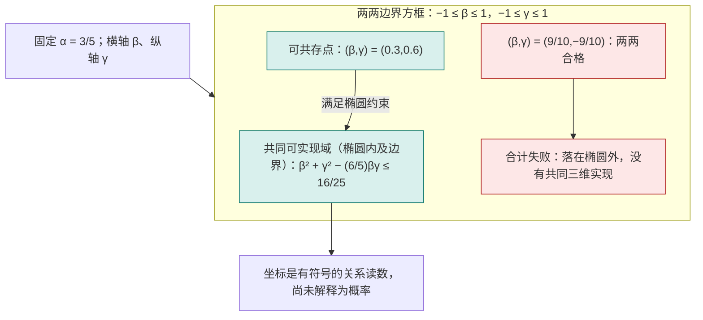
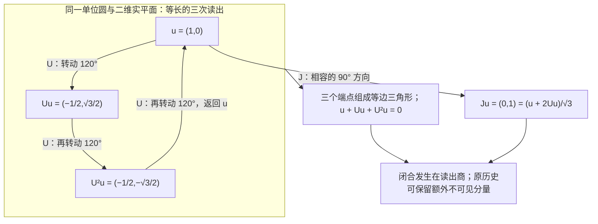

# 互为探针与平方几何的内生恢复

> 来源：用户于 2026-11-05（Asia/Singapore）在本会话提供的 AURIC C139 LaTeX 研究工作稿；原稿未另署作者或模型。本文为参考输入，Lean 是仓库的数学真源；本次仅转换 Markdown，未作形式化认证。正文中的固定快照、项目核读叙述与理论结论均保留原稿口径；两幅 TikZ 图转换为 Mermaid 示意图，保留三元 Gram 可实现域与三读相位闭合的关系及原图注。

**AURIC C139**

从原非负读数到内积、三维余量与量子过程

2026 年 11 月 5 日　新加坡时间

**本轮唯一核心候选。** 在实线性比较载体 $V$ 上，给定同一来源的有限非负读数 $q:V\to[0,\infty)$。 对任意两份比较配方 $x,y$，要求下面两个正向极限存在、有限且相同：

$$
\boxed{\quad
 \lim_{t\downarrow0}\frac{q(x+ty)-q(x)}{t}
 =\lim_{t\downarrow0}\frac{q(y+tx)-q(y)}{t}
 \quad(x,y\in V).\quad}
 \tag{C139}
$$

**白话。** 把你轻轻加到我身上，再把我轻轻加到你身上， 按同一个微小比例计算，两边一开始的原读数变化相同。

**本轮严格结论。** 不预设范数、平方缩放、凸性、三角不等式，也不预设方向导数对探针线性， 就可推出唯一对称实双线性形式 $B$，使

$$
q(x)=q(0)+B(x,x),\qquad
 B(x,y)=\tfrac12\left.\frac{d}{dt}q(x+ty)\right|_{t=0}.
$$

原非负性进一步推出 $B\ge0$。读出零空间商上，$\sqrt{q-q(0)}$ 是原读数恢复出的内积范数。 证明适用于任意实维数。三维在本轮用于检查三份二元读数是否能共存，而非另加维数门槛。

**范围与来源。** 这里减少的是独立的范数与事件二次型前提；正向变化率仍是完整的来源条件。 完整双向可微性会由候选推出；全部带符号的探针仍在量词内。 初响应互易不等于通常的二阶混合偏导互换。 复相位、全效果概率、原过程、联合系统及时间关系均逐项陈述； 原档案不会因取读出商而被删除。 本稿给出普通数学证明与反模型，不声称本轮结果已完成 Lean 形式化或已构成经实验证实的新物理。

**结构。** 第 1 节核对仓库；第 2 节界定二元候选及其检验；第 3 节给出核心恢复定理； 第 4 节给出三维关系余量和手性边界；第 5 节重构标准有限维量子过程； 第 6 节说明 $\Omega$ 内生、递归闭合与仍需保留的来源。

## 1　最新进展：三读预算的一段证明刚进入形式源码

本轮固定默认分支 `dev` 在核查时的 [`b1d673668c6d`](https://github.com/the-omega-institute/trureturing/commit/b1d673668c6d1bc06a152e4607048833d830ca53)， 其提交时间为 2026 年 11 月 4 日 22:29:05 UTC，即新加坡时间 11 月 5 日 06:29:05。 GitHub 的 [固定比较页](https://github.com/the-omega-institute/trureturing/compare/66c49bfe9a1295ceea872b6e6a1d8146fb351237...b1d673668c6d1bc06a152e4607048833d830ca53) 显示，相对上一轮 `66c49bfe9a12` 有 16 个新增可达提交、297 个变更文件。 本轮按当前问题核读相关新增文件，没有把这次定向核查表述成全仓库审计， 也未据此断言整个理论文档树没有变化。

其中直接相关的是 PR \#26631 合并的 [`ThreeReadBudget.lean`](https://github.com/the-omega-institute/trureturing/blob/b1d673668c6d1bc06a152e4607048833d830ca53/D5/S0/Observation/ThreeReadBudget.lean)。 文件共 99 行，本轮核读全文；其 [配套 Blueprint](https://github.com/the-omega-institute/trureturing/blob/b1d673668c6d1bc06a152e4607048833d830ca53/Blueprint/D5/S0/Observation/ThreeReadBudget.md) 共 25 行，也核读全文。项目把它明确标为 C133 定理 2.2 的初始必要性子结论。 本轮没有重新运行 Lean，因此这里报告的是已见源码及其准确声明范围， 没有为整个 C133 或本轮新增理论授予新的机器认证。

### 1.1　新增源码实际证明了什么

它的类型先给定实模 $V$、实双线性读数 $R$ 和实线性推进 $U$。 令 $Q(f)=R(f,f)$、$S=I+U+U^2$，假设

$$
2R(f,Ug+nSg)\le Q(f)+Q(g)
 \qquad(f,g\in V,\ n\in\mathbb N).
$$

源码的 `three_read_budget_nullspace` 得到

$$
Q(f)\ge0,
 \qquad
 S(V)\subseteq\{h:R(f,h)=0\text{ 对所有 }f\in V\}.
$$

前一项用 $g=0,n=0$；后一项把左端展开成 $n$ 的仿射函数。 若斜率为正，总能找到一个有限自然数超过预算；再换 $f$ 为 $-f$，斜率只能为零。 这里的量词是所有有限的 $n$，证明没有执行一个无穷长实验。

源码没有预设 $R$ 对称或正半定，也没有预设 $U$ 可逆或空间有限维。 但实数标量、$R$ 的双线性和 $U$ 的线性确实已经在声明类型中。 Blueprint 又明确排除本文件尚未覆盖的内容：反向槽的零差、对称性、推进等距性、 取商、逆向蕴涵以及复结构分类。不能把当前 99 行的结论扩大成完整量子理论的形式证明。

### 1.2　本轮继续退回哪个前件

作为已经核验的历史版本，C138 固定提交中的 [C133 主文](https://github.com/the-omega-institute/trureturing/blob/66c49bfe9a1295ceea872b6e6a1d8146fb351237/docs/develop/theory/AURIC_C133_THREE_READ_CLOSURE_VISIBLE_COMPLEX_GEOMETRY.md) §2 的完整纸面论证已从上述预算推出对称半正定读数、可见商上的等距三周期， 再以 $J=(I+2T)/\sqrt3$ 得到复结构及 Hilbert 完成。 因此，继续补出这条商空间证明属于补齐来源接口；不能重新称它为本轮发现。 主文同时明说：实配方空间和双线性聚合仍在输入端。

同一历史提交的 [C130 §2](https://github.com/the-omega-institute/trureturing/blob/66c49bfe9a1295ceea872b6e6a1d8146fb351237/docs/develop/theory/AURIC_C130_MUTUAL_READOUT_BOUND_QUANTUM_RELATIONS.md) 在整数配方预算下得到 Hermitian 正性，其有限双和聚合与复数结构也有明确来源。 而 [C133 续五 §4](https://github.com/the-omega-institute/trureturing/blob/66c49bfe9a1295ceea872b6e6a1d8146fb351237/docs/develop/theory/AURIC_C133_THREE_READ_CLOSURE_VISIBLE_COMPLEX_GEOMETRY_CONTINUATION_V.md) 先在已经得到的交换群上证明平行四边形律，再以极化、正 Gram 商和完成获得平方几何。 这些已有路线提示了本轮的精确目标：从一个原始实读数 $q$ 的二元微扰比较出发， 证明双线性读口本身，而不是先把它写进读口的类型。

后文采取的入口是双方一阶响应互易。新的证明若成立，便能把 *双线性读口*从假设移入结论，再与已有三读预算对接。 实向量配方、右方向导数的存在、统一读数及所有相关方向的互易仍须明示； 它们是这条候选的前件，不因采用较短的表述而自动来自 $\Omega$。

### 1.3　同一读口取商不抹去原始日志

C133 主文 §5.2 还明确区分相位返回与档案返回： 若某个实际可读日志长度严格增长，则三步后的完整历史不能在包含该读口的全语境等价中等于原历史。 当前量子读口的 $[U]^3=I$ 只发生在它自己的可见商上。 因此，本轮的几何恢复与原始观察者记录可以同时保留； 不同读口之间是否存在共同表示，要检查实际来源和读口相容性，不能借取商宣告已经完成。

**白话。** 这次项目刚把一个关键步骤写进 Lean：只要同一组三次比较反复加入后始终不透支， 这组三次比较在当前读口里就只能留下零差。 但这段源码先把“比较怎样相加”给好了。我们继续向前退一步： 先只给一份历史的读数，再问两份历史相互轻推时读数怎样改变。 如果双方的响应总能对得上，能否把相加规则和平方尺子一起证明出来？ 证明出来后，再接回三读闭合；相位圈由当前读口生成，原始日志仍留在原处。

## 2　只比较最初怎样改变：唯一候选的接口

### 2.1　从零关系，回溯到产生零关系的响应

C138 的来源是实范数 $N$，并定义

$$
x\perp_N y\iff N(x+ty)\ge N(x)\quad\text{对所有 }t\in\mathbb R.
$$

在实维数至少三时，要求这项关系互易，原范数就来自内积。 该经典 James 刻画允许非光滑范数；二维完整互易仍容许 Radon 六边形，见[\[6\]](#ref-james1947), [\[7\]](#ref-martini2006)。 本轮向前回溯到一个原标量读数 $q$：先不要求它的平方根已经是范数。

#### 定义 2.1：原读数与初响应

固定实线性载体 $V$ 及有限实值读数 $q$。 若下列普通实变量正向极限存在且有限，定义

$$
D(x;y)=\lim_{t\downarrow0}\frac{q(x+ty)-q(x)}t,
 \qquad R(x,y)=\frac12D(x;y).
$$

定义不要求 $y\mapsto D(x;y)$ 可加或线性，也没有在 $V$ 上预设范数拓扑。 极限只发生在每条真实标量参数线 $t\mapsto x+ty$ 上。

#### 定义 2.2：C139：互为探针的初响应相同

对全部 $x,y\in V$，两边定义中的有限正向极限存在，并满足

$$
D(x;y)=D(y;x).
$$

正读出版本另固定 $q:V\to[0,\infty)$。该非负性不被上述交换等式单独推出。

这里 $x$ 是被比较的配方，$y$ 是试探方向；交换时，两个角色一起交换。 每次只取 $t\downarrow0$，但 $y$ 与 $-y$ 都是原实线性载体中的合法探针。 完整的双向导数和对探针的线性，将由候选证明出来。 这不同于同一基点处的二阶导数对称 $D^2q(x)[u,v]=D^2q(x)[v,u]$。 后者对通常的二次可微非二次函数也成立，不能选出平方律。

### 2.2　探针比例不是日志时间

参数 $t$ 表示比较配方中探针的比例；$t<0$ 表示带符号的比较，未表示把观察者档案倒退或删除。 计算 $q(x+ty)-q(x)$ 可以同时保存两条原记录，再形成差读数。 同样，后文的 $q-q(0)$ 是保留原基线后的对照校准；它不宣称基线所依附的原历史不曾存在。 源载体中的加法、实数比例及相应极限条件仍需供应。 有限门菜单或有限日志没有仅因使用这个记号就取得全部连续探针。

### 2.3　沿一条线，平方量与高次量立即分开

在 $V=\mathbb R$ 中取 $x=1,y=2$。对 $q(s)=s^2$，

$$
D(1;2)=4=D(2;1),
$$

但两边有限增量分别是 $4t+4t^2$ 和 $4t+t^2$，不必相同。 对同样平滑、非负的 $q(s)=s^4$，则

$$
D(1;2)=8,\qquad D(2;1)=32.
$$

因此候选比较的是有符号的原初响应数值；它能检测仅观察“是否为零”时被遗漏的缩放失配。 在欧氏空间取 $q(x)=\|x\|_2^4$，其正交零关系仍是标准欧氏正交， 但 $D(x;y)=4\|x\|_2^2\langle x,y\rangle$ 并不对任意 $x,y$ 互易。

#### 说明 2.3：一句更短的条件，仍有完整量词

本轮将范数、齐次性和凸性从前提移到结论，但明确保留全部正向初响应的存在性和数值互易。 在维数至少三、且用 $q=N^2$ 对齐同一来源后，C138 与 C139 都刻画同一内积模型类。 它们使用的原始比较接口不同，不能仅以字数判断对任意原数据严格更弱。 本轮也不把有限次采样等同于对所有 $x,y$ 的证明。

**白话。** 上一轮只问，沿你移动能不能把我缩短。这一轮把产生那个答案的原读数也保留下来， 问两边刚开始怎样变。平方读数让这种交换公平；四次读数会按起点大小额外放大其中一边。 比较这点差别，就有可能把原来的尺子也从关系中恢复。

## 3　首响应互易：从原读数直接恢复平方量

本节只预先给一个实线性比较载体 $V$ 和原实读数 $q:V\to\mathbb R$。 向量表示可作正负组合的比较配方；本节不把概率混合预先认作这些线性组合。 不预设范数、内积、凸性、二次齐次、探针方向上的可加性，也不预设 $V$ 上的拓扑。 下面的极限只沿实参数 $t$ 取值。原读数的固定基线记作

$$
q_0=q(0),\qquad Q(x)=q(x)-q_0.
$$

基线是原记录的一部分；居中只改变所讨论的差量，不删除这项记录。

### 3.1　一个带存在性的二元候选

#### 定义 3.1：原首响应与 C139

若有限右侧极限存在，定义在 $x$ 处用 $y$ 作探针的首响应为

$$
D_q^+(x;y)=\lim_{t\downarrow0}\frac{q(x+ty)-q(x)}{t}.
$$

本轮唯一新增的关系条件是：对每个 $x,y\in V$，两边极限都存在为有限实数，且

$$
\boxed{\quad
 \lim_{t\downarrow0}\frac{q(x+ty)-q(x)}{t} =
 \lim_{t\downarrow0}\frac{q(y+tx)-q(y)}{t}\in\mathbb R.
 \quad}
 \tag{C139}
$$

为使最终对角读数等于 $Q$，另记 $\mathcal R_q(x,y)=\tfrac12D_q^+(x;y)$。

这条条件交换的是“基点历史”和“探针历史”。 它不是在同一个基点交换两个二阶偏导数；二阶偏导的通常对称性不会选出二次函数。 “有限右侧极限存在”是候选的明示组成部分；尚未供应实参数比较的离散来源，不能仅凭符号就获得这个接口。 参数 $t$ 每次只从正侧试探，但 $y$ 与 $-y$ 都属于原实线性配方。 这不要求倒退档案的记录次序，也没有从取极限的一侧选出物理手性。

**白话。** 把另一份历史只加入一点点，记录总读数刚开始怎样变化；再交换两份历史， 用完全相同的标尺重做这次试探。候选只说：两笔首响应应当相等。 它比较实际变化量，因此同时检查了方向和尺度。

### 3.2　完全代数化的恢复定理

#### 引理 3.2：连续函数的右导数积分唯一性

设 $f$ 在闭区间 $[a,b]$ 上连续，且每个 $t<b$ 的有限右导数为零。 则 $f$ 为常数。因此，若其右导数等于某个多项式的导数， 则 $f$ 与该多项式只差一个常数。

**证明。**

若 $a<b$ 且 $f(b)>f(a)$，取 $0<\varepsilon<(f(b)-f(a))/(b-a)$，令 $h(t)=f(t)-\varepsilon t$。 有 $h(b)>h(a)$，故 $h$ 的全局最小值在某个 $c<b$ 取得。 最小性给 $D^+h(c)\ge0$，但原右导数条件给 $D^+h(c)=-\varepsilon<0$，矛盾。 所以 $f(b)\le f(a)$；对 $-f$ 应用同一论证得反向不等式。 在每个闭子区间重复即可得常数性。减去给定多项式即得后一结论。

$\square$

#### 定理 3.3：首响应互易的精确解

对任意实线性空间 $V$ 和函数 $q:V\to\mathbb R$，下列两项等价：

1.  $q$ 满足 C139 的有限右侧首响应互易。

2.  存在唯一对称实双线性形式 $g:V\times V\to\mathbb R$，使

    $$
    q(x)=q_0+g(x,x).
    $$

其恢复式为

$$
\boxed{
 g(x,y)=\frac12D_q^+(x;y)
       =\frac{Q(x+y)-Q(x-y)}4
       =\frac{q(x+y)-q(x-y)}4 .
 }
$$

特别地，在任意有限维窗口中，原居中读数自动成为一个二次多项式。 全部双侧首响应的存在、以及它对探针的实线性，也都是结论。 这一结论不需要全空间维数至少为三，也不借用范数空间的内积刻画定理。

**证明。**

下文把 $D_q^+(x;y)$ 简记为 $D(x;y)$；$q$ 与 $Q$ 的首响应相同。

*第一步：右侧存在性给仿射线连续性，互易锁住正径向尺度。* 对固定 $x,y$ 和每个实数 $s$，探针 $y$ 的有限右响应给 $q(x+(s+h)y)\to q(x+sy)$；探针 $-y$ 的有限右响应给 $q(x+(s-h)y)\to q(x+sy)$，其中 $h\downarrow0$。 故 $s\mapsto q(x+sy)$ 连续。这里没有把两个单侧导数预先认作相反数。

由右侧极限的变量代换，对每个 $a\ge0$，

$$
D(x;ay)=aD(x;y).
$$

$a=0$ 时两边均为零；$a>0$ 时用 $s=at$。再由互易，

$$
D(ax;y)=D(y;ax)=aD(x;y)\qquad(a\ge0).
 \tag{1}
$$

特别地，$D(0;y)=D(y;0)=0$。 对固定 $x$，连续函数 $f(t)=q(tx)$ 在 $t\ge0$ 的右导数满足

$$
D^+f(t)=D(tx;x)=tD(x;x).
$$

对任意 $T>0$ 在 $[0,T]$ 上应用引理 3.2，得到 $q(tx)=q_0+\tfrac12t^2D(x;x)$。令 $t=1$ 再代回，得到

$$
D(x;x)=2Q(x),\qquad
 Q(tx)=t^2Q(x)\quad(t\ge0).
 \tag{2}
$$

尚未使用负缩放。现在只沿 $x$ 的反向探针试探，因 $1-h>0$，

$$
D(x;-x)
 =\lim_{h\downarrow0}\frac{((1-h)^2-1)Q(x)}h
 =-2Q(x).
$$

同理 $D(-x;x)=-2Q(-x)$。互易要求二者相等，因此 $Q(-x)=Q(x)$。 连同 (2)，得到完整的原二次齐次性

$$
\boxed{Q(tx)=t^2Q(x)\qquad(t\in\mathbb R).}
 \tag{3}
$$

*第二步：由重参数化得到径向剪切公式。* 对任意 $a\in\mathbb R$，当 $h>0$ 充分小时 $1+ah>0$，由 (3)，

$$
Q\bigl(x+h(ax+y)\bigr)
 =(1+ah)^2Q\left(x+\frac{h}{1+ah}y\right).
$$

重参数 $h/(1+ah)$ 始终从正侧趋于零，其与 $h$ 之比趋于 $1$。 直接展开有限右响应，包括 $x=0$、$y=0$ 以及任意符号的 $a$，均得

$$
\boxed{D(x;ax+y)=2aQ(x)+D(x;y).}
 \tag{4}
$$

这里没有先假定 $D(x;\cdot)$ 对任意两个探针可加； 式 (4) 只利用已证明的径向齐次性与原右侧首响应，也没有偷用负系数的探针齐次性。

*第三步：任意仿射线上的读数都被锁成二次式。* 固定 $x,y$，令 $F(t)=Q(x+ty)$。第一步已证明 $F$ 连续；互易和 (4) 给

$$
\begin{aligned}
 D^+F(t)
 &=D(x+ty;y)\\
 &=D(y;x+ty)\\
 &=D(y;x)+2tQ(y)\\
 &=D(x;y)+2tQ(y).
 \end{aligned}
$$

将任意 $t$ 与 $0$ 放入同一闭区间，再用引理 3.2，得到

$$
\boxed{
 Q(x+ty)=Q(x)+tD(x;y)+t^2Q(y).
 }
 \tag{5}
$$

该式对全部实数 $t$ 成立，所以原 $q$ 的全部双侧首响应确实存在。 对任意实数 $a$，把 $t$ 换为 $at$，也就得到 $D(x;ay)=aD(x;y)$；负系数的探针齐次性在这里才成为结论。 取 $t=\pm1$ 得

$$
Q(x+y)+Q(x-y)=2Q(x)+2Q(y),
 \tag{6}
$$

以及定理中的极化公式。

*第四步：用三个元的相容性恢复探针可加性。* 定义 $g(x,y)=D(x;y)/2$。它已对称，并由第三步和互易在两变量分别实齐次。 利用极化式与 (6)，直接相减可得

$$
g(x+z,y)+g(x-z,y)=2g(x,y).
 \tag{7}
$$

例如，将左侧乘 $4$ 后，分组为

$$
\begin{aligned}
 &Q((x+y)+z)+Q((x+y)-z)\\
 &\quad-Q((x-y)+z)-Q((x-y)-z),
 \end{aligned}
$$

再用 (6)，结果即为 $8g(x,y)$。 在 (7) 中令 $x=(u+v)/2$、$z=(u-v)/2$，利用已知的实齐次性，得到

$$
g(u+v,y)=g(u,y)+g(v,y).
 \tag{8}
$$

对称性给另一变量的可加性，故 $g$ 实双线性。 由 (2)，$g(x,x)=Q(x)$。极化公式又说明这样的 $g$ 唯一。

反向，若 $q(x)=q_0+g(x,x)$ 且 $g$ 为对称实双线性形式，则

$$
q(x+ty)-q(x)=2t\,g(x,y)+t^2g(y,y),
$$

所以全部有限双侧首响应存在，且 $D_q^+(x;y)=2g(x,y)=D_q^+(y;x)$。证毕。

$\square$

所恢复的平方结构与经典平行四边形刻画相接，见[\[5\]](#ref-jordan1935)； 本节已从原单侧响应完整证明所需结论。

上面最后一步恰好是有限三元闭合：$x,y,z$ 的全部关系位于 $\operatorname{span}\{x,y,z\}$，式 (8) 表明“关系的关系”必须服从同一加法。 本轮不再需要“至少三维”来排除二维例外；三维窗口负责显式展示三份比较的共同相容。 若 $V$ 本来无限维，定理仍只沿每次有限多个配方论证，不把整个来源压成三维。

### 3.3　非负原读数使范数与可见零空间内生

#### 推论 3.4：原非负读数的平方几何

若原读数 $q:V\to[0,\infty)$ 满足 C139，则

$$
q(x)\ge q_0,\qquad Q(x)\ge0,
$$

因此恢复出的 $g$ 为正半定。 其零空间

$$
\mathcal Z=\{x:Q(x)=0\}
$$

恰等于双线性形式的根空间 $\{x:g(x,y)=0\text{ 对全部 }y\}$，从而是线性子空间。 在 $V/\mathcal Z$ 上，

$$
\overline g([x],[y])=g(x,y),\qquad
 N([x])=\sqrt{Q(x)}
$$

分别是正定内积与其范数。 同一个可见等价关系也可完全用原首响应表达：

$$
Q(x-y)=0
 \iff
 D_q^+(x;z)=D_q^+(y;z)\quad\text{对全部 }z\in V.
$$

若原读口已经分离零，即 $q(x)=q_0$ 当且仅当 $x=0$， 则 $\mathcal Z=0$，这些结构直接恢复在原 $V$ 上。

**证明。**

若某个 $Q(x)<0$，主定理给 $q(tx)=q_0+t^2Q(x)$，取充分大的 $|t|$ 就会违反原 $q\ge0$。 故 $Q\ge0$，并且原点自动给出全局最小基线。

对每个 $x,y$，二次式

$$
Q(x+ty)=Q(x)+2t\,g(x,y)+t^2Q(y)
$$

对全部 $t$ 非负。若 $Q(y)>0$，在其最小点取值，得到

$$
|g(x,y)|^2\le Q(x)Q(y).
 \tag{9}
$$

若 $Q(y)=0$，一个仿射函数对全部 $t$ 非负迫使 $g(x,y)=0$， 于是 (9) 仍成立。这同时证明零空间等于根空间。 双线性性使根空间为线性子空间；加上根空间元素不改变 $g$ 或 $Q$， 所以商上的公式良定义，并且正定。 由 $D_q^+=2g$，根空间刻画同时给出所示的全部首响应轮廓相等。

齐次性由 $Q(tx)=t^2Q(x)$ 给出。三角不等式也成为结论：

$$
\begin{aligned}
 N([x]+[y])^2
 &=Q(x)+Q(y)+2g(x,y)\\
 &\le Q(x)+Q(y)+2\sqrt{Q(x)Q(y)}\\
 &=(N([x])+N([y]))^2.
 \end{aligned}
$$

取非负平方根即可。

$\square$

非负值域还可放宽为：原 $q$ 在每一条完整径向直线上有下界； 相同的 $t\to\infty$ 论证仍给 $Q\ge0$。 但如果删掉这项有下界的来源信息， $q(s,t)=s^2-t^2$ 就满足全部首响应互易，却没有正的概率或范数解释。

商 $V\to V/\mathcal Z$ 只描述该读口看不出的差别。 它不授权删除原历史、合并来源树或回写原档案；原记录和商读出应同时保留。 特别地，常数读数也满足候选，其可见商为零维；若任务需要非平凡可见几何，必须有某份记录满足 $q(x)>q_0$。

**白话。** 只先知道每次总读数都不会是负数，交换试探就会强迫同一条射线按平方增长。 于是原点读数自动成为底线；超过底线的部分才是平方量。 沿这个读口完全看不见的差别，可以在表示中归到同一类，但它们的原始历史仍在。 能看见的部分，自身产生内积、长度和三角不等式，不必再预先借一把范数尺子。

### 3.4　逆推：哪些删改会重新放进非量子平方读数

#### 例 3.5：C138 的同一互易六边形，被数值首响应排除

令

$$
H(s,t)=\max\{|s|,|t|,|s+t|\},\qquad q(s,t)=H(s,t)^2 .
$$

这个单位球是 C138 的中心对称六边形。对其六个顶点直接取面积读数最大值，得到

$$
H_a(y):=\max_{H(x)\le1}|\det(x,y)|=H(y).
$$

沿线最小关系 $x\perp_Hy$ 等价于该线在 $x$ 处支持相应尺度的单位球，即 $|\det(x,y)|=H(x)H_a(y)$；因此它对全部 $x,y$ 互易。 另一方面，$q$ 沿每条仿射线都是有限段二次式，故每个右首响应均存在且有限，连多边形角点也不例外。

取 $x=(2,-1)$、$y=(1,2)$。当 $0<h<1/2$ 时，

$$
H(x+hy)=2+h,\qquad H(y+hx)=3+h .
$$

因而

$$
\boxed{\mathcal R_q(x,y)=2\ne3=\mathcal R_q(y,x).}
$$

同一个满足全部二维沿线最小互易的范数，违反 C139 的数值互易。 这里原量已经二次齐次；失败出在角向比较。 它也说明本轮排除多边形并非仅靠预设光滑性禁止角点。

#### 例 3.6：只比较零响应，或只在单位层比较，均丢失尺度

在任意非零欧氏空间中令

$$
q(x)=\|x\|_2^4.
$$

它处处有有限双侧首响应，并且

$$
\mathcal R_q(x,y)=2\|x\|_2^2\langle x,y\rangle .
$$

因此“首响应为零”是互易的；当 $q(x)=q(y)=1$ 时， 甚至完整数值响应也互易。 但对单位 $e$，

$$
\mathcal R_q(e,2e)=4,\qquad
 \mathcal R_q(2e,e)=16.
$$

所以原首响应并不全域互易；原量按四次增长，而不是平方增长。 单位层检验不能代替带尺度的原候选。

#### 例 3.7：正性与二次齐次仍不足

在 $\mathbb R^2$ 上令

$$
q(x)=\|x\|_4^2=(x_1^4+x_2^4)^{1/2}.
$$

它非负、二次齐次，在原点的首响应为零；非零点满足

$$
\mathcal R_q(x,y)=
 \frac{x_1^3y_1+x_2^3y_2}{(x_1^4+x_2^4)^{1/2}}.
$$

取 $x=(1,2)$、$y=(8,-1)$，则

$$
\mathcal R_q(x,y)=0,\qquad
 \mathcal R_q(y,x)=\frac{510}{\sqrt{4097}}>0.
$$

因此保持二次尺度仍然没有固定角向比较；C139 排除了这项原读数。

主定理同样说明，首响应无法确定额外常数：$q$ 与 $q+c$ 具有同一个 $D_q^+$。 本轮保留原 $q_0$ 并恢复 $Q=q-q_0$，不把这项不可见基线冒充已经由互易决定。 若再删去原实线性组合接口，本定理中的 $x+ty$ 本身尚无定义，也就没有所声称的恢复结论。

### 3.5　相对 C138 的准确压缩范围

C138 从原范数 $N$ 出发，以 $N(x+ty)\ge N(x)$ 的全线最小关系定义正交， 在实维数至少三时用互易恢复原内积。 C139 直接从原非负读数 $q$ 出发，用右侧首响应的*数值*互易恢复二次式， 再把范数公设作为推论。

在 $\dim_{\mathbb R}V\ge3$ 的分离可见扇区，令 $q=q_0+N^2$， 两个候选在各自明示的接口上具有同一批正定模型： C138 由其内积结论推出 C139；C139 恢复的 $N=\sqrt{q-q_0}$ 满足 C138， 因为

$$
N(x+ty)^2-N(x)^2=2t\,g(x,y)+t^2N(y)^2
$$

对所有 $t$ 非负当且仅当 $g(x,y)=0$，而这个关系对称。 二维的 Radon 例外不再通过 C139；右侧首响应互易在二维也已强迫二次式。

因此，本轮减少的是预置的范数公设、维数门槛以及经典几何刻画的证明依赖， 代价是明示检查原首响应的存在与数值校准。 它是来源接口的重组与条件压缩，不能宣称在完全相同的数据签名上无条件地使用了更少信息。 “平方规律内生”的已证含义是：由同一原 $q$ 定义出的两种首响应满足一个交换约束， 便迫使这份原 $q$ 的全部有限窗口具有同一个平方结构。

## 4　一条抛物线与三份关系的共同余量

本节在原非负读数恢复的可见空间上讨论；若没有零分离，先取第 3.4节的读出商。 以下仍记 $Q(x)=g(x,x)$，其原基线 $q_0$ 另行保留。

### 4.1　最简图形：每条比较直线都读成抛物线

核心定理给每个 $x,y$ 的精确有限式

$$
Q(x+ty)=Q(x)+2t\,g(x,y)+t^2Q(y).
 \tag{8}
$$

当 $Q(y)>0$，配方位移 $t$ 与读数构成一条抛物线，顶点为

$$
t_*=-\frac{g(x,y)}{Q(y)},\qquad
 Q(x+t_*y)=Q(x)-\frac{g(x,y)^2}{Q(y)}.
$$

这个非负最小余量，正是二元 Gram 矩阵的 Schur 余量。 令 $r=x-g(x,y)y/Q(y)$，则

$$
g(r,y)=0,\qquad
 Q(x)=\frac{g(x,y)^2}{Q(y)}+Q(r).
$$

因此直角三角形、平方分配和最短投影，都由同一条原响应曲线得到。

对任意两个归一方向 $u,v$，$Q(u)=Q(v)=1$，有

$$
Q(au+bv)=a^2+2\alpha ab+b^2,\qquad
 \alpha=g(u,v),\quad |\alpha|\le1.
$$

交叉系数 $\chi=2\alpha$ 已由两份原初响应确定。 $\alpha=0$ 时，$Q(au+bv)=1$ 是该正交单位坐标中的圆； $0<|\alpha|<1$ 时在 $(a,b)$ 系数平面上为椭圆；$\alpha=\pm1$ 时两个可见方向共线，二次式退化为 $(a\pm b)^2$。 所以圆是恢复出的平方图形的归一截面；互易本身没有预先把圆写进定义。

### 4.2　两两合格，还必须能放进同一个三维窗口

取三个归一可见方向 $u,v,w$，记录三项二元响应

$$
\alpha=g(u,v),\qquad \beta=g(u,w),\qquad \gamma=g(v,w).
$$

其共同 Gram 矩阵为

$$
G=\begin{pmatrix}
 1&\alpha&\beta\\
 \alpha&1&\gamma\\
 \beta&\gamma&1
 \end{pmatrix}.
$$

#### 定理 4.1：三个二元读数的有限三维提升

三个实数 $\alpha,\beta,\gamma$ 可由某个实内积空间中的三个单位方向实现， 当且仅当

$$
|\alpha|,|\beta|,|\gamma|\le1,\qquad
 \Delta=1+2\alpha\beta\gamma-\alpha^2-\beta^2-\gamma^2\ge0.
$$

所有可实现的三元读数都可在 $\mathbb R^3$ 中实现；第三项的准确允许区间为

$$
\boxed{
 \alpha\beta-\sqrt{(1-\alpha^2)(1-\beta^2)}
 \le\gamma\le
 \alpha\beta+\sqrt{(1-\alpha^2)(1-\beta^2)}.
 }
$$

**证明。**

必要性来自 $G\ge0$：任意 $a,b,c$ 满足 $(a,b,c)G(a,b,c)^{\mathsf T}=Q(au+bv+cw)\ge0$。 其二阶主子式给三项绝对值界，三阶行列式给 $\Delta\ge0$。

反向，在 $|\alpha|<1$ 时，取

$$
\begin{aligned}
 u&=(1,0,0),\\
 v&=(\alpha,\sqrt{1-\alpha^2},0),\\
 w&=\left(\beta,
 \frac{\gamma-\alpha\beta}{\sqrt{1-\alpha^2}},
 \delta\right),\qquad
 \delta^2=\frac{\Delta}{1-\alpha^2}.
 \end{aligned}
$$

这些向量长度为一，并给所需的三项配对。 若 $\alpha=\pm1$，行列式成为 $\Delta=-(\gamma-\alpha\beta)^2$，故 $\gamma=\alpha\beta$。 取 $v=\alpha u$、$w=(\beta,\sqrt{1-\beta^2},0)$ 即可。 最后重写

$$
\Delta=(1-\alpha^2)(1-\beta^2)-(\gamma-\alpha\beta)^2
$$

就得到区间公式，包括全部端点。证毕。

$\square$

**图 1：** 固定一项关系 $\alpha=3/5$，另外两项关系必须落在椭圆内。 方框只检查每一对的绝对值不超过一；红点 $(9/10,-9/10)$ 通过两两检查，却没有共同的三维实现。 坐标是有符号的关系读数，尚未被解释为概率。

在 $|\alpha|<1$ 的上述构造中，第三方向的平方余量是 $\delta^2$。 当 $\Delta>0$，三项二元配对不能区分 $\delta$ 与 $-\delta$：它们对应两个镜像实现； 当 $\Delta=0$ 时，第三方向余量为零，两者重合。 若选择定向体积 $\tau=\det[u\ v\ w]$，则

$$
\tau^2=\Delta.
$$

二元平方读口锁住了体积的平方，未锁住体积的方向。 具体方向须由来源中额外记录的定向关系或有向操作提供。

### 4.3　为什么固定标签的三元检查不是全域正性

#### 例 4.2：四个标签可以藏住共同负方向

取四阶对称矩阵 $G_4$，对角为一，非对角全为 $-2/5$。 每个三阶主子矩阵的特征值为 $7/5,7/5,1/5$，都是正定的。 但全矩阵在 $(1,1,1,1)$ 方向的特征值为 $-1/5$，故

$$
(1,1,1,1)G_4(1,1,1,1)^{\mathsf T}=-4/5<0.
$$

因此，只检查每三个原标签的局部表，不足以推出全局正核。

C139 约束的是已经对线性组合闭合的同一来源，而非只有若干原标签。 若把前两个标签相加为 $x$、后两个相加为 $y$，则 $Q(x)=Q(y)=6/5$、$g(x,y)=-8/5$，归一化相关为 $-4/3$， 已超出任何合法二元比较的范围；上述负方向也直接出现在 $x+y$ 的读数中。 所以每次论证只需有限多个比较配方，并不等于只需预先固定有限个样本。

**白话。** 两份历史的读数给出交叉项，三份历史则要求三条交叉关系放得进同一个图形。 如果其中一条超过共同余量，三条边各自看着合法，合起来却会制造负的平方量。 三维提升把这个漏洞显示出来；它给出的镜像两解还提醒我们，平方量本身没有选择手性。

## 5　从同一原读数完成有限量子理论：三读相位、原分支与概率

主定理先从原 $q$ 恢复 $g=\mathcal R_q$ 与 $Q=q-q(0)=g(x,x)$。 本节使用非零有限维读出商 $\mathcal H_{\mathbb R}=V/\operatorname{rad}g$；原基线 $q(0)$、来源与日志仍保留。 所有总量预算均作用于这个同一 $Q$，而非未经说明地改变原读数单位。 以下给出一条过程优先的条件链：先由实际分支恢复效果，事件的平方律和相位不变性由此一起推出。

### 5.1　三读预算恢复复相位

取来源中一个原操作 $U:V\to V$，不预设线性。先采用与一般过程相同的单分支比较校准：

$$
Q(Ux-Uy)=Q(x-y)\qquad(x,y\in V).
\tag{1}
$$

逐点定义 $S(y)=y+U(y)+U(U(y))$；此时尚未把 $S$ 或 $U$ 当作线性算子。另要求

$$
2g\bigl(f,Uy+nS(y)\bigr)\le Q(f)+Q(y)
 \qquad(f,y\in V,\ n=0,1,2,\ldots).
\tag{2}
$$

此处预算中的 $g$ 明确绑定为从同一 $q$ 恢复的响应读数。 项目 C133 的三读分类与新增 Lean 预算引理以双线性读数及线性操作为前件，见[\[3\]](#ref-repo_c133), [\[2\]](#ref-repo_three_read)。 本轮先从同一原来源恢复响应与读出操作的线性，再接入这些结果。 若原 $U$ 已线性，C133 的预算会推出 (1)；这里把操作的线性也改成读出上的结论。

#### 引理 5.1：保零比较校准的 Gram 恢复

实内积空间之间的映射 $T$ 若保零且保持全部距离，则 $T$ 实线性且等距。

**证明。**

距离公式给 $g(T\xi,T\eta)=(\|T\xi\|^2+\|T\eta\|^2-\|T\xi-T\eta\|^2)/2=g(\xi,\eta)$。 用这些配对展开 $\|T(\xi+\eta)-T\xi-T\eta\|^2$ 与 $\|T(t\xi)-tT\xi\|^2$，两者均为零，得到可加性与实齐次性。

$\square$

#### 定理 5.2：三读闭合与原尺度保持

条件 (1)–(2) 使 $U$ 保持原零读出等价， 并下降为实线性等距操作 $\bar U$，满足

$$
I+\bar U+\bar U^2=0,\qquad \bar U^3=I,
 \qquad \|\bar U\xi\|=\|\xi\|.
$$

于是

$$
J=\frac{2\bar U+I}{\sqrt3},\qquad
 J^2=-I,\qquad J^*=-J,
 \qquad h(\xi,\eta)=g(\xi,\eta)+i\,g(J\xi,\eta)
$$

定义以 $i\xi=J\xi$ 为复结构、对第一变量共轭线性的正定复内积。

**证明。**

预算中取 $y=0$、$n=0$、$f=U0$，得到 $2Q(U0)\le Q(U0)$，故 $Q(U0)=0$。 比较校准使 $x-y\in\operatorname{rad}g$ 推出 $Ux-Uy\in\operatorname{rad}g$，因此 $U$ 下降为商上的保零等距映射。 由引理 5.1，该 $\bar U$ 实线性。

固定 $f,y$。若 $g(f,S(y))>0$，取足够大的自然数 $n$ 就违背预算；再对 $-f$ 应用预算，得到 $g(f,S(y))=0$。因此每个 $S(y)$ 都落在 $\operatorname{rad}g$。 由于 $U$ 已下降，$[S(y)]=[y]+\bar U[y]+\bar U^2[y]$，故商上有 $I+\bar U+\bar U^2=0$。现在才使用已证明的线性，乘以 $\bar U-I$ 得 $\bar U^3=I$。 等距性与此逆算子给 $\bar U^*=\bar U^{-1}=\bar U^2$。 直接代入二次关系即得 $J^2=-I$、$J^*=-J$ 与 $J^*J=I$；所示 $h$ 因而为复内积。

$\square$

反向，任意复内积结构的 $J=i$ 给 $U=-I/2+(\sqrt3/2)J$；该 $U$ 保持全部比较，$S=0$，预算就是 $0\le\|f-Uy\|^2$。因此此处相位条件有精确的反向模型。 对 $\xi\ne0$，三次读出的轨道 $\xi,\bar U\xi,\bar U^2\xi$ 在其二维实平面里组成等边三角形； 换 $\bar U$ 为 $\bar U^2$ 恰使 $J$ 变为 $-J$，预算不单独选择绝对手性。 $R_\theta=\cos\theta I+\sin\theta J$ 给数学上的完整相位圆；实际门菜单能否实现任意 $\theta$ 需由来源说明。 若根空间非零，原 $U$ 仍可非线性，$U^3=I$ 与 $J^2=-I$ 的结论只在读出商上成立。

#### 例 5.3：逐点三角闭合不能代替全部比较校准

在欧氏平面上，令 $U(x)=R_{+120^\circ}x$ 当 $\|x\|\ge1$，其余点取 $U(x)=R_{-120^\circ}x$。 这个原操作保持每个点的总量，且 $S(x)=0$，因而满足三读预算。 但对 $x=(1,0)$、$y=(1/2,0)$，

$$
Q(Ux-Uy)=\frac74\ne\frac14=Q(x-y).
$$

所以仅有各自等长与逐点闭合，并未保证两份读出之间的关系被保持。

**图 2：** 三读预算使合计在可见空间闭合；同一预算的收缩性再使三边等长。 由此恢复 $120^\circ$ 相位操作及与它相容的 $90^\circ$ 复结构。 图中闭合发生在读出商，原历史仍可携带额外不可见分量。

### 5.2　原分支一次给出复线性、效果与事件平方律

输入和输出各自满足前述读数与三读条件，记其原操作为 $U_{\rm in},U_{\rm out}$。 设原过程的有限个细分支为 $F_j:V_{\rm in}\to V_{\rm out}$，不预先假定线性，要求

$$
\sum_j Q_{\rm out}\bigl(F_j(x)-F_j(y)\bigr)=Q_{\rm in}(x-y),
 \qquad F_jU_{\rm in}=U_{\rm out}F_j.
\tag{3}
$$

粗事件 $e$ 是这些细分支的集合，完整测试取细分支集合的一个划分；其同一原读出权重为

$$
w_e(x)=\sum_{j\in e}Q_{\rm out}(F_j(x)).
\tag{4}
$$

式 (4) 是原事件与原输出配方的绑定，不能把另一套未经核对的事件读数替换进来。

#### 定理 5.4：原过程的复线性表示

各 $F_j$ 都下降到读出商上的复线性映射 $K_j$，且

$$
\sum_jK_j^*K_j=I,\qquad
 E_e=\sum_{j\in e}K_j^*K_j,
 \qquad w_e(x)=h([x],E_e[x]).
$$

因此 $0\le E_e\le I$，完整测试满足 $\sum_eE_e=I$。 原 $w_e$ 自动满足平行四边形恒等式与复相位不变性，无须再逐项公设。

**证明。**

若 $x-y\in\operatorname{rad}g_{\rm in}$，校准式左侧是若干非负项之和且为零，故 $F_j(x)-F_j(y)\in\operatorname{rad}g_{\rm out}$；于是原分支下降为 $\widehat F_j$。 在商上，原 $U$ 协变性使 $\widehat F_j(0)$ 成为 $\bar U_{\rm out}$ 的不动点。 但 $I+\bar U+\bar U^2=0$ 使其三倍为零，故 $\widehat F_j(0)=0$；零点保持也无需另加。

令 $Y(\xi)=\bigoplus_j\widehat F_j(\xi)$。校准式使 $Y$ 保持全部距离并保零； 引理 5.1 使 $Y$ 以及各 $\widehat F_j$ 实线性。 现在 $U$ 协变性及 $J=(2\bar U+I)/\sqrt3$ 给复线性。 令 $K_j=\widehat F_j$；取 $y=0$ 并极化，得到合计等距式。 原粗分支读数的绑定给所示 $E_e$，其余断言随之成立。

$\square$

这一定理保留原来源的可见范围。若输入与输出的 $Q$ 都正定，则 $F_j$ 本身复线性； 若有根空间，只能断言商上的线性。 例如在 $V=\mathbb C^2$ 上取 $Q(z,w)=|z|^2$、$U=\zeta I$，其中 $\zeta=e^{2\pi i/3}$，则

$$
F(z,w)=(z,|w|^2w)
$$

满足全部比较校准和 $U$ 协变，却在未读出的 $w$ 分量上非线性。 它在读出商上正是恒等过程；该表示没有删除那部分原历史。 另一方面，仅保总量不足：$F(z_1,z_2)=(z_1,e^{i|z_1|^2}z_2)$ 保持正定总量并与全部公共相位交换， 却不具可加性，因而不满足全部比较距离的校准。

### 5.3　完整效果评价、Born 规则与实际混合过程

对每个原准备，设完整效果集合 $0\le E\le I$ 上有单值评价 $p$，满足

$$
p(E)\ge0,\qquad p(I)=1,\qquad
 p(E+F)=p(E)+p(F)\quad(E,F\ge0,\ E+F\le I).
\tag{5}
$$

这是对同一效果读出的相容性要求；事件几何本身尚不替实际频率供应此条件。 若原纯准备由 $Q(x)>0$ 的 $x$ 给出，则还以 $p(P_\psi)=1$ 绑定其确定性，其中 $\psi=[x]/\sqrt{Q(x)}$。

#### 定理 5.5：准备的表示及 Born 概率

条件 (5) 等价于存在唯一 $\rho\ge0$、$\operatorname{Tr}\rho=1$，使

$$
p(E)=\operatorname{Tr}(\rho E).
$$

若 $p(P_\psi)=1$，则 $\rho=P_\psi$，从而

$$
p(E_e)=\frac{w_e(x)}{Q(x)},\qquad
 p(P_\varphi)=|h(\psi,\varphi)|^2
 \quad(\|\varphi\|=1).
$$

**证明。**

可加性给有理齐次，正性给序单调性，有理夹逼给实齐次。 对正算子 $A$ 取 $t>0$、$t\ge\|A\|$，定义 $L(A)=t\,p(A/t)$；齐次性使其与 $t$ 无关。 它在正锥可加，再按差延伸为 Hermitian 矩阵上的实线性泛函。 迹配对给唯一 Hermitian $\rho$，正性与归一化给 $\rho\ge0$、$\operatorname{Tr}\rho=1$。 若 $\operatorname{Tr}(\rho P_\psi)=1$，则 $\operatorname{Tr}(\rho(I-P_\psi))=0$，正性使 $\rho$ 的支撑在 $\mathbb C\psi$，故 $\rho=P_\psi$。代入效果表示即得两式。反向由迹的正性与线性直接验证。

$\square$

这里的全效果条件覆盖复二维，见[\[8\]](#ref-busch2003)。 仅保留零、确定性和二结果投影归一化仍容许 $f(t)=t^2/(t^2+(1-t)^2)$；它满足 $f(t)+f(1-t)=1$，但 $f(1/4)=1/10$。 该读法违背全效果可加性，说明概率步骤不可由一个圆的外观代替。

原 $F_j$ 已是纯输入的实际输出配方；若实际随机混合按同一权重仿射组合完整效果评价， 并且原过程对*未归一化的分支评价*尊重这种混合，则在这些实际纯准备生成的混合域上，

$$
\Phi_e(\rho)=\sum_{j\in e}K_j\rho K_j^*,\qquad
 \rho_e=\frac{\Phi_e(\rho)}{\operatorname{Tr}\Phi_e(\rho)}
 \quad\bigl(\operatorname{Tr}\Phi_e(\rho)>0\bigr).
\tag{6}
$$

确实，纯输入先由上一命题绑定为 $P_\psi$，细分支给 $K_jP_\psi K_j^*$；仿射相容性再延伸到每个实际混合。 该公式与纯态分解的选择无关，并给整个密度态集合上的数学延伸。 若要断言这个全集均为原可制备域，还需来源供应全部纯态射线的准备。 对任意辅助维数，放大后的公式仍是正算子的共轭和，故完全正； $\sum_jK_j^*K_j=I$ 给总迹保持。标准矩阵过程性质见[\[9\]](#ref-watrous2018)。 若原混合规则没有这项相容性，只能说式 (6) 是数学上的仿射延伸，不能说它已表示原过程。

### 5.4　投影更新、联合系统与连续演化

在同一输入输出空间上，若事件效果为投影 $P$，且其像内每条纯态射线都由原事件保持，则原更新为 $\Phi(\rho)=P\rho P$。 证明是：$\sum_jK_j^*K_j=P$ 先给 $K_j=K_jP$；每条射线保持使每个 $K_j$ 在 $\operatorname{Ran}P$ 上为标量。 对独立向量及其和使用线性性，标量必与向量无关，故 $K_j=c_jP$。 当 $P\ne0$ 时 $\sum_j|c_j|^2=1$；当 $P=0$ 时全部分支为零。 仅有结果可重复还容许像内的旋转，不能替代每条射线保持。

两组原可观察代数若为 $M_d(\mathbb C),M_m(\mathbb C)$，其保幺元的 $*$-嵌入互相交换且共同生成非零联合代数， 则乘法映射给满的 $*$-同态

$$
M_d(\mathbb C)\otimes M_m(\mathbb C)\longrightarrow\mathcal A_{AB}.
$$

源代数是简单代数 $M_{dm}(\mathbb C)$；保幺元与非零排除全核，因此这就是同构。 若联合代数还是 $B(\mathcal H_{AB})$，则得到完整的 Hilbert 张量分解。 若未给这一完备性，表示还可带有未读出的重数空间： $\mathcal H_{AB}\simeq\mathbb C^d\otimes\mathbb C^m\otimes\mathbb C^r$，联合代数作用为 $M_{dm}\otimes I_r$。 两个观察者的局部记录本身不排除这项重数。

最后，取式 (3) 的同一校准接口（全部比较校准与 $U$ 协变）的单分支时间族 $A_t$，要求其读出商构成连续一参数群。 过程定理已给 $\widehat A_t$ 的复线性与等距；群律给逆，故 $\widehat A_t$ 是幺正群。 无需再额外假定线性时间演化。群律使全部 $\widehat A_t$ 交换，有限维可同时酉对角化； 各对角元是 $\mathbb R$ 到单位圆的连续乘法特征，因而形如 $e^{i\omega_k t}$。于是

$$
\widehat A_t=e^{tK},\qquad K^*=-K.
$$

取作用量单位 $\hbar>0$，令 $\mathsf H=i\hbar K$，得到

$$
i\hbar\dot\psi=\mathsf H\psi,\qquad
 i\hbar\dot\rho=[\mathsf H,\rho].
$$

具体生成元、时间尺度、实际门菜单与可制备态集合仍由原来源决定。 反向，每个标准有限复量子模型都给出互易响应、$U=e^{2\pi i/3}I$、上述分支校准与效果评价。 因此这是可以双向核对的有限条件重构；它不凭局部读数指定唯一全局态 $\omega$。

**白话。** 两份历史交换试探，最初的读数变化相同，就把原来的量锁成平方量。 原操作保留全部比较，线性也随之在读出上恢复。同一操作的三次读出若能反复合并而不冲破预算， 留下的可见部分必须正好闭成一个等边三角形；这个三角形把复相位的方向定出来。 再要求原分支保留全部两两比较，并尊重这一三读操作， 量子门和事件的平方权重会一起出现，不必分别塞入线性与事件平方律。 完整事件的频率怎样相加、实际混合怎样通过同一过程，则把几何读数接成 Born 规则与量子仪器。 表示只归并读出相同的部分，原来源、基线和历史仍各自在场。

## 6　内生接口、有限见证与不被删除的历史

### 6.1　定义之间的约束怎样成为可检验的候选

本轮的来源图可以完全放在 $\Omega$ 内：原比较配方、原读数、探针操作、三读推进、 原事件、准备和过程，均是来源中的结构。数学陈述没有要求一个外部观察者替宇宙施加规则。 但它必须明确：哪些结构已经存在，哪些关系已经证明，哪些仍需在来源上核对。

最先供应的是实线性比较与标量读数 $q$。初响应是直接由这个 $q$ 定义的：

$$
D_q^+(x;y)=\lim_{t\downarrow0}\frac{q(x+ty)-q(x)}t.
$$

C139 约束同一定义产生的两种角色安排，$D_q^+(x;y)=D_q^+(y;x)$。 它不先命名一个“内积”，再把内积的性质写进名字。 定理随后给 $g=D_q^+/2$，并证明 $g$ 的两槽可加性、实齐次性和对称性。 因此恢复的几何属于原 $q$，也保留原基线 $q(0)$。

在正读出版本中，还得到一个完全内生的可见地址：

$$
[x]\quad\longleftrightarrow\quad
 \bigl(z\longmapsto D_q^+(x;z)\bigr).
$$

两份记录的上述完整响应轮廓相同，当且仅当 $Q(x-y)=0$。 这只标识当前读口的内容；不能把同一可见地址当作完整原历史相同。 若观察者实际只提供探针子集，响应相同的记录还可能更多；全体探针的量词不能由有限日志自动授予。

### 6.2　每次检验有限，并不等于一次有限菜单能认证全域条件

核心证明中的每次计算只使用有限个向量及其有限线性组合； 三读预算中每个重写次数 $n$ 也都是有限自然数。 但条件仍量化所有相关向量和所有这样的 $n$。 有限形式的模板可以控制无限实例，有限采样却可能错过尚未达到的违例。

#### 命题 6.1：任何固定的有限重写上限都可能漏检

对每个 $M\in\mathbb N$，存在满足 C139 的正定实二维读数与实线性 $U$， 使三读预算对全部 $f,y$ 及 $0\le n\le M$ 成立，但对某个更大的有限 $n$ 失败。

**证明。**

把 $\mathbb C$ 仅作为实平面，取 $Q(z)=|z|^2$、$g(z,w)=\Re(\bar z w)$。 选择单位复数 $u$，满足

$$
\Re u=-\frac12-\frac1{2(M+1)},\qquad |u|=1,
 \qquad U(z)=uz.
$$

右端实部位于 $[-1,-1/2)$，所以总能选择；$M=0$ 时取 $u=-1$。 这个 $U$ 精确保留内积及全部两点比较：$Q(Ux-Uy)=Q(x-y)$。 记 $s=1+u+u^2$，则

$$
s=u(\bar u+1+u)=-\frac{u}{M+1},\qquad
 u+ns=\left(1-\frac{n}{M+1}\right)u.
$$

三读预算对固定 $n$ 及全部 $f,y$ 成立，当且仅当 $|u+ns|\le1$： 充分性由

$$
|f|^2+|y|^2-2\Re\bigl(\bar f(u+ns)y\bigr)
 =|f-(u+ns)y|^2+(1-|u+ns|^2)|y|^2
$$

得到；必要性取 $f=(u+ns)y$、$y\ne0$。 因此预算通过的自然数恰为 $0\le n\le2M+2$，当然包含全部 $n\le M$。 但在第一个更大的失败位置 $n_*=2M+3$，

$$
|u+n_*s|=\frac{M+2}{M+1}>1.
$$

取任意 $y\ne0$、$f=(u+n_*s)y$，预算余量严格为负。证毕。

$\square$

这项反例同时保留原正定平方几何、线性推进与完整两点等距校准， 故缺口明确位于重写量词。 它也说明近似三步闭合不能未经误差界就替代精确闭合。

### 6.3　相位返回时，原日志仍可严格增长

#### 例 6.2：相位商闭合与原档案追加可以同时成立

取 $E=\mathbb R^{(\mathbb N)}$ 为有限支撑的实序列空间，基为 $e_0,e_1,\ldots$。 定义在线性载体上实现这条前缀历史链追加的操作 $T$：

$$
Te_0=e_0+e_1,\qquad Te_k=e_{k+1}\quad(k\ge1).
$$

在 $V=\mathbb C\oplus E$ 上令

$$
q(z,a)=|z|^2,\qquad U(z,a)=(\zeta z,Ta),\qquad \zeta=e^{2\pi i/3}.
$$

它满足 C139 与完整三读预算，因为读口只读复平面的平方量。 原 $E$ 分量均在该读口的根空间内。

令 $a_n=e_0+\cdots+e_n$，原历史状态为 $h_n=(\zeta^n z,a_n)$。 则 $Uh_n=h_{n+1}$，原档案每次保留已有项并增加 $e_{n+1}$。 日志读口 $L(a)=\sum_k a_k$ 在这些实际历史上满足 $L(a_n)=n+1$。 因此 $h_{n+3}\ne h_n$，但在当前平方读口的商中 $[h_{n+3}]=[h_n]$。

这里 $q$ 与 $L$ 都在同一来源内部。若把增长日志也纳入同一个分离正定读口， 就不能继续声称这个 $U$ 在那个完整读口里满足三读预算；等距三周期与严格增长不能同时施加在同一个可见量上。 因此，三读的相位操作与完整的观察者时间推进须按各自原读口核对。 这个区分来自可见关系，而非把环境或历史搬到 $\Omega$ 外部。

### 6.4　本轮减少了哪些独立前提

本轮核心只有一个新增候选：互为探针的正向初响应相同。 相对 C138，原范数、平方缩放和三角不等式不再预置， 而由同一原读数的候选及非负性恢复；维数至少三的限制则被移除。 复相位沿用项目已有三读预算，把 $U$ 也放进同一全部比较校准接口； 先恢复其可见线性，再用三角闭合恢复 $J$，未把已有分类重新称作新发现。 量子过程使用同一份原分支的全部比较校准和 $U$ 协变性； 原分支的可见线性、零保持、完整相位协变和事件平方律一起成为结论。

仍需供应的接口是：实比较配方、全部正向响应的存在与互易、原非负读数、三读操作及预算、 原过程校准、全效果评价与实际混合相容性，以及具体联合和时间结构。 这些前件都可内生于 $\Omega$；把它们明确列出，是为了能够验证，而不是宣称它们来自本体外部。 数学表示只在明示的可见扇区与实际准备域上忠实；它还没有唯一决定 $\Omega$、物理时空、粒子谱或相互作用。

**白话。** 两份历史各自拿对方轻轻试探，只要一开始的读数变化对得上，原来的量就只能按平方长大。 把关系合起来再比较，平方之间的交叉项也必须按同一加法工作，内积与圆因此出现。 三份读数能不能放进同一个图形，由共同余量决定；二元读数保留这个余量的平方，还不会擅自挑选镜像方向。 来源里的三读操作若能反复合并而始终不过预算，可见部分就闭成等边三角形，进而生出复相位。 实际过程若保留全部比较并尊重这次转动，线性量子门、平方事件权重和完整相位关系会一起出现。 原记录仍继续增加，圆只表示当前读口中的闭合；有限观察者需要不断验证新实例，却不必为每个实例再发明一条规则。

## 参考文献

\[1\] The Omega Institute，*trureturing*，默认分支 `dev` 固定提交 [`b1d673668c6d`](https://github.com/the-omega-institute/trureturing/commit/b1d673668c6d1bc06a152e4607048833d830ca53)， 2026-11-05 06:29:05 Asia/Singapore。 [相对 C138 的固定比较](https://github.com/the-omega-institute/trureturing/compare/66c49bfe9a1295ceea872b6e6a1d8146fb351237...b1d673668c6d1bc06a152e4607048833d830ca53)。 本轮源码读取范围及未重新运行 Lean 的边界见第 1节。

\[2\] The Omega Institute， [`D5/S0/Observation/ThreeReadBudget.lean`](https://github.com/the-omega-institute/trureturing/blob/b1d673668c6d1bc06a152e4607048833d830ca53/D5/S0/Observation/ThreeReadBudget.lean)， `three_read_budget_nullspace`； [配套 Blueprint](https://github.com/the-omega-institute/trureturing/blob/b1d673668c6d1bc06a152e4607048833d830ca53/Blueprint/D5/S0/Observation/ThreeReadBudget.md)。 99 行源码与 25 行说明均核读全文。已给双线性形式与线性操作的初始必要性子结论。

\[3\] The Omega Institute， [*C133：三读闭合与可见复几何*](https://github.com/the-omega-institute/trureturing/blob/66c49bfe9a1295ceea872b6e6a1d8146fb351237/docs/develop/theory/AURIC_C133_THREE_READ_CLOSURE_VISIBLE_COMPLEX_GEOMETRY.md)， 历史固定提交 `66c49bfe9a12`，§§2.1–2.4、5.2。 一般双线性读口的完整纸面分类、读出商与原日志的区别。 本轮并未把后续全部分类归于新加入的单条 Lean 定理。

\[4\] The Omega Institute， [*C133 续五：从关系缺陷恢复平方几何*](https://github.com/the-omega-institute/trureturing/blob/66c49bfe9a1295ceea872b6e6a1d8146fb351237/docs/develop/theory/AURIC_C133_THREE_READ_CLOSURE_VISIBLE_COMPLEX_GEOMETRY_CONTINUATION_V.md)， 历史固定提交 `66c49bfe9a12`，§4。 交换群上的平行四边形恒等式及其极化与正 Gram 表示。

\[5\] P. Jordan and J. von Neumann，*On inner products in linear, metric spaces*， *Annals of Mathematics* **36**(3) (1935), 719–723。 [DOI: 10.2307/1968653](https://doi.org/10.2307/1968653)。 经典平行四边形与内积刻画；本文从原单侧响应出发的推导另完整写出。

\[6\] R. C. James，*Inner products in normed linear spaces*， *Bulletin of the American Mathematical Society* **53** (1947), 559–566，Theorem 1。 [原论文全文](https://web.mat.upc.edu/etseib/calcul2/Apunts/James_Robert_C-Inner_products_in_normed_linear_spaces.pdf)。 用于对照 C138 的范数与正交互易入口；本轮核心证明不依赖该几何定理。

\[7\] H. Martini and K. J. Swanepoel，*Antinorms and Radon curves*， *Aequationes Mathematicae* **72** (2006), 110–138。 [作者预印本 arXiv:math/0409200](https://arxiv.org/pdf/math/0409200)，§§3–6。 反范数与 Radon 互易的经典关系；本文六边形首响应另给直接计算。

\[8\] P. Busch，*Quantum states and generalized observables: a simple proof of Gleason’s theorem*， *Physical Review Letters* **91**, 120403 (2003)。 [作者全文 arXiv:quant-ph/9909073v3](https://arxiv.org/pdf/quant-ph/9909073)。 全部效果评价的密度态表示与复二维范围。

\[9\] J. Watrous，*The Theory of Quantum Information*，Cambridge University Press (2018)。 [作者公开第 2 章](https://cs.uwaterloo.ca/~watrous/TQI/TQI.2.pdf)，Theorem 2.22。 标准完全正过程的矩阵表示；本文另证明同一原分支及实际混合域的表示条件。
## 7　有限三端口：平方几何与相位来自同一二元配平

本节把第 3、5 节的读数与标记条件改写为有限配方上的一项关系。先允许只有正向聚合的来源；若仍使用原实数旋钮，则另给精确的标量校准判据。原制备、效果、独立比较、分支、参考、联合、失败、停止、记录、返回与实际时间接口均保留。以下是普通数学推导，不是 Lean 认证或物理实现认证。

### 7.1　来源与唯一静态关系

**定义 7.1（原配方与三端口）。**设 $(M,+,0)$ 为交换幺半群，聚合表示有限比较配方的并列，不表示原历史的时间接续。给定同一来源的任意映射 $U:M\to M$ 及处处有限的 $q:M\to[0,\infty)$，置 $Q(x)=q(x)-q(0)$。不预设消去、负元、除法、拓扑、实数旋钮、双线性、$U0=0$、$U$ 可加或可逆。要求对全部原有序配方对：

$$
\boxed{Q(x+2y)+Q(x+2Uy)+Q(2Ux+y)=6Q(x)+9Q(y).}
\tag{T7}
$$

这里 $2y=y+y$、$2Uy=Uy+Uy$。每个实例仅有三项有限原读数；全域量词没有统一的配方大小上限。$Q$ 只是减去同一原基线，不能另换读口或为不同配方分别调单位。

**定理 7.2（完整表示）。**定义 7.1 下，(T7) 当且仅当存在复 Hilbert 空间 $H$ 与 $F:M\to H$，使

$$
F(x+y)=Fx+Fy,\qquad F(Ux)=\zeta Fx,\qquad
q(x)=q(0)+\|Fx\|^2,\qquad
\zeta=-\frac12+i\frac{\sqrt3}{2}.
\tag{7.1}
$$

取 $H=\overline{\operatorname{span}_{\mathbb C}F(M)}$ 后，此表示唯一到保留每个原标签像的唯一酉同构。特别地，

$$
F(U0)=0,\qquad F(U^3x)=Fx,\qquad
-Fx=F(Ux+U^2x).
\tag{7.2}
$$

负元只在可见像中由合法正配方实现，原档案仍可不同。$F$ 的完成与复线性包也不自动供应原门菜单中的任意振幅。

### 7.2　只用正平移恢复二次型

**引理 7.3（幺半群上的已知二次方程）。**任意实值 $Q$ 在交换幺半群上满足 $Q(0)=0$ 时，关系

$$
Q(x+2y)-Q(2x+y)=3\bigl(Q(y)-Q(x)\bigr)
\tag{E7}
$$

等价于存在唯一对称双加型

$$
B(x,y)=\tfrac12\bigl(Q(x+y)-Q(x)-Q(y)\bigr),
\qquad Q(x)=B(x,x).
\tag{7.3}
$$

这里“双加”不等于对来源中另有的实标量双线性。

**证明。**取 $y=0$ 得 $Q(2x)=4Q(x)$。固定 $h$，令 $S_h$ 为正平移，$P(t)=t^4-4t+3$。(E7) 用于 $(x,2h)$ 及 $(x,4h)$ 给

$$
P(S_h)Q=12Q(h)\mathbf1,\qquad
P(S_h^2)Q=48Q(h)\mathbf1.
$$

利用恒等式

$$
P(t^2)-(t^4+4t-3)P(t)=12(t-1)^2
$$

以及 $(S_h^4+4S_h-3)\mathbf1=2\mathbf1$，得到

$$
\Delta_h^2Q(x)=2Q(h),\qquad \Delta_h=S_h-I.
\tag{7.4}
$$

正平移彼此交换，$\Delta_{y+z}=\Delta_y+S_y\Delta_z$。平方后作用于 $Q$；由于 $\Delta_y^2\Delta_zQ=0$，有 $S_y\Delta_y\Delta_zQ=\Delta_y\Delta_zQ$。于是

$$
\Delta_y\Delta_zQ(x)=Q(y+z)-Q(y)-Q(z)
$$

与基点 $x$ 无关。再对 $\Delta_{y+z}\Delta_wQ$ 使用平移加法式，得到 (7.3) 对每个变量可加。对称性及 $B(x,x)=Q(x)$ 随即成立；唯一性由极化式给出。反向展开双加型即可。全部除法都在实读数端，没有在 $M$ 中除以二。$\square$

(E7) 本身是既有方程：Patel 与 Patel 的论文第 2 页式 (2)、Theorem 1.1 在实向量空间上给对称双加型加常数的刻画，见第 11 节。此处给正幺半群证明，供下面的原标记桥梁使用；不把既有二次方程另认领为新发现。源群中的挠元可落入根，不需无挠或二可除假设；实值读数不能随意改为特征二值域。

### 7.3　先恢复共同相位，再证明整个包的正性

**证明定理 7.2，正向。**交换 (T7) 的 $x,y$；后两项仅交换位置，相减即得 (E7)，因而得到 $B$。把 $B$ 延到 $M$ 的 Grothendieck 群，再延到其实线性包，商掉双线性根，得到由 $v_x$ 张成的实空间及非退化对称形式，仍记为 $B$。

这一步尚未得到内积。例如 $M=\mathbb N^2$ 上 $Q(a,b)=ab\ge0$ 满足 (E7)，其群包在 $(1,-1)$ 上却取负值。不能在可见负元尚未供应时偷用正性。

记 $u_x=v_{Ux}$、$p=u_0$。在 (T7) 先取 $x=y=0$，再取 $y=0$，得到

$$
B(p,p)=0,\qquad B(u_x,u_x)=B(v_x,v_x)-B(v_x,p).
\tag{7.5}
$$

展开 (T7)，用 (7.5) 消去对角项，其余交叉项给

$$
B(u_x-p,v_y)+B(v_x,u_y-p)=-B(v_x,v_y).
\tag{7.6}
$$

因此 $Wv_x=u_x-p$ 定义良好的实线性算子：若 $\sum r_iv_{x_i}=0$，则由 (7.6)，$\sum r_i(u_{x_i}-p)$ 与每个 $v_y$ 配对为零；非退化性使该和为零。式 (7.6) 同时给

$$
B(Wa,b)+B(a,Wb)=-B(a,b).
\tag{7.7}
$$

把 (7.5) 用于原配方 $nx$，其中 $n=1,2$；由于 $u_{nx}=nWv_x+p$，比较一次项、二次项可得

$$
B(Wv_x,Wv_x)=B(v_x,v_x),\qquad
B((2W+I)v_x,p)=0.
$$

第一式在 $x+y$ 上极化，得 $B(Wa,Wb)=B(a,b)$。与 (7.7) 合用，非退化性给

$$
W^2+W+I=0,\qquad (2W+I)^2=-3I.
\tag{7.8}
$$

第二个算子可逆，所以前述一次项迫使 $p=0$。于是 $v_{Ux}=Wv_x$，并由 (7.8) 得 $-v_x=v_{Ux+U^2x}$。此时才证明正性：$q(nx)\ge0$ 与 $Q(nx)=n^2Q(x)$ 先给 $Q(x)\ge0$；所有整数线性组合都有原正配方代表，故其平方非负。清分母给所有有理组合非负，再在每个有限系数空间用二次多项式的连续性，给所有实组合非负。非退化性遂使 $B$ 成为内积。

令

$$
J=(I+2W)/\sqrt3,\qquad
h(a,b)=B(a,b)+iB(Ja,b),\qquad ia=Ja.
\tag{7.9}
$$

(7.7)–(7.8) 给 $J^2=-I$、$J^*=-J$ 与 $J^*J=I$，故 $h$ 是对第二变量线性的复内积，$W$ 为乘以 $\zeta$。完成并取 $Fx=v_x$，得到 (7.1)。实配对由 (7.3) 唯一确定，$J$ 由同一原 $U$ 唯一确定，故最小表示及保标签酉同构唯一。

**反向及三端口几何。**设 $a=Fx,b=Fy$。三个输出的像是 $a+2b,a+2\zeta b,2\zeta a+b$。两输入在三端口上的系数列

$$
(1,1,2\zeta)^{\mathsf T},\qquad
(2,2\zeta,1)^{\mathsf T}
\tag{7.10}
$$

在 $\mathbb C^3$ 中正交，平方长度为 $6,9$，因为交叉配对是 $2(1+\zeta+\bar\zeta)=0$。展开平方和即得 (T7)。$\square$

这里的三个端口是三项原读数；系数框架在复三维中。它不声称任意三份实际历史只有三实维，更不声称三个端口就是一个量子位。

## 8　原实数旋钮、删除反例与严格比较

### 8.1　忠于原标量的必要且充分条件

**定理 8.1（原尺度校准）。**若 $M$ 还带原实向量空间 $V$ 的全部操作，取任意实生成集 $S\subseteq V$。在 (T7) 下，以下三项等价：$F(tx)=tF(x)$ 对全部原 $t,x$ 成立；对每个 $s\in S$，$\{Q(ts):0\le t\le1\}$ 有界；对每个 $s\in S$、$0\le t\le1$，有 $Q(ts)\le Q(s)$。

**证明。**实线性直接给后两项。区间有界时，$t\mapsto F(ts)$ 是 Hilbert 空间值的有界可加函数。设区间上的范数界为 $C$；利用负元的可加性，$|t|\le1/n$ 时 $\|F(ts)\|=\|F(nts)\|/n\le C/n$，因此该函数连续，继而由有理稠密性实线性。按 $S$ 的有限实线性组合展开，便得全部 $V$ 上的实齐次性。最后一项蕴含区间有界。$\square$

于是同一原实签名下，(T7) 加此尺度条件，精确替换第 3 节的非负响应候选及第 5.1 节的两项相位条件：得到原实双线性 $B$ 后，

$$
D_q(x;y)=2B(x,y),\qquad Q(Ux-Uy)=Q(x-y),\qquad
F(y+Uy+U^2y)=0.
$$

全部旧 $n$-预算由 $2B(f,Uy)\le Q(f)+Q(y)$ 得到，后者就是 $\|Ff-FUy\|^2\ge0$。反向由定理 3.3、5.2 的同一原 $q,U$ 表示和定理 7.2 的反向模型得到 (T7) 与尺度条件。尺度条件的每个实例是有限比较，仍有全体实参数量词；没有用有限菜单认证全域。

### 8.2　删去相容性后留下什么

**例 8.2（原非负性不能校准实旋钮）。**取非实线性的加性函数 $f:\mathbb R\to\mathbb R$，满足 $f(1)=1,f(\sqrt2)=0$。在原 $V=\mathbb R^2$ 上取

$$
U(s,t)=(-t,s-t),\qquad F(s,t)=f(s)+\zeta f(t),\qquad q=Q=|F|^2.
$$

$U$ 甚至原实线性，且 $FU=\zeta F$，所以整个 (T7) 成立。但 $Q(\sqrt2,0)=0$ 而 $Q(1,0)=1$；沿 $s=(\sqrt2,0)$、$t=1/\sqrt2$ 已违背定理 8.1 的尺度不增。因此有限代数关系及非负性没有消除这项真实来源条件。

**例 8.3（逐点三角闭合不能固定关系的方向）。**在 $\mathbb C$ 上令 $Q(z)=|z|^2$；当 $|z|\le1$ 时 $Uz=\zeta z$，否则 $Uz=\bar\zeta z$。逐轨道保长、三次返回、$z+Uz+U^2z=0$ 均成立，原整数三向和式 $\sum_{k=0}^2Q(x+U^ky)=3Q(x)+3Q(y)$ 也成立。然而在 $x=1,y=2i$，(T7) 左减右为 $8\sqrt3$：第一项为 $17$，后两项为 $17+4\sqrt3$、$8+4\sqrt3$，右侧为 $42$。这是一对实际方向不相容，而非单条轨道长度错误。

**例 8.4（半有界性不能无条件删去）。**在 $M=\mathbb C^2$ 取 $U=\zeta I$、$Q(z,w)=|z|^2-|w|^2$。相同正交列展开使 (T7) 仍成立，但读数无下界，不可能是 Hilbert 平方。定理 7.2 使用了原有限非负 $q$；允许任意实值读数会放进不定模型。

### 8.3　相对已有最强来源的准确位置

| 已有来源 | 有限三端口实际改变的部分 | 保留的边界 |
| --- | --- | --- |
| 本卷第 3、5.1 节，同一原 $q,U$ | 用 (T7) 及原尺度校准替换方向导数、全部标记距离校准、无界预算 | 不是凭有限代数自动得到原实标量；全部实际量子接口仍在 |
| C133 整数续篇定理 2.1 | 不再预置原负元与标记可加，允许 $U0\ne0$ | 原整数定理本来已无拓扑或实缩放，不能再次认领这些删减 |
| C133 正配方续篇 III、任意标记续篇 IV | 单端 $q$ 的交叉配方同时约束平方与标记，不要求 $U0=0$ | 正配方和任意标记各已有先例；原独立双端 $c$ 不能被新造距离替换 |
| C133 任意 magma 续篇 V | 未取得全局支配 | (T7) 使用交换、结合聚合；V 还重建任意原二元乘法的可见加法 |

若原背景另有独立读口 $c(a,b)$，本节只能定义表示距离 $d(a,b)=\|Fa-Fb\|^2$，不能据此声称 $c=d$。相同原比较、来源及其合法操作仍须各自绑定。若原 $q$ 带多个中心块和不等正权重，则恢复的是这一同一 $q$ 的形式，未把块权重改成相等，也未删去这些原读数。

**例 8.5（不能外推到任意 magma）。**在 $\mathbb Z[\zeta]$ 上保持普通 $Q(z)=|z|^2,U z=\zeta z$，把普通加法改为有单位的交换运算 $\star$，仅将无序对 $\{1,\zeta\}$ 的结果改为 $0$。所有 $a\star a=2a$；而 $1,\zeta$ 均不属于 $2\mathbb Z[\zeta]$。所以按 $x\star(y\star y)$、$x\star(Uy\star Uy)$、$(Ux\star Ux)\star y$ 读取的三个端口完全不变，(T7) 仍成立。若表示保持全部原乘法，则 $F1+F\zeta=0$，又 $F\zeta=\zeta F1$，迫使 $F1=0$，与 $Q1=1$ 矛盾。此例不属于交换幺半群定理的域；它精确阻止撤掉该域条件。一般去锚 fullR 到 DT 的问题仍未解决。

## 9　同一实际分支的标记比较与完整量子接口

### 9.1　一项交叉校准恢复整个复 Gram

**定理 9.1（原细分支的等价刻画）。**输入、输出各满足定义 7.1。给定同一实际测试的有限细分支 $L_j:M_{\rm in}\to M_{\rm out}$，不预设其可加。以下条件等价：

$$
\boxed{\sum_j Q_{\rm out}(L_jx+U_{\rm out}L_jy)
=Q_{\rm in}(x+U_{\rm in}y)\quad(x,y\in M_{\rm in});}
\tag{P9}
$$

存在唯一有界复线性 $K_j:H_{\rm in}\to H_{\rm out}$，使

$$
F_{\rm out}L_j=K_jF_{\rm in},\qquad \sum_jK_j^*K_j=I.
\tag{9.1}
$$

**证明。**写 $a_x=F_{\rm in}x$、$b_x=\bigoplus_jF_{\rm out}L_jx$。(P9) 的对角 $x=y$ 利用 $|1+\zeta|=1$ 给 $\|b_x\|=\|a_x\|$。减去对角量后得到 $\operatorname{Re}(\zeta h(b_x,b_y))=\operatorname{Re}(\zeta h(a_x,a_y))$；交换 $x,y$ 又给共轭配对的一式。若 $h=u+iv$，两项分别为 $-u/2-\sqrt3v/2$、$-u/2+\sqrt3v/2$，故恢复完整复 Gram。于是 $a_x\mapsto b_x$ 在复线性包上良定义且等距，唯一延到完成。取坐标给 $K_j$ 和 (9.1)。反向用直和等距作用于 $a_x+\zeta a_y$ 即得 (P9)。$\square$

它给可见协变 $F_{\rm out}L_jU_{\rm in}=F_{\rm out}U_{\rm out}L_j$。若保留第 5.2 节原档案逐字协变 $L_jU_{\rm in}=U_{\rm out}L_j$ 的合同，则该原条件仍保留，不能冒称已由 (P9) 得到。具体地，在 $M=\mathbb C\times\mathbb N$ 取分量聚合、$q(z,n)=|z|^2$、$U(z,n)=(\zeta z,n+1)$ 与 $L(z,n)=(z,2n)$，(T7)、单分支 (P9) 均成立，两个协变复合的档案却分别为 $2n+2$、$2n+1$。

在定理 8.1 的原实签名及该逐字协变下，旧全部距离校准与 (P9) 等价：旧条件由定理 5.4 给 (9.1)，继而给 (P9)；反向由 (9.1) 给所有差的合计范数不变。因此完整原来源比较没有暗中撤销档案合同，减少的是可见校准的输入种类。

### 9.2　事件、准备、混合、联合与时间逐项接回

以下取非零有限维最小可见空间；有限维是本段全效果密度矩阵和矩阵过程陈述的适用条件，不由 (T7) 强迫。允许零模型的静态定理没有自动排除它。

**事件与全部合法历史。**原事件权重须确为 $w_e(x)=\sum_{j\in e}Q_{\rm out}(L_jx)$，不能替换成另一个终端读口。由 (9.1)，

$$
E_e=\sum_{j\in e}K_j^*K_j,\qquad
w_e(x)=h(Fx,E_eFx),\qquad \sum_eE_e=I
$$

对完整测试成立。失败、停止及返回分支在其原测试划分中保留；每个合法前缀仅接实际允许的下一测试。细历史按原执行顺序乘 $K_j$，同一原粗标签才求和。丢弃失败结果会改变完整性，不能再声称总和为 $I$。标准带记录 Kraus 测试逐前缀反向满足 (P9) 和此绑定。

**准备与 Born。**对每个原准备仍要求在全部效果 $0\le E\le I$ 上有单值、正、归一且对 $E+G\le I$ 可加的评价 $p$。第 5.3 节的有理齐次、序夹逼、正锥延拓与迹配对证明给唯一 $\rho\ge0,\operatorname{Tr}\rho=1$，满足 $p(E)=\operatorname{Tr}(\rho E)$；这也覆盖复二维。原向量准备还须以 $p(P_\psi)=1$、$\psi=Fx/\sqrt{Q(x)}$ 绑定；于是 $\rho=P_\psi$，$p(e)=w_e(x)/Q(x)$。反向由同一迹公式验证。全部密度态实际可制备仍需全部纯射线及其实际随机混合供应。仅有少数效果、三相圆或 (T7) 不提供此条件；第 5.3 节的非线性 $f(t)$ 反例仍适用。

**实际混合过程及参考。**仅当原随机混合对未归一分支的全部效果评价仿射相容时，纯输入的 $K_jP_\psi K_j^*$ 才延到实际混合域的

$$
\Phi_e(\rho)=\sum_{j\in e}K_j\rho K_j^*.
$$

正迹时才归一化。任意数学参考放大仍是共轭和，因而完全正，总分支迹保持；要把此放大认作实际参考过程，还需同一原参考记录与该扩张相容。反向标准 Kraus 仪器满足逐分支未归一仿射性与完全正性。数学延拓不自动覆盖未经供应的实际混合或参考。

**理想投影更新。**若 $E_e=P=P^2=P^*$，且该实际事件保持 $\operatorname{Ran}P$ 中每条纯射线，则 $\sum K_j^*K_j=P$ 使 $K_j=K_jP$；保持每条线及线性使 $K_j=c_jP$，故 $\Phi_e(\rho)=P\rho P$。零投影给零过程。标准 Lüders 更新反向满足条件。只要求重复性仍容许像内酉转动，这一删除反例不能略去。

**同一实际联合。**原局部全矩阵代数 $M_d,M_m$ 的含幺 $*$-嵌入若在同一非零联合代数中互相交换且共同生成，则乘法给满同态 $M_d\otimes M_m\to\mathcal A_{AB}$；源简单且映射非零，故为同构。若还给 $\mathcal A_{AB}=B(H_{AB})$ 或不可约性，才得到整个联合 Hilbert 张量载体；否则保留 $M_{dm}\otimes I_r$ 的重数。标准张量因子反向验证全部条件。若实际全局态有不等中心权重或跨部分的相关，它们仍由原态及原联合供应，不能把边缘读数相等当成共同实现。

**实际门与时间。**单分支 (P9) 给复线性等距，可逆时给酉。若同一原过程的可见作用为连续一参数群，则有限维同时酉对角化给 $A_t=e^{tD}$、$D^*=-D$。给定原时间单位及作用量单位 $\hbar>0$，令 $\mathsf H=i\hbar D$，便有 $i\hbar\dot\psi=\mathsf H\psi$、$i\hbar\dot\rho=[\mathsf H,\rho]$。标准自伴生成元的连续酉群反向满足这些条件。关系 (T7) 不选择具体生成元或时间尺度。

这样得到一份完整的有限条件重构：静态 (T7)、实际分支 (P9) 与逐项原接口共同给复状态空间、效果、Born 评价、量子仪器、条件投影更新、条件张量联合和连续酉演化。标准有限复量子模型连同上述来源可反向实现。它不是宣称静态一式独自生出全部设备和物理规律。

## 10　三份关系的有限提升与同一整体的供应边界

### 10.1　共同 Gram、复方向及八个事件

对三份原配方取 $v_i=Fx_i$。非零时归一，设其实配对为 $\alpha,\beta,\gamma$。在同一实三维窗口中实现这三份关系的充要条件为

$$
|\alpha|,|\beta|,|\gamma|\le1,\qquad
1+2\alpha\beta\gamma-\alpha^2-\beta^2-\gamma^2\ge0.
$$

必要性是三阶 Gram 正性；充分性由实对称半正定矩阵的 Gram 分解给出。行列式是三向量体积的平方，保留镜像方向的歧义。若已给完整复配对 $h_{ij}$，相应条件是 Hermitian Gram 半正定，反向在至多复三维中实现；不能把它误称为三实维。

同一标记还把有序读数变成方向信息。置

$$
S_{xy}=Q(x+Uy)-Q(x)-Q(y).
$$

则 $\operatorname{Re}h(Fx,Fy)=-(S_{xy}+S_{yx})/2$，$\operatorname{Im}h(Fx,Fy)=(S_{yx}-S_{xy})/(2\sqrt3)$。不同配方的相位方向因而在同一联合 Gram 中受约束。每个非零 $v$ 的 $v,\zeta v,\zeta^2v$ 可画在实三维空间的一个平面内，组成等边三角形；它们只张成一条复直线。实际量子位还须两个复独立方向及绑定的准备、效果。

更大的结构是由原聚合和标记实现的可见 $\mathbb Z[\zeta]$-模，以及它的最小复 Hilbert 包；(7.10) 则给该空间的两个输入到三个输出的正交系数框架。原标签可以继续携带不可见的时间和记录。

对三条实际历史及其八个原子集事件，还须另有共同向量绑定 $v_E=\sum_{i\in E}v_i$、$\mu(E)=\|v_E\|^2$。于是 $D(E,G)=h(v_E,v_G)$ 对任意有限事件族强正，展开二次式给

$$
\mu_{123}-\mu_{12}-\mu_{13}-\mu_{23}
+\mu_1+\mu_2+\mu_3-\mu_\varnothing=0.
$$

每个平方项、每个二元交叉项恰好抵消。反向共同振幅模型实现此式。若改变开口会改变其余路径的原过程，就必须重新证明八次读数有此共同绑定；无三阶干涉本身也不是整个量子理论的充分条件。

### 10.2　有界终端概率不是非零未归一强度

**命题 10.1（同一读口的有界障碍）。**若定义 7.1 的同一原 $q$ 在全部复制配方上还有统一上界，则 (T7) 只允许 $Q=0$。

**证明。**由定理 7.2，$q(nx)=q(0)+n^2Q(x)$ 且 $Q(x)\ge0$。任一 $Q(x)>0$ 都违背上界。$\square$

因此固定归一 $\Omega$ 上一次终端事件的概率 $q\in[0,1]$ 不能直接充当非零 (T7) 的 $q$。所需的是原定义供应的、可随配方增长的未归一比较量，以及它与原有限门词、事件和记录的确切绑定；仅仅把概率重新命名为强度无效。

非空反向读出模型可以明确写出。取同一参考态 $|+\rangle$、门 $\operatorname{diag}(1,\zeta)$、终端 $|+\rangle$；原配方列出 $N$ 个带三相标签 $k_r$ 的项。有限门词读数为 $p_{rs}=|1+\zeta^{k_s-k_r}|^2/4$，用同一校准定义合计

$$
q=N+\sum_{r<s}(4p_{rs}-2)
=\left|\sum_{r=1}^N\zeta^{k_r}\right|^2.
$$

列表并列及标签循环实现 (T7)，每个终端概率有界而合计可无界。此模型使用已给量子参考门，只验证接口有标准反向实现，不用它循环推导量子起源。仓库指定的实际 $\Omega$、读口和门菜单是否供应这样的非平凡聚合量，仍须具体建立原定义桥梁。

**白话。**拿两份有名字的配方，做三次比较：先把第一份和双份第二份放在一起；再把那双份转一次；最后把第一份复制、转一次，再和第二份合起来。三张读数单必须按同一比例配平。把两份配方对调，后两张单只是交换，留下的差额就锁住平方律；再拿不同方向一起试，谁若在自己的小圈里偷偷反转，总账便露出差额。这样每个可见方向都沿同一个规则转三步，后两步的合计恰好抵消第一步。原记录一张也不擦掉。实际分支若也通过带转动的交叉比较，它们才成为线性量子过程；完整效果、实际混合、联合和时钟继续提供各自那一段连接。

## 11　有限三端口的文献对应

B. M. Patel and A. B. Patel，*Stability of Quadratic Functional Equations in 2-Banach Space*，*Gen. Math. Notes* **15**(2) (2013), 1–13，第 2 页式 (2)、Theorem 1.1。[可读全文](https://ftp.gwdg.de/pub/EMIS/journals/GMN/yahoo_site_admin/assets/docs/1_GMN-2942-V15N2.120121316.pdf)。其方程与 (E7) 相同，原结论为实向量空间上的对称双加型对角加常数；该文所引 Jun、Kim、Lee (2002) 原文未取得，不声称已核读。本节的承重点是 (T7) 对任意原标记、正配方与同一原读数的共同表示，以及 (P9) 对实际原分支的复 Gram 桥梁，不提出文献优先权主张。

概率与过程的中间工具仍为第 5 节已列 Busch 全效果表示及 Watrous 的有限维完全正理论；原准备、未归一混合、参考、联合与时间条件均已在第 9 节映射，不把这些成熟工具或 Gram 分解计为新增发现。

## 追加锚（本行以下为增补区）

## 12　实际聚合的供给：二端比较何时决定原终端强度

**定义 12.1（同一来源的比较与终端）。**原基本配方集记为 $\mathcal A$；每个标签保留准备、装置、效果、参考及执行历史身份。$M=\mathbb N^{(\mathcal A)}$ 表示有限发生位置的交换聚合，$0$ 为空聚合；原档案另行保留位置及时间次序。这里假定终端强度只依赖该聚合，不能把历史顺序不变性从符号 $+$ 中推出。原标记 $u:\mathcal A\to\mathcal A$ 可逐项执行，诱导 $U:M\to M$。不要求原档案在三步后相同。

同一实际二端测试的三个互斥穷尽结果供应 $t_k(a,b)$，其中 $k\in\mathbb Z/3$，并满足

$$
t_k(a,b)\ge0,\quad \sum_k t_k(a,b)=1,\quad
t_k(b,a)=t_{-k}(a,b),\quad
t_k(ua,b)=t_{k-1}(a,b),\quad t_0(a,a)=0.
\tag{C12}
$$

三项不能从不相容的参考条件拼成。置 $\kappa(a,b)=1-3t_0(a,b)$。原终端另给点击概率 $p(X)$ 和事先确定、处处有限的来源标尺 $w(X)\ge0$，定义 $I(X)=w(X)p(X)$。标尺不能由待解释的 $p$ 反算。要求

$$
I(0)=0,\quad I(a)=1,\quad
I(a+b)-I(a)-I(b)=2\kappa(a,b).
\tag{A12}
$$

这些式子尚未把完整比较表的分数等同于所有聚合上的实际终端强度。

**定理 12.2（实际聚合绑定与条件量子候选）。**在定义 12.1 下，再要求同一实际读口满足

$$
\boxed{I(X+a+b)-I(X+a)-I(X+b)+I(X)
=I(a+b)-I(a)-I(b)}
\quad(X\in M,\ a,b\in\mathcal A).
\tag{BI12}
$$

则每个有限聚合 $X=[a_1,\ldots,a_N]$ 的实际强度唯一确定为

$$
I(X)=N+2\sum_{r<s}\kappa(a_r,a_s)
=\sum_{r,s}\kappa(a_r,a_s).
\tag{12.1}
$$

取同一原 $q=I$，就满足 (T7)，且 $I(nX)=n^2I(X)$。因此定理 7.2 的最小复 Hilbert 表示与同一原终端绑定，无须预给振幅或另假定平方复制。若输入、输出均采用本定义，再保留 (P9) 以及第 9.2 节逐项原接口，则得到该节完整的有限条件量子重构。这里的新增桥梁是从实际比较器和终端聚合关系到原 $q$；不把 (BI12) 称为比无三阶干涉更弱的公理，也不声称它独自供应完整量子接口。

**证明。**(C12) 的交换关系及标记关系给

$$
t_k(a,ub)=t_{k+1}(a,b),\qquad
t_k(ua,ub)=t_k(a,b).
$$

于是同一三结果测试的归一化恰给

$$
\kappa(a,b)=\kappa(b,a),\quad \kappa(a,a)=1,\quad
\kappa(ua,ub)=\kappa(a,b),\quad
\kappa(a,b)+\kappa(a,ub)+\kappa(ua,b)=0.
\tag{12.2}
$$

记 $C(a,b)=I(a+b)-I(a)-I(b)$。固定新标签 $a$，对背景 $X_r=a_1+\cdots+a_r$，(BI12) 给

$$
[I(X_r+a)-I(X_r)]-[I(X_{r-1}+a)-I(X_{r-1})]=C(a_r,a).
$$

有限求和得到实际追加规则

$$
I(X+a)-I(X)=I(a)+\sum_{r=1}^N C(a_r,a).
\tag{12.3}
$$

再逐项追加整个列表，得到 $I(X)=\sum_r I(a_r)+\sum_{r<s}C(a_r,a_s)$；代入 (A12) 得 (12.1)。这是实际 $I$ 的推论，没有另选一个具有相同一二体数据的函数。

只为计算定义 $B(X,Y)=\sum_{a\in X,b\in Y}\kappa(a,b)$，求和保留发生位置的重数。(12.2) 给 $B(UX,UY)=B(X,Y)$ 和

$$
B(X,Y)+B(X,UY)+B(UX,Y)=0.
$$

展开 (12.1)，便有

$$
\begin{aligned}
&I(x+2y)+I(x+2Uy)+I(2Ux+y)\\
&=6I(x)+9I(y)+4[B(x,y)+B(x,Uy)+B(Ux,y)]\\
&=6I(x)+9I(y).
\end{aligned}
$$

复制每个发生位置 $n$ 次则每个有序位置对复制 $n^2$ 次，给平方复制。非负性来自实际 $I=wp$，没有提前假定整个 Gram 包正定；定理 7.2 才进一步恢复正 Hilbert 包。

本证明的有限求和是已知二阶可加性的使用。对自由交换聚合上的任意 $I(0)=0$，(BI12)、上述一二体账本公式，以及对全部聚合块成立的

$$
I(X+Y+Z)-I(X+Y)-I(X+Z)-I(Y+Z)+I(X)+I(Y)+I(Z)=0
\tag{12.4}
$$

相互等价：由 (BI12) 有有限求和；账本公式代入 (12.4) 时各一体项、二体项抵消；(12.4) 取 $Y=a,Z=b$ 返回 (BI12)。这是 Sorkin 的无三阶干涉及二体干涉可加性在带重数配方上的对应，参见 *Quantum Mechanics as Quantum Measure Theory*，式 (1)–(5)，[原文](https://arxiv.org/pdf/gr-qc/9401003)。原文以互不相交事件为起点；这里重复标签仍是不同发生位置，聚合及终端的实际含义由定义 12.1 承担。全背景量词不能因两个新增标签是基本配方而省略。$\square$

**命题 12.3（原来源等式的读口相容判据）。**在定理 12.2 下，给定两个原聚合 $X,Y$。以下条件等价：任意有限背景 $Z$ 都满足 $I(X+Z)=I(Y+Z)$；以及

$$
I(X)=I(Y),\qquad
\sum_{a\in X}C(a,b)=\sum_{a\in Y}C(a,b)\quad(b\in\mathcal A).
\tag{12.5}
$$

**证明。**账本公式给 $I(X+Z)=I(X)+I(Z)+\sum_{a\in X,b\in Z}C(a,b)$。必要性取 $Z=0,b$，充分性对 $Z$ 的各位置求和。若原来源另有聚合关系，该判据检查强度是否沿其全部背景良定义；标记还须尊重原关系。读数相容不授权把不同装置、效果、合法未来或档案标签合并。$\square$

## 13　有限记录的正实现与保持平方复制的三色反例

**命题 13.1（精确比较表的来源实现及有限几何）。**设可读标记由若干互不相交的三循环轨道组成，$u^3s=s$ 只针对当前可读标记；完整操作档案可以持续增长。原确定二元效果为 $\epsilon(s,t)=\mathbf1_{s=t}$，并以三次比较定义

$$
\chi(s,t)=\epsilon(s,t)+\epsilon(s,ut)+\epsilon(s,u^2t).
$$

对长度 $N$ 的原聚合，取完整有序位置比较表，记 $E=\sum_{r,s}\epsilon(a_r,a_s)$、$O=\sum_{r,s}\chi(a_r,a_s)$。则

$$
\widehat q(X)=\frac{3E-O}{2}
\tag{13.1}
$$

可由至多 $3N^2$ 次精确相等查询确定。存在只访问此表及一个原有限均匀随机菜单的终端，使 $w=N^2$、$p=\widehat q/N^2$、$I=\widehat q$，并满足定义 12.1、(BI12) 与 (T7)。空输入另定 $p=I=0$。这个来源不使用量子参考态或量子相位门；其终端规则是明确的额外来源规则，不能从“存在相等比较”中推出。

**证明。**第 $j$ 个轨道的三种发生次数为 $a_j,b_j,c_j$，直接计数得

$$
\begin{aligned}
\widehat q(X)
&=\sum_j(a_j^2+b_j^2+c_j^2-a_jb_j-b_jc_j-c_ja_j)\\
&=\tfrac12\sum_j[(a_j-b_j)^2+(b_j-c_j)^2+(c_j-a_j)^2].
\end{aligned}
\tag{13.2}
$$

故 $\widehat q$ 是 $[0,N^2]$ 内的整数，单标签值为 $1$。原终端先保留全部查询表，从 $\{1,\ldots,N^2\}$ 均匀取 $r$，当且仅当 $r\le\widehat q$ 点击，给所需概率及独立计数标尺。准备、效果、比较、标记查询及随机结果都可留在同一记录中。

三结果测试也能由此表实现：同轨道时，找到唯一的 $d$ 使 $s=u^dt$，在另外两个结果标签中均匀选择；不同轨道时均匀选择三个标签。它满足 (C12)，且

$$
\kappa(s,t)=1-3t_0(s,t)=\frac{3\epsilon(s,t)-\chi(s,t)}2.
$$

因此 $\widehat q=\sum_{r,s}\kappa(a_r,a_s)$；追加两个位置的混合增量恒为 $2\kappa(a,b)$，与背景无关。定理 12.2 给其余结论。

单轨道的原计数点 $n=(a,b,c)\in\mathbb N^3$ 满足

$$
\widehat q(n)=\frac32\left\|n-\frac{a+b+c}{3}(1,1,1)\right\|_{\mathbb R^3}^2.
\tag{13.3}
$$

共同增加 $(1,1,1)$ 保留当前读数，但记录继续增长；循环在垂直于该对角线的平面中成为 $120^\circ$ 转动。完成计数后可识别 $F(X)_j=a_j+\zeta b_j+\zeta^2c_j$。三条独立轨道的最小复包是 $\mathbb C^3$，原可达像恰为 $\mathbb Z[\zeta]^3$：任意整数系数可通过增加同一平衡三元组改成非负系数。这没有供应连续准备旋钮、全部射线、全效果或所有量子过程。三循环的 Eisenstein 计数几何沿用 C133 续 III 的既有结构；本条增加的是精确原比较表、来源标尺与实际终端的绑定。$\square$

**命题 13.2（全部一二色菜单与平方复制仍不足）。**取相同原聚合 $M=\mathbb N^3$、$U(a,b,c)=(c,a,b)$，令 $N=a+b+c$。空输入置零，非空时取

$$
Q_A=a^2+b^2+c^2-ab-bc-ca,\qquad
Q_B=Q_A+\frac{9abc}{N}.
\tag{13.4}
$$

这两个实际终端可采用同一原标尺及同一三结果比较器，同时满足 $0\le Q_i\le N^2$、$Q_i(Uv)=Q_i(v)$、$Q_i(mv)=m^2Q_i(v)$，且在全部至多二色输入上逐项同读数；(T7) 的全部原子对测试 $x=me_i,y=ne_j$ 也相同并通过。然而 $Q_A$ 满足 (BI12)、(T7)，$Q_B$ 均不满足。

**证明。**$Q_A\ge0$ 见 (13.2)。记 $s_2=ab+bc+ca$，则

$$
Q_B=N^2-3s_2+9abc/N\le N^2
$$

由 $Ns_2\ge3abc$ 得到。循环不变性与二次齐次性由定义给出；至多二色时 $abc=0$。共同使用 $w=N^2$ 和均匀原菜单 $r\in\{1,\ldots,N^3\}$，两终端的整数点击门限分别为

$$
A_A=NQ_A=a^3+b^3+c^3-3abc,\qquad
A_B=NQ_A+9abc=a^3+b^3+c^3+6abc.
\tag{13.5}
$$

两门限均在 $[0,N^3]$，所以 $p_i=A_i/N^3$，确有 $wp_i=Q_i$。至多二色时可用同一随机流，使原输入、参考计数、随机整数与点击位一致；效果身份 $e_A,e_B$ 仍然不同。选择命题 13.1 的三结果比较器，两者均满足 (A12)，却只有 $A$ 遵守全部背景绑定。

取 $x=(1,0,0)$、$y=(0,1,1)$，得到

| 原聚合 | $Q_A$ | $Q_B$ |
| --- | --- | --- |
| $x$ | $1$ | $1$ |
| $y$ | $1$ | $1$ |
| $x+2y=(1,2,2)$ | $1$ | $41/5$ |
| $x+2Uy=(3,0,2)$ | $7$ | $7$ |
| $2Ux+y=(0,3,1)$ | $7$ | $7$ |

(T7) 的右端均为 $15$，来源 $B$ 的左端减右端恰为 $36/5$。对原子对 $me_i,ne_j$，该式每个端口至多二色，所以全部原子对测试仍通过。

更直接地，$Q_A(1,1,1)=0$ 而 $Q_B(1,1,1)=3$；取背景 $X=e_2$、新增 $a=e_0,b=e_1$，(BI12) 的左端减右端在 $B$ 中恰为 $3$。因此三维计数空间的三个坐标面无法决定其内部，二次齐次性也不能补齐。一个三色读数足以区分这一对来源，不能因此替代全部复合背景上的关系。$\square$

## 14　从比较分数到实际点击所需的有限记录支持

**定理 14.1（精确消零的来源信息障碍）。**单轨道中只保留独立重复的随机位置相等比较位，而不供应完整带位置表。其未知命中率为

$$
p_{\rm eq}=\frac{a^2+b^2+c^2}{N^2},\qquad
\frac{\widehat q}{N^2}=\frac{3p_{\rm eq}-1}{2}.
\tag{14.1}
$$

只访问此比较币、与未知来源无关的辅助随机性及固定程序的协议，不能在每个有限三色来源上，以有限记录后的成功事件精确实现右端。即使允许失败、停止或永不返回，结论仍成立；即使共同提供 $N=3$，结论也成立。相反，命题 13.1 的完整精确比较表与其终端规则能够实现它。

**证明。**有限停止记录的非负多项式表示是 Bernoulli factory 的成熟工具，参见 Nacu–Peres，*Fast Simulation of New Coins from Old*，引言式 (1)、§2 Proposition 3，[原文](https://arxiv.org/pdf/math/0309222)，仓内文献条目 `nacuperes2005factory`。这里仅用其必要方向，并保留允许不返回的协议。

记有限记录后成功的概率为 $h(p)$。对每个有限二进制字 $s$，将恰在读完 $s$ 后成功所需的辅助随机条件积分掉，得到与 $p$ 无关的系数 $a_s\ge0$。实际首次成功记录不交，故

$$
h(p)=\sum_{s\in\{0,1\}^{<\infty}}a_s p^{u(s)}(1-p)^{v(s)}.
\tag{14.2}
$$

$u(s),v(s)$ 是该字的一、零数。若任意 $p_0\in(0,1)$ 有 $h(p_0)=0$，每项的幂因子严格为正，故全部 $a_s=0$，于是 $h$ 处处为零。固定 $N=3$ 的平衡计数 $(1,1,1)$ 给 $p_0=1/3$、目标零；同样长度的 $(2,1,0)$ 给 $p_1=5/9$、目标 $1/3$，矛盾。原均匀比较每次有放回独立抽样，其全部有限位串在这两个来源上均有正概率；没有偷偷以增加记录次数替代缺失的联合信息。

若要求对所有 $p>1/3$ 精确实现 (14.1)，即使不纳入端点也不行：任一 $a_s>0$ 的有限成功记录在 $p\downarrow1/3$ 时仍有正概率极限，目标却趋零。该结论使用参数域确实累积到端点；不把它强加于固定长度的任意有限子域。

更一般地，令 $\mathcal F_n$ 为含全部辅助随机性、失败与停止信息的第 $n$ 层可确认记录。若两个来源满足

$$
P_1|_{\mathcal F_n}\ll P_0|_{\mathcal F_n}\quad\text{对每个有限 }n,
\tag{14.3}
$$

则任何有限可确认成功事件在来源 $0$ 上概率为零时，在来源 $1$ 上也为零：把成功事件分成成功时间不超过 $n$ 的递增事件，再用绝对连续性及可数并。因此零目标与正目标的精确分离，至少需要某一有限记录事件在零目标来源上不可能、在正目标来源上有正概率。此为必要条件，不是任意目标概率可实现的充分条件。

完整带位置表使“计数偏离平衡”成为这样的可确认事件，且命题 13.1 的终端给出准确概率。这里增加的是可复查的联合记录，不是更多同分布的无标签币样本。有符号比较分数 $S(B)=(3B-1)/2\in\{-1/2,1\}$ 的期望始终正确，却不等于一只实际非负点击；同理，任何在有限返回时输出非负数且在 $p_0$ 均值为零的协议，都不能在 $p_1$ 取得正均值，因 $Y>1/m$ 的有限返回事件同样受 (14.3) 约束。$\square$

**命题 14.2（直接正响应不是相干聚合）。**设有限参考空间带权 $\mu_\lambda\ge0$，同一原配方的响应满足 $a_x(\lambda)\ge0$、$a_{x+y}=a_x+a_y$、$a_0=0$。若定义 $Q(x)=\sum_\lambda\mu_\lambda a_x(\lambda)^2$，则任意原 $U$ 与此 $Q$ 满足 (T7) 时必有 $Q=0$。

**证明。**由 $a_0=0$ 有 $Q(0)=0$。在 (T7) 取 $x=y=0$ 得 $2Q(2U0)=0$，而响应可加给 $Q(2U0)=4Q(U0)$，故 $Q(U0)=0$；正权重处 $a_{U0}=0$。再取 $x=0$，利用 $Q(2y)=4Q(y)$ 及正权重处 $a_{2U0+y}=a_y$，得 $4Q(y)+4Q(Uy)+Q(y)=9Q(y)$，所以 $Q(Uy)=Q(y)$。令 $B(x,Ux)=\sum_\lambda\mu_\lambda a_x(\lambda)a_{Ux}(\lambda)\ge0$，(T7) 取 $y=x$ 并展开给 $9Q(x)+2[Q(x)+4Q(Ux)+4B(x,Ux)]=15Q(x)$，即 $B(x,Ux)=-Q(x)/2$，从而 $Q(x)=0$。这区分原正准备—效果配对与允许负交叉项的相干聚合，不否定正概率或正效果本身。$\square$

## 15　供给候选的完整条件链与原接口边界

**推论 15.1（实际聚合候选的正反向量子链）。**取定义 12.1、(BI12)、原细分支 (P9)，并满足第 9.2 节的非零有限维、全效果准备评价、纯向量确定性、未归一分支的实际混合仿射性、参考相容、理想事件的像内射线保持、同一实际联合的交换生成及实际连续可逆时间群条件。则同一原终端经 (12.1) 进入定理 7.2 的表示，第 9.2 节的全部条件结论成立。标准非零有限维复量子模型也有这种原比较与终端扩充。独立供应的双端比较、全部装置和历史身份不由 $I$ 重定义。

**证明。**定理 12.2 供应 (T7)、非负强度及平方复制；定理 7.2 给 $I(X)=\|FX\|^2$、$FU=\zeta F$；定理 9.1 将实际 (P9) 转为 $F_{\rm out}L_j=K_jF_{\rm in}$、$\sum_jK_j^*K_j=I_{H_{\rm in}}$。其后逐项使用第 9.2 节，给出

$$
E_e=\sum_{j\in e}K_j^*K_j,\qquad
p_\rho(e)=\operatorname{Tr}(\rho E_e),\qquad
\Phi_e(\rho)=\sum_{j\in e}K_j\rho K_j^*.
\tag{15.1}
$$

归一化只在实际分支迹为正时进行。理想射线保持给 $\Phi_P(\rho)=P\rho P$；联合代数为 $M_d\otimes M_m$，整个 Hilbert 联合的重数仍依第 9.2 节的不可约性或全算子代数条件处理；实际连续可逆群给 $A_t=e^{-it\mathsf H/\hbar}$ 及相应 Schrödinger、von Neumann 方程。所有失败、停止、返回和记录分支按原测试与合法前缀保留。不等中心权重和实际相关仍由原准备及联合接口供应。若另有原实数旋钮，定理 8.1 的尺度条件继续保留；可见标记协变不替代原档案逐字协变。

为给静态供应的反向模型，取原标签为 $H$ 中全部单位向量，$ua=\zeta a$，内积按第二变量线性。定义

$$
t_k(a,b)=\frac{1-\operatorname{Re}h(a,\zeta^k b)}3,\qquad
I([a_r])=\left\|\sum_r a_r\right\|^2.
\tag{15.2}
$$

每个 $t_k\ge0$，三项和为 $1$；交换给 $k\mapsto-k$，标记第一端给 $k\mapsto k-1$，且 $t_0(a,a)=0$。取 $w(X)=N^2$、$p(X)=I(X)/N^2$，三角不等式给合法概率；空输入单列。两向量展开给 (A12)、(BI12)。任意 $v\in H$ 是有限个单位向量之和：选偶数 $N\ge\|v\|$，在 $v$ 的复直线上用 $N/2$ 对对称单位相位，每对的和为 $(2/N)v$；$v=0$ 用相反单位对。因此 $F(M)=H$，可将标准 Kraus 分支逐标签提升到某个有限单位列表，零输出可选空列表；(P9) 由同一 Kraus 完整性反向验证。标准准备、全效果、参考、联合和时间模型再逐项满足原条件。这是量子模型的反向扩充，不用它证明原 $\Omega$ 已有这些装置。

本候选把预先给定的整个 $q$、平方复制和全聚合 (T7)，换成原三结果比较、一二体终端校准及全背景 (BI12)；没有证明这组来源条件在全系统上严格更弱。命题 13.1 给完全经典的局部供应，命题 13.2 与定理 14.1 给不可删除的实际绑定和记录支持边界。它们均不解决无锚 fullR 推出 DT 的问题，也不证明仓库指定的实际 $\Omega$ 已满足 (BI12)。$\square$

**白话。**把三色配方看成一张保留来历的记录表。两格比较给出同色、错色和所属循环；完整数完后，可以读出它偏离三色平衡多少。要让这个数就是原装置的强度，还必须保证：再放入两份配方时，它们之间新增的交叉读数，不会随原来放着什么而改变。否则装置完全可以只在三色同时出现时多加一项，让所有一二色测试和平方复制原封不动。若手里只有一枚未知命中率的比较币，有限抽样还造不出那种在平衡时绝不点击、偏离时又会点击的精确效果；完整带位置表则能提供缺失的共同记录。平方几何由这些真实关系接出，准备、分支、联合和时钟仍各自承担它们的实际连接。

## 追加锚（本行以下为增补区）

## 16　三路算术读口的实际供给与稠密边界

本节沿用第 12–15 节的原比较、强度、分支和完整历史。目标是缩小准备评价所需的直接读出域，而不是把向量空间的数学完成当成实际装置。V59 定理 3.2–3.3 及 V69 §6.4 已给出“同域关系一致性、Hermitian 表示、充分秩一正性”的路线；下文补充有限三进抽签如何供应其中的关系一致性，并给出删掉这项相容性的有限反例。

**定义 16.1（三路算术供给，AS）。**固定 $\zeta=e^{2\pi i/3}$，令

$$
A=\mathbb Z[\zeta,1/3],\qquad
t=(1-\zeta)^{-1}=(2+\zeta)/3,\qquad
B=t(\zeta^{kl})_{k,l=0}^2.
\tag{16.1}
$$

一个三维读出块的 AS 要求：原装置实际供应 $B$、坐标置换、各坐标的六次单位相位 $\mu _6=\{\pm1,\pm\zeta,\pm\zeta^2\}$、坐标投影测试、有限复合及其合法粗粒化；还供应与当前准备独立的有限三进有理抽签，权重属于 $\mathbb Z[1/3]\cap[0,1]$。零事件概率为零，确定事件概率为一。完整门字、抽签结果、路径、失败、停止和返回记录均可保留。对更高维块，要求在任意三坐标上供应这样的 $B$，其余坐标不动。这里的“供应”指所声明合法程序域，不声称某个已执行有限前缀已经采到全部程序。

AS 能接在命题 13.1 的计数来源之后，但须增加实际相干份额与路径操作。具体取三轨道的份额载体 $\mathbb N[1/3]^9$，每条轨道的可见读出为 $a+\zeta b+\zeta^2c$。相干三等分及聚合允许

$$
T x=(2x+Ux)/3,\qquad
(L_Bx)_k=T\sum_{l=0}^2U^{kl}x_l.
\tag{16.2}
$$

于是 $FT=tF$、$FL_B=BF$。负相位可由 $Ux+U^2x$ 提升；平衡份额仍留在原档案中。份额的终端标定也须供应：取共同分母 $3^r$，以整数计数终端读数除以 $3^{2r}$，即同一非负二次强度的份额延伸。这是明确的来源扩充，普通随机选三条路径不等于相干三等分。$B^*B=I$ 使该原提升满足单分支 (P9)；数学逆矩阵的存在并不等于原历史逐字返回。

**命题 16.2（精确算术菜单与稠密射线）。**AS 的有限门字在三维中恰给 $U_3(A)$；全部 $A^3$ 单位向量的秩一投影都能由坐标读口取得。这些投影在全部复秩一投影中稠密。门群的闭包为

$$
\overline{U_3(A)}=\{V\in U(3):\det V\in\mu _6\}.
\tag{16.3}
$$

**证明。**精确综合直接复用 Glaudell–Ross–van de Wetering–Yeh，*Exact Synthesis of Multiqutrit Clifford-Cyclotomic Circuits*，[原文](https://arxiv.org/pdf/2405.08136)，Lemma 3.7、Proposition 3.8：三能级 Fourier 门、单坐标符号与三次相位、坐标交换生成 $U_n(\mathbb Z[1/3,\zeta])$，其单位向量消元也给每条算术单位射线的实际门字。文献 Fourier 门与 (16.1) 只差本菜单已有的六次单位整体相位；不从文献的多 qutrit 辅助位实现推断本来源已有辅助位。Kalra–Mosca–Valluri，*Synthesis and Arithmetic of Single Qutrit Circuits*，[原文](https://arxiv.org/pdf/2311.08696)，Theorem 5.7、Corollary 5.8 给三维的对应综合，额外符号门 $R=\operatorname{diag}(1,1,-1)$ 是其条件，不能删除。

以下直接证明所需稠密性。取 $Q=\operatorname{diag}(-1,1,1)$，则

$$
R=BQB^*=I-\tfrac23\boldsymbol1\boldsymbol1^T,
\qquad \operatorname{Tr}(QR)=\tfrac13.
$$

$QR\in SO(3)$ 的转角满足 $\cos\theta=-1/3$。若 $\theta/\pi$ 为有理数，则 $2\cos\theta=-2/3$ 是有理代数整数，矛盾。因此其幂在一个旋转圆中稠密，闭包 Lie 代数包含非零倍数的 $A_{01}+A_{02}$，其中 $A_{ij}=E_{ij}-E_{ji}$；这也可由 $QR-(QR)^T$ 直接读取。符号共轭分离 $A_{01},A_{02}$，置换给全部 $A_{ij}$。以第 $i$ 坐标的 $\zeta$ 相位共轭又给

$$
D_iA_{ij}D_i^*=-\tfrac12A_{ij}
 +\tfrac{\sqrt3}{2}\,i(E_{ij}+E_{ji}).
$$

二者的交换子给 $i(E_{ii}-E_{jj})$，所以闭包包含 $SU(3)$。全部生成元的行列式属于 $\mu _6$，且六种行列式均取得，证明 (16.3)。$SU(3)$ 在单位射线上传递，故算术读口稠密。嵌入三坐标的同一论证，在任意 $d\ge3$ 给 $SU(d)$ 及算术射线稠密性；精确综合仍由上述 Proposition 3.8 供应。$\square$

**命题 16.3（二维和连续时间的边界）。**$A^2$ 的单位向量只有带六次单位相位的坐标向量，因此 $U_2(A)$ 只含单项矩阵。另一方面，任意维的有限门字群均可数，取值全在该群内的连续实参数曲线必为常值。

**证明。**令 $\chi=1-\zeta$，有 $A=\mathbb Z[\zeta,1/\chi]$。对单位向量取最小共同分母 $\chi^r$。若 $r>0$，分子范数和为 $3^r$；模 $\chi$ 后，非零分子的范数均为 $1\in\mathbb F_3$，故非零分子数是三的倍数。至多两个坐标只能全部被 $\chi$ 整除，与最小性矛盾。$r=0$ 时各坐标 Eisenstein 范数为非负整数、总和一，所以只有一个单位坐标。可数群中的非恒定连续曲线之像若连通且含不同两点，其到其中一点的距离像包含一个非退化实区间，违背可数性。$\square$

二维原系统若要借用三维结论，须实际供应三能级载体、指定二维角、原准备和事件的保真接入；数学上加一个零坐标并不供应这些装置。稠密门字也不供应精确连续时间群。

## 17　有限抽签的等效读出相容与 Born 表示

**定义 17.1（三进读出域及两种配方的相容，EC）。**在一个满足 AS 的 $d\ge3$ 块上，令 $\mathscr P_A$ 为全部算术正交基测试的粗事件投影，含 $0,I$；令 $\mathscr D_A$ 为其有限三进凸组合的实际实现域。对每个固定原准备及固定历史条件，原概率非负、完整测试归一，独立抽签按原权重仿射。EC 进一步要求：$\mathscr D_A$ 中任意两个实际抽签配方，若按已绑定分支得到的效果矩阵相同，其当前事件概率也相同。事件于是有单值 $p(E)$，但装置、配方、未来权限及原档案仍是不同对象。

该二元关系只比较同一准备及同一条件化域中的两个实际事件，不混合不同中心条件或历史。EC 是新增来源约束，不是从矩阵写法自动获得的定义事实。

**定理 17.2（三进相容足以决定算术域的概率）。**在定义 17.1 下，每个原准备存在唯一密度矩阵 $\rho$，满足

$$
p(E)=\operatorname{Tr}(\rho E)\qquad(E\in\mathscr D_A).
\tag{17.1}
$$

它给全部数学效果的唯一实线性正归一延伸。此结论不预设原概率关于门字或效果矩阵连续。

**证明。**先取域内效果之间的任意有限有理关系。清分母、把正负项移到两侧后写成 $\sum_l n_lE_l=\sum_l m_lE_l$，系数是非负整数。取 $3^k$ 不小于两侧系数总和；各侧除以 $3^k$，并用零事件补足权重，就成为两个实际三进抽签。EC 和抽签仿射性给

$$
\sum_l n_lp(E_l)=\sum_lm_lp(E_l).
\tag{17.2}
$$

因此域上评价尊重全部有理线性关系。这里清除非三进分母是证明中的整数运算，不要求装置供应 $1/2$ 或 $1/4$ 的抽签。

说明张成性只需一个有限读口表。在三维取三个坐标投影，四个 $P_s$ 对应单位向量 $t(1,s_1,s_2)$，$s_1,s_2\in\{\pm1\}$，再取这四个投影分别经 $D_0,D_1$ 共轭的八项，共十五个带标签读口。记 $s_0=1$，则对 $i<j$，

$$
S_{ij}=E_{ij}+E_{ji}
=\tfrac34\sum_{s_1,s_2=\pm1}s_is_jP_s,
\qquad
D_iS_{ij}D_i^*=-\tfrac12S_{ij}+\tfrac12J_{ij},
\quad J_{ij}=i\sqrt3(E_{ij}-E_{ji}).
\tag{17.3}
$$

$D_0$ 给 $01,02$，$D_1$ 给 $12$。这些读口在 $\mathbb Q$ 上张成

$$
V_d=\{X=X^*:X_{ii}\in\mathbb Q,\ X_{ij}\in\mathbb Q[\zeta]\},
\qquad \dim_{\mathbb Q}V_d=d^2.
$$

$d>3$ 时对每对坐标选第三坐标，嵌入同一四符号构造。全部域内效果属于 $V_d$，由 (17.2) 得唯一 $\mathbb Q$ 线性泛函。上述对角、实对称及 $J_{ij}$ 基也是 $\operatorname{Herm}_d(\mathbb C)$ 的实基，因而给唯一实线性延伸。此时复用 V59 定理 3.2 的迹配对及定理 3.3 的正性论证：延伸为 $\operatorname{Tr}(\rho\,\cdot)$，归一给 $\operatorname{Tr}\rho=1$；命题 16.2 的稠密秩一读口及非负响应给 $\rho\succeq0$。使用的是已经构成的有限维线性泛函的连续性。反向每个密度矩阵的迹评价都满足这些条件。$\square$

十五个读口只是给出张成性；认证完整正性仍使用实际声明菜单的稠密射线，不能把有限表本身当作所有正方向的认证。该路线与 Wright–Weigert 的 *A Gleason-type theorem for qubits based on mixtures of projective measurements*，[原文](https://arxiv.org/pdf/1808.08091)，Theorem 3、§3.2 的成熟混合一致性思想相接。该文使用全部投影及实权混合，其效果域与本文受限算术域不同，不能直接用其结论替代 (17.2) 或命题 16.2；本文也不把线性延伸及迹表示记为新发现。

### 17.1　接回菜单外原事件所需的顺序桥

**定义 17.3（带噪原事件的顺序相容，OB）。**对每个原事件 $e$，其效果 $E_e$ 仍由原 (P9) 分支绑定。对任意 $\delta=3^{-n}$、$n\ge1$，实际三进抽签供应

$$
H_{e,\delta}=(1-2\delta)E_e+\delta I,
\qquad p(H_{e,\delta})=(1-2\delta)p(e)+\delta.
\tag{17.4}
$$

OB 要求：对 $C\in\mathscr D_A$，矩阵序 $C\le H_{e,\delta}$ 蕴含对应原概率 $p(C)\le p(H_{e,\delta})$；反向矩阵序蕴含反向概率序。同一原准备、同一历史条件仍固定。矩阵差为正本身不供应共同测试；如果原来源实际供应相应差事件与共同细化，并绑定其粗事件概率，就能供应这些不等式。这项实际供给不能从符号 $\le$ 推出。

**命题 17.4（顺序桥把唯一表示绑定到全部原事件）。**在定理 17.2 及 OB 下，同一 $\rho$ 满足

$$
p(e)=\operatorname{Tr}(\rho E_e)
\tag{17.5}
$$

对全部所声明原事件成立。

**证明。**固定 $e,\delta$。$H=H_{e,\delta}$ 的谱在 $[\delta,1-\delta]$。利用稠密算术酉基及三进有理特征值，取

$$
C_m=V_m\operatorname{diag}(r_{m,i})V_m^*,\qquad
\|C_m-H\|<\varepsilon_m,\quad
\varepsilon_m\in\mathbb Z[1/3]_{>0},\quad\varepsilon_m\downarrow0,
$$

其中 $V_m\in U_d(A)$，并使 $r_{m,i}\pm\varepsilon_m\in[0,1]\cap\mathbb Z[1/3]$。令 $C_m^\pm=C_m\pm\varepsilon_m I$。两者属于 $\mathscr D_A$：对共同分母 $3^r$，以 $3^r$ 等权抽签选取投影 $\sum_{i:r_{m,i}\pm\varepsilon_m\ge k/3^r}P_{V_me_i}$，$1\le k\le3^r$，即可实际实现。故

$$
C_m^-\le H\le C_m^+,\qquad
\operatorname{Tr}(\rho C_m^-)\le p(H)\le\operatorname{Tr}(\rho C_m^+).
$$

两端极限均为 $\operatorname{Tr}(\rho H)$。代入 (17.4)，因 $1-2\delta>0$，消去共同常数即得 (17.5)。这里只对固定正 $\delta$ 夹逼，不需要让原事件概率作连续极限。

加噪有实质作用。若 $P_v$ 的射线不属于算术射线，$0<C\le P_v$ 必与它同一支撑；算术效果没有这条支撑，故不能无条件从零边界内侧逼近 $P_v$。范数稠密不自动等于效果序的上下稠密。$\square$

若全部原效果已在 $\mathscr D_A$，不需 OB。若另有菜单外原事件，只取得定理 17.2 的数学延伸还不等于它们的原响应已服从该延伸。EC 与 OB 各有明确职责，未被原 (P9) 对配方向量的约束自动证明。

### 17.2　三维块上只用一个九叶比较原型

**定义 17.5（前接稳定的九叶比较，QC）。**在三维 AS 中，先保留锐利投影的单值响应：同一投影矩阵的实际锐利读口给相同当前概率，但不预先识别不同抽签配方。实际投影测试归一、粗粒化相加，独立抽签仿射。记

$$
Q_s=P_{t(1,s,1)}\quad(s\in\mu _6),\qquad
L_0=\tfrac69Q_{-1}+\tfrac29Q_1+\tfrac19\,0,
\qquad R_0=\tfrac49Q_\zeta+\tfrac49Q_{\zeta^2}+\tfrac19\,0.
\tag{17.6}
$$

每只装置只需两次三进抽签、九个等可能叶。QC 要求对每个原准备及每个合法有限门字 $h$，

$$
\boxed{p(h\cdot L_0)\le p(h\cdot R_0),\qquad h\cdot P=hPh^*.}
\tag{QC17}
$$

门字须由原合法前接及其概率接续实现；可用逆字使此共轭约定与实际回拉方向对应。两只抽签仍保留不同档案与后继状态。只在初始准备上比较一次，不满足全门字量词。

**定理 17.6（单向九叶比较的精确解）。**在定义 17.5 的锐利读口、测试及抽签条件下，QC 等价于存在唯一密度矩阵，使全部三维算术投影及其实际三进抽签满足 Born 规则。因此在三维块上，QC 可以替换定理 17.2 的普遍 EC；这是对同一算术响应域的等价刻画，不是比该域 Born 规则更弱的结论。

**证明。**四投影的直接矩阵恒等式为

$$
3Q_{-1}+Q_1=2Q_\zeta+2Q_{\zeta^2}.
\tag{17.7}
$$

不含第二坐标的矩阵元两侧各出现四次，含第二坐标的交叉项则由 $-3+1=2(\zeta+\zeta^2)$ 及共轭给出，故 $L_0,R_0$ 的效果相同。Born 响应立即给 QC。反向固定 $h$，置 $q(s)=p(h\cdot Q_s)$。再前接第二坐标的六相门，QC 给

$$
3q(-s)+q(s)\le2q(\zeta s)+2q(\zeta^2s)\qquad(s\in\mu _6).
$$

六式求和两侧都等于 $4\sum_sq(s)$。各差额同号且总和为零，所以每式都取等。这是原概率的有限求和结论，未预先把 (17.7) 转成概率恒等式。

取四个参考基 $\mathcal F$：坐标基及 $\{t(1,a,c/a):a\in\mu _3\}$，$c\in\mu _3$。命题 18.2 直接验证它们互无偏及其八维无迹张成性。令

$$
W=\sum_{\Pi\in\mathcal F}p(\Pi)\Pi-I.
\tag{17.8}
$$

四基归一给 $\operatorname{Tr}W=1$。对任一参考 $\Pi$，本基只贡献 $p(\Pi)$，其余三基各贡献 $1/3$，所以 $\operatorname{Tr}(W\Pi)=p(\Pi)$，且 $W$ 唯一。

现在沿门字传播这个等式。三次对角相位与坐标置换保持 $\mathcal F$ 的十二个投影集合。$B$ 也保持它：这四基分别是 $Z,X,XZ,XZ^2$ 的本征投影，$Ze_j=\zeta^je_j$、$Xe_j=e_{j+1\bmod3}$；Fourier 共轭交换 $X,Z$ 的相应射影循环子群。故若迹公式在 $h\cdot\mathcal F$ 上已成立，右接这些门仍成立。

只剩符号门 $S=\operatorname{diag}(1,-1,1)$。它固定坐标投影。每个非坐标参考投影可写成 $\Pi=DQ_1D^*$，其中 $D=\operatorname{diag}(1,a,b)$、$a,b\in\mu _3$，保持参考集合且与 $S$ 交换。在 $hD$ 后使用已取等的 (17.7)：三个读口 $DQ_1D^*,DQ_\zeta D^*,DQ_{\zeta^2}D^*$ 都属于已知参考集合，所以唯一确定第四个 $DQ_{-1}D^*=S\Pi S^*$ 的概率；矩阵恒等式保证它正是 $W$ 的迹配对。因此迹公式传播到 $hS\cdot\mathcal F$。其余坐标符号由置换取得。归纳及精确综合覆盖全部算术投影；非负性与稠密射线再给 $W=\rho\succeq0$。投影粗粒化及实际抽签仿射性覆盖 $\mathscr D_A$，也推出 EC。$\square$

这一缩减只在已经声明的三维块上证明。它把普遍的配方对等式换成一个固定有限比较原型的全合法前接闭包，没有把全部前接缩成一次实验，也没有自动推广为任意高维联合系统的同一个原型。更高维块仍可使用定理 17.2 的 EC；二维角的实际接入和菜单外的 OB 仍保留。QC、投影单值性及原概率的接续究竟由哪项 $\Omega$ 原关系供应，是来源问题，不由 (17.7) 的矩阵恒等式代答。

## 18　删去跨抽签相容后的有限域反例

**命题 18.1（稠密算术投影域仍容许零一响应）。**在三维算术投影测试域上，存在从效果矩阵本身定义的零一响应，满足全部算术正交基归一化及投影粗粒化，却不是任何密度矩阵的 Born 响应。给它添加实际三进抽签及其历史仿射性，仍不足以保证 EC。

**证明。**因 $x^2+x+1$ 在 $\mathbb F_2$ 上不可约，且 $3$ 模二可逆，存在

$$
A\longrightarrow\mathbb F_4,\qquad
\overline\zeta^2+\overline\zeta+1=0,
\qquad \overline{z^*}=\bar z^2.
\tag{18.1}
$$

单位向量的模二像满足 $\sum_i\bar v_i^3=1$；每个非零项等于一，所以非零坐标数为一或三。单位射线共十二条：三条坐标线及九条 $(1,a,b)$，$a,b\in\mathbb F_4^*$。对后者，一个不同单位满支撑射线与它正交当且仅当

$$
1+u+v=0,\qquad u,v\in\mathbb F_4^*.
$$

两种解为 $(u,v)=(\bar\zeta,\bar\zeta^2)$ 及其交换，故其两条正交单位线恰为 $(1,a\bar\zeta,b\bar\zeta^2)$、$(1,a\bar\zeta^2,b\bar\zeta)$。坐标线不与满支撑线正交。于是全部正交基恰分成四个不交三元组：坐标组三条，以及按 $c=ab\in\mathbb F_4^*$ 分类的三个满支撑组。

选中坐标线 $e_0$，并在每个满支撑组选 $(1,1,c)$。对 $A$ 中秩一投影 $P_v$，当其模二投影像为选中线时赋值一，否则零。因为 $\bar v^*\bar v=1$，模二投影的像决定该线；所以这个赋值尊重同一个复投影矩阵的不同向量表示。每个算术正交基恰有一个一。秩二投影的值定义为一减去其秩一补投影的值，故全部投影粗粒化相容。

$P_{e_0}$ 与 $P_{t(1,1,1)}$ 都被赋值一，但其复重叠平方为 $1/3$。正迹一矩阵若在 $P_{e_0}$ 上给一，就只能等于 $P_{e_0}$，不能在第二个投影上也给一。因此不是 Born 响应。

这不违反全部复投影上的 Gleason 定理。算术单位向量域虽稠密，却未包含所有复投影，亦未预给概率连续性。Meyer，*Finite Precision Measurement Nullifies the Kochen-Specker Theorem*，[原文](https://arxiv.org/pdf/quant-ph/9905080)，Lemma 1 使用实有理单位球的 Godsil–Zaks 染色；Ben-Zvi–Ma–Reyes，*A Kochen-Specker theorem for integer matrices and noncommutative spectrum functors*，[原文](https://arxiv.org/html/1509.03618v3)，Theorem 3.4、Corollary 3.5 使用有限域约化。Piterman–Welker，*Homotopy properties of the complex of frames of a unitary space*，[原文](https://arxiv.org/pdf/2208.12626)，Lemma 2.16 已给出三维 $\mathbb F_4$ Hermitian 空间的四个不交正交三框；本文明确写出其坐标及算术拉回。这些都是成熟来源。未归一 Eisenstein 射线若归一化需要 $1/\sqrt2\notin A$，也不属于本命题的单位向量域。$\square$

**命题 18.2（同一效果、两种有限抽签的 $4/27$ 缺陷）。**命题 18.1 的响应满足投影矩阵单值性和抽签仿射性，但两个显示相同效果矩阵的实际三进抽签，其概率可相差恰好 $4/27$。

**证明。**除坐标基外，取三个基

$$
\psi_{a,c}=t(1,a,c/a),\qquad a,c\in\mu _3=\{1,\zeta,\zeta^2\}.
\tag{18.2}
$$

固定 $c$ 时三向量正交。不同 $c$ 的重叠平方为 $1/3$：令 $u=a'/a$、$r=c'/c\ne1$，内积为 $[1+u+r/u]/3$；$u\in\mu _3$ 时分子范数平方均为三。它们与坐标基也互无偏。记十二个投影为 $\Pi$，则对任意 Hermitian $X$，

$$
\sum_\Pi\operatorname{Tr}(X\Pi)\Pi=X+\operatorname{Tr}(X)I.
\tag{18.3}
$$

为直接验证此式，每个基的无迹对角子空间实维二；互无偏使四个子空间在迹内积下两两正交，维数总计八，恰为三维矩阵的全部无迹 Hermitian 空间。该式在每个子空间上为恒等，在标量 $\alpha I$ 上两侧均为 $4\alpha I$。

取 $v=t(1,-1,1)$、$P=P_v$、$f_\Pi=\operatorname{Tr}(P\Pi)$。全部 $f_\Pi$ 为非负三进有理数，分母至多九，且总和为四。在模二选中的四个投影上，$P_{e_0}$ 对应 $f=1/3$；$P_{\psi_{1,c}}$ 对应

$$
f=|1-1+c|^2/9=1/9,
$$

故选中项的 $f$ 总和为 $2/3$。又因 $-1=1$ 模二，原赋值给 $p(P)=p(I)=1$。由 (18.3)，两个实际抽签

$$
L=\tfrac19P+\tfrac19I+\tfrac79\,0,
\qquad
R=\sum_\Pi\tfrac{f_\Pi}{9}\Pi+\tfrac59\,0
\tag{18.4}
$$

显示同一个效果 $(P+I)/9$，权重均为合法三进有理数、分母至多八十一。然而保留抽签配方标签的原响应为

$$
p(L)=\tfrac29,\qquad p(R)=\tfrac{2}{27},\qquad
p(L)-p(R)=\tfrac4{27}.
\tag{18.5}
$$

所以单个投影的非语境赋值、全部投影基归一化、实际独立抽签和历史仿射性没有包含跨抽签配方的 EC。$\square$

同一赋值更直接违反 QC：$p(Q_{-1})=p(Q_1)=1$，而 $p(Q_\zeta)=p(Q_{\zeta^2})=0$，因此 (17.6) 的两张九叶表给 $p(L_0)=8/9$、$p(R_0)=0$。它保留了锐利投影单值性，删掉的正是跨抽签比较及其前接闭包。

这里的反例对象是准备对算术测量域的响应。有限顺序历史可按通常条件概率构造：算术门先共轭回拉投影，投影结果按上述响应抽样，结果后置为对应 Born 射线；对 Born 准备则使用原投影更新。独立抽签保留选中装置及全部记录，合法有限协议由这些核逐步组成。它给投影域及其抽签的自洽顺序扩充，不冒称已经给出同时满足第 9.2 节全部原准备、任意 (P9) 过程、参考和联合接口的完整 $\Omega$ 反模型。特别是，配方向量上的 (P9) 并未把这份额外非 Born 准备表示成某个原纯配方。

## 19　算术读口候选的完整条件链与几何解释

**推论 19.1（以有限抽签相容替换直接全效果评价）。**取第 15.1 节的原比较、(BI12)、实际分支 (P9)，在每个所用有限维非经典块上供应 AS、EC；三维块的 EC 可替换为定义 17.5 的锐利读口条件及 QC；菜单外事件另满足 OB。保留第 9.2 节的纯向量确定性、未归一分支实际混合仿射性、参考相容、理想事件像内射线保持、同一实际联合的交换生成及实际连续可逆时间群。二维块须实际接入三维角，且原准备在该角上给确定概率一；一维块直接保留。则原准备、事件、实际混合过程、理想更新、联合及时间仍具有第 15.1 节的有限维条件量子表示。

**证明。**第 12–15 节先给同一原强度及过程的复表示，$I=\|F\|^2$，$FU=\zeta F$，$F_{\rm out}L_j=K_jF_{\rm in}$，$\sum_jK_j^*K_j=I$。此时才由实际门字读出给 AS。定理 17.2、命题 17.4 给同一原准备的密度矩阵和全部原事件概率，取代直接全效果可加评价的前件。纯向量确定性照旧把对应准备锁成 $P_\psi$；未归一分支的原混合仿射性才给

$$
p_\rho(e)=\operatorname{Tr}(\rho E_e),\quad
E_e=\sum_{j\in e}K_j^*K_j,\quad
\Phi_e(\rho)=\sum_{j\in e}K_j\rho K_j^*.
\tag{19.1}
$$

正分支迹时才能归一；零、失败、停止、返回和记录分支仍按原测试处理。三维角上的确定性使其密度矩阵支撑在原二维角，保真压缩给二维表示。理想射线保持、实际联合代数与连续群分别沿第 9.2 节给 $P\rho P$、矩阵张量代数及 $e^{-it\mathsf H/\hbar}$；未读出重数仍须该节的不可约性或全算子代数条件，AS 的稠密有限字不能代替连续时间供给。标准有限维复量子模型及其第 15.1 节的来源扩充反向满足 AS、EC、OB 及其余条件。$\square$

若原系统有有限中心分解 $\bigoplus_bM_{d_b}(\mathbb C)$，原权重仍为 $\lambda_b=p(I_b)$，不要求相等。$\lambda_b>0$ 时在原条件准备上应用上述块内结论，得到 $p(E)=\sum_b\lambda_b\operatorname{Tr}(\rho_bE_b)$；零权重块不作概率为零的条件化。中心粗粒化、条件化及跨块原事件仍须各自的实际相容接口；该构造不添加跨中心相干，也不把原相关改成乘积。

本候选缩小了直接规定准备响应的数学域，并在三维块上进一步把普遍配方对相容缩成一个四射线九叶比较的全前接闭包。它没有证明 AS、EC 或 QC、OB 及保留接口合起来比第 15.1 节的全部前件严格更弱，没有减少为一个独立公理，也未证明它们由指定实际 $\Omega$ 内生供应。精确算术综合、V59 的线性表示、混合版 Gleason 思想及有限域四三角结构均直接复用；本批的实质连接是三进抽签到有理关系、九叶单向比较沿全门字的传播、菜单外事件的带噪顺序绑定，以及 $4/27$ 和 $8/9$ 的明确删除见证。没有据检索未命中宣称文献原创；无锚 fullR 到 DT 的缺口仍保留。

**白话。**先有三条能相干合并的路和一个三色转接器，有限次接线把读口转到越来越密的方向。在这个三维块上，只取四条特定读口，排成两张九格抽签表，要求同一份准备经过任意合法接线后，左表的接受概率都不超过右表。沿六种相位把这条不等式转一圈，每个差额都同号、总和却为零，所以全部被迫相等；再沿门字接续，四个参考基上的概率就锁住全部算术读口，非负性把它们锁成一个正矩阵和 Born 规则。删掉这条跨抽签关系，仍能给稠密投影菜单涂零一颜色、让每个正交三元组恰亮一灯，却把两张同效果九格表分别读成 $8/9$ 和零。菜单外事件还要接上原概率的顺序桥，更高维联合及准备、更新和时钟也各自保留实际接口。这里把三维概率桥压成了一个有限原型，没有把它的全前接供给或完整量子世界的来源当成已经解决。

## 追加锚（本行以下为增补区）
