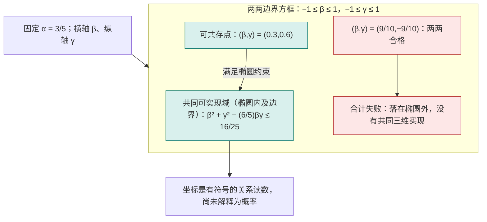
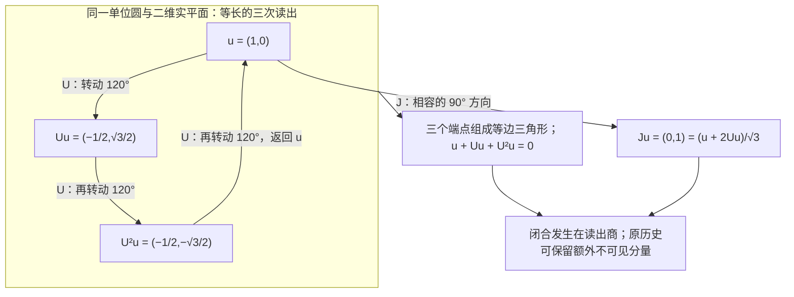

# 互为探针与平方几何的内生恢复

> 来源：用户于 2026-11-05（Asia/Singapore）在本会话提供的 AURIC C139 LaTeX 研究工作稿；原稿未另署作者或模型。本文为参考输入，Lean 是仓库的数学真源；本次仅转换 Markdown，未作形式化认证。正文中的固定快照、项目核读叙述与理论结论均保留原稿口径；两幅 TikZ 图转换为 Mermaid 示意图，保留三元 Gram 可实现域与三读相位闭合的关系及原图注。

**AURIC C139**

从原非负读数到内积、三维余量与量子过程

2026 年 11 月 5 日　新加坡时间

**本轮唯一核心候选。** 在实线性比较载体 $V$ 上，给定同一来源的有限非负读数 $q:V\to[0,\infty)$。 对任意两份比较配方 $x,y$，要求下面两个正向极限存在、有限且相同：

$$
\boxed{\quad
 \lim_{t\downarrow0}\frac{q(x+ty)-q(x)}{t}
 =\lim_{t\downarrow0}\frac{q(y+tx)-q(y)}{t}
 \quad(x,y\in V).\quad}
 \tag{C139}
$$

**白话。** 把你轻轻加到我身上，再把我轻轻加到你身上， 按同一个微小比例计算，两边一开始的原读数变化相同。

**本轮严格结论。** 不预设范数、平方缩放、凸性、三角不等式，也不预设方向导数对探针线性， 就可推出唯一对称实双线性形式 $B$，使

$$
q(x)=q(0)+B(x,x),\qquad
 B(x,y)=\tfrac12\left.\frac{d}{dt}q(x+ty)\right|_{t=0}.
$$

原非负性进一步推出 $B\ge0$。读出零空间商上，$\sqrt{q-q(0)}$ 是原读数恢复出的内积范数。 证明适用于任意实维数。三维在本轮用于检查三份二元读数是否能共存，而非另加维数门槛。

**范围与来源。** 这里减少的是独立的范数与事件二次型前提；正向变化率仍是完整的来源条件。 完整双向可微性会由候选推出；全部带符号的探针仍在量词内。 初响应互易不等于通常的二阶混合偏导互换。 复相位、全效果概率、原过程、联合系统及时间关系均逐项陈述； 原档案不会因取读出商而被删除。 本稿给出普通数学证明与反模型，不声称本轮结果已完成 Lean 形式化或已构成经实验证实的新物理。

**结构。** 第 1 节核对仓库；第 2 节界定二元候选及其检验；第 3 节给出核心恢复定理； 第 4 节给出三维关系余量和手性边界；第 5 节重构标准有限维量子过程； 第 6 节说明 $\Omega$ 内生、递归闭合与仍需保留的来源。

## 1　最新进展：三读预算的一段证明刚进入形式源码

本轮固定默认分支 `dev` 在核查时的 [`b1d673668c6d`](https://github.com/the-omega-institute/trureturing/commit/b1d673668c6d1bc06a152e4607048833d830ca53)， 其提交时间为 2026 年 11 月 4 日 22:29:05 UTC，即新加坡时间 11 月 5 日 06:29:05。 GitHub 的 [固定比较页](https://github.com/the-omega-institute/trureturing/compare/66c49bfe9a1295ceea872b6e6a1d8146fb351237...b1d673668c6d1bc06a152e4607048833d830ca53) 显示，相对上一轮 `66c49bfe9a12` 有 16 个新增可达提交、297 个变更文件。 本轮按当前问题核读相关新增文件，没有把这次定向核查表述成全仓库审计， 也未据此断言整个理论文档树没有变化。

其中直接相关的是 PR \#26631 合并的 [`ThreeReadBudget.lean`](https://github.com/the-omega-institute/trureturing/blob/b1d673668c6d1bc06a152e4607048833d830ca53/D5/S0/Observation/ThreeReadBudget.lean)。 文件共 99 行，本轮核读全文；其 [配套 Blueprint](https://github.com/the-omega-institute/trureturing/blob/b1d673668c6d1bc06a152e4607048833d830ca53/Blueprint/D5/S0/Observation/ThreeReadBudget.md) 共 25 行，也核读全文。项目把它明确标为 C133 定理 2.2 的初始必要性子结论。 本轮没有重新运行 Lean，因此这里报告的是已见源码及其准确声明范围， 没有为整个 C133 或本轮新增理论授予新的机器认证。

### 1.1　新增源码实际证明了什么

它的类型先给定实模 $V$、实双线性读数 $R$ 和实线性推进 $U$。 令 $Q(f)=R(f,f)$、$S=I+U+U^2$，假设

$$
2R(f,Ug+nSg)\le Q(f)+Q(g)
 \qquad(f,g\in V,\ n\in\mathbb N).
$$

源码的 `three_read_budget_nullspace` 得到

$$
Q(f)\ge0,
 \qquad
 S(V)\subseteq\{h:R(f,h)=0\text{ 对所有 }f\in V\}.
$$

前一项用 $g=0,n=0$；后一项把左端展开成 $n$ 的仿射函数。 若斜率为正，总能找到一个有限自然数超过预算；再换 $f$ 为 $-f$，斜率只能为零。 这里的量词是所有有限的 $n$，证明没有执行一个无穷长实验。

源码没有预设 $R$ 对称或正半定，也没有预设 $U$ 可逆或空间有限维。 但实数标量、$R$ 的双线性和 $U$ 的线性确实已经在声明类型中。 Blueprint 又明确排除本文件尚未覆盖的内容：反向槽的零差、对称性、推进等距性、 取商、逆向蕴涵以及复结构分类。不能把当前 99 行的结论扩大成完整量子理论的形式证明。

### 1.2　本轮继续退回哪个前件

作为已经核验的历史版本，C138 固定提交中的 [C133 主文](https://github.com/the-omega-institute/trureturing/blob/66c49bfe9a1295ceea872b6e6a1d8146fb351237/docs/develop/theory/AURIC_C133_THREE_READ_CLOSURE_VISIBLE_COMPLEX_GEOMETRY.md) §2 的完整纸面论证已从上述预算推出对称半正定读数、可见商上的等距三周期， 再以 $J=(I+2T)/\sqrt3$ 得到复结构及 Hilbert 完成。 因此，继续补出这条商空间证明属于补齐来源接口；不能重新称它为本轮发现。 主文同时明说：实配方空间和双线性聚合仍在输入端。

同一历史提交的 [C130 §2](https://github.com/the-omega-institute/trureturing/blob/66c49bfe9a1295ceea872b6e6a1d8146fb351237/docs/develop/theory/AURIC_C130_MUTUAL_READOUT_BOUND_QUANTUM_RELATIONS.md) 在整数配方预算下得到 Hermitian 正性，其有限双和聚合与复数结构也有明确来源。 而 [C133 续五 §4](https://github.com/the-omega-institute/trureturing/blob/66c49bfe9a1295ceea872b6e6a1d8146fb351237/docs/develop/theory/AURIC_C133_THREE_READ_CLOSURE_VISIBLE_COMPLEX_GEOMETRY_CONTINUATION_V.md) 先在已经得到的交换群上证明平行四边形律，再以极化、正 Gram 商和完成获得平方几何。 这些已有路线提示了本轮的精确目标：从一个原始实读数 $q$ 的二元微扰比较出发， 证明双线性读口本身，而不是先把它写进读口的类型。

后文采取的入口是双方一阶响应互易。新的证明若成立，便能把 *双线性读口*从假设移入结论，再与已有三读预算对接。 实向量配方、右方向导数的存在、统一读数及所有相关方向的互易仍须明示； 它们是这条候选的前件，不因采用较短的表述而自动来自 $\Omega$。

### 1.3　同一读口取商不抹去原始日志

C133 主文 §5.2 还明确区分相位返回与档案返回： 若某个实际可读日志长度严格增长，则三步后的完整历史不能在包含该读口的全语境等价中等于原历史。 当前量子读口的 $[U]^3=I$ 只发生在它自己的可见商上。 因此，本轮的几何恢复与原始观察者记录可以同时保留； 不同读口之间是否存在共同表示，要检查实际来源和读口相容性，不能借取商宣告已经完成。

**白话。** 这次项目刚把一个关键步骤写进 Lean：只要同一组三次比较反复加入后始终不透支， 这组三次比较在当前读口里就只能留下零差。 但这段源码先把“比较怎样相加”给好了。我们继续向前退一步： 先只给一份历史的读数，再问两份历史相互轻推时读数怎样改变。 如果双方的响应总能对得上，能否把相加规则和平方尺子一起证明出来？ 证明出来后，再接回三读闭合；相位圈由当前读口生成，原始日志仍留在原处。

## 2　只比较最初怎样改变：唯一候选的接口

### 2.1　从零关系，回溯到产生零关系的响应

C138 的来源是实范数 $N$，并定义

$$
x\perp_N y\iff N(x+ty)\ge N(x)\quad\text{对所有 }t\in\mathbb R.
$$

在实维数至少三时，要求这项关系互易，原范数就来自内积。 该经典 James 刻画允许非光滑范数；二维完整互易仍容许 Radon 六边形，见[\[6\]](#ref-james1947), [\[7\]](#ref-martini2006)。 本轮向前回溯到一个原标量读数 $q$：先不要求它的平方根已经是范数。

#### 定义 2.1：原读数与初响应

固定实线性载体 $V$ 及有限实值读数 $q$。 若下列普通实变量正向极限存在且有限，定义

$$
D(x;y)=\lim_{t\downarrow0}\frac{q(x+ty)-q(x)}t,
 \qquad R(x,y)=\frac12D(x;y).
$$

定义不要求 $y\mapsto D(x;y)$ 可加或线性，也没有在 $V$ 上预设范数拓扑。 极限只发生在每条真实标量参数线 $t\mapsto x+ty$ 上。

#### 定义 2.2：C139：互为探针的初响应相同

对全部 $x,y\in V$，两边定义中的有限正向极限存在，并满足

$$
D(x;y)=D(y;x).
$$

正读出版本另固定 $q:V\to[0,\infty)$。该非负性不被上述交换等式单独推出。

这里 $x$ 是被比较的配方，$y$ 是试探方向；交换时，两个角色一起交换。 每次只取 $t\downarrow0$，但 $y$ 与 $-y$ 都是原实线性载体中的合法探针。 完整的双向导数和对探针的线性，将由候选证明出来。 这不同于同一基点处的二阶导数对称 $D^2q(x)[u,v]=D^2q(x)[v,u]$。 后者对通常的二次可微非二次函数也成立，不能选出平方律。

### 2.2　探针比例不是日志时间

参数 $t$ 表示比较配方中探针的比例；$t<0$ 表示带符号的比较，未表示把观察者档案倒退或删除。 计算 $q(x+ty)-q(x)$ 可以同时保存两条原记录，再形成差读数。 同样，后文的 $q-q(0)$ 是保留原基线后的对照校准；它不宣称基线所依附的原历史不曾存在。 源载体中的加法、实数比例及相应极限条件仍需供应。 有限门菜单或有限日志没有仅因使用这个记号就取得全部连续探针。

### 2.3　沿一条线，平方量与高次量立即分开

在 $V=\mathbb R$ 中取 $x=1,y=2$。对 $q(s)=s^2$，

$$
D(1;2)=4=D(2;1),
$$

但两边有限增量分别是 $4t+4t^2$ 和 $4t+t^2$，不必相同。 对同样平滑、非负的 $q(s)=s^4$，则

$$
D(1;2)=8,\qquad D(2;1)=32.
$$

因此候选比较的是有符号的原初响应数值；它能检测仅观察“是否为零”时被遗漏的缩放失配。 在欧氏空间取 $q(x)=\|x\|_2^4$，其正交零关系仍是标准欧氏正交， 但 $D(x;y)=4\|x\|_2^2\langle x,y\rangle$ 并不对任意 $x,y$ 互易。

#### 说明 2.3：一句更短的条件，仍有完整量词

本轮将范数、齐次性和凸性从前提移到结论，但明确保留全部正向初响应的存在性和数值互易。 在维数至少三、且用 $q=N^2$ 对齐同一来源后，C138 与 C139 都刻画同一内积模型类。 它们使用的原始比较接口不同，不能仅以字数判断对任意原数据严格更弱。 本轮也不把有限次采样等同于对所有 $x,y$ 的证明。

**白话。** 上一轮只问，沿你移动能不能把我缩短。这一轮把产生那个答案的原读数也保留下来， 问两边刚开始怎样变。平方读数让这种交换公平；四次读数会按起点大小额外放大其中一边。 比较这点差别，就有可能把原来的尺子也从关系中恢复。

## 3　首响应互易：从原读数直接恢复平方量

本节只预先给一个实线性比较载体 $V$ 和原实读数 $q:V\to\mathbb R$。 向量表示可作正负组合的比较配方；本节不把概率混合预先认作这些线性组合。 不预设范数、内积、凸性、二次齐次、探针方向上的可加性，也不预设 $V$ 上的拓扑。 下面的极限只沿实参数 $t$ 取值。原读数的固定基线记作

$$
q_0=q(0),\qquad Q(x)=q(x)-q_0.
$$

基线是原记录的一部分；居中只改变所讨论的差量，不删除这项记录。

### 3.1　一个带存在性的二元候选

#### 定义 3.1：原首响应与 C139

若有限右侧极限存在，定义在 $x$ 处用 $y$ 作探针的首响应为

$$
D_q^+(x;y)=\lim_{t\downarrow0}\frac{q(x+ty)-q(x)}{t}.
$$

本轮唯一新增的关系条件是：对每个 $x,y\in V$，两边极限都存在为有限实数，且

$$
\boxed{\quad
 \lim_{t\downarrow0}\frac{q(x+ty)-q(x)}{t} =
 \lim_{t\downarrow0}\frac{q(y+tx)-q(y)}{t}\in\mathbb R.
 \quad}
 \tag{C139}
$$

为使最终对角读数等于 $Q$，另记 $\mathcal R_q(x,y)=\tfrac12D_q^+(x;y)$。

这条条件交换的是“基点历史”和“探针历史”。 它不是在同一个基点交换两个二阶偏导数；二阶偏导的通常对称性不会选出二次函数。 “有限右侧极限存在”是候选的明示组成部分；尚未供应实参数比较的离散来源，不能仅凭符号就获得这个接口。 参数 $t$ 每次只从正侧试探，但 $y$ 与 $-y$ 都属于原实线性配方。 这不要求倒退档案的记录次序，也没有从取极限的一侧选出物理手性。

**白话。** 把另一份历史只加入一点点，记录总读数刚开始怎样变化；再交换两份历史， 用完全相同的标尺重做这次试探。候选只说：两笔首响应应当相等。 它比较实际变化量，因此同时检查了方向和尺度。

### 3.2　完全代数化的恢复定理

#### 引理 3.2：连续函数的右导数积分唯一性

设 $f$ 在闭区间 $[a,b]$ 上连续，且每个 $t<b$ 的有限右导数为零。 则 $f$ 为常数。因此，若其右导数等于某个多项式的导数， 则 $f$ 与该多项式只差一个常数。

**证明。**

若 $a<b$ 且 $f(b)>f(a)$，取 $0<\varepsilon<(f(b)-f(a))/(b-a)$，令 $h(t)=f(t)-\varepsilon t$。 有 $h(b)>h(a)$，故 $h$ 的全局最小值在某个 $c<b$ 取得。 最小性给 $D^+h(c)\ge0$，但原右导数条件给 $D^+h(c)=-\varepsilon<0$，矛盾。 所以 $f(b)\le f(a)$；对 $-f$ 应用同一论证得反向不等式。 在每个闭子区间重复即可得常数性。减去给定多项式即得后一结论。

$\square$

#### 定理 3.3：首响应互易的精确解

对任意实线性空间 $V$ 和函数 $q:V\to\mathbb R$，下列两项等价：

1.  $q$ 满足 C139 的有限右侧首响应互易。

2.  存在唯一对称实双线性形式 $g:V\times V\to\mathbb R$，使

    $$
    q(x)=q_0+g(x,x).
    $$

其恢复式为

$$
\boxed{
 g(x,y)=\frac12D_q^+(x;y)
       =\frac{Q(x+y)-Q(x-y)}4
       =\frac{q(x+y)-q(x-y)}4 .
 }
$$

特别地，在任意有限维窗口中，原居中读数自动成为一个二次多项式。 全部双侧首响应的存在、以及它对探针的实线性，也都是结论。 这一结论不需要全空间维数至少为三，也不借用范数空间的内积刻画定理。

**证明。**

下文把 $D_q^+(x;y)$ 简记为 $D(x;y)$；$q$ 与 $Q$ 的首响应相同。

*第一步：右侧存在性给仿射线连续性，互易锁住正径向尺度。* 对固定 $x,y$ 和每个实数 $s$，探针 $y$ 的有限右响应给 $q(x+(s+h)y)\to q(x+sy)$；探针 $-y$ 的有限右响应给 $q(x+(s-h)y)\to q(x+sy)$，其中 $h\downarrow0$。 故 $s\mapsto q(x+sy)$ 连续。这里没有把两个单侧导数预先认作相反数。

由右侧极限的变量代换，对每个 $a\ge0$，

$$
D(x;ay)=aD(x;y).
$$

$a=0$ 时两边均为零；$a>0$ 时用 $s=at$。再由互易，

$$
D(ax;y)=D(y;ax)=aD(x;y)\qquad(a\ge0).
 \tag{1}
$$

特别地，$D(0;y)=D(y;0)=0$。 对固定 $x$，连续函数 $f(t)=q(tx)$ 在 $t\ge0$ 的右导数满足

$$
D^+f(t)=D(tx;x)=tD(x;x).
$$

对任意 $T>0$ 在 $[0,T]$ 上应用引理 3.2，得到 $q(tx)=q_0+\tfrac12t^2D(x;x)$。令 $t=1$ 再代回，得到

$$
D(x;x)=2Q(x),\qquad
 Q(tx)=t^2Q(x)\quad(t\ge0).
 \tag{2}
$$

尚未使用负缩放。现在只沿 $x$ 的反向探针试探，因 $1-h>0$，

$$
D(x;-x)
 =\lim_{h\downarrow0}\frac{((1-h)^2-1)Q(x)}h
 =-2Q(x).
$$

同理 $D(-x;x)=-2Q(-x)$。互易要求二者相等，因此 $Q(-x)=Q(x)$。 连同 (2)，得到完整的原二次齐次性

$$
\boxed{Q(tx)=t^2Q(x)\qquad(t\in\mathbb R).}
 \tag{3}
$$

*第二步：由重参数化得到径向剪切公式。* 对任意 $a\in\mathbb R$，当 $h>0$ 充分小时 $1+ah>0$，由 (3)，

$$
Q\bigl(x+h(ax+y)\bigr)
 =(1+ah)^2Q\left(x+\frac{h}{1+ah}y\right).
$$

重参数 $h/(1+ah)$ 始终从正侧趋于零，其与 $h$ 之比趋于 $1$。 直接展开有限右响应，包括 $x=0$、$y=0$ 以及任意符号的 $a$，均得

$$
\boxed{D(x;ax+y)=2aQ(x)+D(x;y).}
 \tag{4}
$$

这里没有先假定 $D(x;\cdot)$ 对任意两个探针可加； 式 (4) 只利用已证明的径向齐次性与原右侧首响应，也没有偷用负系数的探针齐次性。

*第三步：任意仿射线上的读数都被锁成二次式。* 固定 $x,y$，令 $F(t)=Q(x+ty)$。第一步已证明 $F$ 连续；互易和 (4) 给

$$
\begin{aligned}
 D^+F(t)
 &=D(x+ty;y)\\
 &=D(y;x+ty)\\
 &=D(y;x)+2tQ(y)\\
 &=D(x;y)+2tQ(y).
 \end{aligned}
$$

将任意 $t$ 与 $0$ 放入同一闭区间，再用引理 3.2，得到

$$
\boxed{
 Q(x+ty)=Q(x)+tD(x;y)+t^2Q(y).
 }
 \tag{5}
$$

该式对全部实数 $t$ 成立，所以原 $q$ 的全部双侧首响应确实存在。 对任意实数 $a$，把 $t$ 换为 $at$，也就得到 $D(x;ay)=aD(x;y)$；负系数的探针齐次性在这里才成为结论。 取 $t=\pm1$ 得

$$
Q(x+y)+Q(x-y)=2Q(x)+2Q(y),
 \tag{6}
$$

以及定理中的极化公式。

*第四步：用三个元的相容性恢复探针可加性。* 定义 $g(x,y)=D(x;y)/2$。它已对称，并由第三步和互易在两变量分别实齐次。 利用极化式与 (6)，直接相减可得

$$
g(x+z,y)+g(x-z,y)=2g(x,y).
 \tag{7}
$$

例如，将左侧乘 $4$ 后，分组为

$$
\begin{aligned}
 &Q((x+y)+z)+Q((x+y)-z)\\
 &\quad-Q((x-y)+z)-Q((x-y)-z),
 \end{aligned}
$$

再用 (6)，结果即为 $8g(x,y)$。 在 (7) 中令 $x=(u+v)/2$、$z=(u-v)/2$，利用已知的实齐次性，得到

$$
g(u+v,y)=g(u,y)+g(v,y).
 \tag{8}
$$

对称性给另一变量的可加性，故 $g$ 实双线性。 由 (2)，$g(x,x)=Q(x)$。极化公式又说明这样的 $g$ 唯一。

反向，若 $q(x)=q_0+g(x,x)$ 且 $g$ 为对称实双线性形式，则

$$
q(x+ty)-q(x)=2t\,g(x,y)+t^2g(y,y),
$$

所以全部有限双侧首响应存在，且 $D_q^+(x;y)=2g(x,y)=D_q^+(y;x)$。证毕。

$\square$

所恢复的平方结构与经典平行四边形刻画相接，见[\[5\]](#ref-jordan1935)； 本节已从原单侧响应完整证明所需结论。

上面最后一步恰好是有限三元闭合：$x,y,z$ 的全部关系位于 $\operatorname{span}\{x,y,z\}$，式 (8) 表明“关系的关系”必须服从同一加法。 本轮不再需要“至少三维”来排除二维例外；三维窗口负责显式展示三份比较的共同相容。 若 $V$ 本来无限维，定理仍只沿每次有限多个配方论证，不把整个来源压成三维。

### 3.3　非负原读数使范数与可见零空间内生

#### 推论 3.4：原非负读数的平方几何

若原读数 $q:V\to[0,\infty)$ 满足 C139，则

$$
q(x)\ge q_0,\qquad Q(x)\ge0,
$$

因此恢复出的 $g$ 为正半定。 其零空间

$$
\mathcal Z=\{x:Q(x)=0\}
$$

恰等于双线性形式的根空间 $\{x:g(x,y)=0\text{ 对全部 }y\}$，从而是线性子空间。 在 $V/\mathcal Z$ 上，

$$
\overline g([x],[y])=g(x,y),\qquad
 N([x])=\sqrt{Q(x)}
$$

分别是正定内积与其范数。 同一个可见等价关系也可完全用原首响应表达：

$$
Q(x-y)=0
 \iff
 D_q^+(x;z)=D_q^+(y;z)\quad\text{对全部 }z\in V.
$$

若原读口已经分离零，即 $q(x)=q_0$ 当且仅当 $x=0$， 则 $\mathcal Z=0$，这些结构直接恢复在原 $V$ 上。

**证明。**

若某个 $Q(x)<0$，主定理给 $q(tx)=q_0+t^2Q(x)$，取充分大的 $|t|$ 就会违反原 $q\ge0$。 故 $Q\ge0$，并且原点自动给出全局最小基线。

对每个 $x,y$，二次式

$$
Q(x+ty)=Q(x)+2t\,g(x,y)+t^2Q(y)
$$

对全部 $t$ 非负。若 $Q(y)>0$，在其最小点取值，得到

$$
|g(x,y)|^2\le Q(x)Q(y).
 \tag{9}
$$

若 $Q(y)=0$，一个仿射函数对全部 $t$ 非负迫使 $g(x,y)=0$， 于是 (9) 仍成立。这同时证明零空间等于根空间。 双线性性使根空间为线性子空间；加上根空间元素不改变 $g$ 或 $Q$， 所以商上的公式良定义，并且正定。 由 $D_q^+=2g$，根空间刻画同时给出所示的全部首响应轮廓相等。

齐次性由 $Q(tx)=t^2Q(x)$ 给出。三角不等式也成为结论：

$$
\begin{aligned}
 N([x]+[y])^2
 &=Q(x)+Q(y)+2g(x,y)\\
 &\le Q(x)+Q(y)+2\sqrt{Q(x)Q(y)}\\
 &=(N([x])+N([y]))^2.
 \end{aligned}
$$

取非负平方根即可。

$\square$

非负值域还可放宽为：原 $q$ 在每一条完整径向直线上有下界； 相同的 $t\to\infty$ 论证仍给 $Q\ge0$。 但如果删掉这项有下界的来源信息， $q(s,t)=s^2-t^2$ 就满足全部首响应互易，却没有正的概率或范数解释。

商 $V\to V/\mathcal Z$ 只描述该读口看不出的差别。 它不授权删除原历史、合并来源树或回写原档案；原记录和商读出应同时保留。 特别地，常数读数也满足候选，其可见商为零维；若任务需要非平凡可见几何，必须有某份记录满足 $q(x)>q_0$。

**白话。** 只先知道每次总读数都不会是负数，交换试探就会强迫同一条射线按平方增长。 于是原点读数自动成为底线；超过底线的部分才是平方量。 沿这个读口完全看不见的差别，可以在表示中归到同一类，但它们的原始历史仍在。 能看见的部分，自身产生内积、长度和三角不等式，不必再预先借一把范数尺子。

### 3.4　逆推：哪些删改会重新放进非量子平方读数

#### 例 3.5：C138 的同一互易六边形，被数值首响应排除

令

$$
H(s,t)=\max\{|s|,|t|,|s+t|\},\qquad q(s,t)=H(s,t)^2 .
$$

这个单位球是 C138 的中心对称六边形。对其六个顶点直接取面积读数最大值，得到

$$
H_a(y):=\max_{H(x)\le1}|\det(x,y)|=H(y).
$$

沿线最小关系 $x\perp_Hy$ 等价于该线在 $x$ 处支持相应尺度的单位球，即 $|\det(x,y)|=H(x)H_a(y)$；因此它对全部 $x,y$ 互易。 另一方面，$q$ 沿每条仿射线都是有限段二次式，故每个右首响应均存在且有限，连多边形角点也不例外。

取 $x=(2,-1)$、$y=(1,2)$。当 $0<h<1/2$ 时，

$$
H(x+hy)=2+h,\qquad H(y+hx)=3+h .
$$

因而

$$
\boxed{\mathcal R_q(x,y)=2\ne3=\mathcal R_q(y,x).}
$$

同一个满足全部二维沿线最小互易的范数，违反 C139 的数值互易。 这里原量已经二次齐次；失败出在角向比较。 它也说明本轮排除多边形并非仅靠预设光滑性禁止角点。

#### 例 3.6：只比较零响应，或只在单位层比较，均丢失尺度

在任意非零欧氏空间中令

$$
q(x)=\|x\|_2^4.
$$

它处处有有限双侧首响应，并且

$$
\mathcal R_q(x,y)=2\|x\|_2^2\langle x,y\rangle .
$$

因此“首响应为零”是互易的；当 $q(x)=q(y)=1$ 时， 甚至完整数值响应也互易。 但对单位 $e$，

$$
\mathcal R_q(e,2e)=4,\qquad
 \mathcal R_q(2e,e)=16.
$$

所以原首响应并不全域互易；原量按四次增长，而不是平方增长。 单位层检验不能代替带尺度的原候选。

#### 例 3.7：正性与二次齐次仍不足

在 $\mathbb R^2$ 上令

$$
q(x)=\|x\|_4^2=(x_1^4+x_2^4)^{1/2}.
$$

它非负、二次齐次，在原点的首响应为零；非零点满足

$$
\mathcal R_q(x,y)=
 \frac{x_1^3y_1+x_2^3y_2}{(x_1^4+x_2^4)^{1/2}}.
$$

取 $x=(1,2)$、$y=(8,-1)$，则

$$
\mathcal R_q(x,y)=0,\qquad
 \mathcal R_q(y,x)=\frac{510}{\sqrt{4097}}>0.
$$

因此保持二次尺度仍然没有固定角向比较；C139 排除了这项原读数。

主定理同样说明，首响应无法确定额外常数：$q$ 与 $q+c$ 具有同一个 $D_q^+$。 本轮保留原 $q_0$ 并恢复 $Q=q-q_0$，不把这项不可见基线冒充已经由互易决定。 若再删去原实线性组合接口，本定理中的 $x+ty$ 本身尚无定义，也就没有所声称的恢复结论。

### 3.5　相对 C138 的准确压缩范围

C138 从原范数 $N$ 出发，以 $N(x+ty)\ge N(x)$ 的全线最小关系定义正交， 在实维数至少三时用互易恢复原内积。 C139 直接从原非负读数 $q$ 出发，用右侧首响应的*数值*互易恢复二次式， 再把范数公设作为推论。

在 $\dim_{\mathbb R}V\ge3$ 的分离可见扇区，令 $q=q_0+N^2$， 两个候选在各自明示的接口上具有同一批正定模型： C138 由其内积结论推出 C139；C139 恢复的 $N=\sqrt{q-q_0}$ 满足 C138， 因为

$$
N(x+ty)^2-N(x)^2=2t\,g(x,y)+t^2N(y)^2
$$

对所有 $t$ 非负当且仅当 $g(x,y)=0$，而这个关系对称。 二维的 Radon 例外不再通过 C139；右侧首响应互易在二维也已强迫二次式。

因此，本轮减少的是预置的范数公设、维数门槛以及经典几何刻画的证明依赖， 代价是明示检查原首响应的存在与数值校准。 它是来源接口的重组与条件压缩，不能宣称在完全相同的数据签名上无条件地使用了更少信息。 “平方规律内生”的已证含义是：由同一原 $q$ 定义出的两种首响应满足一个交换约束， 便迫使这份原 $q$ 的全部有限窗口具有同一个平方结构。

## 4　一条抛物线与三份关系的共同余量

本节在原非负读数恢复的可见空间上讨论；若没有零分离，先取第 3.4节的读出商。 以下仍记 $Q(x)=g(x,x)$，其原基线 $q_0$ 另行保留。

### 4.1　最简图形：每条比较直线都读成抛物线

核心定理给每个 $x,y$ 的精确有限式

$$
Q(x+ty)=Q(x)+2t\,g(x,y)+t^2Q(y).
 \tag{8}
$$

当 $Q(y)>0$，配方位移 $t$ 与读数构成一条抛物线，顶点为

$$
t_*=-\frac{g(x,y)}{Q(y)},\qquad
 Q(x+t_*y)=Q(x)-\frac{g(x,y)^2}{Q(y)}.
$$

这个非负最小余量，正是二元 Gram 矩阵的 Schur 余量。 令 $r=x-g(x,y)y/Q(y)$，则

$$
g(r,y)=0,\qquad
 Q(x)=\frac{g(x,y)^2}{Q(y)}+Q(r).
$$

因此直角三角形、平方分配和最短投影，都由同一条原响应曲线得到。

对任意两个归一方向 $u,v$，$Q(u)=Q(v)=1$，有

$$
Q(au+bv)=a^2+2\alpha ab+b^2,\qquad
 \alpha=g(u,v),\quad |\alpha|\le1.
$$

交叉系数 $\chi=2\alpha$ 已由两份原初响应确定。 $\alpha=0$ 时，$Q(au+bv)=1$ 是该正交单位坐标中的圆； $0<|\alpha|<1$ 时在 $(a,b)$ 系数平面上为椭圆；$\alpha=\pm1$ 时两个可见方向共线，二次式退化为 $(a\pm b)^2$。 所以圆是恢复出的平方图形的归一截面；互易本身没有预先把圆写进定义。

### 4.2　两两合格，还必须能放进同一个三维窗口

取三个归一可见方向 $u,v,w$，记录三项二元响应

$$
\alpha=g(u,v),\qquad \beta=g(u,w),\qquad \gamma=g(v,w).
$$

其共同 Gram 矩阵为

$$
G=\begin{pmatrix}
 1&\alpha&\beta\\
 \alpha&1&\gamma\\
 \beta&\gamma&1
 \end{pmatrix}.
$$

#### 定理 4.1：三个二元读数的有限三维提升

三个实数 $\alpha,\beta,\gamma$ 可由某个实内积空间中的三个单位方向实现， 当且仅当

$$
|\alpha|,|\beta|,|\gamma|\le1,\qquad
 \Delta=1+2\alpha\beta\gamma-\alpha^2-\beta^2-\gamma^2\ge0.
$$

所有可实现的三元读数都可在 $\mathbb R^3$ 中实现；第三项的准确允许区间为

$$
\boxed{
 \alpha\beta-\sqrt{(1-\alpha^2)(1-\beta^2)}
 \le\gamma\le
 \alpha\beta+\sqrt{(1-\alpha^2)(1-\beta^2)}.
 }
$$

**证明。**

必要性来自 $G\ge0$：任意 $a,b,c$ 满足 $(a,b,c)G(a,b,c)^{\mathsf T}=Q(au+bv+cw)\ge0$。 其二阶主子式给三项绝对值界，三阶行列式给 $\Delta\ge0$。

反向，在 $|\alpha|<1$ 时，取

$$
\begin{aligned}
 u&=(1,0,0),\\
 v&=(\alpha,\sqrt{1-\alpha^2},0),\\
 w&=\left(\beta,
 \frac{\gamma-\alpha\beta}{\sqrt{1-\alpha^2}},
 \delta\right),\qquad
 \delta^2=\frac{\Delta}{1-\alpha^2}.
 \end{aligned}
$$

这些向量长度为一，并给所需的三项配对。 若 $\alpha=\pm1$，行列式成为 $\Delta=-(\gamma-\alpha\beta)^2$，故 $\gamma=\alpha\beta$。 取 $v=\alpha u$、$w=(\beta,\sqrt{1-\beta^2},0)$ 即可。 最后重写

$$
\Delta=(1-\alpha^2)(1-\beta^2)-(\gamma-\alpha\beta)^2
$$

就得到区间公式，包括全部端点。证毕。

$\square$

**图 1：** 固定一项关系 $\alpha=3/5$，另外两项关系必须落在椭圆内。 方框只检查每一对的绝对值不超过一；红点 $(9/10,-9/10)$ 通过两两检查，却没有共同的三维实现。 坐标是有符号的关系读数，尚未被解释为概率。

在 $|\alpha|<1$ 的上述构造中，第三方向的平方余量是 $\delta^2$。 当 $\Delta>0$，三项二元配对不能区分 $\delta$ 与 $-\delta$：它们对应两个镜像实现； 当 $\Delta=0$ 时，第三方向余量为零，两者重合。 若选择定向体积 $\tau=\det[u\ v\ w]$，则

$$
\tau^2=\Delta.
$$

二元平方读口锁住了体积的平方，未锁住体积的方向。 具体方向须由来源中额外记录的定向关系或有向操作提供。

### 4.3　为什么固定标签的三元检查不是全域正性

#### 例 4.2：四个标签可以藏住共同负方向

取四阶对称矩阵 $G_4$，对角为一，非对角全为 $-2/5$。 每个三阶主子矩阵的特征值为 $7/5,7/5,1/5$，都是正定的。 但全矩阵在 $(1,1,1,1)$ 方向的特征值为 $-1/5$，故

$$
(1,1,1,1)G_4(1,1,1,1)^{\mathsf T}=-4/5<0.
$$

因此，只检查每三个原标签的局部表，不足以推出全局正核。

C139 约束的是已经对线性组合闭合的同一来源，而非只有若干原标签。 若把前两个标签相加为 $x$、后两个相加为 $y$，则 $Q(x)=Q(y)=6/5$、$g(x,y)=-8/5$，归一化相关为 $-4/3$， 已超出任何合法二元比较的范围；上述负方向也直接出现在 $x+y$ 的读数中。 所以每次论证只需有限多个比较配方，并不等于只需预先固定有限个样本。

**白话。** 两份历史的读数给出交叉项，三份历史则要求三条交叉关系放得进同一个图形。 如果其中一条超过共同余量，三条边各自看着合法，合起来却会制造负的平方量。 三维提升把这个漏洞显示出来；它给出的镜像两解还提醒我们，平方量本身没有选择手性。

## 5　从同一原读数完成有限量子理论：三读相位、原分支与概率

主定理先从原 $q$ 恢复 $g=\mathcal R_q$ 与 $Q=q-q(0)=g(x,x)$。 本节使用非零有限维读出商 $\mathcal H_{\mathbb R}=V/\operatorname{rad}g$；原基线 $q(0)$、来源与日志仍保留。 所有总量预算均作用于这个同一 $Q$，而非未经说明地改变原读数单位。 以下给出一条过程优先的条件链：先由实际分支恢复效果，事件的平方律和相位不变性由此一起推出。

### 5.1　三读预算恢复复相位

取来源中一个原操作 $U:V\to V$，不预设线性。先采用与一般过程相同的单分支比较校准：

$$
Q(Ux-Uy)=Q(x-y)\qquad(x,y\in V).
\tag{1}
$$

逐点定义 $S(y)=y+U(y)+U(U(y))$；此时尚未把 $S$ 或 $U$ 当作线性算子。另要求

$$
2g\bigl(f,Uy+nS(y)\bigr)\le Q(f)+Q(y)
 \qquad(f,y\in V,\ n=0,1,2,\ldots).
\tag{2}
$$

此处预算中的 $g$ 明确绑定为从同一 $q$ 恢复的响应读数。 项目 C133 的三读分类与新增 Lean 预算引理以双线性读数及线性操作为前件，见[\[3\]](#ref-repo_c133), [\[2\]](#ref-repo_three_read)。 本轮先从同一原来源恢复响应与读出操作的线性，再接入这些结果。 若原 $U$ 已线性，C133 的预算会推出 (1)；这里把操作的线性也改成读出上的结论。

#### 引理 5.1：保零比较校准的 Gram 恢复

实内积空间之间的映射 $T$ 若保零且保持全部距离，则 $T$ 实线性且等距。

**证明。**

距离公式给 $g(T\xi,T\eta)=(\|T\xi\|^2+\|T\eta\|^2-\|T\xi-T\eta\|^2)/2=g(\xi,\eta)$。 用这些配对展开 $\|T(\xi+\eta)-T\xi-T\eta\|^2$ 与 $\|T(t\xi)-tT\xi\|^2$，两者均为零，得到可加性与实齐次性。

$\square$

#### 定理 5.2：三读闭合与原尺度保持

条件 (1)–(2) 使 $U$ 保持原零读出等价， 并下降为实线性等距操作 $\bar U$，满足

$$
I+\bar U+\bar U^2=0,\qquad \bar U^3=I,
 \qquad \|\bar U\xi\|=\|\xi\|.
$$

于是

$$
J=\frac{2\bar U+I}{\sqrt3},\qquad
 J^2=-I,\qquad J^*=-J,
 \qquad h(\xi,\eta)=g(\xi,\eta)+i\,g(J\xi,\eta)
$$

定义以 $i\xi=J\xi$ 为复结构、对第一变量共轭线性的正定复内积。

**证明。**

预算中取 $y=0$、$n=0$、$f=U0$，得到 $2Q(U0)\le Q(U0)$，故 $Q(U0)=0$。 比较校准使 $x-y\in\operatorname{rad}g$ 推出 $Ux-Uy\in\operatorname{rad}g$，因此 $U$ 下降为商上的保零等距映射。 由引理 5.1，该 $\bar U$ 实线性。

固定 $f,y$。若 $g(f,S(y))>0$，取足够大的自然数 $n$ 就违背预算；再对 $-f$ 应用预算，得到 $g(f,S(y))=0$。因此每个 $S(y)$ 都落在 $\operatorname{rad}g$。 由于 $U$ 已下降，$[S(y)]=[y]+\bar U[y]+\bar U^2[y]$，故商上有 $I+\bar U+\bar U^2=0$。现在才使用已证明的线性，乘以 $\bar U-I$ 得 $\bar U^3=I$。 等距性与此逆算子给 $\bar U^*=\bar U^{-1}=\bar U^2$。 直接代入二次关系即得 $J^2=-I$、$J^*=-J$ 与 $J^*J=I$；所示 $h$ 因而为复内积。

$\square$

反向，任意复内积结构的 $J=i$ 给 $U=-I/2+(\sqrt3/2)J$；该 $U$ 保持全部比较，$S=0$，预算就是 $0\le\|f-Uy\|^2$。因此此处相位条件有精确的反向模型。 对 $\xi\ne0$，三次读出的轨道 $\xi,\bar U\xi,\bar U^2\xi$ 在其二维实平面里组成等边三角形； 换 $\bar U$ 为 $\bar U^2$ 恰使 $J$ 变为 $-J$，预算不单独选择绝对手性。 $R_\theta=\cos\theta I+\sin\theta J$ 给数学上的完整相位圆；实际门菜单能否实现任意 $\theta$ 需由来源说明。 若根空间非零，原 $U$ 仍可非线性，$U^3=I$ 与 $J^2=-I$ 的结论只在读出商上成立。

#### 例 5.3：逐点三角闭合不能代替全部比较校准

在欧氏平面上，令 $U(x)=R_{+120^\circ}x$ 当 $\|x\|\ge1$，其余点取 $U(x)=R_{-120^\circ}x$。 这个原操作保持每个点的总量，且 $S(x)=0$，因而满足三读预算。 但对 $x=(1,0)$、$y=(1/2,0)$，

$$
Q(Ux-Uy)=\frac74\ne\frac14=Q(x-y).
$$

所以仅有各自等长与逐点闭合，并未保证两份读出之间的关系被保持。

**图 2：** 三读预算使合计在可见空间闭合；同一预算的收缩性再使三边等长。 由此恢复 $120^\circ$ 相位操作及与它相容的 $90^\circ$ 复结构。 图中闭合发生在读出商，原历史仍可携带额外不可见分量。

### 5.2　原分支一次给出复线性、效果与事件平方律

输入和输出各自满足前述读数与三读条件，记其原操作为 $U_{\rm in},U_{\rm out}$。 设原过程的有限个细分支为 $F_j:V_{\rm in}\to V_{\rm out}$，不预先假定线性，要求

$$
\sum_j Q_{\rm out}\bigl(F_j(x)-F_j(y)\bigr)=Q_{\rm in}(x-y),
 \qquad F_jU_{\rm in}=U_{\rm out}F_j.
\tag{3}
$$

粗事件 $e$ 是这些细分支的集合，完整测试取细分支集合的一个划分；其同一原读出权重为

$$
w_e(x)=\sum_{j\in e}Q_{\rm out}(F_j(x)).
\tag{4}
$$

式 (4) 是原事件与原输出配方的绑定，不能把另一套未经核对的事件读数替换进来。

#### 定理 5.4：原过程的复线性表示

各 $F_j$ 都下降到读出商上的复线性映射 $K_j$，且

$$
\sum_jK_j^*K_j=I,\qquad
 E_e=\sum_{j\in e}K_j^*K_j,
 \qquad w_e(x)=h([x],E_e[x]).
$$

因此 $0\le E_e\le I$，完整测试满足 $\sum_eE_e=I$。 原 $w_e$ 自动满足平行四边形恒等式与复相位不变性，无须再逐项公设。

**证明。**

若 $x-y\in\operatorname{rad}g_{\rm in}$，校准式左侧是若干非负项之和且为零，故 $F_j(x)-F_j(y)\in\operatorname{rad}g_{\rm out}$；于是原分支下降为 $\widehat F_j$。 在商上，原 $U$ 协变性使 $\widehat F_j(0)$ 成为 $\bar U_{\rm out}$ 的不动点。 但 $I+\bar U+\bar U^2=0$ 使其三倍为零，故 $\widehat F_j(0)=0$；零点保持也无需另加。

令 $Y(\xi)=\bigoplus_j\widehat F_j(\xi)$。校准式使 $Y$ 保持全部距离并保零； 引理 5.1 使 $Y$ 以及各 $\widehat F_j$ 实线性。 现在 $U$ 协变性及 $J=(2\bar U+I)/\sqrt3$ 给复线性。 令 $K_j=\widehat F_j$；取 $y=0$ 并极化，得到合计等距式。 原粗分支读数的绑定给所示 $E_e$，其余断言随之成立。

$\square$

这一定理保留原来源的可见范围。若输入与输出的 $Q$ 都正定，则 $F_j$ 本身复线性； 若有根空间，只能断言商上的线性。 例如在 $V=\mathbb C^2$ 上取 $Q(z,w)=|z|^2$、$U=\zeta I$，其中 $\zeta=e^{2\pi i/3}$，则

$$
F(z,w)=(z,|w|^2w)
$$

满足全部比较校准和 $U$ 协变，却在未读出的 $w$ 分量上非线性。 它在读出商上正是恒等过程；该表示没有删除那部分原历史。 另一方面，仅保总量不足：$F(z_1,z_2)=(z_1,e^{i|z_1|^2}z_2)$ 保持正定总量并与全部公共相位交换， 却不具可加性，因而不满足全部比较距离的校准。

### 5.3　完整效果评价、Born 规则与实际混合过程

对每个原准备，设完整效果集合 $0\le E\le I$ 上有单值评价 $p$，满足

$$
p(E)\ge0,\qquad p(I)=1,\qquad
 p(E+F)=p(E)+p(F)\quad(E,F\ge0,\ E+F\le I).
\tag{5}
$$

这是对同一效果读出的相容性要求；事件几何本身尚不替实际频率供应此条件。 若原纯准备由 $Q(x)>0$ 的 $x$ 给出，则还以 $p(P_\psi)=1$ 绑定其确定性，其中 $\psi=[x]/\sqrt{Q(x)}$。

#### 定理 5.5：准备的表示及 Born 概率

条件 (5) 等价于存在唯一 $\rho\ge0$、$\operatorname{Tr}\rho=1$，使

$$
p(E)=\operatorname{Tr}(\rho E).
$$

若 $p(P_\psi)=1$，则 $\rho=P_\psi$，从而

$$
p(E_e)=\frac{w_e(x)}{Q(x)},\qquad
 p(P_\varphi)=|h(\psi,\varphi)|^2
 \quad(\|\varphi\|=1).
$$

**证明。**

可加性给有理齐次，正性给序单调性，有理夹逼给实齐次。 对正算子 $A$ 取 $t>0$、$t\ge\|A\|$，定义 $L(A)=t\,p(A/t)$；齐次性使其与 $t$ 无关。 它在正锥可加，再按差延伸为 Hermitian 矩阵上的实线性泛函。 迹配对给唯一 Hermitian $\rho$，正性与归一化给 $\rho\ge0$、$\operatorname{Tr}\rho=1$。 若 $\operatorname{Tr}(\rho P_\psi)=1$，则 $\operatorname{Tr}(\rho(I-P_\psi))=0$，正性使 $\rho$ 的支撑在 $\mathbb C\psi$，故 $\rho=P_\psi$。代入效果表示即得两式。反向由迹的正性与线性直接验证。

$\square$

这里的全效果条件覆盖复二维，见[\[8\]](#ref-busch2003)。 仅保留零、确定性和二结果投影归一化仍容许 $f(t)=t^2/(t^2+(1-t)^2)$；它满足 $f(t)+f(1-t)=1$，但 $f(1/4)=1/10$。 该读法违背全效果可加性，说明概率步骤不可由一个圆的外观代替。

原 $F_j$ 已是纯输入的实际输出配方；若实际随机混合按同一权重仿射组合完整效果评价， 并且原过程对*未归一化的分支评价*尊重这种混合，则在这些实际纯准备生成的混合域上，

$$
\Phi_e(\rho)=\sum_{j\in e}K_j\rho K_j^*,\qquad
 \rho_e=\frac{\Phi_e(\rho)}{\operatorname{Tr}\Phi_e(\rho)}
 \quad\bigl(\operatorname{Tr}\Phi_e(\rho)>0\bigr).
\tag{6}
$$

确实，纯输入先由上一命题绑定为 $P_\psi$，细分支给 $K_jP_\psi K_j^*$；仿射相容性再延伸到每个实际混合。 该公式与纯态分解的选择无关，并给整个密度态集合上的数学延伸。 若要断言这个全集均为原可制备域，还需来源供应全部纯态射线的准备。 对任意辅助维数，放大后的公式仍是正算子的共轭和，故完全正； $\sum_jK_j^*K_j=I$ 给总迹保持。标准矩阵过程性质见[\[9\]](#ref-watrous2018)。 若原混合规则没有这项相容性，只能说式 (6) 是数学上的仿射延伸，不能说它已表示原过程。

### 5.4　投影更新、联合系统与连续演化

在同一输入输出空间上，若事件效果为投影 $P$，且其像内每条纯态射线都由原事件保持，则原更新为 $\Phi(\rho)=P\rho P$。 证明是：$\sum_jK_j^*K_j=P$ 先给 $K_j=K_jP$；每条射线保持使每个 $K_j$ 在 $\operatorname{Ran}P$ 上为标量。 对独立向量及其和使用线性性，标量必与向量无关，故 $K_j=c_jP$。 当 $P\ne0$ 时 $\sum_j|c_j|^2=1$；当 $P=0$ 时全部分支为零。 仅有结果可重复还容许像内的旋转，不能替代每条射线保持。

两组原可观察代数若为 $M_d(\mathbb C),M_m(\mathbb C)$，其保幺元的 $*$-嵌入互相交换且共同生成非零联合代数， 则乘法映射给满的 $*$-同态

$$
M_d(\mathbb C)\otimes M_m(\mathbb C)\longrightarrow\mathcal A_{AB}.
$$

源代数是简单代数 $M_{dm}(\mathbb C)$；保幺元与非零排除全核，因此这就是同构。 若联合代数还是 $B(\mathcal H_{AB})$，则得到完整的 Hilbert 张量分解。 若未给这一完备性，表示还可带有未读出的重数空间： $\mathcal H_{AB}\simeq\mathbb C^d\otimes\mathbb C^m\otimes\mathbb C^r$，联合代数作用为 $M_{dm}\otimes I_r$。 两个观察者的局部记录本身不排除这项重数。

最后，取式 (3) 的同一校准接口（全部比较校准与 $U$ 协变）的单分支时间族 $A_t$，要求其读出商构成连续一参数群。 过程定理已给 $\widehat A_t$ 的复线性与等距；群律给逆，故 $\widehat A_t$ 是幺正群。 无需再额外假定线性时间演化。群律使全部 $\widehat A_t$ 交换，有限维可同时酉对角化； 各对角元是 $\mathbb R$ 到单位圆的连续乘法特征，因而形如 $e^{i\omega_k t}$。于是

$$
\widehat A_t=e^{tK},\qquad K^*=-K.
$$

取作用量单位 $\hbar>0$，令 $\mathsf H=i\hbar K$，得到

$$
i\hbar\dot\psi=\mathsf H\psi,\qquad
 i\hbar\dot\rho=[\mathsf H,\rho].
$$

具体生成元、时间尺度、实际门菜单与可制备态集合仍由原来源决定。 反向，每个标准有限复量子模型都给出互易响应、$U=e^{2\pi i/3}I$、上述分支校准与效果评价。 因此这是可以双向核对的有限条件重构；它不凭局部读数指定唯一全局态 $\omega$。

**白话。** 两份历史交换试探，最初的读数变化相同，就把原来的量锁成平方量。 原操作保留全部比较，线性也随之在读出上恢复。同一操作的三次读出若能反复合并而不冲破预算， 留下的可见部分必须正好闭成一个等边三角形；这个三角形把复相位的方向定出来。 再要求原分支保留全部两两比较，并尊重这一三读操作， 量子门和事件的平方权重会一起出现，不必分别塞入线性与事件平方律。 完整事件的频率怎样相加、实际混合怎样通过同一过程，则把几何读数接成 Born 规则与量子仪器。 表示只归并读出相同的部分，原来源、基线和历史仍各自在场。

## 6　内生接口、有限见证与不被删除的历史

### 6.1　定义之间的约束怎样成为可检验的候选

本轮的来源图可以完全放在 $\Omega$ 内：原比较配方、原读数、探针操作、三读推进、 原事件、准备和过程，均是来源中的结构。数学陈述没有要求一个外部观察者替宇宙施加规则。 但它必须明确：哪些结构已经存在，哪些关系已经证明，哪些仍需在来源上核对。

最先供应的是实线性比较与标量读数 $q$。初响应是直接由这个 $q$ 定义的：

$$
D_q^+(x;y)=\lim_{t\downarrow0}\frac{q(x+ty)-q(x)}t.
$$

C139 约束同一定义产生的两种角色安排，$D_q^+(x;y)=D_q^+(y;x)$。 它不先命名一个“内积”，再把内积的性质写进名字。 定理随后给 $g=D_q^+/2$，并证明 $g$ 的两槽可加性、实齐次性和对称性。 因此恢复的几何属于原 $q$，也保留原基线 $q(0)$。

在正读出版本中，还得到一个完全内生的可见地址：

$$
[x]\quad\longleftrightarrow\quad
 \bigl(z\longmapsto D_q^+(x;z)\bigr).
$$

两份记录的上述完整响应轮廓相同，当且仅当 $Q(x-y)=0$。 这只标识当前读口的内容；不能把同一可见地址当作完整原历史相同。 若观察者实际只提供探针子集，响应相同的记录还可能更多；全体探针的量词不能由有限日志自动授予。

### 6.2　每次检验有限，并不等于一次有限菜单能认证全域条件

核心证明中的每次计算只使用有限个向量及其有限线性组合； 三读预算中每个重写次数 $n$ 也都是有限自然数。 但条件仍量化所有相关向量和所有这样的 $n$。 有限形式的模板可以控制无限实例，有限采样却可能错过尚未达到的违例。

#### 命题 6.1：任何固定的有限重写上限都可能漏检

对每个 $M\in\mathbb N$，存在满足 C139 的正定实二维读数与实线性 $U$， 使三读预算对全部 $f,y$ 及 $0\le n\le M$ 成立，但对某个更大的有限 $n$ 失败。

**证明。**

把 $\mathbb C$ 仅作为实平面，取 $Q(z)=|z|^2$、$g(z,w)=\Re(\bar z w)$。 选择单位复数 $u$，满足

$$
\Re u=-\frac12-\frac1{2(M+1)},\qquad |u|=1,
 \qquad U(z)=uz.
$$

右端实部位于 $[-1,-1/2)$，所以总能选择；$M=0$ 时取 $u=-1$。 这个 $U$ 精确保留内积及全部两点比较：$Q(Ux-Uy)=Q(x-y)$。 记 $s=1+u+u^2$，则

$$
s=u(\bar u+1+u)=-\frac{u}{M+1},\qquad
 u+ns=\left(1-\frac{n}{M+1}\right)u.
$$

三读预算对固定 $n$ 及全部 $f,y$ 成立，当且仅当 $|u+ns|\le1$： 充分性由

$$
|f|^2+|y|^2-2\Re\bigl(\bar f(u+ns)y\bigr)
 =|f-(u+ns)y|^2+(1-|u+ns|^2)|y|^2
$$

得到；必要性取 $f=(u+ns)y$、$y\ne0$。 因此预算通过的自然数恰为 $0\le n\le2M+2$，当然包含全部 $n\le M$。 但在第一个更大的失败位置 $n_*=2M+3$，

$$
|u+n_*s|=\frac{M+2}{M+1}>1.
$$

取任意 $y\ne0$、$f=(u+n_*s)y$，预算余量严格为负。证毕。

$\square$

这项反例同时保留原正定平方几何、线性推进与完整两点等距校准， 故缺口明确位于重写量词。 它也说明近似三步闭合不能未经误差界就替代精确闭合。

### 6.3　相位返回时，原日志仍可严格增长

#### 例 6.2：相位商闭合与原档案追加可以同时成立

取 $E=\mathbb R^{(\mathbb N)}$ 为有限支撑的实序列空间，基为 $e_0,e_1,\ldots$。 定义在线性载体上实现这条前缀历史链追加的操作 $T$：

$$
Te_0=e_0+e_1,\qquad Te_k=e_{k+1}\quad(k\ge1).
$$

在 $V=\mathbb C\oplus E$ 上令

$$
q(z,a)=|z|^2,\qquad U(z,a)=(\zeta z,Ta),\qquad \zeta=e^{2\pi i/3}.
$$

它满足 C139 与完整三读预算，因为读口只读复平面的平方量。 原 $E$ 分量均在该读口的根空间内。

令 $a_n=e_0+\cdots+e_n$，原历史状态为 $h_n=(\zeta^n z,a_n)$。 则 $Uh_n=h_{n+1}$，原档案每次保留已有项并增加 $e_{n+1}$。 日志读口 $L(a)=\sum_k a_k$ 在这些实际历史上满足 $L(a_n)=n+1$。 因此 $h_{n+3}\ne h_n$，但在当前平方读口的商中 $[h_{n+3}]=[h_n]$。

这里 $q$ 与 $L$ 都在同一来源内部。若把增长日志也纳入同一个分离正定读口， 就不能继续声称这个 $U$ 在那个完整读口里满足三读预算；等距三周期与严格增长不能同时施加在同一个可见量上。 因此，三读的相位操作与完整的观察者时间推进须按各自原读口核对。 这个区分来自可见关系，而非把环境或历史搬到 $\Omega$ 外部。

### 6.4　本轮减少了哪些独立前提

本轮核心只有一个新增候选：互为探针的正向初响应相同。 相对 C138，原范数、平方缩放和三角不等式不再预置， 而由同一原读数的候选及非负性恢复；维数至少三的限制则被移除。 复相位沿用项目已有三读预算，把 $U$ 也放进同一全部比较校准接口； 先恢复其可见线性，再用三角闭合恢复 $J$，未把已有分类重新称作新发现。 量子过程使用同一份原分支的全部比较校准和 $U$ 协变性； 原分支的可见线性、零保持、完整相位协变和事件平方律一起成为结论。

仍需供应的接口是：实比较配方、全部正向响应的存在与互易、原非负读数、三读操作及预算、 原过程校准、全效果评价与实际混合相容性，以及具体联合和时间结构。 这些前件都可内生于 $\Omega$；把它们明确列出，是为了能够验证，而不是宣称它们来自本体外部。 数学表示只在明示的可见扇区与实际准备域上忠实；它还没有唯一决定 $\Omega$、物理时空、粒子谱或相互作用。

**白话。** 两份历史各自拿对方轻轻试探，只要一开始的读数变化对得上，原来的量就只能按平方长大。 把关系合起来再比较，平方之间的交叉项也必须按同一加法工作，内积与圆因此出现。 三份读数能不能放进同一个图形，由共同余量决定；二元读数保留这个余量的平方，还不会擅自挑选镜像方向。 来源里的三读操作若能反复合并而始终不过预算，可见部分就闭成等边三角形，进而生出复相位。 实际过程若保留全部比较并尊重这次转动，线性量子门、平方事件权重和完整相位关系会一起出现。 原记录仍继续增加，圆只表示当前读口中的闭合；有限观察者需要不断验证新实例，却不必为每个实例再发明一条规则。

## 参考文献

\[1\] The Omega Institute，*trureturing*，默认分支 `dev` 固定提交 [`b1d673668c6d`](https://github.com/the-omega-institute/trureturing/commit/b1d673668c6d1bc06a152e4607048833d830ca53)， 2026-11-05 06:29:05 Asia/Singapore。 [相对 C138 的固定比较](https://github.com/the-omega-institute/trureturing/compare/66c49bfe9a1295ceea872b6e6a1d8146fb351237...b1d673668c6d1bc06a152e4607048833d830ca53)。 本轮源码读取范围及未重新运行 Lean 的边界见第 1节。

\[2\] The Omega Institute， [`D5/S0/Observation/ThreeReadBudget.lean`](https://github.com/the-omega-institute/trureturing/blob/b1d673668c6d1bc06a152e4607048833d830ca53/D5/S0/Observation/ThreeReadBudget.lean)， `three_read_budget_nullspace`； [配套 Blueprint](https://github.com/the-omega-institute/trureturing/blob/b1d673668c6d1bc06a152e4607048833d830ca53/Blueprint/D5/S0/Observation/ThreeReadBudget.md)。 99 行源码与 25 行说明均核读全文。已给双线性形式与线性操作的初始必要性子结论。

\[3\] The Omega Institute， [*C133：三读闭合与可见复几何*](https://github.com/the-omega-institute/trureturing/blob/66c49bfe9a1295ceea872b6e6a1d8146fb351237/docs/develop/theory/AURIC_C133_THREE_READ_CLOSURE_VISIBLE_COMPLEX_GEOMETRY.md)， 历史固定提交 `66c49bfe9a12`，§§2.1–2.4、5.2。 一般双线性读口的完整纸面分类、读出商与原日志的区别。 本轮并未把后续全部分类归于新加入的单条 Lean 定理。

\[4\] The Omega Institute， [*C133 续五：从关系缺陷恢复平方几何*](https://github.com/the-omega-institute/trureturing/blob/66c49bfe9a1295ceea872b6e6a1d8146fb351237/docs/develop/theory/AURIC_C133_THREE_READ_CLOSURE_VISIBLE_COMPLEX_GEOMETRY_CONTINUATION_V.md)， 历史固定提交 `66c49bfe9a12`，§4。 交换群上的平行四边形恒等式及其极化与正 Gram 表示。

\[5\] P. Jordan and J. von Neumann，*On inner products in linear, metric spaces*， *Annals of Mathematics* **36**(3) (1935), 719–723。 [DOI: 10.2307/1968653](https://doi.org/10.2307/1968653)。 经典平行四边形与内积刻画；本文从原单侧响应出发的推导另完整写出。

\[6\] R. C. James，*Inner products in normed linear spaces*， *Bulletin of the American Mathematical Society* **53** (1947), 559–566，Theorem 1。 [原论文全文](https://web.mat.upc.edu/etseib/calcul2/Apunts/James_Robert_C-Inner_products_in_normed_linear_spaces.pdf)。 用于对照 C138 的范数与正交互易入口；本轮核心证明不依赖该几何定理。

\[7\] H. Martini and K. J. Swanepoel，*Antinorms and Radon curves*， *Aequationes Mathematicae* **72** (2006), 110–138。 [作者预印本 arXiv:math/0409200](https://arxiv.org/pdf/math/0409200)，§§3–6。 反范数与 Radon 互易的经典关系；本文六边形首响应另给直接计算。

\[8\] P. Busch，*Quantum states and generalized observables: a simple proof of Gleason’s theorem*， *Physical Review Letters* **91**, 120403 (2003)。 [作者全文 arXiv:quant-ph/9909073v3](https://arxiv.org/pdf/quant-ph/9909073)。 全部效果评价的密度态表示与复二维范围。

\[9\] J. Watrous，*The Theory of Quantum Information*，Cambridge University Press (2018)。 [作者公开第 2 章](https://cs.uwaterloo.ca/~watrous/TQI/TQI.2.pdf)，Theorem 2.22。 标准完全正过程的矩阵表示；本文另证明同一原分支及实际混合域的表示条件。
