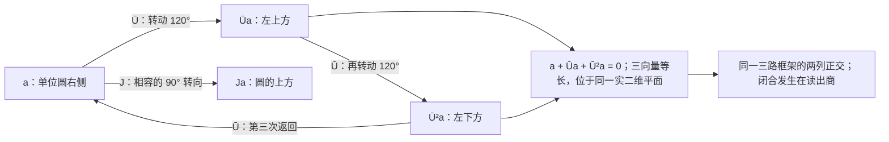
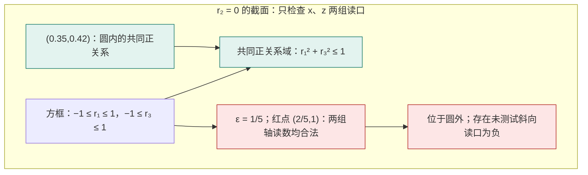

# 同源三路配平：平方尺度与复相位的共同恢复

> 来源：用户于 2026-11-05（Asia/Singapore）在本会话提供的 AURIC C140 LaTeX 研究工作稿；原稿未另署作者或模型。本文为参考输入，Lean 是仓库的数学真源；本次仅转换 Markdown，未作形式化认证。正文中的固定快照、项目核读叙述与理论结论均保留原稿口径；两幅 TikZ 图转换为 Mermaid，保留三路相位、二元关系球截面、图内公式及原图注。

AURIC C140\
同源三路配平\
平方尺度与复相位的共同恢复\
一个有限关系；不预给平方增益、范数、连续性或相位线性\
2026 年 11 月 5 日（新加坡）

**本轮唯一核心候选。** 给原实线性比较载体 $V$、同一有限非负读数 $q:V\to[0,\infty)$ 和任意原操作 $U:V\to V$。 保留基线 $q_0=q(0)$，定义 $Q=q-q_0$。对全部原 $x,y\in V$、$t\in\mathbb R$，要求

$$
\boxed{\begin{aligned}
&Q(x+ty)+Q(x+tUy)+Q(tUx+y)\\
&\hspace{1.5em}=2Q(x)+Q(y)+Q(tx)+2Q(ty).
\end{aligned}}
\tag{C140}
$$

右边的 $Q(tx),Q(ty)$ 也是同一原读数；没有先把它们写成 $t^2Q(x),t^2Q(y)$。

**精确结论。** 该式当且仅当原读数有表示

$$
q(x)=q_0+\|Fx\|^2,\qquad F(tx+sy)=tFx+sFy,\qquad F(Ux)=\zeta Fx,
\qquad \zeta=-\frac12+i\frac{\sqrt3}{2}.
$$

$F$ 进入最小复 Hilbert 包；原零读数差和档案仍保留。 范数、原实尺度平方律、对称双线性、可见操作的线性、三相闭合与复结构，均从同一条件恢复。 不需要方向导数、预给的区间有界性或 $U$ 的原线性。

**本轮比较的准确对象。** 当前仓库 C139 已发展到第 21 节；其第 7 节 T7 已在更原始的交换幺半群上恢复复加法几何， 第 8 节另处理原实数尺度。 C140 合并的是*同一原实数接口*中的 T7 与尺度校准。 它没有宣称比无实数旋钮的幺半群来源整体更弱，也没有把独立读数次数更少当作结论。

**量子完成。** 再消费同一实际分支的标记比较 P9，以及明确的准备、原事件、混合、参考、联合和时间接口， 得到有限维复量子过程、效果、Born 规则、条件投影更新、张量联合与连续酉演化。 最新的算术读口及共同返回前沿逐项保留；有限菜单不能独自强迫原叶概率绑定。

**来源与核对。** 固定提交 `00e86d6353be562f0aa7caa23f7544e0fb65e69f`。 对完整文件树作筛选、对所选正文作检索并核读承重条款。 本文提供普通数学证明及明确反例，没有把源码阅读或本稿编译写成新的 Lean 核验。

**白话。** 两份历史按同一比例接成三路；一路直接相加，另外两路轮流经过同一个标记。把三路合计与各份内容单独读出的合计配平。交换两份历史后，标记项互相抵消，先锁住原读数怎样随比例变化；再放回标记，它只能在可见部分形成三次闭合的转向。平方尺度与复相位从同一关系中出现，原记录则继续留在整体里。

## 1　充分搜索后的实际前沿

### 1.1　固定版本与搜索范围

本轮固定默认分支 `dev` 于 [`00e86d6353be562f0aa7caa23f7544e0fb65e69f`](https://github.com/the-omega-institute/trureturing/commit/00e86d6353be562f0aa7caa23f7544e0fb65e69f)。 提交时间为 2026 年 11 月 5 日 07:22:18 UTC，即新加坡 15:22:18； 本轮观察默认分支后冻结此快照，不把后续未读更新计入本稿。

D5、docs、Blueprint 的完整递归树分别包含 14 052、1 401、25 646 项，返回均未截断。 在完整路径筛选后，对 63 份所选理论正文检索了二次方程、三读、有限混合、相位、原尺度、 读出纤维、日志、进位及来源绑定等结构；共取得 87 个相关文件，并以该快照的 Git blob 校验字节。 这是一项有边界的广泛检索与重点条款核读，不是逐行阅读全库，也不是重新编译全部 Lean。

### 1.2　与本轮真正承重的结构

| 来源 | 已有内容 | 本轮必须保留的区别 |
|:---|:---|:---|
| C139 第 7–8 节 [\[1\]](#ref-c139current) | 交换幺半群上的单一 T7 恢复平方与复相位；原实数尺度另有必要充分校准 | 原单端读数、同一 $U$；双可加不等于原实双线性。 |
| C139 第 9 节 | 单一标记比较 P9 恢复实际分支的完整复 Gram、复线性与 Kraus 完整性 | 只推出可见协变；原档案逐字协变须原合同。 |
| C139 第 12–15 节 | 三结果比较、原一二体校准与背景无关混合差，推出原终端强度的二次展开 | 原子对检验不足以替代全部复合背景；二阶差关系有独立来源内容。 |
| C139 第 16–21 节 | 算术门、三进抽签、九叶比较、共同返回与两个四模相干盒 | 最新叶概率绑定仍未由有限锐利几何自动推出。 |
| V78 续篇第 6 节 [\[3\]](#ref-v78) | 平衡两端口事件律与相位不变性恢复效果 | 已给复 Hilbert 空间及 $0\le w\le\Vert \cdot\Vert ^2$；不是从任意原读数起步。 |
| C133 续篇 V [\[4\]](#ref-c133v) | 从有单位的任意二元运算与双端三向关系恢复可见复加法 | 来源甚至不预设结合交换；C140 的实向量来源不整体支配它。 |
| C135、C136 [\[5\]](#ref-c135), [\[6\]](#ref-c136) | 配平费用的仿射平方包络、端点势及群上的可见二次闭合 | 实平方前体不能独自选择复数型。 |
| V90 [\[7\]](#ref-v90) | 二态中点、对称平方区别、共同量子恢复 | 起点已有密度矩阵与 CPTP 通道；不能省略这些量子前提。 |
| RRO 主卷第 121、126 节 [\[8\]](#ref-rro) | 递增日志的读出纤维与经典 $L^2$ 子空间；完整边界响应恢复有效内积 | 日志递增不推出非交换性；响应实现中的内积与伴随耦合原先已给。 |
| Zeckendorf 缺额与进位源码 [\[9\]](#ref-deficit), [\[10\]](#ref-cocycle) | 三值缺额、整数进位计数与二余循环相容 | 这是一项算术约束，没有由此得到 Hilbert 正性或物理手性。 |

其中当前 C139 的 T7 是

$$
Q(x+2y)+Q(x+2Uy)+Q(2Ux+y)=6Q(x)+9Q(y).
$$

它的来源只要求交换幺半群、任意 $U$ 和有限非负原读数； 不预设消去、负元、除法、拓扑、$U0=0$ 或 $U$ 可加。 其最小表示满足 $F(x+y)=Fx+Fy$、$FU=\zeta F$、$q=q_0+\|F\|^2$。 若原来源还有实数旋钮，该卷定理 8.1 明确把实齐次性等价于生成射线上的区间有界或尺度不增。

C140 的进展不能再表述为“第一次从有限配方获得复几何”。 这里把原尺度自己的读数放回等式，让同一有限关系同时约束平方结构、实尺度与相位； 既有 T7 和尺度校准将在结论中同时出现。

### 1.3　形式源码的实际范围

[`ParallelogramConstruction.lean`](https://github.com/the-omega-institute/trureturing/blob/00e86d6353be562f0aa7caa23f7544e0fb65e69f/D5/S3/QuadraticForms/ParallelogramConstruction.lean) 以加法交换群和目标倍增可消去为前件，从平行四边形律构造 $\mathbb Z$-二次映射。 它给整数平方齐次与双可加极化，没有自动给原实数尺度相容或正性。 [`ThreeReadBudget.lean`](https://github.com/the-omega-institute/trureturing/blob/00e86d6353be562f0aa7caa23f7544e0fb65e69f/D5/S0/Observation/ThreeReadBudget.lean) 仍以实双线性 $R$、线性 $U$ 为前件，由全部自然数预算得到非负对角与三读右零关系。 该文件未将后续对称性、等距、读出商及复分类合并认证。 本稿对这些声明作了源码核读，没有执行新的 Lean build。

### 1.4　最新反例对候选的约束

C139 固定门字比较续卷 [\[2\]](#ref-fixedword) 证明： 若三结果比较只连续依赖当前两射线，第一端标记由一个固定原有限门字给出， 则自比较缺陷 $d$ 与循环协变缺陷 $c_w$ 满足 $3d+2c_w\ge1$。 其证明使用同一完整载体上的本征射线及已声明的稠密实际准备轨道； 它排除这一特定供给方式，没有排除携带原历史或参考身份的所有比较器。

C139 第 21 节又证明：即使保留全部原角内 Born 数据、角概率一和任意预定有限锐利菜单， 仍能在跨角读数中隐藏偏差。因而本轮恢复的数学表示不能自行冒充已供应的实际原叶概率。 这些障碍是选择新候选时的有效约束，不能因公式变短而删去。

**白话。** 项目里已经有多条通向平方几何的路，也已经知道某些看起来可行的接法会漏掉信息。这一轮把范围收准：从同一原读数出发，把“三路配平”和“原比例怎样读”合成一个约束；实际实验怎样取得这些读数，仍必须按原来源逐项核对。

## 2　唯一候选怎样只约束定义之间的关系

取同一原实向量载体 $V$、原操作 $U:V\to V$ 和有限非负读数 $q$。 这里的实向量操作是允许比较配方的签名，并非已经宣布归一态可以任意相加。 聚合、负配方和实数比例须由来源提供；它们不等于原历史的时间串接或删除日志。

保留同一基线后写 $Q=q-q(0)$。对两份原配方 $x,y$ 和同一比例 $t$， 定义三条实际比较配方

$$
C_0=x+ty,\qquad C_1=x+tU(y),\qquad C_2=tU(x)+y.
$$

第一条直接合并，第二条只标记第二份，第三条只标记第一份并交换其比例位置。 同一独立参照读数为

$$
S_t(x,y)=2Q(x)+Q(y)+Q(tx)+2Q(ty).
$$

候选仅要求 $\sum_{k=0}^2Q(C_k)=S_t(x,y)$。 所有项都由同一个原 $q$、同一个原 $U$ 和同一比例操作定义， 没有另选内积、另改计量单位或为不同历史临时换一个函数。

这里“有限”指每个实例只读有限个配方、作有限算术； 它仍量化所有允许的合成历史及全部原实数比例。 原式还允许 $q(0)>0$，并未先假定中心化读数 $Q$ 非负。 后文才证明 $Q\ge0$，也才证明 $q(0)$ 是原读数的全局最小值。

| 暂时不输入                      | 从候选恢复                               |
|:--------------------------------|:-----------------------------------------|
| $Q(tx)=t^2Q(x)$               | 原实数比例下的平方尺度                   |
| $q$ 连续、可微或导数线性      | 每条有限维切片上的二次多项式与初响应互易 |
| 原内积、范数和三角不等式        | 同一读数的正半定双线性表示与读出商范数   |
| $U0=0$、$U$ 线性、$U^3=I$ | 可见商上的零点、实线性、三阶相位         |
| 先给复数作为振幅标量            | 与原 $U$ 相容的正交复结构              |

这些结论首先作用在可见读出上。 若 $q$ 不能分辨某些原记录，核心候选保留它们作为同一读数纤维中的不同来源， 并不宣布它们在全部未来实验中没有区别。

**本轮的简洁性比较。**

相对于同一实来源上的 C139 首响应、三读预算和后续尺度校准， 本轮只有一项有限读数关系，而且右边的比例量仍由原读数实测。 相对于当前最强的幺半群 T7，实数签名是额外保留的结构， 所以不能只数公式条数就声称全局假设更弱。 原式还增加了 $Q(tx),Q(ty)$ 的独立参照读数；本稿不声称实验调用数必然减少。

## 3　同一读数的三路配平：唯一候选与完整分类

### 3.1　原接口：不先给平方增益

**定义 3.1（原配方、标记与读数）**

设 $V$ 是实向量空间，$U:V\to V$ 是任意原映射， $q:V\to[0,\infty)$ 处处有限。令

$$
q_0=q(0),\qquad Q(x)=q(x)-q_0.
$$

实配比与加法仍是来源操作；不预设范数、内积、拓扑、方向导数、 $U0=0$、$U$ 的线性、保长或周期。$q_0$ 是同一原读口的基线， 保留在最终表示中，不能按配方分别重设。

**候选 C140（同一原读数的三路配平）**

对全部原 $x,y\in V$ 与全部实配比 $t$，要求

$$
\boxed{\begin{aligned}
 &Q(x+t y)+Q(x+tUy)+Q(tUx+y)\\
 &\hspace{1em}=2Q(x)+Q(y)+Q(tx)+2Q(ty).
\end{aligned}}
\tag{F140}
$$

右端 $Q(tx),Q(ty)$ 都须实际使用同一个 $q$ 读取； 它们没有被预先替换成 $t^2Q(x),t^2Q(y)$。 等价的原读数形式是

$$
q(x+ty)+q(x+tUy)+q(tUx+y)+3q_0
 =2q(x)+q(y)+q(tx)+2q(ty).
$$

每个实例是有限次原读数之间的等式，不要求逼近一个初始变化率。 全部配方与实配比的全称量词仍在；有限个实验实例不能自动认证它。 这里的加减与配比是比较配方，未把负配方解释成删除原时间日志， 也未由数学公式供应原菜单之外的制备、复制或相干混合操作。

**定理 3.2（同一原对象上的精确表示）**

式 (F140) 当且仅当存在复 Hilbert 空间 $\mathcal H$ 与实线性映射 $F:V\to\mathcal H$，使

$$
q(x)=q_0+\|Fx\|^2,\qquad
 F(Ux)=\zeta Fx,\qquad
 \zeta=-\frac12+i\frac{\sqrt3}{2}.
\tag{1}
$$

允许 $F=0$；非平凡可见理论须由来源另有某个 $Q(x)>0$ 保证。 取最小完成 $\mathcal H=\overline{\operatorname{span}_{\mathbb C}F(V)}$ 后， 表示唯一到保持每个原标签像的唯一酉同构。 特别地，$q_0$ 自动成为原 $q$ 的全局最小值； 整个平方形式与复方向都来自这一个原读数和同一个原标记。 完成空间只表示这些既有读数；未把完成中的每个向量列为新增实际准备。

下面给出完整证明。已有二次方程的消元工具沿用当前 C139 母卷引理 7.3； 本节写出在原实向量空间上所需的全部步骤，避免把双加性或实线性先放入定义。 该二次方程的既有文献刻画见 Patel–Patel 第 2 页式 (2) 与 Theorem 1.1 [\[11\]](#ref-patel)； 本稿不认领二次函数方程、极化或 Hilbert 完成的历史优先权。

### 3.2　交换两端：先分出可加偏移与偶读数

**引理 3.3（交换关系与奇部）**

交换式 (F140) 中的 $x,y$，第二、第三项恰好互换，故

$$
Q(x+ty)-Q(tx+y)=Q(x)-Q(y)-Q(tx)+Q(ty).
\tag{2}
$$

定义

$$
E(x)=\frac{Q(x)+Q(-x)}2,\qquad
 A(x)=\frac{Q(x)-Q(-x)}2.
$$

则 $Q=E+A$，$E$ 偶、$A$ 奇，二者在零处均为零； 且 $A$ 对原加法可加。

**证明**

在式 (2) 中取 $t=-1$，得到

$$
2A(x-y)=2A(x)-2A(y).
$$

再以 $y=-z$ 代入，即得 $A(x+z)=A(x)+A(z)$。 这时尚未得到 $A$ 对原实配比线性。 式 (2) 对 $Q$ 是线性的， 并且在同时把 $x,y$ 改成 $-x,-y$ 后仍成立， 所以 $E$ 也满足该交换关系。$\square$

**引理 3.4（偶部的倍增律）**

偶部满足 $E(2x)=4E(x)$。

**证明**

把 $y=-tx$ 代入 $E$ 的交换关系，得

$$
E((1-t^2)x)=E(x)-2E(tx)+E(t^2x).
$$

取 $t=1/\sqrt2$，左端与右端最后一项相同，故 $E(x/\sqrt2)=E(x)/2$。 再使用一次，得 $E(x/2)=E(x)/4$；把 $x$ 改成 $2x$ 即得结论。 这里的一个实配比是来源中的有限配方；平方律是关系的后果。$\square$

### 3.3　有限平移消元恢复双加型

**引理 3.5（所需二次方程的有限证明）**

偶部 $E$ 是唯一对称双加型 $B$ 的对角：

$$
E(x)=B(x,x),\qquad
 B(x,y)=\frac{E(x+y)-E(x)-E(y)}2
       =\frac{E(x+y)-E(x-y)}4.
\tag{3}
$$

**证明**

在 $E$ 的交换关系中取 $t=2$，使用倍增律，得到既有二次方程

$$
E(x+2y)-E(2x+y)=3(E(y)-E(x)).
\tag{4}
$$

固定 $h$，令 $S_hf(x)=f(x+h)$，$P(s)=s^4-4s+3$。 式 (4) 分别用于 $(x,2h)$ 与 $(x,4h)$，给出

$$
P(S_h)E=12E(h)\mathbf 1,\qquad
 P(S_h^2)E=48E(h)\mathbf 1.
$$

有限多项式恒等式

$$
P(s^2)-(s^4+4s-3)P(s)=12(s-1)^2
$$

与 $(S_h^4+4S_h-3)\mathbf 1=2\mathbf 1$ 合用，得到

$$
E(x+2h)-2E(x+h)+E(x)=2E(h).
$$

这只是有限次平移和相减，没有取极限。 令 $x=a-b,h=b$，便得

$$
E(a+b)+E(a-b)=2E(a)+2E(b).
\tag{5}
$$

以式 (3) 的最后一个公式定义 $B$。 偶性给对称性，倍增律给 $B(x,x)=E(x)$。 把平行四边形关系分别用于 $(x+y,z)$ 和 $(x-y,z)$ 并相减，得

$$
B(x+z,y)+B(x-z,y)=2B(x,y).
$$

取 $z=x$ 得 $B(2x,y)=2B(x,y)$。 再令 $x=(u+v)/2,z=(u-v)/2$，便有 $B(u+v,y)=B(u,y)+B(v,y)$。 对称性给另一变量的可加性。 式 (5) 又给极化公式的两种写法相同； 唯一性由任何双加型的对角展开得到。$\square$

### 3.4　非负性与同一实旋钮恢复真正实双线性

**引理 3.6（正性及奇部的零边界）**

对所有 $x$，$E(x)\ge0$。 令 $\mathcal Z=\{x:E(x)=0\}$，则 $A$ 在 $\mathcal Z$ 上为零，且

$$
\mathcal Z=\{x:B(x,y)=0\ \text{对所有 }y\}.
$$

**证明**

对整数 $n$，双加性与 $A$ 的可加性给

$$
q(nx)=q_0+n^2E(x)+nA(x)\ge0.
$$

若 $E(x)<0$，足够大的 $|n|$ 使右端为负；故 $E(x)\ge0$。 若 $E(x)=0$ 而 $A(x)\ne0$，选相反符号且绝对值足够大的整数 $n$ 又产生矛盾，因此 $A(x)=0$。 若 $E(x)=0$，则对任意 $y$ 和整数 $n$，

$$
E(y+nx)=E(y)+2nB(x,y)\ge0,
$$

迫使 $B(x,y)=0$。反向取 $y=x$ 即可。$\square$

**引理 3.7（原实配比的相容性成为结论）**

$B$ 对原实数域双线性，而不只是双加。

**证明**

把式 (3) 展开到 $E$ 的交换关系中，所有对角项抵消，得

$$
B(x,ty)=B(tx,y)\qquad(t\in\mathbb R).
\tag{6}
$$

固定 $x$，定义实函数 $a_x(t)=B(tx,x)$。它可加。 当 $t\ge0$ 时，令 $s=\sqrt t$，式 (6) 给

$$
a_x(t)=B(s(sx),x)=B(sx,sx)=E(sx)\ge0.
$$

因此 $a_x$ 是正的可加实函数，必有

$$
a_x(t)=tE(x).
\tag{7}
$$

这里使用实数域的阿基米德序：可加性给有理齐次，正性给单调性， 用夹住 $t$ 的有理数即可确定其值；没有给原 $q$ 另加连续性假设。

把式 (7) 用于 $x+y$，展开并扣除 $x,y$ 的对角式，得

$$
B(tx,y)+B(ty,x)=2tB(x,y).
$$

由对称性及式 (6)，左侧两项相等， 故 $B(tx,y)=tB(x,y)$。于是 $B$ 实双线性。 下文记 $g=B$；$\mathcal Z$ 成为原实向量空间的线性根空间。$\square$

### 3.5　同一标记消掉可加偏移并恢复复方向

**引理 3.8（原标记的可见零点、保长与方向关系）**

令 $p=U0$。则 $p\in\mathcal Z$，并对所有 $x,y$ 有

$$
E(Ux)=E(x),\qquad A(Ux)=A(x).
$$

$$
g(x,y)+g(x,Uy)+g(Ux,y)=0.
\tag{8}
$$

**证明**

原式 (F140) 在 $x=y=0$ 处给 $2Q(tp)=0$ 对所有 $t$ 成立。 取 $t=1,-1$，得 $E(p)=A(p)=0$，所以 $p\in\mathcal Z$。 由引理 3.6–3.7，$tp\in\mathcal Z$ 且 $A(tp)=0$，因此

$$
Q(x+tp)=Q(x).
$$

在原式中取 $y=0$，其余两份 $Q(x)$ 抵消，得到

$$
Q(tUx)=Q(tx).
$$

再取 $t=1,-1$，得到所需的 $E$ 与 $A$ 不变性。

最后在原式中取 $t=1$。因为 $A$ 可加并且 $A\circ U=A$， 两端的奇部同为 $3A(x)+3A(y)$，恰好抵消。 展开偶部，使用 $E(Ux)=E(x)$，剩下两倍的式 (8)。$\square$

**引理 3.9（可见线性与三读闭合）**

$U$ 在 $W=V/\mathcal Z$ 上下降为实线性等距映射 $\bar U$，并满足

$$
I+\bar U+\bar U^2=0,\qquad \bar U^3=I.
\tag{9}
$$

**证明**

若 $x-x'\in\mathcal Z$，从式 (8) 相减得

$$
g(Ux-Ux',y)=-g(x-x',y)-g(x-x',Uy)=0
$$

对全部 $y$ 成立，故 $Ux-Ux'\in\mathcal Z$，下降良定。 同样把该式用于 $x+x'$ 与 $sx$，利用右端的实线性，分别得到

$$
U(x+x')-Ux-Ux'\in\mathcal Z,\qquad U(sx)-sUx\in\mathcal Z.
$$

因此 $\bar U$ 实线性；$p\in\mathcal Z$ 保证其零点。 $E(Ux)=E(x)$ 经极化给等距性。

在商上，把式 (8) 的第二端换成 $\bar U y$， 用 $g(\bar Ux,\bar Uy)=g(x,y)$，得到

$$
g\bigl(x,y+\bar Uy+\bar U^2y\bigr)=0\qquad\forall x.
$$

商上的正定性给第一个恒等式；乘以 $\bar U-I$ 给第二个。 这个证明没有把原 $U$ 预先当成线性算子。$\square$

**引理 3.10（原奇部必须为零）**

$A(x)=0$ 对所有原 $x$ 成立。

**证明**

由式 (9)，原配方 $x+Ux+U(Ux)$ 落入 $\mathcal Z$。 $A$ 在 $\mathcal Z$ 上为零，又可加且 $A\circ U=A$，故

$$
0=A(x+Ux+U^2x)=A(x)+A(Ux)+A(U^2x)=3A(x).
$$

因此 $Q(x)=E(x)=g(x,x)$。 不必先用连续性把 $A$ 提升成实线性；同一标记关系已经直接消去了它。$\square$

**完成定理 3.2 的正向证明**

在 $W$ 上定义

$$
J=\frac{I+2\bar U}{\sqrt3},\qquad
 h(a,b)=g(a,b)+i\,g(Ja,b).
\tag{10}
$$

式 (8)、(9) 与等距性给

$$
J^2=-I,\qquad g(Ja,b)=-g(a,Jb),\qquad g(Ja,Jb)=g(a,b).
$$

令 $ia=Ja$，则 $h$ 是对第二变量线性的正定复内积，且 $\bar U=-I/2+(\sqrt3/2)J$，即乘以 $\zeta$。 完成此空间并把原 $x$ 送到其可见类，得到式 (1)。 原 $q_0$ 仍在，且 $Q\ge0$ 给 $q_0=\min q$。

### 3.6　反向模型、唯一性及旧接口的恢复

**反向证明**

设式 (1) 成立，令 $a=Fx,b=Fy$。 三个输出分别是

$$
a+tb,\qquad a+t\zeta b,\qquad t\zeta a+b.
$$

它们对两输入的系数列

$$
c_x(t)=(1,1,t\zeta)^{\mathsf T},\qquad
 c_y(t)=(t,t\zeta,1)^{\mathsf T}
\tag{11}
$$

正交，因为 $\langle c_x,c_y\rangle=t(1+\zeta+\bar\zeta)=0$。 列平方长为 $2+t^2$ 和 $1+2t^2$。故输出平方和为

$$
(2+t^2)\|a\|^2+(1+2t^2)\|b\|^2
 =2Q(x)+Q(y)+Q(tx)+2Q(ty),
$$

正是式 (F140)。

**唯一性**

原 $q$ 唯一确定

$$
g(x,y)=\frac{q(x+y)-q(x-y)}4,
$$

原 $U$ 再由式 (10) 唯一确定共同复方向。 任何两个最小表示因此在有限标签组合上保持相同复内积， 诱导保每个原标签像的唯一等距复线性映射；完成后成为唯一酉同构。 这只识别可见内容，未把原根空间中的历史删掉。$\square$

**推论 3.11（导数、范数及有限反向交换均成为结论）**

原 $q,U$ 自动满足

$$
Q(sx)=s^2Q(x),\qquad
 D_q(x;y)=2g(x,y)=D_q(y;x),
\tag{12}
$$

$$
Q(Ux-Uy)=Q(x-y),\qquad
 x+Ux+U^2x\in\mathcal Z.
\tag{13}
$$

商上范数为 $\|[x]\|=\sqrt{Q(x)}$，其三角不等式由正内积得到。 对任何有限 $n\in\mathbb N_0$，令 $S(y)=y+Uy+U^2y$，则

$$
2g(f,Uy+nS(y))\le Q(f)+Q(y),
$$

因为其差正是 $Q(f-Uy)\ge0$。 因此旧初响应候选、全部标记距离校准及无界有限三读预算被同一来源关系接回。

另有完全有限的二路恒等式

$$
\boxed{
 \begin{aligned}
 Q(x+ty)+Q(y-tx)
 &=Q(x)+Q(y)+Q(tx)+Q(ty)\\
 &=(1+t^2)(Q(x)+Q(y)).
 \end{aligned}
}
\tag{14}
$$

它说明交叉贡献在相反交换中恰好抵消。 相应的单边预算也成立；它在这里是已证推论，不再充当另一个核心公理。

**本节白话**

三条路各自照同一份读数算账：前两条都带一份 $x$，第三条带一份 $y$； 掺进去的 $tx,ty$ 也由原读口亲自读，不先规定缩小一半就变成四分之一。 要求合读恰好等于这些自身份额的合计。交换两端后，两个混合项自行消掉， 留下的关系把读数锁成平方；同一个三色标记又消掉任何偷偷偏向一端的可加偏移， 使三次可见结果闭合成等边三角形。平方尺度、共同复方向与可见线性由此一起出现， 原基线和原历史仍然保留。

## 4　反向检验：删去什么，会重新放进哪些模型

核心定理是同一来源上的精确等价；下面逐项展示其域与量词的作用。 这些反例不把整个项目已有的条件量子分类改写成未解决问题， 而是检验式 (F140) 这个接口的准确依赖。

### 4.1　只保留可加配平，仍会留下有方向的漂移

**反例 4.1（删除半有界性）**

在 $V=\mathbb R$ 上取 $q(x)=Q(x)=x$、$U=I$。 因为 $Q$ 可加，对所有 $x,y,t$，

$$
Q(x+ty)+Q(x+tUy)+Q(tUx+y)
 =2Q(x)+Q(y)+Q(tx)+2Q(ty).
$$

所以整条有限关系成立，但 $q$ 无下界，$U$ 在非零可见空间上也不是 $120^\circ$ 相位。核心证明中先保留的奇部 $A$，此时正是整个读数。 非负性与同一标记的闭合共同消去该漂移，不能提前把 $Q$ 定义为偶函数。

另一个独立边界是 $V=\mathbb C^2$、$U=\zeta I$ 与

$$
q(z,w)=Q(z,w)=|z|^2-|w|^2.
$$

由相同的正交系数列展开，全部式 (F140) 仍成立， 但其二次型不定，不能成为 Hilbert 范数平方。 两例分别保留了可加漂移和不定平方，说明单有代数配平不等于正几何。

### 4.2　有理或固定算术旋钮不能自动校准原实数域

**反例 4.2（全部有理配比通过，实配比的两端读数为 $5$ 与 $4$）**

选取一个 $\mathbb Q$-线性函数 $L:\mathbb R\to\mathbb R$，满足

$$
L(1)=1,\qquad L(\sqrt2)=0.
$$

它可由包含 $1,\sqrt2$ 的 Hamel 基定义并线性延拓。 在原 $V=\mathbb R^2$ 上令

$$
U(s,r)=(-r,s-r),\qquad
 F(s,r)=L(s)+\zeta L(r),\qquad
 q(s,r)=Q(s,r)=|F(s,r)|^2.
$$

$U$ 甚至原实线性，且 $U^3=I$，并且

$$
F(Ux)=\zeta Fx.
$$

对所有原 $x,y$ 及所有有理 $t$，$F(tx)=tF(x)$； 故三列展开证明整个式 (F140) 成立。 这不是只通过有限个点，而是通过全部输入上的全部有理配比。

但取

$$
x=(1,0),\qquad y=(\sqrt2,0),\qquad t=1/\sqrt2,
$$

则三个输出分别为

$$
(2,0),\qquad(1,1),\qquad(\sqrt2,1/\sqrt2),
$$

其读数依次为 $4,1,0$，左端合计为 $5$。 右端为

$$
2Q(x)+Q(y)+Q(tx)+2Q(ty)=2+0+0+2=4.
$$

因此原实数旋钮的相容性必须在来源关系中供应，不能由非负性、 整数配方、标记周期或有理稠密性自行补出。

该失败也不必依赖根空间。可把 $L$ 选成 $\mathbb Q$-线性自同构， 令 $L(1)=1,L(\sqrt2)=2\sqrt2$，其余 Hamel 基向量保持不变。 则上述 $q$ 在原 $V$ 上正定，全部有理配比仍通过； 对同一 $x,y,t$，三个输出合计为 $4+1+6=11$， 右端为 $2+8+2+2=14$，仍然失败。

**一般范围**

给定任意真子域 $K\subsetneq\mathbb R$，可选包含 $1,\theta$ 的 $K$-基， 其中 $\theta\notin K$，并取 $K$-线性自同构 $L$， 使 $L(1)=1,L(\theta)=2\theta$。 相同构造通过全部 $K$ 配比，却不具有原实数齐次性。 任何有限或可数个固定实常数生成的域都是可数的，因而是真子域； 没有另加原尺度有界性等桥梁时，固定算术菜单不等于全体实旋钮。 这是原标量身份的障碍，不是否定有理内积空间的数学实完成。

### 4.3　每条轨道都闭合，仍可能缺少共同方向

**反例 4.3（当前 C139 母卷例 8.3 在本接口中的原读数）**

在 $\mathbb C$ 上令 $q(z)=Q(z)=|z|^2$，并取

$$
Uz=
 \begin{cases}
  \zeta z,&|z|\le1,\\
  \bar\zeta z,&|z|>1.
 \end{cases}
$$

每条原轨道都保长、三次返回，且 $z+Uz+U^2z=0$。 但其方向随半径变化。 对 $x=1,y=2i,t=2$，三项读数是

$$
17,\qquad17+4\sqrt3,\qquad8+4\sqrt3.
$$

左端为 $42+8\sqrt3$，右端为

$$
2Q(x)+Q(y)+Q(2x)+2Q(2y)=42.
$$

所以逐条轨道的等边三角形还未固定两个输入之间的同一个复方向。 式 (F140) 把原 $U$ 同时放到两个角色中，正是为了检验这项共同性。

### 4.4　有限反向交换能直接看见多边形失配

**反例 4.4（六边形的 $5>4$）**

核心定理已经推出式 (14)。 因此违反该有限推论的原读数，无论怎样选择 $U$， 都不可能满足完整的式 (F140)。 取

$$
H(a,b)=\max\{|a|,|b|,|a+b|\},\qquad q=Q=H^2.
$$

令 $x=(1,0),y=(0,1),t=1$，则

$$
Q(x+y)+Q(y-x)=4+1=5,
$$

而

$$
2(Q(x)+Q(y))=4.
$$

这是同一六边形型几何的有限失败见证，无需取初始导数。 它不认领 Radon 六边形或平行四边形判据为新发现。

**反例 4.5（把精确原份额相加弱化为单边上界）**

若把核心式 (F140) 本身弱化为左端不超过右端， 取 $V=\mathbb R$、$q(x)=Q(x)=|x|$ 以及 $U=I$，便对全部 $x,y,t$ 通过：

$$
2|x+ty|+|tx+y|
 \le 2|x|+|y|+|tx|+2|ty|.
$$

这是直接使用三角不等式；任意实范数自身作为 $Q$ 也给同样的模型。 对 $x=1,y=-1,t=1$，左端为零，右端为六，确有严格余量。 该读数不是平方，标记也没有非平凡复相位。 因此本候选的精确三路配平不能直接弱化成这一项单边预算。 相应二路未校准上界也被 $Q(x)=|x|$ 满足。

### 4.5　任何有限原读数清单都能保留一个平滑非平方延伸

**命题 4.6（有限查询的精确边界）**

固定 $\mathbb C\simeq\mathbb R^2$ 上的原线性 $U z=\zeta z$。 给定任意有限组式 (F140) 的检查，把其中实际读取的全部点、 它们的三相位像、负像及零点合成有限集合 $S$。 令

$$
P(z)=\prod_{a\in S}|z-a|^2,\qquad
 q_\varepsilon(z)=|z|^2+\varepsilon P(z)^2,\quad\varepsilon>0.
$$

则 $q_\varepsilon$ 处处非负、光滑，在非零点正定，$q_\varepsilon(0)=0$， 并且 $q_\varepsilon(Uz)=q_\varepsilon(z)$、$q_\varepsilon(-z)=q_\varepsilon(z)$。 它通过所列全部检查，却不满足全域候选。

**证明**

$S$ 对 $U$ 和负号稳定；欧氏距离及集合的置换给 $P(Uz)=P(z)$、 $P(-z)=P(z)$。对每个已读取点 $a\in S$，$P(a)=0$， 所以原读数与标准平方模型一字不差，所列等式都保持。 但 $S$ 非空，$P^2$ 的非零最高次为 $4|S|\ge4$； 故 $q_\varepsilon$ 不是实二次型。由定理 3.2 的必要性， 它必在某个未列入的配方实例失败。 零点与非零点的正性由第一项 $|z|^2$ 直接给出。$\square$

该命题针对无额外参数限制的一般原函数；若来源已把读数限定在 某个已知有限维函数类，可能存在相应有限认证，须另证其范围。 本例说明“每次验证只用有限读数”与“某个固定有限清单已证明全称关系” 是不同命题，不能相互替换。

### 4.6　本轮压缩的准确范围

相对 C139 初始第 3、5.1 节的同一实来源， 式 (F140) 把方向导数、初响应互易、全部标记距离校准和 无界有限三读预算合成一条有限原读数关系， 并且没有把 $t^2$ 增益放进右端。 候选仍量化全部原实配比、全部输入配方；原实向量操作本身没有被推导。

相对当前 C139 第 7–8 节，已有 (T7) 本就从交换幺半群恢复复加性表示， 并用原尺度有界性处理原实旋钮。 本轮是在原实签名上把这项标量桥合入同一三路关系； 它没有支配交换幺半群、更没有支配任意 magma 的较原始来源范围。 V78 续卷第 6 节也早已从平衡重编码及已给 Hilbert 总量恢复事件二次型； 此处处理的是原总读数自身，尚未预给作为上界的内积范数。 这些是来源接口的区别，不能只按公式行数宣布全局最小。

**本节白话**

要知道这条关系究竟锁住了什么，就给它一些看起来很像的替代品。 六边形一混就多出一格；只会在每条轨道上转三圈的操作， 可能在比较两条轨道时方向不一致；只用有理旋钮， 又可能把一个实际实数尺度的读数藏起来。 有限张检查表还允许在表外添一小块平滑变化。 这些失败都发生在明确的一对输入和同一个读口中， 所以候选的内容是可以被指出、被反驳的关系，而不只是一个新名字。

## 5　最简几何：两列正交的三路框架与二元关系球

### 5.1　三路框架的正交性为何选出共同相位

恢复后的两个输入为 $a=Fx,b=Fy$。三路合成写成

$$
\begin{pmatrix}
a+tb\\ a+t\zeta b\\ t\zeta a+b
\end{pmatrix} =
\begin{pmatrix}
1&t\\1&t\zeta\\t\zeta&1
\end{pmatrix}
\begin{pmatrix}a\\b\end{pmatrix}.
$$

这个矩阵的两列在 $\mathbb C^3$ 中正交；它们的平方长分别为 $2+t^2$ 和 $1+2t^2$。 因此对两列各自归一化，便得到一个二输入、三输出的数学等距框架。 这里的三维是*复三维系数框架*，不是把任意两份历史的整个本体压成三个实数； 这个数学框架也没有自动取得一台实际三端口设备。

若先在一个实二维截面上试一项普通转动 $U=R_\theta$， 同一正平方读数给核心式的剩余交叉项

$$
2t\bigl(1+2\cos\theta\bigr)g(x,y).
$$

要对全部二元关系配平，必须

$$
\cos\theta=-\frac12.
$$

故两个可能方向为 $\theta=\pm120^\circ$。 本候选的三路连接方式选择了这个相位关系；它没有声称三这个数无须任何来源结构就由宇宙必然选出。

对任意非零 $a$，向量 $a,\bar Ua,\bar U^2a$ 位于同一实二维平面， 等长、合计为零，两两夹角 $120^\circ$；复方向是

$$
Ja=\frac{a+2\bar Ua}{\sqrt3}.
$$

交换 $U$ 与其可见逆会使 $J$ 变成 $-J$，所以共同方向是相对于同一原标记确定的。

$$
1+\zeta+\bar\zeta=0,\qquad
\langle(1,1,t\zeta),(t,t\zeta,1)\rangle=0.
$$

**图 1：** 同一三路配平恢复共同复方向。闭合发生在读出商；原式未输入平方增益或这张圆图。图中的相位结构成为结论后，才可用两列正交解释三路总量。

### 5.2　两份历史怎样归一化为三个实关系坐标

#### 定义 5.1：归一化的二元 Gram 关系

对两份原配方 $x,y$，令

$$
a=Fx,\quad b=Fy,\quad
s=\|a\|^2+\|b\|^2=Q(x)+Q(y).
$$

当 $s>0$ 时定义三个实数

$$
r_1=\frac{2\operatorname{Re}h(a,b)}s,\qquad
 r_2=\frac{2\operatorname{Im}h(a,b)}s,\qquad
 r_3=\frac{\|a\|^2-\|b\|^2}s.
\tag{15}
$$

$r_1$ 是同向关系，$r_2$ 是由同一 $U$ 恢复的正交相位关系， $r_3$ 是两份自读数的差。$s=0$ 时两份读数均为零，不作除法或强行指定方向。

#### 定理 5.2：二元关系的有限三实维提升

式 (15) 满足

$$
\boxed{r_1^2+r_2^2+r_3^2
 =1-\frac{4(\|a\|^2\|b\|^2-|h(a,b)|^2)}{s^2}\le1.}
\tag{16}
$$

等号当且仅当 $a,b$ 在复意义下线性相关。 每个闭单位球中的点都可由至多复二维中的一对向量实现。

**证明。**

复柯西–施瓦茨不等式使分子中的余量非负，直接展开平方给等式。 其零余量恰是复 Gram 矩阵秩至多一，包括一个向量为零的边界情形。

反向，给 $r_1^2+r_2^2+r_3^2\le1$，取

$$
G_r=\frac12
\begin{pmatrix}
1+r_3&r_1+ir_2\\
r_1-ir_2&1-r_3
\end{pmatrix}.
$$

它的特征值为 $(1\pm\|r\|)/2$，故正半定且迹为一。 在 $\mathbb C^2$ 中取 $a=G_r^{1/2}e_1,b=G_r^{1/2}e_2$， 其 Gram 矩阵就是 $G_r$，从而得到指定三个实坐标。边界秩一时复一维足够。

$\square$

这个闭球是两份历史在同一读口中的归一化关系空间。 若两份历史是复标量 $a=A$、$b=Be^{i\phi}$，其中 $A,B\ge0$ 且不全零，则

$$
r=
\frac{(2AB\cos\phi,\ 2AB\sin\phi,\ A^2-B^2)}{A^2+B^2},
\qquad \|r\|=1.
$$

这就是二元复振幅的球面图景；全体共同相位同时改变时，三个关系坐标不变。 在 $A=B$ 的截面上得到一个圆；若其中一份为零，则到达一个极点，相对相位不可辨。 因此点、圆和球可作为同一关系空间的边界与截面联系起来，而不是在没有映射时直接认作同一个对象。

这个 $2\times2$ Gram 矩阵有量子位密度矩阵的数学形状。 只有另给实际两路编码与准备、事件的绑定，才可把它认作原系统的一只实际量子位。 一般高维历史的其余信息和原日志没有被这个三实数读口恢复。

### 5.3　三份二元关系的共存余量仍须保正

若三个实单位向量的配对为 $\alpha,\beta,\gamma$， 它们的共同 Gram 正性要求

$$
|\alpha|,|\beta|,|\gamma|\le1,\qquad
\Delta=1+2\alpha\beta\gamma-\alpha^2-\beta^2-\gamma^2\ge0.
$$

当 $|\alpha|<1$ 时可以在 $\mathbb R^3$ 取

$$
u=e_1,\quad v=(\alpha,\sqrt{1-\alpha^2},0),\quad
w=\left(\beta,\frac{\gamma-\alpha\beta}{\sqrt{1-\alpha^2}},
\pm\sqrt{\frac{\Delta}{1-\alpha^2}}\right).
$$

边界 $|\alpha|=1$ 迫使 $\gamma=\alpha\beta$，二维足够。 两种符号保持全部二元内积，定向体积则满足 $\tau^2=\Delta$。 这说明平方关系决定三维余量的大小，方向还要由原有向操作或定向记录提供。

### 5.4　同一个球怎样显示有限读口的遗漏

在一个已有复二维矩阵空间中，令

$$
H_\epsilon=
\begin{pmatrix}1&\epsilon\\ \epsilon&0\end{pmatrix}
=\frac12(I+2\epsilon\sigma_x+\sigma_z).
$$

它在 $z$ 基的概率为 $1,0$，在 $x$ 基为 $1/2+\epsilon,1/2-\epsilon$。 当 $0<|\epsilon|<1/2$，这些有限读数全部合法，两个基内都归一， 但对应向量 $(2\epsilon,0,1)$ 已在单位球外：

$$
\det H_\epsilon=-\epsilon^2<0.
$$

因此还有一个未测试斜向读口取得负值。 这是一个有限评价表的反例，$H_\epsilon$ 从来不是正密度矩阵。 第 6 节给出当前仓库第 21.9 定理的高维、任意预定有限菜单版本。

**图 2：** 二元关系球的一个平面截面。方框对应只检查 $x,z$ 两组读口的范围；红点 $(2/5,1)$ 通过这些检查，却在圆外。有限读口的合法性与全域正性之间仍有可明确检出的差别。

**白话。** 最小的可见图形仍很简单：一个共同转向画出等边三角形，两份历史的强弱差与两种相位关系组成一个球。球面、圆和极点分别对应不同的退化与归一化条件。只检查几根轴，可能把球外的点也放进来；所以每个图形都要带着它实际检查了哪些关系。

## 6　同一原分支怎样接回量子过程与概率

本节使用主候选已经恢复的同一原读数表示

$$
q(x)=q(0)+\|Fx\|^2,\qquad F(Ux)=\zeta Fx,
 \qquad \zeta=-\tfrac12+i\tfrac{\sqrt3}{2}.
$$

在原实向量签名上，$F$ 实线性；原 $U$ 在不可见根空间中仍可非线性。 以下明确列出实际过程、概率、混合、联合及时间的来源条件。 主候选恢复静态几何，没有独自供应这些装置或全部原事件的概率。 过程部分复用当前仓库 C139 第 9 节的标记比较，概率部分同时交代该卷第 17–21 节的更细前沿 [\[1\]](#ref-c139current)。

### 6.1　一项标记比较恢复复线性分支

#### 定义 6.1：同一原测试的分支比较

输入、输出各满足主候选，原测试具有有限个实际细分支 $L_j:V_{\rm in}\to V_{\rm out}$。不预设 $L_j$ 可加、线性、保零或与原 $U$ 逐字协变。 要求同一读口对每一对原配方满足

$$
\boxed{\sum_jQ_{\rm out}\bigl(L_jx+U_{\rm out}(L_jy)\bigr)
       =Q_{\rm in}\bigl(x+U_{\rm in}y\bigr).}
\tag{17}
$$

原粗事件 $e$ 是同一完整测试的一组细分支；其原强度须绑定为

$$
w_e(x)=\sum_{j\in e}Q_{\rm out}(L_jx).
\tag{18}
$$

失败、停止、返回及记录分支仍计入各自原完整测试；不能删去失败后继续使用完整和为一的结论。

#### 定理 6.2：原分支的完整复 Gram 表示

式 (17) 当且仅当存在唯一有界复线性算子 $K_j:H_{\rm in}\to H_{\rm out}$，使

$$
F_{\rm out}L_j=K_jF_{\rm in},\qquad
 \sum_jK_j^*K_j=I.
\tag{19}
$$

其中 $H$ 取各自最小复 Hilbert 包。于是

$$
E_e=\sum_{j\in e}K_j^*K_j,\qquad
 0\le E_e\le I,\qquad
 w_e(x)=h(Fx,E_eFx),\qquad \sum_eE_e=I.
\tag{20}
$$

最后的求和对完整事件划分成立。

**证明。**

令 $a_x=F_{\rm in}x$，$b_x=\bigoplus_jF_{\rm out}L_jx$。 式 (17) 等价于

$$
\|b_x+\zeta b_y\|^2=\|a_x+\zeta a_y\|^2.
$$

取 $y=x$ 并用 $|1+\zeta|=1$，得到 $\|b_x\|^2=\|a_x\|^2$。 消去这两项对角量后，得到复配对差 $z=h(b_x,b_y)-h(a_x,a_y)$ 满足 $\operatorname{Re}(\zeta z)=0$；交换 $x,y$ 又有 $\operatorname{Re}(\zeta\bar z)=0$。若 $z=u+iv$，两式为 $-u/2-\sqrt3v/2=0$ 与 $-u/2+\sqrt3v/2=0$，故 $z=0$。

因此标签对应 $a_x\mapsto b_x$ 保持完整复 Gram。 任一有限关系 $\sum c_ra_{x_r}=0$ 的对应向量平方为同一 Gram 和，故 $\sum c_rb_{x_r}=0$。该对应在复线性包上良定义、复线性且等距，唯一延至完成。 取直和坐标即得 $K_j$；等距性给式 (19)。 反向由同一个直和等距作用于 $a_x+\zeta a_y$ 即得原比较。 式 (20) 再由原强度绑定与有限求和得到。

$\square$

可见协变是结论：

$$
F_{\rm out}L_jU_{\rm in}
 =F_{\rm out}U_{\rm out}L_j.
$$

这不等于原档案逐字协变。明确地，在原实载体 $V=\mathbb C\oplus\mathbb R$ 上取

$$
q(z,a)=|z|^2,\qquad U(z,a)=(\zeta z,a+1),\qquad L(z,a)=(z,2a).
$$

主候选及单分支 (17) 均成立，但 $LU(z,a)$ 的档案坐标为 $2a+2$，$UL(z,a)$ 的为 $2a+1$。 若某项原合同另要求逐字协变，它仍须保留，不能从可见表示补写出来。

### 6.2　完整效果评价与 Born 规则的直接证明

以下只在非零有限维可见空间讨论矩阵状态。 非零向量 $v$ 的射线投影记为 $P_v=vv^*/\|v\|^2$。 给定一份实际准备，先明确一种完整评价接口：在全部效果 $0\le E\le I$ 上有单值 $p(E)\ge0$，$p(I)=1$，且

$$
p(E+G)=p(E)+p(G)\qquad(E+G\le I).
\tag{21}
$$

同一效果的单值性与全部效果域都是来源条件，尚未由主候选或分支比较推出。

下面是完整效果评价的有限维重构；标准来源见 Busch [\[12\]](#ref-busch)。

#### 定理 6.3：密度态与纯准备的绑定

式 (21) 给唯一 $\rho\succeq0$、$\operatorname{Tr}\rho=1$，使

$$
p(E)=\operatorname{Tr}(\rho E).
\tag{22}
$$

对原向量准备 $x$，须有 $Q(x)>0$，并以 $\psi=Fx/\sqrt{Q(x)}$、$p(P_\psi)=1$ 绑定其当前准备。 此时 $\rho=P_\psi$，从而

$$
p(E_e)=\frac{w_e(x)}{Q(x)},\qquad
 p(P_\phi)=|h(\phi,\psi)|^2\quad(\|\phi\|=1).
\tag{23}
$$

**证明。**

可加性给有理齐次；正性给序单调性，以有理数夹逼再给实齐次。 对任意正矩阵 $A$，取 $c>0$、$c\ge\|A\|$，置 $\ell(A)=c\,p(A/c)$。齐次性保证选择无关；公共缩放给正锥可加性。 对 Hermitian 矩阵的正负分解作延伸，得到实线性泛函，迹配对遂给唯一 Hermitian $\rho$。对每个单位向量 $v$， $v^*\rho v=p(P_v)\ge0$，所以 $\rho\succeq0$；单位效果给迹一。

若 $p(P_\psi)=1$，则 $\operatorname{Tr}(\rho(I-P_\psi))=0$。 正性使 $\rho$ 支撑于 $\mathbb C\psi$，故 $\rho=P_\psi$。 代入式 (20) 得式 (23)。 反向由任一密度矩阵的迹评价直接验证全部条件。

$\square$

这一有限维证明也覆盖复二维；它使用的是完整效果评价，而非只对某几个正交基归一。 例如 $f(t)=t^2/(t^2+(1-t)^2)$ 保持端点和 $f(t)+f(1-t)=1$， 却使 $f(1/4)=1/10$。组内归一没有给出跨效果可加性。

### 6.3　最新算术读口路线，以及一个固定加噪的简化

当前仓库 C139 第 16–19 节已经把上述直接全效果前件改成更细的实际供给； 不能把这一进展退回成仍只知道全效果 Gleason 的状态。 设

$$
A=\mathbb Z[\zeta,1/3],\qquad \tau=(1-\zeta)^{-1},\qquad
 \mathsf B=\tau(\zeta^{kl})_{k,l=0}^2.
$$

三维算术供给 AS 包括实际 $\mathsf B$、坐标置换、六次单位相位、坐标投影、 合法有限复合与粗粒化，以及准备无关的有限三进有理抽签。 其精确综合与稠密性给全部算术单位射线的实际读口；数学稠密性不单独使概率连续。

记 $Q_s=P_{\tau(1,s,1)}$，并取两个实际九叶抽签

$$
L_0=\tfrac69Q_{-1}+\tfrac29Q_1+\tfrac19\,0,
 \qquad
 R_0=\tfrac49Q_\zeta+\tfrac49Q_{\zeta^2}+\tfrac19\,0.
$$

除锐利投影单值性、正归一、粗粒化与实际抽签仿射性外，要求

$$
p(h\cdot L_0)\le p(h\cdot R_0)
 \quad\text{对每份原准备、原历史条件及每个合法有限前接 }h.
\tag{24}
$$

这是该卷定义 17.5 的 QC；同一个有限原型仍有全合法前接量词。

为说明其承重内容，固定 $h$ 后再前接六种相位，得到 $3p(Q_{-s})+p(Q_s)\le2p(Q_{\zeta s})+2p(Q_{\zeta^2s})$。 六式的总差为零，每项同号，故逐项取等。取坐标基与三个基 $\{\tau(1,a,c/a):a\in\{1,\zeta,\zeta^2\}\}$，其中 $c\in\{1,\zeta,\zeta^2\}$；它们是四个互无偏参考基。其概率随后确定

$$
W=\sum_{\Pi\text{ 属于四参考基}}p(\Pi)\Pi-I,
 \qquad\operatorname{Tr}W=1.
$$

其迹评价先在这十二个参考投影上成立；三相、置换与 Fourier 门保持参考集合， 所得四射线等式再把它传播过坐标符号门。沿所有门字归纳，覆盖全部算术投影。 非负性及稠密射线才使 $W=\rho\succeq0$；实际抽签仿射性覆盖算术效果域 $\mathcal D_A$。这是仓库定理 17.6 的既有证明，不是本轮再次提出的核心公理。

若是更高维块，现有来源保留 EC：同一算术效果的两个实际有限抽签配方给相同概率。 清分母与三进抽签使其尊重全部有理矩阵关系，再由有限张成表、迹表示及稠密正方向得到密度矩阵。 本节不将已经证明的三维 QC 自动推广为任意高维的同一原型。 二维系统借用三维结果时，还需实际保真接入三维角，且原准备在该角概率为一。

菜单外的原事件还需概率绑定。现有第 17.3–17.4 节的 OB 要求带噪事件与算术效果的顺序相容。 在这一步，可以精确地只保留一个固定噪声，而无须保留全部噪声参数。 这里从现有命题 17.4 已经使用的固定噪声夹逼证明中抽取较少前件，不重新认领该夹逼论证。

#### 命题 6.4：一个三等分抽签足够完成顺序桥

已知同一准备在 $\mathcal D_A$ 上有 Born 表示。对每个菜单外实际事件 $e$， 令其效果 $E_e$ 由原分支绑定。实际等权抽签在 $e,I,0$ 三个结果装置间选择，故

$$
H_e=(E_e+I)/3,\qquad p(H_e)=(p(e)+1)/3.
\tag{25}
$$

若对所有 $C\in\mathcal D_A$，$C\le H_e$ 蕴含 $p(C)\le p(H_e)$， 且 $H_e\le C$ 蕴含 $p(H_e)\le p(C)$，则 $p(e)=\operatorname{Tr}(\rho E_e)$。

**证明。**

$H_e$ 的谱属于 $[1/3,2/3]$。由稠密算术酉基与三进有理特征值， 选 $C_n\in\mathcal D_A$ 及三进有理 $\varepsilon_n\downarrow0$，使 $\|C_n-H_e\|<\varepsilon_n$，且 $C_n^\pm=C_n\pm\varepsilon_nI$ 仍在该实际抽签域内。 后一点可由共同三进分母的有限阈值投影抽签实现。 于是 $C_n^-\le H_e\le C_n^+$；来源中的顺序比较与已知 Born 公式给

$$
\operatorname{Tr}(\rho C_n^-)\le p(H_e)
 \le\operatorname{Tr}(\rho C_n^+).
$$

两端趋于 $\operatorname{Tr}(\rho H_e)$，代入式 (25) 即得结论。 这里只让已经线性的矩阵迹配对取极限，没有预设原概率关于效果连续。

$\square$

若原事件还保留同一完整测试中的实际补事件 $\bar e$， $E_{\bar e}=I-E_e$、$p(\bar e)=1-p(e)$，上述顺序桥只需保留第一种方向， 且该下界比较同时适用于 $e$ 和它的实际补事件。 确实，算术抽签域对补事件闭合，且实际三等分给 $H_{\bar e}=I-H_e$、$p(H_{\bar e})=1-p(H_e)$。 当 $H_e\le C$ 时，对 $I-C\le H_{\bar e}$ 应用下界关系，即得 $1-p(C)\le1-p(H_e)$。这里补事件的概率由原完整测试与原抽签确定， 没有把相同效果矩阵本身当成概率身份。

固定三等分仍是实际来源条件：矩阵序不自动供应共同测试或原概率的次序。 它只是删去了 OB 中不必要的噪声参数族；主候选本身没有证明这项原比较。

### 6.4　有限锐利补全不能代替原叶的概率身份

当前仓库第 20–21 节已有共同返回、二十七模算术补全与两个四模相干盒。 其新增共同锐利成功事件可以在几何上成立，原叶与原抽签的概率绑定仍须来源提供。 下面复述其中的精确障碍，以免把几何完成误称为概率已经内生。

#### 命题 6.5：有限横向读数可以隐藏压缩偏差

设 $S$ 为有限维载体上的真子空间投影，$r=\operatorname{rank}S\ge1$。 取单位 $v$，$\alpha=\|Sv\|^2\in(0,1)$，置

$$
a=Sv,\quad b=(I-S)v,\quad X=ab^*+ba^*,\quad
 H_\epsilon=S/r+\epsilon X.
$$

对任意给定的、含 $0,I,S,P_v,P_a$ 的有限锐利菜单，存在充分小的非零实数 $\epsilon$，使 $p_\epsilon(P)=\operatorname{Tr}(H_\epsilon P)$ 在菜单内非负、归一并尊重全部所列投影线性关系； 还能同时保持全部角内投影的 $\operatorname{Tr}P/r$ 和全部角外投影的零响应。 但

$$
p_\epsilon(P_v)=\alpha/r+2\epsilon\alpha(1-\alpha)
 \ne\alpha p_\epsilon(P_a)=\alpha/r.
\tag{26}
$$

**证明。**

写 $p_0(P)=\operatorname{Tr}(SP)/r$、$\chi(P)=\operatorname{Tr}(XP)$。 若 $p_0(P)=0$，则 $PS=0$；若 $p_0(P)=1$，则 $PS=S$。 两种情形都使 $\chi(P)=0$。有限菜单中其余读数在 $(0,1)$ 内， 故可取共同的充分小 $|\epsilon|$ 保持非负及不超过一。 角内外投影的交叉迹统一为零，因而所有这些原数据也不动。 迹线性保留已列框架与粗粒化恒等式，而 $v^*Xv=2\alpha(1-\alpha)$ 给式 (26)。 在 $a/\sqrt\alpha,b/\sqrt{1-\alpha}$ 张成的平面上，$H_\epsilon$ 的矩阵为

$$
\begin{pmatrix}1/r&\epsilon\sqrt{\alpha(1-\alpha)}\\
 \epsilon\sqrt{\alpha(1-\alpha)}&0\end{pmatrix},
$$

行列式严格为负。因此它是有限评价域的反例，并非全投影域的正状态。

$\square$

仓库二十七模叶的参数是 $r=3,\alpha=1/9$，偏差为 $16\epsilon/81$。 该量词是每个有限菜单各有一份足够小的扰动，未声称同一扰动通过全部无限门闭包。 它也没有否定原四射线另有直接 QC 约束。 主候选改善原读数的静态分类，仍须尊重这一已知的实际概率边界。

### 6.5　混合、理想更新、联合与连续时间

若原向量准备及其具名纯输出已按上述射线绑定，并且原随机混合对未归一分支的全部效果评价仿射， 则在实际纯准备生成的凸域上

$$
\Phi_e(\rho)=\sum_{j\in e}K_j\rho K_j^*,\qquad
 \rho_e=\frac{\Phi_e(\rho)}{\operatorname{Tr}\Phi_e(\rho)}
 \quad\bigl(\operatorname{Tr}\Phi_e(\rho)>0\bigr).
\tag{27}
$$

证明是在纯输入 $P_\psi$ 上逐分支使用 $K_jP_\psi K_j^*$，再按原随机权重有限求和。 同一矩阵公式给全部密度态上的数学延伸；全部密度态实际可制备，还需相应纯准备及实际混合的供应。 任意数学参考放大后仍是共轭和，故完全正；式 (19) 给总迹保持。 完全正映射的标准 Kraus 表示见 Watrous 第 2 章定理 2.22 [\[13\]](#ref-watrous)。 将这一放大认作实际参考过程，仍须原参考和原相关的相容接口。

同一输入输出空间上，若事件效果为投影 $P$，且该原事件保持 $\operatorname{Ran}P$ 内每条纯射线，则 $\sum K_j^*K_j=P$ 先给 $K_j=K_jP$。 每条射线保持使各 $K_jv$ 与 $v$ 共线；比较独立向量及它们的和，得到 $K_j=c_jP$。 $P\ne0$ 时 $\sum|c_j|^2=1$；$P=0$ 时所有 $K_j=0$。因此 $\Phi_P(\rho)=P\rho P$。只要求结果可重复，仍允许像内酉转动，不能得到同一结论。

两个原局部矩阵代数 $M_d(\mathbb C),M_m(\mathbb C)$ 若通过保幺元的复 $*$-嵌入进入同一非零联合代数， 两像交换并共同生成，则乘法给满 $*$-同态

$$
M_d(\mathbb C)\otimes M_m(\mathbb C)\longrightarrow\mathcal A_{AB}.
$$

源是简单矩阵代数，映射非零，所以为同构。 在有限 Hilbert 载体上的表示仍可为 $M_{dm}\otimes I_r$；只有另给全算子代数或不可约性， 才消去这项未读出重数并取得整个 Hilbert 张量分解。分别可达的实现不自动成为同一实际联合。

最后，取满足同一原分支比较 (17) 的单分支时间族，要求可见作用构成连续一参数群。 过程定理给其复线性等距，群律给逆，所以是酉群。有限维中的交换酉族可同时酉对角化， 每个对角元是 $\mathbb R$ 到单位圆的连续特征，故形如 $e^{i\omega t}$。 于是 $A_t=e^{tD}$、$D^*=-D$。给定原时间单位和作用量单位 $\hbar>0$，置 $\mathsf H=i\hbar D$，得到

$$
i\hbar\dot\psi=\mathsf H\psi,\qquad
 i\hbar\dot\rho=[\mathsf H,\rho].
$$

实际连续群、具体生成元与时间尺度仍须供应；可数有限门字的稠密性不能供应精确连续时钟。 若原系统带有限中心分解，保留原权重 $\lambda_b=p(I_b)$，正权重块分别给 $p(E)=\sum_b\lambda_b\operatorname{Tr}(\rho_bE_b)$；零权重块不作零概率条件化。

反向，每个标准非零有限维复量子模型的同一向量读数、$\zeta$ 标记、完整 Kraus 测试和迹评价， 都满足本轮主关系及上述相应接口；原档案可作为额外不可见记录保留。 这给出完整的有限条件重构。没有由静态一式确定唯一全局态、粒子目录、时空对称或指定实际 $\Omega$ 的全部装置供给。

**白话。** 三次配平先把同一读数锁成平方量，并把不同配方的转动接成一个共同相位。 实际分支再做同一种带转动的两两比较，复线性和事件平方量就一起出现。 要让这些量成为原装置的点击概率，还须把准备、实际抽签、原叶和原事件接到同一评价上； 新加的空间里画得出同一个投影，并不自动接好了原概率。 接线成立后，混合给密度态，完整分支给量子仪器，理想保持给投影更新， 同一实际联合给张量，连续可逆时钟给薛定谔演化。每一步都使用同一个整体中明确的接口， 原历史和看不见的记录继续保留。

## 7　关系的关系、原历史与内生的精确含义

### 7.1　进位余量与二次干涉之间究竟共享什么

对任意交换加法域上的函数 $f$，定义二元缺额

$$
d_f(x,y)=f(x)+f(y)-f(x+y).
$$

仅由加法结合律，恒有

$$
d_f(x,y)+d_f(x+y,z)=d_f(y,z)+d_f(x,y+z).
\tag{28}
$$

证明就是把两边各展开为 $f(x)+f(y)+f(z)-f(x+y+z)$。 它说明不同分组路径的总差额一致，但任何 $f$ 都具有这一性质，所以它本身没有选出平方几何。

项目的 Zeckendorf 源码给

$$
d_\beta(a,b)=\beta(a)+\beta(b)-\beta(a+b)\in\{-1,0,1\}.
$$

其中三值界来自共轭读面窗口与整数进位证书；具体源码把这个缺额识别为底部两类进位的带符号计数 [\[9\]](#ref-deficit)。 更一般的加法商截面进位满足二余循环关系；同态截面存在性对应能否用核值修正消去余循环 [\[10\]](#ref-cocycle)。 这些结果确实是在较大结构中定位二元余量，尚未从三种数值推出复三相或 Born 规则。

例如纯经典函数 $f(n)=\lfloor n/2\rfloor$ 已有 $d_f(a,b)\in\{-1,0\}$，并满足式 (28)。 因此有限个缺额取值与复相位的有限阶不能仅凭数目相近就互相替代。

C140 对同一个 $Q$ 给出更强的结果：

$$
Q(x+y)-Q(x)-Q(y)=2g(x,y),
$$

所以按上面的符号约定，$d_Q(x,y)=-2g(x,y)$，该二元缺额是原实双线性的。于是第三阶背景差

$$
\begin{aligned}
I_3(x,y,z)
={}&Q(x+y+z)-Q(x+y)-Q(x+z)-Q(y+z)\\
&+Q(x)+Q(y)+Q(z)
=0.
\end{aligned}
\tag{29}
$$

这与当前 C139 第 12 节的背景无关混合差 BI12 接上： 对有限发生位置的聚合，追加一对内容造成的二阶差不再取决于其余背景。 该连接是二次展开的实际后果；若要把这个 $Q$ 当成某个原终端的强度， 仍须该卷的原终端绑定，而不是另造一个好看的函数替代旧读数。

### 7.2　只在二元原子上配平，仍可能漏掉三元内部

当前 C139 第 13 节的有限记录反例可以直接用于审计本轮的量词。 在非负三色计数上取循环标记，令

$$
Q_A(a,b,c)=a^2+b^2+c^2-ab-bc-ca,
$$

$$
Q_B(a,b,c)=Q_A(a,b,c)+\frac{9abc}{a+b+c},
$$

零点处最后一项定义为零。 二者非负、二次齐次、循环不变，在每个至多二色坐标面上相同； 全部原子对的旧 T7 实例仍一致。 但取 $x=e_0,y=e_1+e_2$，T7 的左减右为 $36/5$； 在背景 $e_2$ 上追加 $e_0,e_1$，混合二阶差又多出 $3$。

在这些配方上 $Q_B(2z)=4Q_B(z)$，故本轮 $t=2$ 的关系正是 T7。 所以同一个 $36/5$ 是复合输入对的失败见证。 这个反例的来源是非负计数幺半群，不能被称为满足全部原实签名的反模型； 它检验的是“只查原子对或坐标面就够了”这一错误缩减。 三个坐标面是边界，$abc/(a+b+c)$ 藏在内部，二元条件仍须对复合历史执行。

### 7.3　一个正相位读口怎样容纳严格增长的原档案

令 $E=\mathbb R^{(\mathbb N)}$ 是有限支撑序列空间，基为 $e_0,e_1,\ldots$。 定义线性映射

$$
Te_0=e_0+e_1,\qquad Te_k=e_{k+1}\quad(k\ge1).
$$

在原实向量空间 $V=\mathbb C\oplus E$ 上取

$$
q(z,a)=|z|^2,\qquad U(z,a)=(\zeta z,Ta).
$$

这是核心定理反向模型，故对全部原配方和实比例满足 C140。 对前缀链

$$
a_n=e_0+\cdots+e_n,\qquad h_n=(\zeta^nz,a_n)
$$

有

$$
Uh_n=h_{n+1},\qquad a_{n+1}=a_n+e_{n+1}.
$$

这条链上的日志只追加，长度为 $n+1$；与此同时，

$$
[h_{n+3}]=[h_n]\quad\text{在当前读出商上},\qquad
h_{n+3}\ne h_n\quad\text{作为原历史}.
$$

追加性质只对所展示的合法前缀链声明，不把整个形式实向量空间上的每个向量都解释成正日志。

档案和相位仍在同一个 $V$ 内，没有把未读出的信息移到 $\Omega$ 之外。 若另一项读数忠实地区分这些档案，它的零空间与当前 $q$ 不同； 不能把当前读口上的三周期外推为整体原历史返回。 当前 RRO 主卷第 121 节的递增档案与递减读出纤维同样区分事件时间、信息增量与残余盲空间 [\[8\]](#ref-rro)。

### 7.4　定义之间的约束与仍然存在的来源问题

本轮的来源可以完全放在同一个 $\Omega$ 内： 原比较配方、加法和实配比、原读数、同一标记、实际分支、准备、事件、记录和返回都是内部结构。 C140 不向来源外另放一个观察者来指定内积。 $g$ 从同一个 $q$ 的极化恢复，$J$ 从同一个 $U$ 恢复，可见地址由这些比较关系确定。

但内部对象存在与内部关系成立仍是两个命题。 非负性、所有实比例下的同源配平、实际分支 P9、原概率与事件身份的绑定， 都要由指定来源供应或证明。 有有限反例就能否定某一项全称前件；有限菜单一般不能认证全部前件。 本稿没有从这条静态关系推出唯一宇宙态、全部实际制备、标准模型的粒子或引力动力学。

**本轮具体减少的内容**

同一原实签名上的初响应、独立尺度有界性、原标记线性与三读距离校准不再作为静态输入。 预写的 $t^2$ 增益也已撤下，改为 $Q(tx),Q(ty)$ 的原读数。 它们在定理中重新出现为结论。 概率完成还得到一个有限缩减：在实际补事件保留时， 菜单外顺序桥只需一个固定三等分抽签和一个顺序方向。 原实加法与配比、全部实例的量词和实际装置供给仍未被这次简化抹去。

**本轮完整白话**

把两份历史接成三条路：一条直接合起来，另外两条轮流经过同一个标记， 掺入多少就仍由同一个读口亲自读多少。 只要求三路的合计与这些自身份额的合计配平。 交换两份历史后，两个带标记的混合项互相抵消，剩下的关系先把尺度锁成平方； 再把标记放回来，它只能在可见部分形成三次闭合的共同转向， 并把偷偷偏向某一端的漂移消掉。 两份历史的强弱差、同向关系和正交相位关系因此可以装进一个三维球， 多出的历史仍保留在原记录中。 实际分支若也保存同一标记比较，就恢复量子线性过程； 实际概率还要与原准备、原事件和混合方式接得上，才得到 Born 规则。 这样减少的是独立指定的结构，每一项未被推出的来源关系仍有明确的位置。

## 参考文献

\[1\] The-Omega-Institute, trureturing. *互为探针与平方几何的内生恢复（AURIC C139）*， 固定提交 `00e86d6353be562f0aa7caa23f7544e0fb65e69f`，重点第 7–9、12–21 节。 [不可变原文](https://github.com/the-omega-institute/trureturing/blob/00e86d6353be562f0aa7caa23f7544e0fb65e69f/docs/develop/theory/AURIC_C139_MUTUAL_PROBES_AND_INTRINSIC_RECOVERY_OF_SQUARE_GEOMETRY.md)。 本稿正文所有“当前 C139”均指此快照，而非只指前一轮聊天。

\[2\] 同一仓库、同一快照。 *固定原门字的连续射线比较障碍（AURIC C139 续卷）*，定理 1.2–命题 1.4。 [不可变原文](https://github.com/the-omega-institute/trureturing/blob/00e86d6353be562f0aa7caa23f7544e0fb65e69f/docs/develop/theory/AURIC_C139_FIXED_WORD_COMPARATOR_OBSTRUCTION.md)。

\[3\] 同一仓库、同一快照。 *内生闭合、有限根证书与结果核递归 V78 续篇*，第 6 节。 [不可变原文](https://github.com/the-omega-institute/trureturing/blob/00e86d6353be562f0aa7caa23f7544e0fb65e69f/docs/develop/theory/AURIC_ENDOGENOUS_CLOSURE_FINITE_ROOT_CERTIFICATES_AND_OUTCOME_KERNEL_RECURSION_V78_CONTINUATION.md)。

\[4\] 同一仓库、同一快照。 *三读闭合与可见复几何 C133 续篇 V*，定义 1.1、假设 1.2、定理 1.3。 [不可变原文](https://github.com/the-omega-institute/trureturing/blob/00e86d6353be562f0aa7caa23f7544e0fb65e69f/docs/develop/theory/AURIC_C133_THREE_READ_CLOSURE_VISIBLE_COMPLEX_GEOMETRY_CONTINUATION_V.md)。

\[5\] 同一仓库、同一快照。 *配平关系、有限规则与内生相位（C135）*，第 1–5 节。 [不可变原文](https://github.com/the-omega-institute/trureturing/blob/00e86d6353be562f0aa7caa23f7544e0fb65e69f/docs/develop/theory/AURIC_C135_BALANCED_RELATIONS_FINITE_RULES_AND_INTRINSIC_PHASE.md)。

\[6\] 同一仓库、同一快照。 *二次闭合、关系包络与观察者粘合（C136）*。 [不可变原文](https://github.com/the-omega-institute/trureturing/blob/00e86d6353be562f0aa7caa23f7544e0fb65e69f/docs/develop/theory/AURIC_C136_QUADRATIC_CLOSURE_RELATIONAL_ENVELOPE_AND_OBSERVER_GLUING.md)。

\[7\] 同一仓库、同一快照。 *二元内生中点、平方可恢复性与共享量子结构（V90）*，定义 2.1–2.4。 [不可变原文](https://github.com/the-omega-institute/trureturing/blob/00e86d6353be562f0aa7caa23f7544e0fb65e69f/docs/develop/theory/AURIC_BINARY_INTERNAL_MIDPOINT_SQUARE_RECOVERY_SHARED_QUANTUM_STRUCTURE_V90.md)。

\[8\] 同一仓库、同一快照。 *递归关系的观察商、严格拼接与相容完备化*，第 121、126 节。 [不可变原文](https://github.com/the-omega-institute/trureturing/blob/00e86d6353be562f0aa7caa23f7544e0fb65e69f/docs/develop/theory/RECURSIVE_RELATIONAL_OBSERVATION.md)。

\[9\] 同一仓库、同一快照。 [`DeficitInteger.lean`](https://github.com/the-omega-institute/trureturing/blob/00e86d6353be562f0aa7caa23f7544e0fb65e69f/D5/S1/Deficit/DeficitInteger.lean) 及 [`DeficitThreeValued.lean`](https://github.com/the-omega-institute/trureturing/blob/00e86d6353be562f0aa7caa23f7544e0fb65e69f/D5/S1/Deficit/DeficitThreeValued.lean)。 读数、共轭面与整数进位定义，以及 `deficit_three_valued` 的声明与源码证明；未在本轮重跑 Lean。

\[10\] 同一仓库、同一快照。 [`AdditiveCarryCocycle.lean`](https://github.com/the-omega-institute/trureturing/blob/00e86d6353be562f0aa7caa23f7544e0fb65e69f/D5/S1/Deficit/Cocycles/AdditiveCarryCocycle.lean) 及 [`ExtensionSectionCoboundary.lean`](https://github.com/the-omega-institute/trureturing/blob/00e86d6353be562f0aa7caa23f7544e0fb65e69f/D5/S1/Deficit/Cocycles/ExtensionSectionCoboundary.lean)。 使用范围为加法商截面、核值修正和进位相容。

\[11\] B. M. Patel and A. B. Patel. *Stability of Quadratic Functional Equations in 2-Banach Space*. General Mathematics Notes 15(2), 2013, 1–13。 [原文](https://ftp.gwdg.de/pub/EMIS/journals/GMN/yahoo_site_admin/assets/docs/1_GMN-2942-V15N2.120121316.pdf)， 第 2 页式 (2)、Theorem 1.1；使用既有二次方程的双可加分类，不把它认领为新发现。

\[12\] P. Busch. *Quantum states and generalized observables: a simple proof of Gleason’s theorem*. Physical Review Letters 91, 120403 (2003). [原文](https://arxiv.org/pdf/quant-ph/9909073)。 完整效果评价到密度矩阵，包括复二维；本稿只使用有限维版本。

\[13\] J. Watrous. *The Theory of Quantum Information*, Chapter 2. [作者原稿](https://cs.uwaterloo.ca/~watrous/TQI/TQI.2.pdf)。 有限维状态、效果、完全正映射与 Kraus 表示，尤其 Theorem 2.22。
