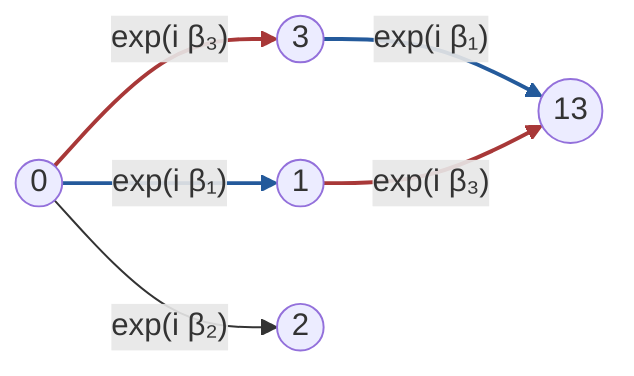
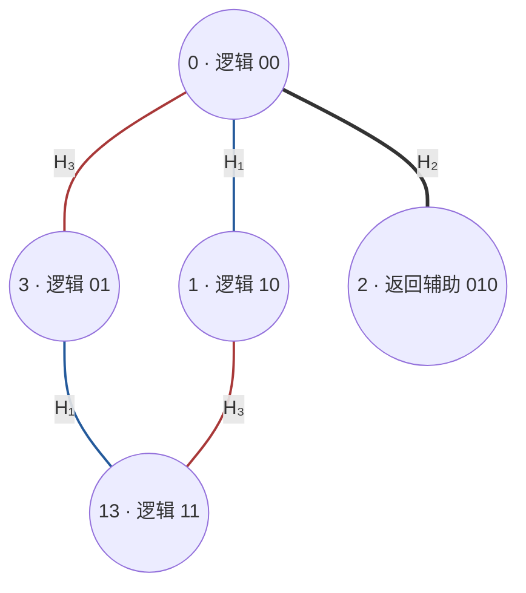

# AURIC 相干关系与递归观测理论

**公理、表征、可观察性与通用计算**

有限尺度严格核心与相容极限 · **v10.0**

2026 年 10 月 28 日（Asia/Singapore）

**来源与阅读约定。** 本卷完整转换用户提供的同名 v10.0 稿件；原作者及模型未指定。
原稿元数据中的“研究讨论稿”表示稿件性质，不作为作者署名。
全卷采用普通数学证明，标准表征结果与组合推论均不主张历史首创；本次转换没有运行 Lean 构建。
本文不是已验证的新物理定律。所述权限、正定性、复合安全性与有限性假设均属于各命题的适用条件。

**历史表述。** 原稿中的“本轮”“最新”“当前提交”“重取”“审计”“读取时间”及目录、blob 数量，
均指原稿在所列固定快照上的历史报告；本次 Markdown 转换不将它们认作新执行的仓库审计。
末节保留的字体和 XeLaTeX 制作说明仅描述原始 TeX 载体；阅读本卷不依赖 TeX、TikZ、字体包或外部图片。
数学使用 GitHub Markdown 数学块，两个科学图使用 Mermaid；文内编号沿用原稿逐节共享的陈述计数。

**编辑说明。** 原稿主定理证明把 `network:substitution` 称作“命题”，但其声明类型为“推论”。
本卷统一称为[推论 9.10](#network-substitution)，仅修正引用类型，科学陈述与证明不变。

**研究对象。**
本稿把 FIB 合法关系、相容振幅核、完整记录仪器、静态因果网络、
有限分辨率预测和相干反射编译组织为一个有类型的数学体系。
它在所声明的有限维接口上给出定义、表征定理、可辨识性定理、
通用编译定理和获取下界，并说明哪些结论可以一致地延拓到极限。

**主线。**

$$
\begin{aligned}
&\text{关系标签与相干核}
\longrightarrow \text{Hilbert 表征与概率标定}\\
&\qquad\longrightarrow \text{完整记录网络}
\longrightarrow \text{未来可观察商与反射计算}.
\end{aligned}
$$

“全部概念都在预测中”在此被落实为：一个观察者只掌握其可执行未来测试所区分的状态。
“没有全局时钟”被落实为：相同静态网络的不同拓扑排序产生相同操作，
同时保留有因果关联操作的组合次序。
“镜子递归最终稳定”则被分成可证明的条件预测极限与需要收缩条件的状态稳定。

**结论边界。**
复标量、全局正定相容性、效果可加标定和复合安全性是明确输入。
本稿证明它们的结果，也构造同一五模式语言上的经典递归模型，
证明裸关系与递归本身没有唯一选出完整量子操作理论。
这是一套有严格范围的数学理论，不是已验证的新物理定律。

**固定项目提交。**
[`bbd2c1b4c502424aeaab5c0d1b4615cb87a610a7`](https://github.com/the-omega-institute/trureturing/commit/bbd2c1b4c502424aeaab5c0d1b4615cb87a610a7)。
提交时间：2026-10-28 17:17:11（Asia/Singapore）。

**原稿扉页的历史报告。** 新旧理论树各 971 个文件，本轮仅 4 项末尾追加；
门控制、相干重构及主要相位接口等 13 项保持不变。
全稿为普通数学证明；没有运行项目 Lean 构建。
标准表征结果与本文组合推论均不主张历史首创。

## 目录

1. [理论的对象、语义与假设层级](#root-architecture)
2. [五模式关系的静态纤维与隐藏方向](#root-fiber)
3. [从相容振幅核构造 Hilbert 表征](#kernel-sec-hilbert)
4. [复结构的几何输入与跨尺度相容](#kernel-sec-scales)
5. [概率标定：效果可加为什么给出 Born 形式](#kernel-sec-probability)
6. [经典递归反例：五模式与自相似并不单独选定量子](#kernel-sec-classical)
7. [观测原子的有限维表示：完全正性、记录与等距](#root-instruments)
8. [经典逻辑的全部相干延拓](#root-logical-lifts)
9. [静态观测网络、记录相容与相位闭环](#network-section)
10. [观察者是未来测试的等价类，而不是一个已知绝对坐标](#root-future)
11. [递归预测、静态历史测度与分辨率稳定](#root-recursion)
12. [反射何时成为通用性的来源](#nand-sec-universal)
13. [五模式原子的原生相干返回门](#sec-native)
14. [一个相位地址如何让原子网络通用](#sec-compiler)
15. [单个五维原子的可控范围](#sec-groups)
16. [静态切面、组合顺序与误差](#sec-static)
17. [控制、可观察性与物理接口的连接定理](#root-control-completion)
18. [最新进展：取得信息、保留状态与实际记录](#latest-section)
19. [统一主定理、理论边界与下一步问题](#root-unification)

## 1. 理论的对象、语义与假设层级

用户提出的图景包含四类问题：什么是一个关系原子，什么是相干预测，
观察者如何作为系统内部的一部分存在，以及这些原子能生成哪些可执行过程。
本稿先给各层独立的数学语义，再证明它们之间的连接。
“量子门通用”不等于“已经从逻辑唯一推导了量子公理”；
“完整有限模型”也不等于解决所有连续场论或实验识别问题。

#### 定义 1.1（FIB 合法语言与五模式原子）

令

$$
\mathcal L_n=\{b_1\cdots b_n\in\{0,1\}^n:
                   b_ib_{i+1}=0\}.
$$

三位时

$$
\mathcal L_3=\{000,100,010,001,101\}.
$$

沿用项目的模式标签

$$
0=F[\mathrm{null}],\quad 1=F[1],\quad
 2=F[2],\quad3=F[3],\quad13=F[1,3].
$$

这些是合法状态的名称；$F[\mathrm{null}]$ 不是 Hilbert 空间的零向量。

合法字的数量满足 $d_n=d_{n-1}+d_{n-2}$、$d_0=1,d_1=2$，
因为末位零的字来自任意 $n-1$ 位合法字，末位一的字必须以 $01$ 结束。
因此 $|\mathcal L_n|=F_{n+2}$。
这个计数决定特定载体的维数上界或正交实现维数，
并不单独决定标量域、相位或概率规则。

#### 定义 1.2（四种不可混用的图）

本稿区分：

1. *配置图*：顶点是合法模式，边是指定 Hamiltonian 的非零耦合；
   它可以有无向环。

2. *操作网络*：顶点是带输入输出端口的局域操作，
   有向边表示同一系统的输出接入另一个操作的输入。
   本稿有限网络无有向环。

3. *记录树*：顶点是已获得的有限结果字，边表示下一次实际结果。
   其分支描述互斥记录。

4. *细化系统*：尺度之间有相容映射，表示一个切面的分辨率扩充。
   其指标不必是物理时钟。

配置图上的空间环、记录树上的延长、操作网络中的偏序以及尺度细化，
可以属于同一个完整模型，但不是同一条边的四种免费解释。
例如原五模式耦合只有五条边；几何金字塔的全部棱并未因此成为控制权限。

### 1.1. 分层结构约定

本理论采用下列可分开检验的结构约定。
它们不是声称独立且数量最少的一组宇宙公理。

| 层 | 输入内容 | 随后得到的结论 |
| --- | --- | --- |
| 关系层 | 合法标签、端口类型、哪些拼接允许 | 合法字、语法组合及关系封闭性 |
| 相干层 | 复 Hermitian 正定核，细化保核；独立复合采用乘积核 | Hilbert 表征、等距、张量表示与相容极限 |
| 标定层 | 全效果区间，非情境的有限可加赋值；纯制备标定 | 唯一密度算子、Born 形式及纯态平方 |
| 操作层 | 混合相容的线性操作；对任意未动参考保持正性；完整结果归一 | CP/Kraus/等距实现与完整仪器 |
| 控制层 | 实际供应的脉冲、相位地址、准备和读出权限 | 指定协议的通用性与不可控障碍 |
| 稳定性层 | 额外的收缩或可辨识性条件 | 误差界、稳定极限或获取下界 |

相干层是对“关系上的隐藏信息”的一种明确模型。
矩阵的对角权重为正，不足以保证全部相干组合具有非负范数；
全局正定性需要对任意有限复系数组合成立。
标定层则回答为什么某个正二次型可以用于实验频率预测。
两者的职责不同。

#### 定义 1.3（静态对象的操作语义）

一个有限 AURIC 观测模型由标签及核、由核生成的载体、
带完整结果的操作菜单、辅助态、记录寄存器、控制策略和末端效果组成。
两个表示若对所声明的全部允许网络给出相同结果概率，
称在该任务类下操作等价。

因而，“点是什么”“边是什么”可以有不同的等价表示。
这种等价需要保持可执行操作和全部指定预测，不能只保持图的顶点数或拓扑外形。
下面逐步构造这种语义。

### 1.2. 与项目和既有量子重构的关系

本稿的五模式控制与编码来自相干重构及合法门文档
[[11](#ref-reconstruction), [12](#ref-legal), [13](#ref-reference)]；
相位与记录部分对应项目相位输运及预测波文档
[[14](#ref-phase), [15](#ref-phasecont), [16](#ref-wavesvi)]；
未来等价的观点对应未来闭记忆文档[[17](#ref-future)]。
本轮四项真实新增与其适用边界在后文单列[[19](#ref-leafiv), [20](#ref-rootj), [21](#ref-positivetrace), [22](#ref-selfcaliv)]。

已有的量子重构研究也通过一组明示的信息处理原则推导量子结构。
例如 Chiribella、D'Ariano、Perinotti 的方案使用因果性、可区分性、
压缩、局部可区分性、纯条件化及纯化等原则[[2](#ref-cdp)]。
本稿没有声称裸 FIB 关系已证明这些原则；
它选择较直接的正定核与复合操作路线，使每一步所付出的假设都可见。

## 2. 五模式关系的静态纤维与隐藏方向

先在经典有限关系层确定“稳定的三个读出”究竟留下多少信息。
这一分析并不预设量子相干，也不把模式标签当作空间中的点坐标。

#### 定义 2.1（占据读出与共同概率）

在五模式次序 $(0,1,2,3,13)$ 上，
$x$ 表示第一位占据，$y$ 表示第三位占据，$z$ 表示中位占据。
给定一个共同概率向量 $p$，记

$$
\bar x=\mathbb E[x],\qquad
 \bar y=\mathbb E[y],\qquad
 \bar z=\mathbb E[z],\qquad
 \kappa=\mathbb E[xy]=p_{13}.
$$

这里的共同概率不能用三个互不关联的边缘模型任意拼接。

#### 定理 2.2（固定三个占据均值的全部概率纤维）

固定 $\bar x,\bar y,\bar z$ 后，全部可行概率恰为

$$
\begin{aligned}
 p_0&=1-\bar x-\bar y-\bar z+\kappa,\\
 p_1&=\bar x-\kappa,\qquad p_2=\bar z,\qquad
 p_3=\bar y-\kappa,\qquad p_{13}=\kappa,
 \end{aligned}
$$

其中

$$
\max\{0,\bar x+\bar y+\bar z-1\}
 \le\kappa\le\min\{\bar x,\bar y\}.
$$

在 $\bar x,\bar y,\bar z\ge0$ 且此区间非空时，上式给全部可行点。
非单点纤维的唯一线性变化方向为
$(1,-1,0,-1,1)$。

**证明。**

由合法五行，$\bar x=p_1+p_{13}$、
$\bar y=p_3+p_{13}$、$\bar z=p_2$。
选定 $\kappa=p_{13}$ 后，前三式与归一化唯一解出全部坐标。
各坐标非负恰为给定上下界及 $\bar z\ge0$。
对 $\kappa$ 微分或作两点相减，得到唯一方向。

∎

#### 定理 2.3（一个关系函数何时由三个均值决定）

对任意函数 $f:\Sigma\to\mathbb{R}$，存在唯一展开

$$
f=f_0+(f_1-f_0)x+(f_3-f_0)y+(f_2-f_0)z+J_fxy,
$$

其中

$$
J_f=f_{13}-f_1-f_3+f_0.
$$

在一个非单点概率纤维上，$\mathbb E[f]$ 由
$\bar x,\bar y,\bar z$ 唯一决定，当且仅当 $J_f=0$。

**证明。**

先代入 $0,1,3,2$ 四行决定前四个系数，再代入 $13$ 行决定 $J_f$。
五行上的等式给函数恒等式，系数唯一。
取期望后，唯一未固定项为 $J_f\kappa$；
非单点区间中它恒定当且仅当 $J_f=0$。
若纤维退化为单点，这个必要性不再适用。

∎

这给“加法和乘法只是两种关系”一个准确的有限模型：
所有响应函数都在同一个五维函数空间中，
$xy$ 是三个占据均值没有直接决定的一个联合特征。
它不是由 $F[1]=[2]$、$F[3]=[5]$ 这些数值标签自动规定的算术答案。
上述静态纤维和响应差分与项目的关系、相位和未来闭记忆接口一致
[[10](#ref-selection), [14](#ref-phase), [17](#ref-future)]。

#### 命题 2.4（三个占据读出没有锁定一般五维量子态）

在五模式正交实现 $H_F\simeq\mathbb{C}^5$ 上，令

$$
M_x={\lvert{1}\rangle\langle{1}\rvert}+{\lvert{13}\rangle\langle{13}\rvert},\qquad
 M_y={\lvert{3}\rangle\langle{3}\rvert}+{\lvert{13}\rangle\langle{13}\rvert},\qquad
 M_z={\lvert{2}\rangle\langle{2}\rvert}.
$$

若只给归一化及这三个期望值，在 $I_5/5$ 附近，
固定均值 $(\bar x,\bar y,\bar z)=(2/5,2/5,1/5)$ 后，
仍有实维 $21$ 的不可区分变化方向。
其中一个是上述对角 $\kappa$ 方向，其余二十个来自非对角相干。

**证明。**

$\operatorname{Herm}(\mathbb{C}^5)$ 实维为 $25$。
$I,M_x,M_y,M_z$ 线性独立，所以四个迹约束的共同零空间实维 $21$。
对角 Hermitian 空间五维，在相同四约束下留下一个方向；
非对角 Hermitian 空间实维 $5(5-1)=20$，均与这四个对角矩阵正交。
足够小的任意此类扰动保持 $I_5/5$ 严格正，故这些方向确实可行。

∎

这里 $M_x,M_y,M_z$ 都对角，彼此交换，而且 $M_xM_y={\lvert{13}\rangle\langle{13}\rvert}$。
基向量 ${\lvert{1}\rangle},{\lvert{2}\rangle},{\lvert{3}\rangle}$ 的正交性，
不等于这三个占据效果是互斥投影，也不等于它们是 Pauli 的三个非交换方向。
只记录边缘均值时隐藏的 $\kappa$，是任务选择造成的信息缺口；
量子相干还会增加其他隐藏方向。
后面的未来可观察闭包将精确说明，允许后续控制时这些方向是否仍不可见。

## 3. 从相容振幅核构造 Hilbert 表征

本节给出条件明确的重构：先声明哪些相容数据被供应，再证明这些数据必须具有怎样的表征。
复标量、正半定性以及相干组合的物理权限不能由名称代替证明。
以下是普通数学证明；其中的核构造与效果表示均为标准结果，不主张新创。

#### 定义 3.1（有限尺度的相容振幅核）

令 $X$ 是有限端口或历史标签集，$\mathbb{C}^{(X)}$ 是以 $e_x$ 为基的自由复向量空间。
供应一个 Hermitian 核 $k:X\times X\to\mathbb{C}$，令 $K=(k(x,y))$，并要求

$$
k(y,x)=\overline{k(x,y)},\qquad
 q(a):=a^\dagger Ka\ge0\quad\text{对全部 }a\in\mathbb{C}^{(X)}.
$$

定义半内积 $\langle a,b\rangle_K=a^\dagger Kb$，对第一变量共轭线性。
本稿允许核退化，所以精确说是正半定核。

标签可以是模式、节点、边或完整记录；定义不预先赋予这些名称不同的本体地位。
自由复组合先是数学结构；若声称每个组合都可准备，还必须说明实际相干接口。

#### 引理 3.2（零模等于根空间）

半内积满足

$$
|\langle a,b\rangle_K|^2\le q(a)q(b),\qquad
 N:=\{a:q(a)=0\}=\ker K.
$$

而且 $a\in N$ 当且仅当它与所有向量正交，因此 $N$ 是复线性子空间。

**证明。**

考察 $q(a+tb)\ge0$。若 $q(b)>0$，对复数 $t$ 配方得到所示不等式。
若 $q(b)=0$ 而 $\langle a,b\rangle_K\ne0$，选择 $t$ 的相位和任意大模长，
可使线性项为任意大的负数，矛盾。
所以零模与全部向量正交；反向取自身即可。
逐个取基向量测试，得到 $N=\ker K$，也得到线性封闭性。

∎

#### 定理 3.3（最小 Hilbert 表征及其唯一性）

对有限标签集 $X$，令 $H_K=\mathbb{C}^{(X)}/N$、$\phi(x)=[e_x]$。
商内积正定，且

$$
\langle\phi(x),\phi(y)\rangle=k(x,y),\qquad
 \operatorname{span}\phi(X)=H_K,\qquad \dim H_K=\operatorname{rank} K.
$$

若另一 Hilbert 空间中的向量族 $\phi'(x)$ 有相同核且张成稠密子空间，
则存在唯一酉 $W$ 满足 $W\phi(x)=\phi'(x)$。
对无限标签集 $X$，只需要求每个有限子集上的核正半定。
令 $H_K$ 为有限支撑自由空间商去零模后的 Hilbert 完成，$\phi(x)$ 为 $[e_x]$ 在完成中的像，则

$$
\langle\phi(x),\phi(y)\rangle=k(x,y),\qquad
 \overline{\operatorname{span}\phi(X)}=H_K.
$$

闭包取 Hilbert 范数闭包，上述酉唯一性仍成立。
前述代数张成等式及秩—维数等式仅在有限标签情形作断言。

**证明。**

引理 [3.2](#kernel-lem-null) 保证改变代表元不影响商内积，且商中的零范数只有零元。
有限维时空间自动完备，维数由秩与零度关系给出。
在生成族上定义

$$
W\Bigl(\sum_xa_x\phi(x)\Bigr)=\sum_xa_x\phi'(x).
$$

两边的范数平方都是 $a^\dagger Ka$，故映射良定义并且等距。
其完备像闭，同时包含目标的稠密生成族，故满射；生成性保证唯一。
无限情形先在有限和之间做相同的等距构造；商空间在其完成中稠密，
故生成族的闭线性张成为整个 $H_K$。
等距唯一连续延拓到完成；延拓的像完备因而闭，且包含目标的稠密生成族，故仍为唯一酉。

∎

**源稿数学更正（定理 3.3）。** 原稿把有限标签公式后的无限延拓写成“结论同样成立”，
没有限定代数张成与秩—维数等式的范围。本卷保留有限标签结论，将无限标签的生成性明确更正为闭线性张成。
例如 $X=\mathbb{N}$、$k(m,n)=\delta_{mn}$ 时，生成向量是标准基，代数张成为有限支撑序列空间 $c_{00}$，
其 Hilbert 完成为 $\ell^2(\mathbb{N})$；向量 $(1/n)_{n\ge1}$ 属于后者而不属于前者。
所以无限情形不能沿用原公式的代数张成等式；上述完成及等距延拓的证明支持更正后的结论。

若写 $f_h(x)=\langle\phi(x),h\rangle$，则 $h\mapsto f_h$ 单射，且
$|f_h(x)|\le\sqrt{k(x,x)}{\left\lVert{h}\right\rVert}$。
把内积搬到这些函数上，就是相应的再生核实现。
这里使用了正形式、零模商与完成；没有先给出带乘法的 $*$ 代数，
就尚未得到一个完整的 GNS 算子代数表示。

#### 命题 3.4（独立复合的乘积核给张量载体）

给核 $k$、$\ell$，在乘积标签上供应

$$
(k\boxtimes\ell)((x,y),(x',y'))=k(x,x')\ell(y,y').
$$

则此核正半定，其最小表征规范等同于
$H_k\otimes H_\ell$，标签 $(x,y)$ 对应
$\phi_k(x)\otimes\phi_\ell(y)$。

**证明。**

显示张量向量的内积恰为乘积核，因此任意有限二次型都是某个张量向量的范数平方。
两个生成族的有限组合所成的简单张量张成稠密子空间，
故最小表征唯一性给结论。

∎

乘积核是对独立复合的明确约定。
完整张量空间可以含纠缠向量，但哪些态可以被准备、
哪些耦合可以被执行，仍由操作菜单决定。
从边集或顶点计数本身得不到这项复合约定。

核的交叉项满足

$$
{\left\lVert{a\phi(x)+b\phi(y)}\right\rVert}^2
 =|a|^2k(x,x)+|b|^2k(y,y)
  +2\operatorname{Re}\!\bigl(\overline a b\,k(x,y)\bigr).
$$

它为关系相干提供了数学位置；把这个范数解释为概率，还需要后面的事件标定。

#### 命题 3.5（保核映射与酉对称）

设 $K,L\succeq0$、$M\ge0$，自由组合之间的矩阵 $A$ 满足
$A^\dagger LA\preceq M^2K$。
则 $[a]_K\mapsto[Aa]_L$ 良定义且范数至多 $M$；若 $A^\dagger LA=K$，则它是等距。
特别地，双射 $\tau:X\to X$ 若满足 $k(\tau x,\tau y)=k(x,y)$，
就诱导唯一酉 $U_\tau\phi(x)=\phi(\tau x)$，并保持复合。

**证明。**

若 $a$ 是源零模，不等式使 $Aa$ 也是目标零模，所以映射可下降到商。
同一不等式给范数界；$A^\dagger LA=K$ 给等距。
保核置换及其逆都诱导等距，故得到酉；复合律在生成元上验证即可。

∎

可逆且保核的变换必须酉，是一个有内容的结论；
它没有证明所有逻辑更新都保核，或所有数学酉都可被观察者调用。

#### 例 3.6（两两相容不保证全局核存在）

考虑

$$
K=\begin{pmatrix}1&-1&-1\\-1&1&-1\\-1&-1&1\end{pmatrix}.
$$

每个对角元为正，每个二阶主块均有特征值 $0,2$，所以每个两点切面都有 Gram 表征。
但 $K(1,1,1)^{\mathsf T}=-(1,1,1)^{\mathsf T}$，整体不是正半定。
因此逐模式的正权重和两两相容都不足以证明全局 PSD。
这是普通 Gram 可实现性反例，尚不是量子情境性的实验定理。

## 4. 复结构的几何输入与跨尺度相容

#### 定理 4.1（定向度量平面确定一个复结构）

二维实空间 $V$ 若已给定正定内积 $g$ 和定向，
就有唯一保度量的实线性 $J$，满足 $J^2=-I$，
并使每个非零 $v$ 的有序基 $(v,Jv)$ 正向。

**证明。**

在正向正交单位基上定义 $Je_1=e_2$、$Je_2=-e_1$。
正向正交基变换是平面旋转，均与此 $J$ 交换，所以定义不依赖所选基。
反之，正交性与 $J^2=-I$ 给 $J^{-1}=-J$，故 $g(v,Jv)=0$ 且两者等长。
二维中只有两个候选方向，定向选择唯一一个。

∎

置 $\mathrm{i} v=Jv$，则

$$
h(v,w)=g(v,w)+\mathrm{i} g(Jv,w)
$$

是复内积。这是从*二维实线性、度量和手性*到复一维结构的构造，
这些输入本身并没有消失。

#### 命题 4.2（三维正交读出不产生全空间复结构）

奇数维实空间不存在满足 $J^2=-I$ 的实线性 $J$。

**证明。**

在奇数维 $d$ 中，取行列式会给 $(\det J)^2=\det(-I)=(-1)^d=-1$，矛盾。

∎

所以三正交读出可以选定一个定向二维平面，却不能据此给整个三维实读出空间安装复结构。
空间坐标维数与模式 Hilbert 维数也是不同概念；qubit 的复二维态矢量空间为实四维，
不能与 Bloch 三维坐标混为一谈。
更高偶数维中，度量和总定向通常也不唯一选定 $J$；各个局部平面的复结构如何拼接，仍需规则。

#### 定义 4.3（相容细化系统）

令 $S$ 为有向偏序集，$s\preceq t$ 表示细化关系，不必表示外部时间。
每个尺度有核表征 $H_s$；供应矩阵 $A_{ts}$，使

$$
A_{ts}^\dagger K_tA_{ts}=K_s.
$$

下降后的等距 $U_{ts}:H_s\to H_t$ 满足
$U_{ss}=I$、$U_{ut}U_{ts}=U_{us}$。
只需复合律在零模商后成立。

#### 定理 4.4（相容等距的 Hilbert 直极限）

存在 Hilbert 空间 $H_\infty$ 及等距 $j_s:H_s\to H_\infty$，使

$$
j_tU_{ts}=j_s,\qquad
 \overline{\bigcup_sj_s(H_s)}=H_\infty.
$$

这一最小系统在保持所有嵌入的酉等价下唯一；取任意余终子系统得到同一结果。

**证明。**

对 $(s,v)$、$(t,w)$，若在某个共同上界 $u$ 有
$U_{us}v=U_{ut}w$，便将二者视为同一向量。
有向性与复合律给等价关系。加法在共同尺度进行，并置

$$
\langle[s,v],[t,w]\rangle
 =\langle U_{us}v,U_{ut}w\rangle_{H_u}.
$$

进一步细化保内积，因此定义与共同上界及代表元的选择无关。
零范数只可能来自零向量；完成所得内积空间就给 $H_\infty$。

另一个最小系统中，把 $j_s(v)$ 映到对应的尺度向量，
会给稠密子空间之间的等距，完成后是唯一酉。
余终子系统包含每个原尺度在某个更细尺度的像，因此其像已稠密，唯一性给最后结论。

∎

这里“从不同尺度进入得到同一表征”依赖保核、复合律与余终性。
若新预测改变旧标签间的核值，严格等距合同便不再成立，应改用明确的更新或近似相容条件。

#### 命题 4.5（细化的完整读出须保留外部结果）

等距 $U:H\to H'$ 对效果的提升 $E\mapsto UEU^\dagger$ 满足

$$
UI_HU^\dagger=UU^\dagger=P_{\operatorname{im}U}.
$$

因此 $H$ 上的 POVM $\{E_a\}$ 在 $H'$ 上应提升为

$$
\{UE_aU^\dagger\}_a\ \cup\ \{I_{H'}-UU^\dagger\}.
$$

对状态 $U\rho U^\dagger$，外部结果概率为零，原结果概率不变。

**证明。**

求和给投影 $UU^\dagger$；补入其正交补才得到 $I_{H'}$。
由 $U^\dagger U=I$ 与迹循环性逐项验证概率。

∎

#### 命题 4.6（相容效果在极限上的唯一延拓）

若每个尺度有 $0\le E_s\le I_{H_s}$，且
$U_{ts}^\dagger E_tU_{ts}=E_s$，
则存在唯一 $0\le E_\infty\le I_{H_\infty}$ 满足
$j_s^\dagger E_\infty j_s=E_s$。
若一组有限结果的尺度效果逐项相容且各尺度求和为 $I$，
其极限效果也求和为 $I$。

**证明。**

对来自不同尺度的两个向量，移入任一共同尺度 $u$，
用 $\langle U_{us}v,E_uU_{ut}w\rangle$ 定义 sesquilinear 形式。
压缩相容性使进一步细化不改变数值。
正效果的 Cauchy–Schwarz 不等式给绝对值至多 ${\left\lVert{v}\right\rVert}{\left\lVert{w}\right\rVert}$，
故该形式唯一连续延拓到完成空间。
Hilbert 空间的 Riesz 表征给唯一有界算子；在稠密子空间上的
$0\le B(v,v)\le{\left\lVert{v}\right\rVert}^2$ 给 $0\le E_\infty\le I$。
有限求和的断言也在稠密子空间验证，再连续延拓。

∎

这给相容读出的一个充分条件，而 Hilbert 直极限本身不自动供应概率态的直极限。
有限维密度算子的下述证明，也不能不加正常性等条件直接延用到无限维。

## 5. 概率标定：效果可加为什么给出 Born 形式

#### 定义 5.1（完整效果域上的标定）

固定有限维复 Hilbert 空间 $H$，令
$\mathcal E(H)=\{E=E^*:0\preceq E\preceq I\}$。
供应效果粗粒化规则：$E+F\preceq I$ 时，
$\{E,F,I-E-F\}$ 是允许的完整测量，前两个结果可合并为 $E+F$。
对固定制备，标定函数 $\mu:\mathcal E(H)\to[0,1]$ 满足

$$
\mu(I)=1,\qquad
 \mu(E+F)=\mu(E)+\mu(F)\quad(E+F\preceq I).
$$

同一效果在不同测量中取同一 $\mu(E)$，是这里的非情境含义；
没有要求每个事件预先具有确定的 $0/1$ 值。
完整效果域、PSD 次序及相加规则都是真实输入；
它们比“预测之间相容”更具体，也包括一些不交换的效果。

#### 定理 5.2（有限效果可加性确定唯一密度算子）

在定义 [5.1](#kernel-def-effect) 下，存在唯一
$\rho\succeq0$、$\operatorname{tr}\rho=1$，使

$$
\boxed{\mu(E)=\operatorname{tr}(\rho E)\quad\text{对全部 }E\in\mathcal E(H).}
$$

反之，每个密度算子都给出这样的标定。

**证明。**

先有 $\mu(0)=0$。若 $0\preceq E\preceq F\preceq I$，
由 $F=E+(F-E)$ 得单调性 $\mu(E)\le\mu(F)$。
把 $E$ 分成 $n$ 份，得到 $\mu(E/n)=\mu(E)/n$，
故 $\mu(qE)=q\mu(E)$ 对有理 $q\in[0,1]$ 成立。
对实数 $r\in[0,1]$，取有理 $q_j\uparrow r$、$r_j\downarrow r$；单调性给

$$
q_j\mu(E)\le\mu(rE)\le r_j\mu(E).
$$

夹逼得到实齐次性，无须另假设此处的连续性。

对任意 $A\succeq0$，取 $t>0$ 且 $A\preceq tI$，定义
$\ell_+(A)=t\mu(A/t)$。
若 $u\ge t$，实齐次性给 $u\mu(A/u)=t\mu(A/t)$，所以定义与缩放无关。
给 $A,B\succeq0$ 选共同的 $t$ 使 $A+B\preceq tI$，效果可加性便给
$\ell_+(A+B)=\ell_+(A)+\ell_+(B)$；同理它在正锥上正齐次。

将任意 Hermitian $T$ 写成 $T=A-B$，$A,B\succeq0$，
定义 $\ell(T)=\ell_+(A)-\ell_+(B)$。
若另有 $A-B=A'-B'$，则 $A+B'=A'+B$，正锥可加性保证同一个值。
因此 $\ell$ 是 Hermitian 空间上的实线性正泛函，且 $\ell(I)=1$。

有限维的实 Hilbert–Schmidt 配对 $\operatorname{tr}(ST)$ 非退化，故存在唯一 Hermitian $\rho$，
使 $\ell(T)=\operatorname{tr}(\rho T)$。
对所有单位 $v$，有 $\langle v,\rho v\rangle=\ell({\lvert{v}\rangle\langle{v}\rvert})\ge0$，
所以 $\rho\succeq0$；又 $\operatorname{tr}\rho=\ell(I)=1$。
限制回效果域即得结论。反向由迹线性与正性直接验证。

∎

这是效果版 Gleason 定理的有限维形式；全部效果域使它也适用于 qubit[[1](#ref-busch)]。
它没有从裸关系推出效果空间，而是说明：一旦效果及其粗粒化被供应，
相容的概率标定就不能任意选取函数。
同时可得 $\mu(tE+(1-t)F)=t\mu(E)+(1-t)\mu(F)$。
若实验还供应按经典概率混合制备的接口，制备密度算子也按相同凸组合变化。

#### 推论 5.3（纯制备的标定与模平方）

上述标定的极端点恰为 $\rho={\lvert{\psi}\rangle\langle{\psi}\rvert}$，${\left\lVert{\psi}\right\rVert}=1$。
对一个已给定的归一向量 $\psi$，若制备标定满足 $\mu({\lvert{\psi}\rangle\langle{\psi}\rvert})=1$，
则同样必有 $\rho={\lvert{\psi}\rangle\langle{\psi}\rvert}$，并且

$$
\mu({\lvert{v}\rangle\langle{v}\rvert})=|\langle v,\psi\rangle|^2,
 \qquad
 \sum_j|\langle e_j,\psi\rangle|^2=1
$$

对单位 $v$ 和任意完整正交基 $\{e_j\}$ 成立。

**证明。**

秩至少二的密度算子可由谱分解写成两个不同密度算子的非平凡凸组合。
若一个秩一投影是两个正密度算子的凸组合，
在其正交补上测试得到两个算子的迹均为零；正性迫使二者都支撑于同一条射线，
归一化使它们相同。因此极端点恰为秩一。

再由 $\operatorname{tr}(\rho{\lvert{\psi}\rangle\langle{\psi}\rvert})=\operatorname{tr}\rho=1$，得到
$\operatorname{tr}(\rho(I-{\lvert{\psi}\rangle\langle{\psi}\rvert}))=0$。
$\rho$ 的非负谱分解中，每个正权重本征向量都必须属于 $\mathbb{C}\psi$，
故 $\rho={\lvert{\psi}\rangle\langle{\psi}\rvert}$。迹乘积给模平方，Parseval 恒等式给求和。

∎

平方的次数不是“不确定量有几个”的计数。
它来自核的二次型、效果标定的线性以及纯制备与秩一测试的关系。
量与尺子都不确定时，可以把参考、记录和测量设备纳入模型；
这本身不会改变上述条件定理。
若只给有限几个投影读出而没有完整效果域，定理的假设就尚未满足。

## 6. 经典递归反例：五模式与自相似并不单独选定量子

#### 定理 6.1（同一 Fibonacci 合法树的经典相容模型）

令 $\Omega_n$ 是全部长度 $n$ 的无相邻一二进制字。
任选 $p\in(0,1)$，取

$$
T=\begin{pmatrix}p&1-p\\1&0\end{pmatrix},\qquad b_0=0,
 \qquad \mu_n(b_1\cdots b_n)=\prod_{j=1}^nT_{b_{j-1},b_j}.
$$

这些是严格正的经典概率分布，且

$$
|\Omega_n|=F_{n+2},\qquad
 \mu_n(w)=\sum_{a:\,wa\in\Omega_{n+1}}\mu_{n+1}(wa).
$$

三位层正是五模式 $000,001,010,100,101$。
进一步定义

$$
k_n(w,v)=\delta_{wv}\mu_n(w),\qquad
 A_{n+1,n}e_w=\sum_{a:\,wa\in\Omega_{n+1}}e_{wa}.
$$

则这些核正定，并且
$A_{n+1,n}^\dagger K_{n+1}A_{n+1,n}=K_n$，
所以同一经典模型也具有严格相容的 Hilbert 直极限。

**证明。**

每个合法转移的权重为正；转移矩阵每行和为一，
故对最后一位求和得到前缀一致性，再递归求和得总质量一。
以末位是否为一分类，合法字计数满足 Fibonacci 递归，初值为 $1,2$。

每个 $K_n$ 是严格正对角矩阵。
不同前缀的子节点集合不交，所以提升后交叉内积仍为零；
同一前缀的平方范数是子节点质量之和，正好为 $\mu_n(w)$。
多层细化按前缀拼接，满足复合律，故可用定理 [4.4](#kernel-thm-limit)。

∎

任意 $p\in(0,1)$ 都满足同一合法关系，所以这些关系也不唯一固定概率数值。
可以把细化向量理解为柱事件的指示函数，完成后得到相应的 $L^2$ 表征；
其可访问读出仍可全部是交换的事件乘法算子，更新仍是经典随机转移。
存在 Hilbert 表征不等于完整非交换效果和相干控制已经可用。

观察者也能内生在这个模型中：令记忆与预测满足

$$
m_{n+1}=F(m_n,b_{n+1}),\qquad q_n=G(m_n),
$$

并把 $(m_n,q_n)$ 记录在同一条路径上。
对给定结果路径，这些记录由递归确定，原概率可直接推前到加了记录的路径。
若 $p$ 未知，记忆还可保存转移次数并递归更新经典后验；
把预测本身作为下层数据并不迫使模型离开经典概率。

这个反例同时具有五模式、Fibonacci 增长、逐尺度相容、PSD 核、
Hilbert 直极限和内生递归预测者。
因此它们的合取仍不足以唯一选出量子理论。
已知的量子重构也需要明确的附加操作原则；例如净化路线依赖操作概率框架及其他公理，
并非由“净化”或“相容”一个概念单独推出全部结构[[2](#ref-cdp)]。

本模块得到的正式进展是明确的蕴含链：
*保核相容给 Hilbert 表征，完整效果相容给 Born 标定；*
复标量、全局 PSD、复合规则和可访问操作仍须在整个理论中逐项交代。

## 7. 观测原子的有限维表示：完全正性、记录与等距

核表征决定载体，但一个载体并未自动指定能执行哪些预测或测量。
以下给操作层的完整有限维语义。
源状态可以未知；模型的线性和完全正条件仍然是所声明接口的精确约束。

#### 定义 7.1（完整量子仪器）

从 $H$ 到 $K$ 的有限结果仪器是线性映射族
$\{\Phi_a:\operatorname{End}(H)\to\operatorname{End}(K)\}_{a\in A}$，满足：
每个 $\Phi_a$ 完全正；$\sum_a\Phi_a$ 保迹。
结果 $a$ 的概率和条件后态分别为

$$
p(a|\rho)=\operatorname{tr}\Phi_a(\rho),\qquad
 \rho_a=\frac{\Phi_a(\rho)}{p(a|\rho)}
 \quad(p(a|\rho)>0).
$$

记录保留时的通道为

$$
\widehat\Phi(\rho)=\sum_a\Phi_a(\rho)\otimes{\lvert{a}\rangle\langle{a}\rvert}.
$$

丢弃记录得到 $\sum_a\Phi_a(\rho)$。

物理随机混合相容性要求对未归一后态作仿射组合；
在正锥上用迹齐次延拓后得到线性映射。
正性保证系统本身的输出有效；
完全正性要求对任意未触动参考 $R$，$\Phi\otimes\operatorname{id}_R$ 仍保持正性。
后一个条件表达与参考纠缠时的复合安全性，是额外的组合约束。
条件后态的除法可以非线性，它不改变未归一分支映射的线性。

#### 定理 7.2（有限维操作表征）

对复线性 $\Phi:M_d(\mathbb{C})\to M_e(\mathbb{C})$，下列条件等价：

1. 对任意有限参考维数，$\operatorname{id}\otimes\Phi$ 保持正性；

2. $J_\Phi=\sum_{i,j=1}^d{\lvert{i}\rangle}{\langle{j}\rvert}\otimes\Phi({\lvert{i}\rangle}{\langle{j}\rvert})\ge0$；

3. 存在矩阵 $K_\alpha:\mathbb{C}^d\to\mathbb{C}^e$，使
   $\Phi(X)=\sum_\alpha K_\alpha X K_\alpha^\dagger$。

$\Phi$ 保迹当且仅当 $\sum_\alpha K_\alpha^\dagger K_\alpha=I_d$。
此时

$$
V{\lvert{\psi}\rangle}=\sum_\alpha K_\alpha{\lvert{\psi}\rangle}\otimes{\lvert{\alpha}\rangle}
$$

为等距，且 $\Phi(X)=\operatorname{tr}_E(VXV^\dagger)$。
最小纯环境维数恰为 $\operatorname{rank} J_\Phi$。

**证明。**

取未归一向量 $\Omega=\sum_i{\lvert{i}\rangle}{\lvert{i}\rangle}$，有
$J_\Phi=(\operatorname{id}_d\otimes\Phi)({\lvert{\Omega}\rangle\langle{\Omega}\rvert})$，故第一项推出第二项。
将正矩阵分解为 $J_\Phi=\sum_\alpha v_\alpha v_\alpha^\dagger$，
唯一写成 $v_\alpha=\sum_i{\lvert{i}\rangle}\otimes K_\alpha{\lvert{i}\rangle}$。
比较每个输入矩阵单位的系数即得第三项。
对任意正 $X$ 和任意参考，

$$
(\operatorname{id}\otimes\Phi)(X)
 =\sum_\alpha(I\otimes K_\alpha)X(I\otimes K_\alpha^\dagger)\ge0,
$$

所以第三项推出第一项。

由迹的循环性，保迹条件恰为 Kraus 平方和等于单位阵；
此时 $V^\dagger V=I$，环境偏迹给原通道。
任意 $r$ 维纯环境实现至多给 $r$ 个 Kraus 算子，故
$\operatorname{rank} J_\Phi\le r$；使用 Choi 矩阵的秩个非零谱向量即可达到等号。

∎

这属于标准有限维通道表征，本文给出所需的完整普通证明[[3](#ref-choi), [4](#ref-stinespring)]。
它说明“完整信息在更大系统中仍可保留”的准确范围：
一个 CPTP 模型存在等距环境实现。
它不保证观察者有权访问环境，亦不把数学上存在的逆延拓变成已供应的控制。

#### 命题 7.3（结果概率不决定测量后的量子行为）

仪器的概率效果为
$E_a=\Phi_a^*(I)=\sum_\alpha K_{a\alpha}^\dagger K_{a\alpha}$。
相同的全部 $E_a$ 不必给出相同后态。

**证明。**

例如单结果效果 $E=I$ 既由恒等通道给出，也由
$\Phi(X)=\operatorname{tr}(X){\lvert{0}\rangle\langle{0}\rvert}$ 给出。
两者都以概率一发生，但前者保留输入，后者把所有输入替换为同一态。
更一般地，任意结果依赖的后置酉都不改变 $K_{a\alpha}^\dagger K_{a\alpha}$。

∎

因此，一个“完整因果原子”应指定仪器或其完整相干实现；
仅给一个终端读出值或 POVM 效果，还没有指定可递归接续的后继状态。

### 7.1. 记录如何成为内部系统

对一个仪器取全部 Kraus 标签 $(a,\alpha)$，则

$$
V=\sum_{a,\alpha}K_{a\alpha}\otimes{\lvert{a,\alpha}\rangle}
$$

是等距。结果寄存器、尚未读出的环境以及控制程序都可放入同一个联合载体。
读取 $a$、遗忘 $\alpha$ 或连 $a$ 一起遗忘，是不同的操作。
有限流程中的观察者因而可以作为内部寄存器与控制规则建模，
无须在数学上加入一个不属于系统的特殊测量者。

#### 命题 7.4（未知态不能被通用复制或单次无误识别）

若一个操作对每个未知纯态都输出其两份副本，则它不存在。
同样，两个非正交纯态不能在每次都给出判定、没有失败结果的条件下，
被一次测量无误区分。

**证明。**

若等距复制成立，可写
$V(\psi\otimes0)=\psi\otimes\psi\otimes e_\psi$。
对 $0<|\langle\psi,\varphi\rangle|<1$，保内积要求

$$
|\langle\psi,\varphi\rangle|
 =|\langle\psi,\varphi\rangle|^2
   |\langle e_\psi,e_\varphi\rangle|
 \le|\langle\psi,\varphi\rangle|^2,
$$

矛盾。一般通道可先作等距实现，故结论不变。

若效果 $0\le E\le I$ 无误区分 $\psi,\varphi$，则
$\langle\psi,E\psi\rangle=1$、
$\langle\varphi,E\varphi\rangle=0$。
正性给 $E\psi=\psi$、$E\varphi=0$，遂
$\langle\psi,\varphi\rangle=\langle E\psi,\varphi\rangle =\langle\psi,E\varphi\rangle=0$，矛盾。

∎

这给“观察者不能任意精确确定自身”的一个有范围的表述：
若允许的自身状态包含非正交态，单份输入没有普适无误识别。
它不排除特定状态下某些读出完全确定，也不排除已知正交状态族的精确识别。

## 8. 经典逻辑的全部相干延拓

上一稿中 NAND 的量子延拓形成一个复球。
这里把它推广到任意有限确定性函数，从而把“关系上的未知”
变成一个可分类的相干参数空间。

#### 定义 8.1（函数的量子延拓）

给有限集合 $X,Y$ 与函数 $f:X\to Y$。
称 CPTP 通道 $\Phi:M_X(\mathbb{C})\to M_Y(\mathbb{C})$ 为 $f$ 的量子延拓，
若

$$
\Phi({\lvert{x}\rangle\langle{x}\rvert})={\lvert{f(x)}\rangle\langle{f(x)}\rvert}\qquad(x\in X).
$$

记纤维 $X_y=f^{-1}(y)$，仅保留非空纤维。

#### 定理 8.2（逻辑延拓的正定核分类）

$f$ 的全部量子延拓与下列矩阵集合一一对应：

$$
\mathfrak G_f=
 \{G\in M_X(\mathbb{C}):G\ge0,\ {}
              G|_{X_y\times X_y}=I_{|X_y|}\text{ 对所有 }y\}.
$$

对应通道满足

$$
\boxed{\Phi_G({\lvert{x}\rangle}{\langle{x'}\rvert})
      =G_{xx'}{\lvert{f(x)}\rangle}{\langle{f(x')}\rvert}.}
$$

其最小纯环境维数为 $\operatorname{rank} G$。

**证明。**

对基态的输出纯，任意等距实现必有
$V{\lvert{x}\rangle}={\lvert{f(x)}\rangle}{\lvert{e_x}\rangle}$。
当 $f(x)=f(x')$ 时，等距性迫使
$\langle e_{x'},e_x\rangle=\delta_{xx'}$；
不同输出纤维之间没有这个正交要求。
设 $G_{xx'}=\langle e_{x'},e_x\rangle$，则 $G$ 为正半定的相干核，
各纤维块为单位阵，偏迹给显示公式。

反之，对任意 $G\in\mathfrak G_f$，其 Choi 矩阵为

$$
J_G=\sum_{x,x'}G_{xx'}
     {\lvert{x,f(x)}\rangle}{\langle{x',f(x')}\rvert}.
$$

向量 ${\lvert{x,f(x)}\rangle}$ 正交，故 $J_G\ge0$ 且 $\operatorname{rank} J_G=\operatorname{rank} G$。
对输出作偏迹时，不同输出纤维的项消失；
同一纤维块为单位阵，所以 $\operatorname{tr}_YJ_G=I_X$。
由定理 [7.2](#root-choi) 得到 CPTP 通道和环境维数结论。
公式又逐矩阵单位确定 $G$，故对应一一。

∎

$\mathfrak G_f$ 是一个由正定性与线性约束定义的凸紧集。
经典真值表只固定其对角纤维块，跨纤维相干仍有自由度。
这是逻辑关系的一族量子实现，而非由真值表自动选定的唯一量子门。

#### 推论 8.3（逻辑压缩的最小纯记录维数）

令 $r=\max_y|X_y|$。在全部量子延拓中，最小纯环境维数恰为 $r$。
若 $f$ 非单射，则不存在保持全部输入的无环境等距实现。

**证明。**

每个最大纤维对应 $G$ 的 $r\times r$ 单位主块，所以 $\operatorname{rank} G\ge r$。
反过来，在同一个 $\mathbb{C}^r$ 环境中，为每个纤维选择前 $|X_y|$ 个标准基向量。
这定义合法等距，且最大纤维已经张成整个环境，维数恰为 $r$。
环境一维只能容纳大小一的全部纤维，故非单射情形不允许。

∎

这是精确可逆记录的维数成本，不是热量、能量或熵产生的定律。
把这个维数直接解释为物理耗散，需要另加热力学模型。

#### 命题 8.4（跨纤维的完美相干代码）

对某个具体延拓，令 $E_y=\operatorname{span}\{e_x:x\in X_y\}$。
给定输出子集 $Y_0$，存在每个纤维中一个单位码向量 $u_y$，
使 $V u_y={\lvert{y}\rangle}\otimes\eta$、共用同一单位环境向量，
当且仅当

$$
\bigcap_{y\in Y_0}E_y\ne\{0\}.
$$

此时 $\operatorname{span}\{u_y:y\in Y_0\}$ 是被完美传输的 $|Y_0|$ 维代码。

**证明。**

必要性由共用 $\eta\in E_y$ 直接得到。
反之，取交空间中的单位 $\eta$。
每个纤维的 $e_x$ 正交归一，可唯一把 $\eta$ 写成其线性组合，
以同样系数定义该输入纤维中的 $u_y$。
各 $u_y$ 归一且因纤维不交而互相正交；
它们的联合输出共享环境，故任意相干叠加完整保留。

∎

#### 例 8.5（NAND 与最小记录）

NAND 的纤维大小为 $3$ 与 $1$，所以

$$
G=\begin{pmatrix}I_3&z\\z^\dagger&1\end{pmatrix},
 \qquad z\in\mathbb{C}^3,\quad {\left\lVert{z}\right\rVert}\le1.
$$

Schur 补给此充要条件。
当 ${\left\lVert{z}\right\rVert}<1$ 时环境最少四维；当 ${\left\lVert{z}\right\rVert}=1$ 时最少三维。
在最小三维环境中，三元素纤维的环境张成全空间，
与另一纤维至少共享一条方向，故存在完美逻辑 qubit。
若 $z=0$，则全部跨输出相干消失，通道为测量后制备。
同一真值表因此包含性质不同的量子实现。

### 8.1. 五模式关系与经典功能完备性

用代数坐标 $(x,y,z)$ 分别表示物理位置 $(1,3,2)$ 的占用，有

$$
\Sigma=\{(x,y,z):xz=yz=0\}.
$$

它保留 $000$ 行。
额外加非空约束后，

$$
\Sigma\cap\{x\lor y\lor z=1\}
 =\{z=\neg(x\lor y)\},
$$

得到 NOR。共享经典变量时 NOR 功能完备[[10](#ref-selection)]。

#### 命题 8.6（裸关系的正组合障碍）

仅用 $\Sigma$、常量钉值、同名变量、等号、合取及存在辅助变量，
所得每个关系都对逐位 AND 封闭。
NOR 与 NAND 的真值图均不封闭，故不能由这些操作免费得到。

**证明。**

$\Sigma$、常量和等号均对 AND 封闭，合取保持封闭。
对于存在投影，把两个满足式的完整赋值及其见证逐位 AND，
便得到投影后 AND 赋值的见证。
NOR 中 $100,010$ 的 AND 为不合法的 $000$；
NAND 中 $110,001$ 的 AND 也为不合法的 $000$。

∎

增加非空约束是一种打破该封闭性的资源，并非唯一可能的资源。
而经典非空后选择、可逆 oracle、相干相位门和擦除环境的通道，
必须保留各自的结果与记录语义。

## 9. 静态观测网络、记录相容与相位闭环

本节把有限维量子仪器作为明确输入，研究它们如何组成无优先全局排序的网络，
以及哪些相位真正能被读出。
这与项目的有类型切面、完整记录和合法交换菱形相接[[11](#ref-reconstruction)]。
事件网络的顶点是操作，配置耦合图的顶点是基态；
前者有向无环，后者可以有无向圈。
五点几何图不能替代其中任一种类型。

### 9.1. 对象、仪器与不依赖拓扑排序的复合

#### 定义 9.1（有类型的有限仪器网络）

每个量子端口携带指定有限维空间 $H_e$，经典端口携带指定的对角标签代数；
边界载体按给定端口作张量积。
态为正的归一密度，效果为 $0\le E\le I$，
本表示内的读出为 $\operatorname{tr}(E\rho)$。
一个完整仪器写成

$$
\mathcal I_a(X)=\sum_\mu K_{a\mu}XK_{a\mu}^\dagger,\qquad
 \sum_{a,\mu}K_{a\mu}^\dagger K_{a\mu}=I,
 \qquad
 \widehat{\mathcal I}(X)=
 \sum_a\mathcal I_a(X)\otimes{\lvert{a}\rangle\langle{a}\rvert} .
$$

模型若包含失败和 Stop，应把它们保留在完整结果中。
权限拒绝是控制器未调用原操作的记录，不与已执行失败混同。
串联用映射复合，并置用张量积。

有限网络为带上述端口与仪器的 DAG。
量子输出端口只能接到一个后继输入；分出两个子系统须实际输出两个张量因子。
经典复制须作为经典通道给出。
反馈由此前结果的经典端口控制，共享辅助或返回环境由共同输入及连线表示。
比较条件分支先用未归一 CP 映射，避免给零概率前缀任意指定条件态。

完整经典记录仍不同于相干记录。
普通仪器只规定各块 $\mathcal I_a$；若另供应
$V\psi=\sum_{a,\mu}K_{a\mu}\psi\otimes{\lvert{a,\mu}\rangle}$，
则分支交叉相位与环境访问权也成为数据。
数学上存在等距提升，不授权实际访问或相干操纵其环境[[11](#ref-reconstruction), [16](#ref-wavesvi)]。

#### 定理 9.2（拓扑排序不改变完整通道）

固定有限网络及其共同输入，任意拓扑排序得到相同的完整 CPTP 通道；
固定全部顶点结果标签后，也得到相同的未归一 CP 分支。
结论对与任意有限参考纠缠的输入成立。

**证明。**

两个当前可执行且不可比的顶点作用于不同边界因子；
否则同一端口被重复消费，违背类型。
对任意线性映射，包括未归一 CP 分支，

$$
(\Phi\otimes\operatorname{id})(\operatorname{id}\otimes\Psi)
 =\Phi\otimes\Psi
 =(\operatorname{id}\otimes\Psi)(\Phi\otimes\operatorname{id}).
$$

这个映射恒等式不要求输入为乘积态。
两个有限偏序的拓扑排序可由相邻不可比元素的交换连接：
把目标排序的首元素向左移，它跨过的元素不可能是其前驱或后继，
再对余下排序归纳。
每次交换都由上式保持复合，结果记录仅作规范重排。
局部完全正性在复合、张量积下保持，完整仪器的归一关系保证总保迹。
张量参考恒等映射后证明不变。

∎

因此同一事件偏序可以有许多等价线性展开；依赖关系仍然存在。
同一量子线上的不同干预不能据此交换。
原子中 $[H_1,H_2]=E_{12}-E_{21}\ne0$ 就是直接例子[[11](#ref-reconstruction)]。

一个事件下集 $D$ 的切面保留穿越边界的端口、未消费输入及声明保留的记录和环境。
对 $D\subseteq E\subseteq F$，差区域给通道，并由上述定理得到

$$
\Phi_{F\leftarrow D}
 =\Phi_{F\leftarrow E}\circ\Phi_{E\leftarrow D}.

\tag{9.1}
$$

实际保留完整相干端口时可用等距接续；隐藏端口时则用偏迹后的通道。
把相关环境另行重置为空白会改变网络。
内部观察者可由访问端口、其中的经典记录及依记录选择许可仪器的规则定义，
不必预先把观察者等同于某个模式基向量。
这里有限切面的有限端口性是显式假设，不能仅从有限前驱性推出[[11](#ref-reconstruction)]。

### 9.2. 边相位的规范分类与原生五模式

#### 定义 9.3（配置图的边相位）

在有限连通无向图 $G=(V,E)$ 上选参考方向 $e:u\to v$，
给 $r_e>0$、$a_e\in U(1)$ 和实对角势 $\epsilon_v$，置

$$
H(a)=\sum_{e:u\to v}r_e
 \bigl(a_e{\lvert{v}\rangle}{\langle{u}\rvert}+\overline{a_e}{\lvert{u}\rangle}{\langle{v}\rvert}\bigr)
 +\sum_v\epsilon_v{\lvert{v}\rangle\langle{v}\rvert} .
$$

反向边取共轭。顶点相位 $g_v$ 给 $D_g=\sum_vg_v{\lvert{v}\rangle\langle{v}\rvert}$，且

$$
D_gH(a)D_g^\dagger=H(a'),\qquad
 a'_{u\to v}=g_va_{u\to v}\overline{g_u}.
$$

沿闭步行按行进方向相乘所得 $h_a(c)$ 称为闭环相位。
规范换表示须同时变换态、效果与全部相位参考；只改变门而固定参考可能是实际干预。

#### 定理 9.4（生成树给出全部边相位不变量）

在相同连通图、正强度及对角势上，两个边相位系规范等价，
当且仅当它们在全部闭步行上有相同 holonomy。
检查任一生成树的基本圈已足够。
独立圈参数数目为 $|E|-|V|+1$；树上的所有边相位均可消去。

**证明。**

规范变换的顶点因子在闭步行中逐项消去，给必要性。
反向令 $b_e=a'_e/a_e$，固定根 $o$ 与生成树，
取 $g_o=1$，把 $g_v$ 定为从根到 $v$ 的树路径上 $b$ 的乘积。
树边遂满足 $b_{u\to v}=g_v\overline{g_u}$。
每条非树边与树路径形成基本圈；该圈的 $b$ 乘积为一，
迫使这条边也满足同一公式。
将树边全部规范固定为一后，每条非树边留下一个可独立指定的圈参数，
共 $|E|-(|V|-1)$ 个。

∎

若某边强度为零，应从实际支撑中删去该边，其相位无定义。
多个连通分量时，圈数为 $|E|-|V|+c$。
本定理分类的是耦合系数，不把它们等同于单位向量间的 Gram 内积。

源矩阵的模式次序为 $(0,1,2,3,13)$，对应
$(000,100,010,001,101)$。其耦合为[[11](#ref-reconstruction)]

$$
\begin{aligned}
 H_1&=E_{10}+E_{01}+E_{13,3}+E_{3,13},\\
 H_2&=E_{20}+E_{02},\\
 H_3&=E_{30}+E_{03}+E_{13,1}+E_{1,13}.
\end{aligned}
$$

图只有 $01,02,03,1\,13,3\,13$ 五条无向边，
唯一基本圈为 $0\to1\to13\to3\to0$。

相位箭头依次为 $0\to1$、$3\to13$ 上的 $e^{\mathrm{i}\beta_1}$，
$0\to3$、$1\to13$ 上的 $e^{\mathrm{i}\beta_3}$，以及 $0\to2$ 上的 $e^{\mathrm{i}\beta_2}$。
每条反向耦合的系数取所示系数的复共轭；箭头不是单向耦合权限。

**图 1。** 实际配置支撑是四环加一叶。箭头标出增加相应占据的相位约定，
反向边取共轭；沿空间四环相位恰好消去。

#### 定理 9.5（固定位置方向的空间圈相位恒为一）

每个位置固定一个相位 $\beta_i$，使用合法脉冲生成元

$$
H_i(\beta_i)=P^0_{i-1}
   (\cos\beta_iX_i+\sin\beta_iY_i)P^0_{i+1}
$$

在五模式空间的限制，端点缺失投影取 $I$。
则唯一空间圈的 holonomy 为一。更强地，同一个对角酉

$$
D_\beta{\lvert{w}\rangle}=e^{\mathrm{i}\sum_j\beta_jw_j}{\lvert{w}\rangle}
$$

同时满足 $H_i(\beta_i)=D_\beta H_i(0)D_\beta^\dagger$。

**证明。**

$Y{\lvert{0}\rangle}=\mathrm{i}{\lvert{1}\rangle}$，故把第 $i$ 位从零翻为一的系数为 $e^{\mathrm{i}\beta_i}$。
所以 $01,3\,13$ 两边的相位相同，都是 $e^{\mathrm{i}\beta_1}$；
$03,1\,13$ 两边都是 $e^{\mathrm{i}\beta_3}$，$02$ 为 $e^{\mathrm{i}\beta_2}$。
沿圈相乘得到

$$
e^{\mathrm{i}\beta_1}e^{\mathrm{i}\beta_3}
 e^{-\mathrm{i}\beta_1}e^{-\mathrm{i}\beta_3}=1.
$$

每条合法翻转只改变一个占据位，$D_\beta$ 的端点相位比恰为上述系数，
故同时共轭公式成立。

∎

#### 命题 9.6（第二方向是控制菜单的相对相位）

同一位置若供应两个控制标签 $\alpha,\beta$，
同一配置边上系数的比值 $e^{\mathrm{i}(\beta-\alpha)}$ 在共同顶点规范下不变。
当 $\beta-\alpha=\pi/2\pmod\pi$ 时，不能用一个共同顶点规范把两种系数同时化为实数。

**证明。**

两种系数在换表示时乘同一因子 $g_v\overline{g_u}$，相除后消去。
两个非零实系数的比值为实，而这里的比值为纯虚，矛盾。

∎

因此单一新增 $Y$ 地址供应的是同位置两个控制的可比较方向，
可画成有色多重图中平行边的相对相位；它不是原生空间四环上的新增磁通。
令 $\Gamma{\lvert{w}\rangle}=(-1)^{|w|}{\lvert{w}\rangle}$、$\mathsf A=\Gamma\mathsf K$。
零相位脉冲与这个反酉实结构交换，而

$$
\mathsf A e^{-\mathrm{i} tH_i(\pi/2)}\mathsf A^{-1}
 =e^{+\mathrm{i} tH_i(\pi/2)}
$$

一般不是原脉冲。这里只排除了这一指定实结构，
不宣称排除所有反酉对称性。

还须区别态的四角关系相位
$\chi_{\rm state}=\theta_0+\theta_{13}-\theta_1-\theta_3$，
其中 $\psi_s=\sqrt{p_s}e^{-\mathrm{i}\theta_s}$[[11](#ref-reconstruction)]。
它对整体与单位置占据相位不变，但对任意五个顶点的独立重相位并不不变；
配置边 holonomy 则对全部顶点重相位不变。
两者都可能剩一个参数，仍是不同对象。
条件返回 $D_{00}$ 可以改变 $\chi_{\rm state}$，同时每个原生瞬时耦合的空间圈相位仍为一。
项目概率纤维上另行指定的相位联络及其曲率[[14](#ref-phase), [15](#ref-phasecont)]
也不能仅因使用 holonomy 一词而与这两者混同。

### 9.3. 空间圈相位的读出范围

#### 定理 9.7（两条最短路线的见证与共轭歧义）

在同一五点五边支撑上取零对角 Hamiltonian，暂允许任意正边强度与边相位。
这是一族诊断模型，不宣称原生菜单供应全部边相位。
记

$$
A=r_{01}r_{1,13},\quad B=r_{03}r_{3,13},\quad
 a_p=a_{01}a_{1,13},\quad a_q=a_{03}a_{3,13},\quad
 a_p\overline{a_q}=e^{\mathrm{i}\Phi}.
$$

则

$$
p_{13\leftarrow0}(t)
 =\frac{t^4}{4}(A^2+B^2+2AB\cos\Phi)+O(t^6).

\tag{9.2}
$$

所有基态转移概率对 $H\mapsto\overline H$ 相同，
所以这些准备与等待读出不能区分 $\Phi$ 与 $-\Phi$。

**证明。**

图的二分为 $\{0,13\}$ 与 $\{1,2,3\}$。
令 $\Gamma$ 在两侧取 $+1,-1$，则 $\Gamma H\Gamma=-H$。
故 $0$ 到 $13$ 的奇数次幂矩阵元为零，而

$$
C:={\langle{13}\rvert}H^2{\lvert{0}\rangle}=Aa_p+Ba_q.
$$

叶模式 $2$ 不提供长度二的到达路线。
于是振幅为 $-t^2C/2+R_t$。取 $M={\left\lVert{H}\right\rVert}_{\rm op}$，
指数级数给

$$
|R_t|\le r_t:=\frac{M^4|t|^4e^{M|t|}}{24},\qquad
 \left|p_{13\leftarrow0}(t)-\frac{t^4}{4}|C|^2\right|
 \le |t|^2|C|r_t+r_t^2 .
$$

这对全部实 $t$ 成立，并严格给出所述 $O(t^6)$。
展开 $|C|^2$ 得首项。另一方面，

$$
e^{-\mathrm{i} t\overline H}
 =\Gamma\,\overline{e^{-\mathrm{i} tH}}\,\Gamma .
$$

矩阵元仅取共轭并乘实符号，模平方不变。
边相位共轭把圈相位变为其逆元，证明完成。

∎

原矩阵中 $A=B=1$、$\Phi=0$，故首项为 $t^4$；
固定位置相位仍给 $\Phi=0$。
从对角态出发，加入有限基态投影读出、记录反馈等待与经典随机化，
相同的条件转移概率仍使全部这些记录律相同。
结论限定于该菜单；额外相干输入、相位参考或非零对角势须重新分析。

#### 定理 9.8（共同记录遮蔽和恢复两路线相位）

设两个经校准路线在重合前具有正交路径标签，联合态为

$$
{\lvert{\Psi_\delta}\rangle}=
 \sqrt{s}\,e^{\mathrm{i}\phi_p}{\lvert{p}\rangle}{\lvert{\eta_p}\rangle}
 +e^{\mathrm{i}\delta}\sqrt{1-s}\,e^{\mathrm{i}\phi_q}{\lvert{q}\rangle}{\lvert{\eta_q}\rangle},
 \qquad 0<s<1,\quad {\left\lVert{\eta_p}\right\rVert}={\left\lVert{\eta_q}\right\rVert}=1 .
$$

另给可调相对相位 $\delta$ 与路径读口
${\lvert{+}\rangle}=({\lvert{p}\rangle}+{\lvert{q}\rangle})/\sqrt2$。
令 $h=e^{\mathrm{i}(\phi_p-\phi_q)}$、$\gamma=\langle\eta_q|\eta_p\rangle$。
忽略记录时，

$$
\boxed{\quad
 p_+(\delta)=\frac12+
 \sqrt{s(1-s)}\,\Re(e^{-\mathrm{i}\delta}h\gamma).
 \quad}

\tag{9.3}
$$

两次 $\delta=0,\pi/2$ 读出确定

$$
z=\sqrt{s(1-s)}h\gamma
   =[p_+(0)-\tfrac12]+\mathrm{i}[p_+(\pi/2)-\tfrac12].
$$

已知非零复值 $\gamma$ 时唯一确定 $h$；
$\gamma=0$ 时全部读出都为 $1/2$；
$\gamma$ 相位未知时只能识别乘积 $h\gamma$。
干涉可见度为 $2\sqrt{s(1-s)}|\gamma|$。

**证明。**

投影到 ${\lvert{+}\rangle}$ 后的记录向量为两项之和除以 $\sqrt2$；
展开其范数平方即得公式。
两个指定 $\delta$ 分别读取 $z$ 的实部、虚部。
已知非零 $\gamma$ 时可相除；未知时
$(h,\gamma)\mapsto(e^{\mathrm{i}\zeta}h,e^{-\mathrm{i}\zeta}\gamma)$ 保持全部数据。
扫描 $\delta$ 得最大、最小值 $1/2\pm|z|$，
二者之差除以其和给所述可见度。

∎

对四环的两条长度二路线，其他装置与动力学相位都校准后，
$h$ 才可识别为边 holonomy。
若记录和相位参考也未知，数据约束它们的共同乘积，不能任意把不确定性只归给系统。
可区别的经典路径记录在被忽略时令交叉项消失；
知道其经典内容不自动供应相干擦除。
本定理也不免费供应路线分离、重合和相位扫描接口。

### 9.4. 切面记录的精确秩与干净返回

#### 定理 9.9（记录 Gram、最小载体与指定门）

设一个 $d$ 维逻辑空间的实际等距接续满足

$$
V{\lvert{x}\rangle}=e^{\mathrm{i}\varphi_x}{\lvert{f(x)}\rangle}{\lvert{\eta_x}\rangle},
 \qquad f\text{ 为基置换},\quad {\left\lVert{\eta_x}\right\rVert}=1 .
$$

置 $G_{xy}=\langle\eta_y|\eta_x\rangle$，
它是通常 Gram 矩阵的复共轭，仍为半正定。
隐藏记录后的通道满足

$$
\Phi({\lvert{x}\rangle}{\langle{y}\rvert})
 =e^{\mathrm{i}(\varphi_x-\varphi_y)}G_{xy}{\lvert{f(x)}\rangle}{\langle{f(y)}\rvert}.
$$

其 Choi 秩及最小纯环境维数都等于 $\operatorname{rank} G$。
它是某个酉通道，当且仅当 $\operatorname{rank} G=1$；
它恰为指定 $F_\varphi{\lvert{x}\rangle}=e^{\mathrm{i}\varphi_x}{\lvert{f(x)}\rangle}$ 的通道，
当且仅当全部 $G_{xy}=1$。

**证明。**

偏迹直接给通道公式。未归一 Choi 矩阵是

$$
J_\Phi=\sum_{x,y}e^{\mathrm{i}(\varphi_x-\varphi_y)}G_{xy}
 {\lvert{x,f(x)}\rangle}{\langle{y,f(y)}\rvert}.
$$

所示支撑向量正交，故其秩为 $\operatorname{rank} G$。
$m$ 维纯环境给至多 $m$ 个 Kraus 算子，
所以 Choi 矩阵秩至多 $m$。
反向写 $G=\sum_{j=1}^r\lambda_jv_jv_j^\dagger$，取

$$
K_j=\sum_x\sqrt{\lambda_j}v_j(x)e^{\mathrm{i}\varphi_x}
       {\lvert{f(x)}\rangle}{\langle{x}\rvert} .
$$

它们实现同一通道，$G_{xx}=1$ 保证总保迹，故最小维数为 $r$。
秩一时只有一个 Kraus 算子 $K$，同维保迹给 $K^\dagger K=I$，
所以它是酉；反向酉通道的 Choi 秩一。
与指定门在全部矩阵单位上比较，最后一项当且仅当 $G_{xy}=1$。

∎

仅有 $\operatorname{rank} G=1$ 允许 $\eta_x=e^{\mathrm{i}\vartheta_x}\eta$，
会把输入相关相位 $\vartheta_x$ 加到系统门上。
“全部环境密度相同”尚不足以核对指定门的相位。
记录向量张成空间也恰有 $\operatorname{rank} G$ 维；
保全部相干关系的记录等距压缩至少需要这个维数。
重现当前系统通道的最小环境，不自动保持原环境全部未来操作。

若每层只加入独立新记录而不改写旧记录，
总记录为 $\eta_x^{(1:n)}=\bigotimes_k\eta_x^{(k)}$，从而
$G_{xy}^{(1:n)}=\prod_kG_{xy}^{(k)}$。
单位向量内积模至多一，所以某对记录一旦有严格小于一的重叠模，
继续添加此类记录不能恢复全逻辑空间的精确酉返回。
主动反计算与共同记录擦除改变旧关联，不在这项单调性假设内。

#### 推论 9.10（干净返回允许静态网络中的门替换）

若实际执行块对全部逻辑输入满足

$$
\widetilde U(J_{\rm in}\psi\otimes{\lvert{r}\rangle})
 =J_{\rm out}U\psi\otimes{\lvert{r'}\rangle},
$$

其中就绪辅助 $r,r'$ 与输入无关，则在任意匹配端口的有限 DAG 中，
可以 $U$ 代替此块而保持逻辑通道及全部参考关联。

**证明。**

等距恒等式张量任意参考后仍成立。
沿一个拓扑排序逐块代入，输入无关辅助满足下一块的就绪类型；
定理 [9.2](#network-topological) 保证结果不依赖排序。

∎

原生二比特码 $J_2{\lvert{ab}\rangle}={\lvert{a0b}\rangle}$ 满足

$$
e^{-\mathrm{i}\pi H_2}J_2=J_2D_{00},\qquad
 D_{00}=I-2{\lvert{00}\rangle\langle{00}\rvert}.
$$

$00$ 分支在 $\operatorname{span}\{{\lvert{000}\rangle},{\lvert{010}\rangle}\}$ 完成相干往返，
其他三个逻辑分支固定，边界中位全部归零，
所以返回辅助的全部 Gram 元素为一。
它可以接入 CZ 和后继编译块；
脉冲中途辅助模式仍可携带输入相关振幅。
可复合性来自完整边界恒等式，而非每个中途切面都无记忆。

## 10. 观察者是未来测试的等价类，而不是一个已知绝对坐标

项目的未来闭记忆要求把“当前读出相同”加强为“全部允许后继预测相同”[[17](#ref-future)]。
本节给出适用于固定有限维量子载体的完整线性版本。
它不替代原生无限历史系统的具体最小性结论；
所用的状态域、操作菜单和终端测试在此独立声明。

#### 定义 10.1（未来可观察算子系统）

固定 $H\simeq\mathbb{C}^d$，一组可接续的 CP 迹不增分支映射 $\{\Phi_a\}_{a\in A}$，
及终端效果集合 $\mathcal E_0$，要求 $I\in\mathcal E_0$。
置

$$
\mathcal V_0=\operatorname{span}_{\mathbb{R}}\mathcal E_0,\qquad
 \mathcal V_{n+1}=
 \operatorname{span}_{\mathbb{R}}\bigl(\mathcal V_n\cup
         \{\Phi_a^*(E):a\in A,E\in\mathcal V_n\}\bigr),
 \qquad
 \mathcal V_\infty=\bigcup_{n\ge0}\mathcal V_n.
$$

等价地，$\mathcal V_\infty$ 是所有
$\Phi_w^*(E)$ 的实线性张成，其中 $w$ 为有限合法字，$E\in\mathcal E_0$。

此处共同菜单对该固定切面有定义；若动作还有状态类型或许可守卫，
须把它们纳入可访问记录与状态域，再作相同闭包。
$\mathcal V_\infty$ 是 Hermitian 空间中的含单位元实子空间；
其复化是算子系统。
它不必对乘法封闭，所以不能未经证明就称为 $C^*$ 代数。

#### 定理 10.2（未来等价、有限深度见证与递归闭包）

设 $r_0=\dim_\mathbb{R}\mathcal V_0$。则：

1. $\mathcal V_{d^2-r_0}=\mathcal V_\infty$，且它在全部 $\Phi_a^*$ 下不变。

2. 两个密度算子对全部允许有限未来测试给相同概率，当且仅当

   $$
   \rho\sim_{\rm Fut}\sigma
    \quad\Longleftrightarrow\quad
    \operatorname{tr}((\rho-\sigma)E)=0\quad(E\in\mathcal V_\infty).
   $$

3. 若它们可被某个未来测试区分，则存在长度至多 $d^2-r_0$ 的字和一个终端效果区分它们。

4. 相同未来等价类具有相同结果概率，且每个正概率结果后的归一后态仍未来等价。

**证明。**

$\mathcal V_n$ 递增，均包含在实维 $d^2$ 的 $\operatorname{Herm}(H)$ 中。
若某一步维数不再增长，则已对每个 $\Phi_a^*$ 不变，后面都不再增长；
否则每一步至少增长一维，所以至多 $d^2-r_0$ 步达到稳定。
归纳展开定义，$\mathcal V_n$ 正是长度至多 $n$ 的拉回终端效果的张成。

对字 $w$，结果与终端测试的联合概率为

$$
\operatorname{tr}(E\Phi_w(\rho))=\operatorname{tr}(\rho\,\Phi_w^*(E)).
$$

故全部相等恰为对整个张成空间正交。
若某个线性组合上的差不为零，至少一个生成测试上的差不为零，
再用稳定深度给第三项。

最后，$I$ 在空间中，故分支概率 $\operatorname{tr}(\rho\Phi_a^*(I))$ 相同。
对任意 $E\in\mathcal V_\infty$，
$\operatorname{tr}(E\Phi_a(\rho))=\operatorname{tr}(\rho\Phi_a^*(E))$ 也相同；
除以共同的正概率后得到相同后继预测。

∎

基于已获结果的同一有限自适应策略也不能突破这个等价：
固定一条实际结果字后，策略决定的控制字仍属于允许字；
每个分支概率和后继都已相同。
反向，一个固定控制字本身就是策略，所以不增加或减少等价关系。

#### 定义 10.3（观察者的预测状态）

固定操作菜单后，定义

$$
q(\rho)=[\rho]_{\sim_{\rm Fut}}.
$$

可取 $\mathcal V_\infty$ 中以 $I,E_1,\ldots,E_{r-1}$ 为基，
用

$$
q(\rho)=\bigl(1,\operatorname{tr}(\rho E_1),\ldots,\operatorname{tr}(\rho E_{r-1})\bigr)
$$

表示该状态，其中 $r=\dim\mathcal V_\infty$。
这些坐标描述足以确定未来的统计信息，不声称观察者已经获得了它们。

#### 定理 10.4（最小仿射预测记忆与量子载体下界）

$q$ 有一个闭合的逐分支递归更新：未归一坐标作线性更新，
条件坐标再除以结果概率。
在所有对全部密度算子精确决定未来的仿射坐标记忆中，
独立非常数坐标的最少数量为 $r-1$。
若通过 CPTP 编码进 $k$ 维量子载体，并由该载体精确预测全部这些测试，
则必有

$$
k^2\ge r.
$$

**证明。**

闭包使每个 $\Phi_a^*(E_j)$ 都可按所选基展开，
所以更新后的坐标是旧坐标的线性组合；
第零坐标就是分支概率，正概率时统一归一化。

对下界，设仿射记忆使用 $s$ 个实数坐标。
把归一态邻域写成 $I/d+\Delta$，$\Delta$ 为足够小的无迹 Hermitian。
若记忆的线性部分湮灭某个 $\Delta$，而某个未来测试对它不为零，
则 $I/d\pm\epsilon\Delta$ 是相同记忆却不同未来的两个状态，矛盾。
因此记忆行空间须包含 $\mathcal V_\infty$ 除常数后的 $r-1$ 个方向，
故 $s\ge r-1$。显示坐标达到此界。

对 $k$ 维 CPTP 编码 $\mathcal E$，即使预测后处理允许一般确定函数，
相同编码输出也必须给出相同未来统计。
因此在无迹 Hermitian 切空间上，$\ker\mathcal E$ 必包含于未来统计映射的核。
核的包含关系迫使编码的线性秩至少为 $r-1$；
而保迹编码的无迹输出空间维数至多为 $k^2-1$。
所以 $k^2-1\ge r-1$。

∎

最小坐标维数不等于有限比特数，也不等于已经获取的记忆。
存储一个任意精确实数的代价没有由 $r-1$ 这个计数解决。
若容许不连续、非线性的任意实数打包，上述仿射维数命题也不再是同一个问题。

#### 推论 10.5（层析完备性的充要条件）

全部密度算子都能被未来测试区分，当且仅当
$\mathcal V_\infty=\operatorname{Herm}(H)$。
若空间是真子空间，则存在不同的满秩状态 $\rho_\pm$ 对全部未来测试等价。

**证明。**

满空间时迹配对非退化，差矩阵必为零。
若空间为真，取非零 $\Delta\in\mathcal V_\infty^\perp$。
因 $I\in\mathcal V_\infty$，$\operatorname{tr}\Delta=0$。
足够小的 $\epsilon>0$ 使 $\rho_\pm=I/d\pm\epsilon\Delta$ 都严格正，
归一且互不相同，却对所有未来测试给同样结果。

∎

因此可以严格定义“对观察者稳定的概念”：
它是该未来等价类上的函数，而非在当前标签上随意指定的名称。
扩展操作菜单会扩大可观察算子系统，并细分过去的等价类。
旧观察者看来相同的两种状态，可能被新增相位控制区分。

### 10.1. 状态与尺子共同未知

#### 命题 10.6（共同换帧不改变任何网络概率）

为每个系统类型或切面选酉 $W$。
将状态、效果和操作同时换成

$$
\rho'=W\rho W^\dagger,\quad E'=WEW^\dagger,\quad
 \Phi'=\operatorname{Ad}_{W_{\rm out}}\circ\Phi\circ\operatorname{Ad}_{W_{\rm in}^\dagger}.
$$

保持全部端口匹配，则任意完整网络的结果概率不变。

**证明。**

每条内部连线上的 $W^\dagger W$ 消去；
边界概率最后为
$\operatorname{tr}(W E W^\dagger\,W\rho W^\dagger)=\operatorname{tr}(E\rho)$。
记录条件分支及参考系统上同样逐项成立。

∎

这给“观察者无法确定自身绝对位置”一个操作解释：
若状态、尺子和控制一同换帧，读出无法选定唯一绝对表示。
可识别的是共同换帧下不变的关系。
若实验另有已校准参考，它会缩小允许的换帧群，故是新增信息。

#### 例 10.7（共同未知不能用独立平均代替）

令 $\lambda\in\{0,1\}$ 等概率，
$\rho_\lambda={\lvert{\lambda}\rangle\langle{\lambda}\rvert}$，$E_\lambda={\lvert{\lambda}\rangle\langle{\lambda}\rvert}$。
真实联合模型给

$$
\mathbb E_\lambda\operatorname{tr}(\rho_\lambda E_\lambda)=1.
$$

但分别平均有 $\bar\rho=\bar E=I/2$，从而
$\operatorname{tr}(\bar\rho\,\bar E)=1/2$。

所以“量与尺子都不确定”应由一个实际联合状态或联合标定模型表示。
只给两个边缘分布并不能恢复它们的关系。
在量子版本中，观察者、程序和对象可共同处于 $\rho_{SO}$；
它们的相关性同样不能由 $\rho_S,\rho_O$ 单独重建。
本例没有把所有未知参数都假设成独立随机变量。

### 10.2. 同一相干形式还给出不相容读出的约束

#### 命题 10.8（协方差不确定关系）

对密度算子 $\rho$ 和 Hermitian $A,B$，令
$\widetilde A=A-\operatorname{tr}(\rho A)I$、$\widetilde B=B-\operatorname{tr}(\rho B)I$。
则

$$
\operatorname{Var}_\rho(A)\operatorname{Var}_\rho(B)
 \ge
 \left|\tfrac12\operatorname{tr}(\rho\{\widetilde A,\widetilde B\})\right|^2
 +\left|\tfrac1{2\mathrm{i}}\operatorname{tr}(\rho[A,B])\right|^2.
$$

**证明。**

对半内积 $\langle X,Y\rangle_\rho=\operatorname{tr}(\rho X^\dagger Y)$ 应用
Cauchy–Schwarz，得到左侧不小于
$|\operatorname{tr}(\rho\widetilde A\widetilde B)|^2$。
将该复数分成反交换子的实部与交换子的虚部即得。

∎

它约束指定状态和指定两个读出，既不声称所有量都必须不确定，
也不把一个关系算子默认成无误的外部尺子。
例如 Bell 态的单比特 $Z$ 读出不确定，而 $Z\otimes Z$ 可以确定。
当装置也未知时，必须先声明联合模型，再应用相应的算子关系。

## 11. 递归预测、静态历史测度与分辨率稳定

预测可以递归地更新，但至少有三种不同的递归对象：
实际量子后态、对固定问题的条件预测，以及尺度细化中的表征。
它们的收敛条件不同。
本节给出相容性能够保证的结果，并把需要额外稳定性假设的结论单列。

#### 定义 11.1（内部记录策略）

固定初态 $\rho$。
每个有限结果字 $h$ 决定下一次允许仪器
$\{\Phi_{a(h),o}\}_o$，其中选择函数只使用实际持有的记录和程序状态。
置

$$
\widetilde\rho_\varnothing=\rho,\qquad
 \widetilde\rho_{ho}=\Phi_{a(h),o}(\widetilde\rho_h),
 \qquad
 p(h)=\operatorname{tr}\widetilde\rho_h.
$$

正概率时定义 $\rho_h=\widetilde\rho_h/p(h)$。
Stop 后附加一个确定的吸收符号，使每个有限前缀都有完整后继。

这是无外部时间语义的记录树：深度只计已经包含多少次操作。
策略表和程序可作为内部经典寄存器编码。
它没有把未知参数当作观察者已经获得的控制输入。

#### 定理 11.2（局部仪器归一决定静态历史概率）

若每个节点有限分支且仪器完整，则

$$
p(\varnothing)=1,\qquad
 p(h)=\sum_o p(ho).
$$

这些前缀概率唯一决定无限合法记录空间上的概率测度。
每个正概率节点的条件延拓仍由相同的仪器递归给出。

**证明。**

完整仪器的总映射保迹，故
$\sum_o\operatorname{tr}\Phi_{a(h),o}(\widetilde\rho_h)=\operatorname{tr}\widetilde\rho_h$。
归纳得到每层总质量一及全部前缀相容性。

无限路径空间是逐层有限前缀集乘积 $\prod_nT_n$ 中的相容闭子空间。
圆柱集是开闭集；其有限并构成代数，前缀相容性给该代数上的有限可加概率。
若一个代数集 $A$ 等于可数个两两不交代数集 $A_k$ 的并，
$A$ 紧致而各 $A_k$ 开，故有有限子覆盖；
其余不交项只能为空，可数可加性遂退化为有限可加性。
由测度扩张定理得到圆柱生成 $\sigma$ 代数上的概率测度，
唯一性来自生成代数上的一致性。
最后在正概率前缀上相除，便得到相同的下一步条件概率。

∎

所以“极限静态历史”可以从相容的有限实验构造。
这给出的是依赖初态、操作与标定的路径测度，
不是由一个无权图唯一恢复概率。
它也没有说观察者实际完成了无限多次操作。

对纯初态，还可在每个深度保留全部 Kraus 记录：

$$
{\lvert{\Psi_n}\rangle}=\sum_{h,\boldsymbol\alpha}
 K_{h,\boldsymbol\alpha}{\lvert{\psi}\rangle}
 \otimes{\lvert{h,\boldsymbol\alpha}\rangle}.
$$

完整性保证范数一。
按前缀控制下一次等距，就得到相容的逐层纯记录实现。
若只保留 $h$ 寄存器，需把未访问的 $\boldsymbol\alpha$ 偏迹；
要得到经典记录态，还须对 $h$ 去相干或只读取其对角块。
仅偏迹 $\boldsymbol\alpha$ 不保证不同 $h$ 的相干项消失。
经典结果律与完整相干记录仍是不同对象。

#### 定理 11.3（固定问题的递归条件预测有均方极限）

在一个已给定的联合概率模型 $(\Omega,\mathcal F,\mathbb P)$ 上，
承载上述记录过程，且其记录边缘律为前述历史测度。
令 $\mathcal F_n$ 为前 $n$ 层记录生成的 $\sigma$ 代数，
$Z\in L^2(\mathcal F;\mathbb{R})$ 为该联合模型中一个固定待预测量。
定义

$$
M_n=\mathbb E[Z\mid\mathcal F_n],\qquad
 \mathcal F_\infty=\sigma\Bigl(\bigcup_n\mathcal F_n\Bigr).
$$

则

$$
M_n\longrightarrow
 \mathbb E[Z\mid\mathcal F_\infty]\quad\text{于 }L^2,
$$

并且

$$
\lim_n\mathbb E|Z-M_n|^2
 =
 \mathbb E\operatorname{Var}(Z\mid\mathcal F_\infty).
$$

误差趋于零当且仅当 $Z$ 在全部可得记录下可测（忽略零测集）。

**证明。**

条件期望是 $L^2(\mathcal F_n)$ 上的正交投影。
子空间递增，所以对 $m\ge n$，

$$
{\left\lVert{M_m-M_n}\right\rVert}_{L^2}^2
 ={\left\lVert{M_m}\right\rVert}_{L^2}^2-{\left\lVert{M_n}\right\rVert}_{L^2}^2.
$$

右侧的范数平方递增且被 ${\left\lVert{Z}\right\rVert}_{L^2}^2$ 控制，
故 $M_n$ 是 Cauchy 列。
其极限 $M$ 位于 $L^2(\mathcal F_\infty)$，
并与 $Z-M$ 对每个 $L^2(\mathcal F_n)$ 正交。
这些子空间的并在 $L^2(\mathcal F_\infty)$ 稠密
（对生成代数的指示函数作简单函数逼近），故
$M=\mathbb E[Z\mid\mathcal F_\infty]$。
正交分解给极限误差和零误差充要条件。

∎

这是固定问题、固定实际策略和实际联合概率测度上的校准极限。
它允许 $\mathcal F_\infty\subsetneq\mathcal F$，故未记录信息可留下非零残余。
若只取原来的纯记录路径空间，则每个该空间上的 $Z$ 都已对
$\mathcal F_\infty$ 可测，均方误差将趋零。
额外联合目标不是自动供应的隐藏参数先验，更不是给全部不相容量子测试
赋予同一个反事实联合分布。
它不保证每条样本路径在某个有限深度后停止变化，
更不保证持续改变的物理量子后态收敛。
“分辨率够低就看起来稳定”可以用这个均方误差表达，
但分辨率本身不会自动补出未被记录的信息。

#### 例 11.4（递归并不强制状态定格）

取合法量子更新 $\rho_{n+1}=X\rho_nX$，$\rho_0={\lvert{0}\rangle\langle{0}\rvert}$。
则 $\rho_{2n}={\lvert{0}\rangle\langle{0}\rvert}$、$\rho_{2n+1}={\lvert{1}\rangle\langle{1}\rvert}$，
相邻态迹距离恒为一。
这个完全相容的递归没有状态极限。

#### 定理 11.5（有收缩条件时的稳定与误差地板）

设一个 CPTP 映射 $T$ 对所有密度算子满足

$$
D(T\rho,T\sigma)\le\lambda D(\rho,\sigma),
 \qquad 0\le\lambda<1,
 \qquad D(\rho,\sigma)=\tfrac12{\left\lVert{\rho-\sigma}\right\rVert}_1.
$$

则有唯一固定态 $\rho_*$，且 $T^n\rho\to\rho_*$。
若实际递归满足 $D(\rho_{n+1},T\rho_n)\le\epsilon_n$，则

$$
D(\rho_n,\rho_*)
 \le\lambda^nD(\rho_0,\rho_*)+
       \sum_{j=0}^{n-1}\lambda^{n-1-j}\epsilon_j.
$$

特别是 $\epsilon_j\le\epsilon$ 时，
$\limsup_nD(\rho_n,\rho_*)\le\epsilon/(1-\lambda)$。

**证明。**

有限维密度算子集合在迹距离下完备。
收缩映射定理给唯一固定点；也可直接用几何级数控制迭代差得到。
三角不等式给
$D(\rho_{n+1},\rho_*)\le\epsilon_n+\lambda D(\rho_n,\rho_*)$，
递归展开即得公式与极限上界。

∎

酉通道保持迹距离，在非平凡状态空间上不能满足 $\lambda<1$。
局部遗忘、环境耦合或其他已声明噪声可以产生有效收缩，
但不能把它归因于“递归”一词。
项目的原控制稳定性反例也显示：
坐标轨迹一致趋近静止、长度与平方速度有统一界，
仍可使原 survival 与等待保持 $1/2$ 的差距[[18](#ref-stability)]。
稳定性必须针对实际状态、通道或预测任务定义。

### 11.1. 条件预测与稀有事件的误差

#### 命题 11.6（后选择的归一化可能放大误差）

设未归一正输出 $A,B$ 的迹为 $p,q>0$，且
${\left\lVert{A-B}\right\rVert}_1\le\delta$、$p,q\ge\eta>0$。
则

$$
\left\lVert\frac A p-\frac B q\right\rVert_1
 \le\frac{2\delta}{\eta}.
$$

**证明。**

按 $A/p-B/q=(A-B)/p+B(1/p-1/q)$ 分解，
迹范数不超过
$\delta/p+|q-p|/p$。
又 $|q-p|\le{\left\lVert{A-B}\right\rVert}_1\le\delta$，即得。

∎

因此在未给成功概率下界时，未归一通道的微小误差
不保证条件预测的统一稳定。
把很少发生的猜测分支归一化为一个漂亮的门，
不能忽略其成功概率、失败记录或误差放大。

## 12. 反射何时成为通用性的来源

经典与量子通用性都依赖允许的布线和复合。
单一种类的多体门放到不同有序线路上，会产生许多不同的整体算子；
这与在同一载体上只重复一个算子不同。
单种双比特通用门的存在已有明确构造[[5](#ref-barenco_single)]。

#### 命题 12.1（同一位置的一门重复不能稠密全部酉门）

若 $\dim\mathcal H=d\ge2$，只允许固定 $G\in U(d)$ 的幂，
则其闭包不能是 $PU(d)$。

**证明。**

任意两个幂交换，乘法连续使闭包仍然交换。
$PU(d)$ 非交换，所以不可能相等。
即使额外供应 $G^{-1}$，结论也不变。

∎

若固定门集有限，有限词集合还可数，所以不可能精确覆盖不可数的 $PU(d)$。
这解释为什么有限量子门组的通用性通常指任意精度逼近。
连续参数门族的精确分解是另一种资源合同[[8](#ref-brylinski)]。

#### 命题 12.2（两次相干反射产生旋转）

令 $u,v$ 为单位向量，并选择相位使
$\langle u,v\rangle=\cos\theta$，$0<\theta<\pi/2$。
置 $R_u=I-2{\lvert{u}\rangle\langle{u}\rvert}$、$R_v=I-2{\lvert{v}\rangle\langle{v}\rvert}$。
在基
$u,w=(v-\cos\theta\,u)/\sin\theta$ 下，

$$
R_vR_u\big|_{\operatorname{span}\{u,v\}}
 =
 \begin{pmatrix}
 \cos2\theta&-\sin2\theta\\
 \sin2\theta&\cos2\theta
 \end{pmatrix}.
$$

在两者的共同正交补上，它为恒等。

**证明。**

该基中 $R_u=\operatorname{diag}(-1,1)$，
将 $v=(\cos\theta,\sin\theta)$ 代入 $R_v=I-2vv^\dagger$ 后直接相乘。

∎

若 $\theta/\pi$ 无理，幂在这一个旋转圆群上稠密。
这仍没有给出全部复酉群：不同反射之间的相对方向和可复合范围才是关键。

#### 定理 12.3（两个固定对合的限制）

在同一 $d\ge2$ 维载体上，两个固定酉对合 $R^2=S^2=I$
不能生成稠密的 $PU(d)$。

**证明。**

消去相邻的 $RR$、$SS$，任意词都可写成
$(RS)^n$ 或 $R(RS)^n$。
令 $K$ 为循环群 $\langle RS\rangle$ 的闭包，则 $K$ 交换，
整个生成群闭包为 $K\cup RK$。
若它等于 $PU(d)$，$K$ 就是指数至多二的闭子群。
有限指数闭子群为开子群，而 $PU(d)$ 连通，迫使 $K=PU(d)$，
与其非交换性矛盾。

∎

这个结论不限制同种多体对合在任意多个不同线路位置的嵌入；
那些嵌入一般提供多于两个整体生成元。

#### 定理 12.4（三个固定复方向反射的单 qubit 通用性）

固定 $\alpha/\pi$ 无理，取

$$
R_0=Z,\qquad
 R_1=\cos\alpha\,Z+\sin\alpha\,X,\qquad
 R_2=\cos\alpha\,Z+\sin\alpha\,Y .
$$

它们均为 Hermitian 酉对合，生成群在 $PU(2)$ 中稠密。
在同一 qubit、无额外辅助控制且每个固定门都是对合的合同中，
三个是实现该通用性的最少数量。

**证明。**

Pauli 反交换关系给 $R_j^2=I$，并给

$$
R_1R_0=e^{-\mathrm{i}\alpha Y},\qquad
 R_2R_0=e^{\mathrm{i}\alpha X}.
$$

无理角的幂使闭包包含全部 $X$ 轴和 $Y$ 轴连续旋转。
Euler 分解使这些旋转生成 $SU(2)$；
忽略全局相位得到 $PU(2)$。
最少数量由命题 [12.1](#nand-prop-cyclic) 与定理 [12.3](#nand-thm-two-involutions) 给出。

∎

这给“取反是基础构件”一个严格的正面版本。
这里的三个方向，尤其包含 $Y$ 的复相位方向，是明确的控制资源。
只保留实方向、只反复使用同一面镜子，均没有得到上述结论。
多 qubit 计算还需要跨系统耦合；
例如这些局部控制配合 $CZ=I-2{\lvert{11}\rangle\langle{11}\rvert}$ 即给标准通用路线[[6](#ref-barenco), [8](#ref-brylinski)]。

#### 命题 12.5（任意可定向反射家族的有限分解）

每个 $U\in SU(d)$ 都能写成至多 $2(d-1)$ 个秩一相干反射的乘积。
因此 $U(d)$ 中任意门忽略全局相位后也有这种分解。

**证明。**

对角化
$U=V\operatorname{diag}(e^{\mathrm{i}\theta_1},\ldots,e^{\mathrm{i}\theta_d})V^\dagger$，
取 $\theta_d\equiv-\sum_{j<d}\theta_j\pmod{2\pi}$。
把对角矩阵拆成 $d-1$ 个在 $(j,d)$ 平面上的相位对。
对每个 $j<d$，置

$$
u_j=\frac{e_j+e_d}{\sqrt2},\qquad
 v_j=\frac{e_j+e^{\mathrm{i}\theta_j}e_d}{\sqrt2}.
$$

直接相乘得到

$$
R_{u_j}R_{v_j}\big|_{\operatorname{span}\{e_j,e_d\}}
 =\operatorname{diag}(e^{\mathrm{i}\theta_j},e^{-\mathrm{i}\theta_j}),
$$

其余方向恒等。共轭后便有
$U=\prod_{j<d}R_{Vu_j}R_{Vv_j}$。

∎

这里的基础原语是一个能够连续指定反射方向的家族。
这些方向依赖目标 $U$，不能把其程序信息当作单个固定反射免费携带的能力。
因此，检验 AURIC 时需要追问实际接口是否提供所需方向、相位、记录和跨原子耦合，
再用它们的生成群或明确编译证明通用性。

## 13. 五模式原子的原生相干返回门

### 13.1. 从关系空间到可执行的门

将三位置合法字作为正交基，定义

$$
\mathcal H_F=\operatorname{span}\{{\lvert{000}\rangle},{\lvert{100}\rangle},{\lvert{010}\rangle},{\lvert{001}\rangle},{\lvert{101}\rangle}\}
 =\operatorname{span}\{{\lvert{0}\rangle},{\lvert{1}\rangle},{\lvert{2}\rangle},{\lvert{3}\rangle},{\lvert{13}\rangle}\}.
$$

最后一个等号只是模式标签。记 $E_{ab}={\lvert{a}\rangle}{\langle{b}\rvert}$，项目的三个合法耦合为

$$
\begin{aligned}
H_1&=E_{01}+E_{10}+E_{3,13}+E_{13,3},\\
 H_2&=E_{02}+E_{20},\\
 H_3&=E_{03}+E_{30}+E_{1,13}+E_{13,1}.
\end{aligned}
$$

它们分别翻转一个位置，但仅在相邻位置均为零时开启。
在三比特环境空间上，写成

$$
H_1=X_1P_2^0,\qquad H_2=P_1^0X_2P_3^0,\qquad
 H_3=P_2^0X_3,\qquad P_i^0={\lvert{0}\rangle\langle{0}\rvert}_i,
$$

再限制到 $\mathcal H_F$，正是上述矩阵[[11](#ref-reconstruction)]。
$H_j$ 是 Hamiltonian，并非酉门；真正的门是 $R_j(t)=e^{-\mathrm{i} tH_j}$。

四个逻辑基态的次序为 $0,3,1,13$；返回辅助模式为 $2$。

**图 2。** 源矩阵的五模式耦合图。它有五条无向耦合边；不能把几何金字塔的所有棱都当作已供应的 Hamiltonian。

#### 定义 13.1（原子的二比特码）

定义等距

$$
J_2:\mathbb{C}^2\otimes\mathbb{C}^2\longrightarrow\mathcal H_F,\qquad
 J_2{\lvert{ab}\rangle}={\lvert{a0b}\rangle}.
$$

逻辑次序 $00,01,10,11$ 对应物理模式次序 $0,3,1,13$。
辅助模式是 ${\lvert{2}\rangle}={\lvert{010}\rangle}$。

$\mathcal H_F$ 是五维。两个 qubit 是其中一个指定编码子空间；
第五个模式提供暂时离开代码再返回的通路。
在代码上，$H_1=X\otimes I$、$H_3=I\otimes X$；
二者在辅助模式上为零，相应指数门固定该模式。

#### 定理 13.2（条件返回精确实现 NOR 相位反射）

一次中位 $\pi$ 脉冲 $D=R_2(\pi)$ 满足

$$
\boxed{DJ_2=J_2D_{00},\qquad D_{00}=I-2{\lvert{00}\rangle\langle{00}\rvert}
       =\operatorname{diag}(-1,1,1,1).}
$$

该等式对任意逻辑输入及其与外部参考的纠缠都成立；
脉冲结束时分离位恰为零。

**证明。**

只有逻辑输入 $00$ 启用中位翻转。
在 $\operatorname{span}\{{\lvert{000}\rangle},{\lvert{010}\rangle}\}$ 上，$H_2=X$，所以

$$
e^{-\mathrm{i}\pi H_2}{\lvert{000}\rangle}=-{\lvert{000}\rangle}.
$$

其余三个码基态的两端至少有一个一，使 $H_2$ 为零，故完全不变。
四个基态逐一成立就给等距恒等式；张量任意参考恒等算子后仍成立。
中途 ${\lvert{000}\rangle}$ 可以变成 $-\mathrm{i}{\lvert{010}\rangle}$，末端则精确返回。

∎

这里保留了 $F[\mathrm{null}]$，由它参与的相干往返产生逻辑信息。
通常 Bloch 球约定中的旋转角为 $2t$，因此 $t=\pi$ 是完整 $2\pi$ 往返，
留下振幅的负号。
这给“反者”的直觉一个可计算版本：
**关系分支保留了返回过程的相对相位。**
该构造已在项目合法门的编码部分证明[[12](#ref-legal), [13](#ref-reference)]。

#### 推论 13.3（五脉冲原生 CZ）

令 $S=R_3(\pi/2)R_1(\pi/2)$，则

$$
\boxed{S^\dagger DSJ_2=J_2CZ,\qquad CZ=I-2{\lvert{11}\rangle\langle{11}\rvert}.}
$$

实现需要两个前脉冲、一个中位脉冲和两个逆脉冲。

**证明。**

在代码上 $S=(-\mathrm{i} X)\otimes(-\mathrm{i} X)=-X\otimes X$。
其共轭将 ${\lvert{00}\rangle\langle{00}\rvert}$ 送到 ${\lvert{11}\rangle\langle{11}\rvert}$；整体负号在共轭中消去。

∎

$D_{00}$ 自身也是纠缠门：它把 ${\lvert{++}\rangle}$ 送到
$(-{\lvert{00}\rangle}+{\lvert{01}\rangle}+{\lvert{10}\rangle}+{\lvert{11}\rangle})/2$，
该态的二维系数矩阵行列式为 $-1/2$，故不是乘积态。
纠缠能力有了，任意局部复方向控制仍需另外说明。

#### 命题 13.4（量子相位不区分布尔函数的整体补）

对布尔函数 $f$ 定义 $D_f{\lvert{x}\rangle}=(-1)^{f(x)}{\lvert{x}\rangle}$，则

$$
D_{\neg f}=-D_f.
$$

所以它们给出相同的无控制酉通道。

**证明。**

$(-1)^{1-f(x)}=-(-1)^{f(x)}$ 对每个输入成立。

∎

AND 的相位门是 $CZ$，NAND 的相位门是 $-CZ$。
因而不能只从这个相位接口断言 NAND 的布尔取反部分具有独占的量子地位。
真正可观测的是相对相位、后续干涉及是否有更高层的相干控制。

## 14. 一个相位地址如何让原子网络通用

### 14.1. 精确声明可用的资源

设 $\mathcal K_n$ 是 $n$ 位全部无相邻一的字张成的 Hilbert 空间。
其维数满足 $d_n=d_{n-1}+d_{n-2}$、$d_0=1,d_1=2$，故为 $F_{n+2}$。
许可的独立寻址脉冲为

$$
H_i(\beta)=P^0_{i-1}(\cos\beta X_i+\sin\beta Y_i)P^0_{i+1},
 \qquad R_i(\beta,t)=e^{-\mathrm{i} tH_i(\beta)},\quad t\in\mathbb{R}.
$$

端点缺少的投影取 $I$。每一脉冲保持 $\mathcal K_n$。
以下只需所有位置的 $\beta=0$，以及*一个固定数据位置*的 $\beta=\pi/2$。
独立寻址、可调实角度及逆脉冲均为明确的理想控制权限[[13](#ref-reference)]。

对 $m$ 个逻辑 qubit 取 $n=2m-1$，定义

$$
\boxed{J_m{\lvert{b_1\cdots b_m}\rangle}
 ={\lvert{b_1\,0\,b_2\,0\cdots0\,b_m}\rangle}.}
$$

奇数物理位置是数据，偶数位置是初末均为零的分离位。
在代码上，数据位置的脉冲直接实现
$R_x(t)=e^{-\mathrm{i} tX}$ 或可用时的 $R_y(t)=e^{-\mathrm{i} tY}$。
每对相邻逻辑数据与中间分离位都包含上一节的五模式原子。

#### 引理 14.1（全零相位控制已供应精确路由）

相邻逻辑 qubit 的

$$
CY_{c,t}=R_{x,t}(-\pi/4)\,CZ_{c,t}\,R_{x,t}(\pi/4)
$$

可用七个零相位原生脉冲实现，且

$$
\boxed{CY_{a,b}\,CY_{b,a}\,CY_{a,b}=\operatorname{SWAP}_{a,b}.}
$$

因此一次相邻逻辑 SWAP 需至多 $21$ 个零相位脉冲。

**证明。**

直接计算 $R_x(-\pi/4)ZR_x(\pi/4)=Y$，故前式为受控 $Y$。
成本是五脉冲 CZ 加两次局部旋转。
对 $00$，三次受控 $Y$ 都无作用；
对 $01$、$10$，翻转产生的 $\mathrm{i}$ 与 $-\mathrm{i}$ 成对消去并交换两位；
对 $11$，两次有效翻转的相位也相消。
四基态的作用分别为 $00,10,01,11$，所以恰为 SWAP，没有遗漏输入相关相位。
每个 CZ 块结束时分离位归零，局部旋转也保持代码，故可依次连接。

∎

该 SWAP 声明针对编码输入及参考。
在单个五模式的整个载体上，上述原生字可以对辅助模式另有相位；
不能把编码恒等式擅自扩大成全五维恒等式。

#### 定理 14.2（单一第二相位地址的显式通用编译）

固定一个逻辑地址 $q_*$，只有物理位置 $2q_*-1$ 可以使用 $Y$ 方向。
任取一个已知 $m$ 比特源电路 $C$，其门为 $R_x$、$R_y$ 和任意对的 $CZ$。
存在合法脉冲字 $V_C$，使

$$
\boxed{V_CJ_m=J_mC.}
$$

若源电路有 $G_x$ 个 $R_x$ 门、$Y$ 门地址为 $q_\ell$、
$CZ$ 门地址对为 $(a_e,b_e)$、$a_e\ne b_e$，则可取原生脉冲数

$$
L\le G_x+
 \sum_\ell\bigl(42|q_\ell-q_*|+1\bigr)+
 \sum_e\bigl(42(|a_e-b_e|-1)+5\bigr).

\tag{14.1}
$$

因此 $L=O(mG)$，并且每个编译块结束时原数据排列与全部分离位复原。

**证明。**

$R_x$ 在所需数据地址直接施加，成本一。
要在 $q$ 作 $R_y(t)$，用 $|q-q_*|$ 次相邻 SWAP 将该逻辑态移到参考地址，
施加一次 $Y$ 脉冲，再逆序撤回 SWAP。
若路由字为 $W$，代码上的门即 $W^\dagger R_{y,q_*}(t)W$，
成本 $42|q-q_*|+1$。
途中交换的其他数据全由逆路由复原，因而也适用于高度纠缠的输入。

要在距离 $d=|a-b|$ 的两位之间作 $CZ$，
用 $d-1$ 次相邻 SWAP 将它们移成相邻，施加五脉冲 CZ，再原路撤回。
成本为 $42(d-1)+5$。
每个块都满足准确的代码等距恒等式；将这些恒等式按源电路复合，
得到 $V_CJ_m=J_mC$ 和成本求和式。
每个块显式可写，脉冲表生成时间对 $m,G$ 为多项式。

∎

这就是当前项目单参考位文件的构造性结果[[13](#ref-reference)]。
任意单 qubit 酉忽略整体相位后可由 $X,Y$ Euler 旋转组成；
局部 Hadamard 共轭把 $CZ$ 变成 CNOT。
任意单 qubit 门与 CNOT 的标准有限分解定理，遂把上述编译推广到全部已知量子电路[[6](#ref-barenco)]。
连续角度在这里是精确实参数；若硬件只供应有限角度门表，则需要角度近似与误差分配。

### 14.2. 第二相位方向的必要性有可检验的下界

#### 定理 14.3（零第二相位协议的反酉障碍）

固定上述编码与全零初态，仅用 $\beta=0$ 的脉冲、计算字投影测量、
经典随机化和基于记录的反馈。
即使允许任意正概率后选择，每个最终条件态 $\sigma$ 仍不能以迹距离小于 $1/2$
逼近

$$
\rho_+=J_m\bigl({\lvert{+}\rangle\langle{+}\rvert}\otimes{\lvert{0}\rangle\langle{0}\rvert}^{\otimes(m-1)}\bigr)J_m^\dagger.
$$

对确定性 CPTP 协议，与任一把全零编码态送到 $\rho_+$ 的目标门通道
（例如首位 Hadamard）的半 diamond 距离也至少为 $1/2$。

**证明。**

在计算字基取复共轭 $\mathsf K$，定义

$$
Z_{\rm par}{\lvert{w}\rangle}=(-1)^{|w|}{\lvert{w}\rangle},\qquad
 \mathsf A=Z_{\rm par}\mathsf K.
$$

每个 $H_i(0)$ 实且翻转奇偶性，所以
$Z_{\rm par}H_i(0)Z_{\rm par}=-H_i(0)$。
反酉性同时翻转 $\mathrm{i}$ 的符号，故

$$
\mathsf A R_i(0,t)\mathsf A^{-1}=R_i(0,t).
$$

计算字投影也与 $\mathsf A$ 相容。
每条实际记录分支的 Kraus 字因此保持 $\mathsf A$ 不变性。
全零态具有该不变性；实概率混合、删除记录和正概率归一化均保持它。
所以 $\mathsf A\sigma\mathsf A^{-1}=\sigma$。

令 $\rho_-=\mathsf A\rho_+\mathsf A^{-1}$，它就是将唯一的 ${\lvert{+}\rangle}$ 改成 ${\lvert{-}\rangle}$，
与 $\rho_+$ 正交。
反酉不变性使 $\operatorname{tr}(\sigma\rho_+)=\operatorname{tr}(\sigma\rho_-)$，
而二者之和至多一，所以 $\operatorname{tr}(\sigma\rho_+)\le1/2$。
二值测试 $\{\rho_+,I-\rho_+\}$ 给

$$
D(\sigma,\rho_+):=\tfrac12{\left\lVert{\sigma-\rho_+}\right\rVert}_1
 \ge1-\operatorname{tr}(\sigma\rho_+)\ge\tfrac12.
$$

对确定性通道，diamond 距离包含这个特定输入的输出距离，故同样下界成立。
后选择后的归一映射一般非线性，只使用其条件态距离结论。

∎

项目给出了零相位的反酉对称性及单参考位充分性[[13](#ref-reference)]；
这里补写了条件态的 $1/2$ 距离下界。
因此，在*固定标准复编码、没有其他破坏该反酉对称的资源*时，
第二相位可用地址的最少数量恰为一。
这不是所有计算模型中的绝对最小性：
实振幅加额外 rebit 编码也能有效模拟复量子计算[[9](#ref-rebit)]，
它改变了编码与资源合同。

## 15. 单个五维原子的可控范围

上一节证明可扩展编码电路通用性。
本节回答另一个问题：给一个固定五模式原子，能否在其*整个*五维载体上做任意门？
源的相干重构第 8 节明确区分了以下菜单[[11](#ref-reconstruction)]。

| 操作菜单 | 能得到的确定性相干控制 |
| --- | --- |
| 只等待 $e^{-\mathrm{i} t(H_1+H_2+H_3)}$ | 一个固定生成元的一参数族；不具有全五维酉通用性。 |
| 独立 $R_1,R_2,R_3$ | 一个复坐标变换后的 $SO(5)$；仍非全部复酉群。 |
| 独立三个旋转，再加 $S_*=e^{\mathrm{i}\pi P_{13}/2}$ | 包含 $SU(5)$；忽略整体相位后覆盖全部五维酉通道。 |
| 合法原子链，加一处 $Y$ 相位地址 | 对指定编码给出式 [(14.1)](#eq-compile-cost) 的可扩展通用编译。 |

#### 命题 15.1（三个独立零相位旋转恰给一个实正交型群）

在模式顺序 $(0,1,2,3,13)$ 上置
$D_5=\operatorname{diag}(1,\mathrm{i},\mathrm{i},\mathrm{i},1)$。
由 $R_1(t),R_2(t),R_3(t)$ 的有限字生成的群恰为

$$
D_5SO(5)D_5^\dagger.
$$

**证明。**

暂将模式 $13$ 写为指标 $4$，并置 $A_{ab}=E_{ab}-E_{ba}$。
共轭后的反 Hermitian 生成元为

$$
L_1=A_{01}-A_{34},\qquad L_2=A_{02},\qquad L_3=A_{03}-A_{14}.
$$

所以生成群包含于 $SO(5)$。
取 $Q=e^{\pi L_2}=\operatorname{diag}(-1,1,-1,1,1)$，有
$QL_1Q^{-1}=-A_{01}-A_{34}$。
由于两个不相交平面上的生成元交换，

$$
\begin{aligned}
e^{tL_1/2}Qe^{-tL_1/2}Q^{-1}&=e^{tA_{01}},\\
 e^{-tL_1/2}Qe^{-tL_1/2}Q^{-1}&=e^{tA_{34}}.
\end{aligned}
$$

对 $L_3$ 同理隔离 $A_{03},A_{14}$，并已有 $A_{02}$。
这些边构成连通的五顶点图。
用边上的 $\pi/2$ 旋转把端点沿路径搬运，可共轭得到任意坐标平面的旋转。
Givens 消元将每个 $SO(5)$ 矩阵写成这些平面旋转的有限乘积，故得到等号。

∎

若只添加整个 $CZ$，在二比特码上仍有
$D_C=\operatorname{diag}(1,\mathrm{i},\mathrm{i},1)$ 使 $R_1,R_3,CZ$ 同时成为实矩阵。
所以有一个纠缠反射仍不能替代复方向控制。

#### 定理 15.2（一个四阶条件相位足以完成复控制）

在独立 $R_j(t)$ 之外供应

$$
S_*=\exp(\mathrm{i}\pi{\lvert{13}\rangle\langle{13}\rvert}/2),\qquad S_*^4=I.
$$

则生成群包含代码上的 $SU(4)\oplus1$，并进一步包含整个 $SU(5)$。
完整矩阵群恰为

$$
\{V\in U(5):\det V\in\{1,\mathrm{i},-1,-\mathrm{i}\}\}.
$$

因此其酉通道为全部 $PU(5)$。

**证明。**

在二比特码上 $S_*=\operatorname{diag}(1,1,1,\mathrm{i})$，并固定辅助模式。
直接计算

$$
R_3(-\pi/2)S_*R_3(\pi/2)S_*
   =\operatorname{diag}(1,1,\mathrm{i},\mathrm{i})
$$

于代码上成立，给第一位的 $\operatorname{diag}(1,\mathrm{i})$；交换端点同理给第二位。
相位共轭将 $X$ 旋转变成 $Y$ 旋转，Euler 分解供应全部局部 $SU(2)$。
又 $S_*^2=CZ$，且

$$
CZ(X\otimes I)CZ=X\otimes Z.
$$

局部共轭于是供应所有九个 $\sigma_a\otimes\sigma_b$ 的一参数流，
加上六个局部方向，共十五个独立 $\mathfrak{su}(4)$ 方向。
这些一参数流的乘积映射在单位元导数满秩，逆函数定理给生成群中的单位元邻域；
$SU(4)$ 连通，任何包含单位元邻域的子群就是全群。
因此精确得到 $SU(4)\oplus1$，不仅是其闭包。

再加入 $R_2$，它把 ${\lvert{0}\rangle}$ 与辅助模式 ${\lvert{2}\rangle}$ 耦合。
用代码 $SU(4)$ 共轭，可使 ${\lvert{0}\rangle}$ 变为任意码内单位向量，
包括四个码基向量及其乘 $\mathrm{i}$ 的版本。
从而得到八个跨代码与辅助模式的实、虚耦合方向。
每一对这样的方向生成两能级上的 $SU(2)$；
Euler 旋转给出该两能级的对角一参数流，再给一个新的对角差方向。
连同原十五个方向，共 $15+8+1=24$ 个独立 $\mathfrak{su}(5)$ 方向。
再次用乘积映射与连通性得到整个 $SU(5)$。

所有 $R_j(t)$ 行列式为一，而 $\det S_*=\mathrm{i}$，故群的行列式只能是四次单位根。
反之，对行列式为 $\mathrm{i}^k$ 的任意 $V$，$S_*^{-k}V\in SU(5)$，
所以 $V$ 也在生成群中。
任何酉通道都有一个 $SU(5)$ 代表，最后一项随之成立。

∎

这个定理是源第 8.6 节的另一条精确通用路线[[11](#ref-reconstruction)]。
它使用固定四阶相位和可调连续旋转；
$S_*$ 并非由原几何五点关系自动产生，也不是定理 [14.2](#thm-single-reference) 所必需的同一硬件接口。
两条路线分别说明有限相位扩展与可扩展单地址扩展。

## 16. 静态切面、组合顺序与误差

静态网络可以把整个电路字、端口及代码嵌入都作为同一个关系对象。
门的索引不必解释成外部绝对时钟；路由也可以理解为切面之间的数据标识变化。
这仍保留组合的方向和次序，否则连可观测输出都会被改变。

#### 命题 16.1（没有外部时钟不推出操作可交换）

在原五模式上，

$$
[H_1,H_2]=E_{12}-E_{21}\ne0,
$$

而

$$
R_1(\pi/2)R_2(\pi/2){\lvert{0}\rangle}=-\mathrm{i}{\lvert{2}\rangle},\qquad
 R_2(\pi/2)R_1(\pi/2){\lvert{0}\rangle}=-\mathrm{i}{\lvert{1}\rangle}.
$$

**证明。**

第一式由矩阵单位相乘得到。
第二组中右侧的脉冲先把 ${\lvert{0}\rangle}$ 送到其耦合端点，
左侧脉冲在该端点关闭，故两种组合留下不同模式。

∎

因此“只有相容因果、不预设线性时钟”可以作为静态模型的解释，
但必须保留哪些端口接到哪些端口。
相容表示组合有定义并遵守共同约束，不能直接替换为矩阵交换。
门的可逆性也不意味着删除中间记录后还可逆。

#### 命题 16.2（编译脉冲的误差累积与代码外泄）

设理想字 $V=V_L\cdots V_1$ 与实际字 $U=U_L\cdots U_1$
都由共同载体上的酉门组成，且 ${\left\lVert{U_j-V_j}\right\rVert}\le\epsilon_j$。
令 $\epsilon=\sum_j\epsilon_j$，则

$$
{\left\lVert{U-V}\right\rVert}\le\epsilon,\qquad
 {\left\lVert{\operatorname{Ad}_U-\operatorname{Ad}_V}\right\rVert}_\diamond\le2\epsilon.
$$

若 $VJ_m=J_mC$，则任何归一编码输入的末端代码外泄概率不超过 $\epsilon^2$。

**证明。**

把两乘积之差逐项望远镜展开，每项的其余因子均酉，故算子范数至多误差之和。
对含任意参考的输入，将 $U\rho U^\dagger-V\rho V^\dagger$ 分成两项，
迹范数各至多 ${\left\lVert{U-V}\right\rVert}$，即得 diamond 上界。
若 $P=J_mJ_m^\dagger$，则 $(I-P)VJ_m=0$，故
${\left\lVert{(I-P)UJ_m}\right\rVert}\le\epsilon$，平方给概率界。

∎

这说明编译公式在何种校准误差下仍有意义。
式 [(14.1)](#eq-compile-cost) 是相对于*已给定的结构化源电路长度*的多项式开销；
一个任意 $m$ 比特酉矩阵本身通常有指数多的独立参数。
这里没有得到容错阈值或任意无结构目标的高效合成。

## 17. 控制、可观察性与物理接口的连接定理

此前三部分分别讨论了预测状态、相干记录与原生编译。
现在可证明一个更强的联系：增添第二相位方向，不仅增加可执行门，
也改变哪些状态在观察者看来是同一状态。

#### 定理 17.1（一个相位地址使未来可观察商成为完整量子态）

固定第 [14](#sec-compiler) 节的 $m$ 比特编码，$d=2^m$。
终端可读取计算字；中间采用该节的代码返回块，
并允许完整计算字 Lüders 投影仪器
$\rho\mapsto P_b\rho P_b$、经典随机化及有限记录反馈。
令 $\mathcal V_\infty^{(0)}$、$\mathcal V_\infty^{(1)}$
分别是零第二相位菜单和增添单一 $Y$ 地址后的未来可观察空间。
则

$$
\dim_\mathbb{R}\mathcal V_\infty^{(0)}
 \le \frac{d(d+1)}2,\qquad
 \mathcal V_\infty^{(1)}=\operatorname{Herm}(\mathbb{C}^d).
$$

因而零第二相位菜单至少有 $d(d-1)/2$ 个局部不可见的无迹方向；
增添该地址后，所有不同密度算子都具有不同的某项未来统计。
若对全部输入作 CPTP 编码，并从编码结果精确保留完整未来预测，
编码量子载体的维数至少为 $d$。

**证明。**

编码后的反酉为
$\mathsf A_C(\sum_bc_b{\lvert{b}\rangle})=\sum_b(-1)^{|b|}\overline{c_b}{\lvert{b}\rangle}$，
即对向量系数作复共轭，再乘奇偶符号。
它满足 $\mathsf A_C^2=I$。
定理 [14.3](#thm-antiunitary) 的逐分支论证表明：
零第二相位的 Kraus 字、计算字效果及其实概率混合均保持此反酉。
故它们拉回的全部效果满足

$$
\mathsf A_C E\mathsf A_C^{-1}=E.
$$

取 $\mathsf A_C$ 固定的正交基：
含偶数个一的字保留原基向量，含奇数个一的字乘 $\mathrm{i}$。
在这个基中 $\mathsf A_C$ 就是通常复共轭；
固定的 Hermitian 矩阵恰为实对称矩阵，
实维为 $d(d+1)/2$。
所有可观察方向都在其中，因此其正交补至少有 $d(d-1)/2$ 维。
这些方向无迹，且在 $I/d$ 附近的小扰动保持正性，
所以确实对应不同而未来等价的状态。

增加一个 $Y$ 地址后，定理 [14.2](#thm-single-reference)
及标准有限酉分解给任意 $U\in SU(d)$ 的代码返回实现。
在其后读取全零字，效果是
$U^\dagger{\lvert{0^m}\rangle\langle{0^m}\rvert}U$。
这遍历全部秩一投影，而所有秩一投影的实张成是 $\operatorname{Herm}(\mathbb{C}^d)$：
对角矩阵单位直接取得，$e_i\pm e_j$ 与 $e_i\pm\mathrm{i} e_j$ 的投影
分别取得非对角实部与虚部。
由推论 [10.5](#root-tomography) 得层析完备性；
再在定理 [10.4](#root-memory) 取 $r=d^2$，得到 $k^2\ge d^2$，即 $k\ge d$。

∎

这里使用的是源文供应的同一编码、脉冲和计算字读出。
结论不把所有零相位可观察方向都声称为已经可达，
也不声称单份未知态能给出其全部精确概率。
“能由某项统计区分”与“有限实验无误识别”仍是不同任务。
若改用其他编码、额外 rebit、预共享相位态或更强读出，需重算操作菜单。
未来见证的有限深度界也只是存在性界，不给实验样本数或高效寻优算法。

### 17.1. 从酉编译到任意仪器，需要哪一项额外权限

#### 定理 17.2（有限仪器的相干实现与条件编译）

给定有限维、有限结果的已知仪器 $\{\Phi_a\}$，
取已知有限 Kraus 表 $K_{a\alpha}$。
在足够大的 qubit 编码空间内，单参考位控制可以精确实现其相干等距

$$
V\psi=\sum_{a,\alpha}K_{a\alpha}\psi\otimes{\lvert{a,\alpha}\rangle}
$$

在指定准备子空间上的作用。
若另供应对记录寄存器的选择性读出、对未用环境的丢弃，
及依据已读记录的许可控制，则任何已知有限仪器网络都可按顶点编译。

**证明。**

完整归一给 $V^\dagger V=I$。
把输入、输出和环境嵌入足够大的二进制寄存器，
补齐输入准备子空间及其等距像的正交基，就将 $V$ 延拓为同一大空间上的酉。
全局相位不影响所需仪器。
用标准有限酉分解和定理 [14.2](#thm-single-reference)
编译这一酉，得到相干实现，所有物理分离位按块复原。

选择性读出 $a$、遗忘 $\alpha$，即得到
$\Phi_a(\rho)=\sum_\alpha K_{a\alpha}\rho K_{a\alpha}^\dagger$。
按网络拓扑排序逐顶点替换；共享参考正确性由等距恒等式保证，
排序独立性由定理 [9.2](#network-topological) 保证。
若有有限经典反馈，保留所需记录并条件执行后续块即可。

∎

第二句的额外权限不可省略。
测量全部计算字，会同时测量并扰动还要保留的输出系统；
它一般不等同于只读取辅助记录。
把完整读出的某些经典结果事后忘记，也不能撤销已经发生的测量扰动。
因此“原生酉通用”“存在任意仪器的相干提升”
与“当前硬件菜单已供应任意选择性仪器”是三个可分开验证的命题。

精确实角度是上述理想合同的资源。
若只供应有限精度角度，先对源电路作误差分配，
再用命题 [16.2](#prop-error) 传播确定性通道误差；
涉及后选择时还要使用命题 [11.6](#root-postselect) 中的成功概率下界。

### 17.2. 取反的最后一个边界：反射不是未知态的普适正交化

#### 命题 17.3（未知 qubit 的精确普适 NOT 不完全正）

不存在对所有纯 qubit 态都满足
$\Phi({\lvert{\psi}\rangle\langle{\psi}\rvert})=I-{\lvert{\psi}\rangle\langle{\psi}\rvert}$ 的 CPTP 通道。

**证明。**

秩一投影张成全部 Hermitian 矩阵，所以这样的复线性映射只能是

$$
\mathcal N(X)=\operatorname{tr}(X)I-X.
$$

取未归一 $\Omega={\lvert{00}\rangle}+{\lvert{11}\rangle}$，其 Choi 矩阵为

$$
J_{\mathcal N}=I_4-{\lvert{\Omega}\rangle\langle{\Omega}\rvert}.
$$

由于 $\langle\Omega,\Omega\rangle=2$，
该矩阵在 $\Omega$ 方向上的特征值为 $-1$。
定理 [7.2](#root-choi) 遂排除完全正性。

∎

精确普适 NOT 的不可能性及最佳近似属于既有研究[[7](#ref-buzek)]。
本稿使用的反射 $R_u=I-2{\lvert{u}\rangle\langle{u}\rvert}$ 则是一个指定方向上的酉门：
它给 $u$ 分支加负号，给其他正交方向保持原相位。
这既不同于经典比特翻转，也不同于将每个未知态送到其正交态。
能把反射组织成通用计算的是可访问方向、相对相位及跨系统耦合的组合。

## 18. 最新进展：取得信息、保留状态与实际记录

**原稿的历史快照报告。** 本章固定默认分支 `dev` 的提交
`bbd2c1b4c502424aeaab5c0d1b4615cb87a610a7`
（2026 年 10 月 28 日 09:17:11 UTC），比较基线
`4e8c143bd4606f91c57edda1e5215345432406e2`。
在所审计的 `docs/develop/theory` 目录中，新旧各有 971 个文件，
恰有以下四个文本改变，均为追加章节；这不是全仓变化总数。

| 变化文件的短标题与固定来源 | 新增章节 |
| --- | --- |
| 原根 J 签名耦合与历史纤维解码器[[20](#ref-rootj)] | 10–11 |
| 原根正迹守卫与奇异来源[[21](#ref-positivetrace)] | 12 |
| FIB 自校准关系数学 IV[[22](#ref-selfcaliv)] | 19 |
| 递归关系观察的原生叶边界获取 IV[[19](#ref-leafiv)] | 111–117 |

**原稿另行报告。** 另外重取并核对了以下十三个接口：它们在当前提交的 Git blob
与基线完全相同，故其定理可继续使用，但不能称为本轮新增。

| 源文所列接口（左列） | 源文所列接口（右列） |
| --- | --- |
| (1) FIB 合法门、状态机与 Shor 读出 | (2) FIB 合法门、单参考位与认证读出 |
| (3) FIB 原子的量子原则与相干重构 | (4) FIB 原子的选择演算 |
| (5) 静态接缝、跃迁环流与 FIB 翻转环 | (6) 概率、相位输运与 holonomy |
| (7) 概率、相位输运与 holonomy 续篇 | (8) 原控制仪器稳定性 |
| (9) 原控制量子载体最小性 | (10) 动态未来商与未来闭记忆 |
| (11) 无序相容原子与量子表示理论 | (12) 相容预测波与关系谱 V |
| (13) 相容预测波与关系谱 VI |  |

### 18.1. 有限混合观测不能代替缺失的精确方向

下面从新增第 112 节抽出一个可独立阅读的*线性信息获取命题*。
它不需要预先定义原生机器，也不把统计可区分性等同于有限次零误差识别。

#### 定义 18.1（共同的有限混合获取协议）

未知参数为 $\theta\in\mathbb Q^k$，$k\ge1$。
观察者起初真正保留 $s_0=R\theta$，其中已知
$R\in\mathbb Q^{r\times k}$、$\operatorname{rank}_{\mathbb Q}R=d$。
其余初始信息只含已知常量及一个与参数无关的独立种子 $\omega$，
种子分布记为 $\lambda$。

查询标签属于一个可数集合。每个标签固定已知的
$a\in\mathbb Q^{1\times k}$、$b\in\mathbb Q$，并供应以下一种回复：

$$
\mathrm{Exact}(a,b):\quad a\theta+b,
 \qquad
 \mathrm{Noisy}(a,b,\sigma):\quad a\theta+b+\sigma\xi,
 \quad 0<\sigma<\infty.
$$

这里 $\sigma$ 是该标签固定的已知常数；每次 $\xi$ 是新的独立标准高斯变量。
同一个可测因果策略可根据全部已有回复及种子，选择下个标签、更新记忆或停止。
其他动作只能作参数无关的可测更新，不另行泄漏 $\theta$。
因此查询方向和噪声尺度均可*通过所选标签*随历史改变。
真实高斯回复是连续记录坐标，不把它们充当不可数多个离散动作标签。

设 $W$ 是实际执行的有限停止字，$A_W$ 将其中精确查询的行 $a$ 依次堆叠，
$m_0(W)$ 是这些查询的次数。共同协议须对每个 $\theta$ 分别满足：
几乎必然有限停止，并输出可测报告 $\widehat\theta=\theta$ 几乎处处。
不要求统一停止上界，也不要求噪声方差有统一正下界。

#### 定理 18.2（精确读取的秩下界）

在定义 [18.1](#latest-definition) 下，对每个 $\theta\in\mathbb Q^k$，

$$
\boxed{\quad
 \mathbb P_\theta\!\left\{
 \operatorname{rank}_{\mathbb Q}
 \begin{bmatrix}R\\A_W\end{bmatrix}=k\right\}=1,
 \qquad
 \mathbb P_\theta\{m_0(W)\ge k-d\}=1.
 \quad}
$$

特别地，若 $d<k$，只使用有限次正噪声查询不能完成上述精确报告任务。

**证明。**

反设某个 $\theta$ 下，以正概率在秩亏时停止。
有限动作字可数，故存在一个秩亏的固定停止字 $w$，其发生概率为正。
有理线性代数给出

$$
0\ne\eta\in\mathbb Q^k,
 \qquad R\eta=0,\qquad A_w\eta=0.
$$

置 $\theta'=\theta+\eta$。两参数的初始建议，以及字 $w$ 中的每个精确回复均相同。

设 $w$ 含 $m$ 次带噪查询。以
$(\omega,y_1,\ldots,y_m)$ 为分支坐标，插入固定字的动作和精确回复，
即可重建策略所见的历史。由于策略共同且精确回复相同，
“恰好执行 $w$ 并在此停止” 对应同一个可测区域 $E_w$。
令该字的第 $j$ 个噪声标签为 $(a_j,b_j,\sigma_j)$。
相对于 $\lambda\otimes\mathrm{Leb}^m$，限制到这个停止分支的次概率律密度为

$$
\mathbf1_{E_w}(\omega,y)
 \prod_{j=1}^m
 \frac{1}{\sqrt{2\pi}\,\sigma_j}
 \exp\!\left[-\frac{(y_j-a_j\theta-b_j)^2}{2\sigma_j^2}\right].
$$

这是逐次条件观测核与因果选择指标的乘积；$m=0$ 时乘积取一。
每个高斯因子对两参数都有限且严格为正，故两限制律在 $E_w$ 上具有相同零测集。
特别地，该分支在 $\theta'$ 下也有正概率。

分支报告是同一坐标的同一个可测函数。
在 $\theta$ 下它除一个零测集外等于 $\theta$；
上述等价性把该零测集搬到 $\theta'$ 分支。
但协议在 $\theta'$ 下又须几乎处处报告不同的 $\theta'$，与分支正概率矛盾。
因此满列秩几乎处处成立。最后
$\operatorname{rank}[R;A_W]\le d+m_0(W)$ 给出读数下界。

∎

证明只建立*一个相容的有限停止分支*上的律等价。
其他分支的精确回复可以是不同 Dirac 值，故没有声称整个混合过程的律等价；
无限多高斯样本也可能通过平均恢复均值，故不能删去有限停止条件。
此命题针对精确识别，不是有限误差估计的样本复杂度下界。

源文第 112 节允许更一般的历史依赖正尺度，并将结论扩展至完整当前原生预测器[[19](#ref-leafiv)]。
后一扩展另用一个必要的桥：未取得方向在原生持久对称增长后仍非零，
且完整终端未来菜单仍能分辨它。
这里没有定义那台机器，因此定理 [18.2](#latest-rank) 只证明参数报告结论。
若未来任务根本不区分某个方向，就不能沿用全参数秩下界。
同样，实际保留了精确右端项时，满列秩允许有理解出 $\theta$；
历史上曾读取满秩数据却已删除数值，不等于现在已取得可用预测状态。

### 18.2. 当前预测状态与已经发生的噪声不是同一种记忆

#### 命题 18.3（可数快照不恢复无原子记录）

设已执行的真实噪声样本 $Y$ 的分布无原子。
若当前保留快照 $S$ 只取可数多个值，则任何只读取 $S$ 的确定性可测解码器 $g$
都满足 $\mathbb P\{g(S)=Y\}=0$。

**证明。**

$g$ 的值域至多可数，而 $Y$ 落入任何给定可数集的概率为零。
事件 $g(S)=Y$ 包含在 $Y\in g(\operatorname{range}S)$ 中，结论随即成立。
这里允许 $S$ 以任意方式依赖 $Y$，不要求独立。

∎

有限有序图、有限有理场及有限字符串组成可数快照类；
新鲜正方差高斯读数即使标签自适应，其实际样本律仍无原子。
因此这种快照可以保留噪声的符号或别的统计信息，却不能恢复已忘记的完整实数样本。
若额外保留模拟实样本档案，便改变了命题前提。
预测未来所需的充分状态、未来噪声尺度状态、过去实际记录应分别定义，
源文第 113–115 节也据此限制其四种视图之间的互逆声明[[19](#ref-leafiv)]。
这不是对任意量子状态、任意编码或任意历史压缩的不可能性断言。

### 18.3. 全局相容性的新增排除与仍未完成的任务

另外三项更新均在源文指定的*同一个完整来源元组及共同线性核*上工作；
其核心要求是完整映射恒等式，不能把不同局部分支的可行见证拼成全局证明。
下表只报告其已证明范围，不引入尚未在本理论定义的历史坐标。

| 固定来源 | 新结论及边界 |
| --- | --- |
| Root-J §§10–11[[20](#ref-rootj)] | 在源文单位层且全部原守卫同时满足时，共同非常数增益像只可能是一或二维；排除若干非退化二维历史层， 并排除指定历史差恒零的整个二维层。剩余退化层不因此可行或不可行。 |
| 正迹 §12[[21](#ref-positivetrace)] | 对源文两类动作中，以三个 J 开头并含 M 的十五个七动作字，固定合法来源的路径映射均满列秩四。 十例原已有，本轮补五例，并推得对应全局同源守卫排除。 |
| 自校准 IV §19[[22](#ref-selfcaliv)] | 排除除一个特定比例外的相关二维层；在例外层给四个固定目标、八槽的局部两步失败构造。 该构造没有覆盖完整来源树。 |

当前 Root-J 的新排除还处理了自校准 IV 本节单独留下的一层，
所以不同文件的局部未解列表不能机械相加。
综合当前来源，完整原根识别问题、全域八读策略及至少九读下界仍未解决；
局部八槽构造也未扩成完整 256 来源元组。
这些更新为获取与全局相容性提供新的严格边界，
没有完成从五模式关系单独导出复 Hilbert 空间、Born 规则或统一物理实现的额外目标。

## 19. 统一主定理、理论边界与下一步问题

#### 定理 19.1（有限相干语义与相对实现完备性）

给定本稿关系层、相干层、标定层和操作层的数据，并限定为有限维载体、
有限结果仪器及有类型的有限 DAG，则：

1. 相容核有唯一的最小 Hilbert 表征，唯一性取到保持标签的酉等价。
   独立乘积核有张量表征；可逆保核映射诱导酉。

2. 每个给定制备的效果标定唯一由密度算子表示。
   加入纯制备标定后，秩一读出的概率为内积模平方。
   完整操作由 Kraus 族表示，并可在包含记录的更大系统中等距实现。

3. 任意合法有限网络给归一的结果分布与确定的后继仪器；
   其语义不依赖不可比事件的线性排列，并保持共同换帧不变性。

4. 对固定 $d$ 维载体及共同操作菜单，未来预测商具有有限维闭合递归表示，
   其独立仿射坐标数最少为 $\dim\mathcal V_\infty-1$。

5. 若另外供应本稿单相位地址的原生控制合同，
   则任何已知有限 qubit 酉电路都可被合法原子网络编译。
   若再供应选择性记录读出和环境丢弃，
   同样可以编译任意已知有限仪器网络。

6. 若尺度之间还供应保核等距复合系统，
   则载体存在唯一最小 Hilbert 直极限；
   压缩相容的有界效果在此极限上唯一延拓。

**证明。**

第一项由定理 [3.3](#kernel-thm-reconstruct)、命题 [3.4](#kernel-product)
与命题 [3.5](#kernel-prop-maps)；
第二项由定理 [5.2](#kernel-thm-born)、推论 [5.3](#kernel-cor-square)
与定理 [7.2](#root-choi)。
第三项由完整仪器归一、定理 [9.2](#network-topological)
及命题 [10.6](#root-gauge)。
第四项由定理 [10.2](#root-future-theorem)、[10.4](#root-memory)。
第五项由定理 [14.2](#thm-single-reference)、
[17.2](#root-instrument-compile)，逐块使用
推论 [9.10](#network-substitution) 的边界等距替换。
第六项由定理 [4.4](#kernel-thm-limit) 与命题 [4.6](#kernel-limit-effect)。
这些构造在各自明确的共同接口上相接，没有把环境存在性换成环境访问权。

∎

这里的“实现完备性”是相对于已声明的有限目标操作类与控制资源：
任意该类目标都有一个表示或编译。
它不是形式逻辑的句法完备性，也不包含全部可能物理系统的分类。
对已给源电路，原生编译开销为 $O(mG)$；
从一个任意巨大酉矩阵寻找短源电路，仍是另一个问题。

### 19.1. 观察者、静态谱与增长的准确含义

在本理论中，至少有三个不同对象都可能被口语称为“观察者”。

1. **物理观察者**：联合载体中的寄存器、记录、程序与可访问端口。
   它受到与对象相同的 CP 和组合规则约束。

2. **预测观察者**：给定菜单下的未来等价类 $q(\rho)$，
   即对于所有许可后继问题而言足够的状态。

3. **已获取的记忆**：实际操作后真正保留下来的结果、标定信息与控制状态。
   它未必足以确定 $q(\rho)$，且可能因遗忘而丢失信息。

门字变长、记录变长、可预测空间扩大和观察者获得更多信息，并不互相等价。
例如 $R_u^2=I$ 使两个新增门在边界相消；
重复同一不提供新信息的测量也不增加可辨识方向。
严格的增长指标应明确选择：
记录字长度、可观察空间维数、已取得线性信息的秩，
或对某个已联合建模目标的条件预测误差。
这些量有不同的单调性条件。

“静态谱”在本稿也不被压缩为一个未说明的词。
它可以指核的谱分解、密度算子的谱、耦合 Hamiltonian 的谱，
或者一次测量的结果分布。
这些对象相互联系，但通常不相同。
即使两个 Hamiltonian 同谱，若它们的本征向量相对于固定制备和读出不同，
实验概率仍可能不同；只报本征值不是完整操作模型。

| 直觉表述 | 本理论中的精确定义与已证明范围 |
| --- | --- |
| 关系上隐藏着信息 | 固定三个占据均值仍有 $\kappa$ 纤维；复相干实现还含非对角方向。 未来是否可见由 $\mathcal V_\infty$ 判定。 |
| 相融的预测形成波 | 正定核使相干交叉项具有一致的内积表示。 将其称为概率还需效果标定；经典模型也可有 Hilbert 表示。 |
| 不同切面属于同一静态对象 | 有类型网络的拓扑排序不变性，及尺度间保核、复合一致的直极限。 不可比操作可交换，有依赖的操作仍保留顺序。 |
| 观察者的自身位置不确定 | 共同换帧不能被内部概率区分；非正交未知态不能单次无误识别。 外部已校准参考会改变可辨识范围。 |
| 量和尺子都在预测中 | 用联合状态、联合标定或共同模型表示不确定性； 分别平均一般不能保留相互关系。 |
| 镜子递归最后稳定 | 条件预测在 $L^2$ 中趋于可获记录给定的最佳预测； 物理状态趋于固定态则还需要严格收缩等条件。 |
| 反者形成基本门 | 指定子空间的相干反射可组合成旋转； 通用性还需要不同方向、复相位和跨系统耦合。 |
| 信息在更大整体中保留 | CPTP 映射存在等距环境实现； 实际丢失的环境或记录不会因数学表示而自动重新可访问。 |
| 所有尺度同一种逻辑 | 若各尺度都遵守相同结构约定，可得到相容表示； 宏观有效仪器仍可能因隐藏环境而表现为非酉与记忆效应。 |

### 19.2. 已经排除的推论与真正尚缺的桥

经典反例定理 [6.1](#kernel-thm-classical) 给出一个逻辑上的必要界限：
五模式、Fibonacci 计数、内生递归、相容细化乃至某种 Hilbert 表示，
合在一起仍不足以强制产生完整复量子操作菜单。
两两相容反例又说明，局部关系正确不能代替整体正定性。

相位分类说明另一个界限。
五模式配置图只有一个独立空间闭环；
原生固定位置相位本身可由一个共同顶点换帧消去。
单一第二相位地址之所以有用，是因为它与同一地址的原方向之间
提供了不能同时消去的相对控制相位。
它不是自动给配置图注入一个任意磁通。

最后，信息存在、信息可区分、信息可获取和信息仍被保留，
是四个不同的断言。
最新混合获取秩下界把这个区别变成一个严格不可能性结果。
不能由“全体统计确定状态”跳到“有限带噪读取必可精确知道状态”，
也不能把预测未来的充分状态自动解释为全部实际历史的无损档案。

下一步可分别处理以下问题：

1. **操作重构：**
   能否从更原始、可检验的关系与复合原则迫使复正定核、可用的效果域及纯化结构？
   候选原则须明确排除本稿经典反例，并说明为何不选实或四元数方案。

2. **接口实现：**
   单一第二相位、独立寻址、清洁返回与选择性记录读出，
   哪些已由同一物理装置供应？
   需要把噪声、泄漏、参考漂移和记忆效应放进同一个完整仪器，
   而非分别验证不同理想模型。

3. **有限精度获取：**
   把当前精确秩下界改成误差容忍、置信度、成功概率和样本数的界，
   并研究观察者与尺子的共同未知如何改变可辨识性。

4. **尺度相容：**
   当细化只近似保核、效果只近似压缩相容时，
   哪些极限预测仍稳定？零概率及趋零概率后选择必须单独控制。

5. **原根全局问题：**
   当前 Root-J 的局部排除还没有决定完整来源树上的全域八读策略或九读下界。
   必须在同一完整共同核上继续证明，不能拼接不同来源的局部见证。

本稿没有由这些有限模型推出一般时空维数、引力动力学、完整量子场论或新的复杂性等式。
若要建立那些联系，下一步应先给相应的可计算对象、观测接口和可被反例否定的命题，
再检验是否能从本稿结构约定推出。
这样，几何直觉会成为能继续累积证明的研究程序。

### 19.3. 来源、复核范围与源文件使用

**原稿的历史复核记录。** 项目快照固定于
`bbd2c1b4c502424aeaab5c0d1b4615cb87a610a7`，
读取时间为 2026-10-28 17:24:22（Asia/Singapore）。
对理论目录做了新旧树比较，并核对 21 个选定文本版本及 HEAD 提交对象的 Git 摘要。
四个变化文件与十三个不变接口的范围已在第 [18](#latest-section) 节列明。
这项比较不是全仓审计，也不证明外部物理实现。
本文没有运行项目 Lean 构建；文内证明是可逐式检查的普通数学证明。

Hilbert 核表征、效果版 Gleason、Choi/Kraus/等距表示、
量子通用门与不可克隆等均有既有数学基础。
本文将所用有限形式完整展开，
并把 FIB 概率纤维、逻辑相干延拓、未来可观察闭包、
相位控制及原生编译置于同一明确接口中。
不对这些结果或组合推论主张历史优先性。

**原始 TeX 载体的历史制作说明（非本 Markdown 的要求）。**

本 `.tex` 为 UTF-8 独立源文件；
TikZ 图和参考文献均已内嵌，无外部图片或 `.bib` 依赖。
用 XeLaTeX 编译三次可生成稳定目录与交叉引用。
需要常规 TeX Live 宏包及中文字体。
可选宏 `\AuricFontPath` 指向同时包含
`NotoSerifCJKsc-Regular.otf` 和
`NotoSerifCJKsc-Bold.otf` 的目录；
未指定时依次查找 Noto Serif CJK SC、Noto Sans CJK SC、SimSun。

## 参考文献

**[1]** P. Busch.
*Quantum states and generalized observables: a simple proof of Gleason's theorem*.
Physical Review Letters 91 (2003), 120403.
[arXiv:quant-ph/9909073](https://arxiv.org/abs/quant-ph/9909073).

**[2]** G. Chiribella, G. M. D'Ariano, P. Perinotti.
*Informational derivation of quantum theory*.
Physical Review A 84 (2011), 012311.
[arXiv:1011.6451](https://arxiv.org/abs/1011.6451).

**[3]** M.-D. Choi.
*Completely positive linear maps on complex matrices*.
Linear Algebra and Its Applications 10 (1975), 285–290.
[DOI:10.1016/0024-3795(75)90075-0](https://doi.org/10.1016/0024-3795(75)90075-0).

**[4]** W. F. Stinespring.
*Positive functions on $C^*$-algebras*.
Proceedings of the American Mathematical Society 6 (1955), 211–216.
[DOI:10.1090/S0002-9939-1955-0069403-4](https://doi.org/10.1090/S0002-9939-1955-0069403-4).

**[5]** A. Barenco.
*A Universal Two–Bit Gate for Quantum Computation*.
1995. [arXiv:quant-ph/9505016](https://arxiv.org/abs/quant-ph/9505016).

**[6]** A. Barenco, C. H. Bennett, R. Cleve, D. P. DiVincenzo, N. Margolus,
P. Shor, T. Sleator, J. Smolin, H. Weinfurter.
*Elementary gates for quantum computation*.
Physical Review A 52 (1995), 3457.
[arXiv:quant-ph/9503016](https://arxiv.org/abs/quant-ph/9503016).

**[7]** V. Bužek, M. Hillery, R. F. Werner.
*Optimal Manipulations with Qubits: Universal NOT Gate*.
1999. [arXiv:quant-ph/9901053](https://arxiv.org/abs/quant-ph/9901053).

**[8]** J.-L. Brylinski, R. Brylinski.
*Universal quantum gates*.
2001. [arXiv:quant-ph/0108062](https://arxiv.org/abs/quant-ph/0108062).

**[9]** T. Rudolph, L. Grover.
*A 2 rebit gate universal for quantum computing*.
2002. [arXiv:quant-ph/0210187](https://arxiv.org/abs/quant-ph/0210187).

**[10]** the-omega-institute/trureturing.
[AURIC FIB ATOM Selection Calculus](https://github.com/the-omega-institute/trureturing/blob/bbd2c1b4c502424aeaab5c0d1b4615cb87a610a7/docs/develop/theory/AURIC_FIB_ATOM_SELECTION_CALCULUS.md).
固定提交同本稿，检索 2026-10-28。以下项目文献均采用相同固定提交。

**[11]** the-omega-institute/trureturing.
[AURIC FIB ATOM Quantum Principles and Coherent Reconstruction](https://github.com/the-omega-institute/trureturing/blob/bbd2c1b4c502424aeaab5c0d1b4615cb87a610a7/docs/develop/theory/AURIC_FIB_ATOM_QUANTUM_PRINCIPLES_AND_COHERENT_RECONSTRUCTION.md)，
尤其第 8.1–8.7 节。

**[12]** the-omega-institute/trureturing.
[FIB Legal Gates, State Machines and Shor Readout](https://github.com/the-omega-institute/trureturing/blob/bbd2c1b4c502424aeaab5c0d1b4615cb87a610a7/docs/develop/theory/FIB_LEGAL_GATES_STATE_MACHINES_AND_SHOR_READOUT.md)，
尤其第 11–13 节。

**[13]** the-omega-institute/trureturing.
[FIB Legal Gates, Single Reference and Certified Readout](https://github.com/the-omega-institute/trureturing/blob/bbd2c1b4c502424aeaab5c0d1b4615cb87a610a7/docs/develop/theory/FIB_LEGAL_GATES_SINGLE_REFERENCE_AND_CERTIFIED_READOUT.md)，
尤其第 1–3 节。

**[14]** the-omega-institute/trureturing.
[AURIC FIB ATOM Probability, Phase Transport and Holonomy](https://github.com/the-omega-institute/trureturing/blob/bbd2c1b4c502424aeaab5c0d1b4615cb87a610a7/docs/develop/theory/AURIC_FIB_ATOM_PROBABILITY_PHASE_TRANSPORT_AND_HOLONOMY.md).

**[15]** the-omega-institute/trureturing.
[AURIC FIB ATOM Probability, Phase Transport and Holonomy: Continuation](https://github.com/the-omega-institute/trureturing/blob/bbd2c1b4c502424aeaab5c0d1b4615cb87a610a7/docs/develop/theory/AURIC_FIB_ATOM_PROBABILITY_PHASE_TRANSPORT_AND_HOLONOMY_CONTINUATION.md).

**[16]** the-omega-institute/trureturing.
[AURIC Compatible Predictive Waves and Relational Spectra VI](https://github.com/the-omega-institute/trureturing/blob/bbd2c1b4c502424aeaab5c0d1b4615cb87a610a7/docs/develop/theory/AURIC_COMPATIBLE_PREDICTIVE_WAVES_AND_RELATIONAL_SPECTRA_VI.md)，
尤其完整回送合同与第 72.1 节。

**[17]** the-omega-institute/trureturing.
[AURIC FIB ATOM Dynamic Future Quotient and Future-Closed Memory](https://github.com/the-omega-institute/trureturing/blob/bbd2c1b4c502424aeaab5c0d1b4615cb87a610a7/docs/develop/theory/AURIC_FIB_ATOM_DYNAMIC_FUTURE_QUOTIENT_AND_FUTURE_CLOSED_MEMORY.md).

**[18]** the-omega-institute/trureturing.
[Recursive Relational Observation: Original Control Instrument Stability](https://github.com/the-omega-institute/trureturing/blob/bbd2c1b4c502424aeaab5c0d1b4615cb87a610a7/docs/develop/theory/RECURSIVE_RELATIONAL_OBSERVATION_ORIGINAL_CONTROL_INSTRUMENT_STABILITY.md)，
尤其第 12 节。

**[19]** the-omega-institute/trureturing.
[Recursive Relational Observation: Native Leaf Boundary Acquisition IV](https://github.com/the-omega-institute/trureturing/blob/bbd2c1b4c502424aeaab5c0d1b4615cb87a610a7/docs/develop/theory/RECURSIVE_RELATIONAL_OBSERVATION_NATIVE_LEAF_BOUNDARY_ACQUISITION_IV.md)，
本轮新增第 111–117 节，尤其定理 112.2。

**[20]** the-omega-institute/trureturing.
[FIB Original-Root J-Signature Coupling and History-Fiber Decoder](https://github.com/the-omega-institute/trureturing/blob/bbd2c1b4c502424aeaab5c0d1b4615cb87a610a7/docs/develop/theory/FIB_ORIGINAL_ROOT_J_SIGNATURE_COUPLING_AND_HISTORY_FIBER_DECODER.md)，
本轮新增第 10–11 节，尤其定理 11.4。

**[21]** the-omega-institute/trureturing.
[FIB Original-Root Positive-Trace Guards and Singular Sources](https://github.com/the-omega-institute/trureturing/blob/bbd2c1b4c502424aeaab5c0d1b4615cb87a610a7/docs/develop/theory/FIB_ORIGINAL_ROOT_POSITIVE_TRACE_GUARDS_AND_SINGULAR_SOURCES.md)，
本轮新增第 12 节。

**[22]** the-omega-institute/trureturing.
[FIB Self-Calibrating Relation Mathematics IV](https://github.com/the-omega-institute/trureturing/blob/bbd2c1b4c502424aeaab5c0d1b4615cb87a610a7/docs/develop/theory/FIB_SELF_CALIBRATING_RELATION_MATHEMATICS_IV.md)，
本轮新增第 19 节。
