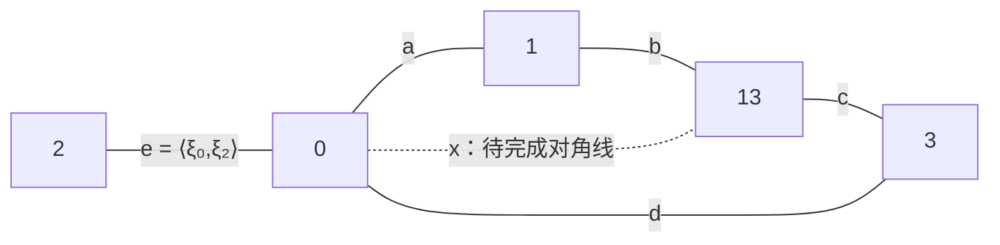

# 相容预测波与关系谱：AURIC FIB ATOM 的条件表示

波在这里指指定模式或观察接口上的可复合振幅及其接续关系。保留不同预测的全部交叉关系，并要求接续无损保持这些关系，给出 Hilbert 空间中的等距；有限维闭合或满射时得到酉相位演化，重合读出产生干涉。谱清单仍需模态嵌入、初态和读出，才能决定波形。

本文采用第一变量共轭线性、第二变量线性的内积。所有模型、效果、参考和控制都有明确的类型与供应条件。正文是普通数学论证；条件表示不等于自然界唯一性的经验结论。项目原始供应版本固定为 `d5e7fbecb49c0e928696f6857b331b3dbd54d128`，相关完整伴篇的供应版本固定为 `ee1728e4f0c42ea4017a6ba12e2abb63210248f3`；引用的具体数学用途在相应证明内说明。

## 1. 先确定“谱”“波”与“相融”分别是什么

“相融的预测得到的谱实际上就是波”可以成为严肃的研究纲领。
最有力量的部分，是把波看成预测之间能够持续接续的关系结构，
而不仅是一个额外附着在粒子上的形状。
要将它变成定理，必须说明哪些关系被保存、什么操作能读取它们。

**定义 1.1（五模式与本稿的命名）。**
取三位置路径的无相邻占据模式

$$
\Sigma=(0,1,2,3,13)=(000,100,010,001,101).
$$

它们对应项目的

$$
(F[\mathrm{null}],F[1],F[2],F[3],F[1,3])
=(N,[2],[3],[5],[2,5]).
$$

下标 $1,2,3$ 指逻辑位置，不把数值标签 $2,3,5$ 当作边长或频率。
三位串按位置 $(1,2,3)$ 排列。
$|0\rangle$ 是范数一的模式向量，不是零向量，也不是停止符。

同一组五标签可以支持不同理论。
概率单纯形、实 Hilbert 模型、复 Hilbert 模型都能用它作结果集。
选择哪个模型，要看额外供应的组合和读出规律。
项目的量子相关卷也明确将复 Hilbert、Born 效果和完全正通道列为模型规则
[static]、[wave]、[second]。

| 对象 | 它记录什么 | 它单独没有记录什么 |
| --- | --- | --- |
| 合法模式谱／计数 | 哪些模式允许、各有多少 | 复振幅、物理时间、门矩阵 |
| Gram 矩阵的谱 | 相干比较核的主轴权重 | 主轴相对结果标签的嵌入 |
| 密度算子谱 | 混合程度及本征权重 | 本征向量、读出方向 |
| Hamiltonian 谱 | 选定时间标定下的能量／频率 | 初态、矩阵元及读出耦合 |
| 功率谱 | Fourier 分量的模平方 | Fourier 相位、一般的完整波形 |

因此，一个 $\lambda$ 表列不能同时替代上述五种不同对象。
本稿把“波”定义为一个在指定模式或观察接口上可复合的振幅场，
及其随接续参数变化的关系；是否能进一步解释成三维空间中的波，
要另给空间嵌入和尺度极限。

**定义 1.2（三种不同的相容）。**
*逻辑相容*指某组限制有共同模型；
*拼接相容*指不同分解方式给出同一操作的相同预测；
*相干相容*还要求不同备选过程的交叉振幅属于同一个正核，
并能在共同参考下比较、重合。
它们均不等同于“全部量子可观测量彼此对易”。

特别地，退相干历史中不同事件之间的交叉项消失，会恢复普通概率加法。
若把“相融”定义成所有交叉项都为零，就恰好删掉了本文要解释的干涉。
本文的相融是共同的表示、比较与拼接规则；它允许可测的非零交叉项。

**命题 1.3（特征值清单不决定波）。**
即使初态与读出固定，两个具有相同特征值的 Hamiltonian
也可以给出不同的时间读出。

证明。
在两维子空间取 $X=\left(\begin{smallmatrix}0&1\\1&0\end{smallmatrix}\right)$、$H_1=\operatorname{diag}(1,-1)$、$H_2=X$，
初态与终端效果都取 $|0\rangle$。
两者谱均为 $\{1,-1\}$，但

$$
|\langle 0|e^{-\mathrm i tH_1}|0\rangle|^2=1,\qquad
|\langle 0|e^{-\mathrm i tH_2}|0\rangle|^2=\cos^2t.
$$

缺少的是谱投影相对制备与读出的方向。
∎

## 2. 相融预测的真正约束：正核与整体一致性

### 从可重合关系到 Hilbert 表示

**定义 2.1（相干预测核）。**
设 $\mathscr P$ 是同一输入输出类型的预测描述集。
给 Hermitian 核
$\mathcal K:\mathscr P\times\mathscr P\to\mathbb C$。
称它强正，若对任意有限描述 $p_1,\ldots,p_m$ 及任意 $c\in\mathbb C^m$，

$$
\boxed{Q(c;p)=\sum_{i,j}\overline c_i c_j\mathcal K(p_i,p_j)\ge0.}
\tag{P}
$$

这里 $c$ 的可操作含义，是在共同参考下对备选预测作相干重组的系数。
只建立形式线性张成，不等于已经实现所有这样的制备。

**定理 2.2（预测核的最小振幅表示）。**
每个强正核都有 Hilbert 表示

$$
\mathcal K(p,q)=\langle v_p,v_q\rangle,\qquad
H=\overline{\operatorname{span}_{\mathbb C}\{v_p:p\in\mathscr P\}}.
$$

该最小表示在保持每个 $v_p$ 标签的酉同构意义下唯一。
对有限描述集，$\dim H$ 等于其 Gram 矩阵的秩。这里是该有限集所生成的最小空间，不是另一个更大描述域的维数。

证明。
在自由复向量空间 $\mathbb C[\mathscr P]$ 上定义

$$
\left\langle\sum_i c_i[p_i],\sum_jd_j[q_j]\right\rangle
=\sum_{ij}\overline c_i d_j\mathcal K(p_i,q_j).
$$

正性给半内积。对任意 $u,v$，
$\left\lVert u+zv\right\rVert^2\ge0$ 的二次式给 Cauchy--Schwarz 不等式；
故零范数向量与全部向量正交，零空间 $\mathcal N$ 为线性子空间。
商去 $\mathcal N$ 再完备化，令 $v_p=[p]+\mathcal N$ 即得。
任意另一最小表示把有限和映到相同标签的有限和，内积相同；
零关系保持，所以它下降为稠密子空间的等距，并延拓成满酉。
有限时商掉 Gram 零空间，维数即为矩阵秩。
∎

此证明使用 [recursive] §2、[quantum] §6 的同一零关系商接口及正核／GNS 标准构造，
不是由五点外形新创的 Hilbert 定理。
历史方法中从强正 decoherence functional 作同类构造，
可见 Dowker--Johnston--Sorkin 的原文 [djs]。
关键输入是整个 $\mathcal K$，不能只给对角线后宣称内积已经被推导。

**命题 2.2a（有限容量与无限维边界）。** 对任意描述集，所有有限 Gram 矩阵的秩都不超过有限整数 $d$，当且仅当最小表示的维数不超过 $d$。无界的有限 Gram 秩排除任何有限维、保留全部组合权重的线性摘要，但不决定任意无限 Hilbert 空间的基数维数。

证明。若 $H$ 至多 $d$ 维，任意有限组向量的 Gram 秩当然至多 $d$。反向，若生成向量的线性张成超过 $d$ 维，就能从其中选出 $d+1$ 个线性无关的生成向量，产生正定的 $(d+1)$ 阶 Gram 矩阵，矛盾。有限维子空间已经完备，所以闭包也不增维。保留全部组合权重的线性摘要经四相位极化保留内积，故必是等距，不能降低有限 Gram 秩。另一方面，对每个无限集合 $I$，取描述集为 $\ell^2(I)$ 的标准正交基；其有限 Gram 秩均无界，而 Hilbert 维数为 $|I|$。这些同样的“有限秩无上界”读数不能区分不同无限基数。只有另加可数稠密生成等条件，才可进一步得可分性。∎

**命题 2.3（同权重可以有完全不同的相干）。**
令 $p_i>0$ 且 $\sum_i p_i=1$。
矩阵

$$
G_{\rm cl}=\operatorname{diag}(p_i),\qquad
G_{\rm coh}=aa^\dagger,\quad a_i=\sqrt{p_i}e^{\mathrm i\theta_i}
$$

都有相同对角线，且均为正半定。
前者秩为 $m$，后者秩为一；一般相干重组权重不同。

证明。
两矩阵的对角元均为 $p_i$。
第一矩阵对角正定，第二矩阵是非零向量外积。
对任意 $c$，其二次型分别是
$\sum_i p_i|c_i|^2$ 与 $|a^\dagger c|^2$；
第二式包含第一式没有的交叉项。
∎

固定正交结果的概率没有指定这些结果在某个其他比较接口下的相干。
矩阵正核也不自动宣布其每一对索引是同一个测量中的互斥结果。
描述集、重合接口和实际结果标签必须保持类型区别。

**命题 2.4（交叉关系的四相位恢复）。**
对共同 Hilbert 表示中的 $u,v$，若四种重组可执行，则

$$
\langle u,v\rangle
=\frac{Q(u+v)-Q(u-v)}4
-\frac{\mathrm i}{4}\bigl(Q(u+\mathrm i v)-Q(u-\mathrm i v)\bigr).
$$

其中 $Q(w)=\left\lVert w\right\rVert^2$，内积对第二变量线性。

证明。
前一差为 $4\Re\langle u,v\rangle$，
后一差为 $-4\Im\langle u,v\rangle$，代入即得。
∎
这是“边上有隐含信息”的可实验版本：比较两种预测时，
除了各自的强度，还需取得两种正交相位的响应。
若参考相位或重组控制不存在，就不能把这个反演当作现成能力。

### 两两可行不保证整体可行

**定理 2.5（三个预测的闭合限制）。**
使用 [second] §68 的共同 Gram 判据，三个归一化预测向量的候选 Gram 矩阵写为

$$
G=\begin{pmatrix}
1&a&b\\ \overline a&1&c\\ \overline b&\overline c&1
\end{pmatrix}.
$$

它可实现为共同 Hilbert 空间中的三个单位向量，当且仅当

$$
|a|,|b|,|c|\le1,\qquad
1-|a|^2-|b|^2-|c|^2+2\Re(ac\overline b)\ge0.
\tag{2.1}
$$

若三向量属于二维复空间，则还必须有 $\det G=0$。

证明。
存在表示等价于 $G\ge0$。
三阶 Hermitian 矩阵正半定等价于所有主子式非负；
一阶子式为一，二阶分别为 $1-|a|^2,1-|b|^2,1-|c|^2$。
展开三阶行列式得到式 (2.1)。
二维表示使秩不超过二，故行列式为零。
反之主子式条件使 $G\ge0$，定理 2.2 给表示；
若行列式为零，最小表示的维数不超过二。
∎

**例 2.6（局部全对而整体冲突）。**
取 $a=b=c=-3/4$。每个二阶块均正定，
但向量 $(1,1,1)^T$ 对应特征值 $-1/2$，
故三者没有共同正核实现。
“每对都猜得通”仍可在三者合并时失败。

量 $ac\overline b$ 在三个向量各自重相位时不变。
它给三预测的关系相位，而不属于任何一个单点。
当三种非零重叠模长与秩二条件给定时，式 (2.1) 的等号会约束这个相位的余弦；
一般仍有共轭取向等剩余选择。
若三个预测向量真正两两正交，则 $a=b=c=0$，
并没有一个非零三角相位被“锁定”。
几何三正交轴、三个互斥结果和三个不对易读出不能互相替换。

### 为什么“存在新增为正”还不是强正性

**定义 2.7（有限历史权重与参考复合）。**
令 $D=D^\dagger$ 为有限历史标签上的矩阵，归一化为
$\mathbf1^\dagger D\mathbf1=1$。
事件 $A$ 的权重定义为

$$
\mu_D(A)=\sum_{i,j\in A}D_{ij}.
$$

弱正性只要求全部 $\mu_D(A)\ge0$。
独立参考的复合规则若给为张量积，则联合事件 $E$ 的权重使用 $D\otimes R$。
未退相干事件的 $\mu_D(A)$ 不是一组共同测量中各互斥结果的普通概率；
其值也不要求对每个任意事件都不超过一。

**定理 2.8（完整相位参考把事件正性提升为强正性）。**
设 $D=D^\dagger\in M_m(\mathbb C)$。如果对每个向量
$z\in\mathbb C^{m+1}$、$\sum_\alpha z_\alpha=1$，
都允许与归一化秩一参考 $R=zz^\dagger$ 复合，
并要求每个联合事件的权重非负，那么 $D\ge0$。
反之若 $D\ge0$，与任意正半定参考复合都满足这一非负条件。

证明。
任取 $c\in\mathbb C^m$，置

$$
z=(\overline c_1,\ldots,\overline c_m,
           1-\sum_{i=1}^m\overline c_i).
$$

取联合事件 $E=\{(i,i):1\le i\le m\}$，则

$$
\mu_{D\otimes R}(E)
=\sum_{ij}D_{ij}z_i\overline z_j=c^\dagger Dc\ge0.
$$

这对全部 $c$ 成立，正是 $D\ge0$。
反向由张量积保持正半定，且事件权重是其在指示向量上的二次型。
∎

额外标签用于保证参考的总历史权重归一化。
本定理供应的是全部这类相位参考和联合事件测试；
它不把它们当作从一个裸五点图自动得到的操作。
这一有限证明说明，正性最有力量的来源是*与其他预测共同使用时仍然非负*。

**命题 2.9（只要求任意次自我复合仍不足）。**
弱正、归一化及任意张量幂的事件非负，不蕴含 $D\ge0$。

证明。
取

$$
D=\frac16\begin{pmatrix}1&2\\2&1\end{pmatrix}.
$$

全部元素非负，总和为一，故全部事件权重非负，
任意张量幂也保留这两项性质。
但特征值为 $1/2,-1/6$，不是正半定。
∎

Dowker--Wilkes 关于复合与强正性的工作提供了更一般的背景 [dw]；
其 Theorem 3 要求弱正系统类同时张量闭合且 Galois 自对偶，才唯一得到强正系统类；Theorem 4 单靠张量闭合只得该类包含于强正类，或包含于元素非负实值类。这里的“或”不排除两者相交。Galois 对偶指与该类每个成员张量复合仍弱正的系统全体。
不能将它缩成“递归可重复，所以强正性自动成立”。

**定理 2.10（一个相位种子的递归复合足以测试强正性）。**
固定两历史参考

$$
z=\frac{(1,\mathrm i)^T}{\sqrt2},\qquad R=zz^\dagger.
$$

对任意有限 Hermitian 矩阵 $D\in M_k(\mathbb C)$，下列条件等价：

$$
D\ge0
\quad\Longleftrightarrow\quad
\mathbf1_E^\dagger(D\otimes R^{\otimes m})\mathbf1_E\ge0
\quad\text{对所有 }m\ge0,\quad
E\subseteq\{1,\ldots,k\}\times\{0,1\}^m .
\tag{2.2}
$$

参考满足 $\operatorname{tr} R=1$ 和 $\mathbf1^\dagger R\mathbf1=1$。

证明。
若 $D\ge0$，张量积正性立即给右侧。
反向写 $z^{\otimes m}$ 的路径分量为
$2^{-m/2}\mathrm i^{|a|}$，其中 $|a|$ 为二进制串中一的个数。
当 $m=3$，四种相位 $1,\mathrm i,-1,-\mathrm i$ 的数量分别为 $(1,3,3,1)$。
若第 $m$ 级各类数目为 $n_r(m)$，则
$n_r(m+1)=n_r(m)+n_{r-1}(m)$，下标模四；
故四类的最少数量至少为 $2^{m-3}$，可以任意增大。

任给 Gaussian 整数向量 $d\in\mathbb Z[\mathrm i]^k$，
对足够大的 $m$，可选互不相交的参考历史子集 $A_i$，
按实部、虚部的正负分别取对应相位，使

$$
\sum_{a\in A_i}(z^{\otimes m})_a
       =2^{-m/2}\overline d_i.
$$

取 $E=\bigcup_i\{i\}\times A_i$，右侧假设便给
$2^{-m}d^\dagger Dd\ge0$。
先用齐次性扩到 Gaussian 有理向量，
再用有限二次型的连续性和其稠密性扩到全部 $c\in\mathbb C^k$，
得到 $c^\dagger Dc\ge0$。
最后两种归一化分别由 $\left\lVert z\right\rVert^2=1$、
$|\sum_i z_i|^2=1$ 得到。
∎

这使“相融、递归”的直觉得到进一步推进：
不一定要预置无限多种相位参考，
一个已经校准的四分之一相位种子，配合任意次数的独立复合与共同事件非负，
就能要求整个核强正。
但这里有三个不能省去的条件：
种子相位、张量独立复合以及历史振幅的相干合并。
若各路径已经留下不能重合的正交记录，
对事件粗粒化只会加概率，而不会产生证明中的复数子集和。

该种子可放在 AURIC 的任意两个已支持相干制备的模式中，
例如 $0$ 和 $13$。
定理在两模式已经成立，所以它不证明五模式是所有量子理论的绝对最小单元。量词中的参考深度 $m$ 任意大：每次测试只用有限载体，但并没有一个事先固定的有限联合载体覆盖全部 $m$。高斯有理近似依赖被测试的负方向和误差裕量；上述等价是精确的全域判据，不是有限样本、有限精度下的取得算法。
它也不等价于“能复制一个普通两维密度矩阵，就能直接测得式 (2.2) 的全部历史权重”；
物理实现这些联合事件需要另外的干涉合同。

**推论 2.11（相位种子的普通状态测试版本）。**
另取迹一 Hermitian 候选状态 $D\in M_k(\mathbb C)$；
这里的归一化是 $\operatorname{tr} D=1$，不沿用历史总和归一化。
若供应任意 $R^{\otimes m}$ 和每个非空集合 $E$ 对应的联合投影

$$
F_E=|u_E\rangle\langle u_E|,\qquad
|u_E\rangle=|E|^{-1/2}\sum_{a\in E}|a\rangle,
$$

则全部测试读数
$\operatorname{tr}[(D\otimes R^{\otimes m})F_E]\ge0$
当且仅当 $D\ge0$。

证明。
读数恰为式 (2.2) 左侧联合二次型除以正数 $|E|$，
故符号不变，应用定理 2.10。
∎
若换成普通基测量粗粒化
$P_E=\sum_{a\in E}|a\rangle\langle a|$，读数只有对角项，结论不成立。
$F_E$ 则需要对集合内标签作共同相干比较；
一些 $u_E$ 在系统与参考的划分上还是纠缠向量。
这精确指出该桥梁使用了什么联合操作资源。

## 3. 两分量预测为何可以迫使复数乘法

上一节直接写复核，留下了“为什么是复数”的问题。
本节给一条更接近正交读出直觉的局部路线：
先给一个实二维的校准平面，考察其权重与串联规律。
两个实分量、欧氏正交和可用的组合是本节的输入，
不是先前五个标签已经证明的结论。

**定义 3.1（局部预测平面的操作条件）。**
令 $A$ 为二维实内积空间，给单位向量 $1$。
允许备选振幅作向量加法，并给强度 $W:A\to[0,\infty)$，要求：

1.  $W(0)=0,\ W(1)=1$，且 $W$ 在平面旋转下不变；

1.  若 $a\perp b$，则 $W(a+b)=W(a)+W(b)$；

1.  串联为双线性运算 $a\cdot b$，$1$ 是双侧单位；

1.  对所有 $a,b\in A$，
      $W(a\cdot b)=W(a)W(b)$。

第三条表达串联对备选合并的相容；
第四条是该全域代数模型中指定中间条件的标量串联规律，
不把未读取的多条路径当成独立概率事件。

**定理 3.2（正交可加与旋转相容决定平方权重）。**
定义 3.1 的前两条推出
$W(a)=\left\lVert a\right\rVert^2$。不需要另假设 $W$ 连续或可微。

证明。
旋转不变使 $W(a)=g(\left\lVert a\right\rVert^2)$，其中
$g(s)=W(\sqrt s\,1)$，$s\ge0$。
取长度为 $\sqrt s,\sqrt t$ 的两个正交向量，
得到 $g(s+t)=g(s)+g(t)$。
非负性使 $g$ 单调，归一化使 $g(1)=1$。
可加性先给非负有理数 $r$ 上 $g(r)=r$；
用递增、递减的有理数夹住任意实数 $s\ge0$，得到 $g(s)=s$。
∎

这里真正有内容的正性是全部校准输入的非负权重。
“新增记录数大于等于零”只约束整数计数，并不供应本定理的正交可加律。
同样，正交的两种*校准分量*不自动是两次可同时无扰动读取的物理结果。

**定理 3.3（二维正乘法唯一成为复乘法）。**
定义 3.1 的全部条件下，
存在与 $1$ 正交的单位向量 $u$，使

$$
u^2=-1,\qquad
(x+yu)(s+tu)=(xs-yt)+(xt+ys)u.
$$

因此 $A$ 作为带乘法及强度的实空间与 $\mathbb C$ 同构，
而 $W(x+yu)=|x+\mathrm i y|^2$。
反向定向选择 $-u$ 给复共轭约定。

证明。
在正交基 $(1,u)$ 中写 $u^2=a+bu$，$a,b\in\mathbb R$。
由上一条定理和乘性，对所有 $t\in\mathbb R$，

$$
W((t+u)u)=a^2+(t+b)^2=W(t+u)W(u)=t^2+1.
$$

比较系数得 $b=0,\ a^2=1$。
若 $a=1$，则双线性与双侧单位给
$(1+u)(1-u)=0$，但两因子的强度均为二，
与乘性要求 $0=4$ 矛盾。因此 $a=-1$。
再将一般乘积双线性展开，便得到复数乘法。
这个结果还证明该乘法结合、交换；
在此二维情形无需先把结合律另当公理。
∎

这个定理给出一个明确理由：
若每条局部预测需要两个正交实分量，强度不依赖平面方向，
且串联与备选合并能共同成立，那么虚单位的平方被迫为负一。
它比“画出了平面，因此自然是量子复平面”更精确。
几何平面本身没有规定双线性串联和强度乘性，必须补证这些接口。

Goyal--Knuth--Skilling 的操作重建同样以实数对及串并联一致性研究复振幅
[gks]。本文采用另一个全域有限充分条件及自含证明，
不声称复述了该论文全部公理的等价最小形式。
若只给一个实分量，实数仍满足对应条件；
若不固定维数，本文的二维证明不能排除其他代数。

**推论 3.4（备选相加与串联相乘的地位）。**
在上述接口中，复加法描述可相干重合的备选，
复乘法描述指定中间条件的串联。
这两种运算由任务组合方式选择，不是五标签数值之间任意运算的穷尽表。

证明。
备选的表示按定义为平面向量加法；
串联的表示由定理 3.3 恰为复乘法。
其他几何或数值任务可另有其他运算，定理没有量化到那些任务。
∎

**定理 3.5（完整正交读出给出的 Born 数值形式）。**
若 $d$ 个结果端口彼此正交，每个端口的振幅为
$a_s\in A\simeq\mathbb C$，且 $\sum_s|a_s|^2>0$，总强度按正交端口相加，
则归一化结果权重为

$$
p_s=\frac{|a_s|^2}{\sum_r|a_r|^2}.
$$

对归一化 $\psi\in\mathbb C^d$，在任意实际供应的正交基 $(e_s)$ 中，
$p_s=|\langle e_s,\psi\rangle|^2$。

证明。
每个端口的强度由定理 3.2 为 $|a_s|^2$。
用非零总强度归一化即得第一式；
取 $a_s=\langle e_s,\psi\rangle$，Parseval 恒等式使总强度为一。
∎

这是数值形式的条件推导。把强度解释为重复记录的发生概率，
仍需要实际制备、读出与频率的标定合同。
它也不宣布任意正交基或任意 POVM 都已可实现。
既有条件表示的全效果版本属于 Busch 型定理 [busch]；
该版本需要全效果赋值域及非情境合并一致性。

## 4. 递归什么时候必然表现为相位波

### 有限闭合预测的主定理

**定义 4.1（平稳相干递归）。**
给强正核 $(\mathscr P,\mathcal K)$ 与接续 $r:\mathscr P\to\mathscr P$，
要求每对预测满足

$$
\mathcal K(rp,rq)=\mathcal K(p,q).
\tag{R}
$$

称式 (R) 为交叉关系守恒。
它远强于只检查 $\mathcal K(rp,rp)=\mathcal K(p,p)$。

**定理 4.2（相容递归的离散波表示）。**
在定义 4.1 下，沿 [recursive] §2 与 [quantum] §6 的保核下降接口，接续唯一诱导一个等距
$U:H\to H$，满足 $Uv_p=v_{rp}$。
如果 $H$ 有限维，或接续像的线性张成稠密，则 $U$ 为酉。
有限维时存在两两正交谱投影 $P_j$ 和相位 $\theta_j$，使

$$
U=\sum_j e^{-\mathrm i\theta_j}P_j,\qquad
U^n\psi=\sum_j e^{-\mathrm i n\theta_j}P_j\psi.
\tag{4.1}
$$

对固定读出向量 $e_s$，

$$
a_s(n)=\sum_j e^{-\mathrm i n\theta_j}
              \langle e_s,P_j\psi\rangle
$$

就是由该递归产生的预测振幅波。

证明。
先在自由有限和上令 $[p]\mapsto[rp]$ 并线性延拓。
式 (R) 使每个有限组合的范数保持，因此零关系保持，
该映射下降到定理 2.2 的商并连续延拓为等距。
有限维等距单射必满射；一般情形若像稠密，
又因等距像闭，则仍满射。
有限维酉矩阵由谱定理正交对角化，本征值模为一，
给式 (4.1) 及其指定坐标。
∎

这个结论没有先要求空间中存在连续正弦曲线。
离散的递归层数 $n$ 已足以产生相位因子和相互抵消。
连续画出的波形可以是其插值表示，但插值本身仍有选择。

**命题 4.3（单独保留每个预测的权重不够）。**
存在对两个生成描述各自保范数的接续，却不能下降为共同空间上的等距。

证明。
取两正交单位向量 $v_1,v_2$，把二者都送到同一个单位向量 $w$。
每个生成元范数均保持，但 $v_1-v_2$ 的平方范数从二变成零，
而 $v_1+v_2$ 的平方范数从二变成四。
缺失的约束是交叉内积。
∎

**定理 4.4（一般有限递归可以变成保范数波的判据）。**
对复矩阵 $T$，存在正定 Hermitian 度量 $G$ 满足
$T^\dagger GT=G$，当且仅当 $T$ 可对角化且全部特征值模为一。

证明。
若存在 $G$，则 $S=G^{1/2}TG^{-1/2}$ 满足 $S^\dagger S=I$，
所以 $S$ 酉并可正交对角化，$T$ 与它相似。
反向若 $T=V\Lambda V^{-1}$ 且 $\Lambda^\dagger\Lambda=I$，
取 $G=(V^{-1})^\dagger V^{-1}>0$，直接相乘得所需恒等式。
∎

因此“具有递归”与“具有保相位的波”之间有明确代数边界。
增长、衰减或非平凡 Jordan 块一般不会满足这个判据。
另一方面，满足判据也不独属于量子系统；
经典周期置换的 Koopman 表示同样可以是酉。

### 一个预测自身的关系谱

**定理 4.5（有限秩平稳相关的正谱分解）。**
设 $U$ 为有限维酉，$\left\lVert \psi\right\rVert=1$，
令 $c(n)=\langle\psi,U^n\psi\rangle$，$n\in\mathbb Z$。
则

$$
c(n)=\sum_{j=1}^r w_j e^{-\mathrm i n\theta_j},
\qquad w_j>0,\quad \sum_jw_j=1,
\tag{4.2}
$$

不同 $\theta_j$ 按模 $2\pi$ 合并，只保留有非零权重的项。
反之任何这样的有限正谱和都给一个强正平稳核
$\mathcal K(m,n)=c(n-m)$。
其最小空间维数恰为 $r$。

证明。
取 $w_j=\left\lVert P_j\psi\right\rVert^2$ 并删除零项，谱展开给第一式。
反向在 $\mathbb C^r$ 取
$\psi=(\sqrt{w_j})$、$U=\operatorname{diag}(e^{-\mathrm i\theta_j})$，
则 $\mathcal K(m,n)=\langle U^m\psi,U^n\psi\rangle$，故强正。
不同特征相位的 Vandermonde 矩阵可逆，
所以 $\psi,U\psi,\ldots,U^{r-1}\psi$ 张成全部 $r$ 个方向，
由最小表示的秩结论即得。
∎

式 (4.2) 的权重是*指定循环向量的谱权重*，
不是不经标定便自动等于五个模式的点击概率。
完整相关核决定这一个循环系统到酉等价，
但没有给出实验中每个结果端口的位置。

**推论 4.6（有限预测波的精确递归阶数）。**
设式 (4.2) 中 $z_j=e^{-\mathrm i\theta_j}$ 互异，
$p(z)=\prod_{j=1}^r(z-z_j)=\sum_{k=0}^r b_kz^k$。
则

$$
\sum_{k=0}^r b_k c(n+k)=0\quad(n\in\mathbb Z).
$$

在全部 $w_j>0$ 时，不存在次数小于 $r$ 的非零多项式给出同样恒等式。

证明。
将谱和代入，内层为 $p(z_j)=0$。
若更低次数多项式也成立，指数序列 $z_j^n$ 的线性独立性
使该多项式在每个 $z_j$ 上为零，不可能。
∎

这为“递归结构决定波”提供有限的精确形式：
递归系数决定允许的相位根，初始条件决定谱权重和相位组合。
但从若干有限、带误差的样本估计这些对象，
还需要可识别性、阶数上界和稳定性分析。

**命题 4.7（概率波动与量子相干不是同一个判据）。**
有复特征值、周期或正相关核，均不足以区分量子与经典模型。

证明。
三个经典状态的确定循环置换有谱
$1,e^{2\pi\mathrm i/3},e^{-2\pi\mathrm i/3}$，其状态仍是三点概率分布。
对任意经典平方可积随机变量族 $X_p$，核
$\mathcal K(p,q)=\mathbb E(\overline X_pX_q)$ 也强正，
因为其二次型是 $\mathbb E|\sum c_pX_p|^2$。
这些性质没有供应物理相干重组、非交换测量和复合量子操作。
∎

### 向前增长、连续时间与能量零点

**命题 4.8（单侧无限递归只先给等距）。**
在 $\ell^2(\mathbb N)$ 上的移位 $Se_n=e_{n+1}$ 保持全部内积，
但不是满射。它可以嵌入 $\ell^2(\mathbb Z)$ 的双侧酉移位。
因此不应由“只向前增加一个记录”直接推出当前载体上已有可逆时间群。

证明。
基向量的内积保持，而 $e_0$ 不在 $S$ 的像中。
在双侧整数基上令 $Ve_n=e_{n+1}$，逆为 $V^{-1}e_n=e_{n-1}$；
限制到非负整数生成的子空间即恢复单侧移位。
∎

一般等距也有同类最小酉扩张：取其迭代嵌入的直接极限，
将新副本视作旧副本的前驱，使移位取得逆。
这个构造是在更大空间上补足表示；
不能将补出的负层数当成观察者实际已取得的历史。

一般等距的扩张可以明确构造。取副本 $H_n=H$，以 $U:H_n\to H_{n+1}$ 作嵌入，等同 $[x,n]=[Ux,n+1]$。两代表的内积先搬到共同较大层计算，因 $U$ 等距而不依赖该层。商后完备化得到 $\widetilde H$。定义

$$
\widetilde U[x,n]=[Ux,n],\qquad
\widetilde U^{-1}[x,n]=[x,n+1],\qquad Jx=[x,0].
$$

这些定义保持等价关系、保内积且互逆，因此给酉；并且 $\widetilde UJ=JU$。各 $[H,n]=\widetilde U^{-n}JH$ 的并稠密，给最小扩张。扩张载体与已获得记录仍是不同对象。

**定理 4.9（可微时间标定给 Schrödinger 形式）。**
固定 $\hbar>0$。在有限维 Hilbert 空间上，若已供应可微一参数酉群 $U(t)$，
则存在唯一 Hermitian $H$ 使
$U(t)=e^{-\mathrm i tH/\hbar}$，
且 $\mathrm i\hbar\,\dot\psi=H\psi$。
反之任意 Hermitian $H$ 定义这种群。
单个离散酉 $U$ 不唯一决定 $H$。

证明。
令 $A=U'(0)$。对 $U(t)^\dagger U(t)=I$ 求导得
$A^\dagger=-A$；群律给 $U'(t)=AU(t)$。
取 $H=\mathrm i\hbar A$，常系数微分方程给所述指数。
反向直接求导验证。
固定采样间隔 $\Delta t>0$。若 $U=\sum_j e^{-\mathrm i\theta_j}P_j$，任意整数 $k_j$ 给

$$
H=\frac{\hbar}{\Delta t}\sum_j(\theta_j+2\pi k_j)P_j
$$

都满足 $e^{-\mathrm i\Delta tH/\hbar}=U$，所以离散采样无法唯一选定频率分支。
∎

有限维连续一参数酉群也自动可微：其成员彼此对易，
可共同对角化，连续的一维群字符为 $e^{-\mathrm i\omega t}$。
连续时间群是额外标定，尚未由五个离散标签推出。
$\hbar$ 则连接相位速率和能量单位，纯图结构不能给出其数值。

**命题 4.10（读出波通常看到能级差）。**
若 $\psi(t)=\sum_j e^{-\mathrm i E_jt/\hbar}P_j\psi$，
则固定效果 $E$ 的读数为

$$
p_E(t)=\sum_{jk}e^{\mathrm i(E_j-E_k)t/\hbar}
                 \langle P_j\psi,E P_k\psi\rangle.
$$

$H\mapsto H+cI$ 不改变任何这种未受相干控制的系统内读数。

证明。
直接展开 $\langle\psi(t),E\psi(t)\rangle$。
公共能量平移只给所有振幅同一个相位，乘共轭后消失。
∎

若把不同实现路径与外部参考作相干控制，原先的“整体相位”可能成为相对相位；
那是扩大的操作合同，不能在原来的系统内读出中凭空加入。

## 5. 项目五模式上的具体预测波

### 金字塔关系与实际耦合图的区分

五模式金字塔的几何图示与项目实际等待 Hamiltonian 的耦合图不是同一张图。
后者由合法单位置翻转给定，按 $(0,1,2,3,13)$ 排列为

$$
K=\begin{pmatrix}
0&1&1&1&0\\
1&0&0&0&1\\
1&0&0&0&0\\
1&0&0&0&1\\
0&1&0&1&0
\end{pmatrix},\qquad U(\tau)=e^{-\mathrm i\tau K}.
\tag{5.1}
$$

这是项目已经供应的动力学，见 [second]、[qmb]。
若另给物理时钟，可写 $H=\hbar\Omega K$、$\tau=\Omega t$；
在 $t\ge0,\ \tau\ge0$ 的等待合同中须取 $\Omega>0$。

合法翻转图的边集为 $\{0\! -\!1,1\! -\!13,13\! -\!3,3\! -\!0,0\! -\!2\}$：一个四环和一条叶边。

它有五条边。把它直接当作欧氏四棱锥的全部棱，
或把它当作已经展开时间层的 DAG，都会改变对象。
相同模式在不同递归层出现时，应使用顶点 $(n,s)$；
时间展开图的边从第 $n$ 层到第 $n+1$ 层，依然可以无有向环。
不同展开路径可以在共同终点干涉，并不要求 DAG 自己含有有向闭环。

[static] §1 的原菜单在同一个 $\mathbb C^5$ 上允许全部复密度输入；控制仅含固定 $K$ 的非负等待、完整秩一 Lüders 仪器 $\mathcal J_s(X)=P_sXP_s$、Stop 和有限记录反馈及输入无关经典随机化。经典合并完整读取结果不等于保留粗块相干的另一种 Lüders 仪器。被动实帧 $D=\operatorname{diag}(1,i,i,i,1)$ 中 $D^\dagger U(\tau)D$ 实正交；这不限制未知输入为实态，也不增加独立相位控制。

**定理 5.1（原子双频谱与暗态：项目结果的复算）。**
令

$$
r=\sqrt{17},\qquad
\omega_\pm=\sqrt{\frac{5\pm r}{2}}.
$$

则

$$
\det(\lambda I-K)=\lambda(\lambda^4-5\lambda^2+2),
\qquad
\operatorname{Spec} K=\{0,\pm\omega_+,\pm\omega_-\}.
$$

零模为
$d=(|1\rangle-|3\rangle)/\sqrt2$。

证明。
将二部顺序改为 $(0,13)\mid(1,2,3)$，则

$$
K=\begin{pmatrix}0&B\\B^\dagger&0\end{pmatrix},\qquad
B=\begin{pmatrix}1&1&1\\1&0&1\end{pmatrix},\qquad
BB^\dagger=\begin{pmatrix}3&2\\2&2\end{pmatrix}.
$$

后一个矩阵的迹为五、行列式为二，
故其两个正特征值是 $\omega_\pm^2$。
$B$ 的每个奇异值给 $K$ 一对正负本征值；
$B$ 秩二，核为右侧的 $(1,0,-1)$ 方向，给唯一零模。
∎

这两种频率、两个实旋转平面及暗线，
已出现在项目《实际等待读出下的近似单份量子边界》定理 4.1 的证明中
[qmb]；亮暗态的直接动力学见《二阶关系完成》定理 63.2
[second]。
这里复算它们是为了连接新问题，而非提出首次发现的主张。

**定理 5.2（从空模式出发的明确波形）。**
设初态为 $|0\rangle$，定义

$$
w_\pm=\frac{1\pm1/\sqrt{17}}2.
$$

返回振幅和对角模式振幅分别为

$$
\begin{aligned}
c_0(\tau)&=\langle 0|U(\tau)|0\rangle
   =w_+\cos(\omega_+\tau)+w_-\cos(\omega_-\tau),\\
a_{13}(\tau)&=\langle 13|U(\tau)|0\rangle
   =\frac2{\sqrt{17}}
      \bigl[\cos(\omega_+\tau)-\cos(\omega_-\tau)\bigr].
\end{aligned}
\tag{5.2}
$$

该初态的循环子空间恰为四维。

证明。
令 $Q=BB^\dagger$。
矩阵指数的偶次项给左上块 $\cos(\tau\sqrt Q)$。
其两个谱投影为

$$
P_+=\frac{Q-\omega_-^2I}{\sqrt{17}},\qquad P_-=I-P_+.
$$

取 $(0,0)$ 与 $(13,0)$ 项即得式 (5.2)。
暗态与 $|0\rangle$ 正交；
四个非零频率的谱权重分别为 $w_+/2,w_+/2,w_-/2,w_-/2$，
全部严格为正，因此循环空间维数为四。
∎

五个合法结果不意味着每个初态都激发五个可见频率。
零模在这个初态中没有权重，不能把它缺席解读为该模式不存在。
而 $p_0(\tau)=|c_0(\tau)|^2$ 的振荡包含
$2\omega_+,2\omega_-,\omega_++\omega_-,\omega_+-\omega_-$ 等频差。
项目另一个加权读出算子的谱也不是 $K$ 的谱，尽管都来自同一原子。

这里的四维是连续时间族 $\{U(\tau)|0\rangle:\tau\in\mathbb R\}$ 的循环维数。四个不同能量 $\pm\omega_\pm$ 的投影均非零；四个投影向量是正交的。对连续指数求前四阶导数所得 Vandermonde 矩阵可逆，因而这四个投影都在循环张成中。若固定间隔 $\Delta\tau$ 采样，则相位 $e^{\mp i\omega_\pm\Delta\tau}$ 可能重合，样本相关的最小递归阶数只等于合并后的不同相位数。例如 $\Delta\tau=\pi/\omega_+$ 时，$+\omega_+$ 与 $-\omega_+$ 的相位都为 $-1$，不再给四阶。连续循环秩四不意味着每个采样酉都有循环秩四。

**推论 5.3（有限相融原子不必定格，也不必严格周期）。**
从 $|0\rangle$ 出发，任意 $\tau>0$ 都没有精确返回原射线；
但存在趋于无穷的一列时刻使态任意接近初态。

证明。
因为

$$
\frac{\omega_+^2}{\omega_-^2}
=\frac{21+5\sqrt{17}}4
$$

无理，$\alpha=\omega_+/\omega_-$ 也无理。
若返回同一射线，返回概率必须为一。
式 (5.2) 是两个余弦的严格正凸组合，
其绝对值为一只能是两个余弦同时为一，或同时为负一。
对 $\tau>0$，这使两频率之比为两个非零整数之比，矛盾。

对近似返回，在 $0,\alpha,\ldots,N\alpha$ 的小数部分中用抽屉原理，
可得 $1\le n\le N$ 使 $n\alpha$ 距某整数至多 $1/N$。
沿 $N\to\infty$ 可选无界子列，否则无理数有某固定非零整数倍恰为整数。
取 $\tau_n=2\pi n/\omega_-$，
四个有权频率的相位都趋于一，故 $U(\tau_n)|0\rangle\to|0\rangle$。
∎

因此两面镜子的比喻应区分：逻辑闭合、有限分辨率不可区分、
振幅递归回归，以及真实耗散收敛。
本例的精确递归保持相干，产生准周期波；它没有要求最后停住。

### 从底面的两条路到唯一闭路相位

**定义 5.4（边连接与顶点坐标）。**
在同一图上给 Hermitian 边耦合
$H_{ab}=w_{ab}e^{\mathrm i A_{ab}}$，
$w_{ab}>0,\ A_{ba}=-A_{ab}$。
被动坐标变换为

$$
\psi'=D_\chi\psi,\quad H'=D_\chi HD_\chi^\dagger,
\quad E'=D_\chi ED_\chi^\dagger,\quad
D_\chi=\operatorname{diag}(e^{\mathrm i\chi_a}).
$$

于是 $A'_{ab}=A_{ab}+\chi_a-\chi_b$。

**定理 5.5（闭路保留的关系信息）。**
有限连通图的非零 Hermitian 边相位在顶点重相位下，
可以消去一棵生成树上的全部相位；
剩下 $|E|-|V|+1$ 个独立环相位。
对五模式翻转图恰有一个，可取

$$
\varphi=\arg\!\left[
H_{13,3}H_{3,0}\,
\overline{H_{13,1}H_{1,0}}\right].
\tag{5.3}
$$

叶边 $0$--$2$ 的相位不提供额外环不变量。

证明。
固定根相位，沿生成树逐个选择子顶点相位，
使每条树边变为正实数。
每条非树边与唯一树路径构成一个基本环，
其相位不能再由保持树规范的顶点变换改变。
沿环乘积中的中间顶点相位两两抵消。
连通图生成树有 $|V|-1$ 条边，故剩余数目如上。
本图五顶点五边，所以只有一个；式 (5.3) 是两条共同端点路径的相对相位。
∎

这里的“关系不可删除”是精确规范命题。
它不要求 $\varphi$ 非零，也没有给出它的数值分布。
所有边取正实数就是合法的 $\varphi=0$ 模型。
若要求存在沿每条边都平行不变的非零标量截面，
则该截面必须被所有环 holonomy 固定；在本图上要求 $e^{\mathrm i\varphi}=1$。
但一般量子态不需要是这种全局平行截面。
非零环相位仍可定义完全正常的 Hermitian Hamiltonian
[wave]。

既有条件表示及项目关系丛接口中的态关系角 [bundle]

$$
\Phi_{\rm state}=\theta_0+\theta_{13}-\theta_1-\theta_3
$$

与式 (5.3) 也不同。
它对整体和单位置相位不变，但不对任意五个顶点的独立重相位不变；
边环相位则是连接的规范不变量。
将二者联系起来，需要另给动力学方程，不能因为都由四角写成便认成同一变量。

与 [tunnel] §5 的失谐族比较时，必须使用同一矩阵对应：该篇 $(13,3)$ 元为 $Je^{-i\phi_{\rm T}}$，这里为 $e^{i\varphi}$，所以在无量纲矩阵中取 $J=g=1$、$\phi_{\rm T}=-\varphi$，并把该篇共同内部失谐置为零。该篇模型声明 $\Delta>0$，故不能直接援引只在正失谐下陈述的估计；零失谐在下面从完整矩阵另算。若使用物理能量矩阵，应取 $J=g=\hbar\Omega$、$\Delta=0$、$\tau=\Omega t$、$\Omega>0$。其奇异值分解机制与下证相同，环取向与参数域已分别声明。[second] §63.3 使用 $\arg(a\overline b)$，这里式 (5.3) 则使用 $\arg(b\overline a)$，两者相差一个负号。

**定理 5.6（单环相位的精确谱与全时间干涉）。**
另允许一个复边耦合模型：保留单位边模长与零对角，
令 $(K_\varphi)_{13,3}=e^{\mathrm i\varphi}$，
其 Hermitian 共轭边为 $e^{-\mathrm i\varphi}$，其余非零边为一。
设

$$
\delta_\varphi=\sqrt{9+8\cos\varphi},\qquad
\nu_\pm=\sqrt{\frac{5\pm\delta_\varphi}{2}}.
$$

则

$$
\det(\lambda I-K_\varphi)
=\lambda\bigl[\lambda^4-5\lambda^2+4-2\cos\varphi\bigr],
\tag{5.4}
$$

$$
\langle 13|e^{-\mathrm i\tau K_\varphi}|0\rangle
=\frac{1+e^{\mathrm i\varphi}}{\delta_\varphi}
   \bigl[\cos(\nu_+\tau)-\cos(\nu_-\tau)\bigr].
\tag{5.5}
$$

特别地，$\varphi=\pi$ 时全部时刻的 $0\to13$ 转移振幅严格为零。

证明。
在二部顺序中有

$$
B_\varphi=
\begin{pmatrix}1&1&1\\1&0&e^{\mathrm i\varphi}\end{pmatrix},
\quad
Q_\varphi=B_\varphi B_\varphi^\dagger
=\begin{pmatrix}3&1+e^{-\mathrm i\varphi}\\1+e^{\mathrm i\varphi}&2\end{pmatrix}.
$$

$Q_\varphi$ 的迹为五，行列式为 $4-2\cos\varphi$，
故特征值为 $\nu_\pm^2$，由奇异值分解得到式 (5.4)。
因 $\delta_\varphi\ge1$，谱投影
$(Q_\varphi-\nu_-^2I)/\delta_\varphi$ 总有定义。
按定理 5.2 的矩阵余弦方法取 $(13,0)$ 项，即得式 (5.5)。
$\varphi=\pi$ 时 $Q_\varphi=\operatorname{diag}(3,2)$，该非对角项恒为零。
∎

全部相位端点也可以从这同一个块证明中读出。$\delta_\varphi\in[1,\sqrt{17}]$、$\det Q_\varphi=4-2\cos\varphi\in[2,6]$，故 $B_\varphi$ 对所有相位均秩二，$\nu_+>\nu_->0$，$K_\varphi$ 始终秩四、零模恰一维，可取

$$
d_\varphi=\frac{-e^{i\varphi}|1\rangle+(e^{i\varphi}-1)|2\rangle+|3\rangle}
{\sqrt{4-2\cos\varphi}}.
$$

直接乘 $B_\varphi$ 得零，范数为一，所以没有遗漏隐藏的秩端点。$|0\rangle$ 的两余弦权重是

$$
w_\pm(\varphi)=\frac{1\pm1/\delta_\varphi}{2}.
$$

$\varphi\not\equiv\pi$ 时两者严格正，连续循环维数为四；$\varphi\equiv\pi$ 时 $w_-=0$，$|0\rangle$ 只激发 $\pm\sqrt3$，循环维数为二，虽然整个 $K_\pi$ 仍秩四。此时暗线为 $(|1\rangle-2|2\rangle+|3\rangle)/\sqrt6$，$|13\rangle$ 的独立频率为 $\sqrt2$，全时不可达是分块正交导致的。$\varphi\equiv0$ 时恢复 $\delta=\sqrt{17}$ 及定理 5.1–5.2；暗线只差一个无意义的整体符号。这里的相位同余均按模 $2\pi$。一般采样仍要合并同相位的谱根，不能用矩阵秩代替采样递归阶数。

因此转移概率为

$$
p_{13}(\tau\mid0)
=\frac{2+2\cos\varphi}{9+8\cos\varphi}
  \bigl[\cos(\nu_+\tau)-\cos(\nu_-\tau)\bigr]^2.
\tag{5.6}
$$

短时展开给
$p_{13}(\tau\mid0)=\tau^4\cos^2(\varphi/2)+O(\tau^6)$，
与项目定理 63.3 的两最短路径公式一致 [second]。
式 (5.4)--(5.6) 是在该文已经允许的复边扩展上作的显式计算；
并不是原菜单不经增添相位控制就能自由扫描的实验。

全消干涉不是删掉了两条路。它表示两条路的相位关系，
使所有路径重求和后的该终端振幅恰好为零。
这正是“边决定对角模式的预测”能够有具体含义的地方：
不是 $F[2]$ 的一个数值自行选出加法或乘法，
而是共同耦合、串联乘积和备选重合一起确定结果。

**命题 5.7（限制基态制备时的环相位取向盲性）。**
对于固定 $\varphi$ 与 $-\varphi$，
基态制备、等待、完整模式 Lüders 读出及经典自适应停止组成的全部协议，
产生相同的记录分布。
但若将这一受限制备域扩为允许固定相位参考的初态
$(|13\rangle+|3\rangle)/\sqrt2$，
则在无量纲时间中

$$
\left.\frac{d}{d\tau}p_{13}(\tau)\right|_{\tau=0}
=\sin\varphi,
$$

一般可以区分两种符号。

证明。
置 $C=\operatorname{diag}(1,-1,-1,-1,1)$。
二部结构给 $CK_\varphi C=-K_\varphi$，
而 $K_{-\varphi}=\overline{K_\varphi}$。
故

$$
U_{-\varphi}(\tau)
=\overline{U_\varphi(-\tau)}
=C\,\overline{U_\varphi(\tau)}\,C.
$$

所有矩阵元模平方相等。
完整读出后的条件态是所读基态；
沿任意同一记录历史，下一等待的条件转移概率相同。
逐层相乘并对经典随机选择求平均，得到全部记录律相同。
对于额外初态，直接用
$\dot p_{13}=2\Im(\overline{\psi_{13}}(K_\varphi\psi)_{13})$，
在零时刻得到 $\sin\varphi$。
∎

所以“关系大致确定”应进一步问：相对于哪个未来操作集合确定？
上述限制基态制备的相位扩展实验无法判断环相位的取向；
允许所列相干制备后，同一个差异就成为可读信息。
这里的限制不能冒充项目全部输入域的限制：
项目原模型的量子输入合同允许一般复密度态，
而整个 $K_\varphi$ 家族本来就是对固定 $K$ 的额外动力学扩展。

## 6. 边是预测时，幅度、相位与隐藏势怎样共同演化

### 图上的连续性与幅相方程

**定理 6.1（有限图上精确的概率流）。**
设 $\mathrm i\hbar\,\dot\psi=H\psi$，$H=H^\dagger$，
$p_a=|\psi_a|^2$。定义

$$
J_{b\to a}=\frac2\hbar
\Im\bigl(\overline{\psi_a}H_{ab}\psi_b\bigr).
$$

则

$$
\dot p_a=\sum_bJ_{b\to a},\qquad
J_{b\to a}=-J_{a\to b},\qquad
\sum_a\dot p_a=0.
\tag{6.1}
$$

在全部有关 $p_a>0$ 的坐标区间，
写 $\psi_a=\sqrt{p_a}e^{-\mathrm i\theta_a}$，
$H_{ab}=w_{ab}e^{\mathrm i A_{ab}}$，$H_{aa}=\epsilon_a$，则

$$
\begin{aligned}
\dot p_a&=\frac2\hbar\sum_{b\ne a}
 w_{ab}\sqrt{p_ap_b}\sin(A_{ab}+\theta_a-\theta_b),\\
\hbar\dot\theta_a&=\epsilon_a+
 \sum_{b\ne a}w_{ab}\sqrt{\frac{p_b}{p_a}}
                 \cos(A_{ab}+\theta_a-\theta_b).
\end{aligned}
\tag{6.2}
$$

证明。
对 $p_a=\overline{\psi_a}\psi_a$ 求导并代入 Schrödinger 方程，
得到第一式。Hermitian 性使对换端点后括号取共轭，虚部变号，
求和即守恒。
再将极坐标代入
$\mathrm i\hbar\,\dot\psi_a/\psi_a$，
分别比较实部与虚部，得到式 (6.2)。
∎

这里采用负指数相位 $\psi_a=\sqrt{p_a}e^{-i\theta_a}$，与 [bundle] 定义 3.4 的约定相同；该篇定理 3.5 的关系角 $\chi=\theta_0-\theta_1-\theta_3+\theta_{13}$ 就是此处的 $\Phi_{\rm state}$，角度均按模 $2\pi$ 理解。该篇命题 10.3 的联合占位相位门 $e^{-i\alpha N_xN_y}$ 只对模式 $13$ 乘以 $e^{-i\alpha}$，故 $\theta_{13}$ 增加 $\alpha$，此处同样有 $\Phi_{\rm state}\mapsto\Phi_{\rm state}+\alpha$，全部概率不变；该门的可用性是另供的操作条件。被动规范下 $\theta'_a=\theta_a-\chi_a$，于是 $A'_{ab}+\theta'_a-\theta'_b=A_{ab}+\theta_a-\theta_b$，概率流不变。态关系角只在所用四个分量全非零的支撑区间内定义；环通量描述连接，两者的类型没有合并。

式 (6.2) 给“稳定可见的占据下面，变化藏在关系上”的精确表达：
只知道所有 $p_a$，仍不一般知道各条边的流。
相位差与连接一起决定下一刻概率怎样变化。
在某些时刻全部概率导数为零，也不保证以后概率不变。
当某个 $p_a=0$ 时，相位坐标失效，原线性方程却仍然正常。

**命题 6.2（对角相位可在概率完全不变时增长）。**
对 $H=\operatorname{diag}(\epsilon_a)$，每个 $p_a(t)$ 恒定，
而 $\theta_a(t)=\theta_a(0)+\epsilon_at/\hbar$。
若随后加入一个实际允许的非对角比较，
这些相位差可以转化为不同的结果概率。

证明。
解为 $\psi_a(t)=e^{-\mathrm i\epsilon_at/\hbar}\psi_a(0)$。
对两非零分量使用效果
$|+\rangle\langle +|$，$|+\rangle=(|a\rangle+|b\rangle)/\sqrt2$，
其概率包含 $\Re(\overline{\psi_a(t)}\psi_b(t))$，
所以依赖相位差。这个效果的可用性是所述后续比较的前提。
∎

**命题 6.3（时间相关的坐标规范改变局域势）。**
若 $\psi'=D_{\chi(t)}\psi$，则相同物理预测的生成元为

$$
H'=D_\chi HD_\chi^\dagger
       -\hbar\operatorname{diag}(\dot\chi_a).
\tag{6.3}
$$

因此单个对角能量的坐标值并非独立于时间相位参考的绝对量。

证明。
对 $\psi'=D_\chi\psi$ 求导：
$\mathrm i\hbar\dot\psi'
=[\mathrm i\hbar\dot D_\chi D_\chi^\dagger+D_\chi HD_\chi^\dagger]\psi'$。
又 $\dot D_\chi D_\chi^\dagger=\mathrm i\operatorname{diag}(\dot\chi_a)$。
∎

这是一条有限维规范协变公式，尚不是电磁场或引力的推导。
只有把具体耦合与实际时空、作用量及测量连接后，
才可讨论它们是否对应已知物理势。

### 隐藏模式被消去时，首先出现的是记忆

**定理 6.4（隐藏叶的精确消元）。**
保留四环为可见部分 $v(t)\in\mathbb C^4$，
把模式 $2$ 写为隐藏振幅 $q(t)\in\mathbb C$。
取 $\hbar=1$，给实耦合 $g$、实隐藏能量 $\epsilon$，
以及 $K_\square=K_\square^\dagger$：

$$
\mathrm i\dot v=K_\square v+g e_0q,\qquad
\mathrm i\dot q=g e_0^\dagger v+\epsilon q.
$$

则可见振幅精确满足

$$
\begin{aligned}
\mathrm i\dot v(t)={}&K_\square v(t)
 +g e_0e^{-\mathrm i\epsilon t}q(0)\\
&-\mathrm i g^2\int_0^t e^{-\mathrm i\epsilon(t-s)}
                     P_0v(s)\,ds,\qquad P_0=e_0e_0^\dagger.
\end{aligned}
\tag{6.4}
$$

对定态能量 $E\ne\epsilon$，相应方程为

$$
\left[K_\square+\frac{g^2}{E-\epsilon}P_0\right]v=Ev.
\tag{6.5}
$$

证明。
对隐藏分量的一阶线性方程用积分因子：

$$
q(t)=e^{-\mathrm i\epsilon t}q(0)
 -\mathrm i g\int_0^t e^{-\mathrm i\epsilon(t-s)}e_0^\dagger v(s)\,ds.
$$

代入可见方程得到式 (6.4)。
定态方程的第二行给
$q=g e_0^\dagger v/(E-\epsilon)$；
代入第一行即得式 (6.5)。
∎

在极点 $E=\epsilon$ 处，不能使用式 (6.5)。必须回到两块原方程：若 $g\ne0$，有 $e_0^\dagger v=0$ 及 $(K_\square-\epsilon I)v+g e_0q=0$，由它们决定是否存在本征态；若 $g=0$，可见系统已经独立，隐藏叶是单独的能量 $\epsilon$ 本征方向。$E$ 接近极点时，自能范数是 $g^2/|E-\epsilon|$；只有给出分母下界，才可使用相应有界估计。初始强迫 $ge_0e^{-i\epsilon t}q(0)$ 与卷积项有不同来源，不能通过删初始叶态同时删掉记忆。式 (6.4) 的连续积分与初始强迫采用 [tunnel] 定理 5.3 的变常数消元步骤，式 (6.5) 的定态自能采用该篇定理 5.2 的 Schur 消元步骤。该篇以两边界／三内部划分写公式；这里按四环／单叶划分取 $x=v,y=q,A=K_\square,B=ge_0,D=\epsilon,\hbar=1$，同样的积分因子及代回计算给出本定理。[recursive] 定理 5.3 直接供应 $\epsilon=0,g\ne0$ 时的四环／单叶积分与初始项，该篇 §4 供应静态匹配与离散驱动记忆接口。两种公式分别是时间域和定态域的同一全矩阵结果。

即使 $q(0)=0$，积分记忆项通常也不消失。
可见四模式的范数可以与隐藏叶交换，不能未经处理便将其当作闭合酉系统。
式 (6.5) 的能量依赖自能与式 (6.4) 的历史记忆，
是“未读关系影响未来”的两种精确形式。
要进一步用一个瞬时、与能量无关的有效势替代它，
需另有尺度分离与误差界。

[sharp] 定理 13.1 的严格作用域是既定等距 $B:\mathbb C^3\to\mathbb C^5$、原始有序字 $Q_h$、全五维实际效果、共同的复线性 CPTP 解码器以及全部复 qutrit 密度输入。它把该篇五个平均任务方程等价于 $\overline\Phi(X)=BXB^\dagger$，并进而得到每个原始正权分支 $\Phi_{h,a}(X)=BXB^\dagger$。最后这步使用秩一 Choi 支撑：

$$
|B\rangle\!\rangle\langle\!\langle B|
 =\sum_{h,a}p_{h,a}J(\Phi_{h,a}),\qquad p_{h,a}=2^{-n}r(a\mid h).
$$

正权项的支撑都只能在右侧这一条线上，且各 CPTP Choi 迹均为三，所以每项的无权 Choi 矩阵恰等于嵌入通道的 Choi 矩阵。有限或可数记录时正项和都按迹范数收敛。这保留的是原始正分支，不能先重分组再换条件概率。解码器因此只在实际角块 $BM_3B^\dagger$ 上满足相应的 $Q_h^\dagger$ 校正；在角块之外以及跨角块相干上的作用没有被分类。该矩形全输出结果是这里关于共同未来的实例供应，不把方形无扰动定理直接套到 $M_3\to M_5$。

这也给内生观察者一条实际原则：
如果以后还可能访问某个记忆、路径参考或环境相关，
它就属于预测边界需要保存的对象。
只保留三个稳定边缘分量，不能一般代表完整未来。
项目矩形通道刚性结果也强调实际全空间操作、
全部输入以及原始正概率分支的重要性 [sharp]；
其结论是在已供应的量子操作模型中成立，并非从遗漏信息自身推出量子论。

## 7. 预测波怎样给出概率与观察者的记录增长

### 相干接续与记录仪器

**定义 7.1（带结果的交叉守恒）。**
给第 $n$ 层强正预测核 $\mathcal K_n$，
一个实际动作的有限结果集 $O$ 及接续 $r_o$，要求

$$
\mathcal K_n(p,q)
=\sum_{o\in O}\mathcal K_{n+1}(r_op,r_oq)
\quad\text{对所有共同合法的 }p,q.
\tag{7.1}
$$

失败、停止也纳入 $O$；不能通过删去它们实现归一化。
本节 $H_n$ 专指本动作共同合法描述域的闭线性张成；
若要把结论用于更大的原空间，须另证明这些描述张成整个原空间。

**定理 7.2（观察的增长是保相干的记录嵌入）。**
式 (7.1) 诱导线性收缩 $M_o:H_n\to H_{n+1}$，且

$$
\sum_oM_o^\dagger M_o=I,\qquad
V\psi=\sum_oM_o\psi\otimes|o\rangle
$$

为等距。对有限维态 $\rho$，

$$
p_o=\operatorname{tr}(M_o\rho M_o^\dagger),\qquad
\rho_o=\frac{M_o\rho M_o^\dagger}{p_o}\quad(p_o>0)
\tag{7.2}
$$

给记录权重与条件后继；
未选择结果时 $\rho\mapsto\sum_oM_o\rho M_o^\dagger$ 完全正且保迹。

证明。
将式 (7.1) 乘以任意 $\overline c_i c_j$ 并求和，得到
$Q_n(v)=\sum_oQ_{n+1}(r_ov)$。
非负性使每个零关系经每支接续仍为零，
所以接续能下降到商空间，且每支范数不增。
极化给 $\sum_oM_o^\dagger M_o=I$，
正交记录内积使 $V^\dagger V=I$。
对任意辅助空间，每项
$(I\otimes M_o)X(I\otimes M_o^\dagger)$ 都保正；
求和为完全正，迹循环和归一恒等式给保迹。
取分支迹并在正迹时归一化，得到式 (7.2)。
∎

这个定理把“预测行为成为观察者自己的增长”落实为一个等距：
新记录不是外部魔法添加，而是总状态接续的一部分。
条件态的归一化含除法，因而对初态一般非线性；
未选择结果的仪器仍然线性。
它不证明主观意识创造结果，也没有仅靠静态关系解释经验中为何呈现唯一记录。
它确定的是所声明记录接口的统计与后继。

同一结果不必只有一个 Kraus 算子。一般仪器的实际分支为

$$
\mathcal J_o(\rho)=\sum_\mu K_{o\mu}\rho K_{o\mu}^\dagger,\qquad
\sum_{o,\mu}K_{o\mu}^\dagger K_{o\mu}=I.
$$

复用 [static] §§6–7 与 [wave] §4 的仪器表示，可以在数学扩张中细化 $(o,\mu)$，令 $\widetilde V\psi=\sum_{o,\mu}K_{o\mu}\psi\otimes|o,\mu\rangle$，同样有 $\widetilde V^\dagger\widetilde V=I$。迹掉不可读的 $\mu$ 恰得原分支；$\mu$ 的数学存在不授予读取权限。正迹时的条件态为 $\mathcal J_o(\rho)/\operatorname{tr}\mathcal J_o(\rho)$，零权分支只有未归一化零态。定理 7.2 的每结果一个 $M_o$ 是保留了纯后继或足够环境的特殊表示，不能将一般混合分支误写成一个系统算子。

在单 Kraus 表示中，记录化后的相干整体为

$$
V\rho V^\dagger=\sum_{o,o'}M_o\rho M_{o'}^\dagger\otimes|o\rangle\langle o'|.
$$

普通选择记录或忽略记录只用对角块；若未来允许相干访问记录，非对角块仍属于共同状态。式 (7.1) 保证总等距所需的同结果交叉守恒，不额外固定不同结果块的全部实现相位。每支改为 $e^{i\gamma_o}M_o$ 保持普通仪器，却改变跨记录块；相干擦除实验必须指定实际的 $V$ 及参考。这与 [quantum] §6、[bundle] §8 的完整未来接口一致。

**定理 7.3（何时可以只加概率）。**
对两个末端预测向量 $u,v$，以下等价：

$$
\left\lVert u+e^{\mathrm i\phi}v\right\rVert^2=\left\lVert u\right\rVert^2+\left\lVert v\right\rVert^2
\quad\text{对所有 }\phi;
\qquad \langle u,v\rangle=0.
$$

只在一个相位上满足概率加法，不足以推出正交。

证明。
交叉项为 $2\Re(e^{\mathrm i\phi}\langle u,v\rangle)$。
它对全部相位消失当且仅当复内积为零。
若内积纯虚，则在 $\phi=0$ 可消失，而在其他相位不必消失。
∎

所以普通概率加法可以看成一个条件结论：
不同预测保留了互相正交、不能在当前接口重合的记录。
若记录后来能够相干重合，必须回到包含它们的振幅描述。
纯粹删掉档案中的路径名称不会完成这种物理重合。

**定理 7.4（可见波与路径记录的精确互补）。**
取等振幅双路径纯态

$$
|\Psi\rangle=
\frac{|L\rangle|m_L\rangle+e^{\mathrm i\phi}|R\rangle|m_R\rangle}{\sqrt2},
\qquad \left\lVert m_L\right\rVert=\left\lVert m_R\right\rVert=1,\quad
\kappa=\langle m_L,m_R\rangle.
$$

只读路径的 $|\pm\rangle=(|L\rangle\pm|R\rangle)/\sqrt2$，有

$$
p_\pm=\frac{1\pm\Re(e^{\mathrm i\phi}\kappa)}2.
$$

其干涉可见度为 $\mathcal V=|\kappa|$；
两纯记录的半迹距离为
$\mathcal D=\sqrt{1-|\kappa|^2}$，故
$\mathcal V^2+\mathcal D^2=1$。

证明。
投影到 $|+\rangle$ 后记录向量为
$(m_L+e^{\mathrm i\phi}m_R)/2$，范数平方给第一式。
相位扫描的极大、极小为 $(1\pm|\kappa|)/2$，
其差除以和给可见度。
在两记录张成的至多二维空间中，
两秩一投影之差迹为零，非零特征值为
$\pm\sqrt{1-|\kappa|^2}$；取半迹范数即得。
∎

这里的量化是等先验、等振幅、纯记录模型的准确结果，
也是项目已经采用的记录重叠机制 [wave]。
一般双路径不等式的经典原始论文为 Englert [englert]。
观察者一旦把路径差异写入可保持的正交记录，局部波纹消失；
整体关系并未因此变为一组互不相关的局部概率。

### 内生观察者不能只保留自己的边缘

**命题 7.5（相同局部知识仍可有不同共同未来）。**
存在两态，使系统和观察者记忆各自的边缘态都完全相同，
但同一个后续共同操作给确定且相反的结果。

证明。
在两个二模系统上取
$|\Phi_\pm\rangle=(|00\rangle\pm|11\rangle)/\sqrt2$。
两侧边缘均为 $I_2/2$。
这里共同空间明确为 $\mathbb C^2\otimes\mathbb C^2$。供应的门为 $\mathrm{CNOT}|a,b\rangle=|a,b\mathbin{\oplus}a\rangle$，以及第一位的 $H_2=\frac1{\sqrt2}\left(\begin{smallmatrix}1&1\\1&-1\end{smallmatrix}\right)$。对两态都先作用 CNOT，再作用 $H_2\otimes I$，
分别得到 $|00\rangle$ 与 $|10\rangle$。
读第一位即可确定区分。
差异存在于共同相干，所有单侧边缘都没有保留它。
∎

这个例子只使用明确供应的两个逻辑位和共同门，
没有宣称任意两个邻接 AURIC 原子都自动有独立张量编码。
在具体系统中，独立复合、接缝约束与实际控制仍须分别检查。
它说明观察者位置的不确定可以与系统存在关系性关联，
但“我不知道自己是什么”本身不等于已经证明纠缠或隧穿。

## 8. 没有外部流动的静态图如何编码波

### 传播约束与历史态

**定义 8.1（有限钟与静态传播约束）。**
给整数 $N\ge0$ 及同一非零有限维 $H$ 上的酉 $U_0,\ldots,U_{N-1}$，
令 $V_0=I,\ V_n=U_{n-1}\cdots U_0$，
并取钟空间 $\mathbb C^{N+1}$。
对 $\Psi=\sum_{n=0}^N|n\rangle\otimes\psi_n$ 定义

$$
L_n\Psi=\psi_{n+1}-U_n\psi_n,\qquad
H_{\rm hist}=\sum_{n=0}^{N-1}L_n^\dagger L_n.
\tag{8.1}
$$

这里 $H_{\rm hist}$ 是传播一致性的非负约束算子，
不预先把它认作系统的物理能量生成元。

**定理 8.2（静态零空间恰好是递归波的历史）。**
定义

$$
W\psi=\frac1{\sqrt{N+1}}\sum_{n=0}^N|n\rangle\otimes V_n\psi.
\tag{8.2}
$$

则 $W^\dagger W=I$，
$\ker H_{\rm hist}=\operatorname{ran}W$。
在 $W\rho W^\dagger$ 上读取钟 $n$ 的概率为 $1/(N+1)$，
对应系统条件态为 $V_n\rho V_n^\dagger$。

证明。
因为钟标签正交、$V_n$ 酉，
$W^\dagger W=(N+1)^{-1}\sum_nV_n^\dagger V_n=I$。
$\langle\Psi,H_{\rm hist}\Psi\rangle=\sum_n\left\lVert \psi_{n+1}-U_n\psi_n\right\rVert^2$，
所以零空间恰为满足 $\psi_{n+1}=U_n\psi_n$ 的序列；
递推得 $\psi_n=V_n\psi_0$，即式 (8.2) 的像。
取第 $n$ 个钟对角块得到
$V_n\rho V_n^\dagger/(N+1)$，取迹并归一化即得条件态。
∎

该证明消费 [static] §7 与 [wave] §3 的 Feynman–Kitaev 历史等距；本处同时明确其整个核／像等式。这是该历史表示的有限形式，
项目《波粒整体》已给相同传播接口；
原始论文例见 Aharonov 等 [wave]、[historypaper]。
静态整体不需要在外部再播放一遍，
内部钟条件之间仍保留原来的有序门积。
因此“没有额外外部时间”与“所有操作没有先后差别”是不同命题。约束谱隙不是受测系统的能隙，也没有给出实际制备零空间的能量、时间或算法成本。

**定理 8.3（历史约束的谱隙随长度缩小）。**
若 $H\ne\{0\}$ 且 $N\ge1$，式 (8.1) 的非零最小本征值为

$$
\gamma_N=2\left(1-\cos\frac{\pi}{N+1}\right).
\tag{8.3}
$$

任意单位向量 $\Psi$ 满足

$$
\left\lVert (I-P_{\rm hist})\Psi\right\rVert^2
\le\frac{\langle\Psi,H_{\rm hist}\Psi\rangle}{\gamma_N},
\tag{8.4}
$$

其中 $P_{\rm hist}$ 是精确历史零空间投影。

证明。
以酉
$\mathcal V=\sum_n|n\rangle\langle n|\otimes V_n$
作共同坐标变换，$\psi_n=V_n\xi_n$，
每项误差变为 $\left\lVert \xi_{n+1}-\xi_n\right\rVert^2$。
故 $H_{\rm hist}$ 酉等价于长度 $N+1$ 的路径图 Laplacian 与 $I_H$ 的张量积。
令 $q=N+1$。其第 $k$ 个钟本征向量可取
$\xi_n^{(k)}=\cos[\pi k(n+1/2)/(N+1)]$，
$k=0,\ldots,N$。
代入内部二阶差分及两端的一阶边界式，
得到本征值 $2[1-\cos(\pi k/(N+1))]$。
最小非零者为式 (8.3)。
谱分解给
$H_{\rm hist}\ge\gamma_N(I-P_{\rm hist})$，
在 $\Psi$ 上取二次型便得式 (8.4)。
∎

当 $N=0$ 时 $H_{\rm hist}=0$，整个载体是历史核，没有非零最小本征值；不能用式 (8.3) 作除数。当 $H=\{0\}$ 时也没有非零谱，且不存在单位历史向量。

这个误差界也提示“任何镜像尺度都达到相同终点”需要额外控制：
$\gamma_N$ 约为 $\pi^2/(N+1)^2$，
更长历史中相同的绝对约束能量不保证相同的整体历史误差。
如果要论证分辨率自适应且跨尺度稳定，
必须给出误差如何随长度缩小的定量规律。
本定理也没有证明求得约束零空间的计算成本很低。

### 路径求和是切面相容，不是每条路已经发生

**定理 8.4（共同切面的振幅拼接）。**
对已供应的线性接续 $U_n$，任意初末模式有

$$
\begin{aligned}
\langle x_N|V_N|x_0\rangle
&=\sum_{x_1,\ldots,x_{N-1}}
\prod_{n=0}^{N-1}\langle x_{n+1}|U_n|x_n\rangle,\\
A_{N:0}(x_N,x_0)
&=\sum_{x_k}A_{N:k}(x_N,x_k)A_{k:0}(x_k,x_0).
\end{aligned}
\tag{8.5}
$$

不同合法切面上的求和给同一最终振幅。

证明。
在有序乘积中插入模式完备关系
$I=\sum_x|x\rangle\langle x|$，逐项展开即得第一式。
按第 $k$ 个中间标签分组，利用矩阵乘法结合律得到第二式。
∎

这种“在不同层从哪里开始都能拼回同一预测”，
是用户尺度相融直觉中可以直接定型的一部分。
它只保证同一有限操作的不同计算分解一致，
不保证每次粗粒化后都能只用较少变量完成后续预测。
若丢掉了以后仍参与干涉的变量，拼接就会改变。
Feynman 的振幅规则提供这一串并联图景的标准来源 [feynman3]。

**命题 8.5（没有操作次序限制的逻辑相容仍不够）。**
一个静态关系模型可以同时容纳 $UV$ 和 $VU$，
而它们未必是同一通道。

证明。
取两维酉 $U=Z=\operatorname{diag}(1,-1)$、$V=H_2=\frac1{\sqrt2}\left(\begin{smallmatrix}1&1\\1&-1\end{smallmatrix}\right)$。
作用于 $|0\rangle$，
$UV|0\rangle=|-\rangle$，
$VU|0\rangle=|+\rangle$，二者可由同一个 $|+\rangle\langle +|$ 效果区分。
把两种有序路径同时画在静态图中，不会使其矩阵积自动相等。
∎

只有当合同明确要求某个交换菱形的两条路径等价，
相应算子才必须满足那个菱形的交换关系。
这与项目静态相容理论的路径运输条件一致 [static]。

## 9. 由谱恢复波：项目中的相位恢复提供了什么启发

项目《金字塔基础公式》§16 对其指定的轮筛信号，
已经明确区分功率谱、三点相关和绝对原点 [foundation]。
其数学接口在这里的作用是：
单点强度遗漏的关系，可以通过共同比较约束回来；
但这些关系必须真的被提供，而不能由“有一个谱”代替。

**定义 9.1（循环信号的功率谱与关系双谱）。**
给正整数 $N$。对 $f:\mathbb Z/N\mathbb Z\to\mathbb C$，固定 Fourier 约定

$$
F_k=\sum_{x=0}^{N-1}f(x)e^{-2\pi\mathrm i kx/N}.
$$

功率谱为 $|F_k|^2$。
给带共轭的三点相关和双谱

$$
C_f^{(3)}(s,t)=\sum_x\overline{f(x)}f(x+s)f(x+t),
\qquad
B_f(k,\ell)=F_kF_\ell\overline{F_{k+\ell}}.
\tag{9.1}
$$

对 $(s,t)$ 作 Fourier 变换，前者恰变为后者。

**命题 9.2（功率谱可以完全相同而波不同）。**
在 $N=2$ 时，取 $F=(1,1)$、$G=(1,\mathrm i)$。
两者功率谱相同，其反变换分别为

$$
f=(1,0),\qquad
g=\left(\frac{1+\mathrm i}{2},\frac{1-\mathrm i}{2}\right).
$$

它们不互为循环平移，且在原坐标上强度不同。

证明。
两个频域向量的每项模均为一；
直接逆变换得到所列结果。
任何平移后的 $f$ 都只有一个非零分量，而 $g$ 有两个。
∎

**定理 9.3（完整非零双谱锁定波到一个原点平移）。**
设 $F_k\ne0$ 对所有 $k$ 成立。
若任意复信号 $g$ 满足 $B_g=B_f$，则存在唯一 $t\in\mathbb Z/N\mathbb Z$ 使
$g(x)=f(x-t)$。
若再给定有原点参考的第一 Fourier 系数 $G_1=F_1$，
则 $g=f$。

证明。使用 [foundation] 定理 16.2 的完整复共轭字符论证，取其循环长度 $W=N$，其 $F_k,J_k$ 分别对应这里的 $F_k,G_k$。本定理直接假设全频率非零，故不需重复轮筛的算术非消失证明。
记 $G_k$ 为 $g$ 的 Fourier 系数。
由
$B_f(0,0)=|F_0|^2F_0$，
以及 $z\mapsto|z|^2z$ 的单射性，得 $G_0=F_0\ne0$。
再由 $B_f(k,0)=F_0|F_k|^2$ 得
$|G_k|=|F_k|>0$。
置 $r_k=G_k/F_k$，则
$|r_k|=1$ 且
$r_kr_\ell\overline{r_{k+\ell}}=1$，
所以 $r_{k+\ell}=r_kr_\ell$。
因此 $r_k=r_1^k$、$r_1^N=1$，
存在唯一 $t$ 使 $r_k=e^{-2\pi\mathrm i kt/N}$。
Fourier 反演给循环平移。
若 $G_1=F_1\ne0$，则 $r_1=1$，所以 $t=0$。
∎

实函数和集合的三点相关背景见 Keleti–Kolountzakis [keleti]；[foundation] 还为其平方自由轮筛验证了所需非消失前提。这一 Fourier 恢复的对象是循环信号，不等同于五模式量子态层析。

若某些 Fourier 系数为零，比值递归可能断开，
结论需按实际频率支撑另作分析。
即使都非零，也没有保证逆问题条件数统一有界：
递推式

$$
F_{k+1}=\overline{\frac{B_f(k,1)}{F_kF_1}}
$$

会除以可能很小的数。
“唯一可恢复”不自动等于“有限分辨率下稳定可恢复”。

这里的三点相关是同一个信号的高阶统计结构，
不是量子三路径的独立三阶干涉。
后者在二次振幅模型中仍有

$$
\begin{aligned}
I_3={}&\left\lVert a+b+c\right\rVert^2-\left\lVert a+b\right\rVert^2-\left\lVert a+c\right\rVert^2-\left\lVert b+c\right\rVert^2\\
&+\left\lVert a\right\rVert^2+\left\lVert b\right\rVert^2+\left\lVert c\right\rVert^2=0,
\end{aligned}
$$

因为展开后每个单项和两两交叉项恰好抵消。
这个标准二次结构与量子测度层次相关 [sorkin]。
相位可由三点关系恢复，与 $I_3=0$ 并不矛盾；
两个“三阶”量属于不同定义。

## 10. 连续空间的波如何成为离散关系的有效描述

### 一个可证明的连续极限

有限模式上的振幅波不需要连续空间。
若要进一步得到熟悉的 Schrödinger 空间方程，
必须给出一族空间图、局部耦合和尺度标定。
晶格振幅与连续波的联系可参见 Feynman 的晶格传播论述
[feynman13]；以下给一个带明确误差的条件版本。

**定义 10.1（独立供应的空间图族）。**
取整数 $d\ge1$、$N\ge1$ 和 $L>0$，使用 $d$ 维周期空间 $\mathbb T_L^d$，
格距 $a=L/N$，使用 $N^d$ 个格点及加权范数

$$
\left\lVert u\right\rVert_a^2=a^d\sum_x|u(x)|^2.
$$

定义

$$
\Delta_a u(x)=\sum_{j=1}^d
 \frac{u(x+ae_j)-2u(x)+u(x-ae_j)}{a^2},
\qquad
H_a=-\frac{\hbar^2}{2m}\Delta_a+V(x),
\tag{10.1}
$$

其中 $\hbar>0,\ m>0$，$V$ 是实值周期势。
这是另给的最近邻、$a^{-2}$ 标度图族，不是单个五模式图的同义改写。

**定理 10.2（局域图演化的有限时间连续近似）。**
设 $\psi(t,x)$ 是 $0\le t\le T$ 上的光滑周期解，

$$
\mathrm i\hbar\partial_t\psi
=\left[-\frac{\hbar^2}{2m}\Delta+V(x)\right]\psi,
$$

并令
$M_j=\sup_{t,x}|\partial_j^4\psi(t,x)|<\infty$。
以 $H$ 表示该连续方程右侧的空间算子。
采样算子记为 $S_a$。
令 $u_a$ 解格点方程
$\mathrm i\hbar\dot u_a=H_au_a$，
$u_a(0)=S_a\psi(0)$。
则

$$
\sup_{0\le t\le T}\left\lVert u_a(t)-S_a\psi(t)\right\rVert_a
\le\frac{\hbar T\,a^2L^{d/2}}{24m}\sum_{j=1}^d M_j.
\tag{10.2}
$$

证明。
对每个坐标，四阶 Taylor 余项给

$$
\left|\frac{f(x+ae_j)-2f(x)+f(x-ae_j)}{a^2}
           -\partial_j^2f(x)\right|
\le\frac{a^2}{12}\sup|\partial_j^4f|.
$$

因此残差
$r_a=H_aS_a\psi-S_aH\psi$ 满足

$$
\left\lVert r_a(t)\right\rVert_\infty
\le\frac{\hbar^2a^2}{24m}\sum_jM_j.
$$

周期差分自伴，实势也自伴，故格点传播酉且保持 $\left\lVert \cdot\right\rVert_a$。
误差 $e=u_a-S_a\psi$ 满足
$\mathrm i\hbar\dot e=H_ae+r_a$、$e(0)=0$。
变常数公式给
$\left\lVert e(t)\right\rVert_a\le\hbar^{-1}\int_0^t\left\lVert r_a(s)\right\rVert_a\,ds$。
格点总体积为 $L^d$，故
$\left\lVert r_a\right\rVert_a\le L^{d/2}\left\lVert r_a\right\rVert_\infty$；
代入即得式 (10.2)。
∎

这是一个充分条件下的近似定理：
在平滑低频、有限时间范围，连续方程可以是离散图的高精度描述。
它没有证明本体上连续一定不存在，也没有证明任意递归图都具有这个极限。
空间维度 $d$、欧氏邻接、势、耦合标度、质量和时钟是明确的新增数据。
尤其三条几何正交读出并不自动推出整个真实空间就是这样的晶格极限。

**命题 10.3（晶格相位色散的低频极限）。**
在 $V=V_0$ 常数时，对周期许可的
$k\in(2\pi/L)\mathbb Z^d$，格点平面模 $e^{\mathrm i k\cdot x}$ 的能量为

$$
E_a(k)=V_0+\frac{2\hbar^2}{ma^2}
                 \sum_{j=1}^d\sin^2\frac{k_ja}{2}.
\tag{10.3}
$$

当各 $|k_j a|\ll1$，其主项为
$V_0+\hbar^2|k|^2/(2m)$。
格点频率按每个方向的 $2\pi/a$ 混叠；
低频展开使用选定的低频代表元。

证明。
将平面模代入二阶差分，
每个方向贡献 $(2\cos k_ja-2)/a^2=-4\sin^2(k_ja/2)/a^2$。
乘动能系数得到式 (10.3)，再展开正弦平方。
∎

同样的空间 Laplacian 也可生成经典扩散方程，
其 Fourier 模按实指数衰减；
量子方程中它生成相位旋转。
图的邻接和递归本身没有决定选择哪一种生成规律。
另外，Schrödinger 方程一阶时间、二阶空间的形式
不同于经典无色散波方程；
把所有“波”写成一个词不能替代具体色散关系。

### 共轭读出、不确定性与有限原子的边界

**定理 10.4（预测读出的 Robertson 界）。**
对有限维归一化 $\psi$ 和 Hermitian $A,B$，

$$
\langle A\rangle_\psi=\langle\psi,A\psi\rangle,\qquad
\Delta_\psi A=\left\lVert (A-\langle A\rangle_\psi I)\psi\right\rVert,
$$

并对 $B$ 同样定义，则

$$
\Delta_\psi A\,\Delta_\psi B
\ge\frac12|\langle\psi,[A,B]\psi\rangle|.
\tag{10.4}
$$

证明。
令 $a=(A-\langle A\rangle)\psi$、
$b=(B-\langle B\rangle)\psi$。
Cauchy--Schwarz 给
$\Delta A\,\Delta B\ge|\langle a,b\rangle|
\ge|\Im\langle a,b\rangle|$。
而 $2\mathrm i\Im\langle a,b\rangle=\langle\psi,[A,B]\psi\rangle$。
∎

这里的下界来自模型内两种读出的非交换作用。
这个不等式本身并不足以排除带额外结构的经典模拟：
经典波的内积表示也能满足同型的 Cauchy--Schwarz 界。
量子模型还可以同时包含普通统计不确定性。
式 (10.4) 只有在实际读出 $A,B$ 以及状态已给定后才有物理内容。

**定理 10.5（有限 Fourier 读出的支撑不确定性）。**
对非零 $\psi\in\mathbb C^d$ 和归一化离散 Fourier 变换

$$
(\mathcal F\psi)_k=\frac1{\sqrt d}
           \sum_{x=0}^{d-1}e^{-2\pi\mathrm i kx/d}\psi_x,
$$

令 $s=|\operatorname{supp}\psi|$、
$r=|\operatorname{supp}\mathcal F\psi|$，则 $sr\ge d$。

证明。
对每个 $k$，
$|(\mathcal F\psi)_k|\le\sqrt{s/d}\,\left\lVert \psi\right\rVert$，
由 Cauchy--Schwarz 得到。
平方后在 $r$ 个非零位置求和，并用 Fourier 酉性：
$\left\lVert \psi\right\rVert^2\le rs\,\left\lVert \psi\right\rVert^2/d$。
因 $\psi\ne0$，约去范数即得。
∎

五模式可以在额外供应 Fourier 比较时取 $d=5$，
但该读出不由原来的固定等待与完整模式读取自动授权。
另在 $L^2(\mathbb R^d)$ 的公共不变 Schwartz 域 $\mathscr S(\mathbb R^d)$ 上，
位置乘法 $X_j$ 和平移生成元
$P_j=-\mathrm i\hbar\partial_j$ 满足
$[X_j,P_k]=\mathrm i\hbar\delta_{jk}I$，
这是对乘积求导直接得到的条件关系。
这一步已经换到非紧空间及其指定算子域，
不把周期环面上有边界问题的位置坐标当作同一个算子。

**命题 10.6（单个有限原子不能精确满足正则交换关系）。**
若 $d\ge1$ 是整数，$X,P$ 是有限 $d\times d$ 矩阵，$\hbar>0$，
则不可能有 $[X,P]=\mathrm i\hbar I$。

证明。
有限矩阵迹循环给 $\operatorname{tr}[X,P]=0$，
而 $\operatorname{tr}(\mathrm i\hbar I)=\mathrm i\hbar d\ne0$。
∎

所以从有限原子到连续量子位置与动量，需要扩大载体、
选定尺度极限及算子定义域；不能在五维内部偷偷完成这一跨越。
类似地，本稿的环相位本身不推出相对论、三维空间的唯一性、
电磁场动力学或某一类基本粒子。

## 11. 一套可审查的“预测波”起源体系

### 五项操作条件及其定理后果

**定义 11.1（预测波条件体系）。**
以下条件均指实际声明的共同输入、输出和参考类型。

1.  **P1：两分量校准。**
局部标量预测满足定义 3.1 的实二维旋转、正交可加、
全域双线性串联和权重乘性。

2.  **P2：整体参考相融。**
不同预测的候选交叉关系为 Hermitian 核；
对其每个有限子矩阵，允许定理 2.10 的固定相位种子独立复合，
并要求全部指定联合相干测试非负。

3.  **P3：递归保关系。**
同一动作的有结果接续满足式 (7.1)；
无结果损失的平稳接续满足式 (R)。
如果宣称当前载体内可逆，则供应满射性或有限维闭合。

4.  **P4：结果标定。**
正交记录是声明的互斥完备结果，
其归一化二次权重对应实际读出概率。
混合制备按其真实混合系数合并预测。

5.  **P5：观察边界完整。**
未来还可能作用的记忆、共同来源、路径参考、记录和控制，
纳入共同的预测载体。
只有已经供应独立复合合同时，才用张量积表示不同系统。

可微时钟、空间晶格族及任意完整操作菜单不是上述五条的自动内容，
须在使用相应结论时另行声明。

**定理 11.2（预测波的条件重建）。**
在定义 11.1 下：

1.  局部标量预测的算术是复数算术，强度为模平方；

1.  共同预测关系有最小复 Hilbert 表示；

1.  无损平稳递归在有限闭合或满射条件下为酉，
      有限维时振幅为有限谱相位的重组；

1.  带结果的递归是记录等距，其记录分支为量子仪器，
      在有限维统计表示中给出 Born 型权重、归一化条件后继
      及完全正保迹的总更新；

1.  共同末端的不同路径先在振幅层重合，
      产生两两干涉；保留正交路径记录时相应概率相加；

1.  在有限维载体上额外供应可微时钟时得到 Schrödinger 生成元；
      额外供应第十节空间标度族时得到该连续极限误差界。

这些是该操作域中的表示与预测定理，
不自动证明所有数学态、效果和控制都已物理可执行。

证明。
第一项由定理 3.2、3.3。
第二项先对每个有限核用定理 2.10 得强正，
再用定理 2.2 作共同商与完成。
第三项由定理 4.2 及有限维谱展开。
第四项由定理 7.2；
纯制备在结果端口的权重由定理 3.5，
混合制备按凸线性得到密度算子迹表达。
第五项由定理 8.4、
7.3 及记录内积计算。
最后一项分别为定理 4.9 和 10.2。
∎

这里较深的推进是：可以把某些量子结构放到*推理在共同未来中不能互相矛盾*
这一要求之下。
例如强正性不再只是任意矩阵限制，而可被一个相位参考的反复复合检测；
酉性也不是单独给定的矩阵形状，而是所有交叉关系都能无损接续的结果。
但 P1 的二维校准、P2 的联合相干测试以及 P4 的概率解释，
仍是有内容且可质疑、可检验的操作条件。
本稿没有证明这些条件相互独立或是逻辑上的最小公理。

| 量子概念 | 本文中的理由 | 不能省略的条件 |
| --- | --- | --- |
| 复振幅 | 正交平方权重与串联乘性迫使 $u^2=-1$ | 两实维校准和全域双线性串联 |
| Hilbert 空间 | 全部有限共同测试要求强正核，商去零关系 | 相干参考与联合测试确实可用 |
| 叠加 | 备选过程在同一接口作线性重组 | 物理相干重组，不只是形式记号 |
| Born 形式 | 旋转、正交可加、非负与归一化给平方权重 | 权重和记录概率的标定 |
| 酉演化 | 无损递归保留全部交叉内积 | 满射性或有限维闭合 |
| 测量与后态 | 等距把结果写入正交记录，再条件化 | 完整仪器，而非只有一个效果 |
| 干涉／暗态 | 路径振幅合并的交叉项相长或相消 | 共同初末端与相位参考 |
| 不确定性 | 同一正核中不同读出的不对易作用 | 实际读出及其算子已指定 |
| 连续波方程 | 局部格点相位传播在平滑尺度下近似 | 空间、耦合标度、时钟与正则性 |

### 另外两条基础原则如何跟随这个结构

**定理 11.3（相干预测不允许无条件复制任意未知态）。**
若一个共同物理等距对两纯输入 $\psi,\phi$ 都产生两份精确副本，
允许另有输入相关环境态，则两输入的重叠模只能为零或一。

证明。
初始机器与辅助态相同。精确纯副本使最终整体纯态可写为

$$
\psi\otimes\psi\otimes e_\psi,\qquad
\phi\otimes\phi\otimes e_\phi,
$$

环境态均归一化。
等距保持内积，故
$\langle\psi,\phi\rangle
=\langle\psi,\phi\rangle^2\langle e_\psi,e_\phi\rangle$。
取模并用环境重叠不超过一，得到 $r\le r^2$。
$0\le r\le1$，故 $r=0$ 或 $r=1$。
∎

因此观察者递归增加记录，并不意味着它能把任意未读相干内容无损复制任意多次。
定理 2.10 复制的是一个*已知且可重新制备的参考*，
不是对任意未知量子态使用克隆器，两者没有冲突。

**定理 11.4（局部完整记录不能改变另一侧边缘）。**
若已供应独立张量复合 $H_A\otimes H_B$，
在 $A$ 上施加满足 $\sum_oM_o^\dagger M_o=I_A$ 的未选择结果仪器，
则 $B$ 的所有局部效果概率保持。

证明。
对任意 $B$ 的效果 $E$，

$$
\begin{aligned}
\sum_o\operatorname{tr}[(M_o\otimes I)\rho(M_o^\dagger\otimes I)(I\otimes E)]
&=\operatorname{tr}\!\left[\rho\left(\sum_oM_o^\dagger M_o\otimes E\right)\right]\\
&=\operatorname{tr}[\rho(I\otimes E)].
\end{aligned}
$$

局部效果分离边缘态，故边缘态相同。
∎

已选取某个结果的条件态可以改变，
但对方没有该记录就只能使用未选择结果的平均。
这个无信号结论以张量局域性和完整分支守恒为条件，
不是仅靠五个模式名称决定真实空间的因果结构。

### 哪些强主张尚未成为定理

**命题 11.5（同一合法递归图容许无穷多种概率规律）。**
五模式的合法翻转支撑与观察者内部记录，
不唯一决定任何一套转移概率，更不唯一决定复振幅。

证明。
在图中每个有多个邻点的顶点，
任取一组严格正、和为一的邻边权重作转移概率；
叶节点的唯一转移取概率一。
这些选择构成无穷多个经典 Markov 规则，合法支撑相同。
将当前状态、执行程序和迄今记录并入配置，
每种规则都有内部观察者和按步展开的静态 DAG。
它们的概率不同，却均满足所述组合和记录结构。
∎

因此“一切概率实际上都是逻辑递归”可以作为一种研究解释，
但若要成为唯一数值定理，就必须指定哪种逻辑、哪种复合、哪个核与哪种标定。
单说“不是乱猜”还未给出这些量词。
同样，存在相容波表示没有决定量子解释中的所有本体论问题。

原生实现仍需满足以下四个桥梁：

1.  AURIC 的观察操作能否实际构成 P1 的二维串并联接口，
      而不仅是在图旁附加一个欧氏平面；

1.  是否原生支持固定四分之一相位种子，以及定理
      2.10 或推论 2.11 所需的共同相干测试；

1.  递归接续是否对全部相干交叉关系守恒，
      或者只是对若干人口统计守恒；

1.  多个原子的实际接缝能否实现所声明的独立复合，
      并保留后续任务仍能读取的观察者与环境关系。

这些问题都有明确对象与可失败条件。
只有逐项完成，才可以把“这个原子能够承载量子规则”
推进到“这个原生观察协议要求这些量子规则”。
五模式的价值在于它为这些检验提供了小而具体的关系系统：
三位置排斥、端点共同占据、四环干涉与隐藏叶记忆同时在场。

## 12. P1–P5 的一个共同相容实现

**定义 12.1（同一复表示与明确的资源族）。** 标量取 $A=\mathbb C$，作为实空间用内积 $\operatorname{Re}(\overline zw)$、单位 $1$、复结构 $Jz=iz$、强度 $W(z)=|z|^2$ 和普通复乘法。系统固定为 $H_S=\mathbb C^5$，基为 $(0,1,2,3,13)$，等待矩阵就是式 (5.1) 的 $K$，读取就是完整仪器 $P_s(\cdot)P_s$。为每个有限参考深度 $m$、有限记录长度及有限钟长度，另供应相应的有限维联合空间。每个有限描述清单的系数标签也可用一个单独的 $\mathbb C^k$ 参考寄存器，或嵌入足够大的二进制参考载体；它不是五模式系统的另一组结果基。不同系统的独立并置使用复张量积。

共同相干描述域在每个这样的载体 $H$ 上取 $\mathscr P_H=H$，包括未归一化向量，核为

$$
\mathcal K_H(p,q)=p^\dagger q.
$$

这里“忠实”指 $\mathcal K_H(p,p)=0$ 当且仅当 $p=0$；不声称任意有线性依赖的描述清单都有严格正定 Gram 矩阵。物理制备状态为 $\rho\ge0,\operatorname{tr}\rho=1$，效果为明确供应的 $0\le F\le I$，概率为 $\operatorname{tr}(\rho F)$。混合制备按实际概率作凸组合。为验证 P2，扩充菜单明确供应种子 $z=(1,i)/\sqrt2$、任意有限幂参考态 $R^{\otimes m}$ 以及式 (2.2) 对应的全部 $F_E$ 相干投影；每个投影的补效果 $I-F_E$ 同时是一个完备二结果测量。这个扩充菜单包含原菜单，却不把这些资源归给原菜单。

**定理 12.2（五条件可在一个实际数学模型中同时满足）。** 定义 12.1 的同一表示满足 P1–P5，并同时容纳式 (5.1) 的五模式等待、完整分支、记录、参考与任意有限长度的静态历史。它给出五条件的非空共同模型。

证明。P1 的旋转是乘 $e^{i\alpha}$，保 $|z|^2$；若 $\operatorname{Re}(\overline zw)=0$，则 $|z+w|^2=|z|^2+|w|^2$。乘法在实标量上完全双线性、双侧有单位，并有 $|zw|^2=|z|^2|w|^2$，所以满足定义 3.1 的全部条件。所有载体上的 $J_Hp=ip$ 都使用这同一个标量 $i$；在复张量积中 $(ip)\otimes q=p\otimes(iq)$，故没有为不同端口另选互不相容的复单位。

对 P2，任意有限描述 $p_j$ 的 Gram 二次型是

$$
\sum_{i,j}\overline c_i c_j\mathcal K_H(p_i,p_j)
=\Bigl\|\sum_jc_jp_j\Bigr\|^2\ge0.
$$

同一表示中的密度矩阵和这些 Gram 矩阵也相容：若 $D\ge0$ 是任意有限矩阵，取 $v_i=D^{1/2}e_i$，则 $D_{ij}=\langle v_i,v_j\rangle$。这一步使用该清单自己的有限系数载体。特别对种子投影 $R=zz^\dagger$，取 $v_\alpha=R^{1/2}e_\alpha$，得到的核矩阵恰为 $R$，不是改变了共轭约定的另一个矩阵。参考的复张量积在这些 Gram 中正好给 $D\otimes R^{\otimes m}$。因此历史事件量为

$$
\mu_{D\otimes R^{\otimes m}}(E)
=\Bigl\|\sum_{(i,a)\in E}v_i\otimes v_a\Bigr\|^2\ge0.
$$

当使用普通状态解释时，同一个矩阵及同一个参考给

$$
\operatorname{tr}[(D\otimes R^{\otimes m})F_E]
=\frac{\mathbf1_E^\dagger(D\otimes R^{\otimes m})\mathbf1_E}{|E|},
\qquad
|u_E\rangle=\frac1{\sqrt{|E|}}\sum_{(i,a)\in E}|i,a\rangle.
$$

若 $\operatorname{tr}D=1$，这个读数及其补读数是合法概率；任意非零 Gram 矩阵可先除以其迹，再把已知的正尺度单独保留。零 Gram 只表示零描述，不强行为它制备迹一状态。若采用历史总和归一化，则要求 $\|\sum_iv_i\|^2=1$，而不是强加 $\sum_i\|v_i\|^2=1$。这两个归一化在种子上恰好同时成立，在一般 $D$ 上分别声明。$\mu(E)$ 本身没有被冒充为一个共同正交测量中每个事件的概率。普通对角粗粒化 $\sum_{(i,a)\in E}|i,a\rangle\langle i,a|$ 的迹只加对角项，仍是不同操作。

对 P3，取任何明确供应的有限 Kraus 族 $M_o:H\to H'$，满足 $\sum_oM_o^\dagger M_o=I$，令 $r_op=M_op$。于是同一核满足

$$
\sum_o\mathcal K_{H'}(r_op,r_oq)
=p^\dagger\Bigl(\sum_oM_o^\dagger M_o\Bigr)q
=\mathcal K_H(p,q).
$$

原生完整读就是 $M_s=P_s$；平稳接续就是 $r p=U(\tau)p$。它们分别给真实的分支概率和实际酉，而不是只匹配对角强度。一般多 Kraus 结果按第七节的扩张处理，有限维环境保留其内部指标。选定的记录等距 $V=\sum_oM_o\otimes|o\rangle$ 也使用同一复标量与同一内积，所有跨记录块由这一实际 $V$ 固定。

P4 中，各完备读取的效果和为 $I$，故 $\sum_op_o=\operatorname{tr}\rho=1$，$p_o\ge0$。纯态时这正是 $\|M_o\psi\|^2$；混态时用谱分解或凸混合得到同一个迹公式。所有条件后继都仅在 $p_o>0$ 时归一化。相干投影测试使用它自己完整的二结果测量，不把不相容的多个 $F_E$ 拼成一个 POVM。

对 P5，把以后可用的参考、控制记忆和已产生记录留在联合载体；只在任务明确永不再访问时迹掉环境。有限深度协议的所有记录数和 Kraus 数有限，因此它的共同环境可以选为有限维。有限历史的载体为 $\mathbb C^{N+1}\otimes H$，其核／像由定理 8.2 给出；不要求把无限多个历史正交存入固定 $H_S$。这些构造已经在 [recursive] §6、[quantum] §§6、12 的共同仪器模型中供应，这里将标量、核与相位种子接到该同一实现。

最后，每个 $m$ 的种子参考维数为 $2^m$，每个有限协议的系数寄存器、记录载体和钟载体也按需增长。任意大但有限的 $m,N,k$ 给一族有限模型；固定系统维数五与不断增长的联合维数是两个不同陈述。这里没有一个固定有限总载体同时包含任意多个正交记录，也没有从有限秩读数推断无限载体基数维数。故五项条件在共同对象上同时成立，结论是条件模型的相容性。∎

这个模型没有证明 P1–P5 相互独立、逻辑最小或已经被原生设备全部实现。它把数值标量、状态与效果、核、分支、记录和参考的接口放进同一个明确实现；原菜单、扩充菜单、物理时间和空间桥梁仍有各自的供应条件。与仅有经典 Markov 递归图的反例相比，决定不同预测的正是相干比较、参考与完备结果标定这些额外关系。

## 13. 数学来源与适用范围

下表给出被实际消费的项目结果；每个引用都受其输入域、操作域和联合来源条件限制。原始供应文献的固定版本为 `d5e7fbecb49c0e928696f6857b331b3dbd54d128`；伴篇供应版本为 `ee1728e4f0c42ea4017a6ba12e2abb63210248f3`。

| 项目数学来源 | 所供应的数学内容 | 本文的消费范围 |
| --- | --- | --- |
| [static] §§1、3–7 | 一般复输入；受限的非负等待／完整读／反馈；配置、运输、交换条件；仪器与历史等距 | 原菜单与新增相干资源分开；保留真实门次序、共同来源和正概率条件态 |
| [second] §§61–65 | 五模式复实现、亮暗分离、两条最短路径环相位、实际效果空间 | 固定 $K$ 的双频与暗线、占位和相干的类型区别；复边是额外动力学 |
| [qmb] §4 | 两实旋转平面、暗线、同一等待轨道的加权平均谱 | 双频矩阵证明；轨道 Cesàro 闭包只作平均，不授予独立相位控制；加权效果算子的谱不等于 $K$ 的谱 |
| [wave] §§0–10、347–348 | 量子模型前提、历史态、记录干涉、局部边缘不足、holonomy 及其残差 | 历史、记录与共同未来；环相位不能由顶点坐标删除，平行截面须由 holonomy 固定 |
| [foundation] §16 | 平方自由轮筛的 Fourier 非消失、完整复共轭双谱字符证明、生成元行恢复、原点与条件数界限 | 完整复证明的直接复用；不把它认作新的复扩展或五态层析 |
| [bundle] §§3、7–8、10 | 态关系角与概率纤维、读出核的下降、全未来分支效果闭包、联合占位相位门 | 态角和连接通量分型；同一负指数约定与相位门增量；保留未来能访问的环境关系 |
| [sharp] §13，定理 13.1 | 实际全五维输出、全部复 qutrit 输入的矩形 $M_3\to M_5$ 刚性；每个原始正分支相同嵌入 | 只在实际角块上分类解码器；不分类角块外及跨块相干，不从裸图推出 CP |
| [recursive] §§2、4–8 | 正核商、原生两帧记忆、内部消元、记录和完整未来闭包 | 保核接续及隐藏记忆的真实接口；相干最小维数不冒充取得成本 |
| [unordered] §§6、14 | 二次权重、全效果赋值与共同相容模型 | 旋转正交权重与一般 Born 赋值的条件区分 |
| [tunnel] §§5、7–8 | 正失谐图的奇异通道、相位与电流、隐藏关系对未来读出的作用 | $\phi_{\rm T}=-\varphi$、零失谐单独全矩阵证明；不外推正失谐估计 |
| [quantum] §§4–7、9、11–12 | 统一复角块与矩阵单位、核与仪器、复合、全未来闭包和共同条件模型 | 本文各标准机制的供应者；增长参考／记录与固定五维系统分开 |

正核构造、谱定理、Schrödinger 群、Born 数值形式、历史编码、记录互补、Fourier 恢复、不确定性及不可克隆均使用已有数学。它们在本文中是带明确参数对应的消费步骤。相位种子、环通量、历史谱隙和连续误差界也只按所列普通证明的条件承担结论，不提出全球原创性、物理完备性或证明助理认证主张。

### 项目文献

1. **[static]** the-omega-institute/trureturing，*AURIC Omega Static Compatibility Fiber Theory*，[固定原文][static]，§1 及 §§3–7。
2. **[second]** the-omega-institute/trureturing，*AURIC FIB Second Order Relation Completion*，[固定原文][second]，§§61–65。
3. **[qmb]** the-omega-institute/trureturing，*Recursive Relational Observation: Measurement Relative Quantum Boundary*，[固定原文][qmb]，§4、定理 4.1 的谱分解。
4. **[wave]** the-omega-institute/trureturing，*波粒整体的关系全息表示*，[固定原文][wave]，§§0–10、347–348。
5. **[foundation]** the-omega-institute/trureturing，*AURIC FIB ATOM 金字塔基础公式与关系*，[固定原文][foundation]，§16。
6. **[bundle]** the-omega-institute/trureturing，*AURIC FIB Relational Bundle and Predictive Closure Theory*，[固定原文][bundle]，态相位、核与全未来接口。
7. **[sharp]** the-omega-institute/trureturing，*Recursive Relational Observation: Sharp Task Retained Environment Memory*，[固定原文][sharp]，§13、定理 13.1。
8. **[recursive]** the-omega-institute/trureturing，*AURIC 递归预测与边界几何*，[固定原文][recursive]。
9. **[unordered]** the-omega-institute/trureturing，*AURIC 无序相融原子与量子表示理论*，[固定原文][unordered]。
10. **[tunnel]** the-omega-institute/trureturing，*AURIC 内生原点不确定性与关系隧穿*，[固定原文][tunnel]。
11. **[quantum]** the-omega-institute/trureturing，*AURIC FIB ATOM 与量子基本原则：相干递归的条件综合*，[固定原文][quantum]。

### 经典文献及具体引用边界

12. **[djs]** F. Dowker、S. Johnston、R. D. Sorkin，*Hilbert Spaces from Path Integrals*，Journal of Physics A: Mathematical and Theoretical **43** (2010), 275302，[arXiv:1002.0589v3][djs]，§§2.2–2.3。强正性是输入；自由复空间、零范数商与完成给历史 Hilbert 空间，不由弱正事件权重直接得到。
13. **[dw]** F. Dowker、H. Wilkes，*An Argument for Strong Positivity of the Decoherence Functional in the Path Integral Approach to the Foundations of Quantum Theory*，[arXiv:2011.06120v2][dw] (2021)，[DOI:10.1116/5.0073587](https://doi.org/10.1116/5.0073587)。Theorem 3 的唯一性需要张量闭合且 Galois 自对偶；Theorem 4 只有“强正类或元素非负类”的分界，不能只凭复合闭合消去后者。
14. **[gks]** P. Goyal、K. H. Knuth、J. Skilling，*Origin of Complex Quantum Amplitudes and Feynman's Rules*，Physical Review A **81** (2010), 022109，[arXiv:0907.0909v3][gks]。该文实数对操作重建的串并联对称性包含结合、分配和连续性条件；本文二维全域范数乘法证明使用自己的明确条件，结合律由结论得到。
15. **[busch]** P. Busch，*Quantum States and Generalized Observables: A Simple Proof of Gleason's Theorem*，Physical Review Letters **91** (2003), 120403，[arXiv:quant-ph/9909073v3][busch]。对象是全效果域上的非负、归一化、效果可加赋值；无限维正态表示还使用其可数可加性。本文只援引有限维版本的归属，不能把仅三个局部读出当成全效果域。
16. **[feynman3]** R. P. Feynman、R. B. Leighton、M. Sands，*The Feynman Lectures on Physics*，Vol. III，Chapter 3: *Probability Amplitudes*，[Caltech 官方页面][feynman3]。
17. **[feynman13]** 同上，Vol. III，Chapter 13: *Propagation in a Crystal Lattice*，[Caltech 官方页面][feynman13]。这两章仅作主题背景书目，不承担本文任何具体定理的文本核验；串并联公式与晶格近似所需全部步骤已在正文独立给出。
18. **[historypaper]** D. Aharonov、W. van Dam、J. Kempe、Z. Landau、S. Lloyd、O. Regev，*Adiabatic Quantum Computation is Equivalent to Standard Quantum Computation*，SIAM Journal on Computing **37**(1) (2007), 166–194，[arXiv:quant-ph/0405098v2][historypaper]；初稿 2004，所引修订版 2005。只消费历史态及相邻传播约束背景；本文路径 Laplacian 采用未乘 $1/2$ 的式 (8.1)，不援引该论文复杂度等价结论或其他归一化下的精确隙常数。
19. **[keleti]** T. Keleti、M. N. Kolountzakis，*On the Determination of Sets by Their Triple Correlation in Finite Cyclic Groups*，Online Journal of Analytic Combinatorics，Issue 1 (2006), article 4，[arXiv:math/0603415v1][keleti]。使用非消失 Fourier 支撑下的平移恢复原理；不将其关于集合、实函数及不同有限循环群的更广分类替代本处全支撑假设。所需带共轭复字符证明由 [foundation] §16 完整供应。
20. **[englert]** B.-G. Englert，*Fringe Visibility and Which-Way Information: An Inequality*，Physical Review Letters **77** (1996), 2154–2157，[DOI:10.1103/PhysRevLett.77.2154][englert]。一般双路径互补背景；这里严格只证明等先验、等振幅、纯记录条件下的 $\mathcal V^2+\mathcal D^2=1$，不将等式外推到一般混合记录。
21. **[sorkin]** R. D. Sorkin，*Quantum Mechanics as Quantum Measure Theory*，Modern Physics Letters A **9** (1994), 3119–3128，[arXiv:gr-qc/9401003v2][sorkin]。干涉层次使用同一测度下互不相交的备选事件；本文 $I_3=0$ 对固定振幅 $a,b,c$ 展开，不能在开闭路径同时改变其他耦合时直接当作经验无三阶干涉结论。

[static]: https://github.com/the-omega-institute/trureturing/blob/d5e7fbecb49c0e928696f6857b331b3dbd54d128/docs/develop/theory/AURIC_OMEGA_STATIC_COMPATIBILITY_FIBER_THEORY.md
[second]: https://github.com/the-omega-institute/trureturing/blob/d5e7fbecb49c0e928696f6857b331b3dbd54d128/docs/develop/theory/AURIC_FIB_SECOND_ORDER_RELATION_COMPLETION.md
[qmb]: https://github.com/the-omega-institute/trureturing/blob/d5e7fbecb49c0e928696f6857b331b3dbd54d128/docs/develop/theory/RECURSIVE_RELATIONAL_OBSERVATION_MEASUREMENT_RELATIVE_QUANTUM_BOUNDARY.md
[wave]: https://github.com/the-omega-institute/trureturing/blob/d5e7fbecb49c0e928696f6857b331b3dbd54d128/docs/develop/theory/RECURSIVE_RELATIONAL_OBSERVATION_WAVE_PARTICLE_EVENTS.md
[foundation]: https://github.com/the-omega-institute/trureturing/blob/d5e7fbecb49c0e928696f6857b331b3dbd54d128/docs/develop/theory/AURIC_FIB_ATOM_PYRAMID_FOUNDATIONAL_FORMULAS_AND_RELATIONS.md
[bundle]: https://github.com/the-omega-institute/trureturing/blob/d5e7fbecb49c0e928696f6857b331b3dbd54d128/docs/develop/theory/AURIC_FIB_RELATIONAL_BUNDLE_AND_PREDICTIVE_CLOSURE_THEORY.md
[sharp]: https://github.com/the-omega-institute/trureturing/blob/d5e7fbecb49c0e928696f6857b331b3dbd54d128/docs/develop/theory/RECURSIVE_RELATIONAL_OBSERVATION_SHARP_TASK_RETAINED_ENVIRONMENT_MEMORY.md
[recursive]: https://github.com/the-omega-institute/trureturing/blob/ee1728e4f0c42ea4017a6ba12e2abb63210248f3/docs/develop/theory/AURIC_RECURSIVE_PREDICTION_AND_BOUNDARY_GEOMETRY.md
[unordered]: https://github.com/the-omega-institute/trureturing/blob/ee1728e4f0c42ea4017a6ba12e2abb63210248f3/docs/develop/theory/AURIC_UNORDERED_COMPATIBLE_ATOM_AND_QUANTUM_REPRESENTATION_THEORY.md
[tunnel]: https://github.com/the-omega-institute/trureturing/blob/ee1728e4f0c42ea4017a6ba12e2abb63210248f3/docs/develop/theory/AURIC_ENDOGENOUS_ORIGIN_UNCERTAINTY_AND_RELATIONAL_TUNNELING.md
[quantum]: https://github.com/the-omega-institute/trureturing/blob/ee1728e4f0c42ea4017a6ba12e2abb63210248f3/docs/develop/theory/AURIC_FIB_ATOM_QUANTUM_PRINCIPLES_AND_COHERENT_RECONSTRUCTION.md
[djs]: https://arxiv.org/abs/1002.0589v3
[dw]: https://arxiv.org/abs/2011.06120v2
[gks]: https://arxiv.org/abs/0907.0909v3
[busch]: https://arxiv.org/abs/quant-ph/9909073v3
[feynman3]: https://www.feynmanlectures.caltech.edu/III_03.html
[feynman13]: https://www.feynmanlectures.caltech.edu/III_13.html
[historypaper]: https://arxiv.org/abs/quant-ph/0405098v2
[keleti]: https://arxiv.org/abs/math/0603415v1
[englert]: https://doi.org/10.1103/PhysRevLett.77.2154
[sorkin]: https://arxiv.org/abs/gr-qc/9401003v2

## 追加锚（本行以下为增补区）

## 14. 从相容预测波到可观察未来：关系完成与递归极限

观察者可以无法唯一恢复完整当前状态，却仍能唯一确定一个指定接口之后的全部未来。
本续篇研究这种“自我未定、预测稳定”：关系完成给出可行域，
实际五维 CPTP 仪器给出后继刚性及参考一致稳定界，
新鲜记录和二分细分分别给出衰减与连续时间的条件极限。
固定供应提交为 `55f8bd5dcd5806983e33cce89b91666d5674c255`。

四组结论贯穿全文：三个完整复投影把端点关系限制在一个精确圆盘，
方环对角线由两个圆盘交集决定；当前通道的距离可以达到 $2$ 而擦除后继完全相同，
三个全输入效果条件给出 $\min\{2,185\sqrt\delta\}$ 稳定界；
独立记录一般只留下校准后的相干块，完全失去某对相干需要累计区分强度发散或出现零重叠；
精确二分相容与零步趋于恒等等价于唯一连续 Hermitian 生成元。

[S18-W][s18-waves] §12 给出强正核、复振幅、保核递归、五模式波形及静态历史的 P1–P5 共同实现。
共同实现说明条件可以同时满足，并不说明这些条件由五个标签单独推出。
[S18-I][s18-sharp] §§25–26 和 [S18-II][s18-sharpII] §27 的实际模型表明：
当前通道与指定嵌入退相干族可以达到最大 diamond 距离 $2$；
三个指定效果在全部未知输入上相等能够强制整个一次擦除后继相等；
有限效果误差也统一控制后继，包括任意有限参考。
三个效果的算子恒等式包含全输入量词，不能解释为三次实验已经供应该信息。

[S18-L][s18-late] 的两个晚到正交任务要求同一个解码器在未知输入及晚到任务选择之前确定。
误差是全 qutrit 输入上的标量效果算子误差；不可访问参考只通过输入边缘影响该误差，
并非 diamond 恢复任务。分别选解码器的单任务最优值不能自动由同一个 CPTP 解码器共同达到。
这里“相融”落实为存在同一个可接续实现。

[S18-A][s18-appendix] §101 在固定 $H^1\times\mathbb R$、固定原始 Green 场上研究
附加高阶中心动能的正束缚阈值与系数尺度律；“高阶”指动能阶数。
临界零能 $L^2$ 态的达到问题仍开放。该变分研究不供应高阶干涉或量子概率起源的结论。

### 14.1. 五个标签、五个向量和五维通道的类型

五合法模式沿用
$$
\Sigma=(0,1,2,3,13)=(000,100,010,001,101),
$$
对应 $F[\mathrm{null}],F[1],F[2],F[3],F[1,3]$。

在量子模式模型中，$|s\rangle$ 可以是五维空间的正交结果基；
在关系推断模型中，与标签关联的单位向量 $\xi_s$ 通常不正交；
在实际记录仪器中，物理基 $(e_0,\ldots,e_4)$、嵌入 $B$ 与 Kraus 算子又有指定含义。
本文不会把这些内积、耦合矩阵元和读出概率互换。

以下内积对第二变量线性，$M_d=M_d(\mathbb C)$。
*状态*指半正定、迹一矩阵；*效果*指 $0\le E\le I$；
*通道*指复线性完全正保迹映射。
这些是本续篇量子表示的输入约定。Kraus 表示与迹范数的标准背景见
[S18-Wat][s18-watrous]，所用有限维论证在下文给出。

## 15. 三个稳定读出怎样约束两个未知端点

**定义 15.1（三轴读出与端点关系）。**
取正交单位向量 $e_1,e_2,e_3$，令 $o,p$ 为两个单位向量。
把它们解释成观察者端点与预测端点的一种表示，规定
$$
u_i=\langle e_i,o\rangle,\qquad v_i=\langle e_i,p\rangle,
\qquad\kappa=\langle o,p\rangle.
$$
这里给定的是完整复投影 $u,v\in\mathbb C^3$，不是只有 $|u_i|^2,|v_i|^2$。

**定理 15.2（五点关系的精确可行圆盘）。**

给定 $u,v,\kappa$，上述五个单位向量能在某个复 Hilbert 空间中共同实现，
当且仅当
$$
A=1-\left\lVert u\right\rVert^2\ge0,\qquad B_0=1-\left\lVert v\right\rVert^2\ge0,
\qquad
\boxed{|\kappa-u^\dagger v|^2\le AB_0.}
$$
因此未知端点关系的全部可行域是
$$
\kappa\in\overline D\bigl(u^\dagger v,\sqrt{AB_0}\bigr).
$$
证明。

作正交分解
$o=\sum_i u_ie_i+o_\perp$、$p=\sum_i v_ie_i+p_\perp$。
则 $\left\lVert o_\perp\right\rVert^2=A$、$\left\lVert p_\perp\right\rVert^2=B_0$，且
$$
\kappa-u^\dagger v=\langle o_\perp,p_\perp\rangle.
$$
Cauchy--Schwarz 给出必要性。
反过来，令 $\delta=\kappa-u^\dagger v$。
若 $A>0$，加入两个正交单位向量 $e_4,e_5$，取
$$
o=\sum_i u_ie_i+\sqrt A\,e_4,\qquad
p=\sum_i v_ie_i+\frac\delta{\sqrt A}e_4+
\sqrt{B_0-|\delta|^2/A}\,e_5.
$$
条件保证根号非负；直接核算得到全部范数与内积。
若 $A=0$，必有 $\delta=0$，取
$o=\sum_i u_ie_i$、$p=\sum_i v_ie_i+\sqrt{B_0}e_4$ 即可。

证毕。

**推论 15.3（何时真正锁定，何时只限制误差）。**

在 $A,B_0\ge0$ 的可行数据上，固定 $u,v$ 并允许足够表示维数时，$\kappa$ 唯一当且仅当 $AB_0=0$。
若 $A\le\varepsilon$、$B_0\le\eta$，则
$$
|\kappa-u^\dagger v|\le\sqrt{\varepsilon\eta}.
$$
五点 Gram 矩阵 $G$ 满足
$$
\operatorname{rank} G=3+\operatorname{rank}\begin{pmatrix}A&\delta\\\bar\delta&B_0\end{pmatrix},
\qquad\det G=AB_0-|\delta|^2.
$$
严格三维实现要求 $A=B_0=0$；至多四维实现要求残余二阶矩阵秩不超过一。

证明。

唯一性与误差界直接由圆盘半径得到。
按 $(e_1,e_2,e_3,o,p)$ 排列，Gram 矩阵的左上角为 $I_3$。
用可逆合同消去其与最后两个坐标的交叉块，得到
$I_3\oplus\left(\begin{smallmatrix}A&\delta\\\bar\delta&B_0\end{smallmatrix}\right)$。
合同保秩，所用三角消元矩阵的行列式为一，故给出两个公式及维数条件。

证毕。

这给“稳定的三读出约束暗处的观察者和预测端点”一个准确的肯定。
但它也说明锁定所需的信息：至少一个端点必须全部位于已知张成空间，
并且已有完整相位投影；仅说三个方向正交还不够。

**例 15.4（相同强度仍有完全不同的端点关系）。**
在 $\mathbb C^3$ 中取
$$
o=(e_1+e_2)/\sqrt2,\qquad
p_+=(e_1+e_2)/\sqrt2,\quad p_-=(e_1-e_2)/\sqrt2.
$$
两预测端点的三轴强度都是 $(1/2,1/2,0)$，
而 $\langle o,p_+\rangle=1$、$\langle o,p_-\rangle=0$。

若标量选 $\mathbb R$，同一证明给实区间。
因此圆盘定理说明复表示中的信息约束，不能用它反过来证明复数是裸金字塔的唯一可能标量。
三个轴也是向量表示中的读出方向，尚未成为物理空间三维的证明。

## 16. 预测对角线：两个局部三角形何时相融

由边预测对角线可以精确表述为以下完成问题。
取单位*记录／预测向量* $\xi_s$，在方环及叶边上只知道
$$
\begin{aligned}
a&=\langle\xi_0,\xi_1\rangle,&b&=\langle\xi_1,\xi_{13}\rangle,\\
c&=\langle\xi_{13},\xi_3\rangle,&d&=\langle\xi_3,\xi_0\rangle,
&e&=\langle\xi_0,\xi_2\rangle.
\end{aligned}
$$
这里 $e$ 是复边数据，本节不把它与上一节的向量 $e_i$ 混用。

图中的虚线 $x=\langle\xi_0,\xi_{13}\rangle$ 是待预测的关系，并非已额外供应的边。
若把方环画成同起点同终点的两条有向路径，它完全兼容 DAG；
比较两条路径不需要引入有向因果循环。

**引理 16.1（一个三角形留下的对角线圆盘）。**

三个单位向量的连续边重叠为 $a,b$，端点重叠为 $x$。
当 $|a|,|b|\le1$ 时，三者共同存在当且仅当
$$
|x-ab|\le\sqrt{(1-|a|^2)(1-|b|^2)}.
$$
证明。

其 Gram 矩阵为
$\left(\begin{smallmatrix}1&a&x\\\bar a&1&b\\\bar x&\bar b&1\end{smallmatrix}\right)$。
消去中间的单位对角元，其 Schur 补为
$$
\begin{pmatrix}1-|a|^2&x-ab\\\bar x-\bar a\bar b&1-|b|^2\end{pmatrix}.
$$
二阶 Hermitian 矩阵半正定恰为对角非负且行列式非负，正是所列条件。
半正定矩阵可写成 $V^\dagger V$，其列向量实现指定单位 Gram 矩阵。

证毕。

**定理 16.2（五模式稀疏关系的充要完成条件）。**

上述五条边能完成为共同的单位对角半正定 Gram 矩阵，当且仅当
$|a|,|b|,|c|,|d|,|e|\le1$ 且
$$
\boxed{\begin{aligned}
|ab-\overline{cd}|\ \le\ &
\sqrt{(1-|a|^2)(1-|b|^2)}\\
&+\sqrt{(1-|c|^2)(1-|d|^2)}.
\end{aligned}}
$$
证明。

三角形 $(0,1,13)$ 要求 $x$ 落在中心 $ab$、半径
$R_1=\sqrt{(1-|a|^2)(1-|b|^2)}$ 的闭圆盘。
三角形 $(0,3,13)$ 要求 $x$ 落在中心 $\overline{cd}$、半径
$R_2=\sqrt{(1-|c|^2)(1-|d|^2)}$ 的闭圆盘。
两圆盘相交的充要条件是圆心距离不大于半径和。

还需证明两个三角形确能拼成一个四点表示。
取交集内的 $x$，分别实现两个三角形。
共有端点 $(0,13)$ 的 Gram 数据相同，因此把同名端点对应起来，
得到其张成空间之间的等距映射：线性组合的范数完全由共有 Gram 矩阵决定，
零范数组合也同时为零。识别这两个张成空间，再将两个剩余正交分量置于互相正交的扩张中。
这同时处理 $|x|=1$ 等奇异边界。
最后加入正交于已有空间的单位向量 $z$，取
$$
\xi_2=e\xi_0+\sqrt{1-|e|^2}\,z.
$$
叶边也实现，且没有新环限制。

证毕。

**推论 16.3（等重叠环的锐相位界）。**

若四条环边模长都为 $r>0$，令 $\Phi=\arg(abcd)$，则四环共同实现等价于
$$
\boxed{r^2|\sin(\Phi/2)|\le1-r^2},
\qquad
r^2\le\frac1{1+|\sin(\Phi/2)|}.
$$
若 $r=0$，四环可以由四个正交向量实现，但环积辐角没有定义。对 $r>0$，特别地，$r=1$ 强制 $\Phi=0\pmod{2\pi}$；$\Phi=\pi$ 时 $r\le1/\sqrt2$。

证明。

上一定理左侧为 $2r^2|\sin(\Phi/2)|$，右侧为 $2(1-r^2)$。

证毕。

在 $\mathbb C^2$ 中取
$$
\xi_0=f_0,\quad\xi_1=(f_0+f_1)/\sqrt2,\quad
\xi_{13}=f_1,\quad\xi_3=(f_0-f_1)/\sqrt2,
$$
其中 $(f_0,f_1)$ 正交归一；四边模长都是 $1/\sqrt2$，环积为 $-1/4$，
因而在 $\Phi=\pi$ 时达到等号。
相反，$(a,b,c,d)=(1,1,1,-1)$ 的每条边单独都是合法二点重叠，整体却无法完成。

**重要类型条件。**
若边是 Hamiltonian 耦合 $H_{uv}$，其模长不受单位状态重叠的约束。
四条耦合模长为一、总通量为 $\pi$ 的 Hermitian Hamiltonian 完全合法。
因此“强相干重叠排斥非平凡环相位”与“酉运输可以有非平凡 holonomy”没有矛盾。
前者比较状态，后者指定运输。关于部分 Hermitian 矩阵完成的经典背景见 [S18-G][s18-grone]；
本文的五点公式由上述初等证明独立给出。

## 17. 项目实例：当前可以最远，后继可以完全相同

### 17.1. 固定五维仪器及原始输入输出

本节使用 [S18-I][s18-sharp] 定义 1.1--1.2、式 (19.1)--(19.2) 的原模型。
物理空间为 $H=\mathbb C^5$，固定正交基 $(e_0,\ldots,e_4)$，令
$$
u_H=\frac{e_0+e_3}{\sqrt2},\quad v_H=\frac{e_1+e_4}{\sqrt2},\quad
z_H=e_2,\qquad B=(u_H,v_H,z_H):\mathbb C^3\longrightarrow\mathbb C^5.
$$
有 $B^\dagger B=I_3$。两个原生 Kraus 算子为
$$
\begin{aligned}
K_0&=|u_H\rangle\langle e_0|+\frac1{\sqrt2}|v_H\rangle\langle e_2|
       +|z_H\rangle\langle e_4|,\\
K_1&=|u_H\rangle\langle e_1|+\frac1{\sqrt2}|v_H\rangle\langle e_2|
       +|z_H\rangle\langle e_3|.
\end{aligned}
$$
直接可见 $K_0^\dagger K_0+K_1^\dagger K_1=I_5$。
已知角度 $\theta\in\mathbb R$ 指定实际分支
$$
A_0=\cos\theta K_0+\mathrm{i}\sin\theta K_1,\qquad
A_1=\mathrm{i}\sin\theta K_0+\cos\theta K_1.
$$
擦除分支标签后，酉 Kraus 混合给出整个 $M_5$ 上的同一通道
$$
\mathcal G(Y)=\sum_{j=0}^1A_jYA_j^\dagger
      =K_0YK_0^\dagger+K_1YK_1^\dagger.
$$
这条角度独立性仅针对擦除标签后的通道，不表示带标签仪器也独立于角度。

在 qutrit 坐标中，定义
$$
U=\begin{pmatrix}1&0&0\\0&0&1\\0&1&0\end{pmatrix},\quad
W=\begin{pmatrix}0&1&0\\1&0&0\\0&0&1\end{pmatrix},\quad
P_\pm=(I_3\pm W)/2,
$$
$$
\Delta_W(X)=P_+XP_++P_-XP_-,\qquad
\mathcal G\operatorname{Ad}_B=\operatorname{Ad}_{BU}\Delta_W.
\tag{17.1}
$$
最后一式由 $K_0B=BU/\sqrt2$、$K_1B=BUW/\sqrt2$ 得到。

指定输入基中的向量及任务为
$$
\xi=\frac{(1,1,1)^{\mathsf T}}{\sqrt3},\quad
e=\frac{(1,1,-2)^{\mathsf T}}{\sqrt6},\quad
f=\frac{(1,-1,0)^{\mathsf T}}{\sqrt2},\quad
q=\frac{\xi+e}{\sqrt2},\quad E=qq^\dagger,
$$
$$
P=BEB^\dagger,\qquad J_t=(\mathcal G^\dagger)^t(P),\quad t=0,1,2,\ldots.
$$
其中 $P_-=ff^\dagger$，$q\perp f$，$Wq=q$。
$J_t$ 保留所有原始联合权重；没有对任何分支作后选择。

### 17.2. 一个完全可检查的最远反例

**定理 17.1（当前最大可区分，全部指定未来仍相同）。**

令
$$
c=\frac{e_0+e_1-e_3-e_4}{2},\qquad b=Bf,
$$
并定义
$$
T_*(X)=BP_+XP_+B^\dagger+c(f^\dagger Xf)c^\dagger.
$$
则 $T_*:M_3\to M_5$ 是 CPTP，且
$$
\boxed{\mathcal G T_*=\mathcal G\operatorname{Ad}_B},\qquad
T_*^\dagger(J_t)=B^\dagger J_tB\quad(t\ge0).
$$
另一方面，令
$$
\mathcal D_\zeta(X)=P_+XP_++P_-XP_-+
\zeta P_+XP_-+\bar\zeta P_-XP_+,
\quad |\zeta|\le1,
$$
则
$$
\boxed{\left\lVert T_*-\operatorname{Ad}_B\mathcal D_\zeta\right\rVert_\diamond=2}
\quad\text{对每个 }|\zeta|\le1.
$$
diamond 范数在本文统一不除以二。

证明。

$c$ 是单位向量，$B^\dagger c=0$。
两个 Kraus 算子 $BP_+$、$cf^\dagger$ 的 $L^\dagger L$ 之和为
$P_++ff^\dagger=I_3$，故 $T_*$ 完全正且保迹。
直接计算
$$
K_0c=K_1c=\frac{u_H-z_H}{2},\qquad
K_0b=-K_1b=\frac{u_H-z_H}{2}.
$$
所以 $\mathcal G(cc^\dagger)=\mathcal G(bb^\dagger)$。
由 $P_-XP_-=(f^\dagger Xf)ff^\dagger$ 及 (17.1)，
$$
\mathcal G T_*=
\mathcal G\operatorname{Ad}_B\Delta_W=\mathcal G\operatorname{Ad}_B,
$$
其中使用了 $\Delta_W^2=\Delta_W$。
又 $Pc=0$、$P_+EP_+=E$ 给出 $T_*^\dagger(P)=E$。
对 $t\ge1$，把后继通道恒等式再接 $\mathcal G^{t-1}$，取其作用于 $P$ 的伴随，
得到全部 $J_t$ 恒等式。

$\mathcal D_\zeta$ 的完全正性可由其两块相干乘数矩阵
$\left(\begin{smallmatrix}1&\zeta\\\bar\zeta&1\end{smallmatrix}\right)\succeq0$
或直接 Kraus 分解得到；它保迹并固定 $ff^\dagger$。
对这个输入，两条通道分别输出 $cc^\dagger$、$bb^\dagger$。
二者正交，迹范数之差为 $2$，因此 diamond 范数至少为 $2$。
由 [S18-Wat][s18-watrous] 第 3 章命题 3.44(2)，每个 CPTP 通道的 diamond 范数为 $1$，三角不等式给差至多为 $2$。
故等号成立。

证毕。

上述构造消费 [S18-I][s18-sharp] 定理 25.1；距离等号还使用通道范数为一的一般事实。
它直接支持如下精确判断：*知道同一接口之后所有可能未来，不必足以恢复接口之前的状态。*
失去的是该接口确实抹去的区别。改变接口、在它之前加入新控制，原等价类可能被细分。

### 17.3. 正性如何把有限关系锁成整个后继

**引理 17.2（尖锐效果的逐 Kraus 锚定）。**

设 $T(X)=\sum_\ell L_\ell XL_\ell^\dagger$ 保迹且完全正，$q,p$ 是单位向量。
若 $T^\dagger(pp^\dagger)=qq^\dagger$，则存在 $\alpha_\ell$ 使
$$
L_\ell q=\alpha_\ell p,\qquad\sum_\ell|\alpha_\ell|^2=1,
\qquad p^\dagger L_\ell z=0\quad(z\perp q).
$$
证明。

在 $q$ 上，保迹给出 $\sum_\ell\left\lVert L_\ell q\right\rVert^2=1$；效果恒等式给出
$\sum_\ell|p^\dagger L_\ell q|^2=1$。
两者相减，非负数 $\left\lVert (I-pp^\dagger)L_\ell q\right\rVert^2$ 之和为零，故逐项为零。
在 $z\perp q$ 上，$\sum_\ell|p^\dagger L_\ell z|^2=0$，同样逐项为零。

证毕。

这个引理说明正性参与推理的实际方式：一个饱和的总关系能排除各分支的隐藏残余。
“新增记录是非负整数”并不自动供应这样的全部平方范数和与 Kraus 分解。

**定理 17.3（三个效果锁定擦除后继）。**

对上述固定 $B,P,\mathcal G,J_t$，设 $T:M_3\to M_5$ 为任意 CPTP 通道，
不限制其输出支持。若
$$
T^\dagger(J_t)=B^\dagger J_tB\quad(t=0,1,2),
$$
则在全部复矩阵及任意有限参考上均有
$$
\mathcal G T=\mathcal G\operatorname{Ad}_B.
$$
证明。

本证明消费 [S18-I][s18-sharp] 定理 26.1 的原始全五维约化、两个复交叉矩与谱饱和。
写 $T(X)=\sum_\ell L_\ell XL_\ell^\dagger$。
取 $r=(\xi-e)/\sqrt2$，则 $(q,r,f)$ 为输入正交基；输出 qutrit 基取
$a=Uq,h=Ur,g=Uf$。
定义
$$
D_+=\frac1{\sqrt2}\begin{pmatrix}1&1&0&0&0\\0&0&\sqrt2&0&0\\0&0&0&1&1\end{pmatrix},
\quad
D_-=\frac1{\sqrt2}\begin{pmatrix}1&-1&0&0&0\\0&0&0&0&0\\0&0&0&-1&1\end{pmatrix}.
$$
它们满足
$$
D_+^\dagger D_++D_-^\dagger D_-=I_5,\quad
D_+B=UP_+,\quad D_-B=UP_-,
$$
$$
\mathcal G(Y)=B(D_+YD_+^\dagger+D_-YD_-^\dagger)B^\dagger.
$$
设 $N=\operatorname{span}_{\mathbb C}\{(1,0,0)^{\mathsf T},(0,0,1)^{\mathsf T}\}$；有
$\operatorname{ran}D_-\subset N$。
令 $F=B^\dagger J_1B=\Delta_W(U^\dagger EU)$。
在输出基 $(a,h,g)$ 中，直接代入得到
$$
E=\frac1{16}\begin{pmatrix}1&3&\sqrt6\\3&9&3\sqrt6\\\sqrt6&3\sqrt6&6\end{pmatrix},
\quad
F=\frac1{32}\begin{pmatrix}17&3&-\sqrt6\\3&9&-3\sqrt6\\-\sqrt6&-3\sqrt6&6\end{pmatrix}.
\tag{17.2}
$$
并且 $J_1=D_+^\dagger ED_++D_-^\dagger ED_-$，
$J_2=D_+^\dagger FD_++D_-^\dagger FD_-$。
两个目标压缩在输入基 $(q,r,f)$ 中为
$$
B^\dagger J_1B=\begin{pmatrix}1/16&3/16&0\\3/16&9/16&0\\0&0&3/8\end{pmatrix},
\quad
B^\dagger J_2B=\begin{pmatrix}17/32&3/32&0\\3/32&9/32&0\\0&0&3/16\end{pmatrix}.
\tag{17.3}
$$
用引理 [17.2](#s18-lem-sharpanchor) 于 $P=(Bq)(Bq)^\dagger$，得
$L_\ell q=\alpha_\ell Bq$、$\sum|\alpha_\ell|^2=1$。
令 $X_\ell=D_+L_\ell,Y_\ell=D_-L_\ell$，则
$$
X_\ell q=\alpha_\ell a,\quad Y_\ell q=0,
\quad a^\dagger X_\ell z=0\ (z\perp q),
\quad\sum_\ell(X_\ell^\dagger X_\ell+Y_\ell^\dagger Y_\ell)=I_3.
$$
其中第三式来自等距映射 $x\mapsto(D_+x,D_-x)$ 对正交性的保持。
设 $M=\sum_\ell\bar\alpha_\ell X_\ell$。
由两个效果的 $(q,r)$ 条目，若 $Mr=yh+tg$，其中 $y,t\in\mathbb C$，则
$$
3y+\sqrt6t=3,\qquad3y-\sqrt6t=3.
$$
故 $Mr=h$；同样对 $(q,f)$ 条目得 $Mf=0$。
于是
$$
\sum_\ell\left(\left\lVert X_\ell r-\alpha_\ell h\right\rVert^2+
\left\lVert Y_\ell r\right\rVert^2\right)=1-2\Re(h^\dagger Mr)+1=0.
$$
所以 $X_\ell r=\alpha_\ell h$、$Y_\ell r=0$。

最后令 $Q=E+2F$、$k=(1,0,1)^{\mathsf T}/\sqrt2$。
从 (17.2) 得以下压缩（不要求子空间被 $Q$ 保持）：
$$
Q|_{a^\perp}=\operatorname{diag}(9/8,3/4)_{(h,g)},\qquad
Q|_N=\operatorname{diag}(5/4,3/4)_{(k,g)}.
$$
记 $x_\ell=X_\ell f\perp a$、$y_\ell=Y_\ell f\in N$。
两效果的 $ff$ 条目和保迹使
$$
\sum_\ell\left[x_\ell^\dagger Qx_\ell+y_\ell^\dagger Qy_\ell
-\frac34(\left\lVert x_\ell\right\rVert^2+\left\lVert y_\ell\right\rVert^2)\right]=0.
$$
每项为 $\frac38|h^\dagger x_\ell|^2+\frac12|k^\dagger y_\ell|^2\ge0$。
故 $x_\ell=\beta_\ell g,y_\ell=\gamma_\ell g$，
$\sum(|\beta_\ell|^2+|\gamma_\ell|^2)=1$。
$Mf=0$ 又给 $\sum\bar\alpha_\ell\beta_\ell=0$，消去了正负扇区间的交叉单位。
具体地，定义
$$
R(X)=\sum_\ell(X_\ell XX_\ell^\dagger+Y_\ell XY_\ell^\dagger).
$$
四个正扇区矩阵单位 $qq^\dagger,qr^\dagger,rq^\dagger,rr^\dagger$ 的像依次为
$aa^\dagger,ah^\dagger,ha^\dagger,hh^\dagger$，而 $R(ff^\dagger)=gg^\dagger$。
另外
$$
R(qf^\dagger)=ag^\dagger\sum_\ell\alpha_\ell\bar\beta_\ell=0,
\qquad R(rf^\dagger)=hg^\dagger\sum_\ell\alpha_\ell\bar\beta_\ell=0;
$$
其伴随也为零。这九个复矩阵单位张成全部 $M_3$，故
$R=U\Delta_W(\cdot)U^\dagger$。
乘回等距 $B$ 得结论。任何参考矩阵按参考矩阵单位分块展开，即把等式逐项放大。

证毕。

定理不分类所有擦除前的 $T$。定理 [17.1](#s18-thm-maxfar) 已说明那样的分类不可能简单等于嵌入退相干族。
它锁定的是一个实际*后继*，并保留原模型的所有未知输入、全五维输出及参考量词。

## 18. 有限精度下的后继稳定与共同未来

**定义 18.1（效果误差与参考一致距离）。**
沿用上一节，定义
$$
\delta(T)=\max_{t=0,1,2}\left\lVert T^\dagger(J_t)-B^\dagger J_tB\right\rVert_{\rm op}.
$$
对复线性映射 $\Lambda:M_d\to M_m$，定义未除二范数
$$
\left\lVert \Lambda\right\rVert_\diamond=
\sup_{r\ge1}\ \sup_{0\ne Z\in M_r\otimes M_d}
\frac{\left\lVert (\mathrm{id}_r\otimes\Lambda)(Z)\right\rVert_1}{\left\lVert Z\right\rVert_1}.
$$
第二个上确界包含全部复矩阵，不限于密度矩阵或 Hermitian 矩阵。

**引理 18.2（由矩阵单位界得到统一放大界）。**

若 $\left\lVert \Lambda(E_{ij})\right\rVert_1\le m_{ij}$，$m_{ij}\ge0$，记数值矩阵
$M=(m_{ij})$，则
$$
\boxed{\left\lVert \Lambda\right\rVert_\diamond\le\left\lVert M\right\rVert_{2\to2}.}
$$
不要求 $\Lambda$ 正、完全正或保迹。

证明。

先取任意参考空间中的秩一输入 $Z=|u\rangle\langle v|$，
$u=\sum_i u_i\otimes e_i$、$v=\sum_jv_j\otimes e_j$。
利用秩一迹范数公式和张量积迹范数的乘法性，
$$
\begin{aligned}
\left\lVert (\mathrm{id}\otimes\Lambda)(Z)\right\rVert_1
&\le\sum_{i,j}\left\lVert u_i\right\rVert\left\lVert v_j\right\rVert\,m_{ij}\\
&\le\left\lVert M\right\rVert_{2\to2}
\left(\sum_i\left\lVert u_i\right\rVert^2\right)^{1/2}
\left(\sum_j\left\lVert v_j\right\rVert^2\right)^{1/2}\\
&=\left\lVert M\right\rVert_{2\to2}\left\lVert Z\right\rVert_1.
\end{aligned}
$$
对一般复矩阵取奇异值分解 $Z=\sum_k s_k|u_k\rangle\langle v_k|$。
逐项使用上式，利用 $\sum_k s_k=\left\lVert Z\right\rVert_1$。
常数与参考维数无关，故可取全部上确界。

证毕。

[S18-II][s18-sharpII] 定理 27.1 给出 $1200\sqrt\delta$ 的统一界。
其证明实际上分别估计了九个矩阵单位。记
$$
R=B^\dagger\mathcal G T(\cdot)B,\qquad R_0=U\Delta_W(\cdot)U^\dagger.
$$
在输入基 $(q,r,f)$ 上，这些估计是
$$
\left\lVert (R-R_0)(E_{ij})\right\rVert_1\le\sqrt\delta\,M_{ij},
\qquad
M=\begin{pmatrix}4&31&31\\31&123&31\\31&31&84\end{pmatrix}.
\tag{18.1}
$$
全部九项的普通证明见附录 [25](#s18-app-bounds)。

**定理 18.3（同一实际模型中的 $185$ 稳定界）。**

对所有上述 CPTP $T:M_3\to M_5$，若 $0\le\delta(T)\le1$，则
$$
\boxed{\left\lVert \mathcal G T-\mathcal G\operatorname{Ad}_B\right\rVert_\diamond
\le\min\{2,185\sqrt{\delta(T)}\}.}
$$
证明。

将引理 [18.2](#s18-lem-amplify) 应用于 (18.1)。矩阵 $M$ 的行和、列和均为
$(66,185,146)$，所以
$$
\left\lVert M\right\rVert_{2\to2}\le\sqrt{\left\lVert M\right\rVert_1\left\lVert M\right\rVert_\infty}=185.
$$
后复合等距 $B$ 在任意参考上保持迹范数，给出 $185\sqrt\delta$。
两通道之差的 diamond 范数至多为 $2$，得到截断后的结论。

证毕。

此界保持原模型的全部效果、输入、输出、标签与参考合同，使用同一九个复矩阵单位界的统一放大。
$185$ 是有效常数，本文不声称常数最优，也不声称平方根指数最优。

**推论 18.4（任意未来深度的统一稳定）。**

设 $\Lambda_{\rm fut}$ 是*在第一次指定擦除 $\mathcal G$ 之后*进行的任意共同 CPTP 协议，
可包括有限长度的自适应控制、所有未来记录及有限参考。则
$$
\left\lVert \Lambda_{\rm fut}\mathcal G T-\Lambda_{\rm fut}\mathcal G\operatorname{Ad}_B\right\rVert_\diamond
\le\min\{2,185\sqrt\delta\}.
$$
任何未来原始事件的概率差至多
$$
\boxed{\min\{1,(185/2)\sqrt\delta\}.}
$$
特别地，$\delta=0$ 时，任何这样的未来递归都不能重新区分两条路线。
任意有限参考属于范数的认证范围，不因此增加可访问参考或实验资源；共同后处理也不自动成为原生可调用菜单。

证明。

保留记录的自适应过程也可表示为一个通道；
diamond 范数在共同通道后处理下不增加。
对两输出状态的差 $X$，有 $X=X^\dagger$、$\operatorname{tr} X=0$。
将 $X=X_+-X_-$ 作正负部分分解，迹零给
$\operatorname{tr}X_+=\operatorname{tr}X_-=\left\lVert X\right\rVert_1/2$。
任意效果 $0\le E\le I$ 因而满足
$|\operatorname{tr}(EX)|\le\frac12\left\lVert X\right\rVert_1$，给出事件界。

证毕。

这是一项初始后继误差的传播结论，故不随未来步数相加。
如果每一步都另引入新的实现误差，必须另估计那些误差。
若先在 $\mathcal G$ 之前加入新控制，或把原始概率改成稀有事件上的条件概率，
上面的同一结论不再直接适用。

## 19. 把观察者定义成可实现未来的等价类

**定义 19.1（相对于操作菜单的未来等价）。**
在 $H=\mathbb C^d$ 上给一组通道 $\{\Phi_a:a\in\mathcal A\}$ 和有限效果集
$\{E_j\}$，其中操作菜单在比较两状态时保持相同。
对有限字 $w=a_1\cdots a_n$，写
$\Phi_w=\Phi_{a_n}\cdots\Phi_{a_1}$。
若对所有 $w,j$ 都有
$$
\operatorname{tr}(E_j\Phi_w(\rho))=\operatorname{tr}(E_j\Phi_w(\sigma)),
$$
称 $\rho\sim_{\mathcal A,E}\sigma$。
字可为空；这是相对于所声明未来任务的等价，并非完整状态相等。

**定理 19.2（有限维未来闭包与有限判定深度）。**

定义 Hermitian 算子的复线性张成空间
$$
\mathcal O_0=\operatorname{span}_{\mathbb C}\{I,E_j\},\qquad
\mathcal O_{n+1}=\mathcal O_n+
\operatorname{span}_{\mathbb C}\{\Phi_a^\dagger(A):a\in\mathcal A,A\in\mathcal O_n\}.
$$
令 $r_0=\dim_{\mathbb C}\mathcal O_0$。存在 $N\le d^2-r_0$，使
$$
\mathcal O_N=\mathcal O_{N+1}=\mathcal O_{N+2}=\cdots=:\mathcal O_*.
$$
两状态未来等价，当且仅当
$$
\operatorname{tr}(A(\rho-\sigma))=0\quad(A\in\mathcal O_*),
$$
亦即只需检验长度至多 $N$ 的全部菜单字。
每个菜单通道都下降到这些等价类上的良定义递归。

证明。

这里复用 [S18-Q][s18-quantum] 定理 11.4、[S18-B][s18-bundle] 定理 8.4、
[S18-R][s18-recursive] 支撑推导 7.2 的全未来闭包。
各 $\Phi_a$ 取为单输出分支，$\mathcal O_n$ 是相应 Hermitian 实张成的复化；
Hermitian 实线性无关向量也复线性无关，所以其复维数等于原实维数。
允许连续或无限动作集时仍取全部像的线性张成，同样的有限维链论证成立。

归纳可知 $\mathcal O_n$ 恰为全部长度不超过 $n$ 的效果拉回以及 $I$ 的张成。
这是一条 $M_d$ 中的递增子空间链。
如果某一步相等，定义立即使该空间对全部 $\Phi_a^\dagger$ 不变，以后不再增长。
每个严格增长至少增加一维，总维数至多 $d^2$，给出深度上界。
迹伴随恒等式把未来读出等价变成所列正交条件。
若 $\rho\sim\sigma$，则对每个 $A\in\mathcal O_*$，
$$
\operatorname{tr}(A\Phi_a(\rho-\sigma))=
\operatorname{tr}(\Phi_a^\dagger(A)(\rho-\sigma))=0,
$$
故后继仍等价，递归下降良定义。

证毕。

这条定理不要求 $\mathcal O_*$ 是乘法封闭代数，也不声称相应商已被压缩为更小的物理量子寄存器。
如果操作菜单本身随未知自我状态变化，则该菜单也是状态描述的一部分；
不能在两条路线使用不同的控制资源后继续宣称“同一观察者”。
若菜单有限，字数仍可能随深度指数增长；菜单无限时，更不保证有限枚举。
有限维上界不自动给廉价的全部实验或计算。

在上一节的实际模型中，更强的后继恒等式 $\mathcal G T=\mathcal G\operatorname{Ad}_B$
意味着经过 $\mathcal G$ 后，连所有效果与共同后续控制都无法分开两条路线。
因此它给“内生观察者”一个可操作版本：
$$
\boxed{\text{观察者的预测身份}=
\text{其可实现未来关系的等价类。}}
$$
这是一个研究定义，不把认知、意识或物理本体直接约化为该商类。
它把“我到底是什么”的未定性与“我能稳定预测什么”明确分开。

## 20. 记录增长何时必然形成相干衰减

本节讨论保留固定模式占据、向新寄存器写入记录的协议。
它不同于前面的特定擦除仪器；不能因两者都叫“观察”便交换它们的假设。
标准环境记录与 Schur 通道的背景见 [S18-Sch][s18-schur]、[S18-D][s18-darwinism]。

**定理 20.1（完整模式占据不变等价于记录 Schur 通道）。**

在 $H=\mathbb C^m$ 中固定正交基 $|a\rangle$ 和 $P_a=|a\rangle\langle a|$。
对 CPTP $\Phi:M_m\to M_m$，以下等价：

1. $\Phi^\dagger(P_a)=P_a$ 对所有 $a$ 成立；
1. $\Phi(P_a)=P_a$ 对所有 $a$ 成立；
1. 存在 $C\succeq0$、$C_{aa}=1$，使 $\Phi(X)=C\odot X$；
1. 存在单位记录态 $r_a$，以及等距 $V|a\rangle=|a\rangle\otimes r_a$，
使 $\Phi(X)=\operatorname{tr}_E(VXV^\dagger)$。

约定 $C_{ab}=\langle r_b,r_a\rangle$，它恰为 $X_{ab}$ 的乘数。

证明。

[S18-SO][s18-second] 定理 109.2 已供应相关矩阵与共同等距记录的等价；
这里把它与全模式占据保持接合。第 1 项使 $\Phi(P_b)$ 的对角为 $\delta_{ab}$。
第 1 项给出的对角等式使用 $\operatorname{tr}(P_a\Phi(P_b))=\operatorname{tr}(\Phi^\dagger(P_a)P_b)$。
对正矩阵 $Y$ 有 $|Y_{ij}|^2\le Y_{ii}Y_{jj}$，所以全部其他条目为零，得到第 2 项。
写 Kraus 表示 $\Phi(X)=\sum_\mu K_\mu XK_\mu^\dagger$。
由 $\sum_\mu|K_\mu a\rangle\langle K_\mu a|=P_a$，在 $|a\rangle^\perp$ 上取期望，
每个非负平方范数必须为零。因此 $K_\mu|a\rangle=k_{\mu a}|a\rangle$，所有 Kraus 算子对角。
于是 $C_{ab}=\sum_\mu k_{\mu a}\bar k_{\mu b}$，是单位对角正矩阵，给第 3 项。

反之作局部因式分解 $C=ZZ^\dagger$，取 $r_a=\sum_\mu Z_{a\mu}|\mu\rangle$，
此处 $Z$ 仅为相关矩阵的平方根因子，不是 §17 的嵌入 $B$。
有 $\left\lVert r_a\right\rVert=1$、$\langle r_b,r_a\rangle=C_{ab}$。
因为模式标签彼此正交，$V$ 是等距；取部分迹给 Schur 公式，得到第 4 项。
该公式保留所有对角条目，因而回到第 1 项。

证毕。

“全部模式占据不变”比“三个任务效果一致”强得多。
定理 [17.1](#s18-thm-maxfar) 的通道并不因通过三个任务而自动成为本节的 Schur 通道。

**定理 20.2（新鲜记录递归的关系谱）。**

每一步都由同一模式 $a$ 控制一份新的 $r_a$，给定模式后各份记录张量独立，
并且写入之间不混合模式。则
$$
V_n|a\rangle=|a\rangle\otimes r_a^{\otimes n},\qquad
\Phi_C^n(X)=C^{\circ n}\odot X,
$$
$$
\Phi_C(|a\rangle\langle b|)=C_{ab}|a\rangle\langle b|.
$$
所以递归超算子的本征值连重数是 $\{C_{ab}:a,b\}$。
对非零 $C_{ab}$ 取 $\gamma_{ab}=-\log|C_{ab}|\ge0$、$\theta_{ab}=\arg C_{ab}$，
即 $C_{ab}=e^{-\gamma_{ab}}e^{\mathrm{i}\theta_{ab}}$，对应关系模为
$$
e^{-n\gamma_{ab}}e^{\mathrm{i} n\theta_{ab}}.
$$
证明。

由 [S18-SO][s18-second] 定理 109.2 的同一记录等距表示，
在此逐次独立写入合同下，记录张量积的重叠为 $\langle r_b^{\otimes n},r_a^{\otimes n}\rangle=C_{ab}^n$。
部分迹给公式，矩阵单位构成 $M_m$ 的基，给出全部超算子谱。

证毕。

这里的谱不是普通矩阵 $C$ 的特征值表。
记录的相位旋转与记录导致的衰减，分别由 $\theta_{ab}$ 与 $\gamma_{ab}$ 控制。
该写入协议重复使用正交模式标签；它没有复制任意未知非正交量子态。

**定理 20.3（残余相干块及其定量极限）。**

定义 $a\sim b$ 当且仅当 $|C_{ab}|=1$。
这是一条等价关系。对每个等价类 $B'$ 选代表，存在相位 $d_a$ 使该类内
$r_a=d_a r_{B'}$。
令
$$
D=\operatorname{diag}(d_a),\qquad P_{B'}=\sum_{a\in B'}P_a,
\qquad\mathcal E(X)=\sum_{B'}P_{B'}XP_{B'}.
$$
若有不止一个类，置 $q_* =\max_{a\not\sim b}|C_{ab}|<1$。
则每个状态 $\rho$ 和 $n\ge1$ 满足
$$
\left\lVert D^{-n}\Phi_C^n(\rho)D^n-\mathcal E(\rho)\right\rVert_2
\le q_*^n\left\lVert \rho-\mathcal E(\rho)\right\rVert_2,
$$
$$
\frac12\left\lVert D^{-n}\Phi_C^n(\rho)D^n-\mathcal E(\rho)\right\rVert_1
\le\frac{\sqrt m}{2}q_*^n\left\lVert \rho-\mathcal E(\rho)\right\rVert_2.
$$
只有一个类时，两误差恒为零。

证明。

这是 [S18-H][s18-hidden] 定理 C-29.5 的校准块应用。
单位向量 Cauchy--Schwarz 等号当且仅当共线，故 $\sim$ 传递并有这些相位。
同类内 $C_{ab}=d_a\bar d_b$，对角共轭消除其 $n$ 次相位。
类间乘数模至多 $q_*^n$，逐条目平方相加给 Hilbert--Schmidt 界。
再用 $\left\lVert X\right\rVert_1\le\sqrt m\left\lVert X\right\rVert_2$。

证毕。

当每个类都是单点时，极限为完整对角概率结构。
若有非平凡类，极限仍容纳量子相干。
原始坐标中还可能有类内永久相位旋转，因此极限的表述明确保留了 $D^{-n}$ 的逐模式相位校准。
矩阵中的校准是一个数学坐标变换；把它解释为可执行纠正还要求相位已知且该对角门实际许可。
若 $q_*=0$，所有跨类条目在一步后消失；若 $\rho=\mathcal E(\rho)$，误差从初始时刻就是零。

**推论 20.4（镜像在有限分辨率下稳定的步数）。**

令 $K=(\sqrt m/2)\left\lVert \rho-\mathcal E(\rho)\right\rVert_2$。
若 $0<q_*<1$、$0<\varepsilon<K$，则
$$
n\ge\left\lceil\frac{\log(K/\varepsilon)}{-\log q_*}\right\rceil
$$
保证上述迹距离至多为 $\varepsilon$。若 $\varepsilon\ge K$，对全部 $n\ge1$ 已成立。

证明。

求解 $Kq_*^n\le\varepsilon$。

证毕。

这不等于有限步精确定格。
例如 $C=\left(\begin{smallmatrix}1&c\\c&1\end{smallmatrix}\right)$、$0<c<1$、
$\rho=|+\rangle\langle +|$、$|+\rangle=(|0\rangle+|1\rangle)/\sqrt2$，则到其对角状态的迹距离为 $c^n/2$，任意有限 $n$ 都非零。
因此“分辨率达到后稳定”可以有严格步数界，而全局微观态继续不同。

**推论 20.5（闭路相位对递归边相干的约束）。**

若第 [16](#s18-sec-cycle) 节四个单位记录态的环边具有共同模长 $r>0$ 与相位 $\Phi$，
并按本节的同质新鲜记录协议递归写入，则每条该环边的系统相干项满足
$$
|\rho_{ab}^{(n)}|=r^n|\rho_{ab}^{(0)}|
\le\bigl(1+|\sin(\Phi/2)|\bigr)^{-n/2}|\rho_{ab}^{(0)}|.
$$
若 $\Phi\not\equiv0$，这四条指定边的相干均趋于零。

证明。

[S18-H][s18-hidden] 定理 C-29.4–C-29.5 已在同一方形记录模型区分环相位、边可见度和残余块。
这里仅接合本篇初等完成界与指定环边的重复写入：记录重叠与 $C_{ab}$ 只差共轭，模长相同。
把推论 [16.3](#s18-cor-phase) 的 $r$ 界代入定理 [20.2](#s18-thm-recordpowers)。

证毕。

该推论不控制未指定对角线或叶边的全部残余相干，
也不适用于将 $\Phi$ 解释为 Hamiltonian 通量的另一个模型。
它联结的是*同一记录核*的整体相容约束与其递归退相干。

## 21. 无限增长仍可能只获得有限区分信息

**定理 21.1（非齐次记录的累计阈值）。**

固定同一个模式标签 $a$，第 $k$ 步写入单位记录态 $r_a^{(k)}$，
写入之间不混合模式，给定模式后新记录张量独立。
令 $c_{ab}^{(k)}=\langle r_b^{(k)},r_a^{(k)}\rangle$。
则
$$
\rho_{ab}^{(n)}=\rho_{ab}^{(0)}\prod_{k=1}^n c_{ab}^{(k)}.
$$
对初始非零相干项，其模趋于零，当且仅当某个因子为零，或在无零因子时
$$
\boxed{\sum_{k=1}^{\infty}-\log|c_{ab}^{(k)}|=\infty.}
$$
无零因子时，这也等价于 $\sum_k(1-|c_{ab}^{(k)}|)=\infty$。

证明。

本论证消费 [S18-PG][s18-phasegain] 定理 17.2 的同记录乘积／累计对数判据，
对每一对模式应用；其二块原模型在这里对应固定的 $(a,b)$。
张量积重叠给乘积。有零因子时，从该步起乘积恒为零。无零因子时乘积模为
$\exp(-\sum_{k\le n}[-\log|c_{ab}^{(k)}|])$，因此其零极限恰对应级数发散。
对 $0<x\le1$，$1-x\le-\log x$；对 $1/2\le x\le1$，$-\log x\le2(1-x)$。
若 $\sum(1-x_k)<\infty$，则 $x_k\to1$，后一个界可用于尾项，故对数和有限；
若 $\sum(1-x_k)=\infty$，第一个界使对数和发散。这证明两方向。

证毕。

**例 21.2（每步记录都不同，仍留下 $e^{-1}$ 相干）。**
沿用 [S18-PG][s18-phasegain] 命题 17.3 的记录构造，取
$$
r_0^{(k)}=|0\rangle,\qquad
r_1^{(k)}=e^{-2^{-k}}|0\rangle+
\sqrt{1-e^{-2^{1-k}}}|1\rangle,\quad k\ge1.
$$
每一份都是单位记录，两分支记录在每一步都不相同。但
$$
\prod_{k=1}^n|c_{01}^{(k)}|
=e^{-(1-2^{-n})}\longrightarrow e^{-1}>0.
$$
观察者的载体可以一直增长，而新增记录的区分能力总量有限。

对固定有限模式族，给定初态收敛到其完整对角态，当且仅当每个初始非零的非对角项逐对满足上述消失条件；
要求对全部输入都完全退相干时，每一对不同模式均须满足。
这里给“预测增长”加入了一个必要的定量问题：新一步到底增加了多少可区分关系？
仅计数门、节点或记录长度，无法回答该问题。
定理讨论可见子系统的退相干；完整系统与全部记录仍可处于纯态，
所以它也没有单独解决一次实验为什么呈现某一个结果的解释问题。

## 22. 连续时间来自何种递归细分

连续时间的生成问题也可由一个离散尺度条件提出：
同一次操作是否可以无矛盾地细分为两个相同步骤，而细分后的单步是否趋于无作用？

**定义 22.1（精确二分细分）。**
在同一个有限维复 Hilbert 空间上，令 $U_n$ 为尺度 $2^{-n}$ 的酉操作，要求
$$
U_{n+1}^2=U_n\quad(n\ge0).
$$
这里的相等包含已校准参考下的相位，使用相同的时间单位。

**定理 22.2（递归细分决定唯一连续生成元）。**

上述序列满足以下三项等价条件：

1. $\left\lVert U_n-I\right\rVert\to0$；
1. 存在唯一 Hermitian 矩阵 $H$，使 $U_n=e^{-\mathrm{i} 2^{-n}H}$ 对每个 $n$ 成立；
1. 二进有理数上的 $U(m/2^n)=U_n^m$ 可唯一延拓为连续的一参数酉群。

此时 $\left\lVert U_n-I\right\rVert\le2^{-n}\left\lVert H\right\rVert$，并且
$$
U(t)=e^{-\mathrm{i} tH},\qquad \mathrm{i}\frac{d}{dt}U(t)=HU(t).
$$
证明。

先说明二进有理数上的定义良定。
细分关系使任意两个分母提升到共同的 $2^N$ 后成为同一 $U_N$ 的幂，
所以表示无关且满足加法群律。

若第 1 项成立，充分大 $n$ 的所有主值本征相位都在 $(-\pi/2,\pi/2)$ 内。
由酉矩阵谱分解，对这些 $n$ 有
$$
\operatorname{Log}(U_{n+1}^2)=2\operatorname{Log}U_{n+1}.
$$
因此 $2^n\operatorname{Log}U_n$ 最终严格恒定。
取 $H=\mathrm{i} 2^n\operatorname{Log}U_n$，它是 Hermitian，且给出所有充分大 $n$ 的指数公式。
反复平方得到全部较早尺度。
若另一 Hermitian 矩阵 $H'$ 给同一全部序列，足够大 $n$ 使
$2^{-n}\left\lVert H\right\rVert,2^{-n}\left\lVert H'\right\rVert<\pi$，主值对数唯一性给 $H=H'$。

第 2 项直接给 $\left\lVert U_n-I\right\rVert\le2^{-n}\left\lVert H\right\rVert$，也给连续延拓 $e^{-\mathrm{i} tH}$。
二进有理数稠密，所以连续延拓唯一；连续性在 $2^{-n}\to0$ 上又给第 1 项。
最后的导数由有限维矩阵指数逐项求导得到。

证毕。

这比预设整条实时间演化弱：只供应离散细分及 $U_n\to I$。
甚至线性速率 $O(2^{-n})$ 都由结论给出。
但趋于恒等仍是实质的小尺度条件；它不是“递归”一词的同义表达。
物理单位可写为 $U(t)=e^{-\mathrm{i} tH_{\rm phys}/\hbar}$，
该定理不从逻辑独立确定 $\hbar$ 或时间单位。
若输入只有射影／概率数据，$H_{\rm phys}$ 的整体标量平移仍不可见；
这里的唯一性是对指定相位提升后的 $U_n$ 而言。

**命题 22.3（只有细分相融仍允许完全不连续）。**

令
$$
a_n=\sum_{\substack{0\le k<n\\k\text{ 为偶数}}}2^k,\qquad
z_n=e^{2\pi\mathrm{i} a_n/2^n},\qquad U_n=\operatorname{diag}(1,z_n),
$$
其中 $a_0=0$。则 $U_{n+1}^2=U_n$，但 $U_n$ 不趋于 $I$，
所以不存在与它们相容的连续实时间酉群。

证明。

$a_{n+1}-a_n$ 等于 $0$ 或 $2^n$，故平方关系成立。
几何级数给
$$
\frac{a_{2m}}{2^{2m}}=\frac{1-4^{-m}}3\longrightarrow\frac13,
\qquad
\frac{a_{2m+1}}{2^{2m+1}}=\frac23-\frac1{3\cdot2^{2m+1}}
\longrightarrow\frac23.
$$
因此 $z_n$ 的两个聚点为 $e^{2\pi\mathrm{i}/3},e^{4\pi\mathrm{i}/3}$，
$\left\lVert U_n-I\right\rVert\to\sqrt3$。
置 $|+\rangle=(|0\rangle+|1\rangle)/\sqrt2$。这也不是无法读出的整体相位：$|+\rangle$ 的返回概率在这些趋于零的二进时刻趋于
$|1+e^{2\pi\mathrm{i}/3}|^2/4=1/4$，而零时刻为 $1$。

证毕。

**定理 22.4（有可求和细分误差时的生成元稳定）。**

设 $U_n$ 为同一个有限维复 Hilbert 空间上的酉矩阵，$U_n\to I$；
本定理不要求精确平方关系。令 $\epsilon_n=\left\lVert U_{n+1}^2-U_n\right\rVert$。
若 $\sum_n2^n\epsilon_n<\infty$，则充分大 $n$ 的
$H_n=\mathrm{i}2^n\operatorname{Log}U_n$ 收敛到 Hermitian $H$，且
$$
\left\lVert H-H_n\right\rVert\le\sum_{k\ge n}2^{k+1}\epsilon_k,
$$
$$
\left\lVert U_n-e^{-\mathrm{i}2^{-n}H}\right\rVert
\le2^{-n}\sum_{k\ge n}2^{k+1}\epsilon_k.
$$
证明。

取足够大 $N$，使 $n\ge N$ 时
$$
\left\lVert U_n-I\right\rVert\le1/4,\qquad \left\lVert U_{n+1}^2-I\right\rVert\le1/2.
$$
第二式由酉性与 $U^2-I=(U-I)(U+I)$ 得到。

在 $\left\lVert A-I\right\rVert,\left\lVert B-I\right\rVert\le1/2$ 的球内，
对数幂级数与恒等式
$$
X^k-Y^k=\sum_{j=0}^{k-1}X^j(X-Y)Y^{k-1-j}
$$
共同给出
$$
\left\lVert \operatorname{Log}A-\operatorname{Log}B\right\rVert\le2\left\lVert A-B\right\rVert.
$$
这里令 $X=A-I,Y=B-I$，第 $k$ 次幂差的范数至多
$k(1/2)^{k-1}\left\lVert A-B\right\rVert$，再乘对数系数 $1/k$ 求和，
常数恰为 $\sum_{k\ge1}(1/2)^{k-1}=2$；不需要 $A,B$ 交换。
小相位仍保证 $\operatorname{Log}(U_{n+1}^2)=2\operatorname{Log}U_{n+1}$，故
$\left\lVert H_{n+1}-H_n\right\rVert\le2^{n+1}\epsilon_n$。
加权可求和性给 $\sum_{n\ge N}\left\lVert H_{n+1}-H_n\right\rVert<\infty$，
有限维完备性给 Hermitian 极限；对差分从 $n$ 起求和就得所列生成元尾界。
对两个 Hermitian 生成元，Duhamel 积分给
$\left\lVert e^{-\mathrm{i} tA}-e^{-\mathrm{i} tB}\right\rVert\le |t|\left\lVert A-B\right\rVert$，例如对 $t\ge0$，可写
$$
e^{-\mathrm{i}tA}-e^{-\mathrm{i}tB}
=-\mathrm{i}\int_0^t e^{-\mathrm{i}(t-s)A}(A-B)e^{-\mathrm{i}sB}\,ds,
$$
每侧酉因子的算子范数为一；$t<0$ 同理。取 $t=2^{-n},A=H_n,B=H$ 得第二个尾界。

证毕。

该条件是充分条件，不声称必要或最优。
在“分辨率自适应”的语言中，它说明不同尺度的误差需要按尺度付出预算；
任意小但累积过快的拼接误差并不能保证共同生成元。

## 23. 这些定理对量子基础究竟增加了什么

现在可把此前的研究链条接成三层：

1. **关系完成。** 给出局部可比较关系后，正核约束决定哪些对角线可能、哪些不可能；
三个轴给圆盘，方环给两个圆盘交集。它们把“相融”变成可检验条件。
1. **预测身份。** 当前状态的未定性由操作菜单相对的未来商类描述；
在项目实际仪器中，有限效果的正性饱和可以锁定整个后继，并有统一稳定界。
1. **递归极限。** 相位保存形成波的关系模；记录区分使部分模衰减；
二分操作相融与零步连续性把离散尺度整合为连续生成元。

| 要解释的现象 | 条件数学结论 | 仍需明确的供给 |
| --- | --- | --- |
| 三读出约束暗处关系 | 五点复圆盘及秩条件 | 复向量表示、完整投影与维数范围 |
| 边预测对角线 | 两圆盘相交的充要条件 | 同一组记录／预测向量，非任意耦合常数 |
| 自我不确定而未来稳定 | 指定擦除后继刚性、$185\sqrt\delta$ 界 | 原生 CPTP 仪器及全部输入上的效果条件 |
| 预测谱表现为波 | 记录关系模有 $e^{-n\gamma}e^{\mathrm{i}n\theta}$ | 同一相干表示与递归协议 |
| 镜像在分辨率下定格 | 相干块收敛及有限步误差界 | 跨块严格衰减与逐模式相位校准 |
| 无限增长产生经典极限 | 累计 $-\log$ 重叠发散或有零因子的充要条件 | 条件独立记录及足够区分强度 |
| 连续时间与 Schrödinger 形式 | 精确二分细分加 $U_n\to I$ | 可逆酉表示、相位与时间标定 |
| 物理三维、具体粒子与常数 | 没有唯一性结论 | 空间嵌入、连续几何及实验桥接 |

**关于概率。**
这里的记录乘积解释了为何干涉关系可能逐步不可见，
但初始 $\rho_{aa}$、仪器与概率读出仍有明确来源。
有限结果标签和递归语法自身不会给出唯一的 Born 数值。
平方权重的条件重建见本卷 §3、§7，其表示与概率前提仍须供应。
同样，退相干与一次事件的唯一结果是不同问题。

**关于“没有先后”。**
局部关系可以作为同时成立的约束指定，静态图也可编码全部过程。
然而具体接续 $A_kA_j$ 的顺序仍是实际任务的一部分；
两操作不交换时不能靠无外部时间的描述消除其差异。
本文的双路径比较和二分细分使用了确切的拼接规则。

**关于基础量子门。**
五模式可以成为一套原子化接口，但模式数与几何外形尚不唯一决定门矩阵。
这里的条件结论是：五模式原子可以承载关系完成、记录与接续的具体协议，
并从这些明确操作条件推出波、稳定后继和某些连续极限。
下一项决定性的起源问题，是原生操作是否确实供应了所需参考、相干组合和全部比较域。

### 23.1. 直接对应模型的检验问题

关系完成预测可以被逐式核对：完整复投影所得的 $\kappa$ 应落在定理
[15.2](#s18-thm-disk) 的圆盘内；同一记录族的四边数据应满足定理 [16.2](#s18-thm-cycle)。
若失败，应首先检查“同一组向量、共同参考、归一化”的模型条件是否成立。

记录递归的可区分假设也有具体后果：对初始非零且 $0<|C_{ab}|\le1$ 的项，齐次写入给
$\log|\rho_{ab}^{(n)}|=\log|\rho_{ab}^{(0)}|+n\log|C_{ab}|$；
只有 $0<|C_{ab}|<1$ 时严格线性下降，$|C_{ab}|=1$ 时模长恒定，$C_{ab}=0$ 时一步归零。
非齐次写入在无零因子时服从累计对数和，有零因子时从该步起相干恒为零。
只看门序列长度无法替代该斜率或累计量。

连续生成元的检验应同时比较 $U_{n+1}^2-U_n$ 与 $U_n-I$，
而不仅是宏观一整步是否周期重复。
推论 [18.4](#s18-cor-future) 则给三效果校准误差对全部后续原始事件的统一保证，
无需逐个未来深度重新累加同一初始缺陷。

## 24. 来源身份与数学适用范围

本续篇的项目供应文本固定于提交
`55f8bd5dcd5806983e33cce89b91666d5674c255`。
本续篇项目条目使用独立的 `S18` 标识；前文固定于其他提交的同名文献保持各自身份。
本续篇的结果是所声明模型中的普通条件数学。

| 数学接口 | 直接供应及本篇的消费方式 |
| --- | --- |
| 实际五维仪器、当前最远反例、三效果后继刚性 | [S18-I][s18-sharp] 定义 1.1–1.2、式 (19.1)–(19.2)、定理 25.1、26.1；本篇给出同一模型的完整证明 |
| 九矩阵单位估计 | [S18-II][s18-sharpII] 定理 27.1；附录完整保留逐项推导，以秩一／SVD 放大得到有效常数 $185$；该来源的统一常数为 $1200$ |
| 同菜单全未来闭包 | [S18-Q][s18-quantum] 定理 11.4、[S18-B][s18-bundle] 定理 8.4、[S18-R][s18-recursive] 支撑推导 7.2；本篇采用同载体通道子菜单并明示有限深度与下降 |
| 共同记录与 Schur 正性 | [S18-SO][s18-second] 定理 109.2；完整占据保持的等价证明在本篇展开 |
| 方形记录相位、残余校准块 | [S18-H][s18-hidden] 定理 C-29.4–C-29.5；本篇用同一记录核接合初等完成条件与指定边的幂衰减，并给定量范数界 |
| 非齐次累计阈值与非零幸存例 | [S18-PG][s18-phasegain] 定理 17.2、命题 17.3；本篇按每对模式展开乘积、零因子、级数等价与 $e^{-1}$ 极限 |
| 复表示与共同模型 | [S18-W][s18-waves] §12 的 P1–P5 共同实现；相容性不替代假设的物理供给 |
| 矩阵完成与通道方法 | [S18-G][s18-grone] 仅为矩阵完成的文献背景；五点充要条件由本文初等证明承担。[S18-Wat][s18-watrous] 第 2–3 章供应标准 Kraus 与范数事实 |

闭包、Schur 表示、记录乘积、校准块和累计阈值均消费上述已有结果，
不是新的物理压缩原理或既有数学的重新发现。
三个效果恒等式对全部未知输入成立；辅助矩阵 $D_\pm,E,F,Q$ 与附录中的谱隙
均为证明坐标，不增设探测器、实验轮数、标签或可访问参考。
常数 $185$ 是在相同输入、输出及任意有限参考范围内的有效界，不主张常数或指数最优。
二分细分定理的相位提升、时间单位及 $U_n\to I$ 均为明示输入。

## 25. 九个矩阵单位稳定界的完整推导

本附录在原模型内完整展开 [S18-II][s18-sharpII] 定理 27.1 的逐单位估计，
供应定理 [18.3](#s18-thm-185) 所用的全部数字。
记 $\varepsilon=\sqrt\delta$，$0\le\delta\le1$。
沿用定理 [17.3](#s18-thm-rigid) 的输入基 $(q,r,f)$、输出基 $(a,h,g)$，
$X_\ell=D_+L_\ell$、$Y_\ell=D_-L_\ell$ 及 $\operatorname{ran}Y_\ell\subset N$。
保迹等价于
$$
\sum_\ell(X_\ell^\dagger X_\ell+Y_\ell^\dagger Y_\ell)=I_3.
\tag{A.1}
$$
对向量序列用平方和范数；反复使用的估计为
$$
\left\lVert \sum_\ell v_\ell w_\ell^\dagger\right\rVert_1
\le\left(\sum_\ell\left\lVert v_\ell\right\rVert^2\right)^{1/2}
\left(\sum_\ell\left\lVert w_\ell\right\rVert^2\right)^{1/2}.
\tag{A.2}
$$
它由秩一迹范数、三角不等式与 Cauchy--Schwarz 得到。

### 25.1. 尖锐锚的近似形与两个谱隙

令 $\alpha_\ell=a^\dagger X_\ell q$、$A=\sum|\alpha_\ell|^2$、
$e_\ell=X_\ell q-\alpha_\ell a$。
效果 $J_0$ 的误差给出
$$
1-\delta\le A\le1,\qquad
\sum_\ell(\left\lVert e_\ell\right\rVert^2+\left\lVert Y_\ell q\right\rVert^2)=1-A\le\delta,
\tag{A.3}
$$
$$
\sum_\ell|a^\dagger X_\ell z|^2\le\delta\quad(z=r,f).
\tag{A.4}
$$
原因是 $J_0$ 在等距 $x\mapsto(D_+x,D_-x)$ 下对应 $(a,0)$ 的投影。

令 $b_0=(a+h)/\sqrt2$、$k=(1,0,1)^{\mathsf T}/\sqrt2$。
由 (17.2)，$Q=E+2F$ 满足
$$
Q=\frac34I_3+\frac34b_0b_0^\dagger,
\qquad Q|_N=\frac34I_N+\frac12kk^\dagger.
\tag{A.5}
$$
所以 $Q\oplus Q|_N$ 的唯一最大本征线是 $(b_0,0)$，本征值 $3/2$；
其正交补上的本征值至多 $5/4$，最小本征值为 $3/4$。
输入 $s=(q+r)/\sqrt2$、$f$ 的目标期望分别为 $3/2$、$3/4$。
效果 $J_1+2J_2$ 的误差至多 $3\delta$。
最大本征值的谱隙 $1/4$ 给出
$$
\left\lVert (Y_\ell s)_\ell\right\rVert\le\sqrt{12}\varepsilon,
\qquad
\left\lVert (Y_\ell r)_\ell\right\rVert
\le(\sqrt{24}+1)\varepsilon\le6\varepsilon.
\tag{A.6}
$$
最小本征值的饱和近似给出
$$
\frac34\sum|b_0^\dagger X_\ell f|^2+
\frac12\sum|k^\dagger Y_\ell f|^2\le3\delta.
\tag{A.7}
$$
结合 (A.4) 与 $h=\sqrt2b_0-a$，有
$$
\left\lVert (a^\dagger X_\ell f)_\ell\right\rVert\le\varepsilon,\quad
\left\lVert (h^\dagger X_\ell f)_\ell\right\rVert\le(2\sqrt2+1)\varepsilon\le4\varepsilon,\quad
\left\lVert (k^\dagger Y_\ell f)_\ell\right\rVert\le\sqrt6\varepsilon\le3\varepsilon.
$$
取 $\beta_\ell=g^\dagger X_\ell f$、$\gamma_\ell=g^\dagger Y_\ell f$，
$u_\ell=X_\ell f-\beta_\ell g$、$v_\ell=Y_\ell f-\gamma_\ell g$。
在两个相应正交基中，以上给
$$
\sum_\ell(\left\lVert u_\ell\right\rVert^2+\left\lVert v_\ell\right\rVert^2)\le36\delta,
\quad n_0:=\sum_\ell(|\beta_\ell|^2+|\gamma_\ell|^2)\le1,
\quad1-n_0\le36\delta.
\tag{A.8}
$$
事实上三个平方常数为 $1+16+9<36$；保留较宽的整数便于后续统一。

### 25.2. 两个交叉矩和正扇区

对 $z=r,f$ 定义 $M_z=\sum_\ell\bar\alpha_\ell X_\ell z$。
有 $|a^\dagger M_z|\le\varepsilon$。
把 $q$ 列 $(X_\ell q,Y_\ell q)$ 换成 $(\alpha_\ell a,0)$，
由 (A.2)--(A.3) 对任意收缩 $E,F$ 的交叉矩引入至多 $\varepsilon$ 误差。
原效果误差至多 $\delta\le\varepsilon$。
因此，置 $d_r=1,d_f=0$，
$$
|a^\dagger EM_z-3d_z/16|\le2\varepsilon,
\qquad |a^\dagger FM_z-3d_z/32|\le2\varepsilon.
\tag{A.9}
$$
写 $M_z=xa+yh+tg$，由 (17.2) 得
$$
|x+3y+\sqrt6t-3d_z|\le32\varepsilon,
\quad |17x+3y-\sqrt6t-3d_z|\le64\varepsilon,
\quad |x|\le\varepsilon.
$$
相加给 $6|y-d_z|\le(96+18)\varepsilon=114\varepsilon$，
相减给 $2\sqrt6|t|\le(96+16)\varepsilon=112\varepsilon$，即
$|y-d_z|\le19\varepsilon$、$|t|\le(56/\sqrt6)\varepsilon\le23\varepsilon$。
由 $\sqrt{1+19^2+23^2}=\sqrt{891}<30$，故
$$
\left\lVert M_r-h\right\rVert\le30\varepsilon,\qquad\left\lVert M_f\right\rVert\le30\varepsilon.
\tag{A.10}
$$
直接展开 $R(qz^\dagger)$，得到 $aM_z^\dagger$ 加一个迹范数至多
$\varepsilon$ 的余项。因此
$$
\left\lVert R(qr^\dagger)-ah^\dagger\right\rVert_1\le31\varepsilon,
\qquad\left\lVert R(qf^\dagger)\right\rVert_1\le31\varepsilon.
\tag{A.11}
$$
对 $qq^\dagger$，系数误差与正余项总计至多 $2\delta$，两交叉项至多
$2\varepsilon$，所以
$$
\left\lVert R(qq^\dagger)-aa^\dagger\right\rVert_1\le4\varepsilon.
\tag{A.12}
$$
置 $d_\ell=X_\ell r-\alpha_\ell h$。由 (A.1)、(A.10)，
$$
\sum_\ell(\left\lVert d_\ell\right\rVert^2+\left\lVert Y_\ell r\right\rVert^2)
=1+A-2\Re(h^\dagger M_r)\le60\varepsilon,
\tag{A.13}
$$
且 $\left\lVert \sum\bar\alpha_\ell d_\ell\right\rVert=\left\lVert M_r-Ah\right\rVert\le31\varepsilon$。
展开 $rr^\dagger$ 输出为 $Ahh^\dagger$、两交叉项及正余项，得到
$$
\left\lVert R(rr^\dagger)-hh^\dagger\right\rVert_1
\le\delta+62\varepsilon+60\varepsilon\le123\varepsilon.
\tag{A.14}
$$
这里没有对 (A.13) 开方再损失为 $\delta^{1/4}$；正余项直接用其迹控制。

### 25.3. 负扇区与最后一个交叉单位

由 (A.8)，$ff^\dagger$ 输出的两交叉项迹范数总计至多
$2\sqrt{n_0(1-n_0)}\le12\varepsilon$，系数误差与正余项至多
$2(1-n_0)\le72\delta$，因此
$$
\left\lVert R(ff^\dagger)-gg^\dagger\right\rVert_1\le84\varepsilon.
\tag{A.15}
$$
对 $rf^\dagger$ 写
$$
R(rf^\dagger)=wg^\dagger+H_0,
\quad w=\sum_\ell(\bar\beta_\ell X_\ell r+\bar\gamma_\ell Y_\ell r),
\quad\left\lVert H_0\right\rVert_1\le6\varepsilon.
$$
最后一个界由 (A.2)、(A.8) 与输入 $r$ 的总序列范数为一得到。
写 $w=xa+yh+tg$。
由 (A.4)、(A.6) 得 $|x|\le7\varepsilon$。
保迹使 $\operatorname{tr} R(rf^\dagger)=0$，所以 $|t|\le6\varepsilon$。
效果 $J_1$ 的交叉误差给
$$
|g^\dagger Ew|\le\delta+6\varepsilon\le7\varepsilon.
$$
用 (17.2) 的 $g$ 行，
$$
3\sqrt6\,|y|\le112\varepsilon+\sqrt6|x|+6|t|
\le(148+7\sqrt6)\varepsilon\le69\sqrt6\,\varepsilon,
$$
故 $|y|\le23\varepsilon$，且
$\left\lVert w\right\rVert\le\sqrt{7^2+23^2+6^2}\varepsilon=\sqrt{614}\varepsilon\le25\varepsilon$。
从而
$$
\left\lVert R(rf^\dagger)\right\rVert_1\le31\varepsilon.
\tag{A.16}
$$
三个反向交叉单位由保持伴随得到相同界。
(A.11)--(A.16) 正好给正文 (18.1) 的全部九项，完成自含证明。

## 26. 可观察未来的参考文献

以下项目条目统一采用供应提交 `55f8bd5dcd5806983e33cce89b91666d5674c255`；各标识仅指此处列出的不可变文本。

- **[S18-I]** the-omega-institute/trureturing. *Recursive Relational Observation: Sharp Tasks, Retained Environment Records and Actual Continuation*。[固定原文][s18-sharp]。定义 1.1–1.2、式 (19.1)–(19.2)、§§25–26；实际全五维仪器、当前状态反例与完整擦除后继刚性。

- **[S18-II]** the-omega-institute/trureturing. *Recursive Relational Observation: Sharp Tasks and Retained Environment Memory II*。[固定原文][s18-sharpII]。§27，定理 27.1；九矩阵单位估计及有效统一界 $1200\sqrt\delta$。其证明还给 $1107\sqrt\delta$；本文保留同一逐项估计，使用秩一／SVD 放大。

- **[S18-W]** the-omega-institute/trureturing. *相容预测波与关系谱：AURIC FIB ATOM 的条件表示*。[固定原文][s18-waves]。§12 为 P1–P5 的共同实现；各自操作条件不由共同标签自动取得。

- **[S18-L]** the-omega-institute/trureturing. *Recursive Relational Observation: Sharp Common Recovery of Two Late Qutrit Tasks*。[固定原文][s18-late]。定义 1.1–1.2，定理 3.1、4.1、5.2、6.1；同一个解码器、全 qutrit 输入与标量效果误差的共同恢复问题。

- **[S18-A]** the-omega-institute/trureturing. *FIB-ATOM Recursive Holographic Boundary Geometry: Continuation III Appendix*。[固定原文][s18-appendix]。§101；固定原始 Green 场的高阶附加动能正阈值、系数尺度律与开放的临界达到问题。

- **[S18-S]** the-omega-institute/trureturing. *AURIC Omega Static Compatibility Fiber Theory*。[固定原文][s18-static]。静态相容与运输的项目背景，不替代实际操作合同。

- **[S18-Q]** the-omega-institute/trureturing. *AURIC FIB ATOM 与量子基本原则的相干重建*。[固定原文][s18-quantum]。定理 11.4；全未来效果闭包、有限深度与最小仿射预测摘要。

- **[S18-B]** the-omega-institute/trureturing. *AURIC FIB 关系丛与预测闭包理论*。[固定原文][s18-bundle]。定义 8.3、定理 8.4；逐输出分支闭包与反馈同律。本续篇的通道菜单是其单输出特例。

- **[S18-R]** the-omega-institute/trureturing. *AURIC 递归预测与边界几何*。[固定原文][s18-recursive]。定义 7.1、支撑推导 7.2；固定载体全未来闭包及最小仿射摘要，增长记忆须计入载体。

- **[S18-SO]** the-omega-institute/trureturing. *AURIC FIB 二阶关系完成*。[固定原文][s18-second]。§109，特别是定理 109.2；同一纯环境记录的相关矩阵、Schur 通道与联合正性。

- **[S18-H]** the-omega-institute/trureturing. *AURIC FIB ATOM 隐关系、统计、相位与接缝*。[固定原文][s18-hidden]。定理 C-29.4–C-29.5；共同方形记录相位、指定边可见度障碍及新鲜记录下校准块极限。

- **[S18-PG]** the-omega-institute/trureturing. *AURIC Omega Phase Gain and Qutrit Recovery*。[固定原文][s18-phasegain]。定义 17.1、定理 17.2、命题 17.3；同一记录的重叠乘积、累计对数阈值及 $e^{-1}$ 非零幸存例。

- **[S18-Wat]** J. Watrous. *The Theory of Quantum Information*. Cambridge University Press, 2018。[作者官方书页][s18-watrous]，第 2–3 章；第 2 章定理 2.22、推论 2.27 的 Kraus／Stinespring 表示，第 3 章的迹距离、完全有界迹范数、通道范数及共同后处理收缩。

- **[S18-G]** R. Grone, C. R. Johnson, E. M. Sá, H. Wolkowicz. *Positive Definite Completions of Partial Hermitian Matrices*. Linear Algebra and its Applications **58** (1984), 109–124。[DOI:10.1016/0024-3795(84)90207-6][s18-grone]。书目信息以 DOI 元数据为准；本文不以该文全文供应五点公式或奇异拼接证明，这些由 §16 的直接初等论证承担。

- **[S18-Sch]** S. J. Harris, R. H. Levene, V. I. Paulsen, S. Plosker, M. Rahaman. *Schur Multipliers and Mixed Unitary Maps*. Journal of Mathematical Physics **59** (2018), 112201。[arXiv:1807.06491v2][s18-schur]，§1；相关矩阵与 Schur 通道的标准背景。本篇不调用混合酉分类，也不宣称所有 Schur 通道都是随机酉。

- **[S18-D]** R. Blume-Kohout, W. H. Zurek. *A Simple Example of Quantum Darwinism: Redundant Information Storage in Many-Spin Environments*. Foundations of Physics **35** (2005), 1857–1876。[arXiv:quant-ph/0408147v1][s18-darwinism]；环境记录的原始研究背景。不将记录积累、冗余或退相干等同于 Born 规则或单一结果的证明。

[s18-sharp]: https://github.com/the-omega-institute/trureturing/blob/55f8bd5dcd5806983e33cce89b91666d5674c255/docs/develop/theory/RECURSIVE_RELATIONAL_OBSERVATION_SHARP_TASK_RETAINED_ENVIRONMENT_MEMORY.md
[s18-sharpII]: https://github.com/the-omega-institute/trureturing/blob/55f8bd5dcd5806983e33cce89b91666d5674c255/docs/develop/theory/RECURSIVE_RELATIONAL_OBSERVATION_SHARP_TASK_RETAINED_ENVIRONMENT_MEMORY_II.md
[s18-waves]: https://github.com/the-omega-institute/trureturing/blob/55f8bd5dcd5806983e33cce89b91666d5674c255/docs/develop/theory/AURIC_COMPATIBLE_PREDICTIVE_WAVES_AND_RELATIONAL_SPECTRA.md
[s18-late]: https://github.com/the-omega-institute/trureturing/blob/55f8bd5dcd5806983e33cce89b91666d5674c255/docs/develop/theory/RECURSIVE_RELATIONAL_OBSERVATION_QUANTUM_LATE_TASK_COMPATIBILITY.md
[s18-appendix]: https://github.com/the-omega-institute/trureturing/blob/55f8bd5dcd5806983e33cce89b91666d5674c255/docs/develop/theory/FIB_ATOM_RECURSIVE_HOLOGRAPHIC_BOUNDARY_GEOMETRY_CONTINUATION_III_APPENDIX.md
[s18-static]: https://github.com/the-omega-institute/trureturing/blob/55f8bd5dcd5806983e33cce89b91666d5674c255/docs/develop/theory/AURIC_OMEGA_STATIC_COMPATIBILITY_FIBER_THEORY.md
[s18-quantum]: https://github.com/the-omega-institute/trureturing/blob/55f8bd5dcd5806983e33cce89b91666d5674c255/docs/develop/theory/AURIC_FIB_ATOM_QUANTUM_PRINCIPLES_AND_COHERENT_RECONSTRUCTION.md
[s18-bundle]: https://github.com/the-omega-institute/trureturing/blob/55f8bd5dcd5806983e33cce89b91666d5674c255/docs/develop/theory/AURIC_FIB_RELATIONAL_BUNDLE_AND_PREDICTIVE_CLOSURE_THEORY.md
[s18-recursive]: https://github.com/the-omega-institute/trureturing/blob/55f8bd5dcd5806983e33cce89b91666d5674c255/docs/develop/theory/AURIC_RECURSIVE_PREDICTION_AND_BOUNDARY_GEOMETRY.md
[s18-second]: https://github.com/the-omega-institute/trureturing/blob/55f8bd5dcd5806983e33cce89b91666d5674c255/docs/develop/theory/AURIC_FIB_SECOND_ORDER_RELATION_COMPLETION.md
[s18-hidden]: https://github.com/the-omega-institute/trureturing/blob/55f8bd5dcd5806983e33cce89b91666d5674c255/docs/develop/theory/AURIC_FIB_ATOM_HIDDEN_RELATIONS_STATISTICS_PHASE_AND_SEAMS.md
[s18-phasegain]: https://github.com/the-omega-institute/trureturing/blob/55f8bd5dcd5806983e33cce89b91666d5674c255/docs/develop/theory/AURIC_OMEGA_PHASE_GAIN_AND_QUTRIT_RECOVERY.md
[s18-watrous]: https://cs.uwaterloo.ca/~watrous/TQI/
[s18-grone]: https://doi.org/10.1016/0024-3795(84)90207-6
[s18-schur]: https://arxiv.org/abs/1807.06491v2
[s18-darwinism]: https://arxiv.org/abs/quant-ph/0408147v1

## 追加锚（本行以下为增补区）

## 27. 负谱裕量的有限相位参考见证

**定义 27.1（校准独立参考与联合相干测试）。** 令 $k\ge1$ 为整数，固定

$$
z=\frac{(1,\mathrm i)^T}{\sqrt2},\qquad R=zz^\dagger.
$$

深度 $m$ 的参考合同供应 $m$ 份按同一相位约定校准、实际独立制备的参考，联合参考为 $R^{\otimes m}$；参考与待检验系统也按独立复合合同接续，候选联合核规定为 $D\otimes R^{\otimes m}$。联合标签空间为

$$
\mathcal H_{k,m}=\mathbb C^k\otimes(\mathbb C^2)^{\otimes m},
\qquad
\mathcal I_{k,m}=\{1,\ldots,k\}\times\{0,1\}^m.
$$

对所需的非空 $E\subseteq\mathcal I_{k,m}$，合同还供应联合相干投影

$$
u_E=|E|^{-1/2}\sum_{(j,a)\in E}|j,a\rangle,
\qquad F_E=|u_E\rangle\langle u_E|.
$$

对 Hermitian 候选核 $D\in M_k(\mathbb C)$，定义其在该合同中的预测值

$$
t_D(E)=\operatorname{tr}\bigl[(D\otimes R^{\otimes m})F_E\bigr].
\tag{27.1}
$$

这里 $D$ 是待检验共同实现性的候选核，不预设正半定，也不要求能够把非正的 $D$ 制备为状态。参考态和投影是实际操作资源；式 (27.1) 是候选核对这些操作所给出的数值。此定义不另加 $\operatorname{tr}D=1$ 或历史总权重归一化；若候选模型具有其中一种归一化，以下结论仍适用。

**定理 27.2（负谱裕量给出的定量有限相位见证）。** 设

$$
D=D^\dagger\in M_k(\mathbb C),\qquad
\|D\|_{\mathrm{op}}\le M,\qquad
\lambda_{\min}(D)\le-\alpha,\qquad
0<\alpha\le M.
$$

取

$$
L=\left\lceil\frac{8M\sqrt k}{\alpha}\right\rceil,
\qquad
B=\lceil2\sqrt kL\rceil,
\qquad
m=3+\lceil\log_2B\rceil.
\tag{27.2}
$$

则存在非空集合 $E\subseteq\mathcal I_{k,m}$，使

$$
1\le |E|\le B,\qquad
\boxed{\ t_D(E)\le-\frac{\alpha}{288k}\ }.
\tag{27.3}
$$

具体地，每种四分之一相位在参考中至少有 $B$ 条可用历史，并且

$$
B\le27\frac{kM}{\alpha},\qquad
2^m<16B\le432\frac{kM}{\alpha},\qquad
m\le4+\log_2\!\left(27\frac{kM}{\alpha}\right).
\tag{27.4}
$$

因此参考副本深度为 $O(1+\log(kM/\alpha))$。当定义 27.1 的参考与该 $F_E$ 被供应时，式 (27.3) 给出带明确负裕量的共同实现性反证。

证明。由有限维 Hermitian 谱定理，取单位向量 $v\in\mathbb C^k$，满足 $v^\dagger Dv\le-\alpha$。对每个坐标，把 $L\Re v_j$ 和 $L\Im v_j$ 分别取最近整数；半整数处任取一个最近整数。所得 $d\in\mathbb Z[\mathrm i]^k$ 满足

$$
\|d-Lv\|_2^2
=\sum_{j=1}^k\bigl((\Re d_j-L\Re v_j)^2
 +(\Im d_j-L\Im v_j)^2\bigr)
\le\frac{k}{2}.
$$

置 $w=d/L$、$h=w-v$ 和 $e=\|h\|_2$。由 $L\ge8M\sqrt k/\alpha$，

$$
e\le\frac{\sqrt{k/2}}L
\le\frac{\alpha}{8\sqrt2M}
\le\frac{\alpha}{8M}\le\frac18.
\tag{27.5}
$$

特别地 $\|w\|_2\ge1-e\ge7/8$，故 $d\ne0$。展开二次型，利用算子范数界得到

$$
\begin{aligned}
|w^\dagger Dw-v^\dagger Dv|
&=|h^\dagger Dv+v^\dagger Dh+h^\dagger Dh|\\
&\le M e(2+e)
\le\frac{17\alpha}{64}<\frac{\alpha}{2}.
\end{aligned}
$$

所以

$$
d^\dagger Dd=L^2w^\dagger Dw
\le-\frac{\alpha L^2}{2}.
\tag{27.6}
$$

为控制所需历史数，写 $d_j=x_j+\mathrm i y_j$，其中 $x_j,y_j\in\mathbb Z$，并令

$$
P=\sum_{j=1}^k(|x_j|+|y_j|).
$$

$d\ne0$ 保证 $P\ge1$；在 $2k$ 个实坐标上用 Cauchy--Schwarz，并利用式 (27.5)，得到

$$
\begin{aligned}
P&\le\sqrt{2k}\,\|d\|_2
\le\sqrt{2k}\,L(1+e)\\
&\le\frac{9\sqrt2}{8}\sqrt kL
<2\sqrt kL\le B.
\end{aligned}
\tag{27.7}
$$

下面核对每种相位的供应量。对 $r\in\mathbb Z/4\mathbb Z$，令

$$
n_r(q)=\#\{a\in\{0,1\}^q:|a|\equiv r\pmod4\}.
$$

每条长度 $q$ 的历史，追加 $0$ 保持相位，追加 $1$ 将相位乘以 $\mathrm i$；因此

$$
n_r(q+1)=n_r(q)+n_{r-1}(q).
$$

由长度三的二项式系数，

$$
(n_0(3),n_1(3),n_2(3),n_3(3))=(1,3,3,1).
$$

若四类在深度 $q\ge3$ 都至少有 $2^{q-3}$ 条，则递推式使深度 $q+1$ 的每类至少有 $2^{q-2}$ 条。归纳得到 $n_r(q)\ge2^{q-3}$，所以式 (27.2) 的深度满足

$$
n_r(m)\ge2^{m-3}=2^{\lceil\log_2B\rceil}\ge B
\quad(r=0,1,2,3).
\tag{27.8}
$$

第 $j$ 组要求的四类历史数分别取为

$$
\begin{aligned}
N_{j,0}&=\max\{x_j,0\},&
N_{j,2}&=\max\{-x_j,0\},\\
N_{j,1}&=\max\{-y_j,0\},&
N_{j,3}&=\max\{y_j,0\}.
\end{aligned}
$$

每个 $N_{j,r}$ 都是非负整数，全部需求的总数为 $P$。对任意固定相位 $r$，有 $\sum_jN_{j,r}\le P\le B\le n_r(m)$，故可在该相位类中按这些数目选取互不重复的历史，分给各组。不同相位类本身互不相交，因而所得 $A_1,\ldots,A_k\subseteq\{0,1\}^m$ 可同时两两不交，且

$$
|A_j|=|x_j|+|y_j|,\qquad
\sum_{a\in A_j}\mathrm i^{|a|}
=x_j-\mathrm i y_j=\overline d_j.
\tag{27.9}
$$

允许 $d_j=0$ 时 $A_j$ 为空。令 $E=\bigcup_j\{j\}\times A_j$，则 $|E|=P\ge1$。参考向量的每个历史分量为 $(z^{\otimes m})_a=2^{-m/2}\mathrm i^{|a|}$。由式 (27.9)，直接计算联合相干投影的预测值：

$$
\begin{aligned}
t_D(E)
&=\frac1P\sum_{j,\ell}D_{j\ell}
 \left(\sum_{a\in A_j}(z^{\otimes m})_a\right)
 \overline{\left(\sum_{b\in A_\ell}(z^{\otimes m})_b\right)}\\
&=\frac{2^{-m}}P\sum_{j,\ell}\overline d_jD_{j\ell}d_\ell
=\frac{2^{-m}}P\,d^\dagger Dd.
\end{aligned}
\tag{27.10}
$$

特别地，所选相位之和是 $\overline d_j$；这个共轭保证式 (27.10) 使用原候选核 $D$ 的负方向。

最后核对取整后的常数。对任意 $B>0$，有 $2^{\lceil\log_2B\rceil}<2B$，包括 $B$ 为二的幂时，故 $2^m<16B$。又因 $M/\alpha\ge1$ 和 $k\ge1$，有 $L\ge8\sqrt k$，特别地 $\sqrt kL\ge1$，于是

$$
B\le2\sqrt kL+1\le3\sqrt kL.
$$

联立式 (27.6)、$P\le B$ 和上述两个上界，得到

$$
\begin{aligned}
t_D(E)
&\le-\frac{\alpha L^2}{2}\frac{2^{-m}}P
\le-\frac{\alpha L^2}{32B^2}\\
&\le-\frac{\alpha L^2}{32(3\sqrt kL)^2}
=-\frac{\alpha}{288k}.
\end{aligned}
$$

令 $x=M\sqrt k/\alpha\ge1$，则 $L=\lceil8x\rceil\le8x+1\le9x$，从而

$$
B\le3\sqrt kL\le27\frac{kM}{\alpha}.
$$

再用 $\lceil\log_2B\rceil\le1+\log_2B$，便得式 (27.4) 的全部结论。∎

定理 27.2 的整数逼近与相位计数是本卷定理 2.10 构造的定量推导（repo-derived）；联合投影的归一化沿用推论 2.11。两条既有结果仍承担任意深度下的强正性等价。Dowker--Wilkes [dw] 供应复合与强正性的背景：对弱正系统类 $\mathcal A\subseteq\mathcal W$，其 Theorem 3 以张量闭合与 Galois 自对偶共同推出 $\mathcal A$ 等于强正类；Theorem 4 在这类系统仅满足张量闭合时，得到 $\mathcal A$ 包含于强正类或包含于元素非负实值类的二分。此处的有限深度及常数由上面的整数逼近、四相位递推和归一化计算给出。

深度界依赖已指定的 $\alpha>0$，当 $\alpha\downarrow0$ 时增大，因而该界不提供固定深度、有限精度的精确半正定判定。证明从一个负谱方向选取 $E$，只给出见证的存在及资源规模，不给寻找该方向、选择并实现 $F_E$ 的多项式时间算法。实际独立且共同校准的参考副本，以及集合内标签的联合相干投影，均须按定义 27.1 供应；仅有边缘态相同的相关副本不满足张量独立条件。若只有基测量的粗粒化 $\sum_{(j,a)\in E}|j,a\rangle\langle j,a|$，式 (27.10) 的交叉项不在该操作中，故上述见证不随之取得。

## 追加锚（本行以下为增补区）

## 28. 递归记录下的相容通道与关系分辨率

**定义 28.1（共同来源、历史和查询）。** 令非空模型类 $\Omega$ 同时编码环境、观察者内部状态、许可操作和历史生成规则。固定一个按已得历史选择动作的协议；同一模型在整个执行中保持同一个来源。对实际有限记录 $h_n$，令

$$
\mathcal K_n=\{\omega\in\Omega:\omega\text{ 与 }h_n\text{ 及已声明的约束共同相容}\}.
$$

查询是函数 $f:\Omega\to Y$，其中 $(Y,d_Y)$ 为度量空间。定义预测集合与直径分辨率

$$
\mathcal P_n(f)=f(\mathcal K_n),\qquad
w_n(f)=\sup_{x,y\in\mathcal K_n}d_Y(f(x),f(y)).
\tag{28.1}
$$

以下紧表示条件指：$\Omega$ 是非空紧度量空间，$\mathcal K_0=\Omega$，新增条件 $C_n$ 闭，$\mathcal K_{n+1}=\mathcal K_n\cap C_{n+1}$ 且每层非空。记 $\mathcal K_\infty=\bigcap_n\mathcal K_n$。模型修订若扩展 $\Omega$，须重新定义这些集合；空相容集不作为确定预测的证据。

五标签仍取 $\Sigma=(0,1,2,3,13)=(000,100,010,001,101)$。两个可用的紧载体分别为

$$
\mathcal E_5=\{G\in M_5(\mathbb C):G=G^\dagger,\ G\succeq0,\ G_{aa}=1\},\qquad
\mathcal C_{3\to5}=\{C\succeq0:\operatorname{Tr}_{\rm out}C=I_3\}.
\tag{28.2}
$$

前者的二阶主子式给 $|G_{ab}|\le1$；后者满足 $\operatorname{Tr}C=3$。故二者在有限维实坐标空间中闭且有界，因而紧。第二个集合采用未归一化 Choi 约定，与全部 $T:M_3\to M_5$ 的 CPTP 通道一一对应。闭的矩阵条目区间和效果误差条件给出闭相容集。Gram 内积、Hamiltonian 耦合与通道效果各按自身类型作查询，不作相互替换。

**命题 28.2（关系分辨率与相容通道的后继盲区）。** 对定义 28.1 在 (28.2) 上的紧表示及连续查询 $f$，以下紧性中间结论给出关系分辨率：

$$
\mathcal K_\infty\ne\varnothing,\qquad
w_n(f)\downarrow\operatorname{diam}f(\mathcal K_\infty).
\tag{28.3}
$$

所以任意正分辨率最终可达，当且仅当 $f$ 在极限相容纤维上常值；不要求整个模型唯一。对作为非空紧度量空间的查询菜单 $Q$ 和联合连续的 $F:Q\times\Omega\to Y$，$f_q=F(q,\cdot)$ 还满足

$$
\sup_{q\in Q}w_n(f_q)\downarrow
\sup_{q\in Q}\operatorname{diam}f_q(\mathcal K_\infty).
\tag{28.4}
$$

若开集 $O$ 包含 $\mathcal K_\infty$，则某个有限 $N$ 有 $\mathcal K_N\subset O$。尤其连续实查询 $g$ 若 $\min_{\mathcal K_\infty}g>0$，则某层已有 $\min_{\mathcal K_N}g>0$。这些是语义存在结论；有效停止另需可取得的界。对 §29 的实际相容通道对 $\mathcal K_n=\{T_{t,+},T_{t,-}\}$，所有原效果查询的宽度为零，但后继查询 $T\mapsto\mathcal G T$ 的宽度恒为 $4t\sqrt{1-t^2}>0$，所以原菜单分辨率不能代替后继重建分辨率。

证明。这里在通道与关系载体上消费 Cantor 嵌套紧集原理及连续函数达到极值的成熟机制。取 $x_n\in\mathcal K_n$ 的收敛子列；对固定 $m$，子列最终属于闭集 $\mathcal K_m$，所以极限属于每个 $\mathcal K_m$。交集也闭，故紧且非空。

直径在 $\mathcal K_n^2$ 上达到，且递减。取达到点对 $(x_n,y_n)$ 的收敛子列，其极限 $(x,y)$ 属于 $\mathcal K_\infty^2$。连续性给 $\lim_nw_n=d_Y(f(x),f(y))\le\operatorname{diam}f(\mathcal K_\infty)$；反向不等式由包含关系给出。对 (28.4)，在各紧集 $Q\times\mathcal K_n^2$ 上取达到三元组；因 $Q\times\mathcal K_0^2$ 为紧度量空间，可取收敛子列，相同极限论证给出等式。

若每个 $\mathcal K_n\setminus O$ 非空，它们构成嵌套紧集，交集非空，与假设矛盾。取 $O=\{g>0\}$，再用紧集上正连续函数的正最小值，得到裕量结论。最后，定理 29.2 的完整效果相等及非零后继距离，分别就是该双点相容集上这两种查询的直径。∎

此命题用于 (28.2) 的具体查询，如 $G\mapsto G_{0,13}$、$T\mapsto T^\dagger(J_s)$ 及 $T\mapsto\mathcal G T$。最后一项取定义 18.1 的 diamond 范数度量；有限维线性映射在该范数下连续。固定 $s$ 的效果查询连续；所有深度组成的无限菜单是否满足 (28.4) 的假设须另证。§29 给出即使全部原深度都已知，后继查询仍不确定的实际纤维。

对连续实查询，令 $a_n=\min_{\mathcal K_n}f$、$b_n=\max_{\mathcal K_n}f$，则

$$
\min_{z\in\mathbb R}\max_{\omega\in\mathcal K_n}|z-f(\omega)|
=\frac{b_n-a_n}{2},\qquad z_n=\frac{a_n+b_n}{2}.
\tag{28.5}
$$

因为任意 $z$ 到两个达到端点的最大距离至少为半宽，中点到整个 $[a_n,b_n]$ 的距离至多为半宽。无需假设 $f(\mathcal K_n)$ 是区间。这与 §29 的通道中点重建是不同目标上的同一三角不等式机制。

**支撑推导 28.3（无限细节与支持约束的剩余自由）。** 以下标准反例用于命题 28.2 的条件边界：相容预测不能仅凭逐层相容升级为统一、概率或算法结论。

证明。首先撤去紧性，在 $\Omega=\mathbb R$ 中取 $\mathcal K_n=[n,\infty)$，每层闭且非空，交集为空。保留紧性但问精确临界等式时，$\mathcal K_n=[0,1/n]$ 的极限只有零，每个有限层仍含非零点。

对无限细节，取

$$
\Omega=\{0,1\}^{\mathbb N_{\ge1}},\quad
d(x,y)=\sum_{k\ge1}2^{-k}|x_k-y_k|,\quad
\mathcal K_n=\{x:x_1=\cdots=x_n=0\}.
\tag{28.6}
$$

逐坐标抽取子列再取对角子列，尾和一致小，证明此度量空间紧。$\mathcal K_\infty=\{0^\infty\}$，$\operatorname{diam}\mathcal K_n=2^{-n}$。坐标查询 $f_k(x)=x_k$ 在 $n\ge k$ 时宽度为零，但每个有限 $n$ 都有 $\sup_kw_n(f_k)=1$。全称查询 $g(x)=\mathbf1\{\forall k,x_k=0\}$ 在每个有限层仍取零与一；它在 $0^\infty$ 不连续，因为只改变第 $n+1$ 位便使世界距离趋零而输出跳变。连续二值查询恰好只依赖有限前缀：由紧性得一致连续，取输出容差 $1/2$，再取 $2^{-N}$ 小于所得输入容差，相同前 $N$ 位便强迫输出相同；反向由有限前缀柱集开闭得到。坐标菜单不具有 (28.4) 的联合连续紧参数表示，故没有矛盾。

再设相容类含两个对全部许可记录响应相同的模型 $\omega_0,\omega_1$，事件在两者中分别为零、一。每个

$$
\mu_\lambda=(1-\lambda)\delta_{\omega_0}+\lambda\delta_{\omega_1},\qquad0\le\lambda\le1
\tag{28.7}
$$

都满足同样的支持约束，却给事件概率 $\lambda$。共同确定成立的记录事件的条件化不改变权重。故相容性本身不选择概率。§29 的相位符号正给出两个不可由原菜单排除的模型；给它们加先验是额外输入。矩阵强正性要求任意复系数的二次型非负，也不由逐条记录非负推出。

最后，确定递归也不必收敛。关于夹角 $\theta$ 的两条过原点直线的反射复合为旋转 $2\theta$；取 $\theta=\pi/2$，非零初值按 $x,-x,x,-x,\ldots$ 振荡。预测集合收缩不等于实际状态静止。∎

对已知收缩的摘要更新，可直接消费《AURIC 递归预测与边界几何》支撑推导 10.4 的 Banach 机制，而无需把它当作新原理：在非空完备度量空间上，若 $d(Tx,Ty)\le qd(x,y)$、$0\le q<1$，则唯一不动点 $x_*$ 满足

$$
d(T^nx_0,x_*)\le\frac{q^n}{1-q}d(Tx_0,x_0),\qquad
d(x,x_*)\le\frac{d(x,Tx)}{1-q}.
\tag{28.8}
$$

相邻距离的几何尾和使轨道 Cauchy，连续性给不动点，不动点间的 $q$ 倍距离界给唯一性；$d(x,x_*)\le d(x,Tx)+qd(x,x_*)$ 给残差界。若供应可计算的有理上界 $q\le\bar q<1$、$d(Tx_0,x_0)\le D$ 和正有理容差 $\epsilon$，搜索 $\bar q^nD/(1-\bar q)<\epsilon$ 即给可计算停止层。只有抽象紧性或“最终稳定”的承诺不供应这些数据，见 §31。

## 29. 原五维仪器的符号相位纤维与精确重建半径

**定义 29.1（固定仪器和双世界）。** 完整保留 §17.1 的物理基、$B,K_0,K_1,U,W,P_+,f,q,p,P$ 和擦除标签通道 $\mathcal G$。令 $r=(\xi-e)/\sqrt2$，$J_s=(\mathcal G^\dagger)^s(P)$，$s$ 为非负整数。$M_d=M_d(\mathbb C)$，内积对第二变量线性，所有通道为复线性 CPTP。置

$$
\begin{gathered}
c=(e_0+e_1-e_3-e_4)/2,\qquad a=Uq,\qquad g=Uf,\\
\alpha_t=\sqrt{1-t^2},\qquad w_{t,\pm}=\alpha_tc\pm\mathrm i t p,\qquad0<t<1,\\
T_{t,\pm}(X)=BP_+XP_+B^\dagger+(f^\dagger Xf)w_{t,\pm}w_{t,\pm}^\dagger,\\
S_\pm=\mathcal G T_{t,\pm},\qquad S_B=\mathcal G\operatorname{Ad}_B.
\end{gathered}
\tag{29.1}
$$

原菜单仅为 $\{J_s:s\ge0\}$ 的完整效果数据，不含分支标签、新相位控制、任意后选择联合历史或所有量子效果。范数统一采用定义 18.1，即

$$
\|\Lambda\|_\diamond=\sup_{k\ge1}\sup_{0\ne Z\in M_k\otimes M_3}
\frac{\|(\operatorname{id}_{M_k}\otimes\Lambda)(Z)\|_1}{\|Z\|_1},
\qquad\|Z\|_1=\operatorname{Tr}\sqrt{Z^\dagger Z}.
\tag{29.2}
$$

任意复矩阵、任意有限且未触动的参考都包含在上确界内。效果误差 $\delta(T)$ 仍按定义 18.1；它是全部输入上的算子误差，不是三次随机试验的读数。

**定理 29.2（全深度实效果盲区与完整参考距离）。** (29.1) 的两个通道满足

$$
\begin{gathered}
T_{t,+}^\dagger(J)=T_{t,-}^\dagger(J)
\quad\text{对固定物理基下每个实对称 }J,\\
T_{t,+}^\dagger(J_s)=T_{t,-}^\dagger(J_s)\quad(s\ge0),\\
\delta(T_{t,\pm})=t^2,\qquad
\|S_\pm-S_B\|_\diamond=2t,\qquad
\|S_+-S_-\|_\diamond=4t\sqrt{1-t^2}.
\end{gathered}
\tag{29.3}
$$

正号族及其 $\delta=t^2,d=2t$ 已由《尖锐任务与保留环境记忆 II》定理 28.2 供应。本条的内容是把该族接成同一全深度实菜单的符号双世界，连同后继距离、风险和新增相位效果的接口；不把已供应的锐性包装为新发现。

证明。原矩阵直接给

$$
\begin{gathered}
\|c\|=1,\quad B^\dagger c=0,\quad \|a\|=\|g\|=1,\quad a^\dagger g=0,\\
K_0B=BU/\sqrt2,\quad K_1B=BUW/\sqrt2,\\
K_0c=K_1c=Bg/\sqrt2,\quad K_0p=K_1p=Ba/\sqrt2.
\end{gathered}
\tag{29.4}
$$

$c\perp p$ 使 $w_{t,\pm}$ 单位化。两个 Kraus 算子 $BP_+$、$w_{t,\pm}f^\dagger$ 满足伴随平方和 $P_++ff^\dagger=I_3$。因此完全正、保迹，且公式在任意复矩阵上复线性。这里消费的是 Watrous《量子信息理论》定理 2.22、2.26 及推论 2.27 的表示准则。

$P,K_0,K_1$ 在物理基下实，归纳可知 $J_s$ 实对称。对任意实对称 $J$，$c^\dagger Jp=p^\dagger Jc\in\mathbb R$，故

$$
w_{t,\pm}^\dagger Jw_{t,\pm}
=\alpha_t^2c^\dagger Jc+t^2p^\dagger Jp.
\tag{29.5}
$$

两个伴随都等于 $P_+B^\dagger JBP_++(w_{t,\pm}^\dagger Jw_{t,\pm})ff^\dagger$，得到完整算子相等，而非仅对一个输入的标量相等。此处不需要对深度取极限。

为同时核对误差尺度，记 $H_s=B^\dagger J_sB$。由 (17.3) 及 $H_0=qq^\dagger$，在 $(q,r,f)$ 基下

$$
\begin{gathered}
H_0=\operatorname{diag}(1,0,0),\qquad
H_1=\begin{pmatrix}1/16&3/16&0\\3/16&9/16&0\\0&0&3/8\end{pmatrix},\\
H_2=\begin{pmatrix}17/32&3/32&0\\3/32&9/32&0\\0&0&3/16\end{pmatrix},\\
\begin{array}{c|ccc}
s&0&1&2\\ \hline
c^\dagger J_sc&0&3/8&3/16\\
p^\dagger J_sp&1&1/16&17/32\\
f^\dagger H_sf&0&3/8&3/16
\end{array}.
\end{gathered}
\tag{29.6}
$$

这些标量也由 $q=(x,x,y)^{\mathsf T}$，$x=(\sqrt2+1)/\sqrt{12}$、$y=(\sqrt2-2)/\sqrt{12}$，$q^\dagger Uq=1/4$、$q^\dagger Uf=\sqrt6/4$ 与 (29.4) 得到。$H_s$ 对 $P_+\oplus ff^\dagger$ 分块对角，(29.5) 因而给

$$
T_{t,\pm}^\dagger(J_s)-H_s
=t^2\kappa_sff^\dagger,\qquad
(\kappa_0,\kappa_1,\kappa_2)=(1,-5/16,11/32).
\tag{29.7}
$$

取最大算子范数得到 $\delta=t^2$。

令 $v_\pm=\alpha_tg\pm\mathrm it a$。由 (29.4) 及 $\mathcal G\operatorname{Ad}_B=\operatorname{Ad}_{BU}\Delta_W$，对每个 $X\in M_3$ 都有

$$
\begin{aligned}
(S_\pm-S_B)(X)&=(f^\dagger Xf)BD_\pm B^\dagger,
&D_\pm&=v_\pm v_\pm^\dagger-gg^\dagger,\\
(S_+-S_-)(X)&=(f^\dagger Xf)BD_{+-}B^\dagger,
&D_{+-}&=v_+v_+^\dagger-v_-v_-^\dagger.
\end{aligned}
\tag{29.8}
$$

在 $(g,a)$ 基下非零块是

$$
D_+=\begin{pmatrix}-t^2&-\mathrm it\alpha_t\\\mathrm it\alpha_t&t^2\end{pmatrix},\quad
D_-=\overline{D_+},\quad
D_{+-}=\begin{pmatrix}0&-2\mathrm it\alpha_t\\2\mathrm it\alpha_t&0\end{pmatrix}.
\tag{29.9}
$$

$D_+$ 迹零、行列式 $-t^2$，故特征值为 $\pm t$；$D_{+-}$ 特征值为 $\pm2t\alpha_t$。相应迹范数为 $2t$、$4t\alpha_t$，等距 $B$ 保持它们。

完整放大范数也恰等于上述迹范数。事实上，对 $\Lambda_D(X)=(f^\dagger Xf)BDB^\dagger$ 和任意参考及任意复输入 $Z$，令

$$
Z_{ff}=(I_k\otimes f^\dagger)Z(I_k\otimes f).
$$

放大输出为 $Z_{ff}\otimes BDB^\dagger$。迹范数理想性质给 $\|Z_{ff}\|_1\le\|Z\|_1$，张量迹范数相乘给输出至多 $\|Z\|_1\|D\|_1$。输入 $ff^\dagger$ 的迹范数为一并达到 $\|D\|_1$，所以 $\|\Lambda_D\|_\diamond=\|D\|_1$。该论证不把一般复输入约化为未证的“只需状态”断言，且常数与参考维数无关。代入三个 $D$ 即得 (29.3)。∎

**定理 29.3（同数据两世界的精确风险和相位读口）。** 固定 $t$，重建规则仅获得定理 29.2 的共同效果数据，须对两个世界输出同一个 $R:M_3\to M_5$。则

$$
\boxed{
\inf_{\substack{R:M_3\to M_5\\R\ {\rm CPTP}}}
\max\{\|R-S_+\|_\diamond,\|R-S_-\|_\diamond\}
=2t\sqrt{1-t^2}=2\sqrt{\delta(1-\delta)},\qquad\delta=t^2.}
\tag{29.10}
$$

相同条件下的后继查询宽度为 $4t\sqrt{1-t^2}$；仅继续读取原菜单不能减小此双世界宽度。新增合法效果

$$
h=(g+\mathrm ia)/\sqrt2,\qquad E_y=Bhh^\dagger B^\dagger
\tag{29.11}
$$

则对输入 $ff^\dagger$ 给出精确响应

$$
\operatorname{Tr}\bigl(E_yS_\pm(ff^\dagger)\bigr)
=\frac12\pm t\sqrt{1-t^2}.
\tag{29.12}
$$

证明。三角不等式给任意 $R$ 的最大误差至少为 $\|S_+-S_-\|_\diamond/2$。中点 $R_0=(S_++S_-)/2$ 是同域同陪域的 CPTP 通道，到两端点均为该半距离，故下确界达到。共同数据的任何确定后处理仍相同，不能改变相容端点。$Bh$ 单位化，故 $E_y$ 是效果；两输出为 $Bv_\pm v_\pm^\dagger B^\dagger$，而 $h^\dagger v_\pm=(\alpha_t\pm t)/\sqrt2$，取模平方即得。∎

该风险无先验，是双世界子类的精确值；对完整相容通道纤维只给下界。它与到固定基准 $S_B$ 的 $2\sqrt\delta$ 距离不同，在 $\delta\uparrow1$ 时双世界半径趋零，不能将二者混同。$E_y$ 的虚交叉项超出原实菜单。一般 $t$ 下，响应概率不同不等于有限随机样本必然判对；$t=1/\sqrt2$ 时的两个输出恰正交，响应分别为一、零。数学效果的合法性也不供应实际制备和控制资源。

作为这一接口的误差尺度供应，本卷定理 18.3 及 §25 给所有原域通道

$$
\|\mathcal G T-S_B\|_\diamond\le\min\{2,185\sqrt{\delta(T)}\}
\quad(\delta(T)\le1).
\tag{29.13}
$$

其九单位常数矩阵为 $\left(\begin{smallmatrix}4&31&31\\31&123&31\\31&31&84\end{smallmatrix}\right)$，最大行列和均为 $185$；引理 18.2 的秩一分块和 SVD 论证供应任意复输入上的放大。原 $1200$ 常数来自 Sharp II 定理 27.1，$185$ 来自本卷既有上界。Sharp II 定理 28.2 的正号族给 $d/\delta^\gamma=2t^{1-2\gamma}$，故任何统一有限常数的指数必有 $\gamma\le1/2$；结合 (29.13)，一致最优指数为 $1/2$，最优平方根系数仍只有 $2\le C_*\le185$。这些供应结论既不求出 $C_*$，也不求出完整纤维的精确风险。

## 30. 相容纤维上的决策与有限误差证书

**定义 30.1（固定菜单的最坏后悔）。** 在定义 28.1 的紧表示下，令行动空间 $A$ 为非空紧度量空间，损失 $L:\Omega\times A\to\mathbb R$ 连续。定义

$$
\begin{aligned}
v(\omega)&=\min_{a\in A}L(\omega,a),\\
R_n(a)&=\max_{\omega\in\mathcal K_n}\bigl(L(\omega,a)-v(\omega)\bigr),
&r_n&=\min_{a\in A}R_n(a).
\end{aligned}
\tag{30.1}
$$

$v$ 使用已知世界时的同一行动菜单；$R_n$ 使用记录约束下的同一个未知世界。比较过程中不扩展菜单、不改变损失，也不对每个动作重选一套互不相容的历史。

**定理 30.2（决策收敛与相位纤维的残余代价）。** 每个 $R_n$ 连续，且一致递减收敛到

$$
R_\infty(a)=\max_{\omega\in\mathcal K_\infty}\bigl(L(\omega,a)-v(\omega)\bigr).
$$

$r_n\downarrow r_\infty=\min_A R_\infty$，达到 $r_n$ 的行动序列的每个聚点达到 $r_\infty$，并且

$$
r_\infty=0\quad\Longleftrightarrow\quad
\bigcap_{\omega\in\mathcal K_\infty}\operatorname*{argmin}_{a\in A}L(\omega,a)\ne\varnothing.
\tag{30.2}
$$

对 §29 的双世界，取 $A$ 为全部 CPTP $M_3\to M_5$、$L(\pm,R)=\|R-S_\pm\|_\diamond$，原菜单任意深度下均有

$$
r_n=r_\infty=2t\sqrt{1-t^2}>0.
\tag{30.3}
$$

证明。此处消费紧集参数最小值的连续性及单调连续函数的一致收敛机制，并给出所需推导。紧乘积上的一致连续性给

$$
|v(\omega)-v(\omega')|\le\sup_{a\in A}|L(\omega,a)-L(\omega',a)|,
$$

故 $v$ 连续。同样的最大值差估计使 $R_n,R_\infty$ 连续。固定 $a$，取每层达到最大值的世界的收敛子列，按命题 28.2 的嵌套紧集论证得 $R_n(a)\downarrow R_\infty(a)$。

给定 $\epsilon>0$，开集 $U_n=\{a:R_n(a)-R_\infty(a)<\epsilon\}$ 递增且覆盖紧集 $A$；有限子覆盖被其中最大的一个包含，故某个 $U_N=A$，证明一致收敛。于是 $|r_n-r_\infty|\le\|R_n-R_\infty\|_\infty\to0$。若 $a_{n_j}\to a_*$，一致收敛与连续性给 $R_\infty(a_*)=\lim_jR_{n_j}(a_{n_j})=r_\infty$。后悔项非负，故最小最大值为零恰好意味着某达到点对每个极限世界都最优，证明 (30.2)。

对双世界，Choi 载体 (28.2) 使 $A$ 紧，损失连续，每个世界的 $v(\pm)=0$ 由行动 $R=S_\pm$ 达到。原菜单不排除任一端点，故定理 29.3 给 (30.3)。即使查询记录已在自身菜单中完全确定，也没有两世界共同的零损失行动。∎

残余世界歧义本身不强迫正后悔；(30.2) 才是判据。例如 $\Omega=\{0,1\}$、$A=[0,1]$、$L(\omega,a)=(a-\omega)^2$，两世界都保留时 $R(a)=\max\{a^2,(1-a)^2\}$，最优值 $1/4$ 由 $a=1/2$ 达到；排除世界一后最优值零由 $a=0$ 达到。若两个世界本来共享一个最优动作，世界无需唯一，后悔也可为零。这些都是集合风险，不预设均匀先验。

**支撑推导 30.3（有限分辨率目标的证书接口）。** 对上述固定行动问题，使用统一扰动的标准证书：若连续真实目标 $S$ 与连续近似目标 $\widetilde S$ 在 $A$ 上满足 $\|S-\widetilde S\|_\infty\le\epsilon$，并有

$$
\widetilde S(\widehat a)\le\min_A\widetilde S+\eta,\qquad\epsilon,\eta\ge0,
$$

则 $S(\widehat a)-\min_A S\le2\epsilon+\eta$。若目标区域 $U$ 外的真实目标至少高出最小值 $b>2\epsilon+\eta$，则 $\widehat a\in U$。若另有 $S(a)-S(a_*)\ge\mu\|a-a_*\|^2/2$、$\mu>0$，则 $\|\widehat a-a_*\|\le\sqrt{(4\epsilon+2\eta)/\mu}$。

证明。取真实达到点 $a_*$，使用成熟的统一扰动估计

$$
S(\widehat a)\le\widetilde S(\widehat a)+\epsilon
\le\widetilde S(a_*)+\eta+\epsilon
\le S(a_*)+2\epsilon+\eta.
\tag{30.4}
$$

间隙结论由反证立即得到；代入二次增长界得到位置界。此处可令 $S=R_n$，把相容风险求解误差转为真实风险证书；没有增长条件时，代价近优不推出位置接近。

另一种可取得的证书来自已知 Lipschitz 常数 $L_0$：若有限采样集是 $A$ 的 $\Delta$-网，各采样误差至多 $\epsilon$，选出的网点观测值至多高于网内最小观测值 $\eta$，则真实代价至多高于最优值 $L_0\Delta+2\epsilon+\eta$。取距 $a_*$ 至多 $\Delta$ 的网点，依次使用一次 Lipschitz 界、两次观测误差及一次网内近优性即得。该证书要求网覆盖全部许可行动及有效常数，不能只检查已搜索的少数候选。∎

模型内精确最优性已有独立供应实例。固定版本 `194597016233d92b0d42fe93e8cda55f2f6ea471` 的《未标定二次时钟统一报告设计》定义 33.1、定理 33.4、命题 33.6 使用完整世界

$$
W=(\tau,A,B,\eta),\quad
\tau\in[-3/2-E,-3/2+E],\quad A\ge m>0,\quad B\in\mathbb R,\quad
\eta\in[-mc/2,mc/2]^4,
$$

报告 $y_i=A(i+\tau)^2+B+\eta_i$，$i=0,1,2,3$。$\eta$ 在执行前完整固定；恰读三个递增整数位置，首读 $0$，依历史选 $u\in\{1,2\}$，再选 $u<v\le3$，输出 $\tau$ 的估计。全部规则确定且全定义；没有重置、随机化、额外位置或中途换世界。该供应不要求紧的完整世界空间，故不是从定理 30.2 自动推出，而是原文的专门上下界证明。

取 $c=1/10,E=21/50$，供应式 (33.32) 给

$$
R_{\mathrm{ad},3}=\frac{533}{18600}<\frac{23}{800}
=\min_{u,v}R^*_{u,v},\qquad
\frac{23}{800}-\frac{533}{18600}=\frac7{74400}>0.
\tag{30.5}
$$

这里参数 $A$ 是时钟增益而非本节行动空间；风险单位为原始 $\tau$ 的绝对误差。该精确菜单结果和 §29 的指数供应共同表明：一般认证障碍与具体模型的精确最优证书可以同时成立。

## 31. 可计算来源、公布反馈与认证的边界

**定义 31.1（程序来源与有效保证）。** 对一个含程序描述的模型类，只有从描述可统一计算且在声明承诺域内总终止的过程才称通用认证算法。语义存在、有限黑箱查询、程序运行时间及语言的最优复杂度是不同对象。对公布后可影响世界的协议，目标响应必须写作 $F_x(p)$：同一记录纤维 $X_h$ 上记录选择器只能公布同一个 $p$，其合法且共同正确的集合为

$$
\mathcal P_h=\bigcap_{x\in X_h}\{p\in\Lambda_x:F_x(p)=p\}.
\tag{31.1}
$$

这直接消费《静态相容纤维理论》定义 33.2、命题 33.3；该原文已经供应本控制合同内的合法反响应实例，不将可计算构造自动当成所有物理菜单可执行的动作。

**命题 31.2（相位纤维的可计算风险与程序类边界）。** 对已给有理 $0<t<1$，§29 双世界的精确风险是可计算实数，但原菜单仍不识别其符号。若扩展模型类允许任意下述总可计算序列、预测器反响应或程序目标，则分别不存在通用最终稳定时刻算法、对所有反响应世界永远正确的总预测器，以及任意程序目标的全局最优性判定器。若只允许有限点值查询而不给共同正则性数据，即使目标解析，也不存在总能有限终止并输出全局最小点的确定算法。这些不同接口的障碍不能相互替代。

证明。给定有理 $t$，对正有理数 $1-t^2$ 作有理二分平方根夹逼，可按任意有理误差计算 $2t\sqrt{1-t^2}$；不需要判定符号世界。特别在 $t=3/5$，风险为 $24/25$，新增 $E_y$ 的精确响应为 $49/50$ 和 $1/50$，而全部原效果仍相同。因此此信息盲区既不是风险数值不可计算，也不需要一个停机归约来成立。

对扩展程序类，以下停机归约与对角法只作为成熟中间机制，给出完整归约以限定量词。

若有总停机判定器 $H(p,x)$，程序 $D(x)$ 在 $H(x,x)$ 回答停机时循环，否则停机。对 $D$ 的编码 $d$，两种 $H(d,d)$ 答案均与实际行为矛盾。因此停机不可判定。

给任意机器 $M$ 及固定输入，构造总可计算二进制序列

$$
x_M(n)=\mathbf1\{M\text{ 在前 }n\text{ 步内停机}\},\qquad n\in\mathbb N.
\tag{31.2}
$$

它总是最终常值。若算法在这一承诺域内总能输出 $N$，保证所有 $n\ge N$ 的值相同，则计算 $x_M(N)$ 即判定停机：一表示已停机，零和保证共同意味着永不停机。矛盾。这也排除对这一程序类统一计算此后离最终值小于 $1/2$ 的时刻；不排除 (28.8) 的有效收缩界。

给任意总可计算预测器 $P:\{0,1\}^*\to\{0,1\}$，递归定义

$$
x_n=1-P(x_0\cdots x_{n-1}),\qquad n\ge0.
\tag{31.3}
$$

每个有限前缀可计算，逐项算法总停机，且每步预测皆错。此世界确定且可计算，但要求世界能够取得或计算同一个 $P$ 并合法实施反响应；缺少此权限不能把它放入许可类。公布反预测的相容形式正是 (31.1) 的共同不动点为空，而不是任何给定自然系统都随机。

对一般目标，给机器 $M$ 定义 $L_M(0)=1$，$n\ge1$ 时令 $L_M(n)=0$ 当且仅当 $M$ 在前 $n$ 步停机，否则为一。这是总可计算 $\mathbb N\to\{0,1\}$ 函数；候选零为全局最小点恰好当 $M$ 不停机。任何在全部这类程序上总终止的最优性判定器都会判定停机，故不存在。此可行域无限离散，不适用有限穷举或紧连续证书。

最后，对声称以有限精确点值查询解决所有连续目标 $S:[0,1]\to\mathbb R$ 的确定算法，在零函数上运行至终止，记查询集合为 $E$、输出为 $\widehat a$。有限非空集合 $F=E\cup\{\widehat a\}$ 定义解析目标

$$
\widetilde S(x)=-\prod_{z\in F}(x-z)^2.
\tag{31.4}
$$

它在所有查询点与输出点为零，在 $[0,1]\setminus F$ 为负。逐步同记录使算法作出相同查询及输出，故该输出不是全局最小点，矛盾。给出函数的符号公式、已知导数界或 Lipschitz 常数是更强接口，不受这一点值结论直接限制。∎

**支撑推导 31.3（有限 SAT 记录的准确逻辑范围）。** 有限正确 SAT 测试及有限运行时间记录，不认证一个算法的全域正确性或渐近多项式时间；这一标准有限测试反例不推出 $P\ne NP$、$P=NP$ 或其集合论独立性。

证明。将有限测试的正确答案硬编码，未测试公式均回答不可满足。未测试的可满足公式无限多，故此总算法通过所有既有测试而在别处出错。若已测最大长度为 $N$，让两算法在 $|x|\le N$ 时运行同一程序，超过 $N$ 后一个立即输出固定答案，另一个先执行至少 $2^{|x|}$ 次空转再给相同答案；有限记录相同，渐近时间不同。故意减慢一个算法只改变该算法，不能证明某语言的所有正确算法都慢。有限数学证明也可以概括无限输入，不等同于有限测试。∎

这里采用 Cook 官方问题说明 §1、PDF 第 1–2 页的标准统一计算定义：$P$ 为确定性多项式时间可判定的语言，$NP$ 为存在多项式长度证书且可在多项式时间核验的语言。Clay 的 [P vs NP 官方问题页](https://www.claymath.org/millennium/p-vs-np/) 将其列为未解决问题；[Cook 原文](https://www.claymath.org/wp-content/uploads/2022/06/pvsnp.pdf) 及 [Library 条目](../../../Library/ConceptDynamics/cook2006pversusnp.md) 供应定义，不供应本稿的复杂度分离。关于该命题的个人信念可以是预测，命题的数学含义不依赖预测者。上述停机归约、有限实验局限与黑箱最优性障碍都没有证明 $P$ 与 $NP$ 的关系，也没有证明其独立于 ZFC。

## 32. 相位纤维、路径递归与作用量的三种极限

**定义 32.1（带权路径与相位坐标）。** 对有限 DAG、交换半环 $(\mathbb S,\oplus,\otimes,0_{\mathbb S},1_{\mathbb S})$ 和边权 $w_e$，令

$$
w(\gamma)=\bigotimes_{e\in\gamma}w_e,\qquad
Z(s,t)=\bigoplus_{\gamma:s\to t}w(\gamma).
\tag{32.1}
$$

空路径权重为 $1_{\mathbb S}$，无路径的和为 $0_{\mathbb S}$。半环假设包括合并结合交换、串联结合、双侧分配、单位元及零吸收。这里消费 Mohri，*Semiring Frameworks and Algorithms for Shortest-Distance Problems*，[原文](https://cs.nyu.edu/~mohri/pub/jalc.pdf) §1.1–1.2 的半环定义及 §2 的路径距离框架；有限 DAG 的末边递推在下面直接展开，而非另行发明路径代数。对已经供应的边相位 $u_e\in U(1)$，选实提升 $\theta_e$ 及尺度 $\hbar>0$，定义

$$
u_e=e^{\mathrm i\theta_e},\qquad
S(\gamma)=\hbar\sum_{e\in\gamma}\theta_e.
\tag{32.2}
$$

此 $S$ 是乘性相位的加性坐标，尚不是选定的物理 Lagrangian。

**命题 32.2（原相位双世界与路径合并的对应）。** §29 的两个世界可具有相同相位不敏感递归数据而具有不同的相对作用量坐标；路径重组相容性不选择相位符号、复数系数、全局最小值或 Gibbs 概率。非驻定相消、驻定变分和正权重零温极限分别使用不同条件。

证明。先把半环框架接到五标签菱形上。对 $t\ne s$，每条非空 $s\to t$ 路径有唯一末边，按末边分类及分配律得

$$
Z(s,t)=\bigoplus_{u\to t}Z(s,u)\otimes w_{ut},\qquad
Z(0,13)=(w_{01}\otimes w_{1,13})\oplus(w_{03}\otimes w_{3,13}).
\tag{32.3}
$$

结合、交换和分配保证同一个有限表达式的合法括号及拓扑求值次序不改变值。但 Boolean $(\lor,\land)$、min-plus $(\min,+)$、非负实数 $(+,\times)$、复数 $(+,\times)$ 均满足同一递归，含义依次为可达性、最小代价、正权重和振幅。min-plus 的 $0_{\mathbb S}=+\infty$、$1_{\mathbb S}=0$，约定 $+\infty$ 串联吸收。若点 $2$ 只有叶边 $0$--$2$，它不在这两条路径中，不能单凭标签使 $F[2]$ 决定 $F[1,3]$；须另供含 $2$ 的边或关系因子。非对易算子串联必须保持顺序，重括号不授权交换物理操作。

对 (32.2)，指数乘法给 $u(\gamma)=e^{\mathrm iS(\gamma)/\hbar}$ 及拼接加性。$\theta_e\mapsto\theta_e+2\pi k_e$ 不改变相位。顶点规范变换 $u'_{uv}=e^{\mathrm i\chi_v}u_{uv}e^{-\mathrm i\chi_u}$ 沿路径消去内部因子，只余 $e^{\mathrm i(\chi_t-\chi_s)}$，故同端点两路径的相对相位不变。这里没有推出物理 $\hbar$ 或具体 $L=T-V$。

在原仪器的输出坐标上，这个相位坐标有直接消费者。考虑

$$
v_\varphi=\alpha_tg+t e^{\mathrm i\varphi}a.
\tag{32.4}
$$

对实对称输出算子 $J$，令 $A=B^\dagger JB$，则

$$
v_\varphi^\dagger Av_\varphi
=\alpha_t^2g^\dagger Ag+t^2a^\dagger Aa
+2\alpha_tt\cos\varphi\,g^\dagger Aa.
\tag{32.5}
$$

$\varphi=\pm\pi/2$ 时两响应相同，但 $E_y$ 的响应差是 (29.12) 的 $2t\alpha_t$。两分量可取相对作用量 $S_a-S_g=\pm\pi\hbar/2$，模 $2\pi\hbar$；(32.5) 是实菜单只留余弦、相位效果能读出正弦的具体接口。$g,a$ 是已指定输出坐标而非自动存在的两条时空轨道；这一坐标表示不增加可实施干涉操作。

若合并两条单位相位支路，归一化振幅为

$$
A=\frac{e^{\mathrm iS_1/\hbar}+e^{\mathrm iS_2/\hbar}}2
=e^{\mathrm i(S_1+S_2)/(2\hbar)}
\cos\frac{S_1-S_2}{2\hbar}.
\tag{32.6}
$$

当 $S_1-S_2=(2k+1)\pi\hbar$ 时振幅为零，因有限复指数非零，不存在有限 $S_{\rm eff}=-\mathrm i\hbar\log A$。非零时对数仍有分支，且模不为一要求复的 $S_{\rm eff}$。若 $|A'-A|\le\epsilon<|A|$，则 $A'\ne0$，并由

$$
\frac{A'}{|A'|}-\frac A{|A|}
=\frac{A'-A}{|A|}+A'\left(\frac1{|A'|}-\frac1{|A|}\right)
$$

及反三角不等式得相位距离至多 $2\epsilon/|A|$。因此绝对振幅连续不能保证零点附近的相位查询稳定；应用命题 28.2 于归一化相位，必须先在相容类上有离零裕量。这是相位作用量与查询分辨率间的额外条件。

为区分最小代价，取有限非空 $X_j$、实相邻代价 $L_j$、实终端代价 $b$，$0\le j\le N$，并定义

$$
V_j(x)=\min_{x_{j+1},\ldots,x_N}
\left[\sum_{k=j}^{N-1}L_k(x_k,x_{k+1})+b(x_N)\right],\qquad x_j=x.
$$

按下一状态分类路径，先最小化尾部，得 Bellman 中间步骤

$$
V_N=b,\qquad V_j(x)=\min_{y\in X_{j+1}}\{L_j(x,y)+V_{j+1}(y)\}.
\tag{32.7}
$$

有限性保证达到，倒推选取各达到点即成全局最优路径。这正是 (32.3) 的 min-plus 选择；《计算行为表示理论》§18.4 供应带参考核的软 Bellman，取温度趋零时须保留其支持和误差条件。复相位不是这一最小化：$|(1+e^{\mathrm i/\hbar})/2|^2=(1+\cos(1/\hbar))/2$ 在 $\hbar\downarrow0$ 没有极限，沿 $1/\hbar=2\pi n$ 和 $(2n+1)\pi$ 分别为一、零。

驻相解释另外输入连续积分。以下只消费有限维振荡积分的成熟工具，参见 Tao，[Lecture Notes 8](https://www.math.ucla.edu/~tao/247b.1.07w/notes8.pdf) §2–3 的非驻相与驻相分析，特别是引理 2.6–2.8 的一维机制。对 $a\in C_c^1(\mathbb R)$、实 $S\in C^2(\mathbb R)$，若在 $\operatorname{supp}a$ 的邻域上 $|S'|\ge c>0$，则分部积分给

$$
\begin{aligned}
I_\hbar&=\int a(x)e^{\mathrm iS(x)/\hbar}\,dx
=-\frac\hbar{\mathrm i}\int\left(\frac a{S'}\right)'e^{\mathrm iS(x)/\hbar}\,dx,\\
|I_\hbar|&\le\hbar\int\left|\left(\frac a{S'}\right)'\right|dx.
\end{aligned}
\tag{32.8}
$$

$a/S'$ 在支撑邻域外延拓为零，紧支撑使边项消失。若 $a,S$ 光滑，反复对紧支撑振幅使用同一操作，得每个固定整数 $k\ge1$ 的 $|I_\hbar|\le C_k\hbar^k$，常数依赖固定振幅与相位。

对实对称可逆 $d\times d$ 矩阵 $A_0$，二次相位的 Abel 正则化还给精确公式

$$
\begin{aligned}
&\lim_{\zeta\downarrow0}\int_{\mathbb R^d}
 e^{-\zeta|x|^2/2}e^{\mathrm i(S_0+x^{\mathsf T}A_0x/2)/\hbar}\,dx\\
&\qquad=\frac{(2\pi\hbar)^{d/2}}{\sqrt{|\det A_0|}}
 e^{\mathrm iS_0/\hbar+\mathrm i\pi\operatorname{sgn}(A_0)/4}.
\end{aligned}
\tag{32.9}
$$

实正交对角化后各积分为 $\sqrt{2\pi}(\zeta-\mathrm i\lambda/\hbar)^{-1/2}$。复高斯公式在正实轴由实高斯积分得到，再在右半平面解析延拓，平方根取该半平面的连续分支。对非零特征值 $\lambda$ 令 $\zeta\downarrow0$，因子趋于 $\sqrt{2\pi\hbar}|\lambda|^{-1/2}e^{\mathrm i\pi\operatorname{sign}\lambda/4}$；有限乘积即 (32.9)。正、负或混合 Hessian 都有非零贡献；多个驻点的贡献仍可相消。一般光滑相位的展开需局部化和余项，不从二次公式直接推出无限维路径积分。

Hamilton 变分使用另一组条件。对 $C^2$ 的 $L(q,\dot q,t)$ 和 $C^2$ 路径，固定端点，定义 $S[q]=\int_{t_0}^{t_1}L(q,\dot q,t)dt$。对光滑且端点为零的变分 $\eta$，求导与分部积分给

$$
\delta S[q](\eta)=\int_{t_0}^{t_1}
\left(\partial_qL-\frac d{dt}\partial_{\dot q}L\right)\cdot\eta\,dt.
\tag{32.10}
$$

若连续括号项某处非零，在该处选同方向且局部非负的光滑测试函数便使积分非零。因此对全部变分驻定恰为 Euler--Lagrange 方程，不是全局最小。Tong，[Classical Dynamics §2.1](https://www.damtp.cam.ac.uk/user/tong/dynamics/dynhtml/S2.html) 供应这一成熟变分解释。具体地，在 $H_0^1(0,T)$ 上令

$$
S[x]=\frac m2\int_0^T(\dot x^2-\omega^2x^2)dt,\qquad
x_k(t)=b\sin(k\pi t/T),\qquad m,\omega,T>0.
$$

零路径驻定，直接积分却给

$$
S[x_k]=\frac{mb^2T}{4}\left[(k\pi/T)^2-\omega^2\right].
\tag{32.11}
$$

当 $T>\pi/\omega$，第一模负、高模正，任意小 $b$ 即有两种方向，故零路径为鞍点；沿第一模 $|b|\to\infty$ 还无下界。这是明确指定作用量内的结论，不由相容递归选出自然界的 $L$。∎

**支撑推导 32.3（细分计数与相位粗化的不同稳定条件）。** 为命题 32.2 的正权重分支消费标准 Gibbs 估计：给定 $N$ 个真实不同的有限路径候选、实代价 $S_\gamma$ 和 $\beta>0$，以计数测度定义

$$
m=\min_\gamma S_\gamma,\qquad
Z_\beta=\sum_\gamma e^{-\beta S_\gamma},\qquad F_\beta=-\beta^{-1}\log Z_\beta.
$$

若额外将正权重归一化为概率 $P_\beta(\gamma)=e^{-\beta S_\gamma}/Z_\beta$，则

$$
m-\frac{\log N}{\beta}\le F_\beta\le m,\qquad
P_\beta\{S_\gamma\ge m+\Delta\}\le\min\{1,Ne^{-\beta\Delta}\},\quad\Delta>0.
\tag{32.12}
$$

对细分层数 $n$，充分条件为 $\beta_n\Delta-\log N_n\to+\infty$；只令 $\beta_n\to\infty$ 不足。与 (32.6) 的相位零点相比，正权重粗化的额外条件来自参考测度及候选数量。

证明。此处消费《计算行为表示理论》§18.2–18.3 的 Gibbs 分解与条件自由能，并显式给参数对应：温度 $\tau=1/\beta$，费用 $C=S$，均匀参考 $R=1/N$。该原文的归一化配分函数为本式 $Z_\beta/N$，所以其自由能为 $F_\beta+(\log N)/\beta$，两者的常数项不可漏掉。直接地，$e^{-\beta m}\le Z_\beta\le Ne^{-\beta m}$，取对数即给第一界；坏候选总分子至多 $Ne^{-\beta(m+\Delta)}$，分母至少 $e^{-\beta m}$，给第二界及充分条件。

一条零代价路径加 $2^n$ 条代价 $\Delta$ 的路径给

$$
P_n(0)=\frac1{1+2^ne^{-\beta_n\Delta}}.
\tag{32.13}
$$

若 $\beta_n=cn$，$c\Delta>\log2$ 时趋一，$c\Delta<\log2$ 时趋零，等号时恒为 $1/2$。先固定 $n$ 取 $\beta\to\infty$ 再取 $n\to\infty$，与相反次序的迭代极限分别为一、零。

若把 $2^n$ 个同代价微状态合为一个计数权重为一的粗状态，并要求未归一化配分函数不变，必须有 $e^{-\beta S_{\rm eff}}=2^ne^{-\beta\Delta}$，即

$$
S_{\rm eff}=\Delta-\frac{n\log2}{\beta}.
\tag{32.14}
$$

若改用归一化参考，则该重数由粗参考质量 $q_\#R$ 承担，条件自由能按供应 §18.3 定义，不能再重复加入计数因子。层间分布是否满足推前相容须另核对；不能重复标签来改变概率。这些正权重结论不把实时间复振幅变为概率，也不从路径递归推出 Born 标定。∎

## 33. 变分阈值查询不等于状态的紧恢复

**定义 33.1（原场能量查询）。** 消费固定供应版本 `194597016233d92b0d42fe93e8cda55f2f6ea471` 的《递归全息边界几何续篇 III 附录》定义 101.1、定理 102.2–102.3、命题 102.4。载体仍为 $G=\mathbb H^1\times\mathbb R$，群律 $pp'=(x+x',y+y',z+z',w+w'+xy')$，Haar 测度 $dx\,dy\,dz\,dw$，原水平场 $X_i$ 及原时钟下的 $L=-\sum_{i=1}^3X_i^2$。$\Gamma$ 仍是原 $L$ 的正 degree-$-3$ Green 场，不改成新增动能的 Green 场。参数 $a,\eta>0$、$\sigma>2$，复分布形式域及各量为

$$
\begin{gathered}
\mathcal E_\sigma=\{u\in L^2(G):X_i u\in L^2\ (i=1,2,3),\ |D_w|^{\sigma/2}u\in L^2\},\\
T[u]=\sum_i\|X_i u\|_2^2,\quad
D_\sigma[u]=\||D_w|^{\sigma/2}u\|_2^2,\quad
V[u]=\int_G\Gamma|u|^2d\mu,\\
S_{a,\eta}[u]=aT[u]+\eta D_\sigma[u],\qquad
Q[u]=S_{a,\eta}[u]/V[u],\qquad
 g_*=\inf_{0\ne u\in\mathcal E_\sigma}Q[u].
\end{gathered}
\tag{33.1}
$$

$V$ 在全部此域有限且对非零态为正，是供应 §87、§101 的实际场结论。这里 $S$ 是非负变分能量，不与 (32.10) 的 Hamilton 时间作用量互换；“查询 $Q$ 趋于确定”也不表示模型向量已经确定。

**命题 33.2（近阈值相容类不能给状态恢复证书）。** 在定义 33.1 的固定来源下，对每个 $\epsilon>0$，约束类 $\{w:V[w]=1,\ Q[w]\le g_*+\epsilon\}$ 在 $L^2$ 中无界；相对于任何固定达到态 $u$，其中的 $\|w-u\|_2$ 也无上界。因此即使供应已证明 $V[u]=1$、$S_{a,\eta}[u]=g_*$ 及实际非零零本征态，阈值查询的趋优性仍不能给出状态空间的紧恢复或位置误差证书。这里也不由取得性推断任意趋优序列收敛或统一有效收敛模。

证明。达到态及反例均由原供应 §102 证明；以下明确消耗的条件和对应，不另行认领其数学结果。完整 Hilbert 形式范数等价于 $\|u\|_2^2+S_{a,\eta}[u]$，供应定理 87.5 给 $\mathcal E_\sigma\hookrightarrow L^2(G,\Gamma d\mu)$ 的紧嵌入及负能本征态。一般直接法的具体机制如下：若 $V[u_n]=1$、$g_*\le S[u_n]\le g_n\downarrow g_*$ 且 $\sup_n\|u_n\|_2<\infty$，则在 $\mathcal E_\sigma$ 中有界。弱子列及加权强收敛给 $V[u]=1$；弱下半连续给 $S[u]\le g_*$，商下确界给 $S[u]\ge g_*V[u]=g_*$，故达到。若稠定非负闭 Hermitian 形式 $q=S-g_*V$ 满足 $q[u]=0$，形式 Cauchy--Schwarz 给 $|q(\phi,u)|^2\le q[\phi]q[u]=0$。表示算子的域刻画遂把 $u$ 放入算子域并给 $H_qu=0$。这一步不拆成分别存在的 $Au$ 与 $\Gamma u$。

所需质量界不由形式能量有界自动得到。供应定理 102.2 只对满足实际弱方程

$$
a\,t(\phi,u)+\eta\,d_\sigma(\phi,u)-g\,v(\phi,u)
=-\varepsilon\langle\phi,u\rangle\quad(\phi\in\mathcal E_\sigma),\qquad\varepsilon\ge0
\tag{33.2}
$$

的态证明

$$
\|u\|_2\le\frac{gK_\Gamma}{a}\sqrt{T[u]},\qquad
V[u]=1\ \Longrightarrow\ \|u\|_2^2\le\frac{K_\Gamma^2g^3}{a^3}.
\tag{33.3}
$$

这里 $t,d_\sigma,v$ 分别是 $T,D_\sigma,V$ 的极化形式。有限配对常数 $K_\Gamma=B_\Gamma h_1h_2$ 的来源是 Ciatti–Cowling–Ricci，*Hardy and uncertainty inequalities on stratified Lie groups*，[原文](https://arxiv.org/html/1308.2373v1) Theorem A、Theorem 3.1、Corollary 3.2。参数对应为齐次维数 $Q=5$、$p=2$、阶数 $1$ 和 $2$，均严格满足 $0<\alpha<Q/p=5/2$。取齐次范数

$$
\rho=(|(x,y,z)|^4+(w-xy/2)^2)^{1/4},\qquad
B_\Gamma=\sup_{p\ne e}\rho(p)^3\Gamma(p)<\infty.
$$

供应中的 Hardy/Rellich 中间估计为 $\|\rho^{-1}u\|_2\le h_1\sqrt{T[u]}$、$\|\rho^{-2}\phi\|_2\le h_2\|L\phi\|_2$，在原自由形式域和算子域的延拓由该供应 §102 的核心逼近承担，给

$$
|v(\phi,u)|\le K_\Gamma\|L\phi\|_2\sqrt{T[u]}.
\tag{33.4}
$$

再取原强交换谱和 $A_{\rm free}=aL+\eta|D_w|^\sigma$，弱测试 $\phi=(A_{\rm free}+\varepsilon+\delta)^{-1}f$，$\delta>0$。联合谱乘子给 $\|L(A_{\rm free}+r)^{-1}\|\le a^{-1}$，故

$$
\left|\left\langle[I-\delta(A_{\rm free}+\varepsilon+\delta)^{-1}]f,u\right\rangle\right|
\le\frac{gK_\Gamma}{a}\sqrt{T[u]}\,\|f\|_2.
\tag{33.5}
$$

该自由算子无零谱原子：零能强迫中央 Fourier 变换支撑于 Haar 零测的 $\lambda=0$，故 $L^2$ 向量为零。于是括号中正则项强趋零，先令 $\delta\downarrow0$ 再取单位 $f$ 上确界即给 (33.3)。这一供应并不要求 $\Gamma u\in L^2$，也不使用无界零能逆作为处处定义的算子。

取 $g_n=g_*+1/n$，供应定理 101.3 的实际负能本征态按 $V=1$ 归一化后，满足 (33.2)，且 $g_*\le S[u_n]<g_n$。(33.3) 补齐质量有界，故上述直接法适用。供应定理 102.3 再在实际达到态上应用逐态严格界，得到 $0<\mathcal C_\sigma<1/8$；只知道每态严格小于 $1/8$ 本来不够推出上确界严格小于它。阈值及该常数的精确数值和有效收敛模不由这些存在性步骤算出。

最后，令 $u$ 为此达到态，$h$ 为固定归一化非零穿孔核心态，沿供应 (101.9) 的 Carnot 膨胀

$$
\delta_R(x,y,z,w)=(Rx,Ry,Rz,R^2w),\quad
(U_Rh)(p)=R^{-5/2}h(\delta_{1/R}p),\quad b_R=R^{1/2}U_Rh.
$$

同一测度和 degree-$-3$ 场给

$$
\|b_R\|_2^2=R,\quad T[b_R]=R^{-1}T[h],\quad
D_\sigma[b_R]=R^{1-2\sigma}D_\sigma[h],\quad V[b_R]=R^{-2}V[h].
\tag{33.6}
$$

各非负形式 Cauchy--Schwarz 分别控制交叉项，故 $S[u+b_R]\to g_*$、$V[u+b_R]\to1$。对大 $R$ 定义 $w_R=(u+b_R)/\sqrt{V[u+b_R]}$，便有 $V[w_R]=1$、$Q[w_R]\to g_*$，但

$$
\|w_R\|_2\ge\frac{\sqrt R-\|u\|_2}{\sqrt{V[u+b_R]}}\longrightarrow\infty.
\tag{33.7}
$$

所以对任意 $\epsilon>0$，近阈值约束类 $\{w:V[w]=1,\ Q[w]\le g_*+\epsilon\}$ 已含一条 $L^2$ 无界尾部。又 $\|w_R-u\|_2\ge\|w_R\|_2-\|u\|_2\to\infty$，证明任何有限位置误差上界都不能仅由该阈值约束供应。这不能当作命题 28.2 所需的紧世界空间；实际方程而非仅目标值才供应质量界。上述失效也不反驳已证明的最优态存在。∎

## 34. 相容纤维的剩余数学问题与供应范围

**定义 34.1（完整纤维、接口扩充与证书问题）。** 固定 §17 的 $J_s$ 和一组精确效果数据 $y=(Y_s)_{s\in I}$，$I\subseteq\mathbb N$ 为指定索引集，定义

$$
\mathcal F_y=\{T:M_3\to M_5\text{ CPTP}:T^\dagger(J_s)=Y_s\ (s\in I)\},\qquad
r(\mathcal F_y)=\inf_{R\ {\rm CPTP}}
\sup_{T\in\mathcal F_y}\|R-\mathcal G T\|_\diamond,
\tag{34.1}
$$

其中 $R$ 的域、陪域同为 $M_3\to M_5$，且假定 $\mathcal F_y$ 非空。定理 29.3 只求出其中双世界子类的半径；一般完整纤维的半径尚未求出。另一个问题是：给定操作成本和合法控制，哪些新增效果使完整相容后继可识别？$E_y$ 只解决这一符号对的精确响应区分，不证明全局最小的相位接口。第三个问题是：对指定有限维、有理半正定约束与有理误差预算，哪些宽度和后悔值能取得可核验上下界，以及在递归扩维时可保持何种有效界？命题 31.2 不替这些具体类作不可计算性判决。

相容支持、复通道可行性、效果的数学合法性及变分达到性分别是不同前提下的数学陈述。从它们到自然系统，仍需指定实际模型类、可制备来源、实验菜单、概率或频率标定以及算子误差如何由观测取得；这些桥梁不由本定义供应。

**定义 34.2（所消费的数学来源）。** 定理 29.2–29.3 的符号相位纤维、全深度实效果不可辨识及其两世界决策接口是相对于下列供应文本的推导；不作穷尽文献的新颖性断言。紧性、直接法、Banach、对角法、半环、Bellman、Gibbs 及驻相在相应推导中仅作成熟中间工具。本卷 §27 的独立参考与联合相干权限不由 §29 的菜单自动取得。

- [Sharp II 固定供应](https://github.com/the-omega-institute/trureturing/blob/194597016233d92b0d42fe93e8cda55f2f6ea471/docs/develop/theory/RECURSIVE_RELATIONAL_OBSERVATION_SHARP_TASK_RETAINED_ENVIRONMENT_MEMORY_II.md)：定义 28.1、定理 28.2，原正号族、原域最优指数；§27 供应原稳定估计。本卷 §18、§25 供应 $185$ 上界及任意复矩阵放大。
- [PDE 原卷固定供应](https://github.com/the-omega-institute/trureturing/blob/194597016233d92b0d42fe93e8cda55f2f6ea471/docs/develop/theory/FIB_ATOM_RECURSIVE_HOLOGRAPHIC_BOUNDARY_GEOMETRY_CONTINUATION_III.md#L3081)：§87 的全域形式，定理 87.5 的加权紧嵌入与负能取得性。
- [PDE 附录固定供应](https://github.com/the-omega-institute/trureturing/blob/194597016233d92b0d42fe93e8cda55f2f6ea471/docs/develop/theory/FIB_ATOM_RECURSIVE_HOLOGRAPHIC_BOUNDARY_GEOMETRY_CONTINUATION_III_APPENDIX.md)：§101 的全域阈值，定理 102.2–102.3 的方程质量界及实际临界态，命题 102.4 的发散序列；§33 按原卷与附录的这些确切来源消费，未将它们作为新达到性发现。
- [时钟固定供应](https://github.com/the-omega-institute/trureturing/blob/194597016233d92b0d42fe93e8cda55f2f6ea471/docs/develop/theory/FIB_UNCALIBRATED_QUADRATIC_CLOCK_UNIFORM_REPORT_DESIGNS.md)：定义 33.1、定理 33.4、命题 33.6，原始联合误差和完整世界菜单的精确风险。
- [递归预测与边界几何](AURIC_RECURSIVE_PREDICTION_AND_BOUNDARY_GEOMETRY.md)：支撑推导 10.4 及 Banach 文献条目，已知收缩率的停止界。[静态相容纤维](AURIC_OMEGA_STATIC_COMPATIBILITY_FIBER_THEORY.md)：定义 33.2、命题 33.3，公布后的合法反响应条件。
- [计算行为表示理论](COMPUTATIONAL_BEHAVIOR_REPRESENTATION_THEORY.md)：定理 18.2–18.4 的参考分布、条件自由能及软 Bellman；§19 的观察商优化条件。§32 保留参考质量与微状态计数的区别，不把粗化当作免费的最优策略取得。
- [Watrous 作者版第三章](https://cs.uwaterloo.ca/~watrous/TQI/TQI.3.pdf)：§3.3 完全有界迹范数，命题 3.44 的通道范数；[既有 Library 条目](../../../Library/Quantum/watrous2018theory.md) 及其定理 2.22、2.26、推论 2.27 的完整 Kraus 表示。特殊相位差的完整范数等式由 (29.8)–(29.9) 后的压缩证明承担。

## 追加锚（本行以下为增补区）

## 35. 原通道完整纤维的后继约化

**定义 35.1（全深度原数据与原负扇区）。** 沿用 §17、§29 的全部复线性通道、原效果菜单及不除以二的 diamond 范数。固定 $0<t<1$，置 $d=t^2$、$\beta=1-d$、$r=(\xi-e)/\sqrt2$，输入基为 $(q,r,f)$，后继 qutrit 基为 $(a,h,g)=(Uq,Ur,Uf)$；此处 $h$ 不指 (29.11) 的效果向量。令 $p=Bq$，保留 §17.3 的 $D_\pm$，并在原 qutrit 坐标中取

$$
\ell=(0,1,0)^{\mathsf T},\quad k=(1,0,1)^{\mathsf T}/\sqrt2,\quad N=\ell^\perp=\operatorname{span}_{\mathbb C}\{k,g\},\quad k_-=(e_0-e_1-e_3+e_4)/2.
$$

这里 $N$ 是原 $D_-$ 的像，不是可自由旋转的负扇区。以 $s_\ell=(\sqrt2-2)/\sqrt{12}$、$c_\ell=(\sqrt2+2)/\sqrt{12}$、$\alpha=(2+\sqrt2)/\sqrt{12}$、$\gamma=(2-\sqrt2)/\sqrt{12}$ 表示

$$
a=\alpha k+s_\ell\ell,\quad h=\gamma k+c_\ell\ell,\quad \tau=-s_\ell/c_\ell=3-2\sqrt2,\quad \alpha^2=(3+2\sqrt2)/6.
$$

$Vx=(D_+x,D_-x)$ 是 $\mathbb C^5\to\mathbb C^3\oplus N$ 的酉识别，且 $Vp=(a,0)$、$VBr=(h,0)$、$Vc=(g,0)$、$Vk_-=(0,k)$、$Vb=(0,g)$。令 $C=(a+h)(a+h)^\dagger$，$E,F$ 为 (17.2)，则 $E+2F=3I/4+3C/8$。定义原通道纤维

$$
\mathcal F_t=\{T:M_3\to M_5\text{ CPTP}:T^\dagger(J_j)=Y_j\ (j\ge0)\},\qquad Y_j=T_{t,+}^\dagger(J_j)=T_{t,-}^\dagger(J_j).
\tag{35.1}
$$

量词包括不受限的五维输出支持及 Kraus 秩；$Y_j$ 是完整输入效果算子，不是某个输入的期望值。对任意 qutrit 密度矩阵 $\rho,\sigma$，记

$$
S_\rho(X)=B\bigl[UP_+XP_+U^\dagger+(f^\dagger Xf)\rho\bigr]B^\dagger,\qquad R_\sigma=S_\sigma.
\tag{35.2}
$$

**定理 35.2（三个原约束与任意复通道的后继刚性）。** 原纤维 (35.1) 恰由 $j=0,1,2$ 的约束定义，而且每个 $T\in\mathcal F_t$ 都有唯一密度矩阵 $\rho$ 使 $\mathcal GT=S_\rho$，等式在全部复输入矩阵及任意有限未触动参考上成立。

证明。令 $H_j=B^\dagger J_jB$。原递推为 $H_{j+1}=\Delta_W(U^\dagger H_jU)$、$J_{j+1}=D_+^\dagger H_jD_++D_-^\dagger H_jD_-$。由 (29.6)，$H_2=(H_0+H_1)/2$，故

$$
J_{j+2}=(J_j+J_{j+1})/2\quad(j\ge1),\qquad
Y_0=\operatorname{diag}(1,0,d),\quad Y_1=\frac1{16}\begin{pmatrix}1&3&0\\3&9&0\\0&0&6-5d\end{pmatrix},\quad Y_2=\frac1{32}\begin{pmatrix}17&3&0\\3&9&0\\0&0&6+11d\end{pmatrix}.
\tag{35.3}
$$

$Y_j$ 满足相同递推，因而前三个约束没有遗漏尾部条件。取任意有限 Kraus 表示 $T(X)=\sum_jL_jXL_j^\dagger$；其存在性消费 Watrous 定理 2.26、推论 2.27。由 $Y_0$ 的 $qq=1$、$rr=0$ 和保迹性，$L_jq=\lambda_jp$、$\sum|\lambda_j|^2=1$、$p^\dagger L_jr=0$。这里不推出逐项 $p^\dagger L_jf=0$。置 $X_j=D_+L_j$、$Z_j=D_-L_j$。$\sum_j\bar\lambda_jX_jr=yh+zg$ 的两个交叉效果条件为 $3y+\sqrt6z=3$、$3y-\sqrt6z=3$，故该均值为 $h$。于是

$$
\sum_j\bigl(\|X_jr-\lambda_jh\|^2+\|Z_jr\|^2\bigr)=0,
\quad X_jr=\lambda_jh,\quad Z_jr=0.
$$

对 $m=\sum_j\bar\lambda_jL_jf$，保迹的 $qf,rf$ 条目给 $D_+m\perp a,h$。故 $D_+m$ 为 $g$ 的倍数，而 $Y_1$ 的 $qf=0$ 与 $a^\dagger Eg=\sqrt6/16\ne0$ 迫使该倍数为零。四个正扇区矩阵单位遂固定为 $\operatorname{Ad}_{BU}$，四个跨扇区单位全部消失，唯一剩余的 $ff^\dagger$ 像为 $B\rho B^\dagger$。正性及保迹给 $\rho\succeq0$、$\operatorname{Tr}\rho=1$。九个复矩阵单位及参考分块展开给出所述全部量词。∎

**定义 35.3（忠实后继集合与纯扇区截面）。** 记

$$
\mathcal K_d=\{\rho=A+D:A,D\succeq0,\ \operatorname{ran}D\subseteq N,\ \operatorname{Tr}\rho=1,\ a^\dagger Aa=d,\ \operatorname{Tr}(C\rho)=d,\ \operatorname{Tr}(E\rho)=(6-5d)/16\},\quad
\mathcal K_d^0=\mathcal K_d\cap\{\rho_{aa}=d\}.
\tag{35.4}
$$

由于 $E+2F=3I/4+3C/8$，最后两个矩等价于 $\operatorname{Tr}(E\rho)=(6-5d)/16$、$\operatorname{Tr}(F\rho)=(6+11d)/32$。

**定理 35.4（完整集合、消元与原域提升）。** $\{\mathcal GT:T\in\mathcal F_t\}=\{S_\rho:\rho\in\mathcal K_d\}$。等价地，$\mathcal K_d$ 是具有 (35.4) 的迹及两个矩、并满足

$$
\rho\succeq0,\qquad s:=\rho_{aa}-d\ge0,\qquad B_d(\rho):=\begin{pmatrix}d&a^\dagger\rho\ell\\\ell^\dagger\rho a&\ell^\dagger\rho\ell\end{pmatrix}\succeq0
\tag{35.5}
$$

的全部复矩阵。$\mathcal K_d$ 非空、紧且凸。

证明。给定原通道，取 $\omega=T(ff^\dagger)$、$A=D_+\omega D_+^\dagger$、$D=D_-\omega D_-^\dagger$。原 $P,J_1,J_2$ 的 $ff$ 条目恰给 (35.4)。反之，对任意 (35.4) 的分解，$\omega=V^\dagger(A\oplus D)V$ 是五维密度矩阵，且

$$
T_\omega(X)=BP_+XP_+B^\dagger+(f^\dagger Xf)\omega
\tag{35.6}
$$

是原域 CPTP，具有 (35.3) 的三个完整效果及全部后续效果，后继为 $S_{A+D}$。由于 $D\ell=0$，(35.5) 的必要性是 $A$ 在 $a,\ell$ 上的压缩正性。为证明充分性，令 $L=\ell^\dagger\rho\ell$。写 $y=\rho_{hh}$，两个矩给 $\Re\rho_{ah}=-(s+y)/2$，从而

$$
L=s_\ell^2d+\frac{2-\sqrt2}{3}s+\frac{2+\sqrt2}{3}y\ge s_\ell^2d>0.
\tag{35.7}
$$

于是 $A_{\min}=\rho\ell\ell^\dagger\rho/L$ 满足 $0\preceq A_{\min}\preceq\rho$，且 $\rho-A_{\min}$ 支持于 $N$。(35.5) 给 $(A_{\min})_{aa}\le d\le\rho_{aa}$。在 $A_{\min}$ 与 $\rho$ 间取 $aa$ 条目为 $d$ 的凸组合 $A$，令 $D=\rho-A$，即得忠实分解。非空性由原相位世界给出；(35.5) 是密度矩阵紧集内的闭凸约束，故紧且凸。∎

**定理 35.5（全部参考与任意共同重建的精确外层约化）。** 令 $r_t=r(\mathcal F_t)$，则

$$
r_t=\min_{\sigma\succeq0,\ \operatorname{Tr}\sigma=1}\ \max_{\rho\in\mathcal K_d}\|\rho-\sigma\|_1,\qquad
\|S_\rho-R_\sigma\|_\diamond=\|\rho-\sigma\|_1.
\tag{35.8}
$$

两层极值均达到；中心 $\sigma$ 允许在 $\mathcal K_d$ 外。可以选实对称中心，但相容通道和对手仍为复数。对 $c\ge0$，半径至多 $2c$ 等价于对全部 $\rho\in\mathcal K_d$ 有 $\sigma-cI\preceq\rho\preceq\sigma+cI$。

证明。对任意复参考输入 $Z$，差通道的放大像为 $Z_{ff}\otimes B(\rho-\sigma)B^\dagger$。压缩的迹范数不增、张量迹范数相乘，且 $ff^\dagger$ 达到等号，故同 §29 的直接论证给第二式。对任意竞争 CPTP $R$，取 CPTP 压缩

$$
\mathcal C_B(Y)=B^\dagger YB+\operatorname{Tr}((I_5-BB^\dagger)Y)gg^\dagger,\qquad \sigma=\mathcal C_B(R(ff^\dagger)).
$$

在 $ff^\dagger$ 上求值，再对 Hermitian 差用通道的迹范数收缩性，得 $\|R-S_\rho\|_\diamond\ge\|\sigma-\rho\|_1$。这覆盖全部竞争 $R$；不预设其输出支持。紧性和连续性给达到性。原矩阵为实，故 $\rho\mapsto\bar\rho$ 保持集合，凸性允许把中心换为 $(\sigma+\bar\sigma)/2$。最后，迹零 Hermitian 三阶矩阵 $H$ 的正、负谱中至少一侧至多一个非零特征值，所以 $\|H\|_1=2\|H\|_{\rm op}$，得到双侧区间等价。迹范数背景消费 Watrous 第三章；特殊差映射的任意复输入等号由上述压缩证明承担。∎

**定理 35.6（原平面的六实参数约束）。** 对 $\tau=3-2\sqrt2$，全部 $\mathcal K_d$ 恰为

$$
\rho=\begin{pmatrix}d+s&-(s+y)/2+\mathrm iv&(4s-3w+\mathrm im)/\sqrt6\\-(s+y)/2-\mathrm iv&y&(w+\mathrm in)/\sqrt6\\(4s-3w-\mathrm im)/\sqrt6&(w-\mathrm in)/\sqrt6&1-d-s-y\end{pmatrix},\quad
\rho\succeq0,\quad s\ge0,\quad v^2+\frac{[y+(1+2\tau)s]^2}{4}\le d(y-\tau^2s),
\tag{35.9}
$$

其中 $s,y,w,v,m,n\in\mathbb R$。它特别蕴含

$$
0\le s\le\frac{3+2\sqrt2}{8}d,\quad 0\le D_{kk}\le3d/4,\qquad
\operatorname{Tr}((I-gg^\dagger)\rho)\le3d-2\tau s+2\sqrt{d[d-(1+\tau)^2s]}.
\tag{35.10}
$$

证明。两个矩分别给 $\Re\rho_{ah}=-(s+y)/2$、$\Re\rho_{ag}+3\Re\rho_{hg}=4s/\sqrt6$。代入 $\ell=c_\ell(h-\tau a)$，$\det B_d\ge0$ 恰为 (35.9) 的最后一式。把它看作关于 $y$ 的二次不等式，并舍去 $v^2\ge0$，其判别式要求 $d-(1+\tau)^2s\ge0$，上根为 $y\le2d-(1+2\tau)s+2\sqrt{d[d-(1+\tau)^2s]}$。这给 (35.10)，其中 $\rho_{aa}-d=\alpha^2D_{kk}$ 在每个提升中成立。人口上包络仅为必要条件，不能代替完整矩阵正性。∎

## 36. 复完整纤维的全部极端边界

**定义 36.1（压缩坐标）。** 等价地写 (35.9) 为

$$
\rho=\begin{pmatrix}d+s&u+\mathrm iv&p_0+\mathrm iq_0\\u-\mathrm iv&y&r_0+\mathrm it_0\\p_0-\mathrm iq_0&r_0-\mathrm it_0&z\end{pmatrix},\quad
u=-(s+y)/2,\quad r_0=(4s/\sqrt6-p_0)/3,\quad z=1-d-s-y.
$$

这里六个自由实数为 $(s,y,p_0,v,q_0,t_0)$，与 (35.9) 的关系是 $p_0=(4s-3w)/\sqrt6$、$q_0=m/\sqrt6$、$t_0=n/\sqrt6$。记 $A=\rho_{\{a,h\}}$、$\delta=\det A$、$b=(p_0+\mathrm iq_0,r_0+\mathrm it_0)^{\mathsf T}$、$L=\ell^\dagger\rho\ell$、$\mathfrak D=\det B_d(\rho)$，则

$$
\mathfrak D=c_\ell^2\delta-sL,\qquad \det\rho=z\delta-b^\dagger\operatorname{adj}(A)b.
\tag{36.1}
$$

**定理 36.2（穷尽的三个极端层）。** 对每个 $0<d<1$，$\operatorname{Ext}(\mathcal K_d)$ 恰为以下 $\mathsf P,\mathsf R_0,\mathsf R_+$ 三层；所有坐标及扰动均为复 Hermitian，中心是否属于集合不影响此分类。

$\mathsf P$ 是全部可行纯态。取 $\theta\in[-\pi,\pi]$，令 $H=\sqrt d(e^{\mathrm i\theta}-1)$、$Y=|H|^2$、$C_\theta=\sqrt d+3H$、$Z=1-d-Y\ge0$。全部纯态为 $\psi\psi^\dagger$，其中

$$
\psi=\sqrt d\,a+Hh+Gg,\qquad G=\eta\mathrm i C_\theta\sqrt Z/|C_\theta|,\quad\eta\in\{+1,-1\}.
\tag{36.2}
$$

$C_\theta$ 从不为零；$Z=0$ 时两个符号相同。$d<1/5$ 时所有 $\theta$ 合法且 $Z>0$；$d=1/5$ 时分支在 $\theta=\pi$ 相接；$d>1/5$ 时恰要求 $\cos\theta\ge(3d-1)/(2d)$。

$\mathsf R_+$ 恰由 (36.1) 中满足 $s>0$、$\delta>0$、$\mathfrak D=0$、$z\delta=b^\dagger\operatorname{adj}(A)b$ 的点构成。它们自动正半定且秩二。

$\mathsf R_0$ 是 $s=0$、$\mathfrak D>0$ 的秩二可行点中通过下式的点。此时 $\delta>0$，核向量唯一地写为 $n=(\xi_0,\eta_0,1)^{\mathsf T}$。定义

$$
\begin{gathered}
c_1=(-3\Re\xi_0+5\Re\eta_0)/6,\quad c_2=\Im\xi_0-\Im\eta_0/3,\\
c_3=1+|\eta_0|^2-\Re(\bar\xi_0\eta_0),\quad c_4=-2\Im(\bar\xi_0\eta_0),\quad \mathfrak J=c_1c_4-c_2c_3.
\end{gathered}
\tag{36.3}
$$

所需充要判据为 $\mathfrak J\ne0$。没有秩三极端点；$s=\mathfrak D=0$ 的全部秩二点均非极端；$L=0$ 的可行层为空。

证明。消费 Chiribella, *Extreme quantum states and processes, and extreme points of general spectrahedra in finite dimensional algebras*, arXiv:2311.10929v1，定理 1 第 2 项及推论 1–2 的有限维复直和锥支撑判据：等式映射在支撑 Hermitian 空间上单射，恰等价于极端性。对本集合使用仿射双射

$$
\rho\longmapsto\rho\oplus s\oplus B_d(\rho)\in M_3(\mathbb C)\oplus\mathbb C\oplus M_2(\mathbb C).
$$

其逆是第一块投影。等式为 $\operatorname{Tr}R=1$、$\operatorname{Tr}(ER)=(6-5d)/16$、$\operatorname{Tr}(FR)=(6+11d)/32$、$t-R_{aa}=-d$ 及

$$
C_0-\begin{pmatrix}0&a^\dagger R\ell\\\ell^\dagger Ra&\ell^\dagger R\ell\end{pmatrix}=\operatorname{diag}(d,0).
$$

它们在十四维实 Hermitian 空间中的秩恰为八：$t$ 和 $C_0$ 坐标分开五行，$I,E,F$ 线性独立；由 $ag$、$ah$ 条目依次得 $cI+uE+vF=0\Rightarrow v=2u\Rightarrow u=0\Rightarrow c=0$。所以极端点必有

$$
\operatorname{rank}(\rho)^2+\mathbf1_{s>0}+\operatorname{rank}(B_d)^2\le8.
\tag{36.4}
$$

此处不需严格可行性。支撑判据的原因是 $X\pm\epsilon H\succeq0$ 的双侧小扰动恰要求 $H=P_XHP_X$，再施加齐次等式；这只作为上述源特定分类的中间工具。因 $B_{00}=d>0$，(36.4) 排除秩三，秩二极端点不能同时有 $s>0$、$\mathfrak D>0$。

若 $\rho$ 秩一，则 $\delta=0$，(36.1) 和 $L>0$ 给 $s=\mathfrak D=0$。固定非零 $a$ 振幅为 $\sqrt d$，两个矩恰为 $|H+\sqrt d|^2=d$、$\Re(C_\theta\bar G)=0$，从而给 (36.2)；$|C_\theta|^2=d(13-12\cos\theta)>0$。纯密度矩阵本已极端，故得到 $\mathsf P$ 及全部分支端点。

若 $s>0$，可行性使 $\delta\ge sL/c_\ell^2>0$；秩界迫使 $\mathfrak D=0$。反之，所述秩二点的 $B_d$ 秩一，其任一支撑扰动的 $00$ 条目为零，故整个 $B_d$ 扰动为零。对 $S=\operatorname{supp}\rho$ 上的对应扰动 $H_0$，有 $a^\dagger H_0\ell=\ell^\dagger H_0\ell=0$。$a,\ell$ 的 $\rho$-Gram 行列式为 $(d+s)L-|a^\dagger\rho\ell|^2=sL>0$，所以 $P_Sa,P_S\ell$ 独立，迫使 $H_0\ell=0$。它至多支撑于 $S$ 的一维子空间，$\operatorname{Tr}H_0=0$ 再迫使 $H_0=0$。这证明 $\mathsf R_+$ 的充要性；$A>0$ 和零 Schur 补给正性及秩二。

对 $s=0,\mathfrak D>0$，记 $k_0=(\xi_0,\eta_0)^{\mathsf T}$。满足 $H_0n=0$ 的全部候选扰动由

$$
A_H=\begin{pmatrix}0&-Y_0/2+\mathrm iV_0\\-Y_0/2-\mathrm iV_0&Y_0\end{pmatrix},\quad b_H=-A_Hk_0,\quad z_H=k_0^\dagger A_Hk_0
$$

唯一确定，剩余效果等式和迹等式恰为 $c_1Y_0+c_2V_0=0$、$c_3Y_0+c_4V_0=0$。因此没有非零扰动恰等价于 $\mathfrak J\ne0$，得到 $\mathsf R_0$。

最后，$s=\mathfrak D=0$ 的秩二点有秩一 $ah$ 块 $vv^\dagger$，$v=(\sqrt d,H,0)^{\mathsf T}$，支撑为 $\operatorname{span}\{v,g\}$。令 $C_v=\sqrt d+3H\ne0$，则

$$
H_0=\mathrm i C_v|g\rangle\langle v|-\mathrm i\bar C_v|v\rangle\langle g|
$$

非零、支撑于该空间，且其迹、$aa$ 条目、$E,F$ 矩和 $B_d$ 扰动全为零，故该点非极端。(35.7) 排除 $L=0$；所有秩及退化面均已穷尽。∎

**定理 36.3（混合层的参数化、非空性与复数必要性）。** $\mathsf R_0$ 还可直接参数化：任取复 $\xi_0,\eta_0$ 使 (36.3) 的 $\mathfrak J\ne0$，置

$$
b_1=-d\Re\xi_0/3,\quad b_2=1-d(1+|\xi_0|^2),\quad Y_0=(b_1c_4-c_2b_2)/\mathfrak J,\quad V_0=(c_1b_2-b_1c_3)/\mathfrak J.
\tag{36.5}
$$

令 $A=\left(\begin{smallmatrix}d&-Y_0/2+\mathrm iV_0\\-Y_0/2-\mathrm iV_0&Y_0\end{smallmatrix}\right)$、$b=-Ak_0$、$z=k_0^\dagger Ak_0$；恰保留 $dY_0-Y_0^2/4-V_0^2>0$ 的参数即可穷尽该层。两个混合层在每个内点参数 $d$ 均非空，而实秩二 $s=0$ 态不属于 $\mathsf R_0$。

证明。固定核的非齐次矩与迹方程为 $c_1Y_0+c_2V_0=b_1$、$c_3Y_0+c_4V_0=b_2$，解之即为 (36.5)。$A>0$ 与因子分解 $\rho=QAQ^\dagger$、$Q=(I_2,-k_0)^{\dagger}$ 给全部所需条件。若核为实，$c_2=c_4=0$，所以 $\mathfrak J=0$，说明只搜索实对手会丢掉整个混合极端层。具体地，置 $T=1-d$，则

$$
W_d=\begin{pmatrix}d&-dT/2&-\mathrm i\sqrt d\,T\\-dT/2&dT&\mathrm i\sqrt d\,T^2/2\\\mathrm i\sqrt d\,T&-\mathrm i\sqrt d\,T^2/2&T^2\end{pmatrix}
\tag{36.6}
$$

有迹一及原两个矩，核为 $(\mathrm iT/\sqrt d,0,1)^{\mathsf T}$，$\delta=d^2T(d+3)/4>0$、$\mathfrak D=c_\ell^2\delta>0$、$\mathfrak J=-T/\sqrt d\ne0$；同一 $QAQ^\dagger$ 分解证明正性及秩二，故 $W_d\in\mathsf R_0$。

为构造 $\mathsf R_+$，在 $v=0$ 的 $\mathfrak D(s,y)=0$ 上，从 $(s,y)=(0,0)$ 出发有 $\mathfrak D_y=c_\ell^2d>0$、$\mathfrak D_s=-s_\ell^2d$，隐函数给小正分支 $y'(0)=s_\ell^2/c_\ell^2>0$，且 $\delta=sL/c_\ell^2>0$。对 $c_0=(1,3)^{\mathsf T}$，约束 $\Re(c_0^\dagger b)=4s/\sqrt6$ 下的最小 $b^\dagger A^{-1}b$ 为 $8s^2/(3c_0^\dagger Ac_0)\to0$，而 $z\to1-d>0$。取实最小解，再添适量纯虚分量即可达到 $b^\dagger A^{-1}b=z$。这给每个 $d$ 的 $\mathsf R_+$ 点。∎

**定理 36.4（完整最坏态搜索的极端约化）。** 对任意密度中心 $\sigma$，包括 $\sigma\notin\mathcal K_d$，$\max_{\rho\in\mathcal K_d}\|\rho-\sigma\|_1$ 至少在 $\mathsf P\cup\mathsf R_0\cup\mathsf R_+$ 的一点达到。对任意 $c\ge0$，双侧区间 $\sigma-cI\preceq\rho\preceq\sigma+cI$ 在全 $\mathcal K_d$ 成立，恰等价于在全部三个层成立。

证明。有限维紧凸集的 Minkowski 极端点表示及迹范数凸性给第一结论，仿射矩阵不等式给第二结论。这里消费成熟紧凸几何，不从必要秩界单独推出极端性，也不从可取实中心推出可取实最坏态。∎

## 37. 纯截面的精确中心、混合活动世界与关系切口

**定理 37.1（纯后继只占一个真截面）。** $\mathcal K_d$ 的每个纯态都满足 $\rho_{aa}=d$。而 $\mathcal K_d^0$ 恰为具有原迹及 $E,C$ 矩并满足 $\rho_{aa}=d$ 的全部密度矩阵；其每个点都有 $A=\rho,D=0$ 的原域提升。

证明。若 $\rho=A+D$ 秩一，正性迫使 $A,D$ 为 $\rho$ 的非负标量倍数。若 $D\ne0$，则 $\rho$ 支持于 $N$，从而 $\operatorname{Tr}(C\rho)=4\rho_{kk}/3=d$，但 $\rho_{aa}=\alpha^2\rho_{kk}<d$，与 (35.5) 矛盾。因此 $D=0$、$\rho_{aa}=d$。反向截面结论由定义 35.3 直接成立。纯态的完整参数化为 (36.2)，不能将其穷尽性误用于混合态。∎

**定理 37.2（$d=5/61$ 的整个纯截面精确中心）。** 固定 $d_0=5/61$、$\beta_0=56/61$，在 $(w,z,g)$ 基中置

$$
w=(a-2h)/\sqrt5,\quad z=(2a+h)/\sqrt5,\quad
\bar\sigma=\frac{25}{61}ww^\dagger+\frac{36}{61}gg^\dagger,\quad \bar c=\frac{30}{61},\quad
Z=(\bar\sigma+\bar cI)^{-1}=\operatorname{diag}(61/55,61/30,61/66)_{(w,z,g)}.
\tag{37.1}
$$

在全部密度中心中，纯后继族与更大的 $\mathcal K_{d_0}^0$ 的最小最大迹半径都恰为 $60/61$，且中心唯一为 $\bar\sigma$。相应条件子问题的共同 CPTP 重建可取 $R_{\bar\sigma}$；这不是完整 $\mathcal F_t$ 的最优性断言。

证明。直接展开得 $Z=(61/66)I+(61/110)aa^\dagger+(61/165)C$，故对每个 $\rho\in\mathcal K_{d_0}^0$，

$$
\operatorname{Tr}(Z\rho)=61/66+(61/110+61/165)(5/61)=1.
\tag{37.2}
$$

此处使用有限维等期望纯态系综工具，给出所需构造以固定假设：$B_0=\rho^{1/2}(Z-I)\rho^{1/2}$ 为迹零 Hermitian。若非零，在最小、最大特征向量间连续插值选一个零期望单位向量；压缩至其正交补，迹仍为零，归纳得到 $B_0$ 对角全零的正交基 $(e_j)$。非零列 $\rho^{1/2}e_j$ 归一化后给 $\rho$ 的纯态系综，每项 $v_j$ 都满足 $v_j^\dagger Zv_j=1$。此工具不要求每项同时保持原两个矩。对任意这样的单位 $v$，秩一支配判据给 $vv^\dagger\preceq\bar\sigma+\bar cI$；差 $vv^\dagger-\bar\sigma$ 迹零且至多有一个正特征值，故迹范数至多 $2\bar c$。凸性给整个截面的上界。对实际纯后继，支配差有核，故 $\bar c$ 恰为差的一个特征值，距离恰为 $2\bar c$。

兼容纯态 $\psi_\pm=\sqrt{25/61}\,w\pm\mathrm i\sqrt{36/61}\,g$ 的中点为 $\bar\sigma$，相互迹距离为 $120/61$；它们的原物理提升向量为 $\sqrt{d_0}p-2\sqrt{d_0}Br\pm\mathrm i\sqrt{1-5d_0}c$。三角不等式给半径下界 $60/61$。为证唯一性，令 $H=\mathrm i(gw^\dagger-wg^\dagger)$，其谱为 $1,-1,0$，且 $\operatorname{Tr}(H\psi_\pm\psi_\pm^\dagger)=\pm60/61$。若密度 $\sigma$ 距两端均不超过 $60/61$，迹范数对偶先迫使 $\operatorname{Tr}(H\sigma)=0$，再迫使两端的对偶不等式均为等号。于是 $\psi_+\psi_+^\dagger-\sigma$ 的正、负部分分别支撑于 $H$ 的一维 $+1,-1$ 空间；迹零及距离给该差为 $(30/61)H$，所以 $\sigma=\bar\sigma$。定理 35.5 把这些界转移至全部共同 CPTP 重建。∎

**定理 37.3（原域混合通道超出整个纯族最优球）。** 仍取 $d=d_0$、$\beta=\beta_0$，令 $\varepsilon=10^{-8}$。以下显式原域 CPTP 通道 $T_\varepsilon\in\mathcal F_t$ 的秩二后继满足

$$
\|\mathcal GT_\varepsilon-R_{\bar\sigma}\|_\diamond>60/61+\varepsilon/400.
\tag{37.3}
$$

定义所用精确实数及原平面向量为

$$
\zeta=\frac{6\sqrt d(5\alpha+\gamma)}{23},\quad N_0=\sqrt{\zeta^2+\beta},\quad
\nu=(\zeta k+\mathrm i\sqrt\beta\,g)/N_0,\quad
m_\nu=\nu^\dagger C\nu=\frac{4\zeta^2}{3N_0^2},\quad e_\nu=16\nu^\dagger E\nu=\frac{(\alpha+3\gamma)^2\zeta^2+6\beta}{N_0^2}.
\tag{37.4}
$$

对 $0\le s\le10^{-3}$，正平方根给出

$$
\begin{gathered}
x_s=\sqrt{d-sm_\nu}-\sqrt d,\quad c_s=\sqrt d+3x_s,\quad u_s=\frac{s(6+3m_\nu-e_\nu)}{2\sqrt6\,c_s},\quad v_s=\sqrt{\beta-s-x_s^2-u_s^2},\\
\psi_s=\sqrt d\,a+x_sh+(u_s+\mathrm iv_s)g,\quad A_s=\psi_s\psi_s^\dagger,\quad D_s=s\nu\nu^\dagger,\quad \rho_s=A_s+D_s.
\end{gathered}
\tag{37.5}
$$

其物理提升为 $\eta_s=\sqrt d\,p+x_sBr+(u_s+\mathrm iv_s)c$、$\eta_-=(\zeta k_-+\mathrm i\sqrt\beta\,b)/N_0$，$T_s$ 的三个 Kraus 算子为 $BP_+$、$\eta_sf^\dagger$、$\sqrt s\,\eta_-f^\dagger$。

证明。先核对整个连续族的合法性。$0\le m_\nu\le2$、$0\le e_\nu\le16$，且在所述区间 $d-sm_\nu>1/16$。从平方根公式与 $c_s$ 的定义依次得到

$$
|x_s|\le8s,\quad |x_s'|\le6,\quad |x_s''|\le192,\quad c_s\ge1/5,\quad |c_s'|\le18,\quad |c_s''|\le576.
\tag{37.6}
$$

置 $K=(6+3m_\nu-e_\nu)/(2\sqrt6)$，则 $|K|\le12/(2\sqrt6)<5/2$。所用导数为

$$
x_s'=-\frac{m_\nu}{2\sqrt{d-sm_\nu}},\quad x_s''=-\frac{m_\nu^2}{4(d-sm_\nu)^{3/2}},\quad
u_s'=\frac K{c_s}-\frac{sKc_s'}{c_s^2},\quad u_s''=-\frac{2Kc_s'}{c_s^2}-\frac{sKc_s''}{c_s^2}+\frac{2sK(c_s')^2}{c_s^3}.
$$

代入 (37.6) 及 $s\le10^{-3}$ 得

$$
|u_s|\le35s,\quad |u_s'|\le40,\quad |u_s''|\le7000,\quad \beta-s-x_s^2\ge3/4,\quad v_s^2\ge2/3.
\tag{37.7}
$$

最后两个下界由 $\beta=56/61$、$s\le10^{-3}$ 和前述 $x_s,u_s$ 上界直接得出，所以所有定义在闭区间上有效。由 $2v_sv_s'=-1-2x_sx_s'-2u_su_s'$ 及其导数，得 $|v_s'|\le4$、$|v_s''|\le2600$。这些是整个区间的解析界。

由定义 $\|\psi_s\|^2=1-s$、$(A_s)_{aa}=d$、$\operatorname{ran}D_s\subset N$，而

$$
|\sqrt d+x_s|^2+sm_\nu=d,\qquad
c_s^2+6(\beta-s-x_s^2)=6-5d-s(6+3m_\nu).
\tag{37.8}
$$

故 $\operatorname{Tr}(C\rho_s)=d$；加上 $2\sqrt6c_su_s=s(6+3m_\nu-e_\nu)$ 得 $16\operatorname{Tr}(E\rho_s)=6-5d$。于是 $\rho_s\in\mathcal K_d$，其 $F$ 矩也正确。$V\eta_s=(\psi_s,0)$、$V\eta_-=(0,\nu)$，所以 Kraus 伴随平方和为 $P_++[(1-s)+s]ff^\dagger=I_3$，$T_s$ 为原域 CPTP，后继为 $S_{\rho_s}$，并满足全部原深度效果约束。$\ell^\dagger\psi_s=s_\ell\sqrt d+c_\ell x_s<0$，故 $\psi_s\notin N$；对 $s>0$，$\rho_s$ 秩二，且

$$
(\rho_s)_{aa}=d+s\alpha^2\zeta^2/N_0^2>d.
\tag{37.9}
$$

为证严格越球，取 $\psi_0=\sqrt d\,a+\mathrm i\sqrt\beta\,g$、$f_*=Z\psi_0$，并令 $F_*(s)=f_*^\dagger\rho_sf_*$。由 (37.2)，$F_*(0)=1$ 且 $f_*^\dagger(\bar\sigma+\bar cI)f_*=1$。对 $N$ 上的正算子及投影向量

$$
D_{\rm ref}=(61/66)I_N+(61/165)C|_N,\quad f_N=P_Nf_*,\quad
D_{\rm ref}^{-1}f_N=\zeta k+\mathrm i\sqrt\beta\,g,\quad
S_0=f_N^\dagger D_{\rm ref}^{-1}f_N=\frac{244+16\sqrt2}{253}>1
\tag{37.10}
$$

可直接计算 $f_*=(61\sqrt d/165)(5a+h)+\mathrm i(61\sqrt\beta/66)g$。因为 $x_0'=-m_\nu/(2\sqrt d)$、$v_0'=-1/(2\sqrt\beta)$，$A_s$ 的导数贡献为 $-61/66-(61/165)m_\nu=-\nu^\dagger D_{\rm ref}\nu$，而 $D_s$ 的贡献为 $|f_N^\dagger\nu|^2$。因此

$$
F_*'(0)=\frac{S_0(S_0-1)}{N_0^2}>1/80,
\tag{37.11}
$$

其中 $S_0-1>1/40$、$N_0^2<2$ 均由 $7/5<\sqrt2<3/2$ 代入 (37.4)、(37.10) 得到。由 (37.6)–(37.7)，$\|\psi_s'\|\le50$、$\|\psi_s''\|<10000$；又 $\|\psi_s\|\le1$、$\|Z\|=61/30<3$，故

$$
|F_*''(s)|\le2\|f_*\|^2(\|\psi_s'\|^2+\|\psi_s\|\,\|\psi_s''\|)<250000.
$$

Taylor 余项界现在给

$$
F_*(\varepsilon)>1+\varepsilon/80-125000\varepsilon^2=1+9\varepsilon/800.
\tag{37.12}
$$

$\|f_*\|^2<9$ 与 Rayleigh 商遂给 $\lambda_{\max}(\rho_\varepsilon-\bar\sigma)>\bar c+\varepsilon/800$。迹零 qutrit 恒等式及定理 35.5 得 (37.3)。这也证明 $\mathcal K_d^0$ 在此参数为完整后继集的真子集。∎

**定理 37.4（每个完整最优重建必有活动混合世界）。** 在 $d=5/61$，完整半径 $r_t>60/61$。每个完整最优密度中心至少有一个达到其最坏距离的 $\rho$ 满足 $\rho_{aa}>d$；这样的 $\rho$ 必混合，且其每个原域提升都有 $D_{kk}>0$。每个最优共同 CPTP 重建也有这类原通道达到最坏损失。

证明。若完整半径等于 $60/61$，达到的中心由定理 37.2 的两纯端点唯一迫为 $\bar\sigma$，与 (37.3) 矛盾。设 $\sigma_*$ 是任一完整最优中心，半径 $r>60/61$；若其全部最大点都在 $\mathcal K_d^0$，则 $\bar\sigma$ 在这个紧最大点集上的损失均至多 $60/61$。连续性使某邻域内其损失统一严格小于 $r$；邻域外 $\sigma_*$ 的损失也统一严格小于 $r$。迹范数凸性于是使 $(1-\lambda)\sigma_*+\lambda\bar\sigma$ 在充分小的 $\lambda>0$ 时严格更好，矛盾。每个提升中 $\rho_{aa}-d=\alpha^2D_{kk}$，给正激发；定理 37.1 排除纯态。对任一最优 CPTP $R$，定理 35.5 的压缩 $ff$ 输出必是最优密度中心；上述活动 $\rho$ 的任一原提升对 $R$ 的通道损失至少为 $r$，又至多为 $r$，故达到。注意 (37.3) 的加性差只属于固定 $\bar\sigma$，这里没有将它冒充完整最优半径的同量加性下界。∎

**定理 37.5（真实平面激发的缺失效果及精确条件切口）。** 定义 $P_a=Baa^\dagger B^\dagger$ 及

$$
Q_a=\mathcal G^\dagger(P_a)=P+\alpha^2k_-k_-^\dagger.
\tag{37.13}
$$

它是实合法效果，超出 $I$ 及全部原 $J_j$ 的实、复线性张成。对每个 $T\in\mathcal F_t$，$T^\dagger(Q_a)=qq^\dagger+\rho_{aa}ff^\dagger$。若额外效果算子数据实际供应 $T^\dagger(Q_a)=qq^\dagger+dff^\dagger$，后继集合恰缩为 $\mathcal K_d^0$。原矩还把这一隐藏坐标与实相干联系为

$$
\Re(\rho_{ag}+3\rho_{hg})=4(\rho_{aa}-d)/\sqrt6.
\tag{37.14}
$$

证明。$D_+^\dagger a=p$、$D_-^\dagger a=\alpha k_-$ 给 (37.13)；$p,k_-$ 正交且 $0<\alpha^2<1$ 证明效果合法。定理 35.2 的后继形式给伴随公式。原纯相位世界与 $T_\varepsilon$ 的全部原效果和 $I$ 数据一致，而 $Q_a$ 的响应差为 $\varepsilon\alpha^2\zeta^2/N_0^2>0$，所以它不在该张成中。一般 $d$ 下，新增等式恰为 $D_{kk}=0$；正性迫使 $D$ 仅支持于 $g$，将它吸收到 $A$ 得 $\mathcal K_d^0$。反向每个截面态都有 (35.6) 的提升及该新增数据。(37.14) 由 (35.9) 得出。效果的数学存在不蕴含其测量已被取得，也不增加时钟、相位控制、参考或副本权限；在 $d=5/61$，即使条件切口实际取得，剩余精确半径仍为 $60/61$。∎

## 38. 完整纤维的固定重建风险、严格上界与未决中心

**定理 38.1（两个固定中心的精确风险及两端渐近）。** 对每个 $0<d=t^2<1$，在完整原纤维上

$$
\sup_{T\in\mathcal F_t}\|\mathcal GT-R_{gg^\dagger}\|_\diamond=2\sqrt{\min\{5d,1\}},\qquad
\sup_{T\in\mathcal F_t}\|\mathcal GT-R_{aa^\dagger}\|_\diamond=2\sqrt{1-d}.
\tag{38.1}
$$

前者就是原 $S_B$ 的风险。完整最小最大半径满足

$$
r_t\ge2\sqrt{d(1-d)},\qquad d\le1/5\Longrightarrow r_t\ge2\sqrt{5d(1-5d)},\qquad
r_t\sim2\sqrt{5d}\ (d\downarrow0),\quad r_t\sim2\sqrt{1-d}\ (d\uparrow1).
\tag{38.2}
$$

证明。对任一忠实分解 $\rho=A+D$，令 $m=\operatorname{Tr}((I-gg^\dagger)\rho)$。原矩给恒等式

$$
5d-m=\operatorname{Tr}\bigl(A(2a+h)(2a+h)^\dagger\bigr)+(5/3)D_{kk}\ge0.
\tag{38.3}
$$

因此 $m\le\min\{5d,1\}$。成熟纯态距离公式及纯态系综、平方根凹性给 $\|\rho-gg^\dagger\|_1\le2\sqrt{1-\rho_{gg}}=2\sqrt m$。当 $d\le1/5$，原可行纯向量 $\sqrt d\,a-2\sqrt d\,h\pm\mathrm i\sqrt{1-5d}\,g$ 达到该上界；其原物理提升把 $(a,h,g)$ 换为 $(p,Br,c)$。当 $d\ge1/5$，取 $u=1-d$、$x=-u/(2\sqrt d)+\mathrm i\sqrt{u-u^2/(4d)}$，单位向量 $\sqrt d\,a+xh$ 满足全部原矩，且与 $g$ 正交，给风险二。

由于 $\rho_{aa}\ge d$，相同系综估计给第二风险上界；原纯相位世界有 $aa$ 人口恰为 $d$，达到它。纯相位对给 (38.2) 第一界；上述临界激发符号对的半距离给第二界。故 $d\downarrow0$ 时 $\sqrt{1-5d}\le r_t/(2\sqrt{5d})\le1$，$d\uparrow1$ 时 $\sqrt d\le r_t/(2\sqrt{1-d})\le1$，夹逼得两端渐近。上述达到态的原通道皆有 $\delta(T)=d$，所以 §29 的统一平方根稳定系数还满足 $C_*\ge2\sqrt5$；这里没有给出匹配的全域最优系数。∎

**定理 38.2（每个参数的显式严格小于 $4/3$ 的可行重建）。** 令 $e_d=(6-5d)/16$，并置

$$
a_d=d-2/3,\quad b_d=e_d-1/3,\quad h_d=a_d^2+b_d^2,\quad M_d=(4|a_d|+2|b_d|)/3,\quad
H_d=a_d(C-2I/3)+b_d(E-I/3),\quad \epsilon_d=\frac{h_d^2}{32M_d^3},\quad \sigma_H=I/3+\epsilon_dH_d.
\tag{38.4}
$$

则 $\sigma_H$ 为严格正密度矩阵，其原域重建满足

$$
\sup_{T\in\mathcal F_t}\|\mathcal GT-R_{\sigma_H}\|_\diamond\le U_H(d):=\frac43-\frac{h_d^3}{32M_d^3}<\frac43,\qquad
r_t\le\frac43-\frac{2}{1405\sqrt{1405}}.
\tag{38.5}
$$

证明。$h_d>0$，因为 $d=2/3$ 和 $e_d=1/3$ 不能同时成立。$H_d$ 实且迹零，$\|H_d\|_{\rm op}\le M_d$；每个原可行 $\rho$ 都有 $\operatorname{Tr}(H_d\rho)=h_d$。非空性遂给 $0<h_d\le M_d$。令 $\delta=(h_d/(4M_d))^2\le1/16$，则 $\epsilon_dM_d=\delta/2\le1/32$，所以 $\sigma_H$ 严格正且迹一。

对任意复单位向量 $v$，若 $v^\dagger\rho v\le1-\delta$，则 $v^\dagger(\rho-\sigma_H)v\le2/3-\delta/2$。否则成熟纯态距离上界给 $\|\rho-vv^\dagger\|_1\le2\sqrt\delta$，从而 $v^\dagger H_dv\ge h_d-2M_d\sqrt\delta=h_d/2$，故 $v^\dagger(\rho-\sigma_H)v\le2/3-\epsilon_dh_d/2$。相反方向 $\lambda_{\max}(\sigma_H-\rho)\le1/3+\epsilon_dM_d\le2/3-\epsilon_dh_d/2$；最后一步由 $\epsilon_dM_d\le1/32$、$h_d\le M_d$ 给出。两侧连同迹零三阶恒等式、定理 35.5 给第一界。

又 $5a_d+16b_d=-8/3$，Cauchy--Schwarz 给 $\sqrt{h_d}\ge8/(3\sqrt{281})$，而 $M_d\le(2\sqrt5/3)\sqrt{h_d}$。因此 $h_d/M_d\ge4/\sqrt{1405}$，代入即给统一严格裕量。该中心只是显式可行者，不宣称最优。∎

**定义 38.3（剩余精确关系与物理前提）。** 完整中心问题仍是：对每个 $0<d<1$ 求具体达到的密度 $\sigma_*(d)$ 及 $c(d)$，并证明

$$
\sigma_*(d)-c(d)I\preceq\rho\preceq\sigma_*(d)+c(d)I\quad(\rho\in\mathcal K_d),\qquad
\inf_{\sigma\succeq0,\ \operatorname{Tr}\sigma=1}\max_{\rho\in\mathcal K_d}\|\rho-\sigma\|_1=2c(d),
\tag{38.6}
$$

包括对所有密度中心的匹配下证书。已有上下界为 $r_t\le\min\{2\sqrt{\min\{5d,1\}},2\sqrt{1-d},U_H(d)\}$ 和 (38.2)，$d=5/61$ 还严格大于 $60/61$；这些尚不确定全参数最优值或最优中心。经 $\operatorname{diag}(1,1,\sqrt6)$ 合同变换，(35.9) 的正性及候选双侧区间均可写为 $\mathbb Q(\sqrt2)$ 上至多三次的主子式条件，实迹一中心有五个自由坐标；这一代数表示并未选出最优根或分支。定理 36.2 允许只在全部三个极端层上证明区间，但定理 37.4 要求最优接触包含非零原 $N$ 激发的混合态，纯族中心不能完成 (38.6)。

这里复 Hilbert 空间、密度矩阵、CPTP 组合及 Born 效果配对都是供应的量子结构前提。另一个未决关系是：哪些实际取得的关系数据可控制 $\rho_{aa}$ 及 (37.14) 的实相干，又可进一步消除切口后仍存的相容后继宽度？$Q_a$ 只给一个精确的条件切口；其数学存在不供应取得性，也不从本卷结果推出量子结构本身的物理起源。

**定义 38.4（数学来源与适用域）。** §§35–38 的原模型应用及常数、极端层、混合反例和风险关系为 `repo-derived`；不主张文献全域新颖性或经验实现。原模型的固定供应是本卷 §17、§29–30、§34；所有通道保持原域、全部深度和擦除标签菜单，没有增加分支仪器历史、返回环境、副本、参考制备或相位权限。成熟中间工具的来源为：Watrous, *The Theory of Quantum Information*，[作者版第二章](https://cs.uwaterloo.ca/~watrous/TQI/TQI.2.pdf) 定理 2.26、推论 2.27、命题 2.28 的有限复 Kraus/Choi 与紧性背景，及[第三章](https://cs.uwaterloo.ca/~watrous/TQI/TQI.3.pdf) 命题 3.44、定理 3.51 的迹范数背景；Chiribella, [*Extreme quantum states and processes, and extreme points of general spectrahedra in finite dimensional algebras*](https://arxiv.org/html/2311.10929v1)，§2.3、定理 1 第 2 项、推论 1–2、式 (20) 的支撑扰动与复直和秩界。有限维谱分解、Schur 补、纯态系综、迹范数对偶、紧凸表示及 Taylor 余项仅作为各条新应用证明中的成熟中间步骤，不作为另立的新理论；(35.8) 的全复参考等号和原平面矩阵条件由相应直接推导承担。

## 追加锚（本行以下为增补区）
