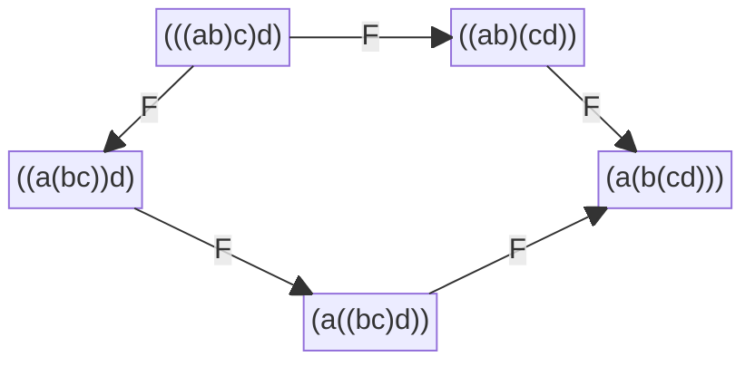

<a id="auric-v25"></a>

# AURIC 量子铺砌

**五边形相融、黄金门与整体观测**

**定义、定理与纸面证明**

**v25.0 · 2026 年 10 月 30 日 · Asia/Singapore**

> **转换说明（编者）。** 本文完整转写原作者提供的 v25.0 XeLaTeX 稿件。作者关于固定快照、来源核读、纸面结果及既有项目进展的陈述仍归属于原作者，不构成本次转换的新认证。字体、页眉、页码、分页和目录排版由 Markdown 替代；数学宏展开为独立表达。陈述沿用各节共享计数器，四个小节保留编号 2.1、2.2、9.1、9.2，自动公式保留源稿全局编号 (1)–(20)，其中 `align` 的三行分别为 (14)、(15)、(16)。每个证明的可见终止符保留在原稿对应位置。第 12 节保持为具名来源的条件结果供应，不另编号为本稿定理。图形的字形、颜色及间距替代见图 1 旁的说明，原始完整图与 TikZ 原文同处保留。

<a id="sec-abstract"></a>

## 摘要

若一切观测都来自一种基础量子门，它能否像瓦片一样铺满整体？
本文把该问题分成几何覆盖、边界相容、观测完备与操作生成四项。
在明确的 Fibonacci 融合规则及正实规范下，五边形重组一致性给
$r=s^2$，与局部酉性 $r^2+s^2=1$ 合并，确定黄金关联矩阵；
路径投影进一步给 Temperley–Lieb 关系和原生黄金门的编织重铺恒等式。
两个重叠地址在一个明确的二维不变扇区上产生稠密射影控制，但该扇区的制备仍是独立条件。
静态张量沿不同切面解释为酉操作需要双酉或多酉条件；原生三比特扩展存在秩亏切面。
观测层面，同一种 trine 三通道读口的三个正交朝向构成稳定、各向同性的信息完备覆盖；
其振幅接缝仍具有 Hopf 绕数及可观测闭环相位。
无限整体由相容有限区域状态定义，而非无限多个等模振幅的归一化和。
局部量子边际的重叠一致并不保证全局存在；我们给出 Bell 反例和真正的紧致性延拓定理。
最后给出有限铺砌配置产生擦除纠错码的完整条件证明，并对接项目最新的全上下文四时残差稳定性。
这些结果建立的是带明确前提的数学框架，不把非周期性、局部酉性或一种图形直接等同于完整量子物理。

**结果身份与方法。**
Fibonacci 融合、五边形、Temperley–Lieb、双酉、Hopf、紧框架及量子纠错均有既有理论来源，本文不主张这些结构的原创优先权。
本文的工作是固定项目字典、补齐条件、给出可逐行核对的连接证明与反例。
未运行数学数值、CAS、门字搜索、数学枚举或 Lean；检索、文稿写入、编译和页面渲染仅用于来源核查及交付。

## 目录

1. [项目快照与“铺满”的四种含义](#sec-scope)
2. [从三角剖分到五边形：黄金系数怎样被约束](#sec-pentagon)
3. [从路径投影到黄金门的非交换重铺](#sec-braid)
4. [两个重叠地址上的逻辑量子比特](#sec-localcontrol)
5. [静态张量铺砌与不同切面的酉性](#sec-cuts)
6. [边相容、闭环信息与“没有先后”的准确形式](#sec-holonomy)
7. [一种三通道读口怎样覆盖完整量子态](#sec-trine)
8. [覆盖以后仍然存在的相位接缝](#sec-phase)
9. [无限铺满：有限相容态而非无限等幅求和](#sec-infinite)
10. [铺砌的隐藏整体信息与量子纠错](#sec-qec)
11. [递归重铺与误差：酉性不是唯一相容条件](#sec-recursion)
12. [最新项目稳定性怎样接到这套理论](#sec-latest)
13. [可以成立的总体理论陈述与下一项闭合任务](#sec-conclusion)

[文献与固定项目来源](#sec-bibliography)

<a id="sec-scope"></a>

## 1. 项目快照与“铺满”的四种含义

本稿核对的 `dev` 快照为

`e04787282d06951e87972128ec8e4ef90b58543c`。

提交时间为 2026 年 10 月 30 日 17:14:31（新加坡），合并 PR #24129。
相对 v24 使用的 `88a98cb974735eba23c7ece731a40ba9b48c19f5` 前进 103 个提交。
GitHub 比较接口的文件列表达到截断边界，因此不把它当作完整全仓变更清单；
逐项比较两个快照的 theory 目录，确认九个理论文档变化。
与本题直接相关的是保存既有 v23 铺砌论文，以及相干重构续卷 II 新增第 90 节的统一稳定界。
前者是既有研究的保存，不是独立验证；后者是条件纸面结果，本文未宣称其已获 Lean 内核验证。
（[1](#ref-repoaudit)、[6](#ref-repov23)、[3](#ref-repoborn)）

<a id="statement-1-1"></a>

#### 定义 1.1（四种覆盖）

设 $\mathcal T$ 是局部原子及其允许拼接规则。

1.  *几何覆盖*：$\mathbb{R}^2$ 是所允许几何瓦片的并，内部不重叠。

2.  *相干拼接*：具有相同外部接口的允许重组产生相同的边界线性映射，或在明确的相位商下等价。

3.  *观测完备*：允许读出在指定状态空间上分离任意两个不同状态。

4.  *操作生成*：有限门字的闭包包含目标操作群；若只要求有限门字本身等于目标，称精确生成。

四项不能互相替代。用恒等算符装饰一个合法 Hat 铺砌，保留其几何非周期性而没有新增量子控制能力。
一枚局部非交换门也未必携带任何欧氏瓦片形状。
Hat 与 Spectre 的原始结果确实解决了几何单瓦片的非周期覆盖问题；
它们并未因此自动给出希尔伯特空间、Born 标定或一组实验可执行的量子门。（[7](#ref-hat)、[8](#ref-spectre)）

<a id="statement-1-2"></a>

#### 命题 1.2（单地址重复与有限字的边界）

固定一个有限维酉矩阵 $U$。只使用其幂，所得闭包是可交换群，不能等于 $PU(d)$（$d\ge2$）。
若 $U^{10}=I$，其幂至多十个。
任何有限字母表的有限门字都只是可数集，不能精确覆盖不可数的 $PU(d)$；
可数门字的闭包则可能等于整个目标群。

**证明。**

任意两幂交换；交换关系关于矩阵极限连续，故闭包仍交换。
$PU(d)$ 在 $d\ge2$ 时不交换。有限阶给幂的周期归约。
有限长度 $n$ 的字有限，遍历 $n\in\mathbb{N}$ 仍可数；$PU(d)$ 含连续的一参数子群，因而不可数。
有理数在实数中的稠密性已说明“可数”不妨碍“闭包连续”。 ∎

所以，“一种门”可以指一种*局部规则*，但其地址、方向、边界类型、布线、初态和读口都是规则的一部分。
本稿将这种有接口的原子称为量子瓦片。

<a id="sec-pentagon"></a>

## 2. 从三角剖分到五边形：黄金系数怎样被约束

<a id="sec-2-1"></a>

### 2.1. 边上的类型与隐藏完成方式

取类型集合 $L=\{\mathbf{1},\tau\}$，规定

<a id="eq-fusion"></a>

$$
\mathbf{1}\otimes a=a\otimes\mathbf{1}=a,\qquad
\tau\otimes\tau=\mathbf{1}\oplus\tau .
\tag{1}
$$

这是明确输入的 Fibonacci 融合规则，不能由“存在平面铺砌”本身推出。

<a id="statement-2-1"></a>

#### 定义 2.1（带类型的预测树）

有序二叉树的叶带类型，根类型固定为 $c$。
每个内部节点的父类型必须是其两子类型融合允许的结果。
所有合法内部标签构成有限集合 $\mathsf{Lab}(T,c)$，
定义 $H_T^c=\mathbb{C}^{\mathsf{Lab}(T,c)}$，合法标签向量取为正交归一基。
一次局部重括号
$((ab)_e c)_z\longrightarrow(a(bc)_h)_z$
由矩阵 $\mathsf F^{abc}_z(e,h)$ 表示。

这里“选择对角线”对应选择一种括号树；对角线上还要保留类型及相干振幅。
这比只保留三角形的边长丰富。换一种括号树可以只是同一态的坐标变换，并不自动构成测量塌缩。
项目已有的树基构造、完整有限五边形及路径投影提供了这一接口。（[2](#ref-repofusion)）

规定所有合法一维 $\mathsf F$ 块等于 $1$，非法系数为 $0$；
唯一二维块采用正实对称规范

<a id="eq-Fgeneric"></a>

$$
\mathsf F=\mathsf F^{\tau\tau\tau}_\tau
=\begin{pmatrix}r&s\\s&-r\end{pmatrix},\qquad r,s>0,
\tag{2}
$$

标签顺序为 $(\mathbf{1},\tau)$。

<a id="statement-2-2"></a>

#### 定理 2.2（黄金系数的条件唯一性）

在上述融合规则、规范和标量块下，局部酉性及全部带类型五边形恒等式等价于

<a id="eq-Fgold"></a>

$$
r=\varphi^{-1},\qquad s=\sqrt{\varphi^{-1}},\qquad
\varphi=\frac{1+\sqrt5}{2}.
\tag{3}
$$

特别地，黄金数在这里来自*两条重组路径必须相融*与酉性的联立约束。

**证明。**

酉性直接给

<a id="eq-Funit"></a>

$$
r^2+s^2=1.
\tag{4}
$$

五边形的带类型形式为

<a id="eq-pentagon"></a>

$$
\sum_j
\mathsf F^{abc}_f(e,j)\mathsf F^{ajd}_z(f,g)
\mathsf F^{bcd}_g(j,h)
=
\mathsf F^{ecd}_z(f,h)\mathsf F^{abh}_z(e,g).
\tag{5}
$$

取 $a=b=c=d=z=\tau$、$e=h=\mathbf{1}$、$f=g=\tau$。
左边 $j=\mathbf{1}$ 项为 $r^2$，$j=\tau$ 项为 $-rs^2$；
右边因中间类型 $\mathbf{1}\otimes\mathbf{1}$ 不能给 $\tau$ 而为零。
所以 $r(r-s^2)=0$。由 $r>0$ 得 $r=s^2$，代回 [(4)](#eq-Funit) 得
$r^2+r=1$，唯一正根即 [(3)](#eq-Fgold)。

还要证明充分性，而非只检查一个必要分量。
在四片叶和根全为 $\tau$ 的三维空间，源、靶路径均按
$(\mathbf{1},\tau),(\tau,\mathbf{1}),(\tau,\tau)$ 排序。
矩阵采用列为输入、行为输出的约定。
三步路径的中间标签为 $(j,f)$、$(j,g)$，两步路径的中间标签为 $(e,h)$；
各标签对都采用上述顺序。
令

$$
A=\begin{pmatrix}r&0&s\\0&1&0\\s&0&-r\end{pmatrix},\quad
B=\begin{pmatrix}1&0&0\\0&r&s\\0&s&-r\end{pmatrix},\quad
C=\begin{pmatrix}0&1&0\\r&0&s\\s&0&-r\end{pmatrix}.
$$

三步侧和两步侧分别是 $ABA$ 与 $CB$。直接相乘给

$$
ABA=
\begin{pmatrix}
r^2-rs^2&s^2&rs(1+r)\\
s^2&r&-rs\\
rs(1+r)&-rs&s^2-r^3
\end{pmatrix},
\quad
CB=
\begin{pmatrix}
0&r&s\\
r&s^2&-rs\\
s&-rs&r^2
\end{pmatrix}.
$$

使用 $s^2=r$、$r^2+r=1$，两者均为

$$
\begin{pmatrix}0&r&s\\r&r&-rs\\s&-rs&r^2\end{pmatrix}.
$$

若四片叶全为 $\tau$ 而根为 $\mathbf{1}$，两路都化为 $I_2$，用的是 $\mathsf F^2=I$。
若有单位叶，删除单位叶后，非平凡的二维情形两路都是同一个 $\mathsf F$；
其余非空情形均为一维恒等，空标签空间上的等式自动成立。
这穷尽全部类型情形，证明完整五边形。 ∎

<a id="fig-pentagon"></a>

> **图形转写说明（编者）。** 下图使用 Markdown 支持的 Mermaid 块图呈现相连的有向五边形。左上、左下、下方、右下、右上分别保留原图的五棵完整括号树，五条边分别为 `a→b→c→d` 和 `a→e→d`，各有一个 `F`。网格间距近似原图相对位置，不表示精确坐标或比例；节点增添边框，标签采用普通字形的 `F`，源图蓝色与橙色由渲染主题统一呈现。框、字形、颜色和间距仅为排版替代，不新增数学对象。精确坐标、颜色、原图题及完整原始 TikZ 均在同处保留。



**图 1：** 同一边界数据的两条重组路径。节点是括号树，边是带类型的酉换基；不是把五个 AURIC 模式直接认作欧氏正五边形。

**原始图与 TikZ（逐字保留；Markdown 不执行此源码）。**

```latex
\begin{figure}[ht]
\centering
\begin{tikzpicture}[>=Stealth, every node/.style={font=\small}]
\node (a) at (-2.1,1.3) {$(((ab)c)d)$};
\node (b) at (-3.1,-0.7) {$((a(bc))d)$};
\node (c) at (0,-2) {$(a((bc)d))$};
\node (d) at (3.1,-0.7) {$(a(b(cd)))$};
\node (e) at (2.1,1.3) {$((ab)(cd))$};
\draw[->,thick,blue!65!black] (a)--node[left] {$\mathsf F$}(b);
\draw[->,thick,blue!65!black] (b)--node[below] {$\mathsf F$}(c);
\draw[->,thick,blue!65!black] (c)--node[below] {$\mathsf F$}(d);
\draw[->,thick,orange!75!black] (a)--node[above] {$\mathsf F$}(e);
\draw[->,thick,orange!75!black] (e)--node[right] {$\mathsf F$}(d);
\end{tikzpicture}
\caption{同一边界数据的两条重组路径。节点是括号树，边是带类型的酉换基；不是把五个 AURIC 模式直接认作欧氏正五边形。}
\end{figure}
```

<a id="sec-2-2"></a>

### 2.2. 任意重组与被动坐标

对任意有限有序叶列，重括号图的基本相容关系由分离位置的交换方块和五边形生成；
这是结合相容定理的标准供应。（[10](#ref-egno)、[9](#ref-trebst)）
在此供应下，上述局部矩阵给出与重括号路径无关的坐标运输。
它没有单独给出所有曲面的 Pachner 不变性；后者还需要适当的单位、对偶、迹及闭环权重等结构。

<a id="statement-2-3"></a>

#### 命题 2.3（换基不等于主动观测）

若 $W:H_T^c\to H_{T'}^c$ 酉，且同时令
$\rho'=W\rho W^\dagger$、$E'=WEW^\dagger$，则
$\operatorname{Tr}(\rho'E')=\operatorname{Tr}(\rho E)$。
若仅改状态而固定 $E$，则一般会改变读出。

**证明。**

第一式由 $W^\dagger W=I$ 和迹的循环性得到。
第二式可取 $W$ 交换两个正交基态，$\rho$ 与 $E$ 均取第一个基态投影；
原读数为一，变换后为零。 ∎

因此，“重新铺开同一个预测”与“对系统施加一个门”需要分别记账。
$\mathsf F$ 的存在并不授权实验装置执行任意 $\mathsf F$ 操作。

<a id="sec-braid"></a>

## 3. 从路径投影到黄金门的非交换重铺

<a id="statement-3-1"></a>

#### 定理 3.1（带权路径投影）

设有限类型图的邻接关系对称，允许自环；$\delta>0$，严格正权重满足
$\sum_{b\sim a}d_b=\delta d_a$。
在固定端点的合法路径正交基上，定义只改变第 $i$ 个标签的算符 $P_i$：
若 $x_{i-1}\ne x_{i+1}$ 则为零；若两者同为 $a$，

<a id="eq-pathP"></a>

$$
\langle\ldots,b',\ldots|P_i|\ldots,b,\ldots\rangle
=\frac{\sqrt{d_{b'}d_b}}{\delta d_a}.
\tag{6}
$$

则

<a id="eq-TL"></a>

$$
P_i^\dagger=P_i,\quad P_i^2=P_i,\quad
P_iP_{i+1}P_i=\delta^{-2}P_i,\quad
[P_i,P_j]=0\quad(|i-j|\ge2).
\tag{7}
$$

**证明。**

每个非零块是 $vv^\dagger/(\delta d_a)$，$v_b=\sqrt{d_b}$；
权重关系给 $v^\dagger v=\delta d_a$，所以是正交投影。
三乘积只需看输入局部路径 $(a,b,a,d)$。
第一个 $P_i$ 改出的中间标签必须等于 $d$，否则第二步为零；
最后一步非零又强制第 $i+1$ 位回到 $a$。
因此求和只有一个可能项，其系数是

$$
\frac{\sqrt{d_bd_d}}{\delta d_a}
\frac{d_a}{\delta d_d}
\frac{\sqrt{d_dd_{b'}}}{\delta d_a}
=\delta^{-2}\frac{\sqrt{d_bd_{b'}}}{\delta d_a}.
$$

对称邻接保证该中间路径合法，其他输入两边都为零。
当 $|i-j|\ge2$ 时，两个算符改变不同标签，且不改变对方所依赖的邻居标签，故交换。 ∎

取 Fibonacci 邻接、$(d_{\mathbf{1}},d_\tau)=(1,\varphi)$、$\delta=\varphi$。
写 $x=\varphi^{-1}$，有 $x+x^2=1$。
在 $(\mathbf{1},\tau)$ 顺序，非平凡块是

$$
\begin{pmatrix}x^2&x\sqrt x\\x\sqrt x&x\end{pmatrix}
=\mathsf F\operatorname{diag}(1,0)\mathsf F^\dagger.
$$

改为项目中心位的 $(0,1)$ 顺序，得到

<a id="eq-nativeQ"></a>

$$
Q=\begin{pmatrix}x&x\sqrt x\\x\sqrt x&x^2\end{pmatrix}.
\tag{8}
$$

这一步保留了字典，不把两种顺序混用。

<a id="statement-3-2"></a>

#### 定理 3.2（黄金相位的编织条件）

设 $P,Q$ 为投影，$PQP=x^2P$、$QPQ=x^2Q$、$P\ne Q$。
对 $|z|=1$，定义 $T_P(z)=I+(z-1)P$。
则

<a id="eq-braiddefect"></a>

$$
T_PT_QT_P-T_QT_PT_Q
=(z-1)\bigl[z+x^2(z-1)^2\bigr](P-Q).
\tag{9}
$$

除 $z=1$ 的平凡情形外，编织关系成立当且仅当
$z=e^{3\pi i/5}$ 或 $e^{-3\pi i/5}$。

**证明。**

令 $u=z-1$。三次展开后，两边共享 $I$ 和 $u^2(PQ+QP)$；
差为 $u(1+u+x^2u^2)(P-Q)$，即 [(9)](#eq-braiddefect)。
非平凡条件除以 $z$ 得
$1+x^2(z+z^{-1}-2)=0$，即
$z+z^{-1}=2-x^{-2}=-x$。
单位圆上恰有所述互为共轭的两个解。 ∎

取 $\zeta=e^{3\pi i/5}$ 和原生门

<a id="eq-Ki"></a>

$$
K_i=\zeta\bigl[I+(\zeta-1)P_i\bigr].
\tag{10}
$$

共同标量不改变编织等式，且谱包含于 $\{\zeta,\zeta^2\}$，所以

<a id="eq-nativerel"></a>

$$
K_i^{10}=I,\qquad
K_iK_{i+1}K_i=K_{i+1}K_iK_{i+1},\qquad
[K_i,K_j]=0\quad(|i-j|\ge2).
\tag{11}
$$

这些关系在合法路径扇区成立，不能未经检查扩展到任意不合法位串。
项目的完整十三维来源已把七个地址及两端边界同时接到 Jones–Wenzl 表示。（[3](#ref-repoborn)、[4](#ref-repov15)、[11](#ref-flw)）

<a id="statement-3-3"></a>

#### 定义 3.3（关系铺砌）

把门字看作带地址的路径。
分别以远距交换、相邻三步编织及十步返回作为边界，附着四边形、六边形和十边形关系胞腔。
两个路径若由这些胞腔的有限局部替换联系，则称为已证明等价的重铺。

<a id="statement-3-4"></a>

#### 推论 3.4（重铺保留边界操作）

已证明等价的路径给出相同的边界算符。

**证明。**

每个局部替换保持其边界算符；在同一前后上下文中左右相乘仍相等。
有限次替换归纳完成证明。 ∎

这给出了用户“相融递归”最具体的代数形式之一。
三步编织允许非交换操作保持某种整体相容；
它不要求 $K_iK_{i+1}=K_{i+1}K_i$，也不声称这些关系多边形本身在欧氏平面无缝嵌入。

<a id="sec-localcontrol"></a>

## 4. 两个重叠地址上的逻辑量子比特

本节将一种局部门放在相邻位置，展示“同一原子，多种关系”的实质。
原生投影为
$P=n_Ln_R+(1-n_L)(1-n_R)Q_C$，其中 $n=\lvert 1\rangle\langle 1\rvert$，
$Q$ 取 [(8)](#eq-nativeQ)。
固定四位串的外端为 $0$，中间允许 $00,01,10$，得到
$H_3=\operatorname{span}\{\lvert 00\rangle,\lvert 01\rangle,\lvert 10\rangle\}$。
原生三位投影在地址 $(0,b_1,b_2)$、$(b_1,b_2,0)$ 的限制分别是

$$
P_1=\lvert g_1\rangle\langle g_1\rvert,\quad
P_2=\lvert g_2\rangle\langle g_2\rvert,\qquad
g_1=\sqrt x\lvert 00\rangle+x\lvert 10\rangle,\quad
g_2=\sqrt x\lvert 00\rangle+x\lvert 01\rangle.
$$

<a id="statement-4-1"></a>

#### 定理 4.1（指定不变扇区上的稠密控制）

$W=\operatorname{span}\{g_1,g_2\}$ 是两门共同不变的二维空间。
在 $W$ 上，两个地址的有限正向 $K_1,K_2$ 门字的射影闭包为 $PU(2)$。

**证明。**

由 $x+x^2=1$，两向量归一且 $\langle g_1,g_2\rangle=x$。
设
$e_2=g_1$、$e_1=(g_2-xg_1)/\sqrt x$；
因为 $1-x^2=x$，这是 $W$ 的正交归一基。
在此基下

$$
P_1=\operatorname{diag}(0,1),\qquad
P_2=\begin{pmatrix}x&x\sqrt x\\x\sqrt x&x^2\end{pmatrix}.
$$

二者不交换。令
$A=e^{-9\pi i/10}K_1|_W$、
$B=e^{-9\pi i/10}K_2|_W$，则 $A,B\in SU(2)$。
写 $t=3\pi/10$ 和 $N_i=2P_i-I$，

$$
A=\cos t\,I+i\sin t\,N_1,\qquad
B=\cos t\,I+i\sin t\,N_2.
$$

$\operatorname{Tr}(N_1N_2)=2(2x^2-1)$，
$\cos^2t=(2-x)/4$、$\sin^2t=(2+x)/4$，故

<a id="eq-goldtraces"></a>

$$
\operatorname{Tr}(AB)=1,\qquad \operatorname{Tr}(AB^{-1})=x^2.
\tag{12}
$$

若 $AB^{-1}$ 有限阶，其特征值是互逆单位根；其迹的每个代数共轭都在 $[-2,2]$。
但 $x^2$ 的另一个代数共轭是 $\varphi^2>2$，矛盾，故所生成闭群无限。
使用闭子群定理，$SU(2)$ 的闭子群是紧 Lie 群；
$\mathfrak{su}(2)\simeq\mathbb{R}^3$ 的括号对应叉积，因而子 Lie 代数维数只有 $0,1,3$。
零维紧 Lie 群有限，已排除。
若维数为一，其单位连通分支是极大环面 $T$，整个群包含于 $N(T)$。
将 $T$ 共轭为对角圆群后，$N(T)$ 的矩阵分成对角与反对角两类，
后一类迹均为零；
而 $A,B$ 的迹均为 $2\cos t\ne0$，于是两者都在同一个 $T$ 内，必须交换，矛盾。
故闭群满维，因而是开子群；$SU(2)$ 连通，故闭群是整个 $SU(2)$，
射影闭包是 $PU(2)$。
最后，$K_i^{10}=I$ 给 $K_i^{-1}=K_i^9$，所以正向字已经包含逆门所需的有限表达。 ∎

<a id="statement-4-2"></a>

#### 命题 4.2（控制不自动供应编码初态）

仅从上述三个计算基态之一出发，只用这两个地址，不能任意逼近 $W$ 内的纯态。

**证明。**

$W^\perp$ 由单位向量

$$
h=\frac{\sqrt x\lvert 00\rangle-\lvert 01\rangle-\lvert 10\rangle}{\sqrt{x+2}}
$$

张成。$P_1h=P_2h=0$，故两门都只给 $h$ 乘相位 $\zeta$；
任意门字保持输入在 $\mathbb{C} h$ 上的权重。
三个计算基态对 $h$ 的内积都非零，因此其到 $W$ 的距离有固定正下界。 ∎

本节证明的是*给定编码扇区的控制能力*；
编码制备、读出及多逻辑比特之间的纠缠耦合仍需供应。
项目的七地址十三维密度结论使用不同的完整来源与准备轨道，不能与这个小扇区的资源混同。

<a id="sec-cuts"></a>

## 5. 静态张量铺砌与不同切面的酉性

<a id="statement-5-1"></a>

#### 定义 5.1（带端口的量子瓦片）

一个瓦片是有限张量 $T$，每条端口边带有限维 Hilbert 空间及明确的对偶配对。
拼接两条匹配端口就是收缩共享指标。
一块有限区域的开放端口张量称为其边界振幅。
只有在选择输入、输出分组之后，它才成为一个矩阵。

<a id="statement-5-2"></a>

#### 定理 5.2（有限收缩次序无关）

固定有限张量网络及全部端口配对后，先收缩哪一条内部边，不改变最终边界张量。

**证明。**

固定外部指标后，每个分量都是有限多重和
$\sum_{\mathbf i}\prod_v T_v(\mathbf i_v)$。
有限加法的结合律与交换律允许改变求和次序，复数乘法可重新分组，结果不变。 ∎

这一定理描述静态网络的*计算切面*，并未把同一条线上两个不交换门的先后顺序交换。
若有一条合法电路切面，网络由酉门的张量积及复合构成，则该切面上的整体传输是酉的。
若要求另一方向也如此，则需要额外条件。（[12](#ref-dual)）

<a id="statement-5-3"></a>

#### 定义 5.3（双酉）

对 $U:\mathbb{C}^d\otimes\mathbb{C}^d\to\mathbb{C}^d\otimes\mathbb{C}^d$，
记 $U_{cd,ab}=\langle c,d|U|a,b\rangle$。
定义横向重排

$$
\widetilde U_{(a,c),(b,d)}=U_{cd,ab}.
$$

若 $U$ 和 $\widetilde U$ 均为酉矩阵，称其在这两个切面下双酉。
若指定更多等维分组均酉，则是相应的多酉要求。

<a id="statement-5-4"></a>

#### 命题 5.4（通常酉性不蕴含双酉）

$d\ge2$ 时，恒等门 $I_{d^2}$ 通常酉，但 $\widetilde I$ 的秩为一；
交换门 $S\lvert a,b\rangle=\lvert b,a\rangle$ 在上述两个切面均酉。

**证明。**

恒等门有 $I_{cd,ab}=\delta_{ca}\delta_{db}$，
故重排是向量 $(\delta_{ac})_{a,c}$ 与 $(\delta_{bd})_{b,d}$ 的外积，秩一。
交换门给 $\widetilde S_{(a,c),(b,d)}=\delta_{cb}\delta_{da}$，
每行每列恰有一个 $1$，所以是置换酉矩阵。 ∎

对任何能分别沿两方向写成这些局部门的张量积、置换和复合的有限砖墙区域，
双酉性使两个相应传输都酉。
边界开放腿数、维数必须匹配；取迹、固定边界向量或任意弯曲切面并不受这个陈述自动覆盖。

<a id="statement-5-5"></a>

#### 定理 5.5（原生三比特扩展有秩亏切面）

取明确的三比特实现

$$
K=\zeta[I+(\zeta-1)P],\qquad
P=n_Ln_R+(1-n_L)(1-n_R)Q_C,
$$

其中 $n=\lvert 1\rangle\langle 1\rvert$，省略的张量因子为恒等。
这个 $K$ 不是所有等维三腿对三腿切面均酉的张量。

**证明。**

左右计算位不被改变，因此

$$
K_{a'b'c',abc}=\delta_{a'a}\delta_{c'c}(M_{ac})_{b'b}
$$

对某些二阶矩阵 $M_{ac}$ 成立。
将六个指标重排为行 $(a,a',b)$、列 $(c,c',b')$ 的 $8\times8$ 矩阵。
凡 $a\ne a'$ 的行都为零，所以秩至多四，不可能酉。 ∎

这一反例针对明确的三比特扩展。
限制到五模式后，并没有天然的三个独立 qubit 张量分解，不能沿用不存在的端口分组。

<a id="statement-5-6"></a>

#### 命题 5.6（可满铺、可纠缠、双酉仍不足通用）

令 $\zeta=e^{3\pi i/5}$，定义两比特瓦片
$B_\zeta\lvert a,b\rangle=\zeta^{ab}\lvert b,a\rangle$。
它双酉、可产生纠缠，且满足编织关系；
但固定有限比特数时，仅使用此瓦片和计算基路由不能生成稠密的全部酉群。

**证明。**

通常展开和横向重排均为每行每列一个模一元素的置换矩阵，故双酉。
对 $\lvert ++\rangle$ 的输出振幅矩阵为
$\frac12\bigl(\begin{smallmatrix}1&1\\1&\zeta\end{smallmatrix}\bigr)$，
行列式 $(\zeta-1)/4\ne0$，所以输出不是乘积态。
作用于 $\lvert a,b,c\rangle$，编织两侧都反转三标签并乘
$\zeta^{ab+ac+bc}$，故满足三步关系。
然而所有允许字仍是计算基上的单项矩阵，非零元均为十次单位根。
$n$ 固定时这样的矩阵至多 $10^{2^n}(2^n)!$ 个，闭包有限，故不通用。 ∎

这是一个独立的比较模型，不是声称 $B_\zeta$ 已由原生 $K$ 编译出来。

<a id="sec-holonomy"></a>

## 6. 边相容、闭环信息与“没有先后”的准确形式

<a id="statement-6-1"></a>

#### 定义 6.1（酉边连接）

在连通图每个顶点放同维 $H_v\simeq\mathbb{C}^d$。
每条有向边 $u\to v$ 带酉映射 $U_{vu}$，逆边取 $U_{uv}=U_{vu}^{-1}$。
路径运输为按路径顺序复合的矩阵；闭合路径运输称为 holonomy。
相容截面满足 $\psi_v=U_{vu}\psi_u$。

<a id="statement-6-2"></a>

#### 定理 6.2（整体相容的精确判据）

固定根 $o$，记 $\mathcal H_o$ 为所有以 $o$ 为根的闭路运输。
相容截面空间与

$$
\bigcap_{H\in\mathcal H_o}\ker(H-I)
$$

自然等距对应（以根纤维的范数计）。
每个根向量均可路径无关地运输，当且仅当所有根闭路运输都是 $I$。

**证明。**

相容截面沿闭路返回原向量，所以根向量被所有 $H$ 固定。
反之，若 $\psi_o$ 被全部闭路固定，选任何 $o\to v$ 的路径定义 $\psi_v$。
两路径之差构成闭路，故结果相同，并自动满足每条边约束。
根向量唯一确定全截面，运输酉性保持每个纤维范数。
若所有向量都被某闭路固定，该闭路矩阵只能是 $I$；反向直接成立。 ∎

若图是一个单连通二维胞腔复形的一骨架，
并且每个面边界的 holonomy 都为 $I$，则任意闭路可由面边界和逆边抵消化为空路，
所以全局路径无关。
在有孔区域，所有小面平坦仍可能留下绕孔 holonomy；
例如一个环上只有一条边带非平凡 $U$，即给明确例子。

<a id="statement-6-3"></a>

#### 命题 6.3（射线相同并未删除干涉相位）

若两个运输 $V=e^{i\theta}U$，它们对单路径末态的射线作用相同。
若两路径可相干叠加并在同一读口比较，则该相位可改变输出。

**证明。**

前一句由射线定义。
对单位输入 $\psi$，平衡干涉器的一个输出振幅是
$(U+V)\psi/2$，其概率为
$\left\lVert (U+V)\psi\right\rVert^2/4=(1+\cos\theta)/2$。
此式假设两支路径的其他档案相同，或已被相干消去；若仍保留正交路径档案，交叉项消失。
所以相位能否删除取决于是否保留和允许比较路径记录。 ∎

因此“没有外部绝对时间”可以与静态关系网络相容，
但不能删掉端口方向、路径词、相位参考和可比较的因果记录。
只有已经证明等价的局部路径才能互换。

<a id="sec-trine"></a>

## 7. 一种三通道读口怎样覆盖完整量子态

原始 AURIC 五模式三占位均值满足
$X+Y+Z=1-p_0+p_{13}$，一般不是三结果归一化概率。
本节沿用 v24 的*附加逻辑编码读口*：
$\mathbb{C}^2\to\mathbb{C}^3$ 的三元 Fourier 等距映射
$a_j=(\alpha+\omega^{-j}\beta)/\sqrt3$，$\omega=e^{2\pi i/3}$，
并把三输出置于 $\lvert 1\rangle,\lvert 3\rangle,\lvert 2\rangle$ 模式。
这个数学编码和其主动旋转是否在原生菜单可实施，是独立问题。

写 $\rho=(I+r\cdot\sigma)/2$、$|r|\le1$。
取单位法向 $u$，在 $u^\perp$ 中取夹角 $120^\circ$ 的三个单位向量 $n_j$；
定义

$$
E_j=\frac{I+n_j\cdot\sigma}{3},\qquad
q_j=\operatorname{Tr}(\rho E_j)=\frac{1+n_j\cdot r}{3}.
$$

$E_j$ 正且和为 $I$，是 trine POVM，不是三个互相正交的 qubit 基态。（[13](#ref-caves)）

<a id="statement-7-1"></a>

#### 引理 7.1（一个读口给概率盘）

记 $P_u=I-uu^{\mathsf T}$，则

<a id="eq-trineone"></a>

$$
\sum_j n_jn_j^{\mathsf T}=\frac32P_u,\qquad
P_ur=2\sum_jq_jn_j,\qquad
\sum_jq_j^2=\frac13+\frac{|P_ur|^2}{6}.
\tag{13}
$$

其概率像是
$\{q_j\ge0,\ \sum q_j=1,\ \sum q_j^2\le1/2\}$。
对纯态，盘内通常对应两个相反法向分支。

**证明。**

在平面正交坐标取
$n_0=(1,0)$、$n_1=(-1/2,\sqrt3/2)$、$n_2=(-1/2,-\sqrt3/2)$；
外积求和给第一式，且 $\sum n_j=0$，后两式随即得到。
反向给定所述 $q$，令 $v=2\sum q_jn_j$；
$n_i\cdot v=3q_i-1$ 且 $|v|^2=6\sum q_i^2-2\le1$。
因此 $r=v$ 是合法混态向量。
纯态可取 $r=v\pm\sqrt{1-|v|^2}\,u$；盘边界两分支重合，盘内部不同。 ∎

<a id="statement-7-2"></a>

#### 定理 7.2（两张带分支概率盘粘成球面）

把上述概率盘复制两份，分别标记法向正、负，只将边界的相同点识别，
所得商空间同胚于纯态 Bloch 球面 $S^2$。

**证明。**

在两份盘上分别用 $q\mapsto v\pm\sqrt{1-|v|^2}\,u$。
该映射连续，在边界相同，故下降到商空间。
它覆盖球面；除边界已识别点外，平面分量和法向符号唯一确定原像，所以是双射。
商空间紧、球面 Hausdorff，连续双射是同胚。 ∎

这是一项真正的“观测瓦片覆盖”，但符号标签并不由单个 trine 概率自动产生。

<a id="statement-7-3"></a>

#### 定理 7.3（三个正交朝向的稳定完整覆盖）

令 $u_1,u_2,u_3$ 正交，在每个 $u_a^\perp$ 上放同一种 trine，
得到九个条件概率 $q_{aj}$。则

<a id="eq-trineinverse"></a>

$$
\begin{aligned}
r&=\sum_{a,j}q_{aj}n_{aj},
\end{aligned}
\tag{14}
$$

<a id="eq-trinepurity"></a>

$$
\begin{aligned}
\sum_{a,j}q_{aj}^2&=1+\frac{|r|^2}{3},
\end{aligned}
\tag{15}
$$

<a id="eq-trinedistance"></a>

$$
\begin{aligned}
\sum_{a,j}\bigl(q_{aj}(r)-q_{aj}(s)\bigr)^2
&=\frac{|r-s|^2}{3}.
\end{aligned}
\tag{16}
$$

**证明。**

$\sum_aP_{u_a}=2I$。
将 [(13)](#eq-trineone) 的中式对 $a$ 求和即得 [(14)](#eq-trineinverse)；
末式求和得 [(15)](#eq-trinepurity)。
对差向量 $d=r-s$，

$$
\sum_{a,j}(\Delta q_{aj})^2
=\frac19d^{\mathsf T}\Bigl(\sum_{a,j}n_{aj}n_{aj}^{\mathsf T}\Bigr)d
=\frac19d^{\mathsf T}(3I)d.
$$

这就是 [(16)](#eq-trinedistance)。 ∎

这给完整状态识别和各向同性的误差度量。
若将三个设置以等概率选择且保留设置标签，
九个联合效果 $F_{aj}=E_{aj}/3=(I+n_{aj}\cdot\sigma)/9$ 构成单个 POVM，
$p_{aj}=q_{aj}/3$，并有

$$
r=3\sum_{a,j}p_{aj}n_{aj},\qquad
\operatorname{Tr}\rho^2=\frac{27}{2}\sum_{a,j}p_{aj}^2-1.
$$

主动设置选择及其记录是输入；被动更换坐标没有产生三份实验数据。
这里的完备性针对同一制备态的精确概率族。
实验估计需要重复制备的样本及设置标签，有限样本只给估计值；
对单个未知态先后测三次，并不产生这里的九个精确概率。

<a id="statement-7-4"></a>

#### 命题 7.4（两个非平行读口已足够）

法向 $u,v$ 非平行时，两 trine 的合并读出单射，且

$$
\frac{1-|u\cdot v|}{6}|r-s|^2
\le \left\lVert Q(r)-Q(s)\right\rVert^2
\le\frac13|r-s|^2.
$$

**证明。**

左边的精确二次型为
$\frac16(r-s)^{\mathsf T}(2I-uu^{\mathsf T}-vv^{\mathsf T})(r-s)$。
括号矩阵的特征值为 $2,1+|u\cdot v|,1-|u\cdot v|$。
非平行保证最小值严格正，结论成立。 ∎

<a id="sec-phase"></a>

## 8. 覆盖以后仍然存在的相位接缝

<a id="statement-8-1"></a>

#### 定理 8.1（Hopf 相位无全局连续选择）

不存在对每个纯 qubit 态连续地选择一个归一化振幅代表的全局规则
$s:S^2\to S^3$，使 $s(r)s(r)^\dagger=(I+r\cdot\sigma)/2$。

**证明。**

在北、南开图分别取

$$
s_N=\begin{pmatrix}
\sqrt{(1+z)/2}\\
(x+iy)/\sqrt{2(1+z)}
\end{pmatrix},\quad
s_S=\begin{pmatrix}
(x-iy)/\sqrt{2(1-z)}\\
\sqrt{(1-z)/2}
\end{pmatrix}.
$$

这里 $(x,y,z)$ 是本节的 Bloch 坐标，不是黄金常数。
在赤道 $x+iy=e^{i\phi}$，有 $s_S=e^{-i\phi}s_N$。
若全局连续 $s$ 存在，则在闭北、南半球分别写为
$s=g_Ns_N=g_Ss_S$，$g_N,g_S$ 连续取值于 $U(1)$。
两者都可延伸至圆盘，所以赤道限制的绕数都是零。
但赤道上 $g_N=g_Se^{-i\phi}$，绕数之差必须为 $-1$，矛盾。 ∎

这是否定一张覆盖全部纯态的连续相位约定；
它不否定密度矩阵的全局描述，更不否定一个具体全局纯态。
Hopf 丛及其在量子比特中的角色是标准几何事实。（[14](#ref-urbantke)）

<a id="statement-8-2"></a>

#### 定理 8.2（三点闭环保存边概率缺失的手性）

设单位振幅代表的 Bloch 向量为 $a,b,c\in S^2$。
则循环边积

<a id="eq-Bargmann"></a>

$$
\mathcal B=
\langle a|b\rangle\langle b|c\rangle\langle c|a\rangle
=
\frac{1+a\cdot b+b\cdot c+c\cdot a
+i\,a\cdot(b\times c)}4
\tag{17}
$$

不受三个顶点各自的相位选择影响。
两两转移概率不能一般确定 $\mathcal B$。

**证明。**

相位重标定的六个相位因子在循环中抵消。
又有 $\mathcal B=\operatorname{Tr}(\rho_a\rho_b\rho_c)$，
利用 $(a\cdot\sigma)(b\cdot\sigma)=(a\cdot b)I+i(a\times b)\cdot\sigma$、
$\operatorname{Tr} I=2$、$\operatorname{Tr}\sigma_j=0$，逐项展开即得 [(17)](#eq-Bargmann)。
两两概率是 $(1+a\cdot b)/2$。
空间反射保持三个点积却反转三重积，所以将 $\mathcal B$ 变为其复共轭。
例如 $a=e_x,b=e_y,c=e_z$ 给 $(1+i)/4$；
镜像给 $(1-i)/4$，两者三条边概率均为 $1/2$。 ∎

这为“隐藏信息位于连线关系中”给出可检验的形式：
单边长度读数不够，最小有向闭环已经携带额外相位信息。

<a id="statement-8-3"></a>

#### 命题 8.3（球面铺砌不能处处复制平面六邻接）

任意有限球面三角剖分满足

$$
\sum_v(6-d_v)=12,
$$

其中 $d_v$ 为顶点度数。

**证明。**

每个三角形有三条边、每条边邻接两个面，所以 $3F=2E$；
度数和为 $2E$。Euler 公式 $V-E+F=2$ 给
$6V-2E=6(V-E+F)=12$。 ∎

纯态空间是球面而非平面；
即使只要求组合三角剖分，也必须容许总体曲率或度数缺陷。
“五个模式”“五边形相容”与“球面缺陷总量”是不同对象，不能仅凭数字对应合并。

<a id="sec-infinite"></a>

## 9. 无限铺满：有限相容态而非无限等幅求和

<a id="statement-9-1"></a>

#### 命题 9.1（非零平行截面不属于顶点直和）

在无限连通图上，若 $\psi_v=U_{vu}\psi_u$ 且运输酉，
非零截面不属于 $\ell^2(V;\mathbb{C}^d)$。

**证明。**

连通与酉性使所有 $\left\lVert \psi_v\right\rVert$ 等于同一正数 $c$，
所以 $\sum_v\left\lVert \psi_v\right\rVert^2=\infty$。 ∎

因此局部每块归一化，不能靠“铺满”成为一次全局归一化。
无限张量系统通常应先描述所有有限窗口的状态。

<a id="statement-9-2"></a>

#### 定理 9.2（相容有限区域定义整体态）

设可数站点集每点带有限维空间。
对每个有限区域 $\Lambda$ 给定密度矩阵 $\rho_\Lambda$，
且 $\Lambda\subset\Gamma$ 时

$$
\operatorname{Tr}_{\Gamma\setminus\Lambda}\rho_\Gamma=\rho_\Lambda.
$$

则存在唯一准局域代数态 $\omega$，满足
$\omega(A_\Lambda)=\operatorname{Tr}(\rho_\Lambda A_\Lambda)$。

**证明。**

把局部算符按 $A_\Lambda\mapsto A_\Lambda\otimes I$ 嵌入大区域。
部分迹相容使定义与所选区域无关。
在局部算符并集上，$\omega$ 线性、$\omega(I)=1$，
且 $\omega(A^\dagger A)\ge0$。
由于每个 $\rho_\Lambda$ 正且迹一，
$|\omega(A_\Lambda)|\le\left\lVert A_\Lambda\right\rVert_{\rm op}$。
故它唯一连续延拓至该并集的算子范数完备化，即准局域 $C^*$ 代数。
正性由局部逼近及连续性保留，唯一性由局部并集稠密得到。 ∎

<a id="statement-9-3"></a>

#### 命题 9.3（从相容预测得到一个 Hilbert 表示）

上述 $\omega$ 定义半内积
$\langle A,B\rangle_\omega=\omega(A^\dagger B)$。
除去零范数向量并完备化，得到 Hilbert 空间、循环向量 $\Omega=[I]$ 与有界表示 $\pi$，
满足
$\omega(A)=\langle\Omega,\pi(A)\Omega\rangle$。

**证明。**

正性给 Cauchy–Schwarz 不等式，故零范数向量与所有向量正交，商内积良定。
$\omega(B^\dagger A^\dagger AB)\le\left\lVert A\right\rVert^2\omega(B^\dagger B)$，
所以左乘 $A$ 保持零空间并在商上有界。
令 $\pi(A)[B]=[AB]$，完备化后仍有界，且保持乘法与伴随。
取 $\Omega=[I]$ 即得表示公式；局部算符类稠密，故循环性成立。 ∎

这是 GNS 构造在本框架中的直接形式。
它以复算符代数、正性、相容性为前提，并未从裸静态图自动推导这些输入。

<a id="sec-9-1"></a>

### 9.1. 内生观察者与记录的条件读出

<a id="statement-9-4"></a>

#### 定义 9.4（有限内生观察接口）

在同一整体的有限区域内，指定记录子系统 $R$、待预测子系统 $S$，
及 $R$ 上的 POVM $\{M_a\}$。
观察者的读出是整体态 $\rho_{RS}$ 与这个内部接口的关系：

$$
\sigma_a=\operatorname{Tr}_R\!\left[(\sqrt{M_a}\otimes I)\rho_{RS}
(\sqrt{M_a}\otimes I)\right],\quad
p_a=\operatorname{Tr}\sigma_a,\quad \rho_{S|a}=\sigma_a/p_a\quad(p_a>0).
$$

<a id="statement-9-5"></a>

#### 定理 9.5（静态整体上的条件分支相融）

上述接口满足
$\sum_a p_a\rho_{S|a}=\rho_S$，零概率项记为零。
若两份记录位于不同张量因子，且两个局部读口预先固定，
先条件于哪份记录都给出同一个联合条件态，
只要联合事件概率非零。

**证明。**

对只作用于被部分迹系统的算符，部分迹有循环性，
所以 $\sigma_a=\operatorname{Tr}_R[(M_a\otimes I)\rho_{RS}]$；
求和并用 $\sum_aM_a=I_R$ 得第一式。
若两份记录的效果分别为 $M_a$、$N_b$，
其平方根作用于不同因子而交换。
两次条件化的未归一化分子都是

$$
\operatorname{Tr}_{R_1R_2}
\!\left[(\sqrt{M_a}\otimes\sqrt{N_b}\otimes I)\rho
(\sqrt{M_a}\otimes\sqrt{N_b}\otimes I)\right].
$$

两次归一化的分母相乘等于同一个联合概率，因此最终条件态相同。 ∎

这给“观察者位于本体内部、读出是条件关系”的一个准确模型。
记录集合扩大可以改变观察者的条件预测，而固定整体 $\rho$ 不必随数学条件化改写。
第一式保持的是未选择结果时的 $S$ 边际，
并不声称物理测量后的联合 $RS$ 态仍等于原态。
这里的无序性属于相容记录的读序；同一系统上的不交换测量、记录的物理生成以及扰动，
仍须由相应仪器或整体门网络描述。

<a id="sec-9-2"></a>

### 9.2. 局部边际相同仍可能没有整体

<a id="statement-9-6"></a>

#### 定理 9.6（树状重叠的 Bell 阻碍）

$\rho_{AB}=\lvert \Phi^+\rangle\langle \Phi^+\rvert$ 与
$\rho_{BC}=\lvert \Phi^+\rangle\langle \Phi^+\rvert$ 在共享的 $B$ 上都有边际 $I/2$，
但不存在具有这两份边际的三比特状态。

**证明。**

若 $\rho_{ABC}$ 的 $AB$ 边际是秩一投影 $P$，
令 $Q=I_{AB}-P$，则 $\operatorname{Tr}[(Q\otimes I)\rho_{ABC}]=0$。
正性使 $\rho_{ABC}$ 的支撑包含于
$\operatorname{ran}P\otimes H_C$，从而
$\rho_{ABC}=P\otimes\sigma_C$。
于是其 $BC$ 边际只能是 $(I_B/2)\otimes\sigma_C$，
秩至少二，不可能等于纯 Bell 态。 ∎

经典记录的树上延拓不能直接移植为任意量子密度矩阵的延拓：
量子关联还受纠缠单配等全局约束。

<a id="statement-9-7"></a>

#### 定理 9.7（真正的局部到整体紧致性）

在上述可数有限维站点系统中，给定一族作用于有限区域的闭条件。
若每一有限组条件都可由某个共同有限区域上的密度矩阵同时满足，
则存在相容的全体有限区域状态同时满足所有条件。

**证明。**

对每个有限 $\Lambda$，密度矩阵集合 $\mathcal D_\Lambda$ 在有限维中紧。
考虑紧乘积 $\prod_\Lambda\mathcal D_\Lambda$。
每个部分迹相容等式和每个指定条件都给闭子集。
任意有限组这样的闭条件涉及的站点并集仍有限；
由假设选择共同区域上的满足态。
若该区域未包含本次相容方程的全部站点，用任意辅助乘积态张量延拓至并集，
再对其取各部分迹，就满足这有限组条件。
故这些闭集具有有限交性质，紧致性给总交非空。
其中的点即所需相容族，再用前一定理得到整体态。 ∎

“每一有限片可同时满足”比“每条边看起来相配”强。
该定理也不保证整体唯一、存在可计算构造或某个贪心铺法永不遇阻。

<a id="sec-qec"></a>

## 10. 铺砌的隐藏整体信息与量子纠错

Penrose 铺砌与量子纠错的联系已有具体研究；
2026 年 7 月的 Hat/Spectre 预印本进一步讨论了单瓦片情形，
其摘要明确保留 Hat 奇异铺砌的一个几何延拓问题。（[15](#ref-liboyle)、[16](#ref-batle)）
本节只证明一个有限、精确的条件模型，不把无限平面的形式等权和当成自动归一化的态。

<a id="statement-10-1"></a>

#### 定义 10.1（有限配置编码）

有限站点分成 $A$ 与 $B$，每点取有限字母表的计算基配置，逻辑指标集也有限。
令 $C_i$ 为两两不交的非空配置类，各类内有正权重
$\sum_{c\in C_i}p(c)=1$，定义

$$
\lvert i_L\rangle=\sum_{c\in C_i}\sqrt{p(c)}e^{i\theta_c}
\lvert c_A\rangle\lvert c_B\rangle.
$$

所有 $\theta_c$ 都是固定编码数据。
这些配置可以来自满足某种铺砌规则的有限补全，但本定义不假定某个具体单瓦片已满足后续条件。

<a id="statement-10-2"></a>

#### 定理 10.2（外部唯一延拓与局部同统计给擦除纠错）

假设：

1.  在 $\bigcup_iC_i$ 上，$c_B=c'_B$ 蕴含 $c=c'$；

2.  $\sum_{c\in C_i:c_A=a}p(c)=p_A(a)$ 与逻辑类 $i$ 无关。

则擦除整个 $A$ 后，存在只作用于 $B$ 的量子通道，可精确恢复任意逻辑密度矩阵及其与参考系统的关联。

**证明。**

第一条件使不同配置在 $B$ 上正交，故

<a id="eq-erasurecriterion"></a>

$$
\operatorname{Tr}_B\lvert i_L\rangle\langle j_L\rvert
=\delta_{ij}\sum_a p_A(a)\lvert a\rangle\langle a\rvert.
\tag{18}
$$

为直接构造恢复，忽略 $p_A(a)=0$ 的标签，并定义

$$
\lvert \chi_{i,a}\rangle=
\frac{1}{\sqrt{p_A(a)}}\sum_{\substack{c\in C_i\\c_A=a}}
\sqrt{p(c)}e^{i\theta_c}\lvert c_B\rangle.
$$

这组向量对全部 $(i,a)$ 正交归一。
编码可写为
$\lvert i_L\rangle=\sum_a\sqrt{p_A(a)}\lvert a\rangle_A\lvert \chi_{i,a}\rangle_B$。
令 $S=\operatorname{span}\{\chi_{i,a}\}$，定义支撑上的等距解码
$W\chi_{i,a}=\lvert i\rangle_L\lvert a\rangle_E$，并令 $W=0$ 于 $S^\perp$。
取 $\Pi=W^\dagger W$，任取固定输出态 $\omega_0$，定义

$$
\widetilde{\mathcal D}(\tau)
=W\tau W^\dagger+\operatorname{Tr}[(I-\Pi)\tau]\,\omega_0.
$$

第一项完全正；若 $\omega_0=\sum_\beta\lambda_\beta\lvert f_\beta\rangle\langle f_\beta\rvert$，
且 $\{e_\alpha\}$ 是 $S^\perp$ 的正交基，
补偿项的 Kraus 算符为 $\sqrt{\lambda_\beta}\lvert f_\beta\rangle\langle e_\alpha\rvert$，故也完全正。
两项迹之和为 $\operatorname{Tr}\tau$，所以它是 CPTP 通道。
对任意逻辑矩阵 $\rho=\sum_{i,j}\rho_{ij}\lvert i\rangle\langle j\rvert$，直接代入得

$$
\widetilde{\mathcal D}\!\left(\operatorname{Tr}_A\operatorname{Enc}(\rho)\right)
=\rho\otimes\sum_a p_A(a)\lvert a\rangle\langle a\rvert_E.
$$

再丢弃 $E$ 就精确恢复 $\rho$。
等式对所有矩阵单位成立，张量任意参考系统恒等操作仍成立，故参考关联也恢复。 ∎

恢复器一般依赖这些固定相位；仅知道配置支撑及概率，不能指定相干解码。
这体现了标准量子纠错的逻辑：擦除区域不能获得任何逻辑信息，
而整体关联仍将信息保存在其补集。（[17](#ref-knill)）
“不知道自己处于哪一种整体铺砌”在此可以成为编码机制，而不是概率无约束的理由。

<a id="statement-10-3"></a>

#### 命题 10.3（局部概率相同本身不够）

取 $C_0=\{00,11\}$、$C_1=\{01,10\}$，各自等权且相位为零。
两个编码态为 $\Phi^+$ 与 $\Psi^+$，单体边际都为 $I/2$，
但擦除任一比特不能恢复任意逻辑态。

**证明。**

两类支撑不交且满足共同局部统计，但外部唯一延拓失败。
直接计算
$\operatorname{Tr}_B\lvert \Phi^+\rangle\langle \Psi^+\rvert=X/2\ne0$，违背 [(18)](#eq-erasurecriterion)。
更直接，逻辑 $\lvert \pm_L\rangle$ 分别编码为 $\lvert ++\rangle$、$\lvert --\rangle$，
故任一比特都可读到某种逻辑相位信息。
另一方面，两种不同逻辑计算基态擦除 $A$ 后在 $B$ 上都变为 $I/2$；
若恢复器存在，它须把同一输入恢复成两个不同态，矛盾。 ∎

<a id="sec-recursion"></a>

## 11. 递归重铺与误差：酉性不是唯一相容条件

<a id="statement-11-1"></a>

#### 命题 11.1（增加分辨率需要区分等距嵌入与酉重组）

若细尺度接口比粗尺度接口维数更大，
保持所有内积的线性细化 $V:H_{\rm coarse}\to H_{\rm fine}$
可以满足 $V^\dagger V=I$，但不能同时满足 $VV^\dagger=I$。
给两空间选定一个共同的足够大环境后，$V$ 可延拓为该环境上的酉算符。

**证明。**

$VV^\dagger$ 是 $\operatorname{ran}V$ 上的投影；
其秩为 $\dim H_{\rm coarse}<\dim H_{\rm fine}$，故不等于细空间单位。
在共同环境内取粗空间一组正交基及其经 $V$ 的正交像，
分别补成环境的正交基，再逐一对应，就得到所需酉延拓。 ∎

固定边界、只改对角线的 $\mathsf F$ 重组不增加 Hilbert 维数；
增加内部记录或分辨率则可能需要等距细化及额外环境。
这使“观察者增长”与整体保范数相容，但所需编码和环境仍是实际接口数据。

<a id="statement-11-2"></a>

#### 定理 11.2（共享子门替换的精确谱约束）

设 $P,Q$ 满足本稿的黄金投影关系，$P\ne Q$，
$W$ 是独立有限维接口上的酉矩阵。
定义

$$
\mathcal U_P=I+P\otimes(W-I),\qquad
\mathcal U_Q=I+Q\otimes(W-I).
$$

它们总是酉的；但三步编织成立当且仅当

<a id="eq-recursiveW"></a>

$$
(W-I)\bigl[W+x^2(W-I)^2\bigr]=0,
\quad\text{等价于}\quad
\operatorname{spec}(W)\subseteq\{1,\zeta,\bar\zeta\}.
\tag{19}
$$

**证明。**

$\mathcal U_P=(I-P)\otimes I+P\otimes W$ 是正交子空间上的酉直和。
令 $D=W-I$；与 [(9)](#eq-braiddefect) 相同的三次展开给

$$
\mathcal U_P\mathcal U_Q\mathcal U_P-
\mathcal U_Q\mathcal U_P\mathcal U_Q
=(P-Q)\otimes\bigl(D+D^2+x^2D^3\bigr).
$$

$P-Q\ne0$，故零差等价于右侧多项式为零。
酉 $W$ 可对角化，标量多项式的根由第 [3](#sec-braid) 节给出，得到谱条件。 ∎

若把整枚原生 $K$ 原样代入 $W$，
其谱中的 $\zeta^2$ 不属于上述集合；只要该谱扇区非零，三步编织关系便失败。
所以“子门仍是量子门”足以保持酉性，却不够保持同一种递归重铺规则。
项目 v18 已给出同类精确条件；这里把它放在瓦片边界相融的语义下。（[5](#ref-repov18)）

<a id="statement-11-3"></a>

#### 命题 11.3（有限次近似重铺的误差预算）

在酉电路上下文中，各次替换均在相同输入、输出接口上比较。
若第 $j$ 次局部替换的算子范数误差至多 $\varepsilon_j$，
经 $m$ 次替换后

$$
\left\lVert U-V\right\rVert_{\rm op}\le\sum_{j=1}^m\varepsilon_j.
$$

对单位输入及 $0\le E\le I$，相应 Born 读数误差至多
$\min\{1,\,2\sum_j\varepsilon_j\}$。

**证明。**

左右酉上下文不改变算子范数，依次替换并用三角不等式给第一式。
第二式展开
$U^\dagger EU-V^\dagger EV =(U^\dagger-V^\dagger)EU+V^\dagger E(U-V)$，
两项范数各至多 $\left\lVert U-V\right\rVert$；概率本身在 $[0,1]$ 中，再取最小值。 ∎

该界没有给无限次重铺统一误差，也不能用于范数无约束的一般张量环境。
要使递归尺度任意增大仍稳定，必须另证误差可求和、收缩性、谱隙或其他一致控制。

<a id="sec-latest"></a>

## 12. 最新项目稳定性怎样接到这套理论

固定项目第 77 节的原生十三维扇区、输入 $v$、七门 $K_j$，
记所有有限正向字为 $\mathsf W$，全部十位原始标签为 $\Omega_{10}$。
对终端响应定义

$$
a_t(p,f,w)=P_w(K_fK_0^tK_pv),\qquad
\mathcal R(P)=\sup_{\substack{p,f\in\mathsf W\\w\in\Omega_{10}}}
|a_3+x^2a_1-a_0-x^2a_2|.
$$

最新第 90 节的条件定理说：
在连续、相位不变、非负、归一化、当前射线对指定终端任务充分，
以及十三个基底射线和全部 $1024$ 标签精确标定等前提下，
存在该固定来源的有限常数 $C_0>0$，使

<a id="eq-latest"></a>

$$
\mathcal R(P)\le\varepsilon
\ \Longrightarrow\ \sup_{\psi,w}|P_w(\psi)-|\psi_w|^2|
\le\min\{1,\;2C_0\varepsilon+12\sqrt{6C_0\varepsilon}\}.
\tag{20}
$$

此处 $0<\varepsilon\le1$，$\psi$ 遍历整个单位球面，非法标签的目标振幅为零。
该结果出自 PR #24122、提交
`5e2cc0db854ff817672ebacee61c6528d5c237e2`，
于 2026 年 10 月 30 日 16:43:01（新加坡）提交。（[3](#ref-repoborn)）

其证明先借原生射影密度把全程序残差推广到全部数学共轭，
再构造 $C(\mathbb{CP}^{12},\mathbb{R})$ 上的算子 $B=aI+K$，
其中 $a>0$、$K$ 紧、核恰为 $169$ 维 Hermitian 二次型空间 $\mathcal Q$。
由闭值域估计

$$
\operatorname{dist}_\infty(g,\mathcal Q)\le D\left\lVert Bg\right\rVert_\infty
$$

得到响应接近二次型，再用正性和基底标定转成 [(20)](#eq-latest)。
本稿已核读其中加权 $L^1$ 核逼近与一致范数步骤，但不把引用结果重命名为本稿原创定理。

这个进展与铺砌的关系是：
*相融必须在全部允许上下文中保持，才可能控制整体读出。*
有限几块拼得好、有限门字通过检查，都不能给出 $\mathcal R(P)$ 的全称上界；
常数 $C_0$ 仍无数值，且 Haar 平均是证明工具，不是新授予的实验操作。
平方律的这一条件刻画，也没有删除复射线、连续性、正性、标定和终端充分性等输入。

<a id="sec-conclusion"></a>

## 13. 可以成立的总体理论陈述与下一项闭合任务

<a id="statement-13-1"></a>

#### 定义 13.1（相容量子铺砌框架）

一个完整候选由以下数据构成：
类型与合法局部关系；有限区域的 Hilbert 接口及正配对；
带端口的局部张量；明确的重组等式；相容的有限区域状态；
以及保留上下文、路径和相位参考的读出协议。
若还要求计算普适性，另外指定编码、准备、控制地址、读出及精度成本。

在这组定义下，已证明的逻辑链条是

$$
\boxed{
\begin{gathered}
\text{Fibonacci 类型规则 + 五边形相容 + 指定酉规范}\\
\Longrightarrow\ \text{黄金 }\mathsf F
\Longrightarrow\ \text{路径投影与编织重铺};\\
\text{三个正交法向朝向的基础 trine 读口}
\Longrightarrow\ \text{完整、稳定的 qubit 观测};\\
\text{所有有限片共同相容}
\Longrightarrow\ \text{无限准局域态};\\
\text{局部同统计 + 外部唯一延拓}
\Longrightarrow\ \text{特定擦除的量子纠错}.
\end{gathered}}
$$

每一行的输入独立列明，不能把相邻行之间尚未构造的接口省略。

| 主张 | 本稿已给的证明 | 仍需供应的具体对象 |
| --- | --- | --- |
| 一种原子重复产生整体 | 有限边界收缩、Fibonacci 重组、相容态延拓 | 物理上为何选择这些局部类型及张量 |
| 黄金门具有 NAND 式意义 | 双地址在给定 $W$ 上稠密控制，原生十三维来源另有密度供应 | 编码制备、多逻辑比特耦合、编译与误差成本 |
| 所有切面都可作为演化 | 双酉的有限电路构造；原生扩展的明确反例 | 哪些切面允许、所需双酉或更强结构 |
| 读出能铺满量子态 | 三朝向 trine 的精确重构与距离恒等式 | 原生读口编译及稳定相位参考 |
| 整体信息藏在关系中 | 三点循环积、闭路判据及条件纠错码 | 具体 Hat/Spectre 配置是否满足完整接口 |

最值得接着完成的不是再给一个外形，而是选定一块具体有限区域，
同时写出其合法边标签、原生门字、重铺等式、三通道读口以及边界相位记录，
再证明这些数据在区域扩大时保持相容。
做到这一步，“原子铺满整体”就从类比成为一项可以逐层检验的数学建构。
在完成这些接口之前，本框架支持一种研究路线，尚不构成“宇宙已被证明是一枚量子门的铺砌”的结论。

<a id="sec-bibliography"></a>

## 文献与固定项目来源

<a id="ref-repoaudit"></a>

**[1]** 
The Omega Institute, *trureturing*, dev snapshot
[e04787282d069](https://github.com/the-omega-institute/trureturing/commit/e04787282d06951e87972128ec8e4ef90b58543c),
2026-10-30. 本稿固定审读版本。

<a id="ref-repofusion"></a>

**[2]** 
[FUSION SPIN CHAIN QCA CUT OBSTRUCTIONS](https://github.com/the-omega-institute/trureturing/blob/e04787282d06951e87972128ec8e4ef90b58543c/docs/develop/theory/FUSION_SPIN_CHAIN_QCA_CUT_OBSTRUCTIONS.md),
特别是 §§12–15：类型路径、迹、五边形、带权投影和局部门。

<a id="ref-repoborn"></a>

**[3]** 
[AURIC FIB ATOM QUANTUM PRINCIPLES AND COHERENT RECONSTRUCTION, CONTINUATION II](https://github.com/the-omega-institute/trureturing/blob/e04787282d06951e87972128ec8e4ef90b58543c/docs/develop/theory/AURIC_FIB_ATOM_QUANTUM_PRINCIPLES_AND_COHERENT_RECONSTRUCTION_CONTINUATION_II.md),
§77 原生来源，§§85–89 响应刻画，§90 统一稳定性。

<a id="ref-repov15"></a>

**[4]** 
[AURIC GOLDEN GATE NAND UNIVERSALITY AND ARITHMETIC LIMITS V15](https://github.com/the-omega-institute/trureturing/blob/e04787282d06951e87972128ec8e4ef90b58543c/docs/develop/theory/AURIC_GOLDEN_GATE_NAND_UNIVERSALITY_AND_ARITHMETIC_LIMITS_V15.md),
§3 黄金编织缺陷，§6 融合规范。

<a id="ref-repov18"></a>

**[5]** 
[AURIC TRIANGULATION, COLLAPSE AND RECURSIVE UNITARY GATES V18](https://github.com/the-omega-institute/trureturing/blob/e04787282d06951e87972128ec8e4ef90b58543c/docs/develop/theory/AURIC_TRIANGULATION_COLLAPSE_AND_RECURSIVE_UNITARY_GATES_V18.md#statement-7-2),
§7.2，共享子门的谱相容条件。

<a id="ref-repov23"></a>

**[6]** 
[AURIC APERIODIC MONOTILES, UNITARY PROJECTIONS, TRIANGLE CENTRES AND RECURSIVE VARIATION V23](https://github.com/the-omega-institute/trureturing/blob/e04787282d06951e87972128ec8e4ef90b58543c/docs/develop/theory/AURIC_APERIODIC_MONOTILES_UNITARY_PROJECTIONS_TRIANGLE_CENTRES_AND_RECURSIVE_VARIATION_V23.md).
既有研究保存，不作独立验证。

<a id="ref-hat"></a>

**[7]** 
D. Smith, J. S. Myers, C. S. Kaplan, C. Goodman-Strauss,
*An aperiodic monotile*, 2023/2024.
[arXiv:2303.10798](https://arxiv.org/abs/2303.10798);
[作者项目页](https://cs.uwaterloo.ca/~csk/hat/)。

<a id="ref-spectre"></a>

**[8]** 
D. Smith, J. S. Myers, C. S. Kaplan, C. Goodman-Strauss,
*A chiral aperiodic monotile*, 2023/2024.
[arXiv:2305.17743](https://arxiv.org/abs/2305.17743);
[作者项目页](https://cs.uwaterloo.ca/~csk/spectre/)。

<a id="ref-trebst"></a>

**[9]** 
S. Trebst, M. Troyer, Z. Wang, A. W. W. Ludwig,
*A short introduction to Fibonacci anyon models*.
[arXiv:0902.3275](https://arxiv.org/pdf/0902.3275),
特别是 §§2.4–2.5 和 §4。

<a id="ref-egno"></a>

**[10]** 
P. Etingof, S. Gelaki, D. Nikshych, V. Ostrik,
*Tensor Categories*, AMS, 2015,
[作者许可公开版本](https://math.mit.edu/~etingof/egnobookfinal.pdf)，
§§2.8–2.9，特别是 Theorem 2.9.2。
此项作为标准结合相容供应。

<a id="ref-flw"></a>

**[11]** 
M. H. Freedman, M. Larsen, Z. Wang,
*The two-eigenvalue problem and density of Jones representation of braid groups*.
[arXiv:math/0103200](https://arxiv.org/abs/math/0103200),
Communications in Mathematical Physics 228 (2002).
本稿引用项目已明确对接的来源，不扩展其操作权限。

<a id="ref-dual"></a>

**[12]** 
B. Bertini, P. Kos, T. Prosen,
*Exact Correlation Functions for Dual-Unitary Lattice Models in 1+1 Dimensions*,
Physical Review Letters 123, 210601 (2019).
[arXiv:1904.02140v3](https://arxiv.org/pdf/1904.02140),
式 (5)–(7)。

<a id="ref-caves"></a>

**[13]** 
C. M. Caves, C. A. Fuchs, K. Manne, J. M. Renes,
*Gleason-Type Derivations of the Quantum Probability Rule for Generalized Measurements*.
[arXiv:quant-ph/0306179](https://arxiv.org/pdf/quant-ph/0306179)，
trine 测量及全朝向相容背景。

<a id="ref-urbantke"></a>

**[14]** 
H. K. Urbantke, *The Hopf fibration—seven times in physics*,
Journal of Geometry and Physics 46 (2003), 125–150.
[作者论文 PDF](https://www.fuw.edu.pl/~suszek/pdf/Urbantke2003.pdf),
§2 及附录。

<a id="ref-liboyle"></a>

**[15]** 
Z. Li, L. Boyle, *The Penrose Tiling is a Quantum Error-Correcting Code*.
[arXiv:2311.13040v2](https://arxiv.org/pdf/2311.13040), 2024。

<a id="ref-batle"></a>

**[16]** 
J. Batle, A. Bednorz,
*Quantum error-correcting codes from aperiodic monotiles: the Hat and the Spectre*.
[arXiv:2607.15326](https://arxiv.org/abs/2607.15326), 2026-07-16.
本稿仅据其公开摘要说明研究方向和奇异 Hat 情形的保留问题，不借其未在本文重证的整体定理。

<a id="ref-knill"></a>

**[17]** 
E. Knill, R. Laflamme, *A Theory of Quantum Error-Correcting Codes*.
[arXiv:quant-ph/9604034](https://arxiv.org/html/quant-ph/9604034v1).
本稿第 [10](#sec-qec) 节给出了所用有限编码的直接恢复证明。

## 追加锚（本行以下为增补区）
