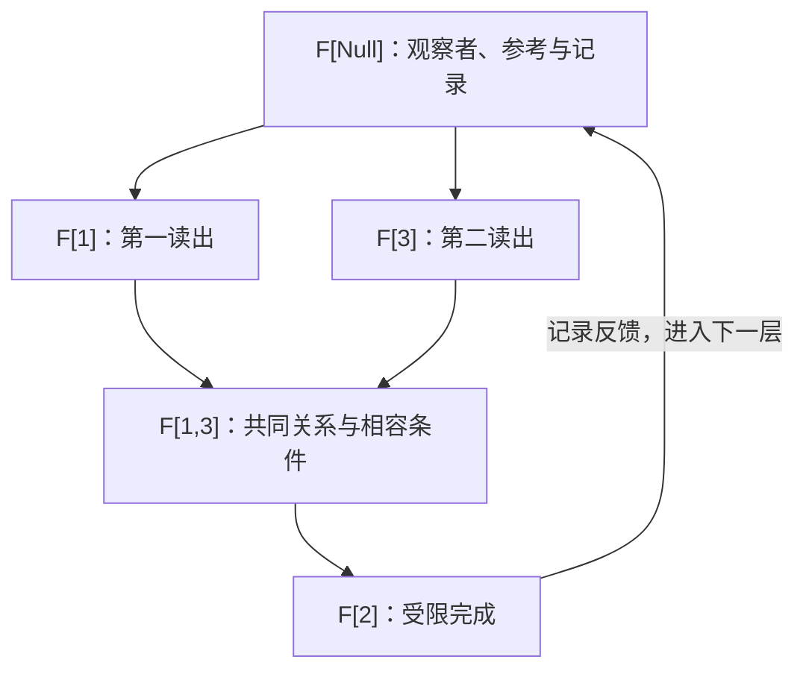

# 观察者内生的五元素递归

> 来源：用户于 2026-11-05（Asia/Singapore）在本会话提供的 AURIC R5-001 LaTeX 研究工作稿；原稿未另署作者或模型。本文为参考输入，Lean 是仓库的数学真源；本次仅转换 Markdown，未作形式化认证。正文中的固定快照、项目核读叙述与理论结论均保留原稿口径；一幅 TikZ 图转换为 Mermaid，保留五角色依赖、记录反馈及原图注。

AURIC / R5-001

从二元读出、关系与归一化，到局部三维纤维和信息逃逸

理论定义候选与条件性纸面推导

2026年11月5日　新加坡时间

## 摘要

本轮把用户的表述整理为一个可核查的定义候选：$F[\mathrm{null}]$ 承载当前观察者，$F[1]$ 与 $F[3]$ 给二元读出，$F[1,3]$ 保留共同关系，$F[2]$ 是这些条件下的完成量；观察者自身也由同样的结构递归表示。在五模式概率这一明确实现中，固定观察者端口的标量读数 $s$ 后，$(x,z,\kappa)$ 是三个完整坐标，并有 $p_2=1-s-x-z+\kappa$。观察者读数变化时，完整族恢复四个自由度。本文还证明：计算出的提升不自动增加区分能力；新增读出恰在切开旧纤维时捕获信息；有限阶段持续有逃逸与无限极限能分离所有状态可以同时成立。递归拼接须保留共同来源、接缝和联合正性。量子部分在明确给定复正矩阵、Pauli 代数或等距仪器条件后推导，不声称五个标签已经唯一重构标准量子力学。

**核心结论** 五元素可以作为观察者内生的递归接口。每层的三维是相对于已指定观察者的关系空间；深度、接缝、观察者和跨层关系共同承载整体信息。

本轮读取的仓库快照：[`the-omega-institute/trureturing`](https://github.com/the-omega-institute/trureturing/tree/d3c4ee1ee7f60f48b7dcdbd4967972029e18dfed)，分支 `dev`。

固定提交：`d3c4ee1ee7f60f48b7dcdbd4967972029e18dfed`。

范围：相关理论文本与 Lean 源码的只读核对、下述普通数学推导。未运行本轮 Lean 编译，未修改或提交仓库。本文的定义候选和纸面推导不冒充仓库已验收的新形式化结果。

## 1　本轮修订的准确含义

用户提出的关键修订，是把观察者放回描述内部：不仅被观察对象有二元读出和关系，作为参考点、选择规则与记录载体的观察者也应有同样的结构。这样，$F[\mathrm{null}]$ 可被定义为**本层观察者端口**；一个端口的完整内容可以在其他单元中继续展开。

这一解释需要区分模式、端口载荷和数值读出。一个模式标签可以承载一个有结构的对象，而对这个对象的一次数值读出并不等于对象的全部内容。本文采用下面的候选对应。

| 角色 | 本轮候选语义 |
|:---|:---|
| $F[\mathrm{null}]$ | 当前观察者 $O$：记录、参考系、标定、允许操作和更新规则的内部端口。 |
| $F[1]$ | 相对于 $O$ 的第一项读出。 |
| $F[3]$ | 相对于 $O$ 的第二项读出。 |
| $F[1,3]$ | 两项读出的共同来源关系；视任务可含联合占位、次序、相位或相容证据。 |
| $F[2]$ | 在观察者与关系已指定后得到的受限完成量；未唯一时保留可行集合。 |

仓库原生五模式与本文位置记号之间的对应为

$$
\begin{array}{c|ccccc}
\text{本文}&F[\mathrm{null}]&F[1]&F[2]&F[3]&F[1,3]\\
\hline
\text{位置串}&000&100&010&001&101\\
\text{仓库权重标签}&N&[2]&[3]&[5]&[25]
\end{array}
$$

其中 $[25]$ 表示共同占位标签，不是十进制二十五。仓库的 $N$ 是实际模式，不是 Hilbert 零向量；在来源递推中 $000$ 也不自动是恒等操作。把它指定为观察者端口，是本轮提出的语义赋值，需要保留原模式的来源与接缝含义，不能以改名代替一个无损对应。相关原文见文献[\[4\]](#ref-fib), [\[2\]](#ref-observer), [\[3\]](#ref-omega)。

**图 1：** 五角色的定义依赖和记录反馈。图示不把三维关系空间解释为物理空间，也不表示计算出的完成量必然是一次新测量。

## 2　一个完全可算的实现：观察者固定后的三维纤维

### 2.1　五模式分布与二元关系

#### 定义 2.1：归一化五模式族

按 $(\mathrm{null},1,2,3,13)$ 排序，设

$$
p=(p_0,p_1,p_2,p_3,p_{13}),\qquad p_j\ge0,\qquad
p_0+p_1+p_2+p_3+p_{13}=1.
$$

定义本层数值读出

$$
s=p_0,\quad x=p_1+p_{13},\quad z=p_3+p_{13},\quad
\kappa=p_{13},\quad y=p_2.
$$

$x,z$ 是第一与第三位置的占位边缘，$\kappa$ 是共同占位关系。$s$ 是观察者端口在这一概率表示中的一个标量读数，不是整个观察者。

这里 $p_1$ 与占位边缘 $x$ 不是同一个量：共同模式 $13$ 也使第一位置被占据。区分二者，才不会在归一化中重复计数。

#### 命题 2.2：固定观察者读数后的精确三坐标

固定 $s\in[0,1]$，则该五模式族与

$$
\mathcal C_s=\{(x,z,\kappa):\ \kappa\ge0,\ x\ge\kappa,\ z\ge\kappa,
\ x+z-\kappa\le1-s\}
$$

之间存在仿射双射，逆映射为

$$
\boxed{
p_0=s,\quad p_1=x-\kappa,\quad p_3=z-\kappa,\quad
p_{13}=\kappa,\quad p_2=1-s-x-z+\kappa.}
\tag{1}
$$

若 $0\le s<1$，$\mathcal C_s$ 有三维内部；若 $s=1$，则只剩 $(x,z,\kappa)=(0,0,0)$。

**证明。**

由边缘和共同占位的定义，先得 $p_{13}=\kappa$、$p_1=x-\kappa$、$p_3=z-\kappa$。将这三式和 $p_0=s$ 代入归一化，恰得最后一式。每个非负条件分别对应 $\mathcal C_s$ 的四项不等式，故它们既必要又充分；重构后五项之和为一。两套公式互为逆映射，且都是仿射映射。当 $s<1$ 时，取其余四个概率均为 $(1-s)/4$，所有四项非负条件均严格，故有三维内部。当 $s=1$ 时，其余非负概率之和为零，必全为零。

$\square$

因此，在这个模型中，用户所说的“二元读出加关系，归一化后算出受限 $F[2]$”有精确形式

$$
\boxed{(O;x,z,\kappa)\longmapsto y=1-s(O)-x-z+\kappa.}
$$

本层的 $s$ 必须已知。固定 $s<1$ 的纤维是一个三维四面体的仿射像；它不同于原五占位点的三维方底棱锥，也不同于量子 Bloch 球。维数相同不使三者的混合结构相同。

### 2.2　观察者的读数不能无代价删除

#### 例 2.3：相同二元读出和关系，不同观察者权重

令 $x=z=1/3$、$\kappa=1/6$。下面两个五模式分布都合法：

$$
p=\left(0,\frac16,\frac12,\frac16,\frac16\right),\qquad
p'=\left(\frac14,\frac16,\frac14,\frac16,\frac16\right).
$$

它们的 $(x,z,\kappa)$ 相同，但 $p_2$ 分别为 $1/2$ 与 $1/4$。故不知 $s$ 时，三项读出并不唯一决定 $F[2]$ 的权重。

允许 $s$ 变化，完整分布由 $(s,x,z,\kappa)$ 四个参数恢复。这与仓库关于“五模式概率有四个自由度”的结论一致[\[1\]](#ref-second), [\[5\]](#ref-mixed)。本文做的重组，是**把观察者端口的参考读数当作基底参数，把其余三个参数当作该参考下的纤维坐标**。

这不是断言整个观察者只有一个自由度。其记忆、仪器、参考方向和尺度可以有更多结构；这些内容在递归子图中保留。这个三维纤维只是一个任务明确的局部概率模型。

#### 命题 2.4：归一化保留比例，通常舍去尺度

设 $u_j\ge0$、$T=\sum_j u_j>0$，归一化映射为 $u\mapsto p=u/T$。则任意 $\lambda>0$ 给相同归一化像 $p(\lambda u)=p(u)$，而 $(T,p)$ 唯一恢复 $u=Tp$。

**证明。**

直接约去分子分母中的 $\lambda$；逆向逐项乘以 $T$。

$\square$

若总强度、时长或资源尺度属于目标，就应由观察者记录保存 $T$。当 $T=0$ 时归一化未定义，必须作为单独的零输入边界处理。三维实坐标还可以含任意精度；“有限维”不自动等于“有限信息量”。

## 3　让观察者本身进入相同的递归语法

#### 定义 3.1：带类型的五端口单元

一个单元写为

$$
\mathfrak F_O(A,B)=\bigl(O,A,B,R_O(A,B),L_O(A,B,R_O(A,B))\bigr).
$$

五个位置依次对应观察者、两个读出、共同关系、受限完成。$O$ 包括本次解释所用的记录、允许菜单、归一化约定、坐标方向与更新规则。关系和完成映射的定义均要求注明来源及类型。

本定义允许端口指向已有节点或子图。因此同一节点可在一个单元中充当观察者，在另一个单元中充当被比较对象：

$$
\mathfrak F_{O'}(O,A).
$$

把观察者纳入分析并不需要新增第六种角色。它需要允许**同一种角色载荷继续成为其他单元的输入**。

这也不要求集合论中的 $O\in O$。有限有向图可以含指回自身的引用；图的节点标识和边关系都可由通常集合编码。对运行历史，可以用有限阶段 $O_0,O_1,\ldots$ 表示，每一阶段保存截至当时的记录。自指接口、完整自知和预测全部未来是不同要求，前者不蕴涵后两者。

#### 定义 3.2：内部更新与历史保存

令 $R_n:\mathcal X\to Y_n$ 表示截至阶段 $n$ 的联合记录，其中 $\mathcal X$ 是研究任务允许的完整来源或历史集合。一次新增的实际读出为 $q_n:\mathcal X\to Z_n$，更新定义为

$$
R_{n+1}(\xi)=(R_n(\xi),q_n(\xi)).
\tag{2}
$$

仪器的选择可依赖已有记录；此时 $q_n(\xi)$ 表示由 $R_n(\xi)$ 选择的那项实际实验结果。旧记录仍可由第一投影恢复。

$\mathcal X$ 中比较不同来源，是刻画观察者已知条件下的可区分性，不主张现实同时存在多个独立“全局本体”。若实际整体记作 $\omega$，实际记录就是 $R_n(\omega)$。数学上定义全部纤维，也不意味着某个内部观察者已经拥有枚举它们的全局能力。

## 4　信息逃逸的精确定义与递归规律

### 4.1　逃逸对与目标恢复

#### 定义 4.1：相对于记录的逃逸

记相等核 $\ker R=\{(\xi,\eta):R(\xi)=R(\eta)\}$。它是一个等价关系，勿与线性映射零空间混淆。阶段 $n$ 的逃逸集合为

$$
\mathcal E_n=\{(\xi,\eta)\in\mathcal X^2:\xi\ne\eta,\ R_n(\xi)=R_n(\eta)\}.
$$

若目标为 $T:\mathcal X\to W$，目标相关逃逸为

$$
\mathcal E_{n,T}=\{(\xi,\eta):R_n(\xi)=R_n(\eta),\ T(\xi)\ne T(\eta)\}.
$$

这个定义与仓库首页及 `EscapePairs` 的有限来源版本相接[\[7\]](#ref-escape)。信息“逃逸”指没有进入所选读出的区别，不指信息从全局整体中消失。

#### 命题 4.2：目标恢复的纤维判据

存在 $g:R_n(\mathcal X)\to W$ 使 $T=g\circ R_n$，当且仅当 $\mathcal E_{n,T}=\varnothing$。

**证明。**

若有 $g$，同记录必有同目标。反之，对达到像中的 $r$，定义 $g(r)$ 为任一满足 $R_n(\xi)=r$ 的来源之 $T(\xi)$；无目标逃逸保证这一值唯一，故良定义。这里解码器只定义于达到像，不额外要求空值域上的延拓。

$\square$

仓库已有任意目标恢复的相应因子化判据[\[8\]](#ref-target)。它证明恢复函数的存在，不自动给出计算该函数的算法或复杂度界。

### 4.2　新增关系何时真正捕获信息

#### 命题 4.3：联合读出的精确细化

更新式(2)满足

$$
\boxed{\mathcal E_{n+1}=\mathcal E_n\cap\ker q_n\subseteq\mathcal E_n.}
\tag{3}
$$

包含严格，当且仅当存在 $\xi,\eta$ 满足

$$
R_n(\xi)=R_n(\eta),\qquad q_n(\xi)\ne q_n(\eta).
$$

目标逃逸严格减少，还要求这样的见证具有 $T(\xi)\ne T(\eta)$。

**证明。**

有序对相等，当且仅当其两分量分别相等。因此两个来源在新记录下不可区分，当且仅当既在旧记录下不可区分，也被新读出合并。删去对角即为(3)。严格性恰对应有旧逃逸对被新读出分开；目标版本在同一推理中保留目标不等条件即可。

$\square$

已有 Lean 源码的联合核交与逃逸反单调律提供这一结构的直接接口[\[6\]](#ref-joint), [\[7\]](#ref-escape)。

#### 命题 4.4：计算提升不增加区分能力

若 $q_n=f\circ R_n$，则 $\mathcal E_{n+1}=\mathcal E_n$。若只保留 $f\circ R_n$ 而丢弃 $R_n$，逃逸集合反而可能扩大。

**证明。**

同旧记录必有同 $f$ 值，所以 $\ker R_n\subseteq\ker(f\circ R_n)$；与 $\ker R_n$ 取交不变。只保存 $f$ 的值时，原有相等核仍被包含，且 $f$ 可以合并原本不同的读出。

$\square$

这是五元素递归中的一项关键责任分配：$F[2]$ 若只是从 $(O,F[1],F[3],F[1,3])$ 算出，它解释约束并完成表示，但不凭空添加新的观测区别。真正减少逃逸的步骤，是取得一个在旧纤维上不恒定的新关系、新探针或新历史响应。所谓“继续递归”，应把尚未被固定的关系作为下一层实际研究对象。

### 4.3　本轮候选的一个直接逃逸例子

第2节中的两个分布有相同 $(x,z,\kappa)$，不同 $s$。因此省略观察者参考读数的读出

$$
R(p)=(x,z,\kappa)
$$

把它们合并；加入 $s$ 后即能区分，并恢复 $p_2$。进一步将恢复的 $p_2$ 追加到 $(s,x,z,\kappa)$，则依据命题4.4不会再次增加区分能力。

## 5　持续逃逸、逐对完成与任务完成

#### 命题 5.1：有限容量下的非终结边界

若 $\mathcal X$ 无限，且每一阶段 $R_n(\mathcal X)$ 有限，则每个有限 $n$ 都有 $\mathcal E_n\ne\varnothing$。

**证明。**

若 $\mathcal E_n=\varnothing$，则 $R_n$ 单射，把无限集合注入有限集合，矛盾。

$\square$

该结论说每一阶段*至少存在*一个仍不区分的来源对。它不保证实际来源所在的每条纤维都有多个元素。例如在 $\mathcal X=\mathbb N$ 上令 $R_n(k)=\min(k,n)$，每个固定 $k$ 在足够大 $n$ 后已成为单元素纤维，虽然每一阶段仍有无限尾部被合并。

#### 例 5.2：每层都有剩余，极限却分离全部来源

令 $\mathcal X=\{0,1\}^{\mathbb N}$，$R_n$ 读取前 $n$ 位。每个有限前缀后仍有无限多种延拓，所以每个有限阶段的每条非空纤维均有未决内容。但任意两条不同序列在某个有限位置首次不同，因此

$$
\forall n\quad\mathcal E_n\ne\varnothing,\qquad
\bigcap_{n\ge0}\mathcal E_n=\varnothing.
$$

有限前缀逐层增长可以既持续遇到信息逃逸，又在极限意义上分开每一个固定来源对。

#### 命题 5.3：有限目标可以在有限阶段完成

在上述二进制流的乘积拓扑上，若 $W$ 是有限离散集合，目标 $T:\mathcal X\to W$ 连续，则存在 $N$ 使 $T$ 仅依赖前 $N$ 位。

**证明。**

对每个 $\xi$，连续性保证一个包含 $\xi$ 的有限前缀柱集，其上 $T$ 恒定。这些柱集覆盖紧空间 $\{0,1\}^{\mathbb N}$，故存在有限子覆盖。取该有限子覆盖中前缀长度的最大值 $N$。具有相同前 $N$ 位的两条流，落在包含其中一条的同一覆盖柱集中，所以目标相同。由目标恢复判据，目标由 $R_N$ 恢复。

$\square$

因此，“全局仍有逃逸”和“当前目标已经完成”相容。理论不能把始终存在剩余区别，误写为所有具体任务都永远不能结束。

#### 说明 5.4：一个量子兼容的无限余量例子

在 $\ell^2(\mathbb N)$ 中取

$$
\omega=\sum_{k\ge1}2^{-k/2}e_k,\qquad
V_n=\operatorname{span}\{e_1,\ldots,e_n\}.
$$

几何级数给 $\|\omega\|=1$，且

$$
\|(I-P_{V_n})\omega\|^2=2^{-n}>0.
$$

若 $Se_k=e_{k+1}$，还有 $\omega=(e_1+S\omega)/\sqrt2$。同一个归一化二元分解可无限重复，有限层余量始终非零而趋零。这个例子需要无限支撑，余范数也不是自动等于 Shannon 或 von Neumann 信息量。

## 6　二元递归必须保留全局相容

### 6.1　局部成对合法并不够

假如每一个二元关系单元只是独立检查一份二阶正矩阵，三份关系仍可能不属于同一个共同来源。最简反例为

$$
G=\begin{pmatrix}1&-1&-1\\-1&1&-1\\-1&-1&1\end{pmatrix}.
$$

每个二阶主块 $\left(\begin{smallmatrix}1&-1\\-1&1\end{smallmatrix}\right)$ 都正半定；但

$$
(1,1,1)G(1,1,1)^\mathsf T=-3<0.
$$

所以三份两两关系不能同时成为三个单位向量的 Gram 矩阵。直观上，前两项分别与第三项完全反向时，前两项不能彼此也完全反向。仓库二阶关系完成的 §§109–110 已把共同 Gram 正性与历史递归联结起来[\[1\]](#ref-second)。

#### 命题 6.1：带边界条件的 Schur 递归判据

设 $A$ 为有限维 Hermitian 矩阵，$b$ 为列向量，$c\in\mathbb R$。则

$$
\begin{pmatrix}A&b\\b^\dagger&c\end{pmatrix}\succeq0
$$

当且仅当

$$
A\succeq0,\qquad b\in\operatorname{Ran}A,\qquad
\delta=c-b^\dagger A^+b\ge0,
$$

其中 $A^+$ 为 Moore–Penrose 逆。若 $A$ 正定，可把 $A^+$ 换为 $A^{-1}$。

**证明。**

正性先给 $A\succeq0$。若 $v\in\ker A$ 但 $v^\dagger b\ne0$，令上块向量沿 $v$ 取任意复倍数、下块取一，可使二次型为负。因此 $b\perp\ker A$，即 $b\in\operatorname{Ran}A$。令 $q=A^+b$，则 $Aq=b$，并有对任意 $u,t$

$$
u^\dagger Au+2\Re(u^\dagger bt)+c|t|^2
=(u+qt)^\dagger A(u+qt)+\delta|t|^2.
$$

取 $u=-qt$ 给必要的 $\delta\ge0$，而右式又证明充分性。

$\square$

该判据可把联合相容检查递归化，但 $b$ 必须保留新对象与整个旧结构的交叉关系。当 $A$ 或 $b$ 被放入一个关系端口时，它们的内部尺寸可以增长；五个端口不是固定五个标量。单元可仍采用五角色语法，其载荷需要继续展开。

### 6.2　局部三维不限制全局秩

在同一内积空间中，每一对向量张成的空间至多二维，任意固定三个向量的局部空间至多三维，但一列相互正交的向量可以具有任意高乃至无限维的联合张成空间。因此局部有限提升本身不给全局维数或存储量的统一上界。仓库原生五模式还带有 Fibonacci 合法接缝；任意五标签串不一定是合法来源词[\[4\]](#ref-fib), [\[2\]](#ref-observer)。

## 7　量子实现：受限第三轴与二元不确定关系

### 7.1　归一化复正矩阵给三维球

本节**另外给定** 复二级载体以及正、迹一状态。它说明候选接口怎样与已有量子数学对接，不从五个模式标签推出复数。

任意二阶复 Hermitian 迹一矩阵可唯一写成

$$
\rho=\frac12\begin{pmatrix}1+z&x-iy\\x+iy&1-z\end{pmatrix}
=\frac12(I+x\sigma_1+y\sigma_2+z\sigma_3).
\tag{4}
$$

其两个本征值为 $(1\pm\sqrt{x^2+y^2+z^2})/2$，所以

$$
\rho\succeq0\quad\Longleftrightarrow\quad x^2+y^2+z^2\le1.
$$

只有两个已知坐标 $x,z$ 时，第三坐标满足

$$
-\sqrt{1-x^2-z^2}\le y\le\sqrt{1-x^2-z^2}.
$$

在纯态条件下，$y^2=1-x^2-z^2$。若右侧正，仍有正负两支。**手性规定正轴方向；实际关系或分支数据才决定未知态落在哪一支。** 仓库观察者文本 §7 给出同样的几何区分[\[2\]](#ref-observer)。

### 7.2　有序二元关系的第三方向

#### 命题 7.1：反对易读出对的第三算子

在复 Hilbert 空间上，若 $A,C$ 自伴，$A^2=C^2=I$，且 $AC=-CA$，则

$$
B=iAC=\frac{i}{2}[A,C]
$$

也是自伴、平方为一，并与 $A,C$ 反对易。

**证明。**

$B^\dagger=-iCA=iAC=B$。由 $ACAC=-I$ 得 $B^2=I$。把 $A$ 或 $C$ 移过乘积，分别得到反对易式。

$\square$

在标准 Pauli 约定 $A=\sigma_1,C=\sigma_3$ 下，$AC=-i\sigma_2$，故 $B=\sigma_2$。这给出一种明确的“二元有序关系产生第三方向”的实现。但由代数构造出 $B$，不等于已知未知态上的 $\operatorname{tr}(\rho B)$。此外，经典共同占位概率 $\kappa=p_{13}$ 是非负实数，它不能未经新映射就被当成非交换乘积 $AC$ 或其虚部。

#### 命题 7.2：二元协方差的三坐标约束

对式(4)的状态，令

$$
u=(\sigma_1-xI)\sqrt\rho,\qquad
v=(\sigma_3-zI)\sqrt\rho.
$$

采用 Hilbert–Schmidt 内积 $\langle u,v\rangle=\operatorname{tr}(u^\dagger v)$，其 Gram 矩阵为

$$
\Gamma=\begin{pmatrix}
1-x^2&-xz-iy\\-xz+iy&1-z^2
\end{pmatrix}\succeq0,
\qquad
\det\Gamma=1-x^2-y^2-z^2=4\det\rho.
$$

**证明。**

平方展开与 $\sigma_j^2=I$ 给对角元。交叉元为 $\operatorname{tr}[\rho(\sigma_1-xI)(\sigma_3-zI)]=-iy-xz$。 Gram 正性来自 $\|\alpha u+\beta v\|_{\rm HS}^2\ge0$。行列式直接展开为 $(1-x^2)(1-z^2)-(x^2z^2+y^2)$，得到所示结果；二阶密度矩阵行列式由(4)直接计算。

$\square$

如果 $|x|<1$，消去第一项后的 Schur 余量为

$$
\delta=\frac{1-x^2-y^2-z^2}{1-x^2}.
$$

$\delta=0$ 当且仅当这两个中心化向量复线性相关。这是“平方关系使*这一项局部关系*可以停止增加独立方向”的精确版本。若 $|x|=1$，正性已迫使 $y=z=0$，需按退化情形单独处理。

局部停止不代表全部信息都被读出。例如 $x=z=0,y=1$ 时状态纯且第三坐标确定，但 $\sigma_1,\sigma_3$ 的方差仍都等于一。算出第三坐标不能变成同时知道两项不相容测量的单次结果。

## 8　把观察者记忆纳入量子递归

仓库的相干历史递归提供了本轮语义的具体量子接口[\[1\]](#ref-second), [\[3\]](#ref-omega)。本节在每一阶段取有限历史集、有限结果集和有限维块载体；其大小可以随阶段增长。设历史标签为 $h$，整体边界态为

$$
\Omega_n=\sum_{h,k}|h\rangle\langle k|\otimes\Xi^{(n)}_{hk}\succeq0,
\qquad\operatorname{tr}\Omega_n=1.
$$

块载体包括系统、观察者记忆、控制以及将来还会再次作用的环境。给定同一实际等距实现

$$
V_n=\sum_{h,a}|h,a\rangle\langle h|\otimes K_{a|h},\qquad
\sum_aK_{a|h}^{\dagger}K_{a|h}=I,
$$

便得到

$$
\Omega_{n+1}=V_n\Omega_nV_n^\dagger,\qquad
\boxed{\Xi^{(n+1)}_{ha,kb}=K_{a|h}\Xi^{(n)}_{hk}K_{b|k}^{\dagger}.}
$$

输出历史基正交使 $V_n^\dagger V_n=I$，因此正性和迹一均保持。这个公式把记忆和记录放在同一内部演化中，不需要图外的观察者。但它以已给定的量子载体、实际等距和相位关系为前提；它不把整个复合载体压为三维，也不许把未来仍会返回的环境直接丢弃。

必须区分在较大描述中追踪一个子系统，与物理复制该子系统的未知量子态。本文的递归端口可以共享引用、重组关系或记录实际测量结果；它不授予克隆未知态的操作。

## 9　完整候选 R5-001：五角色内生递归原则

本轮提出以下完整*定义候选*。它是有明确假设与边界的关系模型，尚不是唯一恢复全部量子力学的公理系。

- **R1.** **内生端口。** 每个局部关系单元具有观察者、两个读出、共同关系和受限完成这五个角色。观察者的记录、标定、菜单与更新规则也在同一对象网络中表示；角色载荷允许递归引用其他单元。

- **R2.** **相对归一化。** 每次归一化必须给出正的尺度与共同来源，并在目标需要时保留尺度。采用第2节的五模式概率实现时，固定观察者读数 $s$ 后使用 $(x,z,\kappa)$，以(1)完成 $F[2]$；边界与不可行输入显式处理。

- **R3.** **共同相容。** 共享端口的单元必须在重叠记录和同一实现上相容。使用向量或量子语义时，需要联合 Gram 或整体状态正性；单独成对相容不能替代共同实现。原生 Fibonacci 语法还保留合法接缝。

- **R4.** **历史递增。** 一个声称保留历史的更新能恢复旧记录；最直接采用 $R_{n+1}=(R_n,q_n)$。物理上不可逆的局部读出可以作为整体内部的记录操作表示，但未授权的旁路、自由复位和未知态复制不被默许。

- **R5.** **按逃逸见证推进。** 新一层若声称捕获了旧记录遗漏的信息，必须给出在旧纤维上取不同值的实际关系读出；若目标已在纤维上恒定，则该目标可停止。无限来源和有限阶段容量可作为持续有逃逸的附加条件，不把无限持续写成五个标签的自动后果。

| 去掉的条件 | 具体后果 |
|:---|:---|
| 观察者数据内生 | 同一数值可来自不同标定、参考或菜单，无法统一解释后续。 |
| 观察者读数 $s$ | 第2节的同 $(x,z,\kappa)$ 反例使 $p_2$ 不唯一。 |
| 联合关系 $\kappa$ | 相同边缘可以具有不同共同占位，三维占位投影丢掉关系。 |
| 联合相容 | 第6节矩阵的每对关系合法，整体却不可实现。 |
| 历史保留 | 更新可以合并已区分的来源，逃逸不再单调减少。 |
| 真实新增读出 | 只计算 $f(R_n)$ 不切开任何旧纤维。 |
| 有限容量等非终结条件 | 完全读出或有限状态任务可以终止，不能推出永远有剩余。 |

这些条件把“为什么需要这条约束”落实到具体的反例或丢失信息。把约束写入定义，可以明确选出合法模型；这不会把元语言中的假设变成无需任何前提的逻辑定理。理论内生性的数学内容，是约束有图内载体并参与同一解释与更新，而不是宣称零假设可唯一产生物理世界。

## 10　与现有量子力学的推导关系

| 目标结构 | 本文得到的关系 | 仍需保留的条件 |
|:---|:---|:---|
| 目标结构 | 本文得到的关系 | 仍需保留的条件 |
| 观察者在理论内部 | 观察者端口的载荷可递归表示；量子历史块可包含观察者记忆。 | 类型、更新规则、实际记录及共同实现。 |
| 局部三维 | 固定 $s$ 的五模式概率纤维为三维；归一化二阶复正矩阵给 Bloch 三坐标。 | 这两种三维结构不同，不能只按维数认同。 |
| 第三方向 | 反对易自伴对满足 $B=iAC$。 | 复结构、乘法、反对易关系；轴定义不决定未知态的坐标。 |
| 不确定约束 | 中心化二元 Gram 正性给 $x^2+y^2+z^2\le1$。 | 标准 Pauli 与正状态语义。 |
| 概率平方或迹规则 | 在复正态与效果的标准配对下具有既有量子概率形式。 | 五模式递归本身未推出这种概率配对。 |
| 复合系统与纠缠 | 相干历史块和联合正性保留跨层关联。 | 张量组合、允许操作及相位约定。 |
| 可逆动力学 | 给定等距实现保持正性和归一化。 | 不能从记录递增单独推出所有闭系统演化均为酉或特定哈密顿量。 |
| 无限观察过程 | 前缀例子与无限支撑例子可持续有余量。 | 无限来源、容量或非闭合条件，不是所有模型都必须无限。 |

已有量子重构研究也把概率、复合与纯化等条件明确列为输入。Chiribella、D’Ariano 与 Perinotti 使用一组信息原则和纯化条件恢复量子理论[\[9\]](#ref-cdp)；Barnum 与 Wilce 在 Jordan 结构、局部层析和含量子位等条件下刻画有限维复量子理论[\[10\]](#ref-barnum)。这些工作提供可核对的后续桥接目标，而不是给“五元素”这个数字本身背书。

本轮已经明确的主结果，是**观察者读数固定后的三维纤维、观察者自身的递归角色、计算提升不增信息的判据、逃逸细化规律以及联合相容责任**。要进一步唯一导出标准量子力学，需要证明相应的复结构、概率和复合条件确实由所选内部关系模型满足。

## 11　白话描述与可继续检验的命题

你看到两项东西时，已经站在一个具体的观察位置上。这个位置带着你的历史、量具和判断规则，所以它也必须在图里。两项读出只有连同它们的共同关系一起看，才能知道还有什么被约束、什么仍有多种可能。在明确的归一化模型中，当前观察者的参考量一旦固定，两个读出加一个关系就成为三项坐标，剩下那一项按约束算出。接着，观察者自己和刚得到的记录又可以成为下一层的两个对象。

这样的递归始终使用相同的五种角色，结构却可以越来越大。已经算出来的东西让旧关系更清楚；要真正知道更多，就要找到旧记录分不出的两个来源，并读到它们不同的关系。没有读到的区别仍留在相容的整体关系里。每一层可以有限，每一个具体目标可以完成，而整个来源仍可能有尚未分开的内容。

下一步最明确的可检验对象是：对一个给定来源族及其实际菜单，构造从原生五模式词与观察者记忆到五端口网络的映射，证明它同时保持合法接缝、允许操作、所选目标读出以及旧记录恢复。若某个映射删除了这些目标之一，应给出同像不同目标的具体双点；若全部保持，则说明在该明确任务范围内五角色递归确实充分。这里不要求先证明“宇宙的一切”才能形成一个有效结果。

## A　来源定位与本轮证据边界

下列仓库链接均固定在 `d3c4ee1ee7f60f48b7dcdbd4967972029e18dfed`。来源文本用来确认术语、既有条件和相应声明；本轮未运行 Lean，因此没有作新的编译验证声明。固定观察者读数后的纤维重组及本文演算以其显式假设和纸面证明承担。

## 参考文献

\[1\] trureturing，*AURIC FIB 二阶关系完成*，§53.1（占位与概率维数）、§§109–110（联合记录与历史块递归）。

<https://github.com/the-omega-institute/trureturing/blob/d3c4ee1ee7f60f48b7dcdbd4967972029e18dfed/docs/develop/theory/AURIC_FIB_SECOND_ORDER_RELATION_COMPLETION.md>

\[2\] trureturing，*AURIC FIB 观察者内生三轴几何与预测接口*，§§6–9。

<https://github.com/the-omega-institute/trureturing/blob/d3c4ee1ee7f60f48b7dcdbd4967972029e18dfed/docs/develop/theory/AURIC_FIB_OBSERVER_INTERNAL_THREE_AXIS_GEOMETRY_AND_PREDICTIVE_INTERFACE.md>

\[3\] trureturing，*AURIC Ω 静态相融纤维理论*，§§1、4、7、12。

<https://github.com/the-omega-institute/trureturing/blob/d3c4ee1ee7f60f48b7dcdbd4967972029e18dfed/docs/develop/theory/AURIC_OMEGA_STATIC_COMPATIBILITY_FIBER_THEORY.md>

\[4\] trureturing，*FIB 关系延拓几何*，定义2.1–2.4、定理2.3。

<https://github.com/the-omega-institute/trureturing/blob/d3c4ee1ee7f60f48b7dcdbd4967972029e18dfed/docs/develop/theory/FIB_RELATIONAL_CONTINUATION_GEOMETRY.md>

\[5\] trureturing，`FiveModeMixedCoordinates.lean`，`mixed_coordinates_global_chart`。

<https://github.com/the-omega-institute/trureturing/blob/d3c4ee1ee7f60f48b7dcdbd4967972029e18dfed/D5/S1/Words/AdmissibleWords/FiveModeMixedCoordinates.lean>

\[6\] trureturing，`JointReadoutSupremum.lean`，`pair_readout_kernel`。

<https://github.com/the-omega-institute/trureturing/blob/d3c4ee1ee7f60f48b7dcdbd4967972029e18dfed/D5/S3/ObserverMemory/Refinement/JointReadoutSupremum.lean>

\[7\] trureturing，`EscapePairs.lean`，`escapePairs_anti`、`escapePairs_insert`。

<https://github.com/the-omega-institute/trureturing/blob/d3c4ee1ee7f60f48b7dcdbd4967972029e18dfed/D5/S3/ConceptDynamics/InformationEscape/EscapePairs.lean>

\[8\] trureturing，`TargetRecoveryCriterion.lean`，`target_recovery_criterion`。

<https://github.com/the-omega-institute/trureturing/blob/d3c4ee1ee7f60f48b7dcdbd4967972029e18dfed/D5/S3/ConceptDynamics/Restoration/TargetRecoveryCriterion.lean>

\[9\] G. Chiribella, G. M. D’Ariano, P. Perinotti. *Informational derivation of Quantum Theory*. Phys. Rev. A 84, 012311 (2011).

<https://arxiv.org/abs/1011.6451v3>

\[10\] H. Barnum, A. Wilce. *Local tomography and the Jordan structure of quantum theory*. arXiv:1202.4513v2.

<https://arxiv.org/abs/1202.4513v2>
