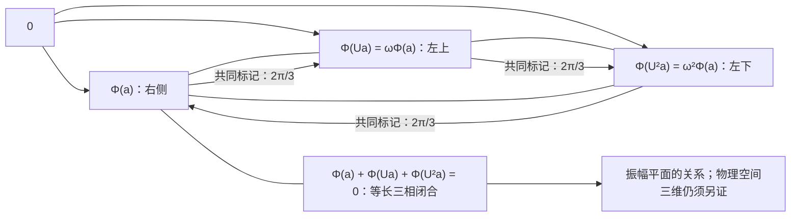

# 三相比较、内生记录与量子公理

> 来源：用户于 2026-11-05（Asia/Singapore）在本会话提供的 AURIC R5-002 LaTeX 研究工作稿；原稿未另署作者或模型。本文为参考输入，Lean 是仓库的数学真源；本次仅转换 Markdown，未作形式化认证。正文中的固定快照、项目核读叙述与理论结论均保留原稿口径；一幅原生 TikZ 图转换为 Mermaid，保留三相方向、等边闭合关系、图中文字和原图注。

AURIC / R5-002

从等边关系到复几何，再锁定原读口

完整候选、条件性理论与反向删条件检查

2026年11月5日

## 摘要

本轮沿 R5-001 的五角色递归继续回溯。起点由复正关系核退到处处有限、非负、零对角的实值二元比较：对任意两对原始配方，三次共同标记聚合满足一个平衡式。项目现有定理已经从这个条件重建复 Hilbert 几何，无须先给结合律、交换律、对称距离、内积或正定矩阵。本文完整说明该证明，并把同一关系施于由原实际概率定义的事件质量，得到正效果与 Born 形式。

本轮的集中增量是一条跨层绑定链：连通的二元排斥关系、同切口响应一致、支持相容以及一个内部空分支，推出原记录校准；正性再把校准推广到完整空间，迫使记录向量正交并锁定原命名投影。该链把许多逐态概率数值压缩为关系的零性，并防止把另一个 POVM 冒认成原读口。随后给出观察者内生、三维 Bloch 关系、递归 Gram 完成、状态、仪器、张量积与连续时间的条件推导及删条件反例。本文不把表示空间的数学完成等同于实际操作供应，也不声称仅凭五个标签已完成物理量子起源。

**候选的一句话版本** 同一来源中的比较总量和实际记录分量，都服从三相聚合平衡；来源与读出使用同一套二元区别，内部零分支不能被报告成别的记录。观察者也是这些来源和记录中的对象。

核对版本：[the-omega-institute/trureturing，dev](https://github.com/the-omega-institute/trureturing/tree/7435937ceebe94e73d90ba9ac86fb0ca392402b0)。

固定提交：`7435937ceebe94e73d90ba9ac86fb0ca392402b0`，提交时间 2026-11-05 09:11:56 UTC。

证据范围：相关理论文本、提交差异与 Lean 声明的只读核对；本文纸面推导。未在本轮运行 Lean 编译，未修改仓库。已有项目结果、本文组合引理和仍待供应的物理接口分别注明。

## 1　本轮究竟压缩了什么

R5-001 说明五个角色可以递归承载观察者、两项读出、共同关系和受限完成，但也证明了五模式概率本身不足以选出量子理论。本轮向前回溯一步：不把复数、内积和 Gram 正性先放入定义，而从一个实值比较关系重建它们。这样，局部三维也有了准确来源：两个复振幅的正关系表归一化后，恰有三个实参数。

本轮固定到仓库提交 `7435937ceebe94e73d90ba9ac86fb0ca392402b0`。它相对最初读取的 `21d47954` 又增加五个提交；该增量属于 CRIM 博弈分类，没有改变本轮量子来源。真正相关的结构如下。

| 来源 | 对本轮的作用 |
|:---|:---|
| C133 续卷 V 与 RawAnchored 模块 | 原始双端三相平衡与复 Hilbert 表示等价；有完整历史缺陷消除证明。 |
| C129 | 递归 Gram 扩展、Schur 余量、相位三角和共同日志条件。 |
| 量子原则续卷 XI | 九个原二元切口的支持相容，在其完整来源背景中恢复校准和 Born 选择。 |
| 续卷 X 新 §§9–12 | 同源因果实现和指定有限合同仍可与原终端 Born 律分离；实际程序 $78$ 给反例。 |
| C139 新 §§22–23 | 双模操作替代四模原语，稳定提升扩大环内菜单；原叶概率身份与全菜单刚性仍需接口。 |
| C128 新 §§187–190 | 在其完整原背景内，用两个实际参考共同恢复被删的正交自读；不能只借结论而略去背景。 |

对应原文见文献 [\[1\]](#ref-c133), [\[2\]](#ref-raw), [\[3\]](#ref-c129), [\[4\]](#ref-xi), [\[5\]](#ref-x), [\[6\]](#ref-c139), [\[7\]](#ref-c128)。本文不将这些已有结果重新命名为发现；本轮的组织重点是

$$
\boxed{\text{三相比较}\ \Longrightarrow\ \text{正事件几何}
\ \Longrightarrow\ \text{原记录校准}\ \Longrightarrow\ \text{原 Born 读口}.}
$$

中间两箭头必须使用同一来源、同一响应和同一事件命名。两个不同文件都写了字母 $R$，不表示两条条件相同。以下用 $\mathsf B_3$ 表示三相平衡，用 $\mathsf R_{\rm keep}$ 表示保留记录关系。

## 2　完整候选：先把对象和关系的类型锁定

### 2.1　原始二元配方与三相比较

#### 定义 2.1：原始比较域

$M$ 是有限配方的集合，带二元聚合 $a\odot b$ 与双侧单位 $e$。配方保留左右次序、括号、来源、参考与档案；不先假定聚合交换或结合。给定

$$
U:M\to M,\qquad Ue=e,\qquad
c:M\times M\to[0,\infty),\qquad c(a,a)=0.
$$

每个读数是有限实数。$M$ 不要求有限；允许任意有限深度的配方。$a\odot b$ 是本比较使用的聚合，不能自动解释成量子门的时间接续。

#### 定义 2.2：几何核心 $\mathsf B_3$

对全部 $a,b,u,v\in M$，要求

$$
\boxed{\sum_{k=0}^{2}c(a\odot U^ku,\ b\odot U^kv)
=3c(a,b)+3c(u,v).}
\tag{\mathsf B_3}
$$

这是两个有序对 $(a,b)$、$(u,v)$ 之间的相容约束：将第二个差别以三个标记接入第一个差别，比较总量精确相加。

三项都使用同一个 $U$，而且对任意旧背景成立。没有这两个量词，三个局部示意图不能替代完整条件。三相标记本身是前件；其可见作用将被证明为 $120^\circ$ 转动。本文不宣称从完全无结构的集合唯一推出三相。

### 2.2　事件分量从原概率定义，不另换一个测量

记 $q(a)=c(a,e)$。几何定理将证明

$$
\iota(b)=Ub\odot U^2b,\qquad
d(a,b)=a\odot\iota(b),\qquad q(d(a,b))=c(a,b).
$$

对一个实际完整有限测试 $C$，设原命名记录为 $s\in S_C$，其原响应为 $p_C(s\mid h)\ge0$、$\sum_s p_C(s\mid h)=1$，定义域是 $q(h)>0$ 的原配方。观察者、器件及保留参考是这个测试身份的一部分。

#### 定义 2.3：原响应的事件比较

在几何核心成立以后，定义

$$
c_{C,s}(a,b)=
\begin{cases}
c(a,b)\,p_C(s\mid d(a,b)),&c(a,b)>0,\\
0,&c(a,b)=0.
\end{cases}
\tag{1}
$$

候选要求每个 $c_{C,s}$ 仍满足同一个 $\mathsf B_3$。由定义已知

$$
c_{C,s}\ge0,\qquad \sum_s c_{C,s}=c,\qquad
c_{C,s}(a,e)=q(a)\,p_C(s\mid a).
$$

最后一个等式使用 $Ue=e$ 与双侧单位，因此 $d(a,e)=a$。

这里没有给抽象成本随意取一个概率解释：式 (1) 从原响应构造质量，约束必须由这个原响应满足。若实际来源不能供应相应比较配方和测试身份，这一条仍是候选条件，不能宣称已经从 $\Omega$ 证明。零比较处只定义未归一质量为零，不评价 $p_C(s\mid0)$。

### 2.3　来源与读出保留同一套二元区别

固定一个待绑定的完整记录测试，输出配置集合

$$
S\subseteq\operatorname{Ind}(G)
$$

是有限图 $G=(V,\mathcal E)$ 的独立集族，含空配置和每个单点。边 $k\sim l$ 表示两位不能同时为一。对每个来源配置 $s$，取满足 $q(r_s)>0$ 的配方 $r_s$，并对*同一个原响应*定义

$$
T(t\mid s)=p_C(t\mid r_s),\qquad
p_k(s)=\sum_{t:\,k\in t}T(t\mid s).
$$

完整记录条件包括：

1.  **同切口一致：** $p_k(s)=a_k$ 当 $k\notin s$，$p_k(s)=b_k$ 当 $k\in s$。 这是一项结构条件；在具体项目中可由避开该位的实际门轨道和响应一致性推出，任意图不自动拥有这些门。

2.  **支持相容：**

    $$
    a_k=0\ \Longrightarrow\ b_k=1.
    \tag{L}
    $$

    等价语言是：若来源零侧从不被报到一侧，则来源一侧也不会被报到零侧。九位项目原文使用双向形式；在其非孤立连通背景中可推出本式的反向。

3.  **内部零种子：** 存在 $s_*\in S$、$k_0\notin s_*$，原 ready 恰为 $h_*=r_{s_*}$。 同一个保留读过程的第一分支给原标签 $h_1$，且 $q(h_1)=0$。 记 $m_1(h_*)=\sum_{t:\,k_0\in t}p_C(t\mid h_*)$，所需的原保留读实例为

    $$
    \mathsf R_{\rm keep}:\quad p_C(t\mid h_*)=
    \begin{cases}
    m_1(h_*)p_C(t\mid h_1),&q(h_1)>0,\\
    0,&q(h_1)=0,
    \end{cases}
    \quad(k_0\in t).
    $$
    因此 $p_{k_0}(s_*)=0$，同切口一致给 $a_{k_0}=0$。 这仅要求该原 ready 的确切零实例；若 ready 只与 $r_{s_*}$ 同射线，必须先证明那项同源对应。 有限样本中未见事件不能替代这个过程零关系。

4.  **连通与覆盖：** $G$ 连通；记录的可见向量张成所讨论的保留载体。若图不连通，每个连通分量分别需要一个零种子；若只覆盖一个子空间，结论只到该子空间。

#### 说明 2.4：同源要求是实质条件

$r_s$ 可以是原模型定义域中有明确来源的数学输入，不必全部已经有精确实验制备程序。此时得到的是同一个响应的数学校准定理，不能称为逐态已实施校准。若图论证使用响应 $\Pi$，事件几何使用另一个响应 $\widetilde\Pi$，即使两者各自正确也无法连接。本文始终令二者为同一 $p_C$。

**白话对应。** 先把两份配方拿来比较，把另一对差别以三种标记接进去，三次比较必须对得上总账；真正记录到每个结果的那一份也要遵守这条关系。记录上的每一位，来源和读出都使用同一个“是或否”。一个确知不可能出现的内部分支，就能沿互斥的相邻关系把误读边界逐处关上。这是本轮的完整候选，未把操作供应和同源身份藏进一句“自然成立”。

## 3　从三相比较重建复几何

#### 定理 3.1：项目已有的原始比较表示定理

定义 2.1 的数据满足 $\mathsf B_3$，当且仅当存在复 Hilbert 空间 $H$ 与 $\Phi:M\to H$，使

$$
\begin{gathered}
\Phi(e)=0,\qquad \Phi(a\odot b)=\Phi(a)+\Phi(b),\\
\Phi(Ua)=\omega\Phi(a),\qquad c(a,b)=\|\Phi(a)-\Phi(b)\|^2,\qquad
\omega=-\tfrac12+i\tfrac{\sqrt3}{2}.
\end{gathered}
\tag{2}
$$

取 $H=\overline{\operatorname{span}_{\mathbb C}\Phi(M)}$ 时，表示唯一到唯一的保标签酉同构。

这就是 C133 续卷 V 定理 1.3 与 `raw_hilbert_characterization` 的内容 [\[1\]](#ref-c133), [\[2\]](#ref-raw)；完整前件已逐项写出。附录 A 给出普通数学证明，包含从非对称比较消去原始乘法缺陷的步骤，不以“显然线性”略过这部分。

### 3.1　几何为何如此简单

若 $X=\Phi(a)-\Phi(b)$、$Y=\Phi(u)-\Phi(v)$，则

$$
\sum_{k=0}^{2}\|X+\omega^kY\|^2
=3\|X\|^2+3\|Y\|^2,
$$

因为 $1+\omega+\omega^2=0$，全部交叉项相消。反向定理说明：即使最初没有向量，这个关系也足以产生相应的平方几何。

$$
\Phi(a)+\Phi(Ua)+\Phi(U^2a)=0,\qquad \frac{2\pi}{3}.
$$

一个原始标记的三个可见方向构成等边闭合关系。这是振幅平面的关系，不是物理空间三维的证明。

**图 1：** 最小几何图像：同一差别的三相闭合。

三相并非三个独立空间维度。实 Hilbert 空间上得到的算子 $T$ 满足 $T^2+T+I=0$，于是

$$
J=\frac{2T+I}{\sqrt3},\qquad J^2=-I,\qquad J^*=-J.
$$

这个 $J$ 正是复结构。两相模型 $Ux=-x$ 在实直线上也满足两相平方平衡，因此两相不足以强制非实复结构。三是循环相位中首次出现非实字符的阶数；这不是任意逻辑语言下“最少公理”的证明。

### 3.2　原比较确定全部复关系

全文采用**第一变量共轭线性、第二变量线性** 的内积。由原比较可直接恢复

$$
K(a,b)=\langle \Phi(a),\Phi(b)\rangle
=\frac{q(a)+q(b)-c(a,b)}2+
\frac{i}{2\sqrt3}\bigl[c(a,Ub)-c(Ua,b)\bigr].
\tag{3}
$$

因此所有有限 Gram 表都是正半定的；正性成为结论。虚部来自有方向的共同标记，不能只保留比较大小或所有 $|K(a,b)|$。

定义 $a\sim b\iff c(a,b)=0$。由表示定理，它是与 $\odot,U$ 兼容的等价关系，且

$$
M/{\sim}\cong\Phi(M),\qquad
-[a]=[Ua\odot U^2a],\qquad [U^3a]=[a].
$$

可见商成为无挠的 $\mathbb Z[\omega]$-模，聚合在其中交换、结合。原始括号、档案和时间顺序不因此被删除。数学上的标量扩张和 Hilbert 完成也不供应新的实际制备。

#### 推论 3.2：有限与有界的界限

若 $c$ 全局有界，则 $c\equiv0$。特别地，有限 $M$ 没有非零完整模型。

**证明。**

任意 $a$ 的左括号 $n$ 次聚合满足 $\Phi(a^{[n]})=n\Phi(a)$，故 $c(a^{[n]},e)=n^2c(a,e)$。有界性迫使所有 $c(a,e)=0$，再由表示得所有比较为零。

$\square$

所以归一概率必须在原比较几何之后出现。“五元素持续递归”可理解为五种角色生成无界多份有限历史；不能把完整非零世界直接限制成五个状态和一个始终在 $[0,1]$ 内的 $c$。

**白话对应。** 最小图像是一支箭头转三次，三支箭头恰好首尾闭合。你不必先宣布有复数或内积；要求任意旧差别接入这三种新差别都能配平，就会逼出平方长度和共同转向。每次只搭有限块，允许继续搭；五种角色可以一直复用，却不能把所有历史压成五个静止状态。

## 4　同一比较的正分解，直接给 Born 形式

#### 定理 4.1：实际事件的唯一正效果

假设总比较和定义 (1) 的每个事件比较都满足 $\mathsf B_3$。则存在唯一复线性正算子族

$$
0\le E_{C,s}\le I,\qquad \sum_sE_{C,s}=I
$$

使

$$
c_{C,s}(a,b)=
\langle \Phi(a)-\Phi(b),E_{C,s}(\Phi(a)-\Phi(b))\rangle.
\tag{4}
$$

因此对于原响应、原标签及每个 $q(a)>0$，

$$
\boxed{p_C(s\mid a)=
\frac{\langle \Phi(a),E_{C,s}\Phi(a)\rangle}{\|\Phi(a)\|^2}.}
\tag{5}
$$

**证明。**

对每个 $c_{C,s}$ 应用几何定理，得表示 $\Phi_s:M\to H_s$。事件完备性给 $0\le c_{C,s}\le c$。在加法子群 $A=\Phi(M)$ 上定义 $L_{s,0}(\Phi a)=\Phi_s a$。若 $\Phi a=\Phi b$，则 $c_{C,s}(a,b)=0$，故定义良好。表示公式给

$$
L_{s,0}(x+y)=L_{s,0}x+L_{s,0}y,\qquad
L_{s,0}(\omega x)=\omega L_{s,0}x,\qquad
\|L_{s,0}x\|\le\|x\|.
$$

在有理包 $A_{\mathbb Q}=\{x/n:x\in A,\ n\ge1\}$ 上令 $L_s(x/n)=L_{s,0}(x)/n$。清分母证明其良定义、加性和收缩性。

$A_{\mathbb Q}$ 的闭包为实线性空间，又对 $\omega$ 封闭；因 $i=(2\omega+1)/\sqrt3$，它也是复线性空间。最小性故使该闭包等于 $H$。 $L_s$ 唯一连续延拓为实线性收缩，共同的 $\omega$ 关系使延拓复线性。 取 $E_{C,s}=L_s^*L_s$，得到 (4)。

完整求和先在 $A_{\mathbb Q}$ 上给 $\sum_s\|L_sx\|^2=\|x\|^2$，再由连续性和极化得 $\sum_sE_{C,s}=I$。同样的稠密性和极化给唯一性。 最后令 $b=e$，使用原响应的定义，便得到 (5)。

$\square$

这是 C133 续卷 V §6.1 的支配表示机制，本文将原响应绑定写在比较定义里。它不需要先假设满效应菜单，也不需要另设平方概率指数。式 (5) 同时说明：对声明的这些测试，响应只依赖可见射线，且连续；该性质可以用于随后从同源门轨道推出同切口一致。

#### 说明 4.2：相干相加与事件相加不同

$\Phi(a\odot b)=\Phi(a)+\Phi(b)$ 可以有干涉：

$$
q(a\odot b)=q(a)+q(b)+2\Re K(a,b).
$$

而一个完整测试中互斥记录的质量直接求和： $\sum_s c_{C,s}=c$。不能把相干聚合与互斥粗分组当成同一种运算。

### 4.1　为什么仅有 Born 形式仍可能读错名称

续卷 X 给出一个精确例子：把配置中的第八位在报告时抹去，数学上仍能写成另一组投影 $\widehat N_w$ 的 Born 律，但它不等于原字面投影 $N_w$。在原合法两门程序 $78$ 上，令 $\varphi=(1+\sqrt5)/2,\ x=\varphi^{-1}$，有 [\[5\]](#ref-x)

| 同一原终端标签 | 第八位擦除响应 | 原平方路径响应 |
|:---------------|:--------------:|:--------------:|
| $1000100000$ |     $x$      |    $x^3$     |
| $1000100001$ |     $0$      |    $x^2$     |
| $1000100010$ |    $x^2$     |    $x^2$     |

因为 $x-x^3=x^2$，两律总变差恰为 $x^2>0$。这并非只在未取得的数学态上分离；程序 $78$ 属原合法程序。若只给新效果换上旧名字，就会漏掉这个反例。

**白话对应。** 三相平衡先迫使每个真实结果占一份正的平方量，这已经得到 Born 的形状。但同一个按钮不能悄悄被解释成另一个按钮。项目的新反例正说明，整体内部、过程因果、若干校准正确，都仍可能把一位记录读丢。因此下一步要锁定名称，而不只找一个好看的概率公式。

## 5　本轮桥梁：由二元零关系推出正交记录

### 5.1　零性如何沿更大结构传播

#### 定理 5.1：连通排斥图上的内生校准

令 $S\subseteq\operatorname{Ind}(G)$ 含空集与全部单点，$G$ 有限、非空、连通。 同一个非负归一响应 $T(t\mid s)$ 满足同切口二值性质、 $a_k=0\Rightarrow b_k=1$，并存在一个 $a_{k_0}=0$。 则

$$
a_k=0,\quad b_k=1\quad(k\in V),\qquad
T(t\mid s)=\delta_{ts}.
$$

**证明。**

种子及支持相容先给 $b_{k_0}=1$。 若 $k\sim l$ 且 $b_k=1$，在合法来源 $\{k\}$ 上，每个合法输出都满足 $1_{k\in t}+1_{l\in t}\le1$。取同一响应的平均，得到

$$
1+a_l=p_k(\{k\})+p_l(\{k\})\le1.
$$

非负性给 $a_l=0$，支持相容再给 $b_l=1$。沿连通路径传播到所有顶点。

若 $t\ne s$，选一个差异位 $k$。当 $k\in t\setminus s$ 时， $T(t\mid s)\le p_k(s)=0$；当 $k\in s\setminus t$ 时， $T(t\mid s)\le1-p_k(s)=0$。所有错误配置均为零，归一化给正确配置为一。

$\square$

这把续卷 XI 的九位路径机制提取成了一般连通图定理 [\[4\]](#ref-xi)。 推广的是传播证明；原九位门轨道及其实际资源没有被免费推广到任意图。 若图有多个分量，同一证明要求每个分量各有一个种子。连通单顶点也满足定理。

同切口一致可以有明确的来源：若同一位之外的合法操作保持 $p_k$，并将该位相同的来源记录在射影极限中互相连接，那么定理 4.1 的连续性就使粗响应相等。需实际证明的是这些操作、这些轨道及其与原响应的对应，不能只说“对称性应该存在”。

### 5.2　从一组暗记录推广到整个空间

#### 引理 5.2：生成记录的零校准锁定原 PVM

设 $E_s\ge0,\ \sum_s E_s=I$。给定非零向量族 $v_j$ 和固定解码名称 $d(j)$。 若

$$
\overline{\operatorname{span}_{\mathbb C}\{v_j\}}=H,\qquad
\langle v_j,E_sv_j\rangle=0\quad(s\ne d(j)),
$$

则令 $H_s=\overline{\operatorname{span}_{\mathbb C}\{v_j:d(j)=s\}}$，有

$$
H=\bigoplus_s H_s,\qquad E_s=P_{H_s}.
$$

不同名称的正交性不需要预先假定。

**证明。**

正性给 $\langle v_j,E_sv_j\rangle=\|E_s^{1/2}v_j\|^2$，故错误事件都满足 $E_sv_j=0$。 完整求和给 $E_{d(j)}v_j=v_j$。若 $d(j)\ne d(l)$，由自伴性

$$
\langle v_j,v_l\rangle
=\langle E_{d(j)}v_j,v_l\rangle
=\langle v_j,E_{d(j)}v_l\rangle=0.
$$

因此 $H_s$ 两两正交。$E_s$ 在 $H_s$ 上为恒等，在其他 $H_t$ 上为零； 总张成给结论。

$\square$

每个生成记录甚至只需一项二元零关系：

$$
p_C(\text{不是名称 }d(j)\mid v_j)=0.
$$

非负性自动把这项粗事件的零拆成全部错名细事件的零。不必逐个给出它对所有其他态的概率。

#### 定理 5.3：本轮的记录绑定链

对同一个响应满足定义 (1)、事件 $\mathsf B_3$ 与定理 5.1 的全部条件。若非零 $v_s=\Phi(r_s)$ 总张成 $H$，则归一化的 $e_s=v_s/\|v_s\|$ 构成一组正交基，并且原命名事件满足

$$
E_s=|e_s\rangle\langle e_s|,\qquad
p_C(s\mid a)=\frac{|\langle e_s,\Phi(a)\rangle|^2}{\|\Phi(a)\|^2}.
$$

**证明。**

事件几何先给正效果及原响应公式。图传播使 $p_C(t\mid r_s)=\delta_{ts}$，所以所有错名事件满足引理 5.2 的零条件。引理同时推出记录正交和 $E_s$ 的原命名投影形式； 代回原响应即可。

$\square$

这里“原命名”通过 $r_s$、解码和同一个 $p_C$ 锁定，不能任意重排后称为原结果。 若两个来源的向量不正交，正效果与完整性就禁止将它们确定地解码成不同名称。

### 5.3　一般 POVM 还需要锁定过程

零支撑足以锁定锐利输出记录，但不能确定一般非锐利效果的全部数值。例如

$$
E_\pm^{(\eta)}=\tfrac12(I\pm\eta\sigma_z),\qquad 0<\eta<1,
$$

对所有非零输入都有正概率；不同 $\eta$ 的零模式相同而概率不同。

对给定有限 POVM $\{\widehat E_s\}$，数学上可定义

$$
\widehat Vx=\sum_s\sqrt{\widehat E_s}\,x\otimes|s\rangle,\qquad
P_s=I\otimes|s\rangle\langle s|,
$$

于是 $\widehat V^*\widehat V=I$， $\widehat E_s=\widehat V^*P_s\widehat V$。 输出记录的暗校准只锁定 $P_s$；要锁定输入的 $\widehat E_s$，还需同源实际过程 $V=\widehat V$。在已证明复线性以后，比较一组输入生成向量的输出相等就足够：

$$
c_{\rm out}(Vx_j,\widehat Vx_j)=0\quad\text{对所有生成 }x_j.
$$

该式在输出有同源标签时使用。Naimark 的数学构造本身不供应辅助系统或这项实际校准。

**白话对应。** 可以先不说不同记录是正交方向。只要求：一份名称明确的记录，不能被报成别的名称；这些记录又覆盖了全部保留空间。正性便迫使错名通道彻底不作用于这份记录，完整性迫使正确通道完整保留它。不同名称于是自动分开成正交方向。对于不那么锐利的读口，还要知道读前怎样把输入送到这些记录，单看“哪里为零”不够。

## 6　五角色、观察者与三维有限提升

### 6.1　观察者在内部，单位元不等于观察者

本轮用 $\Phi$ 表示几何映射，以免与用户的五个 $F[\cdot]$ 角色混淆。

| 角色 | 严格解释 |
|:---|:---|
| $F[\mathrm{null}]$ | 本层内部观察者 $o$：参考、记录、所用测试及更新条件；也是 $\Omega$ 中的配方或复合对象。 |
| $F[1]$、$F[3]$ | 相对于 $o$ 的两个输入或二元读出接口；它们可以再次展开成相同结构。 |
| $F[1,3]$ | 两个接口的同源关系，保留相位、共同记录及接缝；不能缩成两个边缘概率。 |
| $F[2]$ | 在这些已知关系下的完成量或可行集合；未唯一时不强选一支。 |

原生 $[\mathrm{null}]=000$ 仍可以执行来源更新，并非恒等操作 [\[8\]](#ref-observer)。 本轮把它解释为观察者端口，是新的语义接口，不能据此把

$$
F[\mathrm{null}],\quad e,\quad\Phi(e)=0,\quad\Phi(o),\quad
\text{GNS 循环向量}
$$

全部等同。将对象放在 $\Omega$ 内部，不等于把它压成零向量。

### 6.2　两种观察者相对化，作用不同

**仿射中心化** 使用 $\Phi(a)-\Phi(o)$，只是将观察者设为坐标原点，保留差别：

$$
K^{\rm aff}_o(a,b)
=\langle \Phi(a)-\Phi(o),\Phi(b)-\Phi(o)\rangle.
$$

其对角为 $c(a,o)$。这种相对化不需要 $\|\Phi(o)\|>0$。

**正交残差** 则把沿观察者向量的分量分离出来。若 $q_o=K(o,o)>0$，令

$$
\alpha_o(a)=\frac{K(o,a)}{\sqrt{q_o}},\qquad
K^\perp_o(a,b)=K(a,b)-\frac{K(a,o)K(o,b)}{q_o}.
$$

投影定理给

$$
K^\perp_o\succeq0,\qquad
K(a,b)=\overline{\alpha_o(a)}\,\alpha_o(b)+K^\perp_o(a,b).
\tag{6}
$$

完整递归保留这两部分，观察者没有被消掉。若 $q_o=0$，正性迫使观察者整行关系为零，不能除以 $q_o$；特别不能取 $o=e$ 后套用非零残差公式。

### 6.3　三维球来自二阶复正表的归一化

取两个残差向量，关系表为

$$
G_o=\begin{pmatrix}\alpha&\gamma\\\bar\gamma&\beta\end{pmatrix}\succeq0,
\qquad T=\alpha+\beta>0.
$$

定义

$$
r_1=\frac{2\Re\gamma}{T},\qquad
r_2=-\frac{2\Im\gamma}{T},\qquad
r_3=\frac{\alpha-\beta}{T}.
$$

则

$$
\frac{G_o}{T}
=\frac12\begin{pmatrix}
1+r_3&r_1-ir_2\\
r_1+ir_2&1-r_3
\end{pmatrix},\qquad
r_1^2+r_2^2+r_3^2\le1.
\tag{7}
$$

**证明。**

Hermitian 二阶表有四个实参数，迹归一化减少一个。其正性等价于非负对角与 $\alpha\beta-|\gamma|^2\ge0$。代入坐标，行列式为 $(1-r_1^2-r_2^2-r_3^2)/4$，即得三维闭球。边界对应秩一，球内对应秩二。

$\square$

这是三维实参数球，纯态边界只有两个连续自由度；两维复空间有四个未归一实坐标。 它不证明物理空间三维。一般 $d$ 维混态的实维数为 $d^2-1$，三维球只是二态局部。 由两个历史的 Gram 表构造的 $G_o/T$ 首先是标签空间上的正矩阵；只有接上已证明的实际制备与读出接口，才是对应的物理 qubit 状态。

若 $F[1]$、$F[3]$ 特指两个正交 Pauli 方向的二元读出，则 $r_1=2p_1-1,\ r_3=2p_3-1$。受限的第三分量是

$$
\boxed{
r_2\in\left[-\sqrt{1-r_1^2-r_3^2},\
\sqrt{1-r_1^2-r_3^2}\right].}
$$

只有相位关系 $F[1,3]$ 或更多读数才能进一步决定它。即使已知纯态，一般也只得到两支 $r_2=\pm\sqrt{1-r_1^2-r_3^2}$；坐标手性本身不替状态选择正负。

**白话对应。** 你说的金字塔可以理解成一个递归接口：观察者摆在同一套关系里，两项读出是两条边，二者的共同相位与来源把边连起来，第三项只取这个整体允许的值。二维复关系表归一化以后，确实只剩三个实参数。但“两项已知”通常只把第三项夹在一个范围里；要得到一个确定值，连接两项的关系必须真的提供剩下的信息。

## 7　递归时，二元关系必须接住整个旧日志

#### 定理 7.1：有限 Gram 完成

设旧日志的关系表 $G\succeq0$，一个新历史与旧日志的关系列为 $b$，自质量为 $s$。 则

$$
\begin{pmatrix}G&b\\b^*&s\end{pmatrix}\succeq0
\quad\Longleftrightarrow\quad
b\in\operatorname{Ran}G,\quad \delta=s-b^*G^+b\ge0,
$$

其中 $G^+$ 为 Moore–Penrose 逆。若 $\delta>0$，新向量在旧张成空间之外增加一个方向； 若 $\delta=0$，它已在旧空间内。

**证明。**

对任意 $z\in\ker G$，考虑向量 $(tz,1)$ 的二次型；其非负性对所有复数 $t$ 成立，迫使 $z^*b=0$，即 $b\in\operatorname{Ran}G$。在此前提下，配平方得到

$$
x^*Gx+2\Re(t\,x^*b)+s|t|^2
=(x+tG^+b)^*G(x+tG^+b)+\delta|t|^2.
$$

这给充要条件。几何上 $G^+b$ 指定旧空间投影，$\delta$ 为正交余量的平方长度，故得秩结论。

$\square$

该结构已有于 C129 [\[3\]](#ref-c129)。它最适合将 $F[2]$ 解释为受限完成： 若已有两个方向，其 $2\times2$ 版本是 $\delta=\beta-|\gamma|^2/\alpha\ge0$；当 $\alpha=0$ 时必须先有 $\gamma=0$，不能直接做除法。

#### 反例 7.2：所有三元都可行，整体仍不可行

取四阶实对称矩阵，对角全为 $1$，非对角全为 $-2/5$。 每个三阶主块的特征值是 $1/5,7/5,7/5$，都为正； 整个四阶表在全一向量上的特征值却是 $-1/5$。

因此“公理作用于二元关系”中的一个元，可以是已经保存全部接缝的旧日志，另一个元是新历史。 若始终只检查两个原子或三个原子，不能保证整体存在。 完整 $\mathsf B_3$ 的全部配方量词自动控制所有有限 Gram 表；仅在少数原子上校准它没有这项结论。

三角关系还保留边缘概率看不到的信息。三个单位向量的关系表满足

$$
\det G=
1-|K_{12}|^2-|K_{23}|^2-|K_{31}|^2
+2\Re(K_{12}K_{23}K_{31})\ge0.
$$

循环乘积的相位在逐标签改相位下不变。所有非对角取 $1/2$ 与所有非对角取 $-1/2$ 时，成对平方重叠完全相同；前者秩为三，后者秩为二。这说明“关系的关系”确有不能从边缘重建的内容。

### 7.1　几何余量与信息逃逸须分开定义

对整个来源集合 $\Omega$，令第 $n$ 步原记录映射为 $R_n$，并定义尚未区分的关系

$$
\mathcal E_n=\{(\omega,\omega'):R_n(\omega)=R_n(\omega')\}.
$$

新增真实读口 $h_{n+1}$ 后，

$$
\mathcal E_{n+1}=\mathcal E_n\cap\ker h_{n+1}.
$$

只对旧记录计算 $f(R_n)$，不会缩小 $\mathcal E_n$。 Schur 余量为正证明新几何方向存在；它是否转化为新的来源区分，仍取决于实际读口。 两者不能不加说明就统称为“信息增益”。

无限来源配有限记录容量，可使每个有限阶段仍有未分离来源，但不推出同一对来源永远无法分离。 例如二进制无限序列在第 $n$ 步只读前 $n$ 位，每步都有逃逸，所有步骤合起来却能区分任意两个不同序列。 因此五角色持续递归与持续有限盲点相容，不是永恒不可知性的证明。

原始几何零商只保证声明的聚合、标记、事件与校准过程相容。若另加一种能读取旧档案差别的未来过程， 还须证明它也尊重同一个零商，才能把“本比较不可见”提升为“所有未来不可区分”。

**白话对应。** 每轮仍然是“两件东西建立关系”，但旧的一件可以是一整份带接缝的日志。新关系补进去后，多出来的量必须非负，旧的关系不能打架。三块局部都拼得上，不保证第四块也拼得上；只有每次保留整个旧结构，递归才可靠。计算旧记录不会凭空看见新东西，真正的新读口才会切开旧盲区。

## 8　由候选逐项发展量子理论

本节区分已经由主候选推出的结构，与联合系统、过程和时间仍需供应的关系。 以下有限维结论可逐有限载体使用；无限维密度矩阵结论还需要正规性或相应可数可加条件。

### 8.1　纯态、混态与可观测量

一个已供应的非零纯制备 $a$ 给

$$
\psi_a=\frac{\Phi(a)}{\|\Phi(a)\|},\qquad
\rho_a=|\psi_a\rangle\langle\psi_a|,\qquad
p_C(s\mid a)=\operatorname{tr}(\rho_aE_{C,s}).
$$

全局非零复倍数产生同一事件响应，因此射线是这些事件的状态表示；任意射线是否可准备是另一项问题。 下文的纯制备指这种向量表示。若读出族不分离各态，不同射线仍可能有完全相同的实际读数； 例如只供应一组对角测试就保留一个经典子理论。把全部操作纯态与射线一一对应还需要足够的读出与制备。

若内部经典记录以权重 $\lambda_j$ 选择已有制备 $\psi_j$，并在遗忘选择记录时遵守同一联合概率的粗分组， 则

$$
p_C(s)=\sum_j\lambda_j p_C(s\mid\psi_j)
=\operatorname{tr}(\rho E_{C,s}),\qquad
\rho=\sum_j\lambda_j|\psi_j\rangle\langle\psi_j|\succeq0,\quad\operatorname{tr}\rho=1.
$$

这给可用混合制备的密度算子，不需要一个在 $\Omega$ 外部掷币的观察者。 所有密度矩阵均可准备，还要求相应纯制备和混合权重实际可用。

对于已绑定的锐利测试，给各结果实数刻度 $\lambda_s$，便有

$$
A=\sum_s\lambda_sP_s=A^*,\qquad
\mathbb E(A)=\operatorname{tr}(\rho A).
$$

反过来，有限维自伴算子的谱分解给一个数学 PVM；它成为实际可观测量还需要对应的测试供应。

若从一般概率评价而非制备向量出发，满效应区间 $0\le E\le I$ 上的非负、归一、上下文一致评价，满足二元可加

$$
p(E+F)=p(E)+p(F)\quad(E+F\le I),
$$

则有限维 Busch 型定理给唯一 $\rho\succeq0,\operatorname{tr}\rho=1$ 及 $p(E)=\operatorname{tr}(\rho E)$ [\[11\]](#ref-busch)。 它不要求 $E,F$ 对易，但要求完整效应域；本轮实际事件表示并未偷偷借入这一满域假设。

### 8.2　实际细过程如何成为 Kraus 仪器

#### 定理 8.1：同相位的成对比较守恒

输入、输出各有上述极小表示。实际有限细分支族 $T_j:M_{\rm in}\to M_{\rm out}$ 满足可见单位、 全部成对比较守恒和共同相位：

$$
\Phi_{\rm out}(T_je)=0,\qquad
\sum_j c_{\rm out}(T_ja,T_jb)=c_{\rm in}(a,b),
$$

$$
\Phi_{\rm out}(T_jU_{\rm in}a)
=\omega\Phi_{\rm out}(T_ja).
$$

则存在唯一复线性算子 $K_j$，使

$$
K_j\Phi_{\rm in}(a)=\Phi_{\rm out}(T_ja),\qquad
\sum_jK_j^*K_j=I.
$$

按原事件分组得到

$$
\mathcal I_s(\rho)=\sum_{j\in s}K_j\rho K_j^*,\qquad
E_s=\sum_{j\in s}K_j^*K_j.
$$

若事件质量绑定了同一细记录，这里的 $E_s$ 就是定理 4.1 的原效果。

**证明。**

令 $\Psi(a)=\bigoplus_j\Phi_{\rm out}(T_ja)$。 它保原点和全部成对距离，实极化故保持全部实 Gram 数据。 输入标签的实张成因对 $\omega$ 封闭而已经复线性，故由最小性稠密。 因此唯一延拓为实线性等距 $W:H_{\rm in}\to\bigoplus_jH_{\rm out}$。 共同相位给 $W(\omega x)=\omega Wx$，所以 $W$ 复线性。 各坐标为 $K_j$，$W^*W=I$ 给归一。任意辅助空间上的 $(K_j\otimes I)X(K_j^*\otimes I)$ 对 $X\succeq0$ 非负，故各事件映射完全正。 同名质量公式与效果唯一性给最后一条。

$\square$

实际带参考实验等于这个数学 CP 扩张，还需同一参考接口。初始系统与记忆已有固定相关时， 不能随意宣称每种约化演化都是定义在全部系统态上的 CPTP 映射；应保留联合记忆或声明兼容域。 数学上的完全正性本身由上式已经证明。

对正概率事件，条件态为

$$
\rho\mid s=\frac{\mathcal I_s(\rho)}{\operatorname{tr}\mathcal I_s(\rho)}.
$$

零概率分支不做归一化。效果 $E_s$ 不能决定测后状态，例如对同一空间上的酉 $V$， $\sqrt{E_s}$ 与 $V\sqrt{E_s}$ 有同一效果却可产生不同后继。

#### 命题 8.2：Lüders 需要的恰当额外条件

输入输出取同一保留空间 $H$。若 $E_s=P_s$ 是投影，且原事件的每个细分支都保留 $\operatorname{Ran}P_s$ 内的每条射线，则 $\mathcal I_s(\rho)=P_s\rho P_s$。

**证明。**

$\sum_jK_j^*K_j=P_s$ 使各 $K_j$ 在 $\ker P_s$ 上为零。 在 $\operatorname{Ran}P_s$ 上，每个向量都被 $K_j$ 送回自身射线；取两个独立向量及其和，线性迫使比例常数相同， 故 $K_j=c_jP_s$。归一给 $\sum_j|c_j|^2=1$，从而得到所述仪器。

$\square$

只要求测量可重复，还允许简并块内的酉转动，不足以得到这条理想更新。

### 8.3　张量积来自联合关系，不来自加法聚合

#### 定理 8.3：乘积关系的张量表示

若实际联合标签 $(a,b)$ 的关系满足

$$
K_{AB}((a,b),(a',b'))=K_A(a,a')K_B(b,b'),
$$

则其乘积标签张成部分与 $H_A\otimes H_B$ 之间有唯一保标签等距对应。 若实际联合的整个表示空间由这些乘积标签稠密张成，该对应为酉同构。

**证明。**

把形式简单张量 $\Phi_A(a)\otimes\Phi_B(b)$ 送到联合标签向量。 上式正是简单张量的 Gram 公式，所以对有限线性组合保范数、保所有零关系。 因此映射良定义且等距，完成后得结论。

$\square$

实际独立准备、联合菜单及上式都是要从 $\Omega$ 供应的关系。 $\Phi(a\odot b)=\Phi(a)+\Phi(b)$ 并不等于张量复合。 若联合存在尚未由乘积标签覆盖的部分，只得到一个嵌入，不能删掉那个部分。

### 8.4　酉演化与 Schrödinger 方程

可逆过程若保可见原点、全部比较和共同相位，定理 8.1 的单分支版本给酉算子。 只保转移概率而没有共同相位，复共轭这样的反酉变换仍可能存在。

若同一实际时间参数供应连续的一参数酉群 $V_t$，在有限维可同时对角化这些互相对易的正规算子。 每条共同本征线上的连续字符为 $e^{-it\epsilon_j/\hbar}$，于是

$$
V_t=e^{-itH/\hbar},\qquad H=H^*,\qquad
i\hbar\frac{d}{dt}\psi(t)=H\psi(t).
$$

这给方程的结构，不决定真实时钟、具体 $H$ 或 $\hbar$ 的数值。 三相编号和树深度都不能直接冒充物理时间。

### 8.5　已经可得到的量子特征

平方几何立即给二阶干涉。对三条相干路径振幅 $x,y,z$，展开范数可得

$$
\|x+y+z\|^2-\|x+y\|^2-\|x+z\|^2-\|y+z\|^2
+\|x\|^2+\|y\|^2+\|z\|^2=0.
$$

所以在这个固定的相干路径模型中没有独立的三阶干涉项；路径强度不能自动当成不相交事件概率。

若已供应共同张量结构与可逆物理过程，普适纯态克隆也被排除： 即使允许机器留下依赖输入的单位向量记录 $g_\psi$，保内积仍会要求

$$
|\langle \psi,\phi\rangle|=|\langle \psi,\phi\rangle|^2\,|\langle g_\psi,g_\phi\rangle|
\le|\langle \psi,\phi\rangle|^2,
$$

与 $0<|\langle \psi,\phi\rangle|<1$ 矛盾。 对已供应的自伴 $A,B$，Cauchy–Schwarz 同时给 $\Delta_\rho A\,\Delta_\rho B\ge\frac12|\operatorname{tr}(\rho[A,B])|$。 具体位置、动量和它们的对易关系仍不由抽象有限几何决定。

### 8.6　完整公理对应表

| 通常量子公理 | 本轮的推导入口 | 仍需从原世界供应的内容 |
|:---|:---|:---|
| 复 Hilbert 空间 | 总比较 $\mathsf B_3$ 及有限、非负、零对角、共同标记 | 该三相比较在指定 $\Omega$ 中确实成立；非零来源 |
| 纯态与密度态 | 非零向量归一；内部混合记录的粗分组 | 可用纯制备、混合权重；全部态的可实现性 |
| 效果与 Born 律 | 原响应事件质量满足同一 $\mathsf B_3$ | 原概率身份；完整测试含失败等所有结果 |
| 原锐利读口 | 支持传播与生成记录暗校准 | 同切口轨道、内部种子、同名覆盖 |
| 自伴可观测量 | 原 PVM 加实结果刻度 | 每个所需谱测试的实际供应 |
| 测量与 CP 仪器 | 同相位细过程保持全部成对比较 | 原细记录与过程绑定；实际参考扩张 |
| Lüders 更新 | 投影效果加事件内每条射线不变 | 理想无扰动性质；仅可重复性不足 |
| 复合系统张量积 | 乘积关系与乘积标签稠密张成 | 实际独立联合及全载体覆盖 |
| 酉动力学与时间方程 | 可逆比较守恒加连续一参数群 | 真实时钟、生成元、物理单位 |

若进一步把“所有相应纯态、有限 POVM、Kraus 仪器与独立复合均可实现”列为操作饱和条件， 这套表示与通常有限维量子理论相接。有限维量子模型也提供反向实例： 取 $M=H$、$\odot=+$、$e=0$、$Ua=\omega a$、$c(a,b)=\|a-b\|^2$； 实际效应定义事件质量，给一组原记录基即可满足以上条件。 这里 $M=H$ 是可见代表模型；若要保留全部语法，以向量标签生成自由有限配方， 由 $\Phi$ 按加法和 $\omega$ 求值，再拉回比较，就得到保留括号、次序和档案的同样模型。 对任意 $d\ge2$，可取 $G$ 为 $d-1$ 个顶点的完全图，独立集为一个空配置和 $d-1$ 个单点， 对应 $d$ 个记录；$d=1$ 是平凡单记录情形。 这证明候选有完整非零模型；操作饱和仍不是由几何完成推出来的。

**白话对应。** 空间、平方概率和正交记录能够沿这条链推出来。把真实细分支的比较也接上，就得到 Kraus 仪器；把独立联合的关系接上，才得到张量积；把同一个连续时钟接上，才得到 Schrödinger 方程。每一层都能说清是哪个关系在起作用，也能说清它还需要整体实际提供什么。

## 9　反着推：删掉条件后，究竟坏在哪一对关系

### 9.1　几何条件的删除反例

#### 反例 9.1：去掉非负性

在 $M=(\mathbb C,+)$、$Ua=\omega a$ 上，令 $c(a,b)=\Re((a-b)^3)$。三相立方展开中的混合项相消，所以完整 $\mathsf B_3$ 成立， 而 $c$ 有正有负，不是 Hilbert 平方距离。 非负性排除的正是这种可符号抵消的比较。

#### 反例 9.2：去掉零对角或单位保持

同一加法模型上的 $c(a,b)=|a|^2+|b|^2$ 非负且满足 $\mathsf B_3$， 但 $c(a,a)$ 通常非零，无法表示为两者之差的平方。 另取 $c(a,b)=|a-b|^2,\ Ua=\omega a+t,\ t\ne0$； 两端差仍按 $\omega$ 转动，完整平衡成立，却有 $U0=t$。 要求 $\Phi(Ua)=\omega\Phi(a)$ 和 $\Phi(0)=0$ 会使 $\Phi(t)=0$，与 $c(t,0)>0$ 矛盾。

#### 反例 9.3：只检查单端，漏掉背景关系

令

$$
(r,z)\odot(s,w)=(r+s,\ z+\omega^r w),\quad
U(r,z)=(r,\omega z),\quad
c((r,z),(s,w))=|z-w|^2,
$$

其中 $r,s\in\mathbb Z/3\mathbb Z,\ z,w\in\mathbb Z[\omega]$。 单端三相平方平衡成立。但取 $a=(0,0),b=(1,0),u=v=(0,1)$，则 $c(a,b)=c(u,v)=0$， 三项新比较各等于 $3$，完整双端式变成 $9=0$。 两个旧配方单独看相同，接入同一个增量后却按不同背景转向；这正是双端条件排除的缺陷。

上述几何反例及有限历史界限对应 C133 续卷 V §5 [\[1\]](#ref-c133)。 它们说明每个条件约束的是哪一对对象，不说明所有可能重建方案都必须采用相同语法。

### 9.2　记录条件的删除反例

#### 反例 9.4：有全部零与一校准，仍非 Born

在 $\mathbb C^2$ 上定义

$$
p_0(z)=\frac{|z_0|^4}{|z_0|^4+|z_1|^4},\qquad p_1(z)=1-p_0(z).
$$

它连续、射线不变，并保留两个基记录的全部零与一；仍不同于平方 Born 律。 令 $w(z)=\|z\|^2p_0(z)$，取 $x=(1,0),y=(1,1)$。有 $w(x)=w(y)=1$，而

$$
\sum_{k=0}^2w(x+\omega^ky)=\frac{80}{17}+1+1
=\frac{114}{17}\ne6=3w(x)+3w(y).
$$

因此它精确失败事件 $\mathsf B_3$。裸零关系不能替代正事件几何。

#### 反例 9.5：缺少覆盖，未校准部分仍可改变

取

$$
H=\mathbb C^2,\quad
E_0=\operatorname{diag}(1,t),\quad E_1=\operatorname{diag}(0,1-t),\quad0<t<1.
$$

只校准 $v_0=(1,0)$ 时，错名事件 $1$ 完全为暗，正性和完整性也都成立， 但 $E_0$ 不是原一维投影。缺失的是第二个方向的记录覆盖。

#### 反例 9.6：没有种子或没有连通性

在连通图上，取全支撑的固定分布 $\mu$，令 $E_s=\mu(s)I$。 所有切口双向开放，支持相容成立，同切口一致也成立，但没有零种子，记录无法校准。

若 $G=G_1\sqcup G_2$，则

$$
T((t_1,t_2)\mid(s_1,s_2))=\delta_{t_1s_1}\mu(t_2)
$$

使第一分量完全正确并提供种子，第二分量仍随机误读。它可由对角正效果实现，所以连三相事件几何也保留。

#### 反例 9.7：没有同切口一致

取一条含两个顶点的边，配置为 $\varnothing,\{1\},\{2\}$。 响应交换 $\varnothing$ 与 $\{1\}$，固定 $\{2\}$。 第一个切口双向有误读，第二个切口双向关闭，支持相容成立；来源 $\varnothing$ 在第二位有零种子。 但第一位的零侧两个来源 $\varnothing,\{2\}$ 分别读出一、零，故不满足同切口一致，整个响应不是恒等校准。

#### 反例 9.8：没有支持相容

令报告擦除一位： $T(t\mid s)=1_{t=s\setminus\{k_*\}}$。 合法性、二值响应和某些零种子仍在，被擦除位却有 $a_{k_*}=b_{k_*}=0$， 违反 $a=0\Rightarrow b=1$。这就是“来源有区别，读出把一边单向抹掉”的后果。

### 9.3　过程与联合条件的删除反例

复共轭 $z\mapsto\bar z$ 保平方距离，却反转共同三相方向，说明只保距离还不够选择复线性过程。 转置映射在单系统上保持正矩阵，但作用于两 qubit Bell 态的一侧会得到交换算子的一半， 具有特征值 $-1/2$，所以普通正性不能替代带辅助系统的完全正性。 对于酉 $V$，相同效果的 $\sqrt E$ 与 $V\sqrt E$ 可给出不同后继，说明概率律不能单独决定更新。

这组删除检查的作用，是定位承重关系：复相位约束过程与参考的相对方向； 完全正性约束系统与未动辅助系统的关系；理想更新约束事件与保留后继的关系。

## 10　“公理内生”可以落实到什么程度

### 10.1　内生对象、内生约束、被证明的约束

本轮可把候选写成一个结构类：

$$
\Omega_{\mathsf Q}
=\{(\text{原历史、比较、标记、实际响应、记录与过程}) :
\text{上述相容关系成立}\}.
$$

观察者、设备和参考都属于这些对象，没有额外的全知观察点。 定理说明这个关系类的可见表示为何具有量子结构。

但存在三个不同层次：

1.  **对象内生：** 观察者、记录、程序和参考都有 $\Omega$ 内部来源。

2.  **约束内生：** 条件直接比较这些内部对象及其共同读数，不另加外部概率表。

3.  **约束成为定理：** 从项目先前已经固定的 $\Omega$ 定义，证明 $\mathsf B_3$、事件稳定性、 支持相容、保留读和所需操作供应。

前两层可以通过本轮定义实现，第三层不能仅靠重新命名实现。 某条规律的文字也在 $\Omega$ 中，并不推出那条规律为真。 若将一个候选条件写进定义，它给出的是一个精确模型类； 要说明项目的原整体恰属于这个类，还须给出相应桥梁。

这不是把工作退回“外部公理”，而是锁定下一步证明对象： $\mathsf B_3$ 要由原比较操作证明，事件稳定性要由原实际记录证明， 图上的同切口一致要由原允许操作证明。任意准备、参考和联合不能由“全部内生”四个字替代。

### 10.2　本轮的简化范围

几何上，独立的复数、线性、对称距离与 Gram 正性被回溯到一个三相平衡式及其明确域条件； 记录上，许多指定概率值被回溯到切口零支撑和一个内部种子。 在同一个项目背景内，这种校准压缩有严格意义：未加入零种子前，支持相容允许全正恒定响应， 比“全部记录已经准确”更弱；加入原保留读零实例以后，传播定理恢复准确性。

本轮没有声称条件总数在所有描述语言下绝对最少。 把数项供应条件包在一个长名字里也不会减少其信息量。 相比 R5-001 的额外复正核入口，本轮确实消除了一个独立几何层； 相比仓库最新结果，本轮的明确工作是将既有三相重建、支持传播与生成记录暗校准接成同一响应的证明链。

### 10.3　完整候选的白话总结

**白话对应。** 所有东西都先当作可以继续接下去的配方，观察者也在里面。比较两份配方时，把另一对差别分别用三种标记接进去，三次比较的总量必须和原来的两份差别对上；真正分到每个记录里的那份量也要遵守这条关系。这样，比较会自己长成平方几何，三种标记会长成共同的复数转向。再让来源和读出使用同一套“是或否”：一个内部已经不可能出现的分支，沿相邻互斥和不许单向误读的关系传开，就能把原记录名称逐一锁住。覆盖完整空间后，不同记录自然成为正交方向，概率便是同一个来源在该记录方向上的平方份额。两项读出、它们的关系和观察者共同限制第三项，每一层都可以继续用这五种角色展开。每次只处理有限关系，但保留整个旧日志和真实来源；所以能继续长、继续有有限盲区，也不会把未读到的信息冒充已经决定的答案。

## A　原始三相比较表示定理的完整证明

本附录重写 C133 续卷 V 的证明链 [\[1\]](#ref-c133)，并给出其中二次极化的直接初等证明。 记原单位为 $e$，不改变任一原始乘积的括号。以下先使用实双线性型； 只有最后一步才引入复内积。

### A.1　三相标记与统一比较界

固定 $u,v$，令 $s_n=c(U^nu,U^nv)$。背景取 $(e,e)$，得到 $s_{n+1}+s_{n+2}=2s_n$，其解为 $A+B(-2)^n$。 所有 $s_n\ge0$ 迫使 $B=0$，故

$$
c(Uu,Uv)=c(u,v).
\tag{8}
$$

把平衡式的增量换成 $(Uu,Uv)$ 并相减，得到

$$
c(a\odot U^3u,b\odot U^3v)=c(a\odot u,b\odot v).
\tag{9}
$$

于是 $U^3u$ 与 $u$ 的全部行列比较相同。非负性还给

$$
c(a\odot u,b\odot v)\le3(c(a,b)+c(u,v)).
\tag{10}
$$

### A.2　不提前假设对称或正定

置 $q(a)=c(a,e)$、$r(a)=c(e,a)$。 在由 $e_a=\delta_a-\delta_e$ 生成的自由实空间上定义

$$
B(e_a,e_b)=\tfrac12(q(a)+r(b)-c(a,b)).
$$

它目前可以非对称、非正定，但有

$$
B(e_a-e_b,e_a-e_b)=\tfrac12(c(a,b)+c(b,a))\ge0.
\tag{11}
$$

取双侧共同根 $\mathcal R=\{z:B(z,E)=B(E,z)=0\}$，令 $V=E/\mathcal R,\ \beta(a)=[e_a]$。 因此一个向量与全部标签在两个次序上都配对为零时，该向量为零。

原标记 $S:e_a\mapsto e_{Ua}$ 保持 $B$，且 $S^3e_a-e_a\in\mathcal R$。 对 $z\in\mathcal R$，

$$
B(Sz,e_b)=B(Sz,S^3e_b)=B(z,S^2e_b)=0;
$$

反向配对同理。故 $S$ 保根并下降为 $R$，满足

$$
\beta(Ua)=R\beta(a),\qquad B(Rx,Ry)=B(x,y),\qquad R^3=I.
$$

将 $B$ 代入完整三相式，分别取另一端为单位消去 $q,r$ 项，得到

$$
\sum_kB(\beta(a\odot U^ku),\beta(b\odot U^kv))
=3B(\beta a,\beta b)+3B(\beta u,\beta v).
\tag{12}
$$

取 $v=e$，对两种配对次序使用共同非退化性；再取 $b=e$，得到

$$
\sum_k\beta(a\odot U^ku)=3\beta(a),\qquad
I+R+R^2=0,\qquad
\sum_kR^{-k}\beta(a\odot U^ku)=3\beta(u).
\tag{13}
$$

### A.3　保留全部乘法缺陷

定义 $D(a,u)=\beta(a\odot u)-\beta(a)-\beta(u)$。 由 (13) 解三项线性系统，得

$$
\beta(a\odot U^ku)
=\beta(a)+R^k\beta(u)+R^{-k}D(a,u).
\tag{14}
$$

具体而言，三个缺陷 $D_k$ 满足 $D_0+D_1+D_2=0$、 $D_0+R^2D_1+RD_2=0$；由 $(R^2-R)^2=-3I$，解为 $D_1=R^2D_0,\ D_2=RD_0$。

代回 (12)，不同字符的交叉项经 $I+R+R^2=0$ 消去，留下 $B(D(a,u),D(b,v))=0$。 令 $W=\operatorname{span}_{\mathbb R}\{D(a,u)\}$，则

$$
B(W,W)=0,\qquad RW=W.
$$

这里不能把“内部二次量为零”误当成“与所有向量配对都为零”； 下一步正是证明缺陷不能与其他方向留下可见耦合。

令 $\gamma(a)=\beta(a)\bmod W$、$A=\gamma(M)$。 此时才有 $\gamma(a\odot b)=\gamma(a)+\gamma(b)$； $R$ 诱导 $\rho$，且 $I+\rho+\rho^2=0$。 因 $\gamma(Ua\odot U^2a)=-\gamma(a)$，$A$ 是加法子群。

### A.4　任意有限历史消去同纤维残余

设 $N=\{a:\gamma(a)=0\}$， $\mathcal K=\{(a,b):\gamma(a)=\gamma(b)\}$。 若 $(a,b)\in\mathcal K$，则 $w=\beta(a)-\beta(b)\in W$； 由 (11) 和非负性， $c(a,b)=c(b,a)=0$。 展开比较差并用 (10)，得到统一有限界

$$
|B(w,\beta z)|\le\tfrac32r(z),\qquad
|B(\beta z,w)|\le\tfrac32q(z).
\tag{15}
$$

例如 $c(a,b\odot z)-c(b,b\odot z)=-2B(w,\beta z)$， 两项都在 $[0,3r(z)]$ 内；反向配对同理。

令 $J_0=(2R+I)/\sqrt3$，有 $J_0^2=-I$。 对实线性泛函 $\alpha$ 令 $\ell=\alpha-i\alpha J_0$，则 $\ell R=\omega\ell$。 固定 $z$，分别取 $\alpha(x)=B(x,\beta z)$ 与 $\alpha(x)=B(\beta z,x)$。 因 $N$ 在 $U$ 下封闭，(15) 使 $\ell\beta(n)$ 对所有 $n\in N$ 一致有界。

固定 $u\in N$，考虑全部深度 $n$ 的左括号历史

$$
x_0=e,\qquad x_j=x_{j-1}\odot U^{k_j}u,\qquad k_j\in\{0,1,2\}.
$$

它们都在 $N$。对一个节点，式 (14) 的三个子值形如 $Z+\omega^kA_u+\omega^{-k}D_x$，故有限 Fourier 正交给

$$
\frac13\sum_{k=0}^2|Z+\omega^kA_u+\omega^{-k}D_x|^2
=|Z|^2+|A_u|^2+|D_x|^2.
$$

逐层平均，

$$
3^{-n}\sum_{\{0,1,2\}^n}|\ell\beta(x_n)|^2
\ge n|\ell\beta(u)|^2.
$$

左侧有统一有限上界，因而 $\ell\beta(u)=0$。 对两个配对次序及全部 $z$ 使用共同非退化性，得到 $\beta(N)=0$。 这里只使用每个有限整数 $n$，没有假设一次实际完成无限历史。

还需处理一般同纤维对。固定 $z$，令 $h(a,b)=B(\beta a-\beta b,\beta z)$ 在 $\mathcal K$ 上定义。 它由 (15) 有界，且

$$
\sum_k h(a\odot U^ku,b\odot U^kv)=3h(a,b)
\quad\text{当 }\gamma(u)=\gamma(v).
$$

对给定 $(a,b)\in\mathcal K$，取 $d=Ua\odot U^2a$ 并用共同增量 $(d,d)$。 第零项的两端都在 $N$，所以为零；其他两项仍在 $\mathcal K$。 于是 $|h(a,b)|\le\frac23\sup_{\mathcal K}|h|$，取上确界得 $h=0$。 另一配对次序相同，故 $\gamma(a)=\gamma(b)\Rightarrow\beta(a)=\beta(b)$。 再由 $c(a,b)=0$ 及 $B$ 的定义得到同纤维 $q,r$ 相同， 于是整个有向比较下降为加法群 $A$ 上的 $C$。

### A.5　平移不变、偶性和平行四边形律

固定 $x,y\in A$，令 $h(t)=C(x+t,y+t)$。 共同增量的平衡式给 $\sum_kh(t+\rho^kw)=3h(t)$。 设 $m=\inf_Ah\ge0$，则 $h(t+w)-m\le3(h(t)-m)$。 任给 $z$，取 $w=z-t$，再令 $h(t)\downarrow m$，得 $h(z)=m$。 因此比较平移不变，可写为

$$
C(x,y)=f(x-y),\quad f\ge0,\ f(0)=0,\ f(\rho x)=f(x),\quad
\sum_kf(x+\rho^ky)=3f(x)+3f(y).
$$

取 $x=y$，得 $f(2y)+2f(-y)=6f(y)$。 偶部 $f_{\rm e}$ 满足 $f_{\rm e}(2y)=4f_{\rm e}(y)$， 奇部 $f_{\rm o}$ 满足 $f_{\rm o}(2y)=8f_{\rm o}(y)$。 非负性给 $|f_{\rm o}|\le f_{\rm e}$，迭代迫使 $f_{\rm o}=0$。 故 $f$ 偶且 $f(2y)=4f(y)$。

令 $L=\rho-\rho^2$。在平衡式取 $x=-y$，用偶性和相位不变性得 $f(Ly)=3f(y)$。 定义缺陷

$$
P(x,y)=f(x+y)+f(x-y)-2f(x)-2f(y).
$$

在平衡式代入 $(x+y,x-y)$，三个输入化为 $2x,-\rho^2(x-Ly),-\rho(x+Ly)$，从而 $P(x,Ly)=3P(x,y)$。 由对称性得到 $P(Lx,Ly)=9P(x,y)$， 但 $f(Lz)=3f(z)$ 又直接给 $P(Lx,Ly)=3P(x,y)$。 因此 $P=0$，即平行四边形律。

### A.6　初等极化、正性与复完成

定义 $b(x,y)=\tfrac14[f(x+y)-f(x-y)]$。 偶性使它对称。固定 $y$，令 $g(x)=f(x+y)-f(x-y)$； 平行四边形律给

$$
g(x+z)+g(x-z)=2g(x).
$$

$g$ 是奇函数，交换 $x,z$ 得 $g(x+z)-g(x-z)=2g(z)$。 两式相加，得到 $g(x+z)=g(x)+g(z)$。 故 $b$ 对称双可加，且 $b(x,x)=f(x)$。

对任意整数系数，

$$
\sum_{i,j}n_in_jb(x_i,x_j)
=f\!\left(\sum_i n_ix_i\right)\ge0.
$$

清分母推广到有理系数；固定有限二次多项式的连续性再给实系数。 这没有额外假定原函数 $f$ 连续。 在自由实线性空间上取零空间商并完成，得到实 Hilbert 空间和可加映射 $F_0$， 满足 $f(x)=\|F_0x\|^2$。

$\rho$ 诱导正交算子 $T$，满足 $T^2+T+I=0$。 令 $J=(2T+I)/\sqrt3$，便有 $J^2=-I,\ J^*=-J,\ J^*J=I$。 以 $J$ 定义乘 $i$，并取

$$
\langle x,y\rangle=(x,y)_{\mathbb R}+i(Jx,y)_{\mathbb R},
$$

得到第一变量共轭线性的复 Hilbert 空间。令 $\Phi=F_0\gamma$，即得 (2)。

式 (3) 由极化与 $\omega$ 的实虚部直接得到，因此原比较确定全部复 Gram 数据。 两个最小表示之间的标签线性对应保 Gram，故良定义、等距，并唯一延拓为酉同构。 反向展开 $\sum_k\|X+\omega^kY\|^2$，用 $1+\omega+\omega^2=0$，立即得 $\mathsf B_3$。 最后 $c(a,b)=0\iff\Phi(a)=\Phi(b)$，给全部零商结论。证明完成。

## 来源与参考

\[1\] the-omega-institute/trureturing. *无结合律的双端三相比较：可见代数与复几何共同生成（C133 续卷 V）*， §§1–7。 [固定版本原文](https://github.com/the-omega-institute/trureturing/blob/7435937ceebe94e73d90ba9ac86fb0ca392402b0/docs/develop/theory/AURIC_C133_THREE_READ_CLOSURE_VISIBLE_COMPLEX_GEOMETRY_CONTINUATION_V.md)。 几何主定理、完整下降证明、删除反例与事件/过程接口的直接来源。

\[2\] the-omega-institute/trureturing. [ThreePhaseHistoryRigidity](https://github.com/the-omega-institute/trureturing/blob/7435937ceebe94e73d90ba9ac86fb0ca392402b0/D5/S3/Quantum/Completion/ThreePhaseHistoryRigidity.lean)、 [RawAnchoredFourierQuotient](https://github.com/the-omega-institute/trureturing/blob/7435937ceebe94e73d90ba9ac86fb0ca392402b0/D5/S3/Quantum/Completion/RawAnchoredFourierQuotient.lean)、 [RawAnchoredRadicalDescent](https://github.com/the-omega-institute/trureturing/blob/7435937ceebe94e73d90ba9ac86fb0ca392402b0/D5/S3/Quantum/Completion/RawAnchoredRadicalDescent.lean)。 核对了 `RawBalance` 的完整字段及 `raw_hilbert_characterization` 的声明；本轮没有重新编译。

\[3\] the-omega-institute/trureturing. *AURIC：历史核延伸与量子关系（C129）*， §§2–4。 [固定版本原文](https://github.com/the-omega-institute/trureturing/blob/7435937ceebe94e73d90ba9ac86fb0ca392402b0/docs/develop/theory/AURIC_C129_HISTORY_KERNEL_EXTENSION_QUANTUM_RELATIONS.md)。

\[4\] the-omega-institute/trureturing. *AURIC：原生切口支持相容、无数值种子的校准恢复与完整 Born 选择（续卷 XI）*， §§1–3。 [固定版本原文](https://github.com/the-omega-institute/trureturing/blob/7435937ceebe94e73d90ba9ac86fb0ca392402b0/docs/develop/theory/AURIC_FIB_ATOM_QUANTUM_PRINCIPLES_AND_COHERENT_RECONSTRUCTION_CONTINUATION_XI.md)。 本文的一般图传播定理提取其局部传播机制，不移植未经供应的门轨道。

\[5\] the-omega-institute/trureturing. *AURIC：量子原则与相干重建（续卷 X）*， 新增 §§9–12，尤其定理 11.1。 [固定版本原文](https://github.com/the-omega-institute/trureturing/blob/7435937ceebe94e73d90ba9ac86fb0ca392402b0/docs/develop/theory/AURIC_FIB_ATOM_QUANTUM_PRINCIPLES_AND_COHERENT_RECONSTRUCTION_CONTINUATION_X.md)。

\[6\] the-omega-institute/trureturing. *AURIC：互探针与平方几何的内在恢复（C139）*， §§7–10、新增 §§22–23。 [固定版本原文](https://github.com/the-omega-institute/trureturing/blob/7435937ceebe94e73d90ba9ac86fb0ca392402b0/docs/develop/theory/AURIC_C139_MUTUAL_PROBES_AND_INTRINSIC_RECOVERY_OF_SQUARE_GEOMETRY.md)。

\[7\] the-omega-institute/trureturing. *AURIC：框架切口关系续卷（C128）*， §§187–190。 [固定版本原文](https://github.com/the-omega-institute/trureturing/blob/7435937ceebe94e73d90ba9ac86fb0ca392402b0/docs/develop/theory/AURIC_C128_FRAME_CORNER_RELATIONS_CONTINUATION.md)。

\[8\] the-omega-institute/trureturing. *AURIC：观察者内生的三轴几何与预测接口*， §6 及五模式来源说明。 [固定版本原文](https://github.com/the-omega-institute/trureturing/blob/7435937ceebe94e73d90ba9ac86fb0ca392402b0/docs/develop/theory/AURIC_FIB_OBSERVER_INTERNAL_THREE_AXIS_GEOMETRY_AND_PREDICTIVE_INTERFACE.md)。

\[9\] the-omega-institute/trureturing. *AURIC：$\Omega$ 静态相容纤维理论*， §6 量子接口与 §12 相容局部态的延拓。 [固定版本原文](https://github.com/the-omega-institute/trureturing/blob/7435937ceebe94e73d90ba9ac86fb0ca392402b0/docs/develop/theory/AURIC_OMEGA_STATIC_COMPATIBILITY_FIBER_THEORY.md)。

\[10\] the-omega-institute/trureturing. *AURIC：零读极性、射影圆与相位纤维（C137）*， §4.5 零集与概率律的区别、§6.2 正态支撑锁定。 [固定版本原文](https://github.com/the-omega-institute/trureturing/blob/7435937ceebe94e73d90ba9ac86fb0ca392402b0/docs/develop/theory/AURIC_C137_ZERO_READOUT_POLARITY_PROJECTIVE_CIRCLE_AND_PHASE_FIBRES.md)。

\[11\] P. Busch. *Quantum states and generalized observables: a simple proof of Gleason’s theorem*. Physical Review Letters **91**, 120403 (2003). [arXiv:quant-ph/9909073](https://arxiv.org/abs/quant-ph/9909073)。 本文仅在明确列出满效应域及可加评价前件时引用此结果。

**版本与贡献说明。** 项目已有定理在正文逐项标出。本文的生成记录暗校准引理、一般连通图提取以及两者与同一事件响应的组合， 是本轮用于压缩和审计候选的普通数学论证，不主张全球原创或已经获得仓库形式化验收。 所有仓库链接固定到本轮核对的提交，不使用随分支变化的链接。
