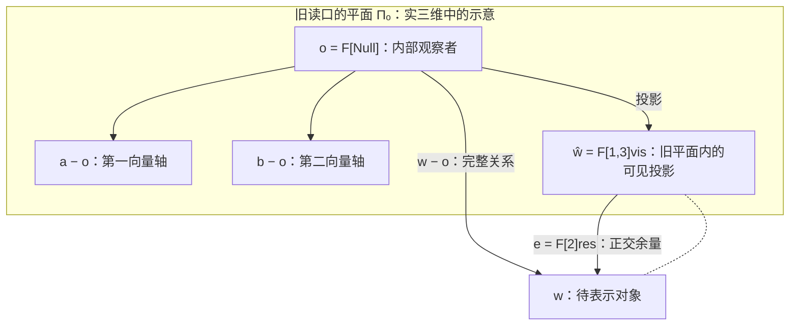
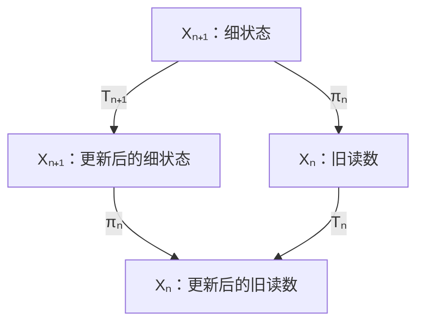

# 投影、对角构造与黄金单位提升

> 来源：用户于 2026-11-05（Asia/Singapore）在本会话提供的 AURIC R5-003 LaTeX 研究工作稿；原稿未另署作者或模型。本文为参考输入，Lean 是仓库的数学真源；本次仅转换 Markdown，未作形式化认证。正文中的固定快照、项目核读叙述与理论结论均保留原稿口径；两幅原生 TikZ 图转换为 Mermaid，保留投影余量、动态交换图、图中文字和数学标签。

AURIC / R5-003

下一维、下一位与同一个旧关系

五角色递归的定义修订、精确桥梁与证明

2026年11月5日

## 摘要

本轮回答四个相连的问题：$F[2]$ 是否就是下一维，$F[1,3]$ 是否是关系的平面投影，关系表增行列是否属于对角化，以及 Wall–Sun–Sun 素数与黄金单位提升是否提供同一递归的实例。结论是：下一项读出、下一独立方向和下一层算术精度必须分别定义；它们可以由同一个“保留旧读数、完成旧纤维”的框架联系。

文中证明 Gram 扩展的秩判据，区分谱分解、Schur 消元、Smith 标准形与康托尔对角构造。一个最小 Gram 例子恰等于黄金矩阵的平方，但黄金参数并非一般递归的必然结果。黄金算术部分给出模 $p^2$ 的显式更新 $(j,z)\mapsto(j+1,z-q_p)$，说明 WSS 是原单位的首层漂移消失；两次延迟迹能恢复一次迹删掉的坐标。进一步，项目已有的三维映射环面把 WSS 条件准确变成一阶同调中出现 $p^2$ 阶挠元素。

这些桥梁不推出 WSS 素数存在，也不单独重建量子力学。它们将“关系的投影、剩余量与内生约束”落实为可检验的等式，并说明量子几何还须保留哪些结构。

**本轮最短表述** 旧读口把多个可能状态压成同一个影子；下一层保留影子，并展开被压掉的差别。新差别是否存在、是否被实际轨道访问、是否增加空间维数，是三个需要分别证明的问题。

核对版本：[the-omega-institute/trureturing，dev](https://github.com/the-omega-institute/trureturing/tree/dbc27f758a2afc7a0477a876e72244025d92c062)。

固定提交：`dbc27f758a2afc7a0477a876e72244025d92c062`。提交时间：2026-11-05 21:52:54，新加坡时间。

证据范围：当前源码、理论文稿与主文献的只读核对；本文提供纸面证明。本轮未重新运行 Lean 编译，未修改项目仓库。所用九份关键 WSS 来源与上一轮所查版本相同；它们是本轮追查到的现有结构。

## 1　先把五个角色与三种维数分开

### 1.1　观察者给出局部参考，两个点本身只确定一条线

用户将 $F[\mathrm{null}]$ 放回系统内部，这可以在几何中直接使用。若 $o=F[\mathrm{null}]$、$a=F[1]$、$b=F[3]$ 都是某个实内积仿射空间中的点，则两个点 $a,b$ 只决定一条直线；不共线的三个点 $o,a,b$ 才决定平面

$$
\Pi_o=o+S_o,\qquad S_o=\operatorname{span}_{\mathbb R}\{a-o,b-o\}.
$$

若 $F[1],F[3]$ 原本指相对于 $o$ 的两条独立向量轴，就可直接说“它们张成的平面”。若它们只是两个概率数值，则须先定义几何表示，不能从两个数值直接得到投影算子。

#### 定义 1.1：可见关系与受限完成

给定上述参考、旧子空间 $S_o$ 及待表示对象 $w$，记

$$
\widehat w=P_{S_o}(w-o),\qquad e=(I-P_{S_o})(w-o).
$$

本轮可采用以下明确的角色约定：

$$
F[1,3]_{\mathrm{vis}}=\widehat w,\qquad F[2]_{\mathrm{res}}=e.
$$

于是 $w-o=\widehat w+e$，且 $e\perp S_o$。下标只用于防止把“可见投影”与此前保留全部相位的“完整关系”混用。

$$
o=F[\mathrm{null}],\quad a-o,\quad b-o,\quad
\widehat w=F[1,3]_{\rm vis},\quad e=F[2]_{\rm res},\quad w-o,\quad\Pi_o.
$$

图示固定在实三维中；一般空间的正交补可以不止一维。

#### 命题 1.2：下一方向的准确判据

对有限维子空间 $S$ 和新向量 $w$，令 $e=(I-P_S)w$。则

$$
\operatorname{span}(S,w)=S\oplus\operatorname{span}\{e\},\qquad
\dim\operatorname{span}(S,w)=\dim S+\mathbf1_{\{e\ne0\}}.
$$

若仅知道 $P_Sw$ 与 $\|w\|^2=s$，则只能确定

$$
\|e\|^2=s-\|P_Sw\|^2,
$$

一般不能唯一确定 $e$。

**证明。**

正交分解给出 $w=P_Sw+e$。由 $e\perp S$，当 $e\ne0$ 时其张成的一维空间与 $S$ 的交为零，得到维数公式。勾股恒等式给出长度；在正交补中，固定长度仍可有多个方向。在实三维、旧平面为二维时，正长度通常留下法向的两支 $\pm e$。

$\square$

因此，“$F[2]$ 是下一维”可理解为**下一项待补的关系方向**；若要理解成空间维数确实增长，必须再证明余量非零。一个由旧数值唯一算出的坐标，也可能完全依赖旧坐标。例如 $(x,z)\mapsto(x,z,x+z)$ 使用三个坐标，但像仍是二维平面。

### 1.2　量子比特给出最清楚的投影例子

在 $\mathbb C^2$ 上取 Pauli 矩阵，写

$$
\rho=\frac12(I+x\sigma_x+y\sigma_y+z\sigma_z).
$$

其特征值为 $(1\pm\sqrt{x^2+y^2+z^2})/2$，故

$$
\rho\succeq0\quad\Longleftrightarrow\quad x^2+y^2+z^2\le1.
$$

若两个二元读口是 $\sigma_x,\sigma_z$，可见投影为 $R_{13}(\rho)=(x,z)$。旧读数确定的完成纤维是

$$
\boxed{y\in[-\sqrt{1-x^2-z^2},\sqrt{1-x^2-z^2}].}
\tag{1}
$$

纯态时取区间的两个端点，边界相合时只剩一支。例如

$$
\rho_\pm=\frac12(I\pm\sigma_y)
$$

具有相同的 $(x,z)=(0,0)$，但 $y=\pm1$。这里补回的是第三个**实状态坐标**；Hilbert 空间一直是 $\mathbb C^2$，没有变成 $\mathbb C^3$。

此前若将 $F[1,3]$ 写成完整复互读 $\gamma$，其虚部已经保留这个相位方向。例如

$$
G=\begin{pmatrix}a&\gamma\\\overline\gamma&b\end{pmatrix},
\quad\rho=G/\operatorname{tr}G,
\quad y=-\frac{2\Im\gamma}{a+b}.
$$

因此本轮的“平面投影”应记为可见部分，不能又将它当成包含所有相位的完整关系。项目 C132 同样区分三实坐标图、三历史的复 Gram 实现和 Bloch 球 [\[4\]](#ref-c132)。

**白话对应。** 把观察者放进图里，先定一个观察的平面。$F[1,3]$ 是对象在这张纸上的影子；$F[2]$ 是纸面没有分开的差别。这个差别可以是高度、正反两支、相位，也可以只是多一位精度。只有确实出现旧空间容纳不了的非零方向，才是在增加独立维数。

## 2　增一行一列：到底是哪一种对角化

### 2.1　完整的 Gram 接续定理

设旧向量为 $v_1,\ldots,v_n$，令 $V$ 的列为这些向量，$G=V^\dagger V$。新向量 $w$ 给出

$$
b=V^\dagger w,\quad s=\|w\|^2,\quad
\widetilde G=\begin{pmatrix}G&b\\b^\dagger&s\end{pmatrix}.
$$

向量 $b$ 是与旧探针的互读，只有旧探针正交归一时才直接等于展开系数。单独知道两个旧探针之间的 $K_{13}$，也不能恢复第三个对象 $w$ 的投影；仍需 $\langle v_1,w\rangle,\langle v_3,w\rangle$。

#### 定理 2.1：正接续与新方向

对 Hermitian 矩阵 $G$、列向量 $b$ 与实数 $s$，有

$$
\widetilde G\succeq0
\quad\Longleftrightarrow\quad
G\succeq0,\quad b\in\operatorname{Ran}G,\quad
\delta:=s-b^\dagger G^+b\ge0,
\tag{2}
$$

其中 $G^+$ 为 Moore–Penrose 伪逆。满足这些条件时，

$$
P_{\operatorname{Ran}V}w=VG^+b,\qquad
\delta=\|(I-P_{\operatorname{Ran}V})w\|^2,
$$

$$
\boxed{\operatorname{rank}\widetilde G=\operatorname{rank}G+\mathbf1_{\{\delta>0\}}.}
\tag{3}
$$

**证明。**

若 $\widetilde G\succeq0$，其主子矩阵 $G\succeq0$。对 $k\in\ker G$，若 $k^\dagger b\ne0$，可选择小复数 $t$，使

$$
\begin{pmatrix}k\\t\end{pmatrix}^{\!\dagger}
\widetilde G\begin{pmatrix}k\\t\end{pmatrix}
=2\Re(tk^\dagger b)+s|t|^2<0.
$$

故 $b\perp\ker G$，也就是 $b\in\operatorname{Ran}G$。设 $c=G^+b$，则 $Gc=b$，且

$$
\widetilde G=
\begin{pmatrix}I&0\\c^\dagger&1\end{pmatrix}
\begin{pmatrix}G&0\\0&\delta\end{pmatrix}
\begin{pmatrix}I&c\\0&1\end{pmatrix}.
\tag{4}
$$

两侧三角矩阵可逆，因此正性和秩分别等价于中间块的正性和秩；这也证明反向。若来自实际向量，则 $V^\dagger(w-Vc)=b-Gc=0$，从而 $Vc$ 正是正交投影，余量范数即为 $\delta$。

$\square$

这正是项目 C132 从 C129 恢复的块式接续 [\[4\]](#ref-c132)。若漏掉像空间条件，会错把 $\begin{psmallmatrix}0&1\\1&0\end{psmallmatrix}$ 当成合法正表；只看伪逆余量为零并不够。

式 (4) 是**合同消元／Gram 正交化**，不是通常的酉谱对角化。谱分解用同一个空间的正交特征基；此处则把新对象的旧部分和余量解耦。三角矩阵通常不是酉矩阵，$\delta$ 也一般不是 $\widetilde G$ 的特征值。

最简单的不增维例子是重复同一个单位向量：

$$
[1]\longmapsto\begin{pmatrix}1&1\\1&1\end{pmatrix},\qquad\delta=0.
$$

标签多了一个，秩依然是一。

### 2.2　与黄金矩阵完全重合的最小例子

在 $\mathbb R^2$ 中取 $v_1=e_1$、$w=e_1+e_2$。则

$$
G=[1],\quad b=[1],\quad s=2,\quad\delta=1,
$$

$$
\widetilde G=
\begin{pmatrix}1&1\\1&2\end{pmatrix}
=Q^2,\qquad
Q=\begin{pmatrix}0&1\\1&1\end{pmatrix}.
\tag{5}
$$

由 $Q^2=Q+I$，其特征值为

$$
\varphi=\frac{1+\sqrt5}{2},\qquad\psi=1-\varphi=-\varphi^{-1}.
$$

因此 $\widetilde G$ 的特征值是 $\varphi^2,\varphi^{-2}$，而 Schur 余量是 $1$。这一个例子同时显示黄金谱与新正交方向的联系，也显示二者不能混同。

黄金数来自这里选定的整数关系 $Q^2=Q+I$。一般的合法 Gram 接续可以含任意 $b,s$，并不会自动满足该多项式。

### 2.3　若“对角化”指康托尔式对角构造

考虑一张二值关系表 $R(i,j)$。若行 $i$ 表示候选函数 $f_i(j)$，定义

$$
g(i)=1-f_i(i).
$$

则对每个 $i$，$g(i)\ne f_i(i)$，所以 $g\ne f_i$。这个结论来自**逐项反对角规则**；“多放一行一列”本身没有这条规则。

有限阶段可对旧索引执行此构造，再给新索引扩表；下一次构造针对更新后的旧表。不能要求新行同时在自己的对角位置等于自己的取反。无限枚举上的结论也不能直接改写成可计算性结论；是否可计算、是否处处终止需要额外前件。

更不能把二值取反直接施于任意 Gram 表：归一化 Gram 表的对角通常固定为 $1$，并且所有条目受联合正性约束。$g$ 与每个旧行不同，不等于 $g$ 在线性意义下独立于旧行。

| 操作           | 保留的结构              | 本轮用途                   |
|:---------------|:------------------------|:---------------------------|
| 酉谱对角化     | 同一 Hermitian 算子的谱 | 黄金矩阵的特征值           |
| Schur 消元     | 二次型的秩与惯性        | 旧投影与新余量             |
| Smith 标准形   | 整数关系的余核          | 三维环面的同调挠群         |
| 康托尔对角构造 | 指定索引上的逐项分歧    | 证明某个枚举未覆盖全部对象 |

**白话对应。** 给表添一行，是登记一个新对象；把新行减去旧行能够解释的部分，才看得见有没有新方向。若要证明“旧候选永远列不完”，还要有逐个避开旧候选的构造。黄金问题中又有一种整数消元：它把闭合关系拆成两个整数因子，而 WSS 检查这些因子里藏了几层 $p$。

## 3　黄金单位：同一二元递推的实几何与算术几何

为避免与五角色 $F[\cdot]$ 混淆，本文以小写 $f_n$ 表示 Fibonacci 数：

$$
f_0=0,\quad f_1=1,\quad f_{n+2}=f_{n+1}+f_n.
$$

设 $\mathcal O=\mathbb Z[\varphi]$。在基 $(1,\varphi)$ 中，

$$
\varphi(a+b\varphi)=b+(a+b)\varphi,
\qquad\binom ab\longmapsto Q\binom ab.
$$

这里的 $Q$ 就是式 (5) 的矩阵。项目有些文件交换两个基向量，采用 $\begin{psmallmatrix}1&1\\1&0\end{psmallmatrix}$；两种写法由置换矩阵共轭。

由递推归纳得到，对 $n\ge1$，

$$
\varphi^n=f_n\varphi+f_{n-1},\qquad Q^n=f_nQ+f_{n-1}I.
\tag{6}
$$

因此黄金单位的乘法、二元整数递推与矩阵幂是同一运算的三种表示。模 $m>1$ 时，$Q^n=I$ 等价于 $(f_n,f_{n+1})=(0,1)$，故

$$
\pi(m)=\operatorname{ord}(Q\bmod m)=\operatorname{ord}(\varphi\bmod m).
$$

该公开桥梁已在项目 `PisanoMatrixBridge` 中出现 [\[2\]](#ref-pisano)。

黄金共轭为 $\overline\varphi=\psi=1-\varphi$，范数为

$$
\mathrm N(a+b\varphi)=(a+b\varphi)(a+b\psi)=a^2+ab-b^2.
\tag{7}
$$

写 $X=2a+b$、$Y=b$，范数一条件成为

$$
X^2-5Y^2=4.
$$

这是实双曲线。$v=\varphi^2$ 的实矩阵 $B=Q^2$ 沿两条特征方向分别伸缩 $\varphi^2$、$\varphi^{-2}$。即使把二次方程齐次化成 $X^2-5Y^2=4Z^2$，也不能把多写一个齐次坐标当成多一个内在自由度。

#### 命题 3.1：黄金实更新不是正定度量下的等距更新

不存在实正定矩阵 $H$ 使 $B^THB=H$。

**证明。**

取 $B$ 的实特征向量 $t\ne0$，对应特征值 $\varphi^2>1$。若上述等式成立，则 $t^THt=(Bt)^TH(Bt)=\varphi^4t^THt$。正定性使 $t^THt>0$，矛盾。

$\square$

黄金范数的双曲几何与量子内积的正定几何需要明确的桥接条件。上一轮的复三相结构若写成 $\omega^2+\omega+1=0$，其范数 $a^2-ab+b^2$ 为正，和式 (7) 的符号不同。两者同属二次代数的关系研究，并不因此具有相同的物理解释。项目 SJC.6 和 C132 已明确保留这一界限 [\[3\]](#ref-shi-notes), [\[4\]](#ref-c132)。

## 4　Wall–Sun–Sun：下一位精度上的返回缺陷

以下统一取素数 $p>5$，以对齐本轮查到的项目定理前件。置

$$
d=2\varphi-1=\sqrt5,\quad
\chi=\left(\frac5p\right),\quad N=p-\chi,
\quad q_p=\frac{f_N}{p}\pmod p,\quad h_p=v_p(f_N).
$$

$q_p$ 中先作整数除法，再降模。Frobenius 关系给出 $p\mid f_N$，故定义成立。

### 4.1　为什么二元黄金代数在下一层仍然是二元

$\mathcal O/p^a\mathcal O$ 始终有两个 $\mathbb Z/p^a\mathbb Z$ 坐标。提高 $a$ 增加精度，不改变这个模的秩。模 $p$ 时，

$$
\mathcal O/p\mathcal O\cong
\begin{cases}
\mathbb F_p\times\mathbb F_p,&\chi=1,\\
\mathbb F_{p^2},&\chi=-1.
\end{cases}
$$

多项式 $X^2-X-1$ 的判别式为 $5\ne0\pmod p$。因此 WSS 不是特征根重合或黄金矩阵无法对角化；分裂情形可在本域对角化，惰性情形需二次扩域。困难在于固定根的幂是否在更高精度上恰好返回。

令范数一单位

$$
u=\varphi/\psi=-\varphi^2,\qquad v=+\varphi^2.
$$

$\varphi$ 的阶是 Pisano 周期；$u$ 的阶是 Fibonacci 首次零点指数；$v$ 的阶又是另一周期，不能混用。由 Binet 恒等式，

$$
u^n-1=d f_n\psi^{-n}.
\tag{8}
$$

由于 $d,\psi$ 在 $p$ 处为单位，这个差值的 $p$-进深度正是 $v_p(f_n)$。此处估值指被 $p$ 整除的最大次数；分裂代数中取两个分量深度的最小值。

#### 定理 4.1：第一层缺陷与 WSS

有

$$
\varphi^N\equiv\chi\pmod p,\qquad
u^N\equiv1\pmod p,
$$

$$
\frac{u^N-1}{p}\equiv\chi q_p d\pmod p.
\tag{9}
$$

并且

$$
\boxed{
p\text{ 是 WSS}
\ \Longleftrightarrow\ p^2\mid f_N
\ \Longleftrightarrow\ q_p=0
\ \Longleftrightarrow\ u^N=1\pmod{p^2}.}
\tag{10}
$$

等价地，$\pi(p^2)=\pi(p)$。

**证明。**

分裂时 $\varphi^{p-1}=1$；惰性时 Frobenius 交换 $\varphi,\psi$，从而 $\varphi^{p+1}=\varphi\psi=-1$。这给出首式，且 $N$ 为偶数。将式 (8) 取 $n=N$，注意 $\psi^{-N}=\varphi^N\equiv\chi$，即得式 (9) 和前三个等价。与周期相等的等价也可由下节的完整周期公式直接得到。

$\square$

这组经典等价及黄金单位刻画见主文献 [\[5\]](#ref-els-jah), [\[6\]](#ref-bragman)。已核对的 2026-10-26 版本主文献仍报告古典 $d=5$ WSS 没有已知实例 [\[7\]](#ref-shi-paper)；本文不把后续等价改写当作存在或不存在的证明。

### 4.2　完整精度塔：可以先停住，再按固定倍率增长

#### 引理 4.2：近单位提升

在上述 $p$-进代数中，若 $g=1+p^hA$、$h\ge1$、$A\not\equiv0\pmod p$，则对正整数 $m$，

$$
v_p(g^m-1)=h+v_p(m).
$$

**证明。**

若 $p\nmid m$，二项式展开的首项 $mp^hA$ 具有深度 $h$，其余项的深度更高。对 $m=p$，首项深度为 $h+1$，其余项更高；逐次取 $p$ 次方，再与互素部分合并即得结论。该论证可分别在分裂的两个分量上进行。

$\square$

#### 定理 4.3：黄金周期的全部提升层

设 $r=\operatorname{ord}(v\bmod p)$，则 $r\mid N$、$\pi(p)=2r$，且对每个 $a\ge1$，

$$
\boxed{\pi(p^a)=\pi(p)\,p^{\max(0,a-h_p)}.}
\tag{11}
$$

**证明。**

模 $p$ 的范数一群阶为 $N$，故 $r\mid N$。$\varphi$ 的范数为 $-1$，其模 $p^a$ 阶必为偶数，平方的阶恰为其一半，故 Pisano 周期是 $v$ 阶的两倍。

由 $N$ 为偶数，$v^N=u^N$，式 (8) 给出 $v_p(v^N-1)=h_p$。因为 $p\nmid N/r$，将 $(v^r)^{N/r}-1$ 分解成几何级数，第二因子模 $p$ 为 $N/r\ne0$，所以 $v_p(v^r-1)=h_p$。任何模 $p^a$ 返回时间都必须为 $r$ 的倍数；上引理说明最小倍数是 $p^{\max(0,a-h_p)}$，从而得到式 (11)。

$\square$

项目当前 `golden_matrix_prime_power_period` 声明给出相同精度塔，并将深度写为 $v_p(f_{\rho(p)})$，其中 $\rho(p)$ 是首次零点指数 [\[1\]](#ref-primepower)。两者相同：$\rho(p)\mid N$，式 (8) 与互素幂的估值稳定性给出 $v_p(f_{\rho(p)})=v_p(f_N)$。本轮核对的是该声明及其证明源码，不是一次新的编译结果。

普通分支 $h_p=1$ 从 $p$ 到 $p^2$ 就将周期乘以 $p$；WSS 分支 $h_p\ge2$ 先保持周期，超过深度 $h_p$ 后再逐层乘 $p$。因此不能把“每一层都必须暴露新误差”先当作无条件公理；它会直接排除这里尚未解决的异常分支。

**白话对应。** 同一只钟，在粗刻度上已经回到原位。打开下一位精度，普通素数会露出一点漂移，WSS 素数则在这一位仍然完全对上。递推的两个坐标没有增加；变化的是读数的精细程度和真正返回所需的步数。

## 5　原黄金轨道的显式完成：粗相位与细漂移

本节使用项目研究笔记 SJC.2–SJC.5 的精确结构，并将证明写完整 [\[3\]](#ref-shi-notes)。

### 5.1　唯一保周期提升不等于原固定单位

记 $T^{(a)}$ 为 $\mathcal O/p^a\mathcal O$ 的范数一群，$C=\langle v\bmod p\rangle$，$|C|=r$。粗约化的核为

$$
\ker(T^{(2)}\to T^{(1)})
=\{1+pzd:z\in\mathbb F_p\}.
$$

证明是 $\mathrm N(1+pw)=1+p\operatorname{Tr}(w)\pmod{p^2}$，而 $\operatorname{Tr}(w)=0$ 的空间由 $d$ 张成，维数为一。

#### 定理 5.1：显式细状态和更新

存在唯一 $r$ 阶单位 $\xi\in T^{(2)}$，使 $\xi\equiv v\pmod p$。粗周期 $C$ 上方的每个细状态唯一写成

$$
x=\xi^j(1+pzd),\qquad
(j,z)\in\mathbb Z/r\mathbb Z\times\mathbb F_p.
$$

原单位 $v$ 的乘法更新恰为

$$
\boxed{(j,z)\longmapsto(j+1,z-q_p).}
\tag{12}
$$

$q_p=0$ 时有 $p$ 条长 $r$ 的周期；$q_p\ne0$ 时有一条长 $rp$ 的周期。

**证明。**

若某一范数一提升 $x$ 满足 $x^r=1+pcd$，则 $x(1-pr^{-1}cd)$ 的 $r$ 次方为一。由于 $p\nmid r$，此修正唯一；同样的唯一性使它形成群截面，从而得到唯一坐标。

设 Lucas 数为 $L_n=\varphi^n+\psi^n$。恒等式

$$
(L_N-2\chi)(L_N+2\chi)=5f_N^2
$$

和 $L_N+2\chi\not\equiv0\pmod p$ 给出 $L_N\equiv2\chi\pmod{p^2}$。因此

$$
\varphi^N\equiv\chi+\frac12p q_pd,\qquad
v^N\equiv1+p\chi q_pd\pmod{p^2}.
$$

写 $v=\xi(1+pcd)$。由 $\xi^N=1$ 与 $N\equiv-\chi\pmod p$，有 $Nc=\chi q_p$，所以 $c=-q_p$。核中的乘法对 $z$ 是加法，得到式 (12)。返回要求 $r\mid t$ 且 $tq_p=0\pmod p$，于是得到周期长度与条数。

$\square$

$z$ 是旧约化删掉的细坐标。两个分支中都存在这个坐标；WSS 表示原轨道在首层的漂移为零，不是 WSS 才创造了坐标。

更贴合“把公理锁成定义之间关系”的写法，是比较同一旧点的两种唯一提升：

$$
\begin{aligned}
\text{黄金定义提升：}&\quad x^2-3x+1=0,\quad x\equiv v\pmod p;\\
\text{保周期提升：}&\quad x^r=1,\quad x\equiv v\pmod p.
\end{aligned}
$$

两个导数分别是 $2v-3=d$ 和 $rv^{r-1}$，在 $p$ 处均可逆。因此在固定约化点附近各有唯一模 $p^2$ 提升，分别是 $v$ 与 $\xi$，而

$$
\boxed{p\text{ 为 WSS}\quad\Longleftrightarrow\quad v=\xi\pmod{p^2}.}
\tag{13}
$$

这将问题化成**两个定义约束选择的细点是否重合**。允许任意改换提升，总能选中 $\xi$；但那没有证明固定黄金单位 $v$ 已经等于 $\xi$。

### 5.2　环路总漂移：关系的关系

更一般地，令 $T(j,z)=(j+1,z+\gamma_j)$。换细坐标 $z'=z+f(j)$ 后，

$$
\gamma'_j=\gamma_j+f(j+1)-f(j).
$$

因此

$$
H=\sum_{j\in\mathbb Z/r\mathbb Z}\gamma_j
\tag{14}
$$

不随此重标定改变。$H=0$ 恰是所有漂移可以同时消掉的条件：必要性由求和得到；充分性由递推 $f(j+1)=f(j)-\gamma_j$ 得到，最后一步能闭合正是 $H=0$。黄金更新中

$$
H=-r q_p,
$$

所以该闭合条件正是 WSS。这里研究的是循环图上边读数的总和；不把它误写成平凡有限群作用的 $H^1(C_r,\mathbb F_p)$。

量子三历史的关系也出现类似的不变量：若 $K_{ij}=\langle u_i,u_j\rangle$，则

$$
\mathcal B=K_{12}K_{23}K_{31}
$$

在 $u_i\mapsto e^{i\theta_i}u_i$ 下不变，因为三条边的相位因子相消。两处共享“边可以重标定、环路总量保留”的结构；一个是有限域中的环路和，一个是复数中的环路积。后者非零时，其辐角是相位不变量，不能直接认作同一物理量。

### 5.3　一个可手算的实例：$p=7$

此时 $\chi=-1$、$N=8$、$f_8=21$，故 $q_7=3$、$h_7=1$。又有 $\pi(7)=16$、$r=8$，细更新为

$$
(j,z)\longmapsto(j+1,z+4),\qquad
j\bmod8,\ z\bmod7.
$$

从 $(0,0)$ 出发，八步后粗相位回到零，细坐标却到 $4$；五十六步才共同返回。因此 $v$ 模 $49$ 的阶为 $56$，$\pi(49)=112$。这个实例是“旧投影看似闭合、完整关系尚未闭合”的精确图景。

## 6　两次读出恢复一个迹隐藏的关系

#### 定理 6.1：二元延迟迹的精确可观察性

对 $a\ge1$，在 $\mathcal O/p^a\mathcal O$ 中取 $x=A+B\varphi$，并定义

$$
y_0=\operatorname{Tr}(x),\qquad y_1=\operatorname{Tr}(vx).
$$

则

$$
\binom{y_0}{y_1}
=\begin{pmatrix}2&1\\3&4\end{pmatrix}\binom AB,\qquad
\boxed{A=\frac{4y_0-y_1}{5},\quad B=\frac{-3y_0+2y_1}{5}.}
\tag{15}
$$

分母表示在模 $p^a$ 中取逆。两个精确迹已区分所有状态。

**证明。**

$\operatorname{Tr}(A+B\varphi)=2A+B$。又有 $vx=(A+B)+(A+2B)\varphi$，所以 $\operatorname{Tr}(vx)=3A+4B$。系数矩阵行列式为 $5$，对 $p>5$ 可逆，直接求逆即得。

$\square$

一个迹确实丢掉一个方向。例如 $\operatorname{Tr}(d)=0$，所以所有 $1+pzd$ 在模 $p^2$ 下的迹都是 $2$，尽管它们是不同的细状态。到粗返回时间 $r$ 时，式 (12) 给出

$$
v^r=1-prq_pd\pmod{p^2},\qquad\operatorname{Tr}(v^r)=2\pmod{p^2}.
$$

单看返回迹无法区分 WSS 与普通分支。但 $\operatorname{Tr}(vd)=5$，因此下一次迹满足

$$
\boxed{\frac{L_{2r+2}-3}{p}=-5r q_p\pmod p.}
\tag{16}
$$

式中仍先在整数中除以 $p$，再降模。因为 $5r$ 可逆，第二次迹恢复首层缺陷。这是项目 SJC.4 的明确命题 [\[3\]](#ref-shi-notes)。

**白话对应。** 只看一次影子，两个对象可以重合。把同一个对象按已知规则走一步，再看一次，两个影子合在一起就能把它找回来。这里不需要凭空长出第三根轴；增加的是观察的角度或时刻。所谓信息逃逸，必须说清是哪一次观察删掉了什么，又是哪一次新观察把它分开。

## 7　真正的三维结构：黄金映射环面

这一节的桥梁已经在项目 CG.5 中出现 [\[3\]](#ref-shi-notes)。它给出实际三维流形，而不只是三个坐标的图。

令 $B=Q^2\in SL_2(\mathbb Z)$。由于整数格被 $B$ 保持，它定义二维环面 $\mathbb T^2=\mathbb R^2/\mathbb Z^2$ 的自同构。对正整数 $n$，定义映射环面

$$
M_n=(\mathbb T^2\times[0,1])/\bigl((x,1)\sim(B^nx,0)\bigr).
\tag{17}
$$

它把二维环面沿一个循环方向排起来，并按黄金变换粘接两端，得到紧致三维流形。额外这一维是悬挂的循环参数；不应先把它解释成已经导出的物理时间。

#### 定理 7.1：偶数覆盖的整数关系与 WSS

令 $S=2Q-I$。对正偶数 $n$，

$$
B^n-I=f_nSQ^n,\qquad
\operatorname{SNF}(B^n-I)=\operatorname{diag}(f_n,5f_n).
\tag{18}
$$

从而

$$
\boxed{H_1(M_n;\mathbb Z)
\cong\mathbb Z\oplus\mathbb Z/f_n\mathbb Z\oplus\mathbb Z/(5f_n)\mathbb Z.}
\tag{19}
$$

特别地，取 $n=N=p-\chi$，

$$
\boxed{\operatorname{Tor}H_1(M_N;\mathbb Z)[p^\infty]
\cong(\mathbb Z/p^{h_p}\mathbb Z)^2.}
\tag{20}
$$

因此 $p$ 为 WSS，当且仅当 $H_1(M_N;\mathbb Z)$ 含有阶为 $p^2$ 的元素。

**证明。**

$Q^{-1}=Q-I$，所以 $I-Q=-Q^{-1}$。$I-Q$ 与 $Q$ 满足同一个二次方程，式 (6) 给出

$$
(-1)^nQ^{-n}=f_{n+1}I-f_nQ.
$$

当 $n$ 为偶数时，与 $Q^n=f_nQ+f_{n-1}I$ 相减得 $Q^n-Q^{-n}=f_n(2Q-I)$，再乘 $Q^n$ 即得首式。

矩阵 $Q^n$ 整数可逆；$S=\begin{psmallmatrix}-1&2\\2&1\end{psmallmatrix}$ 的条目最大公约数为 $1$，行列式为 $-5$。因此其 Smith 标准形为 $\operatorname{diag}(1,5)$，从而返回矩阵的 Smith 标准形为 $\operatorname{diag}(f_n,5f_n)$。

映射环面的基本群为 $\mathbb Z^2\rtimes_{B^n}\mathbb Z$。阿贝尔化保留循环方向的自由 $\mathbb Z$，并使环面方向满足 $(B^n-I)w=0$，所以

$$
H_1(M_n;\mathbb Z)=\mathbb Z\oplus\operatorname{coker}(B^n-I).
$$

结合 Smith 标准形得到式 (19)。$N$ 自动为正偶数，且 $p\nmid5$，取 $p$-初级部分即得式 (20)。

$\square$

偶数条件不能删去。若 $n$ 为奇数，同一计算给出

$$
Q^n-Q^{-n}=L_nI,\qquad B^n-I=L_nQ^n,
$$

其 Smith 标准形为 $\operatorname{diag}(L_n,L_n)$。$n=1$ 已足以反驳把式 (18) 推广到全部 $n$。

$p=7$ 时，$N=8$、$f_N=21$，有

$$
H_1(M_8;\mathbb Z)=\mathbb Z\oplus\mathbb Z/21\mathbb Z\oplus\mathbb Z/105\mathbb Z.
$$

其 $7$-初级部分为 $(\mathbb Z/7\mathbb Z)^2$，没有 $49$ 阶元素，正好对应 $h_7=1$。

所有 $M_n$ 的流形维数都是三。WSS 改变的是整数闭合关系中的挠深度；随 $p$ 改变的也是相应覆盖次数 $N$。该等价没有额外给出素数分布约束。

**白话对应。** 把一张二维的环面，沿“走完再粘回去”的方向卷成一个三维空间。黄金递推决定两端怎样粘。某些闭合关系要重复 $p$ 次才消掉，WSS 对应其中出现需要 $p^2$ 次才消掉的关系。空间始终三维，变深的是整数关系的层数。

## 8　把共同递归压成一张兼容图

### 8.1　粗读口、完成纤维与动态相容

前三种提升可以统一写成

$$
\boxed{\pi_n(x_{n+1})=x_n,\qquad
x_{n+1}\in\pi_n^{-1}(x_n)\cap\mathcal C_{n+1}.}
\tag{21}
$$

$\pi_n$ 是明确指定的旧读口，$\mathcal C_{n+1}$ 是联合正性、范数、原定义多项式或其他已声明约束。空交表示不相容；单点表示唯一完成；多点表示当前资料还没决定全部关系。

若还要保留同一个动态，则要求

$$
\boxed{\pi_n\circ T_{n+1}=T_n\circ\pi_n.}
\tag{22}
$$

这个式子表达“先真实更新再看粗影子”与“先看粗影子再按粗规则更新”一致。它是定义之间可检验的约束。

$$
X_{n+1}\xrightarrow{T_{n+1}}X_{n+1},\qquad
X_n\xrightarrow{T_n}X_n,\qquad \pi_n.
$$

#### 定理 8.1：读口何时够用

设实际状态集合为 $\Omega$，观察为 $R:\Omega\to Y$，实际更新为 $T:\Omega\to\Omega$，所需查询为 $q:\Omega\to Z$。在可达读数 $R(\Omega)$ 上存在闭合更新与查询 $\overline T,\overline q$，使

$$
R\circ T=\overline T\circ R,\qquad q=\overline q\circ R,
$$

当且仅当对所有 $s,t\in\Omega$，

$$
R(s)=R(t)\ \Longrightarrow\
R(Ts)=R(Tt)\ \text{且}\ q(s)=q(t).
$$

**证明。**

必要性来自复合等式。充分性则令 $\overline T(Rs)=R(Ts)$、$\overline q(Rs)=q(s)$；假设恰好保证选取不同代表不会改变结果。

$\square$

#### 推论 8.2：算出来的坐标不自动带来新信息

若新坐标 $q=f\circ R$ 只是旧读数的函数，则

$$
(R(s),q(s))=(R(t),q(t))\quad\Longleftrightarrow\quad R(s)=R(t).
$$

只有 $q$ 在某个旧纤维上不恒定，追加它才真正分开旧观察无法区分的状态。

这准确区分三件事：完成表示、增加观察能力、增加几何维数。范数约束可以给出 $F[2]$ 的可行区间；实际取得额外读数才可能缩小区间；即使区间被分开，Hilbert 维数也未必改变。

### 8.2　五角色递归可以保留，但不是五个独立数值

| 角色 | 本轮固定的职责 |
|:---|:---|
| $F[\mathrm{null}]$ | 内部观察者、参考与记录状态；它在 $\Omega$ 中，更新同样受相容约束。 |
| $F[1],F[3]$ | 本次选用的两个接口或探针；可再次由同样角色展开。 |
| $F[1,3]_{\rm vis}$ | 这组接口实际保留的关系投影；必须注明删掉了什么。 |
| $F[2]$ | 在该投影与联合约束下的完成参数或可行集合；不预先保证唯一或非零。 |

若观察者会变化，将观察者与系统一起放入 $\Omega$，例如状态写为 $(o,s)$，并令 $T(o,s)=(o',s')$。这样所有读口和标定都属于共同关系内；$F[\mathrm{null}]$ 不需要充当外部永远不变的坐标原点。

同时，“$\Omega$ 内生”不能被当成对全部约束的无条件证明。把允许模型定义为满足式 (21)–(22) 的对象，可以使理论精确；哪些模型有实验实现、是否足以选出量子理论，仍是需要承担的数学与物理内容。

## 9　对量子公理候选，本轮得到什么

### 9.1　本轮可压缩的共同原则

**观察相容的递归完成** 所有对象，包括观察者，进入同一组有限关系。细读口必须保留旧读数与原更新；只有在所要求的联合读口下仍不能区分的状态才可合并。未被这些关系唯一固定的完成量，保留为可行纤维。

式 (21)、(22) 与上一节定理给出这句话的完整数学含义。它是对此前候选的**接口定义修订**，不是单凭它就足以挑出量子力学的新唯一公理。经典状态、有限群动态与量子状态都可以满足这一框架。

在已指定复关系核的量子分支，式 (2) 对每个有限接续成立，等价于全部有限 Gram 表正半定。由此可以构造复内积空间：对有限形式线性组合定义二次型，把零范数组合商去，再作完备化。观察者的标签和其他标签遵守相同条件。这部分是表示定理，而非所有量子操作已经可实现。

若实际事件还绑定到同一空间中的正算子 $E_a$，满足 $\sum_aE_a=I$，并且原事件强度确实是相应二次型，那么归一化给出

$$
p(a\mid\psi)=\frac{\langle\psi,E_a\psi\rangle}{\langle\psi,\psi\rangle}.
$$

这里“原事件强度就是该二次型”是不能省略的接口前件；仅仅发现一个正核，不会自动校准用户原先指定的测量记录。上一轮的三相比较与记录约束正是为这一桥梁服务。

若进一步给出保持内积的可逆复线性更新，则它是酉变换；若给出满足适当独立性与局部操作前件的系统联合，才继续讨论张量积。WSS 的模精度递归既不提供正定复内积，也不提供这些实际事件与联合接口。

### 9.2　反着推：删去关键条件会发生什么

| 删掉的条件 | 可直接看到的后果 |
|:---|:---|
| 共同参考或明确的观察映射 | 无法判断所谓“同一影子”究竟是什么；两个标量不自动张成投影平面。 |
| Gram 像空间与联合正性 | 新表可能出现负二次型，无法作为该内积模型的关系表。 |
| 实际新增读出 | 从旧读数算出的坐标不切开任何旧纤维。 |
| 逐项反对角规则 | 仅扩表不产生康托尔式的反枚举结论。 |
| 固定黄金多项式 | 可以人为选唯一扭提升，却已经改换原单位；这不解决 WSS。 |
| 三维同调中的整数系数 | 只保留实同调会丢掉全部有限挠信息，无法表达这里的 WSS 判据。 |
| 原事件与正二次型的绑定 | 几何中的 Born 形式不能冒充实际命名读口的概率律。 |

这里有一个值得保留的“关系的关系”：WSS 比较**黄金定义提升** 与**保周期提升** 是否选中同一点；量子重建则要比较**几何事件分量** 与**实际命名记录** 是否是同一读口。两者都要求保留原对象身份，不能用另一个容易满足条件的对象替换它。这是严格的方法对应，不是声称两个理论已经等价。

**白话对应。** 整个递归像不断把同一件东西看清楚。观察者和对象都在这张关系网里：两个读口给出一个影子，联合约束圈出影子后面还能有哪些可能，再用新的关系去区分它们。有时是纸外多出一条方向，有时是原来的方向多看一位，有时是绕一圈后才显出的总偏移。黄金递推给出一套能精确计算的实例：WSS 就是原黄金规则选出的那一点，恰好与下一位精度仍保周期的那一点重合。这个统一图景更简洁，但每一种“下一层”都必须保留自己的类型和检验。

## 来源核对说明

项目检索覆盖了当前 D5、docs、Library 与 Problems 的完整文件树，并追查相应源码、理论段落及相关 Blueprint；不是宣称逐字搜索了全库每份文件。本文依赖的九份关键 WSS 来源相对上一轮固定版本逐字相同。

当前问题页早期 Gap 段仍称缺少 $p^2$ 黄金代数与提升定理，但同一版本的实际 Lean 源码已经有上述精度塔。本文以现存声明及相应证明体为依据；研究笔记 CG/SJC 中的映射环面、细坐标和延迟迹被注明为纸面推导。没有把读取源码说成当轮已通过编译，也没有把本轮重新组织的等价关系声称为新的数论发现。

## 来源与参考

\[1\] trureturing，[GoldenPrimePowerMatrixPeriod.lean](https://github.com/the-omega-institute/trureturing/blob/dbc27f758a2afc7a0477a876e72244025d92c062/D5/S3/Arith/Primes/GoldenPrimePowerMatrixPeriod.lean)。 声明 `golden_matrix_prime_power_period`，前件 $p>5$、$a\ge1$。同一固定版本的通用近单位提升见 [GoldenPrimePowerOrder.lean](https://github.com/the-omega-institute/trureturing/blob/dbc27f758a2afc7a0477a876e72244025d92c062/D5/S3/Arith/GoldenPrimePowerOrder.lean)。

\[2\] trureturing，[PisanoMatrixBridge.lean](https://github.com/the-omega-institute/trureturing/blob/dbc27f758a2afc7a0477a876e72244025d92c062/D5/S3/Arith/PisanoMatrixBridge.lean)，以及 [GoldenFibonacciModulusPeriod.lean](https://github.com/the-omega-institute/trureturing/blob/dbc27f758a2afc7a0477a876e72244025d92c062/D5/S3/Arith/GoldenFibonacciModulusPeriod.lean)。模数大于一时的周期、矩阵阶与黄金单位对应。

\[3\] trureturing，[Library/Arith/shi2026second.md](https://github.com/the-omega-institute/trureturing/blob/dbc27f758a2afc7a0477a876e72244025d92c062/Library/Arith/shi2026second.md)，CG.1–CG.8 与 SJC.1–SJC.6。 CG.5 为映射环面证明；SJC.2 为显式细漂移；SJC.3 为固定多项式与环路总量；SJC.4 的定理 SJC5 为两次延迟迹；SJC.5 为全部精度层；SJC.6 为实双曲更新的能量边界。

\[4\] trureturing，[AURIC C132：黄金回返与二元量子关系](https://github.com/the-omega-institute/trureturing/blob/dbc27f758a2afc7a0477a876e72244025d92c062/docs/develop/theory/AURIC_C132_GOLDEN_RETURN_BINARY_QUANTUM_RELATIONS.md)，§§2.4、4.2、5.2–5.4、6。投影、正核接续、三类不同维数及量子接口前件。

\[5\] A.-S. Elsenhans and J. Jahnel，*The Fibonacci sequence modulo $p^2$ – An investigation by computer for $p<10^{14}$*，2010。 [arXiv:1006.0824v1](https://arxiv.org/html/1006.0824v1)，定理1.2(d)、命题2.2.5–2.2.6。此处引用周期和等价定理，不将历史搜索范围称为最新范围。

\[6\] N. Bragman and E. Rowland，*Limiting density of the Fibonacci sequence modulo powers of a prime*，Research in Number Theory 11, 88，2025。 [DOI:10.1007/s40993-025-00667-1](https://doi.org/10.1007/s40993-025-00667-1)。特别参见定理10关于固定黄金单位与其扭部分距离的 WSS 刻画。

\[7\] M. Shi, X. Wang, Z. Bouazzaoui, J.-L. Kim and P. Solé，*Second-order recurrences, quadratic number fields and cyclic codes*。 [arXiv:2603.25343v2](https://arxiv.org/html/2603.25343v2)，2026-10-26。该版本区分固定基本单位的递推与可改变多项式的存在性构造，并仍报告古典 WSS 无已知实例。
