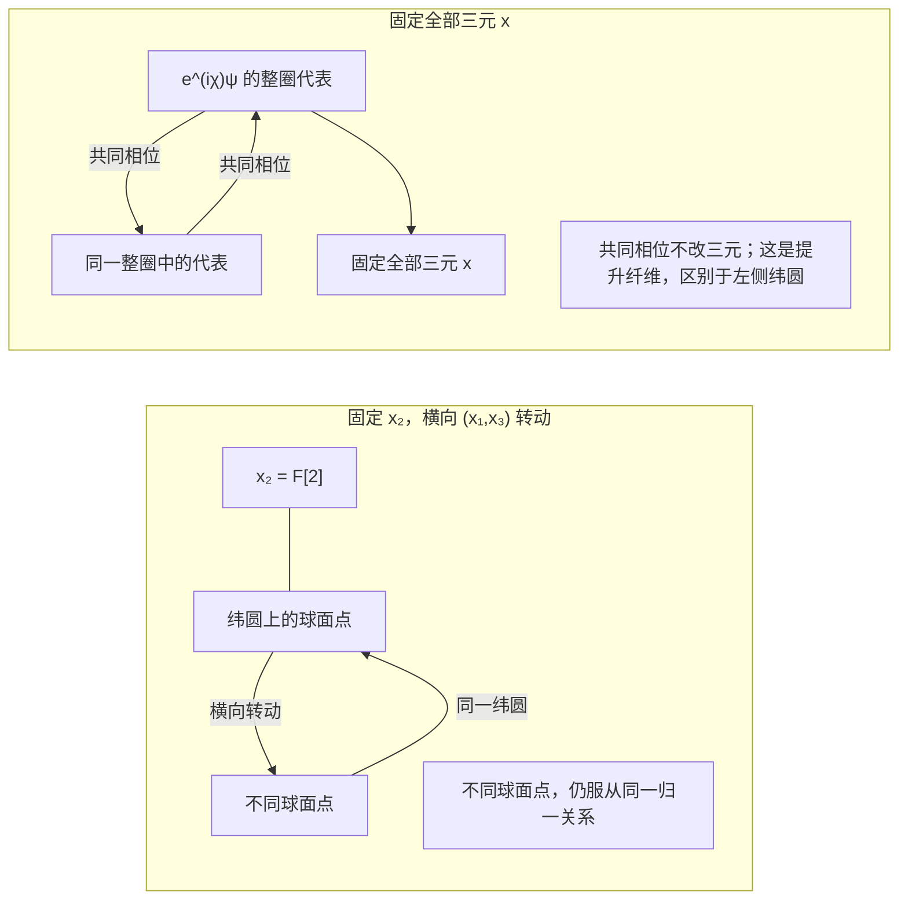

# 内部参考、隐藏关系与二元递归

> 来源：用户于 2026-11-05（Asia/Singapore）在本会话提供的 AURIC R5-004 LaTeX 研究工作稿；原稿未另署作者或模型。本文为参考输入，Lean 是仓库的数学真源；本次仅转换 Markdown，未作形式化认证。正文中的固定快照、项目核读叙述与理论结论均保留原稿口径；一幅原生 TikZ 图转换为 Mermaid，保留横向纬圆与共同相位纤维的区别、图中文字、数学标签和图注。

AURIC / R5-004

从稳定三元到下一次比较

五角色的类型约定、核心恒等式与完整条件候选

2026年11月5日

## 摘要

本轮回答：当 $F[1],F[2],F[3]$ 满足稳定归一化关系时，$F[\mathrm{null}]$ 与 $F[1,3]$ 能否成为下一层二元？答案是在明确接口后可以：把内部参考与带来源的未展关系作为两个比较对象，保留它们的完整复正关系表及其总量；归一化后的表恰给三个实读数。两个横向读数在相位改变下连续旋转，中间读数保持不变。

本文给出一个统一恒等式，证明球体、纯态球面、Schur 余量与横向各向同性的关系；再区分球面投影的两个完成、Hopf 的圆纤维与完整标架的两点提升。稳定三元上方可用“内部参考加相对关系”恢复提升，但这两个角色与两个复振幅的类型不同。

最后提出完整的有限复条件候选，逐项导出密度态、Born 读出、效果、Kraus 仪器、张量联合及可逆演化，并给出删去关键条件后的反例。复正载体、混合相容和实际联合是明确前件。本文没有把五个标签或归一化本身宣称为量子力学的充分起源。

**本轮最短表述** 三元保留本层已经读出的形状；内部参考与未展关系组成下一次比较的两端。二元关系归一化后再次给三元。递归要同时保留总量、来源和联合关系，才不会在归一化时丢失旧信息。

固定项目版本：[the-omega-institute/trureturing，dev](https://github.com/the-omega-institute/trureturing/tree/046c7ac2521a8429a0aeaeaee08b7b23d0bf20ff)。

提交：`046c7ac2521a8429a0aeaeaee08b7b23d0bf20ff`；2026-11-05 15:09:00 UTC。

本轮核对当前理论文稿及有关 Lean 声明；未重新编译 Lean。以下为附证明的数学条件推导。仓库收录的上一轮 R5-003 属于同一研究链，不作为独立验证。

## 1　一个二元关系表，怎样给出稳定三元

### 1.1　先按本轮用法固定角色

本轮采用用户的新约定：

$$
O_n=F_n[\mathrm{null}],\qquad H_n=F_n[1,3].
$$

$O_n$ 是整体 $\Omega$ 内部的参考接口；$H_n$ 是带来源的关系对象或关系记录。把关系作为下一层对象，须保留它来自哪两个端点、哪次读出及哪份整体状态。裸数值与带来源的对象不能自动互换。

下一层比较的是 $O_n$ 与 $H_n$，并把比较结果写成三个标量读数。这里 $F_n[1,3]$ 依用户本轮用法指未展关系；上一轮的可见投影另记为 $\pi_n$。五个符号是可复用的角色，不预先宣称它们是五个独立自由度。

#### 定义 1.1：内部二元正关系

设 $K$ 是同一来源上的复 Hermitian 正核，即任意有限对象列 $u_1,\ldots,u_k$ 的矩阵 $[K(u_i,u_j)]$ 正半定。对两个接口 $O,H$，记

$$
a=K(O,O),\quad b=K(H,H),\quad c=K(O,H),\qquad
G=\begin{pmatrix}a&c\\\bar c&b\end{pmatrix}\succeq0.
$$

在 $N=a+b>0$ 时定义

$$
\rho=\frac GN,\qquad
x_1=\frac{2\Re c}{N},\quad
x_2=\frac{a-b}{N},\quad
x_3=-\frac{2\Im c}{N}.
\tag{1}
$$

这三个数可作为下一层 $F[1],F[2],F[3]$ 的读出。

本约定采用通常 Pauli 矩阵，故

$$
\rho=\frac12(I+x_1\sigma_x+x_2\sigma_z+x_3\sigma_y)
=\frac12
\begin{pmatrix}
1+x_2&x_1-i x_3\\
x_1+i x_3&1-x_2
\end{pmatrix}.
$$

下标 $1,2,3$ 沿用用户角色；它们与通常的 $x,y,z$ 顺序相差一次排列。保持这个约定即可避免相位符号混用。此二阶正锥与三轴表示已见项目 V41、V51；本轮把它应用到观察者与旧隐藏关系组成的新接口。[\[1\]](#ref-v41), [\[4\]](#ref-v51)

#### 定理 1.2：本轮核心恒等式

任意上述非零二元正关系满足

$$
\boxed{\quad
x_1^2+x_2^2+x_3^2+
\frac{4(ab-|c|^2)}{(a+b)^2}=1.
\quad}
\tag{2}
$$

迹一二阶复正矩阵与闭单位球 $B^3$ 一一对应。边界 $S^2$ 恰对应秩一表。

**证明。**

恒等式

$$
4|c|^2+(a-b)^2=(a+b)^2-4(ab-|c|^2)
$$

除以 $N^2$ 即得。正性给 $ab-|c|^2\ge0$，故 $\|x\|\le1$。反之，对于任意 $\|x\|\le1$，上述 $\rho(x)$ 的特征值为 $(1\pm\|x\|)/2$，所以它正且迹一。矩阵各项又由 $x$ 唯一决定。迹一时 $\det\rho=0$ 恰等价于秩一。

$\square$

因此“归一化稳定”首先指 $\operatorname{Tr}\rho=1$，它给出球体；等式 $\|x\|=1$ 另外使用纯态条件。这个区别容纳了整体内的混合与未保留的记录。

#### 推论 1.3：与上一轮新方向判据的衔接

若 $a>0$，令 $\delta=b-|c|^2/a$ 为 Schur 余量，则

$$
1-\|x\|^2=\frac{4a\delta}{N^2}.
$$

故同一表的纯态球面条件等价于 $\delta=0$；$\delta>0$ 对应球内部。

这里的秩指关系表的最小 Gram 实现秩，不是整个量子比特载体的维数。不能在同一个二元 Gram 模型中，一面要求出现非零新正交余量，一面又未经补充地要求其三元必在纯态球面。

### 1.2　“同一个旧点，两种唯一细化”的几何版本

#### 命题 1.4：平面读口的两个纯态完成

若只保留 $(x_1,x_3)$，再要求纯态球面，则在 $x_1^2+x_3^2<1$ 时恰有

$$
\boxed{x_2=\pm\sqrt{1-x_1^2-x_3^2}}
$$

两个完成。选定正半球或负半球规则后，各自唯一；边界圆上两者重合。

**证明。**

解 $x_2^2=1-x_1^2-x_3^2$ 即得。

$\square$

若允许一般混态，完成集合是区间

$$
|x_2|\le\sqrt{1-x_1^2-x_3^2}.
$$

所以“两种”来自纯态及选半球的条件。它与黄金单位的两种唯一提升共享“先给规则，再得唯一”的形式，但不是同一个数学定理。

**白话对应。** 把观察者和未展关系放到同一张两栏表里：两栏各有多少量，以及两栏怎样相互关联。去掉共同尺度后，恰好剩三个实数。只有这张关系表没有混合余量时，三个数才正好落在球面上；平面上的一个影子通常对应球面上下两个位置。

## 2　围绕 $F[2]$ 的各向同性与真正隐藏的关系

### 2.1　两个横向读数没有优先方位

#### 定理 2.1：横向旋转协变

令

$$
D_\theta=\operatorname{diag}(e^{-i\theta/2},e^{i\theta/2}),\qquad
\rho'=D_\theta\rho D_\theta^\dagger.
$$

则

$$
\begin{pmatrix}x'_1\\x'_3\end{pmatrix} =
\begin{pmatrix}\cos\theta&-\sin\theta\\
\sin\theta&\cos\theta\end{pmatrix}
\begin{pmatrix}x_1\\x_3\end{pmatrix},
\qquad x'_2=x_2.
\tag{3}
$$

正性、迹、行列式及式 (2) 均保持。

**证明。**

对角项不变，交叉项变为 $c'=e^{-i\theta}c$。把实部、虚部分别代入式 (1) 得旋转矩阵。其余量在酉共轭下保持。

$\square$

这使用户的“$F[2]$ 的 $F[1]$、$F[3]$ 各向同性”成为一个精确的 $SO(2)$ 陈述：固定中间读数，横向关系只改变方位，规律保持相同。纯态时横向轨道满足

$$
x_1^2+x_3^2=1-x_2^2.
$$

这是固定高度的一条纬圆，在两极退化为点。

$$
x_2=F[2],\qquad (x_1,x_3),\qquad e^{i\chi}\psi,\qquad x.
$$

**图 1：** 两种不同的圆：左侧改变横向读数；右侧保持全部读数。示意图不把不同的圆视为额外空间维。

各向同性作用于规律与变换，不要求每个状态都旋转不变。如果同一态对全部 $\theta$ 满足 $x'=x$，式 (3) 强制 $x_1=x_3=0$。若对全部三维旋转不变，则只能有 $x=0$。

此外，不带符号的交换 $x_1\leftrightarrow x_3$ 且固定 $x_2$ 是反射；定向旋转 $\theta=\pi/2$ 给 $(x_1,x_3)\mapsto(-x_3,x_1)$。两读口地位平等不抹去手性。项目 V48 已区分这些对称条件。[\[3\]](#ref-v48)

### 2.2　纯态的最简完整提升：Hopf 映射

秩一时写

$$
\rho=\psi\psi^\dagger,\qquad \psi=(\alpha,\beta)^T,\quad
|\alpha|^2+|\beta|^2=1.
$$

则

$$
h(\psi)=
\left(2\Re(\bar\alpha\beta),\
|\alpha|^2-|\beta|^2,\
2\Im(\bar\alpha\beta)\right)=x.
\tag{4}
$$

这里两个复数是关系表的一个因子表示，不把整个观察者简化成一个复数。

#### 定理 2.2：满射与精确纤维

式 (4) 满射到 $S^2$，且

$$
h(\psi)=h(\psi')\quad\Longleftrightarrow\quad
\psi'=e^{i\chi}\psi.
$$

因此归一复双元与三元之间是

$$
S^1\longrightarrow S^3\longrightarrow S^2.
$$

**证明。**

球面等式来自

$$
4|\alpha|^2|\beta|^2+(|\alpha|^2-|\beta|^2)^2
=(|\alpha|^2+|\beta|^2)^2.
$$

给定 $x\in S^2$ 且 $x_2\ne-1$，取

$$
\alpha=\sqrt{\frac{1+x_2}{2}},\qquad
\beta=\frac{x_1+i x_3}{\sqrt{2(1+x_2)}}.
$$

南极取 $(0,1)$，故满射。相同三元确定相同的 $|\alpha|^2,|\beta|^2,\bar\alpha\beta$。若 $\alpha\ne0$，令 $\lambda=\alpha'/\alpha$，便有 $|\lambda|=1$ 且 $\beta'=\lambda\beta$； 在 $\alpha=0$ 时只需比较第二分量。反向直接代入。

$\square$

这是标准 Hopf 表示，项目 C137 已给出相同结构及其拓扑边界。[\[5\]](#ref-c137), [\[12\]](#ref-mosseri) 维数依次是：$\mathbb C^2$ 四个实参数，归一化后为三维流形 $S^3$，商去共同相位后为二维流形 $S^2$，后者用三个受限实坐标表示。

完整三元固定后，相对比值在北图已确定：

$$
\frac{\beta}{\alpha}=\frac{x_1+i x_3}{1+x_2}.
$$

所以此时局部读口没有显示的是共同相位，不是整个第二振幅。共同相位对孤立态是表示冗余；只有把它与另一实际相干分支比较、使之成为联合态中的相对相位，才可能改变读出。整体的绝对共同相位仍不可观测。

### 2.3　观察者与隐藏关系怎样构成下一二元

#### 定义 2.3：没有绝对原点的提升纤维

固定三元 $x$，记 $P_x=h^{-1}(x)$。取一个同属 $P_x$ 的内部参考 $o$。由定理 2.2，每个提升 $\psi\in P_x$ 唯一写为

$$
\boxed{\psi=o\lambda,\qquad \lambda\in U(1).}
\tag{5}
$$

换参考 $o'=o\eta$ 时，$\lambda'=\eta^{-1}\lambda$，因而 $o'\lambda'=o\lambda$。

这正是一个 $U(1)$-torsor：可以唯一比较两点的差别，但没有预设绝对原点。若本层严格把 $F[1,3]$ 定义为不改变三元的隐藏接缝，则可以令 $F[\mathrm{null}]=o$、$F[1,3]=\lambda$。

式 (5) 的二元是“参考对象与相对关系”，式 (4) 的二元是“两个振幅分量”。两者可以相接，但类型不同。$o$ 已携带底座 $h(o)=x$；不能删去底座后声称一个通用参考加一个相位恢复了任意三元。

#### 命题 2.4：无连续全局相位选取

不存在连续 $s:S^2\to S^3$ 满足 $h\circ s=\operatorname{id}$。

**证明。**

若存在，则 $(x,\lambda)\mapsto \lambda s(x)$ 是 $S^2\times S^1\to S^3$ 的连续双射。定义域紧致而目标 Hausdorff，故为同胚。但两者基本群分别为 $\mathbb Z$ 与零，矛盾。

$\square$

此结论限制的是全局连续选代表；有限集合选取或不连续选取没有这个障碍。沿路径确定唯一相位运输还需要连接或等价的运输规则，不能由归一化推出唯一 Berry 相位或时间。

#### 说明 2.5：三种提升不能合并

| 已给数据               | 所作提升             | 典型纤维                   |
|:-----------------------|:---------------------|:---------------------------|
| 平面读数 $(x_1,x_3)$ | 纯态球面中的 $x_2$ | 圆盘内部两个点，边界一个点 |
| 完整球面三元 $x$     | 归一复双元 $\psi$  | 整个 $U(1)$ 圆           |
| 完整定向三轴标架       | $SU(2)$ 旋量标架   | 两点 $\{U,-U\}$          |

最后一行由 $U(\psi)=\left(\begin{smallmatrix}\alpha&-\bar\beta\\ \beta&\bar\alpha\end{smallmatrix}\right)$ 实现。共同相位使 $U\mapsto U\operatorname{diag}(e^{i\chi},e^{-i\chi})$，保持法向但转动横向标架。 若完整标架已固定，只剩 $\chi=0,\pi$，不是整圈自由。

**白话对应。** 三元像本层已经确定的方向；完整提升还需要说明它相对于哪一个内部参考取相位。参考换一点，隐藏关系就反向补偿，原对象不变。横向各向同性允许围着法向转动；它并不允许把已经读出的相对相位重新称作全部隐藏。

## 3　递归真正保留什么

### 3.1　五角色复用的精确递推

对每一层取 $O_n,H_n$ 的同源关系，定义

$$
G_{n+1}=
\begin{pmatrix}
K(O_n,O_n)&K(O_n,H_n)\\
K(H_n,O_n)&K(H_n,H_n)
\end{pmatrix},\qquad
x^{n+1}=\mathcal B\!\left(\frac{G_{n+1}}{\operatorname{Tr}G_{n+1}}\right),
\tag{6}
$$

其中 $\mathcal B$ 是式 (1) 的三元表示。$K(O_n,H_n)$ 是新读出的“关系的关系”，不与旧对象 $H_n$ 混为一个无来源数。

该式完成一次局部比较。完整递归还要声明如何从本层记录选择下一层的 $O_{n+1},H_{n+1}$，以及它们如何接回旧关系。若 $\pi_n$ 是遗忘细化的映射，原更新为 $T_n$，相容性写为

$$
\pi_nT_{n+1}=T_n\pi_n.
$$

这是对实际更新的约束；它本身不指定 $T_{n+1}$。常值关系表也满足这些条件，因此持续出现新信息需要另外证明，不能由五个角色的反复命名推出。

#### 命题 3.1：稳定局部表仍可隐藏整体关系

取正交单位向量 $e_0,e_1,e_2$，固定 $0<t<1$，令

$$
O=e_0,\qquad
H_\theta=t e_0+\sqrt{1-t^2}
(\cos\theta\,e_1+\sin\theta\,e_2).
$$

则 $\|O\|=\|H_\theta\|=1$、$\langle O,H_\theta\rangle=t$，所以全部 $\theta$ 给同一三元 $x=(t,0,0)$。但

$$
\langle e_1,H_\theta\rangle=\sqrt{1-t^2}\cos\theta
$$

变化。

这给“隐藏关系”一个更一般而实在的含义：当前局部表完整，不等于与整体其他探针的关系完整。若连 $e_1$ 也一起转动，可能只是换坐标；这里固定了同一个实际参考 $e_1$，所以差别可以在扩大读口后辨认。

### 3.2　条件归一化要保留绝对质量

在有限完整复载体中，内部投影 $E$ 给出角代数 $E\mathcal A E$，单位元是 $E$。若 $\rho\succeq0,\operatorname{Tr}\rho=1$，令

$$
m=\operatorname{Tr}(E\rho)>0,\qquad
\rho_E=\frac{E\rho E}{m}.
$$

选秩二 $E$ 便得到式 (1) 的局部三元。这里 $m$ 是该分支在整体中的质量。一般 Gram 模型的 $N$ 则是比较尺度，只有接到这样的事件接口后才具有分支概率意义。[\[1\]](#ref-v41)

若连续进行条件分支且第 $j$ 步条件成功质量为 $m_j$，实际整段历史质量为

$$
W_n=W_0\prod_{j=1}^{n}m_j.
$$

零质量分支不作归一化。只存每一步条件三元会丢失 $W_n$。

更完整地，相对于 $E\oplus(I-E)$ 分块，

$$
\rho=\begin{pmatrix}A&C\\C^\dagger&B\end{pmatrix}.
$$

条件态 $A/\operatorname{Tr}A$ 没有自动保存 $\operatorname{Tr}A$、$B$ 或跨块相干 $C$。若本次只计算条件任务，可以明确缩小范围；若声称无损保留整个来源，则这些数据必须由其余内部记录承担。

#### 命题 3.2：归一化的稳定边界

若 $M,N\succeq0$，$s=\operatorname{Tr}M>0,t=\operatorname{Tr}N>0$，则

$$
\left\|\frac Ms-\frac Nt\right\|_1
\le\frac{\|M-N\|_1+|s-t|}{\max(s,t)}
\le\frac{2\|M-N\|_1}{\max(s,t)}.
$$

**证明。**

写 $M/s-N/t=(M-N)/s+N(1/s-1/t)$，得分母为 $s$ 的上界；交换两者再取较小上界。最后用 $|\operatorname{Tr}(M-N)|\le\|M-N\|_1$。

$\square$

取 $M=\varepsilon|0\rangle\langle0|$、$N=\varepsilon|1\rangle\langle1|$，可见分支质量趋零时没有统一有限的归一化误差常数。稳定条件应说明质量下界。

### 3.3　二元合法，还要能共同拼接

仅要求每个二元关系合法并不够。例如

$$
G_*=\begin{pmatrix}1&1&1\\1&1&-1\\1&-1&1\end{pmatrix}
$$

的每个二阶主块都正半定，但 $\det G_*=-4$。三组看似各自合法的二元不能同时实现。

因此可复用的是二元比较规则，约束范围必须覆盖全部有限联合表。这是“在整体中找关系的关系”最短的一项可检验内容。

**白话对应。** 每层都能用同一张两栏关系表，但上一层的尺度和接缝要有地方保存。三元是局部接口的充分描述，不是任意大整体的三个万能数。下一步有无新内容，取决于新接口是否真的读到了原先没有保留的联合关系。

## 4　与项目原五模式金字塔的准确衔接

### 4.1　三个模式质量固定时，余下确为一个条件二元

原五个互斥模式按 $(\varnothing,1,2,3,13)$ 排列，质量之和为一。若固定 $s=p_1+p_2+p_3<1$，则

$$
p_\varnothing+p_{13}=m=1-s,\qquad
(p_\varnothing,p_{13})=m(1-u,u),\quad 0\le u\le1.
$$

这只给一个经典二元参数。若保留完整复角

$$
E=e_\varnothing+e_{13},\qquad
\rho_E=\frac1m
\begin{pmatrix}p_\varnothing&c\\\bar c&p_{13}\end{pmatrix},
$$

才同时保留两边分配与复相干的两个实分量，从而得到三实读数。只保留对角事件时 $c=0$，状态域仍是一条线段。

若把三项字面要求成同一全局归一化中的 $p_1+p_2+p_3=1$，则 $m=0$，没有可条件化的剩余分支。三元在自身局部归一化与三元占满全部全局质量是不同条件。

原空模式是事件 $e_\varnothing$，可以另赋参考角色，但不是整体单位元 $I$。二元角的单位是 $E$。这样既允许观察者内生，又保留归一化的正确位置。[\[1\]](#ref-v41), [\[2\]](#ref-v42)

### 4.2　原金字塔三轴是占位均值，不能按三个独占模式处理

项目的三个占位读出是

$$
X=p_1+p_{13},\qquad Y=p_3+p_{13},\qquad Z=p_2.
$$

令 $r=1-Z,\kappa=p_{13}$，便得到完整经典纤维

$$
p_\kappa=(r-X-Y+\kappa,\ X-\kappa,\ Z,\ Y-\kappa,\ \kappa),
\tag{7}
$$

$$
\max(0,X+Y-r)\le\kappa\le\min(X,Y).
$$

证明只需依次解三个读出及总和约束，再检查五项非负。这是项目 V42 定理 3.3 的现有结果。[\[2\]](#ref-v42)

固定占位三元时，固定的是

$$
p_\varnothing-p_{13}=r-X-Y,
$$

一般不是二者的和。改变 $\kappa$ 同时改变四个模式质量。 例如 $(X,Y,Z)=(1/4,1/4,1/2)$ 时，

$$
p=(1/8,1/8,1/2,1/8,1/8),\qquad
p'=(1/4,0,1/2,0,1/4)
$$

有同一占位三元；在 $(\varnothing,13)$ 角中也都有条件二元 $(1/2,1/2)$，但角质量分别为 $1/4$ 与 $1/2$。这个例子直接证明归一化后二元相同并不意味着来源相同。

原占位可行域是方底金字塔，五顶点为

$$
(0,0,0),\ (1,0,0),\ (0,1,0),\ (1,1,0),\ (0,0,1).
$$

项目的两种四面体提升选择式 (7) 的两个端点。有限方形对称本身不提供连续的横向旋转；连续相位来自本轮明确保留的复关系结构。[\[6\]](#ref-pyramid)

对完整 $5\times5$ 量子密度矩阵，固定这三个占位均值后，满秩点附近仍有 21 维纤维：Hermitian 矩阵有 25 个实参数，迹和三个独立均值施加四个线性约束，且正定性在足够小邻域保持。项目 `FiveModeDensityFiber` 有对应声明。[\[7\]](#ref-fivefiber)

**白话对应。** 你的“剩下两项形成二元”在模式质量解释下可以直接算出来；原金字塔的占位解释则还带着一条联合关系纤维。把这两种读法接起来，需要明确选择内部二元角，并把它的总质量一起带走。

## 5　黄金单位的双提升：同一比较语法，不同几何

设 $\phi^2=\phi+1$，$d=2\phi-1=\sqrt5$，$v=\phi^2$。对素数 $p>5$，记

$$
\chi=(5/p),\quad N=p-\chi,\quad q_p=F_N/p\pmod p.
$$

这里 $F_N$ 为 Fibonacci 数，与五角色 $F[\cdot]$ 不同。取模 $p^2$ 范数一单位中，同一约化点 $v\bmod p$ 的保周期提升 $\xi$。项目现有算术稿 SJC.2 给

$$
v=\xi(1-pq_pd)\pmod{p^2},\qquad
\Delta(v,\xi)=\frac{v\xi^{-1}-1}{p}=-q_pd\pmod p.
\tag{8}
$$

除以 $p$ 在降低模数之前进行。[\[9\]](#ref-wss)

该纤维的全部元素为 $\xi(1+pzd)$，$z\in\mathbb F_p$；其差别按加法复合。保周期条件唯一选出 $z=0$，原黄金多项式 $v^2-3v+1=0$ 唯一选出 $z=-q_p$。两种唯一性各有自己的约束，整个纤维仍有 $p$ 个点。

交换两个提升时，利用 $(1+pw)^{-1}=1-pw\bmod p^2$，得

$$
\Delta(\xi,v)=-\Delta(v,\xi).
$$

因此零性与整除深度不变，有向差别反号。$q_p=0$ 即首层 WSS 条件；这不产生 WSS 素数的存在或分布证明。

与 Hopf 的共同结构是“同一个底座，内部参考加相对差别”。黄金首层纤维是 $(\mathbb F_p,+)$-torsor；Hopf 纤维是 $U(1)$-torsor，二者群不同。

#### 命题 5.1：一个明确的三元编码

另选加法特征 $\chi_p(q)=e^{2\pi iq/p}$，取

$$
\psi_p(q)=\frac1{\sqrt2}(1,\chi_p(q)).
$$

其三元为

$$
h(\psi_p(q))=
\left(\cos\frac{2\pi q}{p},\,0,\,\sin\frac{2\pi q}{p}\right).
$$

这在 $q\in\mathbb F_p$ 上单射，且 $q=0$ 恰对应 $(1,0,0)$。

**证明。**

直接代入式 (4)。$p$ 个不同单位根给不同横向点。

$\square$

这个表示只得到赤道的 $p$ 个点；特征选择是另外声明的结构。模 $p^2$ 环不存在保单位的环嵌入到 $\mathbb C$，因为它的特征是 $p^2$。黄金范数 $a^2+ab-b^2$ 也是不定型。因此有限域差别不能未经表示选择就当作正定复振幅。

**白话对应。** 黄金提升和量子提升都能问“同一个影子背后，两个完成差在哪里”。前者的差别是一圈有限的刻度，后者的相位是一整圈。可以把有限刻度画到圆上，但这一步没有让有限算术自动拥有全部量子态和概率。

## 6　本轮完整候选：内部二元关系与整体相容

### 6.1　一句话原则与全部前件

#### 定义 6.1：R5-004 完整有限复条件候选

同一整体内部的参考、对象、关系记录和执行，都使用同源的正比较结构；归一化、换参考、合并实际记录及接入独立参考，对同一份数据给出相容结果。

其精确前件分为四项：

- **C1.** **载体与状态。** 复比较核的全部有限表正半定。所声明的有限简单接口保留完整复矩阵代数 $M_d(\mathbb C)$，数学状态为其全部正归一线性泛函。二元角归一化保留质量和来源；参考也是整体内部对象。

- **C2.** **实际概率与记录。** 同一实际结果的概率对内部混合仿射，并只依赖所声明的充分状态。原正交读出菜单有完整标定 $p_i(P_j)=\delta_{ij}$，粗记录概率为对应细记录之和。

- **C3.** **独立联合。** 声明独立的两个接口以保单位星嵌入进入非零联合代数，两像彼此对易并共同生成该代数。联合保留全部数学正态；所需内部参考至少包括与输入同维的一份完整参考。

- **C4.** **原执行。** 每个原分支在次归一态上保持所有仍合法的加法、非负数乘及零，并按总质量齐次延拓到整个正锥。分支输出质量与同名实际记录绑定：$\operatorname{Tr}\Phi_j(\rho)=p_j(\rho)$。对同一分支 $\Phi$，其与未执行参考的联合更新就是 $\operatorname{id}\otimes\Phi$，并对上述完整联合正锥保正。完整装置的总质量守恒，实际记录的细分、合并及顺序复合保留。

这是一个完整的*条件候选*。C1 中的复数、全矩阵接口和全正态不是由五标签计数得出；C3、C4 也不能由单个局部球面替代。内生性在这里指约束都比较 $\Omega$ 内部已有定义与数据，不意味着任意 $\Omega$ 自动满足这些约束。下文证明的是这些条件对有限量子形式的充分性与标准模型中的可实现性。

### 6.2　正关系怎样得到 Hilbert 表示与密度态

#### 定理 6.2：由正核构造比较空间

复正核 $K$ 可表示为复 Hilbert 空间中向量的内积。

**证明。**

取对象符号的有限复线性组合，定义

$$
\left\langle\sum_i\alpha_i[u_i],\sum_j\beta_j[v_j]\right\rangle
=\sum_{i,j}\bar\alpha_i\beta_jK(u_i,v_j).
$$

全有限正性保证半正定。Cauchy–Schwarz 不等式使零范数子空间与全部向量正交，所以商掉它得到内积空间；再完备化。符号的像满足 $\langle[u],[v]\rangle=K(u,v)$。

$\square$

这一步导出表示空间；它不强制实际对象集合提供该空间的所有向量、全部算子或所有准备，后者是 C1 的接口范围。

#### 定理 6.3：有限正态的密度表示

在 $M_d(\mathbb C)$ 上，每个正归一线性泛函 $\omega$ 唯一表示为

$$
\omega(A)=\operatorname{Tr}(\rho A),\qquad \rho\succeq0,\quad\operatorname{Tr}\rho=1.
$$

**证明。**

迹配对非退化，先给唯一矩阵 $\rho$。正泛函在 Hermitian 元上取实数，所以 $\rho$ Hermitian。对任意向量 $v$， $\langle v,\rho v\rangle=\omega(|v\rangle\langle v|)\ge0$，故 $\rho\succeq0$；在 $I$ 上取值一给迹一。反向直接验证。

$\square$

这是状态泛函的表示。要把同一个公式认作原实际装置的概率，还须使用 C2，不能用符号改写跳过这一步。

### 6.3　Born 概率的最短独立桥

#### 定理 6.4：球体上的混合相容锁定二元 Born 读出

设 $x\in B^3$ 是充分状态坐标，单位向量 $n$ 指定二元菜单。若实际概率 $p_n:B^3\to[0,1]$ 对混合仿射，并有 $p_n(n)=1,p_n(-n)=0$，则

$$
\boxed{p_n(x)=\frac{1+n\cdot x}{2}.}
\tag{9}
$$

纯态夹角为 $\theta$ 时，$p_n(x)=\cos^2(\theta/2)$。

**证明。**

满维球上的仿射函数写成 $p_n(x)=a+b\cdot x$。两端标定给 $a=1/2,b\cdot n=1/2$。整个球上的概率界给 $\|b\|\le1/2$； Cauchy–Schwarz 等号迫使 $b=n/2$。半角公式给最后一句。

$\square$

按本轮 Pauli 顺序，令

$$
P_n=\frac12(I+n_1\sigma_x+n_2\sigma_z+n_3\sigma_y).
$$

迹恒等式给 $\operatorname{Tr}(\rho(x)P_n)=(1+n\cdot x)/2$。对 $\rho=|\psi\rangle\langle\psi|$、$P_n=|\varphi\rangle\langle\varphi|$，得到

$$
p_n(x)=|\langle\varphi,\psi\rangle|^2.
$$

此证明没有先把实际概率定义成平方；它明确使用球体充分性、混合仿射和端点标定。项目 V48 已证明这条桥，并给出下面的反例。[\[3\]](#ref-v48)

#### 命题 6.5：各向同性与归一化仍不唯一选择 Born

$$
\widetilde p_n(x)=\frac{1+(n\cdot x)^3}{2}
$$

在球上合法、互补、旋转协变，并满足同向一、反向零，但不保持混合。

**证明。**

前四项由点积范围及不变性得到。取 $x=n/2$，直接值为 $9/16$；按 $n/2=(n+0)/2$ 混合则应为 $(1+1/2)/2=3/4$，二者不同。

$\square$

#### 定理 6.6：全部可用结果的效果表示

有限维密度态上的任意仿射概率 $p$ 唯一写为

$$
p(\rho)=\operatorname{Tr}(\rho E),\qquad 0\preceq E\preceq I.
$$

完整菜单满足 $\sum_jE_j=I$。对原正交基菜单，完整标定 $p_i(P_j)=\delta_{ij}$ 强制 $E_i=P_i$。

**证明。**

仿射函数在迹一 Hermitian 超平面上延伸，常数项吸收进 $I$，得唯一 Hermitian $E$。在全部纯态上的 $0\le p\le1$ 给 $0\le E\le I$。菜单总和对所有态为一，以迹配对分离得到 $\sum E_j=I$。标定的零值使 $E_i^{1/2}|j\rangle=0$ 对 $j\ne i$ 成立，故 $E_i$ 只支撑于第 $i$ 个方向；自身标定再固定其系数为一。

$\square$

高于二维时，一个“反向零”不足以排除整个正交补的其他响应，所以 C2 使用完整基标定。

### 6.4　联合、原仪器与测量后的态

#### 定理 6.7：独立联合给普通复张量

在 C3 下，联合代数同构于 $M_d(\mathbb C)\otimes M_m(\mathbb C)\cong M_{dm}(\mathbb C)$。

**证明。**

由对易性，$A\otimes B\mapsto\iota_A(A)\iota_B(B)$ 是星同态；共同生成给满射。定义域是简单全矩阵代数，其核只能为零或全部。保单位且联合非零排除全部，故为同构。

$\square$

去掉对易性会失败：两个 $M_2$ 都恒等嵌入同一个 $M_2$，虽忠实且生成，却不构成 $M_4$。这份联合定理也见项目 C137 命题 6.6。[\[5\]](#ref-c137)

#### 定理 6.8：同一分支的完全正表示

C4 中的每个原分支有有限 Kraus 表示

$$
\Phi_j(\rho)=\sum_\alpha K_{j\alpha}\rho K_{j\alpha}^\dagger.
$$

完整装置满足

$$
\sum_{j,\alpha}K_{j\alpha}^\dagger K_{j\alpha}=I.
$$

该原结果的概率及非零条件态为

$$
p_j=\operatorname{Tr}\Phi_j(\rho),\qquad
\rho_j=\Phi_j(\rho)/p_j,\quad p_j>0.
$$

**证明。**

在正锥上加法与非负齐次性给 Hermitian 空间上的线性延拓，再作唯一复线性延拓。与输入同维参考上的保正使

$$
J(\Phi)=\sum_{a,b}|a\rangle\langle b|\otimes\Phi(|a\rangle\langle b|)
$$

正半定，因为它是同一联合映射作用在 $|\Gamma\rangle\langle\Gamma|$、$|\Gamma\rangle=\sum_a|a,a\rangle$ 上的结果。分解 $J=\sum_\alpha|v_\alpha\rangle\langle v_\alpha|$，唯一写 $v_\alpha=\sum_a|a\rangle\otimes K_\alpha|a\rangle$。比较矩阵块即得 Kraus 公式。此公式在任意参考放大下都保正。对全部输入态的总迹守恒等价于显示的算子和为 $I$。最后按同一个原记录的质量条件化。

$\square$

这使用的是同一 $\Phi$ 的 $\operatorname{id}\otimes\Phi$，不是为每个输入另外挑某个正联合输出。标准有限 Choi–Kraus 等价见 Watrous 定理 2.22。[\[13\]](#ref-watrous)

对于一般效果 $E$，许多仪器可有同一 $E$。若另外指定该细分支只有一个正振幅算子 $K\succeq0$，则 $K^\dagger K=E$ 强制 $K=\sqrt E$，得到平方根更新；投影 $P$ 时成为

$$
\rho\longmapsto\frac{P\rho P}{\operatorname{Tr}(\rho P)}.
$$

这个 Lüders 特例需要指定相应无额外支内旋转的实现；仅知道结果概率不足以唯一给出状态更新。

### 6.5　可逆演化、内部记录与历史概率

#### 定理 6.9：完整可逆性给酉演化

若同一有限 $M_d$ 上的 $\Phi$ 与其双侧逆均为 CPTP，则存在酉 $U$ 使 $\Phi(\rho)=U\rho U^\dagger$。

**证明。**

在效果侧，$T=\Phi^\dagger$ 与逆 $S$ 都保单位且完全正。Schwarz 不等式给

$$
T(A^\dagger A)\succeq T(A)^\dagger T(A).
$$

应用 $S$，再用 $S$ 的 Schwarz 不等式，得到两端均为 $A^\dagger A$，故处处取等号。因 $S$ 单射，$T$ 的 Schwarz 也取等号。极化得 $T(A^\dagger B)=T(A)^\dagger T(B)$，故 $T$ 是星自同构。全矩阵代数的星自同构由酉共轭实现：其矩阵单位像仍为一组矩阵单位，选各秩一像的正交单位基并配平相位即可构造酉矩阵。

$\square$

进一步要求同一接口上的连续双侧群

$$
\Phi_{t+s}=\Phi_t\Phi_s,\qquad \Phi_0=\operatorname{id},\qquad t,s\in\mathbb R.
$$

则可以一致选择

$$
U_t=e^{-itH/\hbar},\qquad H=H^\dagger,
$$

于是 $i\hbar\,d|\psi\rangle/dt=H|\psi\rangle$，密度形式为 $\dot\rho=-i[H,\rho]/\hbar$。为说明生成元，有限维连续一参数矩阵群可微；其效果侧生成元 $D$ 满足 $D(AB)=D(A)B+AD(B)$。以矩阵单位令

$$
K=\sum_iD(E_{i1})E_{1i}.
$$

由 $D(E_{kl}E_{i1})=\delta_{li}D(E_{k1})$ 展开并求和，得 $D(E_{kl})=[K,E_{kl}]$，所以 $D(A)=[K,A]$。 星保持使 $K+K^\dagger$ 为标量，减去该标量的一半后可取 $K=iH/\hbar$、$H=H^\dagger$，指数化即得结论。 双侧群、连续性和实际时间标定是这里的前件；任意连续路径或耗散半群不满足同一结论。该构造不选择自然界的具体 $H$ 或 $\hbar$。

内部混态也可来自同一整体的纯态记录。若 $\rho=\sum_j\lambda_j|u_j\rangle\langle u_j|$，取内部参考基 $|j\rangle$，则

$$
|\Psi\rangle=\sum_j\sqrt{\lambda_j}|u_j\rangle\otimes|j\rangle,\qquad
\operatorname{Tr}_{\rm ref}|\Psi\rangle\langle\Psi|=\rho.
$$

这是在已给复联合载体内的纯化，不把任意混态直接改写为两个标量振幅。项目的有限密度纯化模块有对应构造。[\[8\]](#ref-purification)

对原合法有限历史 $j_1,\ldots,j_k$ 和末端效果 $E$，

$$
p(j_1,\ldots,j_k;E)
=\operatorname{Tr}\!\left(E\,\Phi_{j_k}\cdots\Phi_{j_1}(\rho)\right).
$$

细记录被忽略时，把相应原分支求和；保留记录时，可放入内部正交记录寄存器。该式同时保存历史绝对质量与条件态。数学表示不自动授权任意实际仪器的共同组装。

#### 推论 6.10：候选的充分性与反向模型

在 C1–C4 明确范围内，状态、读出、复合、仪器及有限历史均具有标准有限复量子形式。反向，标准有限复矩阵模型及其内部参考、原效果和 Kraus 分支满足 C1–C4。若选取可逆连续子类，则得到上述酉与 Schrödinger 形式。

这提供一门自洽且完整声明前件的有限理论；它没有证明这些前件逻辑独立、全局最少或经验上唯一。

**白话对应。** 真正承重的要求是：同一份关系不能在换参考、混合记录或接入另一内部系统后给出互相冲突的答案。球面说明状态怎样摆放，混合相容才把实际概率锁成 Born 公式；联合保正把同一个执行锁成 Kraus 形式。观察者进入整体，是这些相容条件的应用对象，并未消除条件本身。

## 7　反着推：删掉哪条，会留下什么自由

| 删去的要求 | 明确后果或反例 | 更大结构中的作用 |
|:---|:---|:---|
| 完整复交叉关系 | 二元仅剩对角概率线段；无法给出全部三维球 | 相位比较与横向旋转 |
| 保留归一化质量 | 本稿两份五模式分布具有相同条件二元，却有不同历史质量 | 局部接口与全局分支守恒 |
| 全有限联合正性 | $G_*$ 的全部二元块合法而三元整体行列式为负 | 二元关系的共同实现 |
| 纯态条件 | 允许整个 $B^3$，不能把归一化写成必在 $S^2$ | 内部记录与混合 |
| 复双元及其接缝 | $S^2$ 自身或 $S^2\times S^1$ 也满足三元归一及旋转对称 | 不能仅凭球与隐藏圆确定 Hopf 总空间 |
| 实际混合仿射性 | $[1+(n\cdot x)^3]/2$ 满足归一和各向同性却非 Born | 几何状态与实际记录概率的绑定 |
| 同一执行对联合保正 | 转置保持单系统正性；对 Bell 态的一边转置却有负特征值 | 排除正而非完全正的局部执行 |
| 独立联合的对易与完整生成 | 两份局部接口可能重叠，或联合含未声明的额外扇区 | 普通张量结构的准确范围 |
| 运输或更新规则 | 固定基点上可任意改变相位；也容许常值历史 | 不能从稳定性单独得到时间或必然信息增长 |

转置反例可直接计算：对 $|\Phi^+\rangle=(|00\rangle+|11\rangle)/\sqrt2$， $(\operatorname{id}\otimes{\rm T})(|\Phi^+\rangle\langle\Phi^+|)=\tfrac12{\rm Swap}$。 反对称向量 $(|01\rangle-|10\rangle)/\sqrt2$ 的特征值为 $-1/2$。

这些反例说明“公理变成定义间约束”的具体含义：选定定义后，某些组合仍可能不相容；约束排除这些组合。把约束编码为 $\Omega$ 内部的一个关系对象，只改变它的表示位置，并不自动证明它满足、相容或唯一。

## 8　项目本轮进展、简化的尺度与完整白话

### 8.1　最新提交实际推进了哪一步

本轮固定提交 `046c7ac2521a8429a0aeaeaee08b7b23d0bf20ff`。最新 C128 增补为 §§255–263：在完整背景 $B_*$ 上，删除同一简单块内三颗两两正交原子的第三点读回族。局部推导留下法向系数 $\beta$；原实际联合中的交叉零消去它，再由三个谱值回迁，恢复删除的读回条件。文稿定理 260.1、261.1 随后给出原量子消费者的条件恢复。[\[10\]](#ref-c128)

这符合“从更大结构解释一条局部公理”的研究方向；其完整背景仍保留原联合、相关准备、设备、分支质量、记录和原合法历史。裸四阶块的反例与文稿的 `repo-derived` 状态均明确保留，不能把这项删域结果报道成稳定三元独自推出量子理论。

新增 `NativeProtocolBornNormalization` 对具体协议树证明质量归一、事件界和正切口的迹一致；其质量定义已经使用 `Complex.normSq`，故不是独立推导平方指数的证据。[\[11\]](#ref-protocol)

### 8.2　本轮究竟怎样更简洁

本轮把局部几何收成一条恒等式 (2)、一条参考补偿式 (5) 和一条实际混合式 (9)。其中：

- 核心恒等式同时处理三元约束、纯混边界与 Schur 余量；

- 参考补偿式把观察者放回同一个纤维，不另设绝对观察原点；

- 混合相容把概率与同一份内部记录绑定，阻止用坐标归一化偷换实际概率。

简洁性是本轮局部表示和依赖关系的压缩；完整候选的前件没有被藏起来。任意大整体仍需更多关系数据。例如项目 V51 的

$$
\rho=\frac12(I\otimes S+\sigma_x\otimes X+
\sigma_y\otimes Y+\sigma_z\otimes Z)
$$

要保留四个算子；总归一化只固定 $\operatorname{Tr}S$，不会把它们变成始终三个标量。[\[4\]](#ref-v51)

### 8.3　完整白话

**白话对应。** 可以这样想：三个稳定读数先把这一层已经看见的形状交代清楚。观察者没有站到整体外面，他也是整体中的一个参考；那些尚未显出的关系也仍在整体里。把参考和未展关系放到一起比较，记下两边各有多少量、彼此怎样相干，再把共同尺度单独存好，就又得到三个读数。围着中间那条轴转动，另外两条读出只是同一个关系的不同方位。三元完全固定以后，下一层展开的是它怎样接到其他内部参考和记录上。换参考时，隐藏关系反向补偿，完整对象保持一致。这就是五个角色可以反复使用的原因：重复的是比较、归一化和相容的规则，实际承载的关系会随层次展开。量子概率还要求同一份记录在混合和联合时给出一致答案；加上这条约束，球面上的角度才精确变成 Born 的半角平方。

## 来源与参考

\[1\] 项目 V41，[归一化单位、观察者原点与二次不变量](https://github.com/the-omega-institute/trureturing/blob/046c7ac2521a8429a0aeaeaee08b7b23d0bf20ff/docs/develop/theory/AURIC_NORMALIZATION_UNITS_OBSERVER_ORIGINS_AND_QUADRATIC_INVARIANTS_V41.md)，命题 5.3、定理 6.1、定义 9.1、定理 9.2。固定版本同封面。

\[2\] 项目 V42，[F13 关系语义、量子三轴与递归相容](https://github.com/the-omega-institute/trureturing/blob/046c7ac2521a8429a0aeaeaee08b7b23d0bf20ff/docs/develop/theory/AURIC_F13_RELATIONAL_SEMANTICS_QUANTUM_THREE_AXES_AND_RECURSIVE_COMPATIBILITY_V42.md)，定义 3.1、命题 3.2、定理 3.3。

\[3\] 项目 V48，[各向同性、手性与条件量子重构](https://github.com/the-omega-institute/trureturing/blob/046c7ac2521a8429a0aeaeaee08b7b23d0bf20ff/docs/develop/theory/AURIC_ISOTROPY_CHIRALITY_AND_CONDITIONAL_QUANTUM_RECONSTRUCTION_V48.md)，定义 1.1、定理 7.3、命题 7.4、定理 7.5。

\[4\] 项目 V51，[约束递归、纯态对偶与内生静态历史](https://github.com/the-omega-institute/trureturing/blob/046c7ac2521a8429a0aeaeaee08b7b23d0bf20ff/docs/develop/theory/AURIC_CONSTRAINT_RECURSION_PURE_STATE_DUALITY_AND_ENDOGENOUS_STATIC_HISTORY_V51.md)，定理 2.2、2.3 及 §9。

\[5\] 项目 C137，[零读出极性、射影圆与相位纤维](https://github.com/the-omega-institute/trureturing/blob/046c7ac2521a8429a0aeaeaee08b7b23d0bf20ff/docs/develop/theory/AURIC_C137_ZERO_READOUT_POLARITY_PROJECTIVE_CIRCLE_AND_PHASE_FIBRES.md)，§5.3、命题 5.5 及 §6。

\[6\] 项目，[Fibonacci 原子金字塔的基础公式与关系](https://github.com/the-omega-institute/trureturing/blob/046c7ac2521a8429a0aeaeaee08b7b23d0bf20ff/docs/develop/theory/AURIC_FIB_ATOM_PYRAMID_FOUNDATIONAL_FORMULAS_AND_RELATIONS.md)，原金字塔坐标、两种四面体提升与对称。

\[7\] [FiveModeDensityFiber.lean](https://github.com/the-omega-institute/trureturing/blob/046c7ac2521a8429a0aeaeaee08b7b23d0bf20ff/D5/S3/Quantum/Fibers/FiveModeDensityFiber.lean)，`full_rank_local_fibre`。本轮核对声明，未重新编译。

\[8\] [FiniteDensityPurification.lean](https://github.com/the-omega-institute/trureturing/blob/046c7ac2521a8429a0aeaeaee08b7b23d0bf20ff/D5/S3/Quantum/Foundation/FiniteDensityPurification.lean)，`purification`。本轮核对声明和构造范围，未重新编译。

\[9\] 项目 [shi2026second.md](https://github.com/the-omega-institute/trureturing/blob/046c7ac2521a8429a0aeaeaee08b7b23d0bf20ff/Library/Arith/shi2026second.md)，CG.1–CG.3、SJC.2–SJC.4。当前固定版本与上一轮所查该文件一致。

\[10\] 项目 C128，[标架与角关系续卷](https://github.com/the-omega-institute/trureturing/blob/046c7ac2521a8429a0aeaeaee08b7b23d0bf20ff/docs/develop/theory/AURIC_C128_FRAME_CORNER_RELATIONS_CONTINUATION.md)，新增 §§255–263，特别是定义 255.1、定理 260.1、261.1、命题 262.2 和 §263。

\[11\] [NativeProtocolBornNormalization.lean](https://github.com/the-omega-institute/trureturing/blob/046c7ac2521a8429a0aeaeaee08b7b23d0bf20ff/D5/S3/Quantum/Dynamics/NativeProtocolBornNormalization.lean)，`original_complete_born_law`。原质量已定义为复振幅模平方。

\[12\] R. Mosseri and R. Dandoloff, *Geometry of Entangled States, Bloch Spheres and Hopf Fibrations*, 2001, §2. [arXiv:quant-ph/0108137](https://arxiv.org/abs/quant-ph/0108137)。 本文使用的 $S^3$ 是 $\mathbb C^2$ 中的单位向量集，完整 Hilbert 空间是 $\mathbb C^2$。

\[13\] J. Watrous, *The Theory of Quantum Information*, Cambridge University Press, 2018, Chapter 2, Theorem 2.22. [作者公开章节](https://cs.uwaterloo.ca/~watrous/TQI/TQI.2.pdf)。
