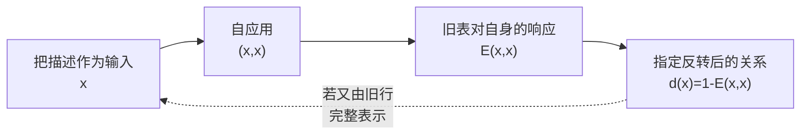

# 关系角色、反思与对角化

> 来源：用户于 2026-11-06（Asia/Singapore）在本会话提供的 AURIC R5-006 LaTeX 研究工作稿；原稿未另署作者或模型。本文为参考输入，Lean 是仓库的数学真源；本次仅转换 Markdown，未作形式化认证。正文中的固定快照、项目核读叙述与理论结论均保留原稿口径；一幅原生 TikZ 图转换为 Mermaid，保留自应用、评价、反转与虚线完整回填的关系、图中文字、数学标签和图注。

AURIC / R5-006

何时需要新区别，何时真正增加维数

同一整体内的相容精化、预测状态与自评价边界

2026年11月6日（新加坡时间）

## 摘要

本轮接住用户的修正：五个 $F$ 符号可以是各层重复使用的关系角色，不必是五个固定数值，也没有仅凭命名就成立的跨领域数值公式。但每次重新定义关系，仍须使新读口保留旧读数的含义，否则不能解释为同一整体内的提升。

本文把“需要提升”精确化为三种不同障碍：旧读口的纤维合并了目标不同的对象；新向量有旧空间不能表示的独立余量；新响应不在旧描述表的表达像中。它们分别由最小精化、Schur 秩公式与对角逃逸刻画。反思不必每次严格增长：固定任务的行为完成是幂等的，显式定义也可以是保守扩展。

“更大的守恒”可在固定整体向量的正交分解中准确实现；“现在连接过去与未来”可定义成保持全部允许未来条件律的最粗过去商。量子不确定关系则由两个误差向量的正关系表推出，但它使用明确的量子算子与正态前提，并不等同于读口未知或必然增秩。

最后给出完整的关系精化候选，证明其接口结论，并以 Lawvere、Gödel 与 Tarski 的准确条件说明：整体内部可以容纳评价器及其代码，但这不保证一个有效、全域、允许自反转的当前评价器能够无例外地评价自身全部关系。

**本轮最短表述** 把旧关系当作新对象，再检查它与其余关系能否共同成立。新问题只有在旧读法无法承载时，才迫使严格精化；是否增加几何维数，还需独立余量证明。

项目固定版本：[the-omega-institute/trureturing，dev](https://github.com/the-omega-institute/trureturing/tree/cae7cdbecefe4e996733b5a31cf247b2c6292ac0)。

提交：`cae7cdbecefe4e996733b5a31cf247b2c6292ac0`；2026-11-06 00:44:54 新加坡时间。

以下为附证明的数学模型与固定源码审阅；本轮没有重新编译 Lean，也未把本会话成果的仓库收录当作独立验证。

## 1　五个角色可以变，旧关系的含义不能任意改

本轮将用户的意思理解为：五个 $F$ 不预先指定一条适用于所有层次的数值关系；每层选择新的比较对象、参考和读口，再确定这一层的具体关系。这个理解允许多种模型，但仍须区分三种类型：

$$
\boxed{\text{关系对象}\qquad\text{关系读数}\qquad\text{关系定律}.}
$$

一个关系可以成为下一层对象；描述它的数字不等于整个关系对象；该数字遵守的规律又是另外一个类型。项目 V42 已明确作此区分。[\[1\]](#ref-v42)

| 符号 | 本轮抽象角色 |
|:---|:---|
| $F[\mathrm{null}]$ | 整体内部的参考接口：说明观察对象、允许操作、单位及读口语境。 |
| $F[1],F[3]$ | 当前选定的两路读出；具体模型须声明它们的对象类型及数值规则。 |
| $F[2]$ | 在已声明约束下完成当前比较所需的第三读数、方向或余量。 |
| $F[1,3]$ | 两路如何共同实现的关系对象，包含当前尚未由读数唯一确定的部分及其来源。 |

这是角色模板，不是一个五维向量定义。进入 R5-004 的二阶正表模型时，三个数值读数仍用该轮的坐标约定；进入其他模型则必须重新声明实现，不能在同一证明中把输入对象、算子与标量互换。内部参考也不能未经说明就等同空事件、加法零元和乘法单位。

用 $X$ 表示整体 $\Omega$ 内可讨论的对象、历史或相容记录。这不要求实际存在多个宇宙；真实整体可以仍只有一个，而模型保留当前读口尚未排除的候选记录。数学上研究全部候选，也不等于授予观察者实际访问全部候选的能力。

#### 定义 1.1：保持旧语义的精化

设当前读口为 $q:X\to S$，新读口为 $r:X\to R$，两者的值域均缩到实际像。若存在映射 $\pi:R\to S$，使

$$
\boxed{q=\pi\circ r,}
\tag{1}
$$

则称 $r$ 精化 $q$，记 $q\preceq r$。

式 (1) 是本轮最重要的跨层约束：新层允许看见更多，但按原规则读取旧问题时，须得到原来的值。若更换了模型或修正旧假设，应明确记录为修订，不把互不相容的两套关系冒充同一个无损提升。

在 R5-005 的 Robin 例子中，有向缺口可以换坐标，却不能在提升后换成绝对值并仍称为原缺口。取正平方根抹去方向，恰是违反目标保持的具体情形。

**白话对应。** 五个位置可以反复使用，每次放进去的对象也可以变。但新一层必须能解释旧一层已经说清楚的关系。否则只是换了一套说法，无法判断究竟补充了什么、修正了什么。

## 2　真正需要增加区别的必要充分条件

定义读口的纤维等价关系

$$
\ker q=\{(x,x'):q(x)=q(x')\}.
$$

这里的 kernel 指不可区分关系，不预设线性结构。

#### 定理 2.1：精化与目标恢复

有 $q\preceq r$ 当且仅当 $\ker r\subseteq\ker q$。 给定新目标 $f:X\to Y$，它可仅由旧读口恢复，即存在 $\bar f:S\to Y$ 满足 $f=\bar f\circ q$，当且仅当

$$
q(x)=q(x')\Longrightarrow f(x)=f(x').
$$

**证明。**

若存在因子映射，同一精细读数必给同一粗读数。 反向定义 $\pi(r(x))=q(x)$，kernel 包含恰保证代表元无关；像上的满射给唯一性。 对 $f$ 使用同一论证即可。

$\square$

#### 定理 2.2：加入一个关系的最小精化

定义

$$
q_f(x)=(q(x),f(x)).
$$

则 $q_f$ 是同时保留 $q,f$ 的最粗读口，并且

$$
\ker q_f=\ker q\cap\ker f.
$$

它比 $q$ 严格精细，当且仅当存在

$$
q(x)=q(x'),\qquad f(x)\ne f(x').
$$

**证明。**

两分量相同恰是两个等价关系的交。 若另一读口 $r$ 同时恢复 $q,f$，则存在 $a,b$ 使 $q=a\circ r,f=b\circ r$，从而 $q_f=(a,b)\circ r$，证明最小性。 严格性就是交集是否真缩小。

$\square$

因此，“每次定义一个关系”不等于“每次增加不可省略的区别”。若 $f$ 本来就是旧读口的函数，加入它只是显式展开旧信息。项目观察者完成稿 §§1–6 已以同一 kernel 次序组织这种关系。[\[2\]](#ref-completion)

### 2.1　固定任务的完整反思可以达到闭合

给定实际更新 $T:X\to X$。若 $q\circ T=\bar T\circ q$，则称 $q$ 对 $T$ 稳定。定义行为完成

$$
C_T(q)(x)=\bigl(q(x),q(Tx),q(T^2x),\ldots\bigr).
$$

#### 定理 2.3：最小稳定完成与幂等性

$C_T(q)$ 是保留 $q$ 的最小 $T$-稳定精化，并有

$$
\boxed{C_T(C_T(q))\simeq C_T(q).}
$$

等价号表示双方可相互恢复，拥有相同的区分能力。

**证明。**

第零分量恢复 $q$，左移无限读数列实现 $T$ 的下降，故完成稳定。 若 $r$ 稳定且 $q=a\circ r$，则 $q(T^kx)=a(\bar T_r^kr(x))$，所以 $r$ 恢复全部完成读数，证明最小性。 再作完成只得到数组 $q(T^{i+j}x)$；原序列恢复整个数组，而数组第零行恢复原序列，故幂等。

$\square$

这个完成是数学上的语义对象，不自动是有限可存储、可计算或已经实际取得的数据。固定任务闭合与观察者能否取得该闭包必须分开。

一个有限例子更直接：令 $X=\{0,1\}^2$， $T(u,v)=(v,u)$、$q(u,v)=u$。第一次加入下一步读数得到 $(u,v)$，确实精化；再加入下一步得到 $(u,v,u)$，已经没有新区别。连续反思可以停止增加信息。

**白话对应。** 反思是在问：刚才相同的两种情况，在新问题面前还相同吗？如果答案不同，就需要补一项关系；如果仍然相同，新描述可以完全留在旧层。某个任务可以已经完成，之后换一个任务又重新展开。

## 3　“关系的关系”怎样发现两两检查漏掉的问题

下面采用明确的复 Hermitian 线性模型。复数、线性组合及正性是这一分支的数学前提，不是由五个名称自动得到。

#### 命题 3.1：两两合法不保证共同实现

令

$$
K=\begin{pmatrix}
1&-\tfrac34&-\tfrac34\\
-\tfrac34&1&-\tfrac34\\
-\tfrac34&-\tfrac34&1
\end{pmatrix}.
$$

其每个二阶主块正定，但 $K$ 不正半定。

**证明。**

每个二阶块的行列式为 $1-9/16=7/16>0$，对角元为正； 然而

$$
(1,1,1)K(1,1,1)^{\mathsf T}=-\frac32<0.
$$

$\square$

把前两个对象的形式组合 $v=e_1+e_2$ 与第三个对象 $w=e_3$ 再作一次二元比较，同一系数系统给出

$$
G(v,w)=
\begin{pmatrix}\tfrac12&-\tfrac32\\-\tfrac32&1\end{pmatrix},
\qquad
\det G=-\frac74<0.
$$

第二层检查揭露了第一层看不出的不相容。此表是形式数据的线性延拓，负性正说明它不能成为同一 Hilbert 实现中的 Gram 表。这个例子与下面的闭合定理已见项目 V71 §5。[\[3\]](#ref-v71)

#### 定理 3.2：全部复合二元的相容性

给定标签集 $\mathcal L$ 上的 Hermitian 数据 $K$，在有限支撑自由复空间定义

$$
B(v,w)=\sum_{h,k}\bar v_h w_kK(h,k).
$$

以下条件等价：

1.  每个有限标签族的 $K$ 矩阵正半定；

2.  $B(v,v)\ge0$ 对每个有限组合 $v$ 成立；

3.  所有单点对角非负，且任意非空、不相交支撑的两个有限组合 $v,w$ 的二阶关系表正半定。

**证明。**

前两条都是所有有限二次型非负。 由第二条，对任意 $\alpha,\beta$，有 $B(\alpha v+\beta w,\alpha v+\beta w)\ge0$，故得到第三条。 反过来，单点组合由对角非负处理；多点组合拆成不相交的 $v=v_1+v_2$，则

$$
B(v,v)=(1,1)G(v_1,v_2)(1,1)^{\mathsf T}\ge0.
$$

零组合显然，得到第二条。

$\square$

关键不在于每层强行使用同一个数值，而在于所有组合用同一个已声明的语义规则，重叠部分相容。若某次合并时随意改动旧系数，第二层就无法检验第一层；任何不相容都可以被改名掩盖。

在上述正性下，可将零长度子空间商去并完成为 Hilbert 空间：定义 $\mathcal N=\{v:B(v,v)=0\}$，Cauchy–Schwarz 使其与全部对象的配对为零，因此 $B$ 在 $V/\mathcal N$ 上成为内积。这里得到的是给定复线性正核的表示定理，不是复线性前提自身的起源。

**白话对应。** 三个人两两说的话都能对上，不代表三个人合起来没有矛盾。把前两个人形成的共同关系当作一个新对象，再与第三个人比较，才可能看见冲突。“关系的关系”增加的是共同成立的要求。

## 4　新标签、新区别与新几何方向是三件事

#### 定理 4.1：新增一个 Gram 方向的准确判据

设 $G\succeq0$ 为 $m$ 阶 Hermitian 矩阵，$v\in\mathbb C^m$、$b\in\mathbb R$，考察

$$
\widetilde G=\begin{pmatrix}G&v\\v^\dagger&b\end{pmatrix}.
$$

则

$$
\widetilde G\succeq0
\iff
v\in\operatorname{Ran}G,\quad
\delta=b-v^\dagger G^+v\ge0,
$$

其中 $G^+$ 是 Moore–Penrose 逆。成立时

$$
\boxed{\operatorname{rank}\widetilde G=\operatorname{rank}G+\mathbf1_{\{\delta>0\}}.}
$$

**证明。**

正性要求 $v\perp\ker G$：否则沿核向量缩放交叉项，会使二次型为负。这在有限维等价于 $v\in\operatorname{Ran}G$。 置 $y=G^+v$，则 $Gy=v$，并有

$$
\binom{x}{t}^{\!\dagger}\widetilde G\binom{x}{t}
=(x+yt)^\dagger G(x+yt)+\delta|t|^2.
$$

取 $x=-yt$ 得必要性；同式给充分性。 可逆变量变换 $(x,t)\mapsto(x+yt,t)$ 将其化为 $G\oplus[\delta]$，给出秩公式。

$\square$

例如

$$
[1]\longmapsto
\begin{pmatrix}1&2\\2&4\end{pmatrix}
$$

增加了一行一列，但秩仍为一；新对象是旧向量的两倍。 只有非零独立余量才增加最小 Gram 实现的维数。这个判据与项目 R5-003、V71 的有限 Schur 结构一致。[\[4\]](#ref-r5003), [\[3\]](#ref-v71)

| 所谓“提升”     | 必须检查的准确条件                   |
|:---------------|:-------------------------------------|
| 新增标签或概念 | 是否只是旧表达式的可消去定义？       |
| 读口精化       | 新目标是否在旧纤维上不为常数？       |
| 线性维数增加   | Schur 余量是否严格为正？             |
| 表达范围扩大   | 新函数是否不在旧表示系统的像中？     |
| 证明强度增加   | 是否得到原理论不能证明的旧语言句子？ |

这些增长可以相关，但不能仅因都叫“更高一层”就视为同一个定理。Gödel 句的代码可以仍是自然数；无限精度的状态也可以仍用一个实坐标。

## 5　更大的守恒：可以给出准确模型，但不能从归一化倒推

### 5.1　归一化与更新不变量不同

若 $G_t\succeq0$ 且 $\operatorname{Tr}G_t>0$，定义 $\rho_t=G_t/\operatorname{Tr}G_t$，则 $\operatorname{Tr}\rho_t=1$ 恒成立。但取 $G_t=e^tI_2$，归一态一直为 $I_2/2$，原总量却为 $2e^t$。真正的守恒需要给定更新 $T$ 与量 $C$，然后证明

$$
C(Tx)=C(x).
$$

因此，“两者被更大概念约束”首先表达共同相容性；哪一个量守恒，还须由具体关系确定。

### 5.2　固定整体，改变可解析部分

设 $\mathcal H$ 为 Hilbert 空间，整体向量 $\psi$ 固定。 取嵌套闭子空间

$$
M_0\subseteq M_1\subseteq\cdots
$$

及正交投影 $P_n$。定义

$$
r_n=(I-P_n)\psi,\qquad
\eta_n=(P_n-P_{n-1})\psi\quad(n\ge1).
$$

#### 定理 5.1：已解析量与未解析量的守恒

$$
r_{n-1}=\eta_n+r_n,\qquad \eta_n\perp r_n,
$$

因此

$$
\boxed{\sum_{j=1}^n\|\eta_j\|^2+\|r_n\|^2=\|r_0\|^2.}
\tag{2}
$$

**证明。**

两式由投影差直接相减得到。$\eta_n\in M_n$，而 $r_n\perp M_n$，所以勾股关系给 $\|r_{n-1}\|^2=\|\eta_n\|^2+\|r_n\|^2$；逐层相加即得。

$\square$

若当前余量 $E_{n-1}=\|r_{n-1}\|^2>0$，可将新解析量与剩余量归一为

$$
a_n=\frac{\|\eta_n\|^2}{E_{n-1}},\qquad
b_n=\frac{\|r_n\|^2}{E_{n-1}},\qquad a_n+b_n=1.
$$

于是它们又可进入一次二元比较。这里的守恒来自同一个固定向量与正交分解；归一化只是随后选取读数。

这与“整体没有变化，改变的是观察者能解析的部分”相容。若称 $\eta_n$ 为当下新展开、$r_n$ 为未来待展开，使用的是解析进度意义的“未来”，还不是物理时间中将发生的具体记录。

令 $M=\overline{\bigcup_nM_n}$，标准投影逼近给

$$
r_n\longrightarrow (I-P_M)\psi.
$$

所以余量趋零需要 $\psi\in M$。永不在有限层结束则还需另有 $\|r_n\|>0$ 对每个 $n$ 成立。二者均不由“递归”一词保证。[\[3\]](#ref-v71)

在 $\ell^2(\mathbb N_{\ge1})$ 的标准正交基 $(e_j)$ 上，一个满足持续严格细分的模型是

$$
\psi=\sum_{j\ge1}2^{-j/2}e_j,\qquad
M_n=\operatorname{span}\{e_1,\ldots,e_n\}.
$$

则 $\|\psi\|=1$、$\|r_n\|^2=2^{-n}>0$，每层都增加独立方向，余量又趋零。它证明这种图景可以一致实现；无限维载体及目标的无限支撑仍是模型前提。

**白话对应。** 可以让整体保持不变，每一步只把原来未展开的部分再拆开：一部分成为这次读出，另一部分继续留下。两部分的平方量守恒。这样的无限模型确实存在，但若目标本来只有有限个独立部分，展开也可能完成。

## 6　现在作为过去与未来之间的关系状态

### 6.1　一个没有零概率歧义的有限模型

设有限过去记录 $H$ 与有限未来记录 $F$ 有给定联合分布，只考虑正概率取值。定义

$$
h\sim_+h'
\iff
\Pr(F=f\mid H=h)=\Pr(F=f\mid H=h')
\quad\text{对全部 }f.
$$

令

$$
S^+(h)=[h]_{\sim_+}.
$$

#### 定理 6.1：最小预测状态

有

$$
\Pr(F\mid H)=\Pr(F\mid S^+).
$$

若另一过去读口 $R=r(H)$ 也保留全部未来条件分布，则存在函数 $g$，使

$$
S^+=g(R).
$$

因此 $S^+$ 是保持未来条件律的最粗过去商。

**证明。**

同一 $S^+$ 类内所有过去给出相同未来分布，对这些过去加权仍得同一分布，所以充分性成立。 若 $r(h)=r(h')$，由 $R$ 的充分性，两者未来分布相同，故同属一个 $S^+$ 类。定义 $g(r(h))=[h]$ 即良定义。

$\square$

在这个意义下，现在是“过去中那些仍会影响未来响应的区别”。它不保存全部过去，也不提前知道哪个未来结果将实现。Shalizi–Crutchfield 的因果状态理论给出了这一结构的系统发展；项目观察者完成稿 §§248–249 已接入相应关系。[\[13\]](#ref-causal), [\[2\]](#ref-completion)

### 6.2　新的读出怎样成为下一刻的现在

对合法且正概率的有限历史 $h$，令 $K_h(w)$ 表示任意有限未来字 $w$ 的条件概率。要求它们来自同一过程，因而在 $K_h(a)>0$ 时满足

$$
K_{ha}(w)=\frac{K_h(aw)}{K_h(a)}.
$$

现在按全部 $K_h(w)$ 定义等价。

#### 命题 6.2：未来等价在合法接续下相容

若 $h\sim h'$ 且 $K_h(a)>0$，则 $ha\sim h'a$。因此

$$
S_{t+1}=\delta(S_t,a)
$$

是良定义的更新。

**证明。**

等价给 $K_h(aw)=K_{h'}(aw)$ 及 $K_h(a)=K_{h'}(a)>0$。 除法后即得全部新未来条件概率相同。

$\square$

允许不同动作菜单、历史相关的请求域或额外时钟时，这些持久信息及合法性也须纳入状态。项目动态未来商文稿 §15 将条件明确写成“预测充分加合法接续右同余”。静态条件律的存在不授予尚未执行分支的结果。[\[5\]](#ref-future)

### 6.3　双向关系：共享的信息留在两个关系状态之间

类似地，把未来按其过去条件分布分组，定义 $S^-(F)$。 有限情形下，有

$$
\boxed{I(H;F)=I(S^+;S^-).}
\tag{3}
$$

**证明。**

正向充分性给 $F\perp H\mid S^+$，从而 $I(H;F)=I(S^+;F)$。 因为 $S^-$ 是 $F$ 的函数，互信息链式法则给

$$
I(S^+;F)=I(S^+;S^-)+I(S^+;F\mid S^-).
$$

反向充分性给 $H\perp F\mid S^-$，而 $S^+$ 是 $H$ 的函数，故末项为零。

$\square$

这是“现在连接过去与未来”的一个精确关系式。反向状态需要给定未来记录后作回溯；它不是在线观察者已经可用的信息，也没有推出未来向过去传信。无限历史版本还需处理条件分布、零测集与极限，本文的有限证明不偷带这些结论。[\[14\]](#ref-presentpaper)

### 6.4　记忆状态增长可以留在同一个实坐标中

项目 §16 的固定隐藏位例子更直接。[\[5\]](#ref-future) 隐藏位一次采样后不再改变；给定隐藏位后，各次输出条件独立同分布。在两种隐藏状态下，输出 $1$ 的概率分别为 $1/4,3/4$，先验各半。 长度 $n$ 的历史若有 $k$ 个 $1$，Bayes 公式给后验赔率

$$
R_h=3^{2k-n}.
$$

下一次输出 $1$ 的概率为

$$
\frac{1+3R_h}{4(1+R_h)},
$$

对 $R_h>0$ 严格递增。因此长度 $n$ 有 $n+1$ 个不同未来类，需要至少 $n+1$ 个精确记忆值。

但取一个实坐标 $t_h=R_h/(1+R_h)$，更新仅为

$$
t_{h1}=\frac{3t_h}{1+2t_h},\qquad
t_{h0}=\frac{t_h}{3-2t_h}.
$$

状态数增长不要求坐标维数增长。相反，独立公平硬币的全部过去给出同一未来条件律，最小预测状态始终只有一个；若另要保存整个历史档案，那是另一项任务。

**白话对应。** 现在可以是一份关系摘要：过去发生过很多事，当前只保留其中会改变后续可能性的差别。新记录到来后，这份摘要更新。未来是它允许的分支和概率；实际走到哪一支，要等新的读出。

## 7　测不准能进入同一二元表，但不等于每次升维

### 7.1　总体已定、两路未知，也可能是经典情形

令经典变量 $R\in\{-1,1\}$，并定义

$$
X=\frac{1+R}{2},\qquad Y=\frac{1-R}{2}.
$$

则 $X+Y=1$。公平分布时两路各自未知而完全负相关，中心化关系表为

$$
G_{\rm cl}=\frac14\begin{pmatrix}1&-1\\-1&1\end{pmatrix}\succeq0.
$$

但每次样本中的 $X,Y$ 可以同时确定。故“整体约束、未知二元、归一化”尚未区分经典未知与量子读出不相容。

还须区分：不知道应选哪两个可观测量、不知道给定量的结果，以及给定两种量无法在同一态中同时无方差。它们不是一个数学条件。

### 7.2　量子分支中的完整二元推导

限定有限维复 Hilbert 空间。给定 $\rho\succeq0,\operatorname{Tr}\rho=1$ 与 Hermitian 可观测量 $A,B$，记

$$
A_0=A-\operatorname{Tr}(\rho A)I,\qquad B_0=B-\operatorname{Tr}(\rho B)I,
$$

$$
V_A=\operatorname{Tr}(\rho A_0^2),\qquad V_B=\operatorname{Tr}(\rho B_0^2),
$$

$$
\kappa=\tfrac12\operatorname{Tr}(\rho\{A_0,B_0\}),\qquad
\chi=\tfrac1{2i}\operatorname{Tr}(\rho[A,B]).
$$

#### 定理 7.1：方差不确定关系的二元正表

$$
G=\begin{pmatrix}
V_A&\kappa+i\chi\\
\kappa-i\chi&V_B
\end{pmatrix}\succeq0,
\qquad
\boxed{V_AV_B\ge\kappa^2+\chi^2.}
$$

**证明。**

在 Hilbert–Schmidt 内积中取 $u=A_0\sqrt\rho,v=B_0\sqrt\rho$。 二者 Gram 表恰为所示矩阵，因为 $\langle u,v\rangle=\operatorname{Tr}(\rho A_0B_0)=\kappa+i\chi$。 Gram 正性给行列式非负。

$\square$

这就是 Schrödinger 方差不确定关系；舍去 $\kappa^2$ 得 Robertson 形式。[\[12\]](#ref-schrodinger) 不等式对可对易算子也成立；非对易贡献体现在 $\chi$。即使算子非对易，特定态上的 $\chi$ 仍可能为零。这是给定态的方差约束，不自动是一般测量误差与扰动的定理。

若 $N=V_A+V_B>0$，用 R5-004 的读口次序定义

$$
x_1=\frac{2\kappa}N,\qquad
x_2=\frac{V_A-V_B}N,\qquad
x_3=-\frac{2\chi}N.
$$

则

$$
x_1^2+x_2^2+x_3^2+
\frac{4(V_AV_B-\kappa^2-\chi^2)}{N^2}=1.
\tag{4}
$$

所以用户的二元正关系与三元约束确实能容纳测不准，但这里的算子、正态、复线性与乘法结构均已明确给出。

### 7.3　严格正的测不准下界，仍可没有新增 Gram 方向

取

$$
A=\sigma_x,\quad B=\sigma_z,\quad
\rho=|+y\rangle\langle+y|.
$$

因为 $[\sigma_x,\sigma_z]=-2i\sigma_y$，有

$$
V_A=V_B=1,\qquad\kappa=0,\qquad\chi=-1.
$$

于是 $\Delta A\,\Delta B=1$，等于严格正的交换子下界。 然而

$$
G=\begin{pmatrix}1&-i\\i&1\end{pmatrix},
\qquad\operatorname{rank}G=1,\qquad
\delta=1-\frac{|-i|^2}{1}=0.
$$

这直接说明：真实量子不确定性可以在独立余量为零时出现。测不准由方差、协方差与交换子控制；新增方向由 Schur 余量控制。

**白话对应。** 有一条总关系而暂时不知道两边的数值，这可以是经典的未知。量子测不准需要更具体的结构：已经选定的两种量如何不对易。它能放进同一张二元关系表，但不能因此与“反思后增加一个维度”画等号。

## 8　对角化：旧表的全部行仍可能漏掉一个新关系

设 $A$ 为描述或地址集合，$Y$ 为读出值集合，给定全域关系表

$$
E:A\times A\to Y.
$$

一行 $E(a,-)$ 表示描述 $a$ 对全部对象的响应。

#### 定理 8.1：Lawvere 固定点定理的集合版本

若每个函数 $f:A\to Y$ 都由某一行表示，则每个 $\alpha:Y\to Y$ 都有不动点。

**证明。**

定义 $d(x)=\alpha(E(x,x))$。由表示假设，存在 $a$ 使 $E(a,x)=d(x)$ 对全部 $x$ 成立。令 $x=a$，得

$$
E(a,a)=d(a)=\alpha(E(a,a)).
$$

因此 $E(a,a)$ 为不动点。

$\square$

取 $Y=\{0,1\}$、$\alpha(y)=1-y$，反转没有不动点。因此

$$
\boxed{d(x)=1-E(x,x)\ \notin\ \{E(a,-):a\in A\}.}
\tag{5}
$$

它与第 $a$ 行至少在第 $a$ 列不同。这是原始对角论证的确切结构，Lawvere 原论文将其置于一般的关系评价框架中。[\[9\]](#ref-lawvere)

$$
x,\qquad (x,x),\qquad E(x,x),\qquad d(x)=1-E(x,x).
$$

**图 1：** 矛盾来自全表示、自应用与无不动点反转同时成立。虚线所要求的完整回填不能实现；图本身不声称增加空间坐标。

不必要求全部集合论函数可表示。只要指定合法函数类 $\mathcal C$，旧行覆盖 $\mathcal C$，同时新对角反转 $d$ 也属于 $\mathcal C$，同样矛盾。因此可计算、可定义或受限关系系统必须逐项检查这些闭包条件。

### 8.1　“增加一行一列”与对角化不同

对有限表 $E_n:\{1,\ldots,n\}^2\to\{0,1\}$，可以加入

$$
d_n(i)=1-E_n(i,i)\quad(1\le i\le n)
$$

作为新行。它只在旧定义域上与所有旧行不同。新列及新对角项另行给定，并未要求一个比特满足 $b=1-b$。 扩大表后可再次作对角反转，但新行数不等于新的 Gram 秩。

这里的障碍在**表达像**：某个响应函数不在旧表的行集合中。 第 2.1 定理的障碍则在**纤维**：旧读口合并了目标不同的对象。 一个系统即使没有重复描述、kernel 很细，仍可能漏掉某些响应函数。项目完成稿 §228.7 和 Lawvere 源码明确区分了这两点。[\[2\]](#ref-completion), [\[6\]](#ref-escape)

### 8.2　总预测器的反向响应检验

假设总可计算函数 $P(e,x)\in\{0,1\}$ 能正确预测每个总二值程序 $e$ 在输入 $x$ 上的值。 定义总程序 $D(x)=1-P(x,x)$，令其代码为 $d$。 正确性将给

$$
P(d,d)=D(d)=1-P(d,d),
$$

矛盾。因此，对任意代码都停止、且正确性覆盖这种反向响应对象的统一预测器不存在。

总性、可访问预测器、反向响应闭包和正确性范围都是必要前件。受限对象、允许拒答或不具备反向响应的系统，不自动落入此矛盾。普通自指可以稳定；例如显式把自己的有限代码写进档案，不因此失去确定性。

取概率变换 $p\mapsto1-p$ 会出现不动点 $1/2$，但这只解除该特定反转的无不动点条件，不会推出 Born 律或量子随机性。

## 9　Gödel 与 Tarski：增长的是证明或评价能力

### 9.1　新定义可以完全不增加旧语言结论

#### 定理 9.1：显式定义的保守性

设理论 $T$ 的语言为 $L$，$\varphi(\vec x)$ 是旧语言公式。 加入新关系符号 $R$ 和定义

$$
R(\vec x)\leftrightarrow\varphi(\vec x),
$$

得到 $T'$。对任意旧语言句子 $\psi$，有

$$
T'\vdash\psi\iff T\vdash\psi.
$$

**证明。**

把 $T'$ 证明中的每个 $R(\vec t)$ 替换为 $\varphi(\vec t)$，必要时重命名绑定变量以避免捕获。新定义公理变成恒真式，旧公理与推理步骤仍有效，故得到旧理论证明。反向显然。

$\square$

因此“把公理锁成定义间约束”可以使输入更清楚，但不能自动增加原理论的结论。若定义的其实是一个更小的允许模型类，那么还须说明这些约束为何成立、模型是否存在，以及为何描述目标对象。

例如把 Robin 正缺口写进“合法整数”的定义，尚未证明所有 $n>5040$ 都属于这个合法类。定义相容性可以消除含混，不能替代目标的独立证明。

### 9.2　对角句已经可以在原算术中构造

以下取可有效公理化且包含 PA 的经典理论 $T$，用通常的公式编码与证明谓词。对角引理给：对每个单自由变元公式 $\theta(y)$，存在句子 $G$ 使

$$
T\vdash G\leftrightarrow\theta(\ulcorner G\urcorner).
$$

其构造要点很短。令 $d(x)$ 是“将编号为 $x$ 的单变元公式代入其自身编号后所得句子的编号”；非法代码采用固定默认值。用原语言公式 $D(x,y)$ 表示这个原始递归函数的图像，使对每个具体自然数 $b$，算术都证明

$$
D(\bar b,y)\leftrightarrow y=\overline{d(b)}.
$$

在原语言内定义 $\beta(x)=\exists y\bigl(D(x,y)\land\theta(y)\bigr)$，令 $b=\ulcorner\beta\urcorner$，再取 $G=\beta(\bar b)$。 因为 $d(b)=\ulcorner G\urcorner$，上述唯一表示式给出所需等价。 所有公式与编号始终使用同一原语言，没有在消去新符号后偷换句子的代码。

因此，自应用句本身不一定先跑到一种新几何空间。它的语法及代码可以已经在原自然数系统中。

### 9.3　第一不完备的准确条件

标准 Gödel–Rosser 定理说：一致、有效可公理化且包含足够算术（例如 Robinson $Q$）的理论不完备，即有句子 $R_T$ 满足

$$
T\nvdash R_T,\qquad T\nvdash\neg R_T.
$$

Rosser 的改造用于把原始论证的更强一致性条件降到普通一致性。[\[11\]](#ref-rosser), [\[10\]](#ref-paulson) 本文引用这一标准定理，不把下面对原始 Gödel 句的简短论证冒充完整 Rosser 证明。

对通常的 Gödel 句，

$$
T\vdash G_T\leftrightarrow
\neg\operatorname{Prov}_T(\ulcorner G_T\urcorner).
$$

若 $T$ 一致，则 $G_T$ 不可证：一旦 $T\vdash G_T$，实际有限证明的可表示性使 $T$ 也证明 $\operatorname{Prov}_T(\ulcorner G_T\urcorner)$，而固定点式又给其否定，矛盾。

要同时保证这个原始句的否定不可证，可以另取算术可靠性等充分前提。若 $T$ 的定理在标准自然数中都为真，前述不可证使 $G_T$ 在标准模型中为真；因此其否定不能成为 $T$ 的定理。只使用普通一致性而又要两侧不可证，应使用 Rosser 版本，不混用句子及前提。

### 9.4　第二不完备与真正严格的反思链

记 $\Box\varphi=\operatorname{Prov}_T(\ulcorner\varphi\urcorner)$，采用通常的 Hilbert–Bernays–Löb 可导性条件：

$$
T\vdash\varphi\Longrightarrow T\vdash\Box\varphi,
$$

$$
T\vdash\Box(\varphi\to\psi)\to(\Box\varphi\to\Box\psi),
\qquad
T\vdash\Box\varphi\to\Box\Box\varphi.
$$

令 $\operatorname{Con}(T)=\neg\Box\bot$。

#### 定理 9.2：自身一致性不可证的核心论证

若 $T$ 一致，且具有上述编码、对角与可导性条件，则

$$
T\nvdash\operatorname{Con}(T).
$$

**证明。**

取 $T\vdash G\leftrightarrow\neg\Box G$。 将 $G\to\neg\Box G$ 放入可证明性并用可导性，得到

$$
T\vdash\Box G\to\Box\neg\Box G.
$$

另有 $T\vdash\Box G\to\Box\Box G$。 在可证明性内部组合相反命题，得 $T\vdash\Box G\to\Box\bot$。 故

$$
T\vdash\operatorname{Con}(T)\to\neg\Box G
\quad\Longrightarrow\quad
T\vdash\operatorname{Con}(T)\to G.
$$

若 $T$ 证明 $\operatorname{Con}(T)$，就会证明 $G$，与上一论证矛盾。

$\square$

这保留了第二定理真正需要的可证明性条件；正式编码的详细展开可见 Paulson 的作者论文与形式化工程。[\[10\]](#ref-paulson)

若 $T_0$ 满足本节的有效公理化、PA 包含及标准可证明性条件，并且算术可靠，可以构造

$$
T_{n+1}=T_n+\operatorname{Con}(T_n).
$$

每个新增句在标准模型中为真，故各层仍可靠；第二不完备使新增句在旧层不可证，于是定理集合严格增长。 但整个链仍可使用同一算术语言和自然数编码，增长的是证明强度。

只假设一致性不能保证每次扩展合法。例如在 PA 一致的前提下， $T=\mathrm{PA}+\neg\operatorname{Con}(\mathrm{PA})$ 仍一致，否则 PA 就会证明自身一致性。 而 $T$ 内部可把 PA 的矛盾证明视为 $T$ 的矛盾证明，因此 $T\vdash\neg\operatorname{Con}(T)$；再加入 $\operatorname{Con}(T)$ 就会矛盾。 所以“向上反思”需要明确的可靠性或扩展一致性依据。

### 9.5　真值层级可以在同一整体中内生

如果同一语言中有真值谓词 $\operatorname{Tru}$，并对包含该谓词的所有句子都满足

$$
\operatorname{Tru}(\ulcorner\varphi\urcorner)\leftrightarrow\varphi,
$$

则对角引理给

$$
L\leftrightarrow\neg\operatorname{Tru}(\ulcorner L\urcorner).
$$

再对 $L$ 应用真值条件，得到 $L\leftrightarrow\neg L$，与一致性矛盾。这是本轮所需的 Tarski 型同层真值障碍。[\[9\]](#ref-lawvere)

一种相容做法是在 $L_{n+1}$ 中评价 $L_n$ 的真值，同时不宣称同一个谓词已评价包含它自身的全部新语言。所有这些语言、代码与评价关系仍可属于同一整体中的结构；局部评价能力有限不要求它们位于 $\Omega$ 之外。

**白话对应。** 把旧关系起一个新名字，未必得到新的结论。真正的反思扩展，是加入旧系统无法证明而有另外依据的内容。哥德尔与对角化说明的是某些有效自评价系统不能把全部新关系一次封死；它们没有证明空间每次增加一根轴，也没有证明量子随机性。

## 10　本轮完整候选：关系在保持旧读数的条件下递归精化

#### 定义 10.1：R5-006 关系候选

指定同一来源域 $X$、允许操作与查询族，以及各层实际读口 $q_n:X\to S_n$。允许把已有关系及其有限描述重新作为查询对象。 要求：

1.  **来源与类型保留。** 参考、两个读口、关系对象与关系数值具有明确类型；使用同一对象或旧读口时，保留其来源和定义域。

2.  **精化相容。** 存在实际像上的投影 $\pi_n:S_{n+1}\to S_n$，满足 $q_n=\pi_n\circ q_{n+1}$；若是模型修订则另行声明。

3.  **目标充分。** 对选定目标族 $\mathcal Q_n$，只有当每个目标在 $\ker q_n$ 上为常数时，才称本层完成该任务。

4.  **后继良定义。** 若声称读口独立支持某操作 $T$，必须有 $q_n\circ T=\bar T_n\circ q_n$；存在相同旧读口而不同后继时，须保留区分它们的关系。

5.  **分支条件明示。** 进入几何、量子或逻辑分支时，分别给出正核与线性组合、算子与态、编码与可导性等前件。只在新区别、非零独立余量或新不可证句的条件已成立时，宣称相应严格提升。

这是一套关于表示与递推的定义约束，并不把“永不结束”或“每步都升维”另行塞进定义。

#### 定理 10.2：候选的直接后果

在上述模型内：

1.  加入目标 $f$ 的最小精化为 $(q_n,f)$，严格性由纤维分裂精确判定；

2.  对固定更新，全部未来读口给最小稳定完成，且完成幂等；

3.  若另有同核复线性正性，全部复合二元检查等价于全局正核，并给出商 Hilbert 表示；

4.  在有限正 Gram 分支，严格新增方向恰等于 Schur 余量为正；

5.  若另有全域自评价与无不动点对角反转，则该反转响应不在旧表示像中。

**证明。**

分别应用定理 2.2、2.3、 3.2、4.1 与式 (5)。 每一结论仅在对应的已声明分支前提下使用，没有把一种分支的结论移作另一种分支的无条件公理。

$\square$

### 10.1　它怎样接到已有量子公理

仅上述关系候选不能唯一选出复量子理论。一个简单的经典随机过程已经满足来源、精化、预测状态和相容更新，因而是反例。 若在量子分支进一步提供有限复矩阵代数及正归一线性泛函 $\omega:M_d(\mathbb C)\to\mathbb C$，则可严格恢复熟悉的状态表示。

#### 命题 10.3：有限正态的密度矩阵表示

存在唯一 $\rho\succeq0,\operatorname{Tr}\rho=1$，使

$$
\omega(A)=\operatorname{Tr}(\rho A).
$$

**证明。**

矩阵迹配对非退化，故线性泛函唯一表示为某个矩阵 $\rho$。 对任意向量 $v$，正性给 $\operatorname{Tr}(\rho vv^\dagger)=v^\dagger\rho v\ge0$，因此 $\rho$ Hermitian 且正。 归一性 $\omega(I)=1$ 给迹一。

$\square$

若再明确效果 $0\le E\le I$ 的操作概率为 $\omega(E)$，则得到 $p(E)=\operatorname{Tr}(\rho E)$；纯态及秩一效果时化为 Born 平方。 这一概率识别是操作接口前提；复线性正态本身也不是由“所有概念都是关系”推出。

仪器需要保持实际联合正性的作用规则；张量联合需要明确的复合系统；可逆动力学需要相应的结构保持条件。R5-004 的条件重构仍可作为这一量子分支的完整展开。本轮增加的是角色与递归边界的澄清，不声称已从 Gödel 或反思单独导出复数、Born、张量和全部量子公理。

### 10.2　“内生”所解决的是什么

把观察者、评价器、关系与规则都作为 $\Omega$ 中的对象，可以避免把某个观察者安放在整体之外。 但“作为对象存在”“能被当前语言表示”“能够有效计算”“实际取得其读数”仍是不同断言。

把约束写进允许模型的定义，会明确理论在讨论什么；要论证目标世界属于该类，仍须数学桥梁或经验依据。若每层只增加可消去定义，定理 9.1 保证它不会自动解决旧语言中的未决问题。

## 11　与本轮项目进展的准确对照

相对 R5-005 的固定提交 `e1a186b8`，本轮固定到 `cae7cdbe`。相关理论更新包括 C123 追加 §§88–93、原生稀疏入口文稿追加 §§14–18，以及 R5-004 的转写入库。后者是本会话成果的收录，不作为独立验证。

| 来源 | 与本轮关系及必须保留的边界 |
|:---|:---|
| V42 关系语义 | 区分对象、读数、定律；目标在纤维上恒定才可恢复。全密度态上的最小附加线性读口数为 $\dim(V_0+\mathcal T)-\dim V_0$，可能为零。[\[1\]](#ref-v42) |
| V71 全复合二元 | 两两正性不足，全部有限复合的同核正性给共同实现；有限独立方向、无限精度与无限历史分别处理。[\[3\]](#ref-v71) |
| 观察者完成与反射 | 行为完成是最小稳定精化且幂等；kernel 不充分与 image 逃逸是不同障碍；预测状态把过去按未来律归类。[\[2\]](#ref-completion) |
| 动态未来商 | 持续精确预测需要充分性与合法接续；固定隐藏位可在一个实坐标中产生无界多个精确记忆值。[\[5\]](#ref-future) |
| Lawvere 源码 | `escaped_of_fixedPointFree` 给指定扭转对角不在当前 listing 像中，不宣称几何必升维。[\[6\]](#ref-escape) |
| 最新 C123 | 局部二输入角之外的补空间仍在原整体内。三线角 $H_3(\mathbb C)$ 或 $H_2(\mathbb C)\oplus\mathbb R$ 与实三维 Bloch 球不同；相交角共享同一原关系，不能任意另选。[\[7\]](#ref-c123) |

C123 §91 的有限原子读回基是每个输入对上的有限重构；所有输入对仍连续量化，不据此得到全对象有限测试表或物理三维空间。 稀疏入口稿也区分符号可恢复与实际 append、commit、return 已完成。[\[8\]](#ref-sparse)

项目中的对角逃逸与量子读口结果须核对载体：完成稿 §105 对既有包装的说明，是两个独立载体上事实的并列，不能把它改读为对角逃逸推出 Born 随机性。形式反转的结果还需单独通过状态或效果的正性检验。 本轮没有重新编译这些 Lean 源码，纸面推导与机器认证分开报告。

## 12　最终判定与本轮白话

用户的关系图景可以收紧为：

$$
\boxed{
\text{旧关系成为新对象}
\ \longrightarrow\
\text{检查共同相容性}
\ \longrightarrow\
\text{必要时增加旧读口不能保留的区别}.
}
$$

支持它的完整结论是：关系能够递归成为对象，整体可以保持不变，当前状态可以概括过去对未来的作用；在指定自评价闭包下，对角化会产生不在旧表达像中的关系。

需要修正的全称断言是：“每次 meta 都必然增加一个几何维度”“这种提升与量子测不准或 Gödel 定理是同一个条件”。幂等完成、保守定义、零 Schur 余量和饱和量子不确定关系分别给出了准确反例。

**白话对应。** 五个位置没有预先写死每一层的具体内容。每次我们从整体中选一个参考，比较两路读出，再把它们怎样共同成立的关系留下来；这个关系下一次也可以成为被比较的对象。现在是过去仍会影响后续展开的那部分关系，新记录到来就更新它。反思时，若旧读法已经够用，就把旧关系展开；若它分不开新问题必须区分的情况，就补进新的关系。对角化说明，有些试图完整评价自身的读法，总能构造出它没有列出的回应。这个界限可以发生在同一个整体之内；至于是否真的增加空间方向，要看有没有独立余量，而不能只凭“又上了一层”来决定。

## 来源与参考

\[1\] [V42：F\[13\] 关系语义、量子三轴与递归相容性](https://github.com/the-omega-institute/trureturing/blob/cae7cdbecefe4e996733b5a31cf247b2c6292ac0/docs/develop/theory/AURIC_F13_RELATIONAL_SEMANTICS_QUANTUM_THREE_AXES_AND_RECURSIVE_COMPATIBILITY_V42.md)，§§1–2。 所有项目链接固定到首页提交；源码内历史元数据属于原文，不作本轮独立认证。

\[2\] [观察者完成反射与可观测 Gram 演算](https://github.com/the-omega-institute/trureturing/blob/cae7cdbecefe4e996733b5a31cf247b2c6292ac0/docs/develop/theory/FORMAL_OBSERVER_COMPLETION_REFLECTION.md)， §§1–6、105、226、228、248–249。最小稳定完成、幂等、对角边界与预测状态。

\[3\] [V71：通用二元关系核、商余与无界递归](https://github.com/the-omega-institute/trureturing/blob/cae7cdbecefe4e996733b5a31cf247b2c6292ac0/docs/develop/theory/AURIC_UNIVERSAL_BINARY_RELATION_KERNELS_QUOTIENT_RESIDUALS_AND_UNBOUNDED_RECURSION_V71.md)， §§5–6、11。全复合正性、Schur 余量与递归范数预算。

\[4\] [R5-003：投影、对角构造与黄金单位提升](https://github.com/the-omega-institute/trureturing/blob/cae7cdbecefe4e996733b5a31cf247b2c6292ac0/docs/develop/theory/AURIC_R5_003_PROJECTION_DIAGONAL_CONSTRUCTIONS_AND_GOLDEN_UNIT_LIFTING.md)，§2.1。 本会话较早成果的项目转写，用于保持定义连续性，不作为独立验证。

\[5\] [动态未来商与未来闭合记忆](https://github.com/the-omega-institute/trureturing/blob/cae7cdbecefe4e996733b5a31cf247b2c6292ac0/docs/develop/theory/AURIC_FIB_ATOM_DYNAMIC_FUTURE_QUOTIENT_AND_FUTURE_CLOSED_MEMORY.md)，§§15–16。 合法历史、预测充分性、接续相容及隐藏位模型。

\[6\] [Lawvere/QualitativeEscape.lean](https://github.com/the-omega-institute/trureturing/blob/cae7cdbecefe4e996733b5a31cf247b2c6292ac0/D5/S0/Diagonal/Lawvere/QualitativeEscape.lean)。 `escaped_of_fixedPointFree` 与 `self_application_fragment_package`。本轮读取源码，未重新编译。

\[7\] [C123：原生互反比较与有限端点量子重构](https://github.com/the-omega-institute/trureturing/blob/cae7cdbecefe4e996733b5a31cf247b2c6292ac0/docs/develop/theory/AURIC_NATIVE_RECIPROCAL_COMPARISON_AND_FINITE_ENDPOINT_QUANTUM_C123.md)，新增 §§88–93，尤其 §91 的三线角与局部球面区分。

\[8\] [递归关系观察的稀疏原生入口取得](https://github.com/the-omega-institute/trureturing/blob/cae7cdbecefe4e996733b5a31cf247b2c6292ac0/docs/develop/theory/RECURSIVE_RELATIONAL_OBSERVATION_SPARSE_NATIVE_ENTRY_ACQUISITION.md)，新增 §§14–18。 符号重构、实际入口与执行状态不同。

\[9\] F. William Lawvere. *Diagonal arguments and cartesian closed categories* (1969). [附作者评论的原文重印](https://tac.mta.ca/tac/reprints/articles/15/tr15.pdf)， Reprints in Theory and Applications of Categories 15 (2006), 1–13，尤其定理 1.1、推论 1.2 与 §3。

\[10\] Lawrence C. Paulson. *A Mechanised Proof of Gödel’s Incompleteness Theorems using Nominal Isabelle*. [作者文稿 arXiv:2104.13792](https://arxiv.org/pdf/2104.13792)。 本文使用明确的编码、可靠性及可导性条件，不只采用其开头的非正式概述。

\[11\] Barkley Rosser. *Extensions of some theorems of Gödel and Church*. Journal of Symbolic Logic 1(3) (1936), 87–91. [出版方原文页面及摘录](https://www.cambridge.org/core/journals/journal-of-symbolic-logic/article/abs/extensions-of-some-theorems-of-godel-and-church/0461E34DC1F219C459EE84CC2FA89068)。 本轮核对官方摘录的普通一致性与 $\omega$-一致性区别，未逐页读取原始扫描全文。

\[12\] E. Schrödinger. *About Heisenberg Uncertainty Relation* (1930). [英译及注释 arXiv:quant-ph/9903100](https://arxiv.org/pdf/quant-ph/9903100)， 原文式 (9)。方差关系不等于一般误差–扰动关系。

\[13\] C. R. Shalizi and J. P. Crutchfield. *Computational Mechanics: Pattern and Prediction, Structure and Simplicity*. [作者文稿 cond-mat/9907176](https://arxiv.org/pdf/cond-mat/9907176)。 定义 5、充分性、最小性与状态更新；本文另给有限完整证明。

\[14\] J. P. Crutchfield and C. J. Ellison. *The Past and the Future in the Present*. [作者文稿](https://csc.ucdavis.edu/~cmg/papers/pafip.pdf)， arXiv:1012.0356。预测与回溯状态的共享信息及无限极限条件。
