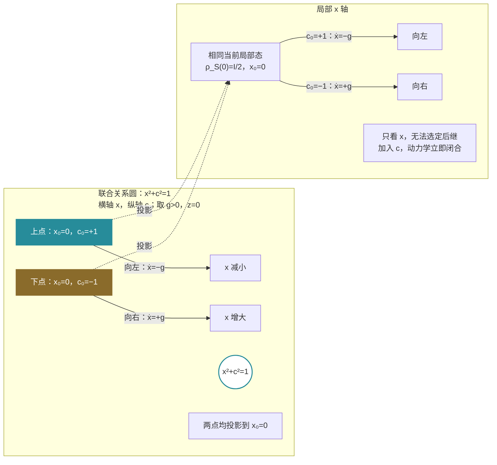

# 稳定三元为何仍会运动

> 来源：用户于 2026-11-06（Asia/Singapore）在本会话提供的 AURIC R5-007 LaTeX 研究工作稿；原稿未另署作者或模型。本文为参考输入，Lean 是仓库的数学真源；本次仅转换 Markdown，未作形式化认证。正文中的固定快照、项目核读叙述与理论结论均保留原稿口径；一幅原生 TikZ 图转换为 Mermaid，保留联合关系圆、局部投影、相反速度、图中文字、数学标签和图注。

AURIC / R5-007

二元正关系、隐藏关联与最小后继闭合

五模式的关系解释与有限量子条件理论

2026年11月6日（新加坡时间）

## 摘要

本轮讨论：二元关系归一化后形成稳定三元，但三元还会运动，是否因为关系仍有关系、尚未稳定？可以严格成立的版本是：当前关系已满足共同实现约束，并不保证当前读数足以决定后继；若后继依赖遗漏关联，就必须补入相关读口。补全后的结构仍可持续运动。

本文保持 R5-004 的三轴约定，从非零二阶复正表推出 Bloch 球；再以两个反对易二值读口生成第三个读口，给出“二元成为三元”的代数实现。平方缺额刻画当前转换是否保持全部生成关系；Heisenberg 生成元不变性刻画当前读数是否足以预测后继。两种闭合均与静止不同。

核心例子是在一个固定两量子比特整体内：两个初态的全部单体读数相同，隐藏联合关联却使下一步运动相反。补入关联后，得到有限闭合的旋转三元及严格守恒量。消去关联则得到准确记忆项。最后以局部三维比较网络和回路运输说明：局部三维并不压缩掉全部全局关系。

完整候选为“同源关系的相容延续”：保留旧读数，只为实际影响目标后继的遗漏关系扩展表示。进入量子分支仍明确给出复正结构、联合与操作接口；本文不声称从关系语言单独推出现实世界的全部动力学。

**本轮最短表述** 归一化闭合当前形状；后继闭合回答下一步；静止是下一步恰好不变。若当前三元不能决定后继，就补进相关关系；补全以后，三元仍可以沿保持约束的轨迹运动。

项目固定版本：[the-omega-institute/trureturing，dev](https://github.com/the-omega-institute/trureturing/tree/3c401bd07aa3accd6e643b40ab6f0b6cad9e6290)。

提交：`3c401bd07aa3accd6e643b40ab6f0b6cad9e6290`；2026-11-06 02:27:39 新加坡时间。

本文给纸面定义与证明，核读相关项目源文及一手文献；未重新编译 Lean。R5-004 至 R5-006 的仓库转写属于本研究链，不作为独立验证。

## 1　五模式的稳定部分与继续展开的部分

五个符号首先是每层复用的角色，不是五个彼此独立的实坐标。为延续 R5-004，允许把本层内部参考 $O=F[\mathrm{null}]$ 与带来源的未展关系 $R=F[1,3]$ 作为下一次比较的两端；比较的三轴读数记为 $F[1],F[2],F[3]$。这是接口构造，不把关系对象与算子、标量自动等同。[\[2\]](#ref-r54), [\[4\]](#ref-v70)

| 角色 | 本轮含义与保留条件 |
|:---|:---|
| $F[\mathrm{null}]$ | 整体 $\Omega$ 内部的参考、标架和读法；参考变化也须纳入比较。 |
| $F[1],F[3]$ | 当前选定的两路读出；它们的相对方向、相位与组合规则必须明确。 |
| $F[2]$ | 在指定结构内补全比较的第三读数；是否独立由模型决定。 |
| $F[1,3]$ | 两路如何共同成立以及如何延续的关系对象；可作为下一轮输入。 |

总尺度、来源和允许操作保存在接口记录中，不要求每项都再占一个固定实坐标。若一个隐藏关系已经能从当前读数恢复，它不再是相对于这个读口的遗漏信息；若它不能影响指定后继，也不能仅凭“尚未知晓”断言必须加入预测状态。

### 1.1　回到项目原五模式：三均值确实会遗漏一个关联

原离散模式按 $(0,2,3,5,25)$ 排列，对应本讨论的 $(F[\mathrm{null}],F[1],F[2],F[3],F[1,3])$。原占位变量满足 $x,y,z\in\{0,1\}$、$xz=yz=0$，函数基为 $1,x,y,z,xy$。其中空窗事件不是常数单位，也不自动就是观察者。本文以 $F[\mathrm{null}]$ 表内部参考，是高层角色约定；连接这两个类型仍须给具体编码。[\[1\]](#ref-foundation)

记三均值为 $X=\mathbb E x,Y=\mathbb E y,Z=\mathbb E z$，交叉关系为 $\kappa=\mathbb E(xy)$。全部五概率为

$$
\boxed{p_\kappa=(1-X-Y-Z+\kappa,\ X-\kappa,\ Z,\ Y-\kappa,\ \kappa),}
\tag{1}
$$

其中非负性恰要求

$$
\max(0,X+Y+Z-1)\le\kappa\le\min(X,Y).
$$

证明只需逐项取占位均值并用总概率一。例如 $p=(1/2,0,0,0,1/2)$ 与 $p'=(0,1/2,0,1/2,0)$ 都有 $(X,Y,Z)=(1/2,1/2,0)$，却有不同的交叉关系。这里的金字塔是五顶点的占位凸体，不是一般意义的 Bloch 球。

项目 V70 §3 给出了额外的固定量子编码桥：存在 $J:\mathbb C^2\to\mathbb C^5$ 及五个固定效果，使

$$
u=(p_2+p_{25},p_5+p_{25},p_3)=u_0+\nu r,\qquad\nu>0,
$$

并有 $p_0=3p_{25}$。在 *这个编码态族* 内，三均值因此能恢复 qubit；额外关系固定 $\kappa=(1-X-Y-Z)/2$。一般五概率并没有该约束。该源还通过共同压缩解释母指针对易而逻辑读口不对易的条件，未从裸离散模式无条件制造量子性。[\[4\]](#ref-v70)

#### 定义 1.1：三种不同的稳定陈述

对已给动力学 $T$ 或 $\dot\rho=\mathcal L\rho$，区分：

1.  **约束保持：** 状态一直处于声明的正性、归一化等允许集合。

2.  **后继闭合：** 当前读数足以决定指定操作下的后继读数。

3.  **静止：** 该状态被操作保持，或其时间导数为零。

这里不把它们统称为动力系统意义的 Lyapunov 稳定。

将用户直觉收紧后，真正需要研究的缺口是： *本层约束保持，但本层读数对后继还不充分。* 持续运动则还可能来自一套完全闭合的生成规则。项目 V89 已给出平方闭合但旋转、振荡的明确反例。[\[5\]](#ref-v89)

**白话对应。** 三元“站得住”，说明它当前可以共同成立；三元“知道下一步”，说明影响后继的关系已经收齐；三元“停下来”，说明这一刻恰好不再变化。这三句话要分别证明。

## 2　二元正关系为何恰好给三个实读数

#### 定义 2.1：同源二元复正表

对两个声明过的接口，取同一复 Hermitian 正核的限制

$$
G=\begin{pmatrix}a&c\\\bar c&b\end{pmatrix}\succeq0,
\qquad N=a+b>0.
$$

定义 $\rho=G/N$，并保持前轮轴序

$$
x_1=\frac{2\Re c}{N},\qquad
x_2=\frac{a-b}{N},\qquad
x_3=-\frac{2\Im c}{N}.
\tag{2}
$$

于是

$$
\rho=\frac12(I+x_1\sigma_x+x_2\sigma_z+x_3\sigma_y)
=\frac12\begin{pmatrix}1+x_2&x_1-i x_3\\x_1+i x_3&1-x_2\end{pmatrix}.
$$

#### 定理 2.2：二元归一化与有限三维球

上述关系满足

$$
\boxed{x_1^2+x_2^2+x_3^2+\frac{4(ab-|c|^2)}{N^2}=1.}
\tag{3}
$$

正归一二阶复矩阵与闭单位三维球一一对应。球面恰对应二阶表秩一。

**证明。**

由定义，前三项之和为

$$
\frac{4|c|^2+(a-b)^2}{N^2}
=1-\frac{4(ab-|c|^2)}{N^2}.
$$

正性给 $ab-|c|^2\ge0$。反向给定 $\|x\|\le1$，显示的 $\rho$ 的特征值为 $(1\pm\|x\|)/2$，故正且迹一。矩阵公式给唯一性；迹一排除零矩阵，行列式为零恰为秩一。

$\square$

原正表有四个实参数：$a,b,\Re c,\Im c$。除去一个正总尺度后剩三个。这是复二阶正结构的结论；一般二元概念并未自动供应这些前提。实对称二阶表归一后只有两个实参数；单独两个正数归一后只有一个。Bloch 球的标准量子解释见官方课程。[\[8\]](#ref-ibm)

纯态球面有三个受限坐标，其流形维数为二。给定两个横向坐标及纯态约束，第三坐标通常仍有正负两个分支；标架手性本身不能替代状态分支的输入。

总尺度须与三元一起保留才能恢复 $G=N\rho$。当 $N=0$ 时正性迫使 $G=0$，此时不得继续使用归一化坐标。另有来源、联合和历史的信息，也不因这个矩阵表示而全部变成三个数。

一旦 $N,x$ 已知，局部矩阵中的 $c$ 已经完全确定；后文所谓隐藏关系属于该表相对于其他对象的嵌入、联合记录或执行连接，不能又在同一二阶表中声称存在第四个独立归一坐标。

### 2.1　归一化只消去共同尺度，不消去全部变化

#### 命题 2.3：归一化微分与精确静止条件

设 $G(t)\succeq0$ 可微且 $N(t)=\operatorname{Tr}G(t)>0$。则

$$
\dot\rho=\frac{\dot G-\rho\operatorname{Tr}\dot G}{N}.
$$

因此在每个时刻

$$
\boxed{\dot\rho=0\iff \dot G=\lambda G,
\qquad\lambda=\frac{\dot N}{N}.}
\tag{4}
$$

**证明。**

对 $G/N$ 求导，再乘以 $N$ 即得等价。作为正迹 Hermitian 开半空间上的微分，归一化映射的核恰是 $\mathbb R G$。

$\square$

例如 $G(t)=e^tG_0$ 仅改变尺度，归一三元不动。若 $G(t)=U(t)G_0U(t)^\dagger$，即使总尺度完全不变，三元一般仍转动。

**白话对应。** 把每张图都归一成同样大小，只消去了“整体放大或缩小”。图中的相对形状和方向仍然可以改变。一个稳定的球面也允许球面上的点一直运动。

## 3　二元生成第三元：一个可完整证明的量子实现

除了把二元关系表写成三个数，还可以问：两个可观测关系如何生成第三个可观测关系？下面给一条前提清楚的答案。

#### 定理 3.1：两个反对易二值读口生成 Pauli 三元

设非零有限复 Hilbert 空间上的 Hermitian 算子 $A,B$ 满足

$$
A^2=B^2=I,\qquad AB=-BA.
$$

定义

$$
\boxed{C=-iAB=\frac{[A,B]}{2i}.}
\tag{5}
$$

则 $C$ Hermitian、$C^2=I$，且

$$
AB=iC,\qquad BC=iA,\qquad CA=iB.
$$

含幺复 $*$-代数 $\mathcal A=\operatorname{alg}_*(A,B)$ 恰为 $\operatorname{span}_{\mathbb C}\{I,A,B,C\}$，同构于 $M_2(\mathbb C)$。其正归一状态由

$$
x=\omega(A),\quad c=\omega(B),\quad z=\omega(C),
\qquad x^2+c^2+z^2\le1
$$

完整表示。

**证明。**

由 $(AB)^\dagger=BA=-AB$，得 $C^\dagger=C$；又 $C^2=-ABAB=A^2B^2=I$。三条乘法关系直接代入可得。因此任何词都约化到 $I,A,B,C$ 的线性组合。

这四个算子线性独立：用 $A,B,C$ 共轭的符号变化分别抽取各分量，例如 $AIA=I,AAA=A,ABA=-B,ACA=-C$。把线性关系及其三个共轭相加、相减，逐项得系数为零。其乘法表与 Pauli 矩阵相同，给出所述 $*$-同构。

有限矩阵代数上的正归一泛函有密度矩阵表示（第 8 节给证明）；对该二阶表示应用定理 2.2 即得状态球。相应角色轴序为 $(F[1],F[2],F[3])=(x,z,c)$。

$\square$

这条结论把“关系连接二元”写成了 $C=[A,B]/(2i)$：第三元来自两个读口的有序组合关系。复数、二值性、反对易及正性是声明过的条件，不能由五个标签直接推出。若 $A,B$ 对易，上式反而给 $C=0$，不会产生这套 Pauli 三元。

### 3.1　二元的更高关系何时不再需要逐项补洞

项目 V89 的乘法域结构给另一个有限证书。[\[5\]](#ref-v89) 设 $\Phi:M_d(\mathbb C)\to M_k(\mathbb C)$ 保单位元且完全正，定义

$$
\Gamma_\Phi(X,Y)=\Phi(X^\dagger Y)-\Phi(X)^\dagger\Phi(Y),
\qquad\Delta_\Phi(X)=\Gamma_\Phi(X,X).
$$

#### 定理 3.2：两端平方闭合锁定全部生成关系

对 Hermitian $A,B$，若

$$
\boxed{\Delta_\Phi(A)=\Delta_\Phi(B)=0,}
$$

则对全部有限非交换 $*$-多项式 $p$，

$$
\Phi(p(A,B))=p(\Phi(A),\Phi(B)).
$$

反向也成立。

**证明。**

写有限表示 $\Phi(X)=V^\dagger\pi(X)V$，其中 $V^\dagger V=I$，$\pi$ 为 $*$-表示。记 $P=VV^\dagger,Q=I-P$，则

$$
\Gamma_\Phi(X,Y)=D(X)^\dagger D(Y),\qquad D(X)=Q\pi(X)V.
$$

平方缺额为零等价于 $D(A)=D(B)=0$。Hermitian 性及取伴随给 $[P,\pi(A)]=[P,\pi(B)]=0$。于是 $P$ 与全部生成多项式对易，在乘积中插入 $P+Q$ 时交叉项消失，故 $\Phi$ 在生成代数上保持乘法、伴随与单位。反向只取平方多项式即可。

$\square$

这不是时间静止定理。酉共轭 $\Phi(X)=U^\dagger XU$ 对所有对象平方闭合，却可以使读口旋转。其含义是：在这个指定转换下，全部关系的组合已经相容。

### 3.2　关系的缺额还可以再组成一个二元三维表

取忠实校准密度矩阵 $\tau>0$，对 $A_1=A,A_2=B$ 定义

$$
M_{ij}=\operatorname{Tr}[\tau\Gamma_\Phi(A_i,A_j)].
$$

因为它是 Hilbert–Schmidt 向量 $D(A_i)\sqrt\tau$ 的 Gram 表，故 $M\succeq0$。当 $s=\operatorname{Tr}M>0$ 时，$M/s$ 再次给定理 2.2 的三元。这正是把“旧关系在转换下如何失配”作为下一轮比较对象。

若 $s=0$，正性与 $\tau>0$ 迫使两个平方缺额都为零，此时这张 *缺额表* 无需也不能再归一化。原状态的概率分散仍可存在。若只保留 $M/s$ 而丢掉 $s$，便无法判断缺额是否正在减小。

**白话对应。** 关系也能有关系：先看两端，再看“先组合后转换”和“先转换后组合”差多少。这个差额仍可做成二元正表。但差额已经为零时，停止的是修补关系的递归，状态本身仍可以运动。

## 4　何时当前三元确实不足以决定下一步

#### 定理 4.1：后继下传的必要充分条件

设 $q:X\to S$ 的值域缩到实际像，$T:X\to X$ 为指定操作。存在 $\bar T:S\to S$ 满足

$$
q\circ T=\bar T\circ q
$$

当且仅当

$$
\boxed{q(x)=q(x')\Longrightarrow q(Tx)=q(Tx').}
\tag{6}
$$

**证明。**

若下传存在，直接代入。反向定义 $\bar T(q(x))=q(Tx)$，条件保证不依赖代表选择。

$\square$

这里 $X$ 可以是同一整体内当前尚未排除的相容记录，不预设多个实际宇宙。若相同旧读数允许不同后继，说明缺失的是预测所需的区别。R5-006 的精化判据在此取目标 $f=q\circ T$。[\[3\]](#ref-r56)

### 4.1　有限量子读口的反向检验

固定 $\mathcal H=\mathbb C^d$，$\mathcal L$ 为 Hermitian 保持的固定线性生成元，满足 $\operatorname{Tr}\mathcal L(X)=0$，并假设 $e^{t\mathcal L}$ 对 $t\ge0$ 把密度态映为密度态；例如有限 Lindblad 生成元或 Hamiltonian 生成元。其对偶由 $\operatorname{Tr}[\mathcal L(\rho)A]=\operatorname{Tr}[\rho\mathcal L^\dagger(A)]$ 定义，且 $\mathcal L^\dagger(I)=0$。取

$$
V=\operatorname{span}_{\mathbb R}\{I,A_1,\ldots,A_m\}\subseteq\operatorname{Herm}_d,
\qquad q(\rho)=(\operatorname{Tr}\rho A_1,\ldots,\operatorname{Tr}\rho A_m).
$$

#### 定理 4.2：全部态上的瞬时预测闭合

相同 $q$ 值总给相同导数，当且仅当

$$
\boxed{\mathcal L^\dagger(V)\subseteq V.}
\tag{7}
$$

成立时存在仿射线性自主方程 $\dot q=b+Mq$，它决定全部后续读数。

**证明。**

若不变性成立，写 $\mathcal L^\dagger(A_i)=b_iI+\sum_jM_{ij}A_j$，则

$$
\dot q_i=\operatorname{Tr}[\rho\mathcal L^\dagger(A_i)]=b_i+\sum_jM_{ij}q_j.
$$

线性 ODE 唯一性给后继。

反向若某个 $B=\mathcal L^\dagger(A_i)\notin V$，令 $P_V$ 是 Hilbert–Schmidt 正交投影，$D=B-P_VB\ne0$。因 $I\in V$，有 $\operatorname{Tr}D=0$。选

$$
0<\varepsilon<\frac1{d\|D\|_{\rm op}},\qquad
\rho_\pm=I/d\pm\varepsilon D.
$$

这两个矩阵都正且迹一；$D\perp V$ 保证当前读数完全相同，但第 $i$ 个导数之差为

$$
\operatorname{Tr}[(\rho_+-\rho_-)B]=2\varepsilon\operatorname{Tr}(DB)
=2\varepsilon\operatorname{Tr}(D^2)>0.
$$

因此不能下传。这里必须量化全部密度态；若只允许受限态族，必要条件可以更弱。

$\square$

这直接落实反向推理：若不满足所要求的闭合条件，就构造两个当前读口相同、后继不同的正归一实例，而不是仅用“关系复杂”解释失败。

### 4.2　关系的关系给出最小递推，固定有限模型可闭合

#### 定理 4.3：最小后继完成

令

$$
\boxed{V_{n+1}=V_n+\mathcal L^\dagger(V_n).}
\tag{8}
$$

则

$$
V_\infty=\operatorname{span}_{\mathbb R}\{(\mathcal L^\dagger)^kA:A\in V_0,\ k\ge0\}
$$

是包含 $V_0$ 的最小不变空间。严格增长至多发生 $d^2-\dim V_0$ 次；一旦相邻层相等，后续全部相等。该空间保留初始目标读口的全部未来期望。

**证明。**

对递推归纳，第 $n$ 层恰为次数不超过 $n$ 的生成元作用之线性包。任何包含 $V_0$ 的不变空间都必须包含这些向量，故最小。$\operatorname{Herm}_d$ 的实维数为 $d^2$，每次严格包含至少加一维；相邻相等即已不变。有限维指数级数给 $e^{t\mathcal L^\dagger}A\in V_\infty$，所以保存这些期望就保存全部目标未来；反向若全部未来期望相同，在 $t=0$ 求各阶导数即得全部生成读数相同。

$\square$

这是标准可观测/Krylov 空间方法的一个自足有限证明；项目 V70 给离散固定门菜单版本，一手文献给连续量子模型约化及量子代数完成。[\[4\]](#ref-v70), [\[11\]](#ref-reduction)

对 Hamiltonian 导子 $\delta(A)=i[H,A]$，Leibniz 法则保证 $\mathcal A_\infty=\operatorname{alg}_*(V_\infty)$ 也不变，并是包含目标的最小不变含幺 $*$-代数。一般 Lindblad 生成元不满足普通 Leibniz 法则，不能直接照搬这个论证。最小线性预测空间也不自动是完整量子可观测量代数。

**白话对应。** 先问当前读数的变化由什么决定，再把缺少的那部分关系加进来。继续问新关系的变化由什么决定。若所有答案最终都能在当前关系表里找到，就完成了这个任务；表内关系依然可以不断变化。

## 5　完整实例：相同三元，隐藏关系使后继相反

本节所有变量均处于同一个两量子比特整体。$S,E$ 只是内部划分，$E$ 不在 $\Omega$ 之外。

#### 定义 5.1：一个闭合的联合 Pauli 三元

令 $X,Y,Z$ 为 Pauli 矩阵，取

$$
A=X\otimes I,\qquad B=Y\otimes Z,\qquad C=Z\otimes Z,
$$

及态族

$$
\rho(x,c,z)=\frac14(I+xA+cB+zC),
\qquad x^2+c^2+z^2\le1.
\tag{9}
$$

#### 命题 5.2：联合正性与当前局部三元

$A,B,C$ 满足定理 3.1 的乘法表。若 $r=\sqrt{x^2+c^2+z^2}$，$\rho$ 的特征值为 $(1\pm r)/4$，各二重。因此式 (9) 恰为一族合法密度态，并且

$$
\boxed{\rho_S=\frac12(I+xX),\qquad\rho_E=\frac12I.}
$$

**证明。**

由 Pauli 乘法直接计算。令 $R=xA+cB+zC$，反对易性给 $R^2=r^2I$，迹零给特征值正负重数各二（$r=0$ 时直接成立）。偏迹时 $\operatorname{Tr}X=\operatorname{Tr}Y=\operatorname{Tr}Z=0$，只留下显示的项。

$\square$

在局部 $S$ 上，三元为 $(x,0,0)$；$c,z$ 不是局部密度矩阵的“第四坐标”，而是联合关系的读数。在联合虚拟量子比特代数上，角色三元为 $(x,z,c)$。当 $r=1$ 时它在该代数上纯，但全局 $4\times4$ 态仍秩二，不能称为全局纯态。

#### 定理 5.3：隐藏关系进入局部速度

固定 $\hbar=1$、$H=gC/2$。在 $\dot\rho=-i[H,\rho]$ 下，式 (9) 的态族不变，且

$$
\boxed{\dot x=-gc,\qquad\dot c=gx,\qquad\dot z=0.}
\tag{10}
$$

其精确解为

$$
x(t)=x_0\cos(gt)-c_0\sin(gt),\qquad
c(t)=x_0\sin(gt)+c_0\cos(gt),\qquad z(t)=z_0.
$$

并保持 $x^2+c^2+z^2$。

**证明。**

Heisenberg 导数为 $i[H,A]=-gB$、$i[H,B]=gA$、$i[H,C]=0$。取期望得到方程；代入显示的解即可核对初值与导数。平方和导数为 $-2gxc+2gcx=0$。

$\square$

特别取

$$
\rho_\pm=\frac14(I\pm B).
$$

两者当前的 $S,E$ 边缘态完全相同，均为 $I/2$。但

$$
\boxed{\rho_{S,\pm}(t)=\frac12[I\mp\sin(gt)X].}
\tag{11}
$$

在 $g\ne0$ 时，它们从同一个当前局部三元沿相反方向出发。遗漏的关系正是 $c=\langle Y\otimes Z\rangle$。这是式 (6) 失败的具体见证。

$$
x^2+c^2=1,\quad x_0=0,\quad \rho_S(0)=I/2,\qquad
c_0=+1:\ \dot x=-g,\quad c_0=-1:\ \dot x=+g.
$$

**图 1：** 取 $g>0,z=0$。隐藏关联使相同当前读数具有不同速度；补入关联后的圆周运动完全闭合。图中的圆属于联合关系坐标，并非物理空间轨道。

两个初态甚至可以是可分态，例如

$$
\rho_+=\tfrac12\bigl(|+y,+z\rangle\langle+y,+z|
+|-y,-z\rangle\langle-y,-z|\bigr).
$$

所以“联合相关影响后继”不是纠缠的充分判据，更不是量子性的充分起源。初始关联影响约化动力学的一手研究与本例相容；本例的等式由上述计算自行承担。[\[12\]](#ref-correlations)

### 5.1　一次补全后可以停止扩展，但不停止运动

若目标仅为预测 $x(t)$，初始 $V_0=\operatorname{span}_{\mathbb R}\{I,A\}$。因 $\delta(A)=-gB$、$\delta(B)=gA$，当 $g\ne0$ 时最小预测空间为

$$
V_\infty=\operatorname{span}_{\mathbb R}\{I,A,B\}.
$$

它只有两个变化读数 $x,c$，已经闭合。要求乘法闭合时，$AB=iC$ 才补入第三个算子，得到完整的虚拟量子比特代数。

这一区分很重要： *最小线性预测闭合* 与 *量子关系代数闭合* 不是同一个维数问题。补全后的三元按式 (10) 永久旋转，不需要持续增加独立方向。$x=c=0$ 时又可静止，即使观察者不知道 $z$ 的具体值。

**白话对应。** 当前三元可以完整描述这个局部系统，却不知道它和其余部分怎样相关。两份看起来完全一样的局部状态，可能因此向相反方向走。把影响运动的关联补进来，就能预测。补全后的关系圆还会转；圆转动不表示圆没有闭合。

## 6　不显式保留隐藏关系，它就以记忆项返回

#### 定理 6.1：消去内部关系的准确方程

设有限线性系统按可见量 $u$ 与隐藏量 $v$ 分块：

$$
\dot u=Au+Bv,\qquad\dot v=Cu+Dv.
$$

则

$$
\boxed{\dot u(t)=Au(t)+Be^{tD}v_0+
\int_0^tBe^{(t-s)D}Cu(s)\,ds.}
\tag{12}
$$

**证明。**

由常数变易公式 $v(t)=e^{tD}v_0+\int_0^te^{(t-s)D}Cu(s)\,ds$。代回第一式即可，没有近似或随机假设。

$\square$

第二项保留未知内部初始关系，第三项保留关系经隐藏部分传播后返回的历史影响。这是 Mori–Zwanzig 思路的有限线性直接形式。[\[13\]](#ref-memory)

在式 (10) 中消去 $c$，得到

$$
\dot x(t)=-gc_0-g^2\int_0^t x(s)\,ds.
$$

也可写 $\ddot x+g^2x=0$，但此时必须保留初速度 $\dot x(0)=-gc_0$。将方程升为二阶并没有让缺失信息凭空消失。

如果 $B=0$，隐藏部分无论多复杂都不影响 $u$ 的后继。因此“有未读关系”不是强迫当前读口继续扩展的充分条件；需要真实的后继耦合。

**白话对应。** 关系没有离开整体。它只是没有显式放进当前读数；如果它还会影响后继，就会以额外初始条件或历史项回到方程里。你可以把它保留为新变量，也可以记住它留下的历史影响。

## 7　参考自身在动，以及局部三元之间的关系

### 7.1　内部参考与真实相对变化

为避免旧轴序的手性误差，以下叉积使用标准顺序 $r=(x_1,x_3,x_2)$。若

$$
H=h_0I+\tfrac12h\cdot\sigma,\qquad\hbar=1,
$$

则 $\dot\rho=-i[H,\rho]$ 等价于

$$
\dot r=h\times r,\qquad \frac d{dt}\|r\|^2=0.
$$

这里保持的是约束和谱，$r$ 可以持续转动。若坚持用反向排列的 $(x_1,x_2,x_3)$，叉积符号须相应改变。

#### 命题 7.1：变化参考下的生成元

给定可微酉 $W(t)$，令 $\widetilde\rho=W^\dagger\rho W$。则

$$
\dot{\widetilde\rho}=-i[\widetilde H,\widetilde\rho],
\qquad\widetilde H=W^\dagger HW-iW^\dagger\dot W.
$$

若效果也变为 $\widetilde E=W^\dagger EW$，则 $\operatorname{Tr}(\rho E)=\operatorname{Tr}(\widetilde\rho\widetilde E)$。

**证明。**

对 $W^\dagger\rho W$ 用乘积法则，并由 $W^\dagger W=I$ 得 $\dot W^\dagger W=-W^\dagger\dot W$。合并两端项即为显示的对易子。概率恒等式由迹的循环性成立。

$\square$

因此 $F[\mathrm{null}]$ 可以作为变化的内部参考进入关系更新；同时重写态与读口的坐标，不会改变操作概率。若实际只改变仪器相对于系统的方向，则是在改变物理比较，须与共同换坐标分开。项目的内部参考/相对生成元结构与此相接。[\[7\]](#ref-v74)

### 7.2　最简更大几何：三维接口加运输关系

不必把每次“关系的关系”解释成新的空间坐标。项目的稳定关系边界稿给出一个很直接的结构：每个节点有定向三维接口，相邻节点间有保持内积的运输，回路记录这些运输怎样共同成立。[\[6\]](#ref-boundary)

#### 定义 7.2：有限三维比较网络

在有限图的每个节点置一个定向三维实内积空间；每条有向边 $e:i\to j$ 给保定向的线性等距映射 $U_e$，反向边满足 $U_{\bar e}=U_e^{-1}$。路径运输按顺序复合；闭路径运输称为回路运输。

#### 定理 7.3：全局统一标架的准确条件

每个连通分量中，全部回路运输为单位，当且仅当可以选择各节点的标架，使所有边运输都表示为单位矩阵。

**证明。**

若所有边已为单位，回路乘积显然为单位。反向在每个连通分量选根及根标架；沿任意根到节点的路径运输它。两条路径的差构成闭走法，回路平凡保证结果与路径无关。于是每条边都把所选起点标架送到终点标架，其矩阵为单位。

$\square$

例如三角形上的 $U_{12}=I,U_{23}=I,U_{31}=R_z(\theta)$，当 $\theta\notin2\pi\mathbb Z$ 时有非平凡回路运输。各个局部接口始终三维，每条边都保持归一化，但不能同时消去全部比较关系。换标架只使回路矩阵共轭，不能使非单位矩阵变成单位。

这个模型解释“局部三元已闭合，整体仍有关系”。它本身可以完全静态；非平凡回路并不自动产生物理运动，也不等于矛盾。要解释动力学，仍须指定沿哪些边如何更新。

**白话对应。** 每个局部都可以是一张完整的三维图，但图和图之间怎样对齐，绕一圈是否回到原标架，仍然是额外关系。复杂性可以留在连接与历史中，而不必塞进每个局部的第四根轴。

## 8　本轮完整候选：同源关系的相容延续

#### 定义 8.1：R5-007 条件候选

在整体 $\Omega$ 内，给定同源对象、实际读口、允许组合和指定后继操作。采用一条闭合规则：

> **凡本层宣称已经闭合的关系，其组合与其指定后继，都必须能由本层读数相容恢复；不能恢复时，保留并补入实际影响目标的缺失关系。**

完整接口条件如下：

1.  对每次二元比较声明共同复正核及 $N>0$，三元由式 (2) 定义；同时保留来源与总尺度。

2.  精化保留旧读数：$q_n=\pi_n\circ q_{n+1}$。当目标只涉及指定后继时，采用其最小充分精化。

3.  对关系组合，用实际同一映射 $\Phi$ 检查闭合；在 UCP 分支，Hermitian 两端平方缺额为零即给全部生成关系相容。

4.  对后继，用式 (6) 检查；在固定有限线性量子分支，采用 $V_{n+1}=V_n+\mathcal L^\dagger V_n$。

5.  各次比较必须在真实来源及共同操作上接合；状态族、概率接口、联合与动力学条件不能在递归中隐去。

这是一套对何时可以称为“闭合”的定义约束，不要求每一层立即闭合，也不把“永远不稳定”作为额外公理。非零缺额、后继不充分与实际速度非零，是三个不同的可检验陈述。

#### 定理 8.2：候选在已声明分支中的完整后果

上述候选给出：

1.  复二元正表的归一化状态球，以及保留尺度后的精确恢复；

2.  反对易二值读口的 Pauli 三元与关系代数；

3.  指定 UCP 转换下，两个平方缺额对全部生成关系的闭合证书；

4.  指定后继下的必要充分恢复判据、最小递推及固定有限模型中的停止界；

5.  同当前、不同后继的隐藏关联反例，以及补全后的守恒旋转；

6.  消去内部关系后的准确记忆方程与局部三维的全局运输界限。

**证明。**

分别为定理 2.2、3.1、3.2、4.1–4.3、5.3、6.1 与 7.3。各结论只在其前提下组合。

$\square$

### 8.1　如何接回标准有限量子理论

为让本轮候选完整可用，须把量子实现的输入与推论分开。沿用前轮有限复分支：系统关系代数为 $M_d(\mathbb C)$；态是正归一复线性泛函；效果 $0\le E\le I$ 的操作概率为态在效果上的取值；联合采用明确给定的复张量结构；允许仪器的每个分支须在张量任意有限维辅助系统的恒等映射后仍保持正性，全部结果分支的和须迹保持。[\[2\]](#ref-r54)

#### 命题 8.3：状态与 Born 读出

上述态唯一写为 $\omega(A)=\operatorname{Tr}(\rho A)$，其中 $\rho\succeq0,\operatorname{Tr}\rho=1$。因此效果概率为 $p(E)=\operatorname{Tr}(\rho E)$；对单位向量 $\psi,\phi$，纯态与秩一投影效果给 $|\langle\phi|\psi\rangle|^2$。一般秩一效果 $E=\lambda|\phi\rangle\langle\phi|$ 的概率还须乘以 $0<\lambda\le1$。

**证明。**

有限矩阵迹配对非退化，先给唯一 $\rho$。正性应用于 $vv^\dagger$ 得 $v^\dagger\rho v\ge0$，所以 $\rho$ Hermitian 正；$\omega(I)=1$ 给迹一。代入 $\rho=|\psi\rangle\langle\psi|$、$E=|\phi\rangle\langle\phi|$ 即得平方。

$\square$

#### 命题 8.4：完全正更新与仪器

有限维完全正映射 $\mathcal E$ 有 $\mathcal E(\rho)=\sum_rK_r\rho K_r^\dagger$。迹不增等价于 $\sum_rK_r^\dagger K_r\le I$，迹保持等价于等号。有限结果仪器的完全正分支族还满足 $\sum_a\mathcal E_a$ 迹保持，等价于 $\sum_{a,r}K_{a,r}^\dagger K_{a,r}=I$。对结果 $a$ 的仪器分支，概率是 $\operatorname{Tr}\mathcal E_a(\rho)$，正概率时后态为 $\mathcal E_a(\rho)/\operatorname{Tr}\mathcal E_a(\rho)$。

**证明。**

对未归一最大纠缠向量 $|\Omega_d\rangle=\sum_i|i,i\rangle$，完全正性给 Choi 矩阵 $J=(\operatorname{id}\otimes\mathcal E)(|\Omega_d\rangle\langle\Omega_d|)\succeq0$。将其谱分解为 $\sum_r|v_r\rangle\langle v_r|$，按 $v_r=\sum_i|i\rangle\otimes K_r|i\rangle$ 重排，逐矩阵单位比较即得 Kraus 式。迹预算由 $\operatorname{Tr}\mathcal E(\rho)=\operatorname{Tr}[\rho\sum_rK_r^\dagger K_r]$ 对全部正态成立而得。仪器归一式是已声明操作接口的条件读出。

$\square$

#### 命题 8.5：更大总量保持的一个可逆实现

设 $V\in M_d(\mathbb C)$，原更新已给为 $G\mapsto VGV^\dagger$。若对全部正表保持迹，则 $V$ 为酉；可微一参数酉群给 Hermitian 生成元及 Schrödinger/von Neumann 演化。

**证明。**

取 $G=zz^\dagger$，得 $\|Vz\|^2=\|z\|^2$ 对全部 $z$ 成立，因此 $V^\dagger V=I$；同维有限矩阵故酉。可微一参数酉群的生成元 $H=i\dot U(0)$ Hermitian，群律给 $U(t)=e^{-itH}$，直接求导得演化方程。

$\square$

只保持一个实际向量的范数不足：$\operatorname{diag}(1,2)$ 保持 $e_1$ 的范数，却不是酉。只观察一条实际历史，也不能自动取得整个接口上的量子门。

因此量子分支可以完整恢复标准有限态、效果、仪器、张量联合与指定可逆演化的形式；新推进在于区分哪些读口已经足以承载该演化。复数、全正结构、联合接口及具体生成元仍是输入。仅凭关系递归，不能排除经典概率模型，也未决定现实世界的 Hamiltonian。

## 9　项目对照、边界与本轮白话

相对上一轮固定提交 `cae7cdbe`，本轮核对到 `3c401bd`。以下区分既有相关结构与本次新近变化；仓库的散文论证不是重新执行的 Lean 认证。

| 来源 | 本轮消费的确切范围 |
|:---|:---|
| 原五模式与 V70 §3 | 一般三均值遗漏 $\kappa$；固定量子编码在声明态族内使三轴完整。原空窗事件与内部参考角色保持类型区分。[\[1\]](#ref-foundation), [\[4\]](#ref-v70) |
| V70 §§6.1–6.2 | 共同酉共轭保持全部有限有序关系；固定有限接口的未来读口空间在有限步停止增长。[\[4\]](#ref-v70) |
| V89 §§4–7、10 | 平方缺额与乘法域；缺额二元表的三维表示；归一形状不变不保证缺额为零；完全闭合仍可运动或振荡。[\[5\]](#ref-v89) |
| 稳定关系边界 §§10–11 | 实际同源接缝、正交运输、回路平凡与全局标架的等价；局部三维与丰富全局关系共存。[\[6\]](#ref-boundary) |
| V74 §10 | 整体内部变化参考的相对生成元；真实相对读口变化与共同坐标重写分开。[\[7\]](#ref-v74) |
| R5-004、R5-006 | 既有角色、轴序与精化边界；均属本会话研究链，仓库转写不作独立支持。[\[2\]](#ref-r54), [\[3\]](#ref-r56) |
| 连续量子约化文献 | 最小 Krylov 读口空间与量子代数完成的区别。本文使用固定有限生成元，未声称一般高效。[\[11\]](#ref-reduction) |

本轮逐项比较的理论目录中，C128 标架角延续、C139 全局有标架 Born 刚性、量子续卷 X 与 XI、递归全息附录、校准综合及稀疏入口稿有新变更，另有 R5-005、R5-006 转写入库。本文核心所用 V70、V89 的上述定理不是本轮新出现的成果。最新提交所追加的有限维能量强制性讨论属于另一条有校准前提的分析，不据此推出本轮运动起源。

两项与“关系继续被关系约束”直接有关的新进展是：

- C128 新增 §§264–271：固定每个原对象的非推动数据后，将整个半重叠标签层的残差放入同一个有限维二次多项式系数空间，从原标签中抽取有限基，便能对全部实双线性候选等价恢复该层。另两层、来源和合法历史不变；没有因此把整个世界、实际观测成本或物理维数有限化。[\[9\]](#ref-c128)

- C139 本次只追加 §§8–9，原 §§1–7 已在前轮快照中。新增共同实际终端、有限探针与两份等质量非负彩票平衡的条件递推，可传播到原 Born 读口绑定。它消去的是新增中间切口的额外无限菜单；实际平衡、接线和全部目标覆盖仍须供应，未证明独立公理更少或实际资源更少。[\[10\]](#ref-c139)

与 R5-006 的对角边界也相容：固定有限任务可完成，不表示所有可能任务已经完成；若接口、目标或允许操作扩展，新的缺口可以再次出现。但对角化、非平凡回路和隐含关联，都不单独推出永不静止或每次增加空间维数。

### 9.1　本轮更简洁的结构

$$
\boxed{
\text{二元正关系}
\ \longrightarrow\ \text{归一三元}
\ \longrightarrow\ \text{检查组合及后继是否闭合}.
}
$$

若已经闭合，就在本层演化；若不闭合，就把实际缺失的关系作为下一次比较对象。几何上可以是同一关系球内的运动，也可以是多个局部关系球之间的运输；没有必要预设每次都增加一根空间轴。

**白话对应。** 两路读出通过关系接在一起，归一后形成这一层能共同成立的三元。三元稳定，表示它满足当前约束，并不表示它停住。若下一步还受没有读出的关联影响，就把那个关联变成下一轮的对象，再做同样的比较；补到后继能由当前关系决定时，这个任务就闭合了。闭合以后仍可以转动，就像完整的圆允许沿圆运动。五个位置反复承担参考、两路读出、共同关系和补全方向；整体可以保持同一套约束，局部读数持续变化。关系没有逃到整体之外，而是在当前读口、隐藏关联和历史之间换了表示。

## 来源与参考

\[1\] [AURIC FIB 原子金字塔基础公式与关系](https://github.com/the-omega-institute/trureturing/blob/3c401bd07aa3accd6e643b40ab6f0b6cad9e6290/docs/develop/theory/AURIC_FIB_ATOM_PYRAMID_FOUNDATIONAL_FORMULAS_AND_RELATIONS.md)，§§2–3。合法五模式、五函数基、事件与占位凸体。

\[2\] [R5-004：内部参考、隐藏关系与二元递归](https://github.com/the-omega-institute/trureturing/blob/3c401bd07aa3accd6e643b40ab6f0b6cad9e6290/docs/develop/theory/AURIC_R5_004_INTERNAL_REFERENCES_HIDDEN_RELATIONS_AND_BINARY_RECURSION.md)。本会话既有论文的仓库转写；轴序、类型约定和有限量子条件重构。

\[3\] [R5-006：关系角色、反思与对角化](https://github.com/the-omega-institute/trureturing/blob/3c401bd07aa3accd6e643b40ab6f0b6cad9e6290/docs/develop/theory/AURIC_R5_006_RELATIONAL_ROLES_REFLECTION_AND_DIAGONALIZATION.md)。本会话既有论文的仓库转写；精化、幂等完成与条件性对角边界。

\[4\] [V70：固定读口、关系递归与二次起源](https://github.com/the-omega-institute/trureturing/blob/3c401bd07aa3accd6e643b40ab6f0b6cad9e6290/docs/develop/theory/AURIC_FIXED_READOUT_RELATIONAL_RECURSION_AND_QUADRATIC_ORIGIN_V70.md)，§§6.1–6.2。有限有序关系的共同协变与有限未来空间。

\[5\] [V89：平方闭合、递归稳定与关系量子场](https://github.com/the-omega-institute/trureturing/blob/3c401bd07aa3accd6e643b40ab6f0b6cad9e6290/docs/develop/theory/AURIC_SQUARE_CLOSURE_RECURSIVE_STABILITY_RELATIONAL_QUANTUM_FIELD_V89.md)，§§4–7、10。有限乘法域证明、缺额归一化与闭合非静止反例。

\[6\] [稳定关系边界与三维闭合](https://github.com/the-omega-institute/trureturing/blob/3c401bd07aa3accd6e643b40ab6f0b6cad9e6290/docs/develop/theory/AURIC_FIB_STABLE_RELATION_BOUNDARY_THREE_DIMENSIONAL_CLOSURE.md)，§§10–11。带类型接缝、互易运输与回路判据。

\[7\] [V74：光滑量子历史、余切动力学与内生运动](https://github.com/the-omega-institute/trureturing/blob/3c401bd07aa3accd6e643b40ab6f0b6cad9e6290/docs/develop/theory/AURIC_SMOOTH_QUANTUM_HISTORIES_COTANGENT_DYNAMICS_AND_ENDOGENOUS_MOTION_V74.md)，§10。移动内部参考及物理时钟仍需的条件。

\[8\] IBM Quantum Learning.  *Bloch sphere* , General Formulation of Quantum Information. [官方课程](https://quantum.cloud.ibm.com/learning/en/courses/general-formulation-of-quantum-information/density-matrices/bloch-sphere)。二阶密度态的球面与球体表示。

\[9\] [C128 标架角关系续卷](https://github.com/the-omega-institute/trureturing/blob/3c401bd07aa3accd6e643b40ab6f0b6cad9e6290/docs/develop/theory/AURIC_C128_FRAME_CORNER_RELATIONS_CONTINUATION.md)，新增 §§264–271，特别是定理 265.1、266.2。固定有限系数空间内的原标签等价恢复。

\[10\] [C139 Fourier 共同探针与全框架 Born 刚性](https://github.com/the-omega-institute/trureturing/blob/3c401bd07aa3accd6e643b40ab6f0b6cad9e6290/docs/develop/theory/AURIC_C139_FOURIER_OVERLAPS_AND_GLOBAL_FRAMED_BORN_RIGIDITY.md)，本次新增 §§8–9，特别是定理 9.13–9.15、命题 9.16。有限中间测试的充分替代及其实际来源边界。

\[11\] T. Grigoletto, Y. Tao, F. Ticozzi and L. Viola.  *Exact Model Reduction for Continuous-Time Open Quantum Dynamics* . Quantum **9**, 1814 (2025). [作者全文](https://quantum-journal.org/papers/q-2025-07-29-1814/pdf/)，§4.1 式 (25)–(26)、定理 5 与 §4.2。最小线性预测空间与量子代数完成分开。

\[12\] A. Smirne, H.-P. Breuer, J. Piilo and B. Vacchini. *Initial correlations in open-systems dynamics: The Jaynes–Cummings model*. Phys. Rev. A **82**, 062114 (2010). [原刊官方摘要](https://doi.org/10.1103/PhysRevA.82.062114)。仅作为初始关联影响约化动力学的背景；本文两比特公式自行证明，未把该论文全文作为已读输入。

\[13\] A. J. Chorin, O. H. Hald and R. Kupferman. *Optimal prediction and the Mori–Zwanzig representation of irreversible processes*. PNAS **97**(7), 2968–2973 (2000). [作者全文](https://math.huji.ac.il/~razk/Publications/PDF/CHK00.pdf)，§2。记忆与未解析变量的关系；本文只使用自证的有限线性恒等式。
