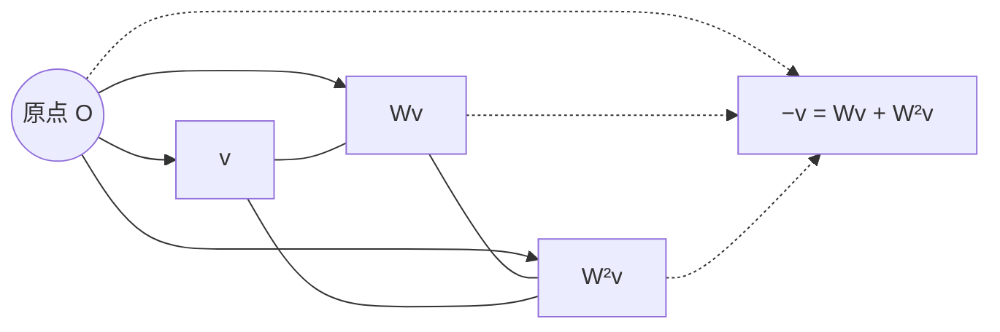

# AURIC R5-009：没有负存在，从正配方到量子几何

> 来源：用户于 2026-11-06（Asia/Singapore）在本会话提供的 AURIC R5-009 LaTeX 研究工作稿；原稿署名为“二元关系、有限提升与内部观察者的条件理论”，未另标生成模型。本文为参考输入，Lean 是仓库的数学真源；本次仅转换 Markdown，未作形式化认证。正文中的固定快照、项目核读叙述与理论结论均保留原稿口径；原 TikZ 图转为 Mermaid 关系图，保留原图文字、坐标与图注。

AURIC / R5-009

没有负存在：从正配方到量子几何

同源分路的配平、复相位与正面相切

二元关系、有限提升与内部观察者的条件理论

2026年11月6日（新加坡时间）

## 摘要

本轮继续回溯 R5-008 的共同实现原则：不先给向量、内积、复相位或原配方的负元，而从同一来源的非负读数与正向聚合开始。核心候选为：同一来源的存在量，按所声明的内部配方分路、重组和继续比较时，完整读数必须相容。其静态检验可写成仅含非负原读数的三路配平式；项目 C139 已证明该式等价于最小复 Hilbert 表示。本文完整复核并重写证明，特别说明可见负向必须先由正配方供应，随后才能把正性提升到整个线性包。

同一对输入的有序交叉比较还能恢复完整复 Gram。要求实际具名分支保留这些比较，便构造出复线性 Kraus 算子；结合原事件与概率的绑定、实际混合和联合接口，得到有限维量子状态、Born 形式、仪器及条件酉动力学。项目本轮真正新增的 C128 正面球相切结构，进一步将关系输出解释为共同支持面内的切向量；本文给出自足的二阶分类证明，明确对象的正性与变化方向的符号不同。

所得是完整的有限条件重构。它不把非负响应等同于布尔存在，也不把普通档案计数等同于相干强度；不声称一句常识自动供应实际装置、全部制备、原三相操作、物理时钟或作用量。几何上先出现三相等边三角形，再由两个复读出得到三维球，递归扩展仍以全体关系的相容性为条件。

**本轮一句话** 同一份存在，按同一来源所允许的方式分开再合起，完整比较必须对得上。负号可以在关系和变化中出现，原记录无需成为“负的存在”。

固定源码：[the-omega-institute/trureturing，dev](https://github.com/the-omega-institute/trureturing/tree/b0a89a1bdde2386f6c8ff7a959069a2118ecb080)。

提交：`b0a89a1bdde2386f6c8ff7a959069a2118ecb080`；2026-11-06 21:06:18 新加坡时间。

本文为纸面定义、定理和证明；未运行新的 Lean 编译。项目已有结果、标准数学、本轮组织与辅助推导分别注明，不作原创优先权或经验验证声明。

## 1　回溯的目标：把存在落实为同源关系的实现

用户提出“正性就是存在，只有不同方式的存在，没有负存在”。本轮保留其中可严格化的核心：原对象、记录和程序均有各自正向的来源；负号可标记比较的方向或差额，不要求原来源里另有一种负数量的实体。必须同时区分三种类型：

1.  原记录是否存在，是关于载体及其身份的命题；

2.  某个原读口的非负量，是在给定参考下获得的响应；

3.  两个响应的差、振幅、切向量或 Hermitian 观测值，可以有正负。

零响应未必为空档案，正半定也包含零。这里的“存在量”是候选理论对特定未归一响应的称呼；其数值、可加方式与实际读口必须另有明确绑定。

### 1.1　一个候选，静态与过程分别给出可检验接口

#### 定义 1.1：R5-009：同源分路的关系相容

固定整体 $\Omega$ 内的原配方、参考、读口、标记及实际分支。先固定这些对象及其操作含义，再要求同一来源的分路读数配平，且实际分支保留同一对配方的完整比较。静态条件取下文式 (1)；过程条件取式 (16)。事件、归一化、随机混合、联合与时间按第 6 节的原接口连接。

“合法”不能事后定义成“恰好满足所需量子公式”，否则候选不可检验。若一个原设备被指定为这里的标记或分路器，它就必须接受相应的全域读数约束。把条件写成定义间的关系，并未证明所有可能世界都满足它。

相对 R5-008，本轮回溯的是原先直接给定的内积、复线性空间和正 Gram 表：在下面的正配方入口中，这些成为表示定理的结论。实际分支和概率接口仍有内容。没有证明本轮的完整假设在所有既有候选中最弱，也没有以一句话的长度代替独立前提比较。

### 1.2　本轮真正新增的项目内容

与 R5-008 的固定提交 `d660ae6c` 比较，完整且未截断的子树列表显示：`docs` 仅两条路径改变；`D5` 一条新增，`Library` 一条新增，`Blueprint` 两条改变。与本题直接有关的新增，是 C128 正交迹续篇 §§371–378 的共同正面球相切分类；另一增补是 RRO 有限时域记忆界 §§5–7。C139、C140、V78、V56、V84 等本轮使用的基础结构均与上一固定提交同 blob；它们是本轮重新发现并纳入的项目积累，不能重复计为本轮新成果。[\[1\]](#ref-repo), [\[4\]](#ref-c128), [\[5\]](#ref-rro)

项目 C139 §§7–10 已给出正幺半群上的三路表示及具名分支桥；C140 和现有原实三路极化、表示源码另处理全部原实旋钮。本文已读相关陈述及证明范围，未将读取源码当成新的内核验证。[\[2\]](#ref-c139), [\[3\]](#ref-c140)

## 2　只有正配方：一条完全非负的读数等式

#### 定义 2.1：原配方接口

设 $(M,+,0)$ 为交换幺半群。$x+y$ 表示已声明的相干比较配方聚合；它不是时间接续，也不是普通可区分记录的计数。原时间、来源及身份档案另行保留。给定任意映射 $U:M\to M$，以及处处有限的同一原响应

$$
q:M\longrightarrow[0,\infty).
$$

不预设原负元、消去律、除法、拓扑、原实缩放，也不预设 $U0=0$、$U$ 可加或可逆。

本轮静态候选的一个精确实现为：对全部原有序配方对 $x,y$，

$$
\boxed{\begin{aligned}
&q(x+2y)+q(x+2Uy)+q(2Ux+y)+12q(0)\\
&\hspace{3em}=6q(x)+9q(y).
\end{aligned}}
\tag{1}
$$

这里 $2y=y+y$，每个输入仍是原正配方，两边所有原读数均非负。三项输出加十二份共同基线，与六份第一输入和九份第二输入比较；两边都有十五份基线。等式本身不声称这些系数已经对应某个实际随机抽签设备。

为证明方便，记

$$
c_0=q(0),\qquad Q(x)=q(x)-c_0.
$$

此时尚不假定 $Q\ge0$。式 (1) 等价于

$$
Q(x+2y)+Q(x+2Uy)+Q(2Ux+y)=6Q(x)+9Q(y).
\tag{2}
$$

这是项目 C139 的 T7，本文将其改写为完全非负的原读数版本，并保留其原适用条件。[\[2\]](#ref-c139)

**白话对应。** 先不画坐标，也不放进负数。拿两份有身份的配方，按固定方式做三次聚合比较，只要求三张读数单与原两份读数在同一基线上配平。若所有有限配方都能通过，坐标、相位和平方量随后才从这些关系里构造出来。

## 3　表示定理：平方量、可见反向与复空间一起出现

#### 定理 3.1：正配方的最小复表示

式 (1) 成立，当且仅当存在复 Hilbert 空间 $H$ 及映射 $F:M\to H$，满足

$$
\boxed{\begin{gathered}
F(x+y)=Fx+Fy,\qquad F(Ux)=\zeta Fx,\\
q(x)=c_0+\|Fx\|^2,\qquad
\zeta=-\frac12+i\frac{\sqrt3}{2}.
\end{gathered}}
\tag{3}
$$

取 $H=\overline{\operatorname{span}_{\mathbb C}F(M)}$，表示唯一到保持每个原标签像的唯一酉同构。并有

$$
F(U0)=0,\qquad F(U^3x)=Fx,\qquad
\boxed{-Fx=F(Ux+U^2x).}
$$

这里的等式发生在可见表示；不要求原档案 $U^3x=x$。零表示允许存在，非零性须另有一个正的相对响应见证。

### 3.1　交换两端，先恢复双加的二次形式

交换式 (2) 的 $x,y$，后两项仅交换位置，故

$$
Q(x+2y)-Q(2x+y)=3\{Q(y)-Q(x)\}.
\tag{4}
$$

取 $y=0$，得 $Q(2x)=4Q(x)$。下列有限差分证明适用于非消去幺半群，不在原配方里作除法。

令 $S_hf(x)=f(x+h)$，$P(t)=t^4-4t+3$。将 (4) 用于 $(x,2h)$、$(x,4h)$，并用倍增式，得到

$$
P(S_h)Q=12Q(h)\mathbf1,\qquad
P(S_h^2)Q=48Q(h)\mathbf1.
$$

多项式恒等式

$$
P(t^2)-(t^4+4t-3)P(t)=12(t-1)^2
$$

以及 $(S_h^4+4S_h-3)\mathbf1=2\mathbf1$ 给出

$$
\Delta_h^2Q(x)=2Q(h),\qquad \Delta_h=S_h-I.
\tag{5}
$$

平移交换，且 $\Delta_{y+z}=\Delta_y+S_y\Delta_z$。展开其平方，用 $\Delta_y^2\Delta_zQ=0$，得到

$$
\Delta_y\Delta_zQ(x)=Q(y+z)-Q(y)-Q(z),
$$

与背景 $x$ 无关。再将平移加法式用于 $\Delta_{y+z}\Delta_wQ$，可知

$$
B(x,y)=\frac{Q(x+y)-Q(x)-Q(y)}2
\tag{6}
$$

对两个变量均可加、对称，并满足 $B(x,x)=Q(x)$。唯一性由 (6) 给出。式 (4) 是已知二次函数方程；这里使用项目提供的正幺半群证明，不将该方程另作新发现。[\[9\]](#ref-patel), [\[2\]](#ref-c139)

### 3.2　暂不使用内积：先让原标记下降为共同转动

把双加型延到 Grothendieck 群。一般幺半群中

$$
(a,b)\sim(a',b')\iff\exists t:\ a+b'+t=a'+b+t.
$$

因为读数在可消去的实数群中，

$$
B_G([a,b],[c,d])=B(a,c)-B(a,d)-B(b,c)+B(b,d)
$$

良定义。再取实线性包并商掉双线性根，得到由原标签 $v_x$ 张成的实空间及非退化对称形式 $B$。这时形式可能不定；例如在 $\mathbb N^2$ 上 $Q(a,b)=ab\ge0$，群包在 $(1,-1)$ 上却取负值。因此不能提前称其为内积。

记 $u_x=v_{Ux}$、$p=u_0$。在 (2) 取 $x=y=0$，再取 $y=0$，得到

$$
B(p,p)=0,\qquad
B(u_x,u_x)=B(v_x,v_x)-B(v_x,p).
$$

展开一般的 (2)，消去这些对角项，得

$$
B(u_x-p,v_y)+B(v_x,u_y-p)=-B(v_x,v_y).
\tag{7}
$$

若 $\sum_i r_iv_{x_i}=0$，则 (7) 使 $\sum_i r_i(u_{x_i}-p)$ 与每个 $v_y$ 配对为零，非退化性迫使它为零。因此

$$
Wv_x=u_x-p
$$

定义了实线性算子，并满足

$$
B(Wa,b)+B(a,Wb)=-B(a,b).
\tag{8}
$$

将对角式用于原配方 $nx$，利用 $u_{nx}=nWv_x+p$，得到

$$
n^2\{B(Wv_x,Wv_x)-B(v_x,v_x)\}
+nB((2W+I)v_x,p)=0.
$$

取 $n=1,2$ 分离系数，得 $B(Wv_x,Wv_x)=B(v_x,v_x)$ 和 $B((2W+I)v_x,p)=0$。在 $x+y$ 上极化给 $B(Wa,Wb)=B(a,b)$。结合 (8)，非退化性给

$$
W^2+W+I=0,\qquad (2W+I)^2=-3I.
\tag{9}
$$

所以 $2W+I$ 可逆，前述与 $p$ 的配对迫使 $p=0$。原 $U$ 的可见作用成为 $W$，无需原 $U$ 可加。

### 3.3　正性在可见反向出现后才扩展到整个包

由双加性，$Q(nx)=n^2Q(x)$。原读数始终非负，因此

$$
c_0+n^2Q(x)\ge0\quad(n=1,2,\ldots)
$$

迫使 $Q(x)\ge0$。由 (9) 和 $p=0$，

$$
-v_x=v_{Ux+U^2x}.
$$

每个负生成元现在都有正配方代表，故任意整数线性组合的平方都非负。清分母给有理组合非负；在任一有限组生成元上，$B(\sum t_iv_i,\sum t_iv_i)$ 是系数的二次多项式，有理稠密性给全部实系数非负。

这里使用的是已经构造出的二次多项式的连续性，并未假定原来源有拓扑或原 $q$ 连续。非退化的正半定形式 $B$ 因而成为实内积。

定义

$$
J=\frac{I+2W}{\sqrt3},\qquad
h(a,b)=B(a,b)+iB(Ja,b),\qquad ia=Ja.
$$

式 (8)–(9) 给

$$
J^2=-I,\qquad J^*=-J,\qquad J^*J=I.
$$

故 $h$ 是对第二变量线性的复内积，且 $W$ 等于乘以 $\zeta$。完成空间，取 $Fx=v_x$，得到 (3)。原读数决定 $B$，原标记决定 $J$；由相同复 Gram 在复线性包上定义的保标签等距映射唯一延拓为最小空间间的酉同构。

### 3.4　反向证明与非空模型

反向设 (3) 已成立。三项输出的像为

$$
a+2b,\qquad a+2\zeta b,\qquad 2\zeta a+b.
$$

两列系数

$$
\begin{pmatrix}1\\1\\2\zeta\end{pmatrix},\qquad
\begin{pmatrix}2\\2\zeta\\1\end{pmatrix}
$$

正交，平方长度分别为 $6,9$，因为交叉配对为 $2(1+\zeta+\bar\zeta)=0$。展开平方和得 (2)，补回基线得 (1)。定理证明完毕。

为避免额外环境假设，直接给出一个数学模型。取

$$
M=\mathbb N^3\times\mathbb N,
\quad U(n_0,n_1,n_2;\ell)=(n_2,n_0,n_1;\ell+1),
$$

$$
F(n_0,n_1,n_2;\ell)=n_0+\zeta n_1+\zeta^2n_2,
\qquad q=c_0+|F|^2.
$$

聚合逐坐标相加。所有原坐标都非负，$FU=\zeta F$，故配平式成立。$U^3$ 返回相同可见相位，但 $\ell$ 增加三；$U0\ne0$，原 $U$ 也不对聚合可加。$(1,1,1;\ell)$ 有非空计数，而可见像 $F$ 与相对响应 $Q$ 为零，原读数仍为 $c_0$。此例证明候选非空，并展示商只归并响应，不删除原标签；它不认证某个具体物理装置。

**白话对应。** 反向并没有从空无里取出一笔负账。三个相位方向都来自正配方；另外两个方向合起来，在当前比较中恰好等于第一个方向的反向。零的是这次合成的响应，三个来源仍可留在档案里。

## 4　简洁几何：相位三角形、二元关系球与递归余量

### 4.1　复相位首先是一张等边三角形

对 $v=Fx\ne0$，式 (9) 给

$$
v+Wv+W^2v=0,\quad
\|v\|=\|Wv\|=\|W^2v\|,\quad
B(v,Wv)=-\frac12\|v\|^2.
$$

三向量相差 $120^\circ$，位于一张实二维平面。且

$$
Jv=(v+2Wv)/\sqrt3
$$

与 $v$ 正交、等长。原来源供应 $x+2Ux$，不自动供应实际 $1/\sqrt3$ 缩放或任意 $J$ 门。

图中 $v$、$Wv$、$W^2v$ 等长，相邻方向相差 $120^\circ$，形成实二维相位平面的等边三角形，并满足 $v+Wv+W^2v=0$、$Wv+W^2v=-v$。三条方向都有原正配方；反向由另外两条方向合成。这是实二维相位平面，还不是三维 Bloch 球。原 TikZ 的坐标为 $O=(0,0)$、$v=(1.9,0)$、$Wv=(-0.95,1.645)$、$W^2v=(-0.95,-1.645)$、$-v=(-1.9,0)$；Mermaid 表示关系，不按比例绘制。

**图 1：** 共同三相几何。向量和为零并不要求原配方或记录为空。

### 4.2　两个复读出归一，得到受限实三维

两标签的共同 Gram 表为

$$
G=\begin{pmatrix}a&c\\\bar c&b\end{pmatrix}\succeq0,
\qquad N=a+b>0.
$$

定义

$$
r_1=\frac{2\operatorname{Re}c}{N},\qquad
r_2=\frac{a-b}{N},\qquad
r_3=-\frac{2\operatorname{Im}c}{N}.
$$

直接展开得

$$
\boxed{r_1^2+r_2^2+r_3^2+\frac{4(ab-|c|^2)}{N^2}=1.}
\tag{10}
$$

这就是三维球。秩一给球面，秩二给球内；球面本身的内在维数为二。若只有实相干关系，参数只形成一个圆盘。三路重组的系数框架位于 $\mathbb C^3$，三相轨道位于实二维，二元归一关系位于实三维参数球，三者不得混称为物理空间维数。

| 五模式角色 | 本轮可承担的含义 |
|:---|:---|
| $F[\mathrm{null}]$ | 内部参考与原基线；不等于零向量、空档案或外部观察者。 |
| $F[1],F[3]$ | 当前选出的两个输入或读出接口，随递归可重选。 |
| $F[1,3]$ | 两者的有序交叉比较；交换次序后共同恢复实部和虚部。 |
| $F[2]$ | 整体关系所约束的第三坐标或法向方向；其取向与尺度须有共同校准。 |

这是角色解释，不将五个标签当成五个独立实数，也不把三相标记直接认作原 FIB 十阶门。这里 $\zeta=e^{2\pi i/3}$，V84 中 $e^{3\pi i/5}$ 是另一个常数，原可执行性需要明确桥梁。[\[8\]](#ref-v84)

### 4.3　一次有限提升不保证整个关系网自动闭合

对旧 $G\succeq0$、$b\in\mathbb C^n$、$d\in\mathbb R$，新增一个标签后的关系表满足

$$
\begin{pmatrix}G&b\\b^\dagger&d\end{pmatrix}\succeq0
\iff b\in\operatorname{Ran}G,\quad\delta=d-b^\dagger G^+b\ge0.
\tag{11}
$$

范围条件要求旧零关系在新比较中仍为零。必要性可直接看出：若 $z\in\ker G$ 而 $z^\dagger b\ne0$，在 $(sz,1)$ 上取适当复数 $s$，便使 $2\operatorname{Re}(\bar s z^\dagger b)+d<0$。故 $b\perp\ker G$，即 $b\in\operatorname{Ran}G$。令 $y=G^+b$，则二次型是

$$
(x+yt)^\dagger G(x+yt)+\delta|t|^2,
$$

给出 (11) 及

$$
\operatorname{rank}G_{\rm new}=\operatorname{rank}G+\mathbf1_{\{\delta>0\}}.
$$

故新关系可能只是一种旧表达；只有 $\delta>0$ 才增加最小实现的独立方向。$\delta<0$ 时，继续扩维不能补救同一固定比较表。

固定坐标的两两检查不够。例如三阶矩阵对角为 $1$、非对角为 $-3/4$，每个二阶主块均正，整个矩阵却在 $(1,1,1)$ 方向给 $-3/2$。T7 必须作用于全部复合配方；只测基本标签对，不能把全域相容性归零。

## 5　最新几何：正对象的变化沿共同正面的球面相切

项目最新 C128 §§371–378 把已有两个局部约束合成一个精确几何条件。令

$$
E=\bigoplus_s\operatorname{Herm}(\mathbb C^{n_s}),\qquad
g_E(A,B)=\sum_s w_s\operatorname{Tr}(A_sB_s),\quad w_s>0,
$$

并给定实双线性关系输出 $D:E\times E\to E$，满足右单位 $D(A,I)=0$。对 $A,B\ge0$，令 $C=\operatorname{supp}(A+B)$。要求

$$
\boxed{D(A,B)=CD(A,B)C,\qquad
g_E(A+B,D(A,B))=0.}
\tag{12}
$$

第一式将输出留在两输入共同支持的面内，第二式使它沿等 $g_E$ 长度球面相切。切向量不要求为正；这里也没有先断言它是实际可执行的时间流。[\[4\]](#ref-c128)

### 5.1　为什么正存在仍然允许带正负的变化

#### 命题 5.1：把变化也要求为正，会冻结归一化运动

设 $\rho(t)$ 为可微的有限维密度矩阵曲线。若在某时刻还要求 $\dot\rho(t)\succeq0$，则该时刻 $\dot\rho(t)=0$。

**证明。**

归一化给 $\operatorname{Tr}\dot\rho=0$。正半定矩阵的特征值均非负，总和为零即每个为零。

$\square$

例如两个不同的正密度矩阵之差通常有正、负特征值，但差不是第三个密度矩阵。酉曲线 $\rho(t)=U(t)\rho(0)U(t)^\dagger$ 全程保持正性，其非零切向量却有正负部分。这精确表达了“只有不同方式的存在”：正性约束对象的可实现状态，符号描述它如何重新分配。

### 5.2　二元相切为什么变成三元体积关系

固定正 $A,B$，把第一输入变成 $tA$，$t>0$。由双线性和 (12)，

$$
0=t^2g_E(A,D(A,B))+t g_E(B,D(A,B)).
$$

所以两个系数各自为零。正定元对组成非空开集，而两式都是有限维实多项式，因此它们延伸到全部 Hermitian 输入：

$$
g_E(A,D(A,B))=g_E(B,D(A,B))=0.
\tag{13}
$$

极化第二式得

$$
g_E(C,D(A,B))=-g_E(B,D(A,C)).
$$

再由第一式得 $D(A,A)=0$，继而 $D(A,B)=-D(B,A)$。于是

$$
T(A,B,C)=g_E(C,D(A,B))
\tag{14}
$$

是全交替三形式。这是一个具体的“关系的关系”：先形成两输入的关系输出，再由第三输入比较它。

#### 定理 5.2：二阶块的完整局部分类

在 $E=\operatorname{Herm}(\mathbb C^2)$、$g_E=w\operatorname{Tr}(AB)$、$w>0$ 上，实双线性 $D$ 满足 $D(A,I)=0$ 和全部正输入的球面相切条件，当且仅当

$$
D(A,B)=\gamma i[A,B]
$$

对某个实常数 $\gamma$ 成立。此时共同支持条件也成立。

**证明。**

上面的推导给全交替 $T$。右单位及交替使 $T$ 任一槽为 $I$ 时为零，且 $D$ 输出无迹。因此 $T$ 降到三实维空间 $V=\operatorname{Herm}(\mathbb C^2)^0$。其三形式空间一维。

取 Pauli 基 $X,Y,Z$，三轴彼此正交，各轴的平方长度均为 $2w$。设 $\theta=T(X,Y,Z)/(2w)$，配对唯一性给

$$
D(X,Y)=\theta Z,\qquad D(Y,Z)=\theta X,
\qquad D(Z,X)=\theta Y.
$$

而 $i[X,Y]=-2Z$，故 $\gamma=-\theta/2$。双线性与单位槽为零将结论推广到整个 $E$。反向由迹循环直接得到两式 (13)。对正 $A,B$，$\ker(A+B)=\ker A\cap\ker B$，所以两者及其交换子都位于共同支持内。

$\square$

写 $A=a_0I+\boldsymbol a\cdot\boldsymbol\sigma$、$B=b_0I+\boldsymbol b\cdot\boldsymbol\sigma$，便有

$$
D(A,B)=-2\gamma(\boldsymbol a\times\boldsymbol b)\cdot\boldsymbol\sigma.
$$

三轴在该块的原比较尺下各向同性。两读出限定平面，关系输出垂直于两者；但 $\gamma$ 的大小和符号仍需校准，$\gamma=0$ 也满足裸局部条件。这幅图容许转动，不强迫非零运动。

高阶与多中心的全部分类，项目定理 373.1 在其明确条件下给逐块 $\gamma_s i[A_s,B_s]$，使用既有定理 274.1；本轮未完整重审该高阶依赖链。本文上面的二阶证明自足。最新定理本身允许各块独立尺度；完整原背景及同一 $\sigma$ 才将它们统一。项目 $D=i[A,B]/2$ 的代数刻度，也不能直接当成物理 $\hbar$ 或时间单位。[\[4\]](#ref-c128)

### 5.3　反向删去条件，几何会怎样失效

仅有相切不能保证共同支持：在 $\mathbb R^4$ 中取 $u=(1,1,1,1)$，令

$$
\langle C,D(A,B)\rangle=\det[u,A,B,C].
$$

它满足右单位和相切，但 $D(e_1,e_2)=(0,0,-1,1)$ 跑到另外两个坐标。

仅有共同支持不能保证相切：取 $h=\operatorname{diag}(1,-1,0,\ldots)$，$D(A,B)=\operatorname{Tr}(hB)A$。右单位及支持成立，但在 $A=B=e_{11}$ 上径向增长。

右单位也不能省略。对 $H_2(\mathbb C)$ 的坐标 $(a_0,a_x,a_y,a_z)$，在前三个坐标上作叉积、第四坐标置零，得到相切且满足正输入支持的双线性关系，却有 $D(X,I)=-Y$、$D(X,Y)=I$。因此“沿球面”必须与单位及支持的原角色一起解释。上述为项目最新删除反例，不是整个物理来源的独立性定理。[\[4\]](#ref-c128)

**白话对应。** 两份正对象先确定自己共同占据的范围。它们之间的关系如果只是在内部转动，就不能跑到别的范围，也不能把总长度径向放大。第三个读出再比较这个转动，便形成有方向的三元关系。对象始终可以为正，转动的坐标却有正有负。

## 6　从同一实际分支恢复量子操作和概率

### 6.1　一个有序二元比较读出完整复关系

在定理 3.1 的表示中，定义原有序交叉差

$$
s(x,y)=Q(x+Uy)-Q(x)-Q(y).
$$

若 $h(Fx,Fy)=a+ib$，则

$$
s(x,y)=-a-\sqrt3b,\qquad s(y,x)=-a+\sqrt3b.
$$

所以

$$
\boxed{h(Fx,Fy)
=-\frac{s(x,y)+s(y,x)}2
+i\frac{s(y,x)-s(x,y)}{2\sqrt3}.}
\tag{15}
$$

原正响应通过交换比较次序，给出两个实读出；负数仅在比较的差中出现。

#### 定义 6.1：原具名分支的比较相容

输入和输出各有上述原配方接口及最小表示。固定同一实际完整测试的有限细分支 $L_j:M_{\rm in}\to M_{\rm out}$，不先假定 $L_j$ 可加。要求

$$
\boxed{\sum_j Q_{\rm out}(L_jx+U_{\rm out}L_jy)
=Q_{\rm in}(x+U_{\rm in}y)\quad(x,y\in M_{\rm in}).}
\tag{16}
$$

它比较具名的全部分支；失败、停止和记录分支不能因未被关注而删除。输入输出基线可不同；此式绑定相对强度，基线原记录仍保留。

#### 定理 6.2：分支比较等价于复线性等距实现

式 (16) 等价于存在唯一的具名有界复线性算子 $K_j:H_{\rm in}\to H_{\rm out}$，使

$$
F_{\rm out}L_j=K_jF_{\rm in},\qquad
\sum_jK_j^\dagger K_j=I.
$$

唯一性针对固定原分支及其最小表示，不是任意通道的 Kraus 分解唯一。

**证明。**

记 $a_x=F_{\rm in}x$、$b_x=\bigoplus_jF_{\rm out}L_jx$。取 $x=y$，由 $|1+\zeta|=1$ 得 $\|a_x\|=\|b_x\|$。再分别用 $(x,y)$、$(y,x)$ 和 (15)，得全部复 Gram 相等。

于是 $V_0(\sum c_ia_{x_i})=\sum c_ib_{x_i}$ 良定义：输入线性组合为零时，输出的平方范数由同一 Gram 给出，也为零。它在复线性包上等距，唯一延到最小完成 $H_{\rm in}$。令 $K_j$ 为其坐标分量，得结论。反向将直和等距作用于 $a_x+\zeta a_y$，即得 (16)。原 $F(M)$ 本身无需对复系数闭合或稠密，稠密的是它的复线性包。

$\square$

这复用项目 C139 §9 的表示桥。原档案上的 $L_jU=UL_j$ 并未由可见协变自动推出；如果某个实际接口要求逐字相等，仍要独立检验。[\[2\]](#ref-c139)

### 6.2　事件效果与 Born 规则

若原事件 $e$ 由细分支集合给出，原事件强度须确实绑定为

$$
w_e(x)=\sum_{j\in e}Q_{\rm out}(L_jx).
$$

定义 $E_e=\sum_{j\in e}K_j^\dagger K_j$，立即有

$$
0\le E_e\le I,\quad\sum_eE_e=I,\quad
w_e(x)=h(Fx,E_eFx).
$$

对于 $Q(x)>0$，若原概率就是完整事件强度的归一分账，令 $\psi=Fx/\sqrt{Q(x)}$，则

$$
p(e\mid x)=\frac{w_e(x)}{Q(x)}=\langle\psi,E_e\psi\rangle.
\tag{17}
$$

若 $E_e=P_\phi$ 是单位向量对应的秩一投影，便得到 $|\langle\phi,\psi\rangle|^2$。概率与强度的绑定是原操作接口，不能只因同一符号就宣布另一终端读口也服从此式。

所有数学 POVM 均有这类实现：给定 $E_e\ge0$、$\sum E_e=I$，取 $K_e=\sqrt{E_e}$，并用内部记录的数学直和保存 $e$。这证明数学表示的完备性；全部相应装置在指定 $\Omega$ 内是否可取得，是另一个来源问题。

### 6.3　完整效果状态为何是密度矩阵

#### 定理 6.3：有限效果评价的状态表示

在有限复空间上，若原准备对全部 $0\le E\le I$ 有单值评价 $p(E)\ge0$，满足 $p(I)=1$ 及

$$
p(E+F)=p(E)+p(F)\quad(E,F\ge0,\ E+F\le I),
$$

则存在唯一 $\rho\succeq0$、$\operatorname{Tr}\rho=1$，使 $p(E)=\operatorname{Tr}(\rho E)$。

**证明。**

加性给零值、整数拆分及有理齐次性；正性给序单调。对实数比例以有理上下界夹逼，得实齐次性。对任意 $A\ge0$，取足够大的整数 $n$ 使 $A/n\le I$，定义 $\omega(A)=np(A/n)$。共同整数倍说明定义与 $n$ 无关，且在正锥上可加、实齐次。

以 $\omega(A-B)=\omega(A)-\omega(B)$ 延到 Hermitian 空间；若两个差相等，移项及正锥加性保证良定义。有限维迹配对给唯一 Hermitian $\rho$。对所有秩一正投影评价非负，故 $\rho\succeq0$；$\omega(I)=1$ 给迹一。唯一性来自完整效果张成 Hermitian 空间。

$\square$

这属于完整效果接口的标准状态表示路线，覆盖复二维；不是仅从几张二元归一概率表得到的结论。[\[10\]](#ref-busch), [\[6\]](#ref-v78)

若同一个原向量准备 $x$ 也使用这份完整效果评价，还须保留原纯态校准

$$
p_x(P_\psi)=1,\qquad \psi=Fx/\sqrt{Q(x)},\quad Q(x)>0.
$$

它使 $\operatorname{Tr}(\rho_x(I-P_\psi))=0$。正性给 $(I-P_\psi)\rho_x^{1/2}=0$，所以 $\rho_x$ 支持于该一维射线，归一化迫使 $\rho_x=P_\psi$。每个非零原向量分支输出也须使用其自身的这一绑定。这样，原标签、强度读口与完整效果评价才指向同一个准备；不以另一份独立评价替换它。

若所有纯射线及其实际随机混合被供应，则任意密度矩阵由谱分解实际可制备。若来源只供应 $F(M)$ 中的部分射线，定理只表示那些已供应的状态，不能补造其余制备。

### 6.4　仪器、内部记录与完全正性

还要求原随机混合对未归一分支的效果评价仿射相容，才能把纯输入作用接到同一实际混合过程：

$$
\Phi_e(\rho)=\sum_{j\in e}K_j\rho K_j^\dagger.
$$

对任意数学内部参考，

$$
(\Phi_e\otimes\operatorname{id})(R)
=\sum_{j\in e}(K_j\otimes I)R(K_j^\dagger\otimes I)\succeq0
\quad(R\succeq0),
$$

所以它完全正。总分支满足 $\sum K_j^\dagger K_j=I$，故保迹；单个事件为迹不增。$p_e=\operatorname{Tr}\Phi_e(\rho)>0$ 时条件态为 $\Phi_e(\rho)/p_e$，零概率时不作除法。[\[11\]](#ref-watrous)

反向，任何有限维完全正映射的正 Choi 矩阵可谱分解为向量外积；将各向量按输出$\otimes$输入约定重排为矩阵 $K_j$，得到上述 Kraus 形式。保迹等价于 $\sum K_j^\dagger K_j=I$。因此此类数学仪器在有限维范围内完整。将数学参考放大认作实际过程，仍需同一原参考和分支绑定。[\[11\]](#ref-watrous)

在同一输入输出空间上，若另要求一个投影事件 $P$ 保持 $\operatorname{Ran}P$ 的每条纯射线，便恢复 Lüders 更新。因为 $\sum K_j^\dagger K_j=P$，有 $K_j=K_jP$。$P=0$ 时全部 $K_j=0$；$P\ne0$ 时，输出保持每条射线使每个 $K_j$ 在该空间上为标量 $c_j I$，且 $\sum_j|c_j|^2=1$，故

$$
\Phi_P(\rho)=P\rho P.
$$

仅要求结果可重复仍允许像内酉转动，不足以选定这一具体更新。

### 6.5　联合、酉演化与测不准关系

**联合。** 设同一实际联合接口给出复双线性准备组合 $j:H_A\times H_B\to H_{AB}$，并绑定全部乘积比较

$$
h_{AB}(j(a,b),j(a',b'))=h_A(a,a')h_B(b,b').
$$

则 $a\otimes b\mapsto j(a,b)$ 在代数张量上保持内积；若乘积像的线性包张成 $H_{AB}$，它给整个联合空间的酉同构 $H_A\otimes H_B\cong H_{AB}$。否则仅识别一个子空间，不能删除额外部分。复合接口是同一 $\Omega$ 的内部关系；它不由孤立的静态 T7 自动供应。

**确定可逆过程。** 单分支 (16) 给复线性等距；若可见作用可逆，便是酉算子。同维有限空间的等距已自动满射。若再有同一实际可微单参数群 $U(t+s)=U(t)U(s)$、$U(0)=I$，则 $A=\dot U(0)$ 满足 $A^\dagger=-A$。给定时间单位及 $\hbar>0$，令 $H=i\hbar A$，得到

$$
U(t)=e^{-itH/\hbar},\qquad
i\hbar\dot\psi=H\psi,\qquad
i\hbar\dot\rho=[H,\rho].
$$

具体 $H$、时钟及作用量不由静态表示选择。

**测不准。** 对单位态 $\psi$ 和 Hermitian $A,B$，令 $a=(A-\langle A\rangle)\psi$、$b=(B-\langle B\rangle)\psi$。共同 Gram 的 Cauchy–Schwarz 给

$$
(\Delta A)^2(\Delta B)^2
\ge\left|\frac12\langle\{\delta A,\delta B\}\rangle\right|^2
+\left|\frac{1}{2i}\langle[A,B]\rangle\right|^2.
$$

这把不确定性落实为两个读出的共同实现约束，不与 Gödel 不完备或任意对角化自动等同。无限维规范对易关系和量子场论还需各自的定义域与极限条件；有限维不可能有 $[A,B]=i\hbar I$，因为两边迹不同。

## 7　观察者记录也在整体内：干涉无需负概率

在已建立的联合接口中，取

$$
|\Psi\rangle=|0\rangle u+|1\rangle v,\qquad
\|u\|^2+\|v\|^2=1.
$$

$u,v$ 是内部记录或参考的向量，未要求它们可区分。记

$$
p=\|u\|^2,\quad q=\|v\|^2,\quad c=\langle v,u\rangle.
$$

忽略记录后的二路状态为

$$
\rho_{\rm path}=\begin{pmatrix}p&c\\\bar c&q\end{pmatrix},\qquad
\det\rho_{\rm path}=pq-|c|^2\ge0.
$$

平衡输出并扫描相对相位时，两出口概率为

$$
p_+(\theta)=\frac12+\operatorname{Re}(e^{i\theta}c),\qquad
p_-(\theta)=\frac12-\operatorname{Re}(e^{i\theta}c).
$$

二者都非负，且总和恒为一。一个出口相消，强度可以转到另一个出口；不需要负概率。

定义偏置 $\mathcal P=|p-q|$、可见度 $\mathcal V=2|c|$、未保留在局部二元相干中的余量

$$
\mathcal R=2\sqrt{pq-|c|^2}.
$$

则直接展开给

$$
\boxed{\mathcal P^2+\mathcal V^2+\mathcal R^2=1.}
\tag{18}
$$

这又是一份二元归一的三元约束，但三个量的操作含义已经明确。

若用内部记录最佳区分两路，定义 $\mathcal D=\|uu^\dagger-vv^\dagger\|_1$。该 Hermitian 差的至多两个非零特征值为

$$
\lambda_\pm=\frac{p-q\pm\sqrt{1-4|c|^2}}2.
$$

由 $|c|^2\le pq$，两特征值异号或有零，故

$$
\mathcal D^2=1-4|c|^2=\mathcal P^2+\mathcal R^2,
\qquad \mathcal D^2+\mathcal V^2=1.
$$

最佳猜路成功率为 $(1+\mathcal D)/2$：二元判别效果 $0\le E\le I$ 的成功率为 $q+\operatorname{Tr}(E(uu^\dagger-vv^\dagger))$，取正谱投影即得。

一般混合联合态分块为 $\Omega=\bigl(\begin{smallmatrix}A&C\\C^\dagger&B\end{smallmatrix}\bigr)\succeq0$、$\operatorname{Tr}\Omega=1$。取纯化，再丢弃纯化参考，迹范数对 Hermitian 差的部分迹收缩性给

$$
\mathcal D=\|A-B\|_1,\quad\mathcal V=2|\operatorname{Tr}C|,
\qquad \mathcal D^2+\mathcal V^2\le1.
$$

收缩性可由 $\|X\|_1=\max_{-I\le H\le I}\operatorname{Tr}(HX)$ 及 $H\mapsto H\otimes I$ 直接证明。混合情形等号也可能成立，不声称等号当且仅当整体纯。此为标准量子二路互补结构，本轮用它解释内部记录，并非新的物理预言。[\[12\]](#ref-englert)

项目 V56 的算子值三轴说明，局部 Bloch 向量为零仍可保留完整联合纯态的关系；V84 则明确，历史索引被写成正交基是一种声明的记录表示，不自动证明实际路径已留下可区分的记录。不能既把每条过去路径视为物理正交记录，又无条件保留未读口中的相干。[\[7\]](#ref-v56), [\[8\]](#ref-v84)

最新 RRO 增补对固定 $0\le\varepsilon<1/2$，在其终端曲线和资源合同下得到经典比较器的持久寄存器位数 $`B^*_\varepsilon(H)=\Theta_\varepsilon(\log H)`$，其中 $H\to\infty$；它已经假定所用相干与读出接口，且排除固定精确实系数表的描述精度、获取和实现成本。它说明有限几何载体与增长的历史记账是不同问题，不给“每一步都升一个 Hilbert 维”的结论，也不是本轮的 Born 推导。[\[5\]](#ref-rro)

## 8　反向检验：哪些缺口不能被一句常识遮住

### 8.1　非负性单独不决定平方律或过程线性

普通计数 $\nu(x\sqcup x)=2\nu(x)$ 完全非负；本轮相干强度则有 $Q(x+x)=4Q(x)$。两者有不同聚合与读口。正性本身没有选择后者，选择来自具体的配平约束。

单有平滑、可逆、保范数、共同相位相容也不推出线性。令

$$
L(z_1,z_2)=(z_1,e^{i\pi|z_1|^2}z_2)
$$

作用于 $\mathbb C^2$。它满足上述四项。取 $x=(1,1)$、$y=(0,1)$，却有

$$
\|x+\zeta y\|^2=2,\qquad
\|Lx+\zeta Ly\|^2=4.
$$

所以它不满足具名分支的二元比较相容。过程公理真正限制的是同一过程对不同输入之间关系的处理。

### 8.2　有界概率、原实尺度与原三相操作都有来源条件

#### 命题 8.1：终端概率不能直接冒充未归一强度

若满足 T7 的同一 $q$ 在全部重复配方上有统一上界，则 $Q\equiv0$。

**证明。**

$q(nx)=c_0+n^2Q(x)$ 且 $Q(x)\ge0$。任何 $Q(x)>0$ 都使其无界。

$\square$

因此，非平凡候选需要原定义供应的未归一响应量。若由终端概率 $p(X)$ 构造 $I(X)=w(X)p(X)$，标尺 $w(X)$ 必须事先由来源确定，不能按希望得到的平方律反算。项目 C139 §12 用实际二端三结果比较、标记协变及全背景二阶差分恒等式绑定该强度；这些是具体条件，不是“存在”一词的语义后果。[\[2\]](#ref-c139)

若原来源本来带实旋钮，T7 只给可见加性，不自动忠于全部原实比例。项目 §8.1 的精确补充是：在原实生成方向 $s$ 上，$\{Q(ts):0\le t\le1\}$ 有界，等价于 $F(ts)=tFs$。有界可加的 Hilbert 值函数连续，再由有理稠密性得到实线性。

同样，三步返回和每条轨道各自等边还不足以固定共同取向。令 $U(z)=\zeta z$ 在 $|z|\le1$，其余取 $\bar\zeta z$。每条轨道都闭合且保长，但 $x=1,y=2i$ 的 T7 左减右为 $8\sqrt3$。不同轨道必须通过交叉比较共用取向。

### 8.3　全域关系不等于一次有限菜单的认证

T7 和分支条件的每个实例有限，但量词覆盖所有已声明复合配方。有限个实测实例不能认证全域等式，也不能自动提供噪声下稳定性或任意设备的可控性。无限序列的每一步仍须保留实际来源与旧关系；有限维表示不会因此成为有限历史档案。

## 9　完整候选的结算与白话图景

本轮将一个原则落实到以下完整条件链。所有对象、参考和记录均位于同一 $\Omega$ 的原接口中；表中的数学表示不被当作外部世界。

| 保留的原条件 | 可证明的结论 |
|:---|:---|
| 正配方交换聚合、任意原标记、同一有限非负强度及原三路配平 | 最小复 Hilbert 表示、平方强度、共同三相及可见反向。 |
| 非零有限维可见空间；具名完整细分支的有序交叉比较相容 | 复线性等距总实现与具名 Kraus 算子。 |
| 原事件强度绑定、正分母归一；完整效果评价与原向量准备／输出的纯态校准 | 效果、同一原准备的 Born 形式、密度矩阵表示。 |
| 实际未归一混合仿射相容、实际参考与同一联合的比较绑定 | 完全正量子仪器、条件更新、所声明联合的张量表示。 |
| 确定可逆过程；另给实际可微时钟群及单位 | 酉演化、Schrödinger 与密度矩阵动力学。 |
| 正面球相切、原双线性与右单位；共同尺度另校准 | 二阶块的叉积／交换子关系；高阶由项目准确前件分类。 |

标准有限复量子模型为这条链给出非空反向实现；本文证明它在给定接口下完整，不宣称静态一式自行生成全部设备与物理规律。关于重构量子测量，Masanes、Galley、Müller 的工作也将分系统描述相容用于测量结构的恢复，但保留复 Hilbert 状态、酉变换、张量联合及有限状态估计等前提；不能把它引用成无前提的单句起源定理。[\[13\]](#ref-mgm)

**本轮实际压缩。** 相对 R5-008，不再把内积及复相位当作正配方入口的独立输入；相对项目已有 C139/C140，这是明确复用与几何组织，不认领重复发现。最新 C128 将支持与自比较条件变成一张正面内球截面的相切图，检查域扩大到全部正输入对；表达更统一不等于已证明检查更少或成本更低。

**白话对应。** 先把每一份实际配方留住，它们的原读数都非负。同一来源的两份配方换着分路再合起，前后完整读数必须配平；只要这条关系对所有有限配方成立，就能构造出共同的平方尺度和三相三角形。反向是三角形另外两条方向的合成，不需要负的原记录。两份复读出再归一，就得到受限的三维球；两份正对象之间的变化留在它们共同的范围里，并沿等量球面转动。观察者和记录也在整体里：哪条路真正留下可区分记录，决定局部还能保留多少相干。递归继续检查同一套关系，能用旧方向表达的就复用，确有独立余量才增加方向。零的是某个读口的响应，原来源与历史仍可存在。

## A　原实旋钮的一个几何校准命题

这是一条辅助等价刻画，不另立第二个量子公理候选。它说明“同一二元分解换角度，总量不变”如何构造实内积，也说明为何只检查一个平衡门不够。项目 C140 已有不同的全实三路入口及相应形式源码，故此处不主张首次去掉范数或连续性预设。[\[3\]](#ref-c140)

#### 定理 A.1：全角二路重组的总量刻画

对实向量空间 $V$，处处取有限值的函数 $A:V\to[0,\infty)$ 满足

$$
A(cx+sy)+A(-sx+cy)=A(x)+A(y)
\quad(c^2+s^2=1)
\tag{19}
$$

当且仅当存在唯一正半定实双线性形式 $B$，使 $A(x)=A(0)+B(x,x)$。不需另设原函数连续性或二次齐次性。

**证明。**

置 $a_0=A(0)$、$a=A-a_0$。取 $45^\circ$ 关系并令 $y=x$，得 $a(\sqrt2x)=2a(x)$；再令 $y=0$，得偶性。因为 $A((\sqrt2)^nx)=a_0+2^na(x)\ge0$，所以 $a(x)\ge0$。平衡关系于是成为

$$
a(x+y)+a(x-y)=2a(x)+2a(y).
$$

固定 $x$，令 $f_x(t)=a(\sqrt t\,x)$，$t\ge0$。对 $r,t\ge0$ 且 $r+t>0$，将输入取为 $(\sqrt{r+t}\,x,0)$，并取 $c=\sqrt{r/(r+t)}$、$s=\sqrt{t/(r+t)}$，得 $f_x(r+t)=f_x(r)+f_x(t)$；$r=t=0$ 时该式直接成立。非负性使该加性函数单调，有理夹逼给 $f_x(t)=tf_x(1)$。因此 $a(tx)=t^2a(x)$ 对全部实数成立。

定义 $B(x,y)=(a(x+y)-a(x-y))/4$。平行四边形恒等式给

$$
B(x+z,y)+B(x-z,y)=2B(x,y).
$$

先令 $z=x$，再换元，得加性和有理齐次性。非负二次多项式先在有理参数上给 Cauchy–Schwarz。对有理 $r_n\to t$，

$$
|B(tx,y)-r_nB(x,y)|
\le\sqrt{a((t-r_n)x)a(y)}
=|t-r_n|\sqrt{a(x)a(y)},
$$

得实齐次性。对称性、正性、唯一性及反向展开随即成立。

$\square$

若只保留 $45^\circ$ 而没有全角或其他尺度校准，结论会失败。取 $K=\mathbb Q(\sqrt2)$，选含 $1,\pi$ 的 $K$-Hamel 基，令 $T$ 为 $K$-线性双射，$T1=1,T\pi=2\pi$，其余基元不变。则 $a(t)=T(t)^2$ 非负、有限、忠实，满足精确平衡关系，却有 $a(\pi)=4\pi^2\ne\pi^2a(1)$。它不连续。有限或可数门族的近似普适性，不能在没有原读数极限条件时排除这类模型。

当 T7 的原来源另有实旋钮时，(19) 供应 $Q(ts)\le Q(s)$、$0\le t\le1$，因此可用 C139 §8.1 将可见 $F$ 绑定回原实标量。这是原接口的校准作用，不是从三次有限门调用取得任意连续控制。

## 来源与参考

\[1\] The Omega Institute, [ *trureturing* , pinned dev snapshot](https://github.com/the-omega-institute/trureturing/tree/b0a89a1bdde2386f6c8ff7a959069a2118ecb080). 本轮比对采用完整子树，不以 GitHub compare 的截断文件列表作全量依据。

\[2\] [C139：互为探针与平方几何的内生恢复](https://github.com/the-omega-institute/trureturing/blob/b0a89a1bdde2386f6c8ff7a959069a2118ecb080/docs/develop/theory/AURIC_C139_MUTUAL_PROBES_AND_INTRINSIC_RECOVERY_OF_SQUARE_GEOMETRY.md). 核读 §§7–10、§12.1–12.3；定理7.2、9.1及相应证明为本轮承重来源。该文件相对 R5-008 固定版本未变。本文自足重写上述有限证明。

\[3\] [C140：同源三路配平与量子几何](https://github.com/the-omega-institute/trureturing/blob/b0a89a1bdde2386f6c8ff7a959069a2118ecb080/docs/develop/theory/AURIC_C140_COMMON_SOURCE_THREE_PATH_BALANCE_AND_QUANTUM_GEOMETRY.md). 原实旋钮、共同标记及完整条件重构。已有 `RealThreePathPolar.lean`、`RealThreePathRepresentation.lean` 的声明被读取，未新编译。此卷为既有对话材料的项目转录，不是独立经验验证。

\[4\] [C128：正交迹与支持角关系续篇](https://github.com/the-omega-institute/trureturing/blob/b0a89a1bdde2386f6c8ff7a959069a2118ecb080/docs/develop/theory/AURIC_C128_ORTHOGONAL_TRACE_AND_CORNER_RELATIONS_CONTINUATION.md). 本轮新增并核读 §§371–378；局部几何及删除反例。全高阶分类引用[支持角前卷定理274.1](https://github.com/the-omega-institute/trureturing/blob/b0a89a1bdde2386f6c8ff7a959069a2118ecb080/docs/develop/theory/AURIC_C128_FRAME_CORNER_RELATIONS_CONTINUATION.md)，本文未重审全部前置；二阶情形另给自足证明。

\[5\] [RRO：原生有限时域记忆界](https://github.com/the-omega-institute/trureturing/blob/b0a89a1bdde2386f6c8ff7a959069a2118ecb080/docs/develop/theory/RECURSIVE_RELATIONAL_OBSERVATION_NATIVE_FINITE_HORIZON_MEMORY_BOUNDS.md). 新增 §§5–7 的资源结论限于其终端曲线和计费合同；不作新量子公理依据。

\[6\] [V78：内生关系量子理论综合](https://github.com/the-omega-institute/trureturing/blob/b0a89a1bdde2386f6c8ff7a959069a2118ecb080/docs/develop/theory/AURIC_ENDOGENOUS_RELATIONAL_QUANTUM_THEORY_UNIFIED_RELATIONAL_AXIOMS_V78_SYNTHESIS.md). §§6–7 的事件二次型与完整效果表示；原先预用总平方标尺，本轮从正配方恢复总标尺。

\[7\] [V56：内部二元切口、算子三轴与整体纯度](https://github.com/the-omega-institute/trureturing/blob/b0a89a1bdde2386f6c8ff7a959069a2118ecb080/docs/develop/theory/AURIC_UNIVERSAL_INTERNAL_BINARY_CUTS_OPERATOR_THREE_AXIS_PURITY_AND_ENDOGENOUS_RECURSION_V56.md). §§4–6；局部零读出与整体关系不同。

\[8\] [V84：正历史返回与手性原子](https://github.com/the-omega-institute/trureturing/blob/b0a89a1bdde2386f6c8ff7a959069a2118ecb080/docs/develop/theory/AURIC_POSITIVE_HISTORY_RETURN_CHIRAL_ATOMS_ELLIPTIC_READOUT_V84.md). §2、§8.1；原词历史、可见逆与实际记录可区分性分开。

\[9\] B. M. Patel and A. B. Patel,  *Stability of Quadratic Functional Equations in 2-Banach Space* , Gen. Math. Notes 15(2), 1–13 (2013). [原文第2页，式(2)、定理1.1](https://ftp.gwdg.de/pub/EMIS/journals/GMN/yahoo_site_admin/assets/docs/1_GMN-2942-V15N2.120121316.pdf). 该文引用的更早原文未核读，不作优先权判断。

\[10\] P. Busch, *Quantum States and Generalized Observables: A Simple Proof of Gleason’s Theorem*, Phys. Rev. Lett. 91, 120403 (2003). [作者预印本](https://arxiv.org/abs/quant-ph/9909073). 本文有限效果证明自足。

\[11\] J. Watrous,  *The Theory of Quantum Information* , Cambridge University Press (2018). [作者公开第2章](https://cs.uwaterloo.ca/~watrous/TQI/TQI.2.pdf)，特别是定理2.22，Choi–Kraus 表示及量子仪器。

\[12\] B.-G. Englert,  *Fringe Visibility and Which-Way Information: An Inequality* , Phys. Rev. Lett. 77, 2154 (1996). [原论文页](https://doi.org/10.1103/PhysRevLett.77.2154). 本轮读取摘要，本文二路纯态及混合界另完整证明，不声称核读付费全文。

\[13\] L. Masanes, T. D. Galley and M. P. Müller,  *The measurement postulates of quantum mechanics are operationally redundant* , Nature Communications 10, 1361 (2019). [原文](https://doi.org/10.1038/s41467-019-09348-x). 使用其公开的前提及测量重构结论作比较，不将其完整证明链作为本文核心证明。

## 追加锚（本行以下为增补区）
