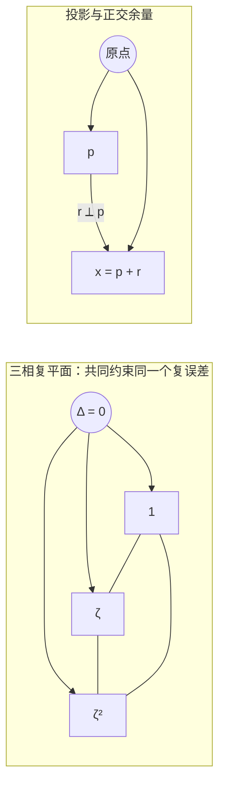

# AURIC R5-011：存在的改写，关系的守恒

> 来源：用户于 2026-11-07（Asia/Singapore）在本会话提供的 AURIC R5-011 LaTeX 研究工作稿；原稿署名为“一个候选：完整总量不减，三相差分不增”，未另标生成模型。本文为参考输入，Lean 是仓库的数学真源；本次仅转换 Markdown，未作形式化认证。正文中的固定快照、项目核读叙述与理论结论均保留原稿口径；原 TikZ 双面板图转为 Mermaid 关系图，保留原图文字、坐标与图注。

AURIC / R5-011

存在的改写，关系的守恒

从三相内部参照到量子线性

一个候选：完整总量不减，三相差分不增

2026年11月6日（新加坡时间）

## 摘要

把“存在”作为哲学起点以后，下一步可以只研究存在形式之间的相容关系：加入第三份记录时，已确立的二元关系怎样保留；同一份输入换一种完整表达后，哪些约束迫使旧关系全部守恒。本轮不再寻找比存在更低的原语，而把这些问题写成有明确对象、量词和反例的数学命题。

项目 C129 已完整实现“旧关系表不改，新对象只增加一份正交非负余量”；V80 已从四相有限参照推出复线性等距。本轮给出其**三相校准变式**：每个实际张成参照只取相差 $120^\circ$ 的三个相位位置；完整输出总量只要求不减少，到这些参照的差分只要求不增加。三相求和迫出总量等号，三方向共同锁住复比较，正性再排除参照外余量。因此原输出沿可见商下降、复线性、全部二元关系守恒及 Kraus 形式成为结论。

最新固定版本的 C128 §§389–397 另有实质削减：在既定复 Hermitian Jordan 载体上，仅要求基本正原子之间的作用留在二者支持内、沿第一个原子的切面；局部两侧单位静止由此导出，无须另设。本文给出 qubit 的自足证明，并注明高维分类的既有依赖。

全文同时给出保守正核递推、局部二元与三轴几何、Born 概率、复合、完全正过程、条件更新、酉演化的条件重构。正交方向、相位三角形、三结果菜单分属不同类型；“没有负存在”本身并不选择复数域、全部实际设备或物理时间。这里压缩的是明确接口上的校准条件，而不是把尚需验证的物理内容藏进“存在”的定义。

**本轮一句话** 一份存在完整地换一种读法，总量不能丢；拿同一内部参照转出的三个方向去比较，差别不能变大。这三条边共同锁住旧关系，线性便从相容性中出现。

固定源码：[the-omega-institute/trureturing，dev](https://github.com/the-omega-institute/trureturing/tree/64aca186adddfb598703f3e96be1f62ffed3dc49)。

提交 `64aca186adddfb598703f3e96be1f62ffed3dc49`；提交时间 2026-11-06 22:56:58。

核对时间 2026-11-06 23:03:13，均为 Asia/Singapore。本稿未运行 Lean 编译；项目既有结果、本文证明和实际来源条件分别注明。

## 1　存在作起点，关系承担约束

你的最新表述最有力的部分是：**第三者的加入，不能暗中改写前两者已经确立的比较。** 这已经比“有三元归一化”更明确，因为它规定了新旧关系之间必须满足的相容性。我们可以把存在作为原语，停止追问更低的哲学元素；数学任务则是说明哪些存在形式能共同组成同一个模型。

#### 定义 1.1：可读的正对象

固定整体 $\Omega$ 内的实际来源、读口、参考与记录。当前有限可见空间为实空间 $V$，正对象锥为 $C$，声明读口族为 $\mathcal R$。要求

$$
r(c)\ge0\quad(r\in\mathcal R,c\in C),\qquad
c\ne0\Longrightarrow\exists r\in\mathcal R:\ r(c)>0.
\tag{E}
$$

读口是线性的实值泛函；这里的线性属于这一已声明的静态接口。若某两份档案对全部声明后续操作与读口都不可区分，就在这个接口的可见表示中识别它们，原档案仍可分别保留。

若 $c,-c\in C$，所有正读数同时满足 $r(c)\ge0$ 与 $-r(c)\ge0$，故全为零，再由 (E) 得 $c=0$。所以 $C\cap(-C)=\{0\}$。这精确表达了“没有非零的负存在”。它不禁止坐标、幅度、差分或可观测量取负值。$-\psi$ 与 $\psi$ 给同一纯态投影；相消是关系的变化。逆过程也须有定义域和实际逆，伴随并不自动是一台可执行的反向装置。

一次读数为零不等于对象不存在。$|0\rangle$ 对 $|1\rangle\langle1|$ 的概率为零，但准备和效果都非零。“可被读出”宜理解为有某个允许关系能区分它，而不是所有读口都必须响应。

### 1.1　正交属于哪一层

正交可作为**独立坐标或新增余量** 的性质。若把任意两个不同存在态都设成正交，它们的内积就全为零，恰好删掉了需要研究的重叠关系。量子比特的三个 Pauli 方向满足 $\operatorname{Tr}(\sigma_i\sigma_j)=2\delta_{ij}$，却只有两个两两正交的非零纯态；三个 Pauli 测量也不能在一个副本上同时作任意精确锐读出。

因此“任取二元稳定读出”在下文是共同参照下的相容比较，可在声明的不同实验或完整记录中实现；它不意味着全部非对易量在同一副本上已有无扰的同时取值。所谓各向同性，是所得三轴几何不偏爱某根数学坐标轴；实现每一种旋转仍须实际控制来源。

### 1.2　本轮真的比哪里更简洁

相对项目 V80，本轮有限相位参考位置由 $4d$ 改为 $3d$，种子参照不必已经正交，完整总量的等号改为单边不减，且不预设原输出已沿输入的可见商下降。若两种参考操作均已供应且作用于同一全输入接口，两套完整条件都等价于复线性等距；因此这是**同一表示类的更短校准**，并非更弱的物理规律。它也不宣称整套前件严格弱于 R5-010，或原生实验成本自动降低。[\[4\]](#ref-v80)

## 2　与最新项目的接合点

本轮以前一轮提交 [`fd394108f2bb`](https://github.com/the-omega-institute/trureturing/tree/fd394108f2bba4dabf43dd7bfa03eddd7421281a) 为对照，核对了四个完整 Git 子树。变化路径数分别为：`docs` 有 2 项，`D5` 有 7 项，`Library` 有 2 项，`Blueprint` 有 14 项。理论文稿真正新增的是 C128 续篇 §§389–397，共 235 行；另一项 docs 变化是 Birkhoff 模块许可证。75 份相关当前文档已按 Git blob 身份核对取得，这不表示全部逐篇完成证明审计。[\[1\]](#ref-repo), [\[11\]](#ref-c128)

| 来源 | 在本轮中的准确地位 |
|:---|:---|
| C129，§§2–3 | 已有旧表续接、奇异 Schur 条件、单正交余量、最小 Hilbert 表示；不是本轮新发现。 |
| C130，定理2.3 | 已有一个无序的相互读出不等式，等价于全有限 Hermitian 正型核；静态正性已有更短写法。 |
| V80，§5.1、§14 | 已有四相参照、星形复比较锁定、正交余量归零及近似稳定性；本轮压缩相位参考布局。 |
| C136，§5、§6.3 | 已有观察窗口的全部保旧关系拼接，以及全对比较与相位校准的过程表示。 |
| C128 §§389–397 | 本快照的实际新增：第一原子切向与共同支持，推出裸局部单位律并接上既有分类。 |
| 本轮三相定理 | 三角形参考、单边总量及原标签版本的等价压缩；给出自足证明，不作外部数学优先权主张。 |

还定点检索了 R5-002、C131、C133、C135、V79、V82、V87、V77，以及 C139/C140 的相关过程段。没有在这些已核对段落中发现完全相同的同过程三相不扩张版本；这不是对全仓和外部文献的排他性声明。C139/C140 的单一三次根标记使用全部原输入对，V80 才是本轮有限参考布局的直接基线。[\[8\]](#ref-c139), [\[9\]](#ref-c140), [\[4\]](#ref-v80)

最新提交还加入严格正矩阵的尖锐 Birkhoff 收缩形式化：使用的是

$$
d_H(x,y)=\log\frac{\max_j(x_j/y_j)}{\min_j(x_j/y_j)},
\qquad \kappa(A)=\frac{\sqrt{\Theta(A)}-1}{\sqrt{\Theta(A)}+1}.
$$

这是 Hilbert  *射影距离* ，不能当作 Hilbert 内积的起源。本文只核读有关定义与终结定理及相应说明，未本地编译；同批 Robin 与 Jacobi 文件仅核对变化路径，不据其元数据宣称新的数学结论。[\[13\]](#ref-birkhoff)

## 3　静态递归：旧关系表加一行一列

#### 定义 3.1：共同正关系核与保守续表

原历史标签集为 $X$。共同复关系核 $k:X\times X\to\mathbb C$ 满足 Hermitian 对称，且每个有限标签族的矩阵 $G=[k(x_i,x_j)]$ 都正半定。正性量化所有有限复系数组合，不限于原始二元或三元主块。加入新标签时，旧标签上的 $k$ 保持原值。

这里复数和共同复参考已被供应，或由第8节的局部比较结构建立。仅说“可读的存在”尚不确定实、复或四元数几何。项目 C130 的静态短式是

$$
2\Re B(f,g)\le\Re B(f,f)+\Re B(g,g),
\qquad f,g\in\mathbb Z[i]^{(X)}.
\tag{P}
$$

在原文的有限双和定义下，(P) 等价于 Hermitian 正核。复数、共轭及任意有限复合配方的量词仍有内容；本文不把它们从“存在”一词中无条件取出。[\[3\]](#ref-c130)

#### 定理 3.2：C129 的单余量续表

设 $G\succeq0$，则

$$
\begin{pmatrix}G&b\\b^*&c\end{pmatrix}\succeq0
\quad\Longleftrightarrow\quad
b\in\operatorname{Ran}G,\qquad \delta=c-b^*G^+b\ge0,
\tag{S}
$$

其中 $G^+$ 是 Moore–Penrose 逆，$c$ 为实数。几何上，新向量唯一分成

$$
x_{\rm new}=p+r,\quad p\in H_{\rm old},\quad r\perp H_{\rm old},
\quad \|p\|^2=b^*G^+b,\quad \|r\|^2=\delta.
\tag{R}
$$

这里 $p$ 由旧关系唯一确定，$r$ 的长度确定；最小扩展中的方向只在保持旧空间的等距意义下唯一。

**证明。**

若大矩阵正，取 $u\in\ker G$，在 $(tu,1)$ 上测试二次型，对任意复数 $t$ 的非负性迫使 $`u^*b=0`$。所以 $b\in(\ker G)^\perp=\operatorname{Ran}G$。令 $v=G^+b$；在 $(-v,1)$ 上测试得 $\delta\ge0$。反过来，$Gv=b$ 且

$$
\begin{pmatrix}G&b\\b^*&c\end{pmatrix}
=\begin{pmatrix}I&0\\v^*&1\end{pmatrix}
\begin{pmatrix}G&0\\0&\delta\end{pmatrix}
\begin{pmatrix}I&v\\0&1\end{pmatrix}\succeq0.
$$

若旧向量为 $x_i$，取 $p=\sum_i v_i x_i$，再添与全部旧向量正交且平方长度为 $\delta$ 的 $r$，即得到所需表示。

$\square$

**两个不能漏掉的边界。** 一是 $b\in\operatorname{Ran}G$：例如 $G=0,b=1,c=1$ 虽给 $`c-b^*G^+b=1`$，大矩阵仍不正。二是 $\delta=0$ 只表示没有新的独立可见方向，不表示新事件没发生。秩每步增加 $0$ 或 $1$，不能断言每次反思一定加维。该定理及以下表示链均已见于 C129。[\[2\]](#ref-c129)

#### 命题 3.3：全有限续表产生 Hilbert 表示

相容的全有限正关系表，决定最小表示 $k(x,y)=\langle\phi(x),\phi(y)\rangle$，在保持原标签向量的酉同构意义下唯一。

**证明。**

在有限形式和 $\sum_x c_x[x]$ 上定义内积 $\langle c,d\rangle=\sum_{x,y}\bar c_x k(x,y)d_y$。正性由有限表给出。对零范数向量，Cauchy–Schwarz 使其与全部向量配对为零；商掉零空间后完备化，得到 Hilbert 空间。两个最小表示间按原标签映射延拓，保内积且稠密满射，所以为酉同构。

$\square$

这条“加行加列”递推是正核扩展和 Gram 分解；并不单凭形式就等同于哥德尔或 Cantor 对角论证。若要接到后者，须另有编码、可计算性、形式可证性或自指条件。旧校准关系的保留也不禁止带着出处修订噪声估计；它约束的是所声明的同一关系和来源。标签指实际声明的历史，不把未作出的不相容测量结果预填成一张经典联合概率表。

### 3.1　为什么原始三元都好仍不够

取

$$
C=\frac75I_4-\frac25\mathbf1\mathbf1^*.
$$

每个 $3\times3$ 主块的特征值为 $1/5,7/5,7/5$，都正；全表却有特征值 $-1/5$。所以任取原标签中的三个都可单独正表示，不代表它们已共同嵌入一个正整体。项目 V72 的二元化量词覆盖**任意有限复合向量**，不能缩成几组原始坐标对；C139 已给出这一类四维反例。[\[5\]](#ref-v72), [\[8\]](#ref-c139)

若只保比较模长，也会漏掉三元环相位。对角全为 $1$、三条边模长都为 $1/2$ 的 Hermitian 表，边全正时秩为 $3$，改一条边的相位为负号可得秩 $2$ 的正表。一般

$$
\det G=1-|a|^2-|b|^2-|c|^2+2\Re(ac\bar b),
\quad G=\begin{pmatrix}1&a&b\\\bar a&1&c\\\bar b&\bar c&1\end{pmatrix}.
$$

循环项是“关系的关系”的具体例子。相同概率重叠并不自动给同一复比较表。

**白话对应。** 把一个新对象接进来，它与旧对象的联系必须共同来自旧空间中的同一份影子。影子之外只准多出正交的非负余量；零余量表示这个读法已有表达。三次分别检查不等于已经拼成整体，旧表必须作为同一张表带着走。

## 4　本轮唯一新候选：三相内部参照

本节研究**同一完整过程对已有输入的改写**；上一节研究新增标签的静态扩展。新输入可以加维，而一个保全部旧关系的完整过程在其输入像上不得暗增独立信息。两者沿同一正关系几何接续，不能混写成同一个加维断言。

静态保旧表并不自动推出下面的动态条件。任意非线性输出 $F(x)$ 也可与全部旧输入一起放进一个更大 Hilbert 空间，形成正 Gram 表且不改旧块；尚未被锁住的是新输出怎样对齐既定参照。三相校准与两条单边关系正是在这个缺口上施加约束。

#### 定义 4.1：原标签接口与三相参照

设 $X$ 是原输入历史标签集，输入表示 $a:X\to H$，其中 $1\le d=\dim_{\mathbb C}H<\infty$。同一实际完整输出给 $b:X\to K$，$K$ 是共同复 Hilbert 输出空间。**不预设** $b$ 只由 $a(x)$ 决定，也不预设输出线性、连续或齐次。

取 $d$ 个实际参照标签 $\alpha_j$，使 $a_j=a(\alpha_j)$ 线性无关并张成 $H$。令 $\zeta=e^{2\pi i/3}$。同一内部相位参考供应标签 $\alpha_{jr}$，$r=0,1,2$，其中 $\alpha_{j0}=\alpha_j$，且

$$
a(\alpha_{jr})=\zeta^r a_j,\qquad
b(\alpha_{jr})=\zeta^r b_j,\quad b_j=b(\alpha_j).
\tag{C}
$$

这只校准有限参照，不预设全部输入上的相位协变。种子参照无须正交或归一。

#### 定义 4.2：R5-011 三相完整关系候选

在上述同一实际接口中，对全部声明的 $x\in X$，要求

$$
\begin{aligned}
\|b(x)\|^2&\ge\|a(x)\|^2,
&&\text{完整总量不减；}
\end{aligned}
\tag{N}
$$

$$
\begin{aligned}
\|b(x)-b(\alpha_{jr})\|^2
&\le\|a(x)-a(\alpha_{jr})\|^2,
&&\forall j,\ r=0,1,2.
\end{aligned}
\tag{D}
$$

输出包含全部声明结果及失败、停止、泄漏记录；范数用同一标尺。若 $K=\bigoplus_eK_e$，这些条件对**全部结果总和** 成立，不要求每一条件分支的量都不减。

式 (C)、(N)、(D) 是本轮一个完整的**过程候选**。它接在共同正复几何上，后者的来源在第8节回溯；概率、复合和时间的明确接口在第10节接入。把这些写成 $\Omega$ 内对象之间的约束，使装置与参照也在理论里，但不把约束本身说成无须检验的同义反复。

### 4.1　三相不是三个新纯态

$a_j,\zeta a_j,\zeta^2 a_j$ 在裸射线空间中相同，单独的全局相位不可区分。这里相位是相对于同一**内部相干参考或路径** 的关系。要使用 (D)，实际来源须供应同一结果分支中、不同输入后继之间的相干差分读口；只有各结果概率表还不够。不同互斥结果之间无需另外授予相干重合控制，直和范数只是逐支求和。[\[4\]](#ref-v80)

有限的是参照侧的 $3d$ 个相位位置；另一槽仍量化全部声明输入。既有单位球上的实际标签也可作 $X$；定理给数学线性延拓，不自动认证尚未供应的未归一装置输入。若记忆或控制设置改变后继，它们须纳入输入或过程标识，不能在同一个 $b$ 中隐去。

## 5　主定理：线性由共同关系锁定

#### 定理 5.1：三相完整关系刚性

在第4节的原标签接口中，(C)、(N)、(D) 等价于存在唯一复线性等距 $V:H\to K$，使

$$
\boxed{b(x)=Va(x)\quad(x\in X),\qquad V^*V=I_H.}
\tag{L}
$$

因此全部复二元关系、全部总量以及全部差分距离均守恒；若 $a(x)=a(y)$，就有 $b(x)=b(y)$。原输出沿可见商下降本身也是结论。

**证明。**

**第一步：三相平均迫出总量等号。** 固定 $j$，将 (D) 对 $r=0,1,2$ 求和。由 $1+\zeta+\zeta^2=0$ 与 (C)，交叉项相消，得到

$$
3\bigl(\|b(x)\|^2-\|a(x)\|^2\bigr)
+3\bigl(\|b_j\|^2-\|a_j\|^2\bigr)\le0.
\tag{1}
$$

两括号由 (N) 都非负，故各为零。对全部 $x$，

$$
\|b(x)\|^2=\|a(x)\|^2.
\tag{2}
$$

无需另列参照总量条件，因为 (N) 的 $x$ 本来就包含 $\alpha_j$。

**第二步：三个方向锁住复比较。** 约定内积对第二变量线性。记

$$
\Delta_j(x)=\langle b_j,b(x)\rangle-\langle a_j,a(x)\rangle.
$$

展开 (D) 并消去已经相等的范数，得

$$
\Re\bigl(\zeta^{-r}\Delta_j(x)\bigr)\ge0,
\qquad r=0,1,2.
\tag{3}
$$

三个实数之和为零，所以各为零。$r=0$ 给实部为零，$r=1$ 因 $\zeta$ 非实给虚部也为零。因此

$$
\langle b_j,b(x)\rangle=\langle a_j,a(x)\rangle
\qquad(\forall j,x).
\tag{4}
$$

取 $x=\alpha_k$，输出参照的 Gram 表自动等于输入参照的 Gram 表。

**第三步：正性排除参照外余量。** 按基规定 $Va_j=b_j$。参照 Gram 相等保证这一唯一复线性映射为等距。由式(4)，

$$
r_x=b(x)-Va(x)\perp\operatorname{span}\{b_1,\ldots,b_d\}.
$$

于是

$$
\|b(x)\|^2=\|a(x)\|^2+\|r_x\|^2.
$$

式(2)使正余量为零，故 $b(x)=Va(x)$。唯一性来自参照张成。反向，任何这样的复线性等距都满足 (C)、(N)、(D)，且两不等式都取等号。

$\square$

这一证明没有从“存在”预设过程线性。使用的静态复线性载体和正范数是明确前件，而同一实际后继必须与它们怎样相容，正是定理新证明的内容。V80 已有星形比较及余量论证；本文把其四向夹定改成三个相位的平衡。[\[4\]](#ref-v80), [\[2\]](#ref-c129)

左图是相位参考的复平面。三个比较方向为 $1$、$\zeta$、$\zeta^2$，相邻方向相差 $120^\circ$，共同约束同一个复误差，锁定 $\Delta=0$；不是三个正交纯态。右图是投影与正交余量：$x=p+r$、$p\perp r$，且 $\|x\|^2=\|p\|^2+\|r\|^2$。过程主定理把余量锁成零，静态新增标签则允许余量非零。Mermaid 表示关系，不按比例绘制。原 TikZ 左图在局部坐标中以 $(0,0)$ 为原点，三个端点为 $(1.55,0)$、$(-0.775,1.342)$、$(-0.775,-1.342)$；右图的 $p$ 端点为 $(2,0)$，$r$ 从 $(2,0)$ 指向 $(2,1.8)$，$x$ 从 $(0,0)$ 指向 $(2,1.8)$。

**图 1：** 左图是相位参考的复平面，不是三个正交纯态。右图是正交分解；过程主定理把余量锁成零，静态新增标签则允许余量非零。

### 5.1　为什么另一个短式的总量方向相反

若已直接知道所有复参照行 $k'(\alpha_j,x)=k(\alpha_j,x)$，共同输出正性只允许额外正交余量。因此

$$
k'(\alpha_j,x)=k(\alpha_j,x),\qquad k'(x,x)\le k(x,x)
\quad\Longrightarrow\quad k'=k.
\tag{A}
$$

证明就是定理第三步。这个既有星形骨架可由 V80/C129 重组。式 (A) 需总量**不增**；三相版本先用差分不扩张给反向总量界，再由总量**不减** 夹成等号。二者已知关系不同，方向不能互换。

### 5.2　精确参照下的稳定性

设输出参照 Gram 精确为 $G=[\langle a_i,a_j\rangle]>0$，$Va_i=b_i$。对一个输入向量 $u$ 及实际输出 $y$，令

$$
e_i=\langle b_i,y\rangle-\langle a_i,u\rangle,
\qquad \|y\|^2-\|u\|^2\le\eta,\quad\eta\ge0.
$$

写 $u=\sum_i c_i a_i$，展开 $\|y-Vu\|^2$ 并对 $`c^*e`$ 用 Cauchy–Schwarz，得到

$$
\|y-Vu\|^2
\le\eta+2\|u\|\sqrt{e^*G^{-1}e}
\le\eta+\frac{2\|u\|\|e\|}{\sqrt{\lambda_{\min}(G)}}.
\tag{5}
$$

参照几乎线性相关时，误差会被放大。这个整理推论与 V80 §14 的近似稳定性及 V63 的参照条件数控制一致；没有同时估计参照 Gram 误差时，不能把式(5)直接当作完整实验误差证书。[\[4\]](#ref-v80), [\[6\]](#ref-v63)

**白话对应。** 每个参照转成一只小三角形。完整输出到三只角的差别都不能变大，总量也不许减少，三条边就会把每个旧比较锁回原值。旧比较已占满总强度，正性不允许旁边再藏一份余量；原后继于是只能沿同一个复线性等距推进。

## 6　反着推：每个条件到底挡住什么

| 删除的条件 | 仍可出现的明确反例 |
|:---|:---|
| 完整总量不减 | $b(x)=0$ 满足三相协变及全部差分不扩张，却抹掉全部输入信息。正性本身不等于守恒。 |
| 共同相位校准 | $F(z)=\bar z$ 保持全部范数与距离，但反线性。纯实距离还没选择复方向。 |
| 种子参照张成 | 在 $H=S\oplus S^\perp$ 中把所有参照放在 $S$，令 $F(s+t)=s+T(t)$，$T$ 为任意保范数非线性映射；未覆盖方向仍自由。 |
| 全部声明输入量词 | 在有限已测点恒等，在某个未测点作保范数改变；所有已测数据相同，整体却不线性。 |
| 共同输出正性 | 各对分别为正仍可拼出 $\bigl(\begin{smallmatrix}1&1&1\\1&1&0\\1&0&1\end{smallmatrix}\bigr)$，有负特征值 $1-\sqrt2$。不存在共同正输出，正交余量证明便失效。 |
| 完整结果覆盖 | 后选择单个结果可以改变归一化内积或提高区分度；丢弃环境也会丢失局部信息。主定理约束的是具名完整输出。 |

### 6.1　三个相位在此协议中确实比两个强

若一复维只用两个相反参照 $\{1,-1\}$，共轭映射固定它们，且满足范数和距离条件，却不复线性。若只用 $\{1,i\}$，令

$$
x_0=-\frac{1+i}{\sqrt2},\qquad
F(x)=\begin{cases}-x_0,&x=x_0,\\x,&x\ne x_0.\end{cases}
$$

它固定两参照且逐点保范数；$x_0$ 到两参照的距离平方都从 $2+\sqrt2$ 降为 $2-\sqrt2$，其他输入距离不变，因此条件通过，映射却非线性。

一般两个非反向单位相位，以其和的反方向作为 $x_0$ 同样构造；反向情形用关于其直径的共轭。因此在这种**逐方向、单边距离参照协议** 中，两相不能一般替代三相。这不是所有可能测量协议的全局最小成本定理。

还可直接保留全部三相校准，只删第三条距离检验：令 $F$ 除 $-1$ 外恒等，且 $F(-1)=-\zeta^2=1+\zeta$。三参照全部固定，范数保持；特殊输入到 $1,\zeta$ 的距离平方分别从 $4,1$ 变为 $1,1$，但到第三参照 $\zeta^2$ 从 $1$ 变为 $4$。第三条边正好检出这个非线性改写。

### 6.2　保全局关系不等于能无扰读出每个局部态

若一台记录装置保持每个局部纯态，写成

$$
V\psi=\psi\otimes r_\psi,\qquad V\phi=\phi\otimes r_\phi,
\qquad \|r_\psi\|=\|r_\phi\|=1.
$$

等距给

$$
\langle\psi,\phi\rangle
=\langle\psi,\phi\rangle\langle r_\psi,r_\phi\rangle.
$$

当输入非正交时，记录内积只能为 $1$，两记录相同，不能留下可区分新消息。观察者在整体内，正是这个联合关系约束的参与者；把它加入并不能逃过该限制。

## 7　二元、三维与五槽位：保持数学类型

### 7.1　一次正交续接怎样变成局部两分量

在定理3.2中，设 $q=\|p\|^2>0$、$\delta=\|r\|^2>0$、$c=q+\delta$。定义局部嵌入

$$
V_n|0\rangle=\frac p{\sqrt q},\qquad
V_n|1\rangle=\frac r{\sqrt\delta}.
$$

则

$$
x_{\rm new}=\sqrt c\,V_n
\begin{pmatrix}\sqrt{q/c}\\\sqrt{\delta/c}\end{pmatrix}.
\tag{6}
$$

该局部纯态的 Bloch 向量可取

$$
\left(\frac{2\sqrt{q\delta}}c,\ 0,\ \frac{q-\delta}c\right).
$$

这里相位吸收到所选 $V_n$ 中，因而画在一条子午线上；完整局部 $\mathbb C^2$ 在数学上仍允许全部 Bloch 球面。旧关系的信息在 $p$ 及嵌入 $V_n$ 中，不能只保留三个数字就保存任意增长的历史。若 $q=0$ 或 $\delta=0$，退化为单腿；若 $c=0$，新增向量在当前可见商中为零。

特别地

$$
p\perp r,\qquad \langle p,p+r\rangle=q,\qquad
\langle r,p+r\rangle=\delta.
$$

所以两条正交腿与它们的和**不构成三个两两正交的元**。三维 Bloch 坐标是两分量复态的归一化 Hermitian 读出，不是又加一条振幅维度。

### 7.2　五槽位可以复用，维数与信息不能固定

在一个已选定的局部二能级呈示中，可以采用下表作为一种有类型的对应，而不把符号锁成永恒的五种实体。

| 槽位 | 当前局部呈示中的作用 |
|:---|:---|
| $F[1],F[3]$ | 两个已校准的独立读出端或局部振幅基方向。 |
| $F[1,3]$ | 二者的交叉关系，如 $\rho_{13}$；一般有实、虚两部分，不能仅凭对角读数确定。 |
| $F[2]$ | 包含对角与交叉项、满足正性及归一的共同局部对象 $\rho$，或本次提升后的关系表示。 |
| $F[\mathrm{null}]$ | 当前内部观察参考、标尺和记录来源；它属于 $\Omega$，不是自动等同于数值零、单位矩阵或外部全知观察者。 |

例如

$$
\rho=\frac12\begin{pmatrix}1+z&x-iy\\x+iy&1-z\end{pmatrix},
\qquad \rho\succeq0\Longleftrightarrow x^2+y^2+z^2\le1.
\tag{7}
$$

这是稳定二元读出的三实坐标几何。把任一输入与一个参照组成 $2\times2$ 正 Gram 表，再除以其迹，就得到这种球内点。主定理先锁住两个对角量，因而固定 $z$；三个相位方向再锁住交叉项的实、虚部，也就是固定同一高度平面上的 $x,y$。这给“二元关系在三实坐标里稳定提升”一个直接模型。

三根 Pauli 轴两两正交、数学上各向同性；式(3)的相位三角形却有 $120^\circ$ 夹角，二三结果菜单也不要求效果正交。这三种“三元”各自承担不同约束。

将 $F[\mathrm{null}]$ 与 $F[1,3]$ 作为下一对，需要把观察参考与关系记录都提升为同一类可比较的历史对象，重新给出共同读口、相位及正性。五槽位可以是递归语法，但不是五个固定标量保存全部关系的证明。

### 7.3　两个观察窗口怎样保留旧关系

项目 C136 已给出更大的拼接结构。先取两个有限维实 Hilbert 比较窗口 $H_A=K\oplus U$、$H_B=K\oplus V$，其中 $K$ 是已等距识别的共同部分。全部保持两份旧关系、且由两像共同张成的最小联合拼接，由实线性收缩 $C:V\to U$ 参数化：

$$
H_C=K\oplus U\oplus\operatorname{Ran}\sqrt{I-C^*C},
$$

$$
i_A(k,u)=(k,u,0),\qquad
i_B(k,v)=(k,Cv,\sqrt{I-C^*C}\,v).
$$

直接展开范数可见两个嵌入都等距且在 $K$ 上一致；跨窗口新增关系由 $C$ 决定。分类取保持原标签的等距等价意义。正交拼接 $C=0$ 只是一种选择，保旧关系不自动确定尚未读到的交叉关系。若原窗口带正交复结构，且在共同不变空间 $K$ 上一致，还须 $CJ_V=J_UC$ 才能按原相位拼接。[\[7\]](#ref-c136)

整体迹重新归一也须分清：$I_2\to I_3$ 保留原始旧表，而 $I_2/2\to I_3/3$ 不保旧条目。应固定原标尺或使用逐对象归一化，不能每次换分母后又宣称所有旧概率原封不动。

## 8　复数与三轴从哪里来：继承原子闭合

三相定理已处于复几何。为使整条重构不循环，本节重述 R5-010 对 C115 的原子闭合压缩，并给证明骨架。这里是既有来源链，不把它重新算成本轮新候选。[\[10\]](#ref-c115)

#### 定义 8.1：局部原子比较结构

给非零实含幺结合 $`*`$-代数 $\mathcal A$。将其全部自伴部分写为

$$
V=\mathbb R1\oplus W,\qquad \dim W\ge2.
$$

对每个 $x\in W$，要求

$$
x^2=Q(x)1,\qquad Q(x)>0\quad(x\ne0).
\tag{Q}
$$

存在中央元 $j$，使 $`j^*=-j`$ 且 $\mathcal A_{\rm skew}=jV$。乘法双线性，反序满足 $`(ab)^*=b^*a^*`$。不预设 $Q$ 为二次型、不预设 $j^2=-1$。

#### 定理 8.2：原子闭合的三轴分类

上述条件迫使 $Q$ 为正内积平方、$\dim W=3$，且

$$
\mathcal A\cong M_2(\mathbb C),\qquad
xy=g(x,y)1+J(x\times y),\quad J^2=-1.
$$

**证明。**

极化恒等式给

$$
\frac{xy+yx}{2}=g(x,y)1.
$$

乘法双线性使 $g$ 对称双线性，$g(x,x)=Q(x)>0$，所以是内积。

中央自伴元只能为实标量：若其 $W$ 部分为非零 $a$，取 $b\perp a$ 非零，则中央性给 $ab=ba$，极化又给 $ab=-ba$；但 $b^2=Q(b)1$ 使 $b$ 可逆，矛盾。故 $j^2=s1$。

取正交单位 $u,v$，则 $uv=-vu$。因 $uv$ 反自伴，可写 $uv=j(\alpha1+w)$。$uv$ 可逆且 $j$ 中央，故 $j$ 可逆。结合律给 $\{u,uv\}=\{v,uv\}=0$；消去 $j$ 后得到 $\alpha=0$、$w\perp u,v$。再由

$$
1=(uv)(vu)=-j^2w^2=-sQ(w)1
$$

得到 $w\ne0,s<0$。

若 $z\perp u,v,w$，它与 $u,v,w$ 都反交换。但结合律使 $z(uv)=(uv)z$，共同中央 $j$ 又使 $zw=wz$。于是 $zw=0$；$w$ 可逆，故 $z=0$。所以 $W$ 恰三维。

令 $J=j/\sqrt{-s}$，$e_1=u,e_2=v,e_3=\sqrt{-s}\,w$。可得 $e_i^2=1$、$e_1e_2=Je_3$ 及循环关系，$J^2=-1$。把 $J$ 映为 $iI$、$e_i$ 映为 Pauli 矩阵，就得保持乘法与伴随的同构：两边均实八维，生成元覆盖全部矩阵单位。

$\square$

这把内积、三轴与内部复数放在同一闭合中，但实线性代数、正平方、全部自伴层、共同中央关系层和结合律仍是前件。裸正核及保守续表也容纳经典、实与四元数模型，不能替代这些选择内容。由 $M_2(\mathbb C)$ 的最小左理想得到振幅空间 $\mathbb C^2$；正 Hermitian 迹一截面就是式(7)的球。

“两个方向带出第三个”在这里有严格含义：同一原子只允许原读出层和一个共同有序关系层，结合闭合排除了第四个独立方向。它不限制整体 $\Omega$ 的维数，也不意味着每次 meta 都无条件增加一维。

## 9　最新 C128：只在原子的支持内沿切面变化

最新新增的关系作用在**已经给定** 的 $E=\bigoplus_s\operatorname{Herm}_{n_s}(\mathbb C)$ 上。给实双线性作用 $D:E\times E\to E$。对全部有序基本正原子，即秩一投影 $e,p$，包括 $e=p$，要求

$$
\boxed{D(e,p)\in E_1(\operatorname{supp}(e+p))\cap E_{1/2}(e).}
\tag{T}
$$

$E_1(c)=cEc$ 是共同支持角；$E_{1/2}(e)$ 是满足 $ev+ve=v$ 的切空间。后者正是对投影关系 $e(t)^2=e(t)$ 求导得到的式子。

白话说，**两种基本存在彼此作用，变化留在二者共同所在的范围内，并沿第一种存在的形状移动。** 它不先输入外在长度 $q$，也不先要求单位对作用静止；这两项是新局部条件的实际削减。完整项目背景的原标尺、单位来源和全部实际参考仍保留。[\[11\]](#ref-c128)

#### 定理 9.1：qubit 的自足分类

在 $E=\operatorname{Herm}_2(\mathbb C)$ 上，实双线性 $D$ 满足 (T)，当且仅当存在 $\gamma\in\mathbb R$，使

$$
D(a,b)=\gamma i[a,b].
\tag{8}
$$

特别地，两侧单位律和交替性都成为结论。

**证明。**

**自配对。** 当 $p=e$，共同支持角为 $\mathbb Re$。$te$ 若满足 $e(te)+(te)e=te$，则 $2te=te$，故 $t=0$。所以 $D(e,e)=0$。

**左单位。** 写 $e_{\mathbf r}=(I+\mathbf r\cdot\boldsymbol\sigma)/2$，$\|\mathbf r\|=1$。若 $v=a_0I+\mathbf w\cdot\boldsymbol\sigma$，直接乘法给

$$
v\in E_{1/2}(e_{\mathbf r})
\Longleftrightarrow a_0=0,\quad\mathbf r\cdot\mathbf w=0.
$$

互补原子 $e_{-\mathbf r}=I-e_{\mathbf r}$ 有同一切面。对固定原子 $p$，双线性使

$$
D(I,p)=D(e_{\mathbf r},p)+D(e_{-\mathbf r},p)
\in E_{1/2}(e_{\mathbf r})
$$

对每个 $\mathbf r$ 成立。所有这些平面的交为零，所以 $D(I,p)=0$。原子张成 $E$，得 $D(I,b)=0$。

**右单位与交替性。** 展开 $0=D(I-e,I-e)$，结合已得左单位律与 $D(e,e)=0$，得到 $D(e,I)=0$，继而 $D(a,I)=0$。再写任意自伴矩阵 $a=\lambda e+\mu(I-e)$，由单位律知 $D(e,I-e)=D(I-e,e)=0$，故 $D(a,a)=0$。极化得 $D(a,b)=-D(b,a)$。

**各向同性的系数。** 单位部分不参与作用，故 $D$ 只需在三维无迹部分上确定。反对称双线性映射唯一写成

$$
D(\mathbf a\cdot\boldsymbol\sigma,\mathbf b\cdot\boldsymbol\sigma)
=F(\mathbf a\times\mathbf b),
$$

其中 $F:\mathbb R^3\to\operatorname{Herm}_2(\mathbb C)$ 线性。单位律还给 $D(e_{\mathbf r},e_{\mathbf s})=F(\mathbf r\times\mathbf s)/4$。对任意单位 $\mathbf n$，取正交单位 $\mathbf r,\mathbf s$ 使 $\mathbf r\times\mathbf s=\mathbf n$。由 (T)，$D(e_{\mathbf r},e_{\mathbf s})$ 在第一切面；交换顺序并用交替性，又在第二切面。所以 $F(\mathbf n)$ 无迹且向量部分平行于 $\mathbf n$。

于是 $F(\mathbf v)=A\mathbf v\cdot\boldsymbol\sigma$，且线性 $A$ 保每一条实直线。取基向量知 $Ae_i=c_i e_i$，再取 $e_i+e_j$ 迫使 $c_i=c_j$，故 $A=cI$。利用 $i[\mathbf a\cdot\boldsymbol\sigma,\mathbf b\cdot\boldsymbol\sigma]=-2(\mathbf a\times\mathbf b)\cdot\boldsymbol\sigma$，得到式(8)，$\gamma=-c/2$。反过来，交换子显然留在共同支持内，并满足 $e\,i[e,p]+i[e,p]\,e=i[e,p]$。

$\square$

### 9.1　删去支持或切面会怎样

仅保切向，不保共同支持，可取

$$
D(a,b)=\operatorname{Tr}(Zb)\,i[Z,a].
$$

它对每个第一原子都切向，且 $D(a,I)=0$；但令 $e=p=(I+(X+Z)/\sqrt2)/2$，则 $D(e,e)=-Y/2\ne0$，超出自支持。这是新增 C128 §395 的明确反例。仅保支持，不保切向，取 $D(a,b)=\operatorname{Tr}(hb)a$，$h$ 非零无迹自伴；它右单位静止、输出留在第一原子的支持，却允许沿自身径向改变强度。[\[11\]](#ref-c128)

### 9.2　它属于什么更大的结构

在同一个复矩阵块 $\operatorname{Herm}_n(\mathbb C)$ 内，基本秩一投影构成 $\mathbb{CP}^{n-1}$。两颗不同原子的秩二共同支持角同构于 $\operatorname{Herm}_2(\mathbb C)$；该角内的原子流形为 $\mathbb{CP}^1$，也就是 Bloch 球面。切空间关系是这一射影几何的局部约束；交换子是其允许转向。与 Jordan 对称乘积合起来，它处在复矩阵的 Jordan–Lie 结构内。

高维新定理以共同支持把二阶角拼接，再调用既有分类定理 382.1 及其 FrameCorner 依赖 274.1，得到每块 $D_s(a,b)=\gamma_s i[a_s,b_s]$。本文自足证明的是二阶情形，没有重新证明全部高维分类。裸局部条件允许各 $\gamma_s$ 不同、甚至为零；共同物理标定仍由完整来源合同承担。式 (T) 不推导矩阵载体本身，也不单独产生时间尺度或 $\hbar$。[\[11\]](#ref-c128)

## 10　接上概率、复合与记录，完整得到有限量子理论

本节给出从上述结构到标准有限维量子公理的证明链。每项实际供给都属于 $\Omega$ 内的关系，不把数学存在的矩阵或装置自动认作来源中已实现的对象。

### 10.1　二、三菜单相容推出 Born 规则

在已取得的有限矩阵系统中，声明全部效果 $0\le E\le I$ 的二、三结果菜单。同一效果在不同菜单中有同一个概率 $p(E)\in[0,1]$；允许零效果及不同记录标签对应同值效果。要求每个完整二、三菜单概率和为一。

比较 $(I,0)$ 与 $(I,0,0)$，得 $p(0)=0,p(I)=1$。再比较

$$
(E,F,I-E-F),\qquad (E+F,I-E-F),
$$

消去同一个补结果，得到

$$
p(E+F)=p(E)+p(F)\quad(E,F\ge0,E+F\le I).
\tag{9}
$$

这正是“第三者加入不改原有比较”的概率版本；不是任意三轴的同时锐读出。[\[12\]](#ref-v62), [\[10\]](#ref-c115), [\[14\]](#ref-busch)

#### 定理 10.1：有限效果概率表示

这些条件当且仅当存在唯一密度矩阵 $\rho\succeq0,\operatorname{Tr}\rho=1$，使

$$
p(E)=\operatorname{Tr}(\rho E).
\tag{10}
$$

结论包括 $d=2$。

**证明。**

加性给单调性，等分给有理齐次，再以有理数上下夹逼给实齐次。对正矩阵 $A$，取 $t\ge\|A\|$、$t>0$，定义 $L(A)=t p(A/t)$；齐次使它与尺度无关，加性使它在正锥上可加。对自伴矩阵用正负差延拓：若 $A-B=C-D$，则 $A+D=C+B$，保证 $L(A)-L(B)$ 定义无歧义。因此得到正实线性泛函且 $L(I)=1$。有限迹配对给唯一自伴 $\rho$；对全部秩一正矩阵测试得 $\rho\succeq0$，再测试 $I$ 得迹一。反向直接。

$\square$

对归一向量 $\psi,\phi$，记 $P_\psi=|\psi\rangle\langle\psi|$。若原准备与其振幅标签 $\psi$ 有同源校准 $p_\psi(P_\psi)=1$，正性使密度支持在该射线上，所以 $\rho=P_\psi$，并有 $p_\psi(P_\phi)=|\langle\phi,\psi\rangle|^2$。若 $H$ 的全部射线均有实际饱和准备，且所需任意有限概率混合也实际可用，谱分解才把每个密度态配到一项实际制备；否则实际准备只是密度态集合中的一部分。

只要求二元归一不够。令 $\tau(E)=\operatorname{Tr}(E)/d$，取

$$
p(E)=\frac{\tau(E)^2}{\tau(E)^2+[1-\tau(E)]^2}.
$$

它满足 $p(E)+p(I-E)=1$，但 $(I/3,I/3,I/3)$ 的总概率为 $3/5$。二元互补没有自动带来跨菜单可加性。

**项目已有更小入口。** V62 §4 只在 $\operatorname{Herm}_d(\mathbb Q(i))\cap[0,I]$ 上供应上述有理二、三菜单，就能先延拓为有理线性正泛函。对有理 $r>\|X\|$，$-rI\le X\le rI$ 给 $|L(X)|\le r$，从而 $|L(X)|\le\|X\|$。这自产连续性及唯一 Born 数学延拓；未供应的效果是否实际可读，仍需原来源上的比较或细化桥。本文采用全效果版本以直接陈述条件完成，不把连续性再列成公理。[\[12\]](#ref-v62)

### 10.2　共同相位与独立复合推出张量积

若两个来源的实际独立标签对满足积核

$$
k_{AB}((x,y),(x',y'))=k_A(x,x')k_B(y,y'),
\tag{11}
$$

映射 $[(x,y)]\mapsto\phi_A(x)\otimes\phi_B(y)$ 保持内积，所以由最小表示唯一性，积标签张成的可见子空间同构于 $H_A\otimes_{\mathbb C}H_B$。只有这些标签张成全部实际联合载体时，才能把该载体整体识别为这个张量积。证明需要同一复相位和积核合同；向量张成也不意味着纠缠态可由独立制备直接生成。[\[4\]](#ref-v80)

代数版本中，若 $n$ 个局部 $M_2(\mathbb C)$ 实际交换、共享 $J$ 并共同生成可见联合代数，乘法给含幺满同态 $M_{2^n}(\mathbb C)\to\mathcal A_{\rm joint}$。源为单代数，故核为零，得到标准复张量积。允许实际投影角 $P M_{2^n}(\mathbb C)P\cong M_d(\mathbb C)$ 后覆盖全部有限维。

共同相位不可默删：只按实数复合时，

$$
M_2(\mathbb C)\otimes_{\mathbb R}M_2(\mathbb C)
\cong M_4(\mathbb C)\oplus M_4(\mathbb C).
$$

局部中心相位形成 $Z=-J_AJ_B$、$Z^2=1$；$J_A=J_B$ 选择通常复扇区。局部相似几何本身不会消除这个整体扇区。[\[10\]](#ref-c115)

### 10.3　三相过程直接给 Kraus、完全正性与仪器

设原实际粗结果为 $e$，完整输出载体为 $K=\bigoplus_e(H_B\otimes M_e)$，其中 $M_e$ 保存该结果内声明的细记录或环境。定理5.1给 $V$。坐标投影给线性 $V_e$；在 $M_e$ 中选正交基，写成

$$
V_e\psi=\sum_\mu K_{e\mu}\psi\otimes|\mu\rangle,
\qquad \sum_{e,\mu}K_{e\mu}^*K_{e\mu}=I.
\tag{12}
$$

这里 $e$ 是原实际记录；$\mu$ 只是所选环境基下的数学指标，除非另有原细记录绑定，不能当作自动新增的实测事件。

实际权重若按同一标尺绑定为输出平方范数，原混合制备按同一标签协议作仿射混合，且允许遗忘 $M_e$，就得到

$$
\mathcal I_e(\rho)=\sum_\mu K_{e\mu}\rho K_{e\mu}^*,
\quad E_e=\sum_\mu K_{e\mu}^*K_{e\mu},
\quad p(e)=\operatorname{Tr}(\rho E_e).
\tag{13}
$$

对任意有限参考 $R$，每项 $`(K_{e\mu}\otimes I_R)\rho_{AR}(K_{e\mu}^*\otimes I_R)`$ 都正，故 $\mathcal I_e$ 完全正；式(12)给总通道保迹，分支迹不增。若 $p(e)>0$，条件态为 $\rho_e=\mathcal I_e(\rho)/p(e)$；概率为零时不定义该条件态。序贯记录沿 $K_{f\nu}K_{e\mu}$ 复合，仍为同类结构。[\[15\]](#ref-watrous), [\[4\]](#ref-v80)

这条路线从**同一实际完整幅度后继** 推出数学 CP，不再独立测试所有辅助维数。要把该数学扩张识别为原带参考实验，还须实际联合与局部作用合同，保证它确实按 $K_{e\mu}\otimes I$ 接续。若原接口只有一个黑箱密度通道，没有共同幅度记录，不能任选一份数学 Kraus 分解就声称已经供应本节前件。R5-010 的单满 Schmidt 参考检验属于另一种实际接口，不能用本节口号自动删除其来源要求。

反向，任何有限 CP 仪器的 Choi 正矩阵可作谱分解并重排为 $K_{e\mu}$；其总和保迹正好给式(12)，从而得到满足三相条件的数学等距实现。这是标准有限 CP/Kraus 等价。要把全部数学仪器实际执行出来，还需其纯辅系、所需等距或酉控制、记录读出和遗忘操作。没有这些，所得是标准量子理论中的实际子理论。[\[15\]](#ref-watrous)

### 10.4　锐测量与 Lüders 更新

效果区间 $[0,I]$ 的极端点恰是投影：若某本征值在 $(0,1)$，可沿其本征投影正反微扰；若 $P=(E+F)/2$，在 $\operatorname{Ran}P$ 与 $\ker P$ 上的正性分别迫使 $E,F$ 等于 $1$ 与 $0$，所以 $E=F=P$。实际完整锐菜单因而是正交投影分解，自伴可观测量由实记录标签 $\lambda_e$ 写为 $A=\sum_e\lambda_eP_e$。

同一 POVM 并不决定唯一测后态。零效果 $P=0$ 使全部 Kraus 算子为零，以下结论直接成立。设 $P\ne0$；若效果为 $P$ 的事件整体还满足 $\mathcal I_P(P_\psi)=P_\psi$，对 $\operatorname{Ran}P$ 中每条单位射线都成立，则效果式先给 $K_\mu(I-P)=0$；正秩一项之和等于 $P_\psi$ 又使各 $K_\mu\psi$ 与 $\psi$ 共线。线性于是迫使 $K_\mu=c_\mu P$，效果等于 $P$ 给 $\sum_\mu|c_\mu|^2=1$。于是

$$
\mathcal I_P(\rho)=P\rho P.
$$

这是带明确无额外扰动条件的 Lüders 更新，不是单靠概率归一推出。仅重复性仍允许在简并 $P$ 子空间内作非平凡酉转动 $K=UP$，所以不足以唯一确定该更新。

### 10.5　可逆与时间

若完整单结果过程具有实际双侧逆，或输入与完整输出同维且为等距，$V$ 为酉。若来源另有连续的内部参数群 $U(t+s)=U(t)U(s)$、$U(0)=I$，有限维连续酉群有自伴生成元 $H$，

$$
U(t)=e^{-itH/\hbar},\qquad
i\hbar\frac{d\psi}{dt}=H\psi,
\qquad \dot\rho=-\frac{i}{\hbar}[H,\rho].
$$

可用连续群的同时对角化与连续字符 $e^{-it\omega}$ 证明。时间参数的物理单位、$H$ 的具体形式以及 $\hbar$ 的标定不是“存在”或三相条件的数值推论。

最后，在纯态上对 $(A-\langle A\rangle)\psi$ 和 $(B-\langle B\rangle)\psi$ 用 Cauchy–Schwarz，取内积虚部得到

$$
\Delta A\,\Delta B\ge\tfrac12|\langle[A,B]\rangle|.
$$

这把不确定性落实为同一正几何内非交换关系的约束；静态记录扩展、Gödel 不完备与物理测不准并非仅凭相似语言就等价。

### 10.6　逐项推导账本

| 标准量子结构 | 本文给出的来源与证明 |
|:---|:---|
| Hilbert 表示 | 全有限共同正核，零关系商与完备化；定理3.2给递归。 |
| 复二能级与三轴球 | 正平方、全部自伴层、共同中央关系层、结合闭合；第8节。 |
| 复线性完整过程 | 实际张成参照与三相、完整总量不减、比差不增；定理5.1。 |
| 密度矩阵、Born 概率 | 同一效果的二三菜单相容、全效果覆盖；式(9)–(10)。 |
| 复合与一般有限维 | 同相位积核，或交换生成的复子代数；实际角系统。 |
| 量子仪器与 CP | 同一完整后继、原结果标签、平方权重、仿射混合及合法遗忘；式(12)–(13)。 |
| Lüders、酉 与 Schrödinger | 分别另需子空间内逐射线保持、实际逆或同维、实际连续内部时钟群。 |

## 11　这轮可以锁定的结论与完整白话

这些接口若全部供应并作相应制备与控制饱和，就得到标准有限维量子操作理论；供应较少，就得到它的受限实际子理论。整体 $\Omega$ 可以包含任意大的相容有限窗口，本文没有把它封成一个有限三维对象。

最基础的哲学元素可以停在“存在”。理论的实质于是转向：同一存在的不同表达如何共用尺度、相位、记录与后继；什么样的关系能同时保留。把公理写成定义之间的约束，确实使它们成为 $\Omega$ 内模型的闭合条件；但仍需区分满足与不满足这些条件的模型。经典正概率和实 Hilbert 几何同样没有负存在，这是保留复结构选择条件的直接原因。

本轮可核验的简化有两个层面。我们的过程校准用三相三角形替换四相方形，并把总量等号变成由两条单边关系推出的结论。项目最新 C128 则把局部作用约束放回基本正原子的支持与切面，使单位静止从同一关系导出。前者让实际后继的线性成为结果，后者在已给双线性生成元的层次刻画允许的转向；两者不是同一个变量上的重复公理。

**白话对应。** 只有存在的不同形式，没有从彻底不存在里再扣掉的一份“负存在”。两份历史相遇，就有一份比较；第三份历史加入，不能偷偷改写已经留下的比较。新对象先在旧结构里找到同一份影子，影子之外若还有新东西，只能是一份正交的非负余量。对同一份存在的完整变化，选几份能撑起旧空间的内部参考，每份转成一只相位三角形：输出到三个角的差别都不变大，总量也不丢，三条边就把所有旧关系锁回原值。旧关系已经占满强度，旁边不能再藏余量，于是变化只能沿同一个线性等距推进。把完整记录分成不同结果以后，才出现概率和条件态。反向、相消、零读数都是现存关系的不同变化；观察者、参考和记忆也都留在这个整体里面。

**本轮最短数学中心：**

$$
\boxed{\text{三相校准}+\text{完整量不减}+\text{参照差不增}
\quad\Longleftrightarrow\quad\text{同一复线性等距。}}
$$

这个等价已有完整证明、明确删条件反例及标准量子理论接合链。它没有声称从一句存在论陈述独自证明全部自然规律，也没有把尚未供应的参照、制备或时钟隐去。

## 来源与证明范围

\[1\] the-omega-institute/trureturing，[固定源码树](https://github.com/the-omega-institute/trureturing/tree/64aca186adddfb598703f3e96be1f62ffed3dc49)，提交 `64aca186adddfb598703f3e96be1f62ffed3dc49`。提交 2026-11-06 22:56:58，核对 23:03:13，Asia/Singapore。相对 R5-010 的四棵子树作完整 Git 对象比较；未运行 Lean 编译。

\[2\] [C129：History Kernel Extension Quantum Relations](https://github.com/the-omega-institute/trureturing/blob/64aca186adddfb598703f3e96be1f62ffed3dc49/docs/develop/theory/AURIC_C129_HISTORY_KERNEL_EXTENSION_QUANTUM_RELATIONS.md)，§§1–4，尤其定理2.3、2.4及命题3.1。旧表续接、单余量、Hilbert 表示、零余量边界均为项目既有内容；正文提供直接有限证明。

\[3\] [C130：Mutual Readout Bound Quantum Relations](https://github.com/the-omega-institute/trureturing/blob/64aca186adddfb598703f3e96be1f62ffed3dc49/docs/develop/theory/AURIC_C130_MUTUAL_READOUT_BOUND_QUANTUM_RELATIONS.md)，定理2.3。无序相互读出不等式等价于全有限 Hermitian 正核；该证明已核读。

\[4\] [V80：All-Outcome Binary Difference Nonexpansion](https://github.com/the-omega-institute/trureturing/blob/64aca186adddfb598703f3e96be1f62ffed3dc49/docs/develop/theory/AURIC_ALL_OUTCOME_BINARY_DIFFERENCE_NONEXPANSION_FINITE_ORIENTED_ANCHORS_AND_ENDOGENOUS_QUANTUM_PROCESSES_V80.md)，§§2–5、6、9–16。四相实际参照接口、星形比较与余量证明及近似稳定性是本轮直接先例；本文三相变式另行证明。

\[5\] [V72：Unique Source, Orthogonal Residuals and Recursive Gates](https://github.com/the-omega-institute/trureturing/blob/64aca186adddfb598703f3e96be1f62ffed3dc49/docs/develop/theory/AURIC_UNIQUE_SOURCE_ORTHOGONAL_RESIDUALS_AND_RECURSIVE_GATES_V72.md)，正核、任意有限复合二元检验与完整分支核等距链。所用全复合量词段已核读，勿与仅坐标二三主块检验混同。

\[6\] [V63：Native Complex Structure, Stable Assembly and Finite Born Readout Certificates](https://github.com/the-omega-institute/trureturing/blob/64aca186adddfb598703f3e96be1f62ffed3dc49/docs/develop/theory/AURIC_NATIVE_COMPLEX_STRUCTURE_STABLE_ASSEMBLY_AND_FINITE_BORN_READOUT_CERTIFICATES_V63.md)，§5 共同参照、Schur 稳定及有限张成锚界。本稿误差式为精确参照 Gram 情形的直接推论。

\[7\] [C136：Quadratic Closure, Relational Envelope and Observer Gluing](https://github.com/the-omega-institute/trureturing/blob/64aca186adddfb598703f3e96be1f62ffed3dc49/docs/develop/theory/AURIC_C136_QUADRATIC_CLOSURE_RELATIONAL_ENVELOPE_AND_OBSERVER_GLUING.md)，§§5–5.2、6.3。观察窗口全部保旧关系拼接及同源过程表示；不是本轮新定理。

\[8\] [C139：Mutual Probes and Intrinsic Recovery of Square Geometry](https://github.com/the-omega-institute/trureturing/blob/64aca186adddfb598703f3e96be1f62ffed3dc49/docs/develop/theory/AURIC_C139_MUTUAL_PROBES_AND_INTRINSIC_RECOVERY_OF_SQUARE_GEOMETRY.md)，§9.1 全原输入对的单标记过程条件，§§28.1–28.4 相容窗口与四维反例。两种有限性不可混同。

\[9\] [C140：Common-Source Three-Path Balance and Quantum Geometry](https://github.com/the-omega-institute/trureturing/blob/64aca186adddfb598703f3e96be1f62ffed3dc49/docs/develop/theory/AURIC_C140_COMMON_SOURCE_THREE_PATH_BALANCE_AND_QUANTUM_GEOMETRY.md)，§§6.1–6.2，复用全原输入对的 P9 过程条件；未把其三相标记误认作本文固定三相参照协议。

\[10\] [C115：Binary Square, Two-Component Composition and Internal Complex Structure](https://github.com/the-omega-institute/trureturing/blob/64aca186adddfb598703f3e96be1f62ffed3dc49/docs/develop/theory/AURIC_BINARY_SQUARE_TWO_COMPONENT_COMPOSITION_AND_INTERNAL_COMPLEX_STRUCTURE_C115.md)，原子分类、共同中央相位、复合扇区及效果表示。本稿第8节复述 R5-010 的正自比较压缩并给证明，不作本轮首创声明。

\[11\] [C128：Orthogonal Trace and Corner Relations Continuation](https://github.com/the-omega-institute/trureturing/blob/64aca186adddfb598703f3e96be1f62ffed3dc49/docs/develop/theory/AURIC_C128_ORTHOGONAL_TRACE_AND_CORNER_RELATIONS_CONTINUATION.md)，本快照新增 §§389–397，235 行完整核读。高维分类使用既有定理382.1及[FrameCorner 续卷](https://github.com/the-omega-institute/trureturing/blob/64aca186adddfb598703f3e96be1f62ffed3dc49/docs/develop/theory/AURIC_C128_FRAME_CORNER_RELATIONS_CONTINUATION.md)定理274.1；本文未重新审证所有依赖，qubit 证明自足。

\[12\] [V62：Real Three-Axis Positive Refinements and Complex Quantum Interface](https://github.com/the-omega-institute/trureturing/blob/64aca186adddfb598703f3e96be1f62ffed3dc49/docs/develop/theory/AURIC_REAL_THREE_AXIS_POSITIVE_REFINEMENTS_AND_COMPLEX_QUANTUM_INTERFACE_V62.md)，§4，二三菜单共同细化到正线性读出。

\[13\] [BirkhoffSharpContraction.lean](https://github.com/the-omega-institute/trureturing/blob/64aca186adddfb598703f3e96be1f62ffed3dc49/D5/S3/Analytic/Convexity/BirkhoffSharpContraction.lean)，严格正有限实矩阵的 Hilbert 射影像直径与尖锐收缩。核读头部、定义与终结定理，以及对应说明，未本地构建，也未逐行审查全部内部引理。

\[14\] P. Busch, *Quantum states and generalized observables: a simple proof of Gleason’s theorem*, Physical Review Letters 91, 120403 (2003)。[作者论文 arXiv 版本](https://arxiv.org/abs/quant-ph/9909073)。本文自行证明有限维全效果概率表示，包含 qubit；不把只有锐二元菜单当作全部前件。

\[15\] J. Watrous,  *The Theory of Quantum Information* , Chapter 2，Theorem 2.22。[作者公开章节](https://cs.uwaterloo.ca/~watrous/TQI/TQI.2.pdf)。有限 CP、Choi 与 Kraus 等价；本文实际后继等距和 Kraus 到 CP 的方向另给直接证明。

## 追加锚（本行以下为增补区）
