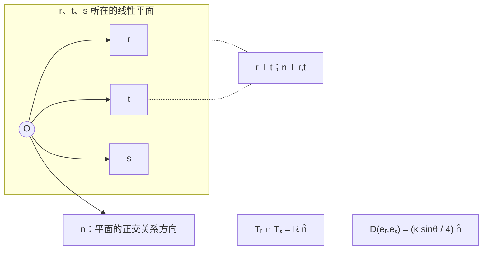

# AURIC R5-012：八原子与关系闭合

> 来源：用户于 2026-11-07（Asia/Singapore）在本会话提供的 AURIC R5-012 LaTeX 研究工作稿；原稿署名为“固定区域：$\mathbb R\oplus\mathbb R^3$ 的正归一化原子与双线性关系”，未另标生成模型。本文为参考输入，Lean 是仓库的数学真源；本次仅转换 Markdown，未作形式化认证。正文中的固定快照、项目核读叙述、有理数精确秩核对与理论结论均保留原稿口径；本次未重跑原稿的 SymPy 秩核对；原 TikZ 图转为 Mermaid 关系图，保留原图文字、坐标与图注。

AURIC / R5-012

八原子与关系闭合

一个区域，一份输入账本，一个完整候选

固定区域：$\mathbb R\oplus\mathbb R^3$ 的正归一化原子与双线性关系

2026年11月7日（Asia/Singapore）

**本轮结果。** 在明确给定的三维正内积实空间和实双线性关系上，八颗选定原子的四十四个有序二元测试，足以推出全部输入上的同尺度叉积。双单位静止、无迹、交替、三形式、旋转协变、Jordan 导子律均为结论。八颗是所声明原子测试方案中的最小标签数；四十四对不声称最少。

$$
\boxed{\begin{gathered}
E=\mathbb R\oplus\mathbb R^3,\quad D\in\operatorname{Bil}_{\mathbb R}(E\times E,E),\\
D(e_r,e_s)\in T_r\cap T_s\quad((r,s)\in\mathcal P)
\\[2pt]\Longleftrightarrow\\[-2pt]
D((\alpha,a),(\beta,b))=(0,\kappa\,a\times b),\quad \kappa\in\mathbb R.
\end{gathered}}
$$

**精确计数**\
$8$ 个原子标签；$44$ 个有序测试对；$132$ 条展示的实标量等式；独立秩为 $63$。\
实双线性映射有 $64$ 个系数，闭合后剩 $1$ 个尺度。\
再加 $1$ 条有符号标定，得到唯一的 $D=-\,\times$ 与复二阶量子代数。

**输入边界。** 三维、正内积、实线性载体和双线性属于本轮外部结构前件。有限切向条件不负责生成这些前件。数学正泛函、谱投影与形式演化可在本区发展；实际准备、读数、复合、仪器、时钟及原 $\Omega$ 的表示须另有对应。

**简化的准确方向。** 最新项目在已给定复 Hermitian 载体上，用连续的零／半重叠原子层恢复全域切向。本轮在同一个二阶局部载体内，把无限标签域改成八个固定有理方向；允许其它重叠角。减少的是本区标签量词，不声称一般高维区域或完整原世界只需这八颗原子。

固定源码：[the-omega-institute/trureturing，HEAD = dev](https://github.com/the-omega-institute/trureturing/tree/b96eecce7d2050357046126e9f4ff894ffb02ac3)。

提交 `b96eecce7d2050357046126e9f4ff894ffb02ac3`。

提交时间 2026-11-07 00:19:48；核对时间 00:35:00，均为新加坡时间。

本稿给出手证明及有理数精确秩核对；没有进行 Lean/kernel 形式验证。

## 1　项目增量与本轮输入账本

### 1.1　固定版本的相关结构

相对上一轮固定提交 `64aca186addd`，四个完整递归子树的变化路径数为：`docs` $7$、`D5` $17$、`Library` $4$、`Blueprint` $24$。标题检索覆盖完整 `docs` 树；正文定点检索覆盖已核对身份的 $80$ 份相关理论文档。下表只列本轮承重来源。[\[1\]](#ref-repo), [\[2\]](#ref-c128), [\[3\]](#ref-c139), [\[4\]](#ref-fib)

| 来源 | 已有结果及本轮使用范围 |
|:---|:---|
| C128，§398 | 在 $E=\bigoplus_s\operatorname{Herm}_{n_s}(\mathbb C)$、$D$ 实双线性的背景中，同一 $D(e,p)$ 在两端 primitive 都切向，推出逐块 $\gamma_s i[a_s,b_s]$。两侧单位、自对零及整支持可导出。 |
| C128，§§402–409 | 仅在 $\operatorname{Tr}(ep)=0,1/2$ 两层输入切向，便恢复量子块全域；经典自对保留 $\sum_j a_jb_jv_j$。无经典块时无需另加单位律。完整量子链仍用原 $`B_*+\sigma_{t_0}`$。 |
| C139，§§32–35 | 有限 EJA 的相位包另有静态、下降、互易、覆盖等前件；三相位八元数模型能违反 Jacobi。该命题与 R5-011 的三相位距离锚定理不是同一前件。 |
| C139，32.1a | 保留原 CountRead 全部指定历史和未来的共同响应商为无穷维。因此一个固定有限 EJA 不能完整表示该原切口。 |
| FIB XI，§§57–58 | 原字得到十阶条纹；所列相位的幂不提供非平凡三次单位根。固定合并器另有同载体有限酉／投影协议的不可实现结果。数学控制不能因此当作已供应。 |
| 本轮 | 仅在固定四维实载体内证明八原子有限证书、最小标签数与 $63+1$ 的独立线性约束计数。 |

最新项目的两层定理已经使用双线性；四珠展开不是从正性推出线性的证明。本轮直接从实坐标开始，并将这一输入显式保留。

### 1.2　计数口径

#### 定义 1.1：唯一候选与输入类别

固定通常的实数、复数与有限维线性代数。候选记为

$$
\mathcal Q_8=(B_{\mathrm{geom}},B_{\mathrm{bil}},C_8,K).
$$

各部分精确定义如下；除这一个候选外，不同时另立其它候选。

| 部分 | 数学内容 | 地位／本轮计数 |
|:---|:---|:---|
| $B_{\mathrm{geom}}$ | $V=\mathbb R^3$ 取标准正内积；$E=\mathbb R\oplus V$；乘法、单位按式 (1) 定义 | 固定载体背景；三维、实线性和正内积没有由 $C_8$ 导出。 |
| $B_{\mathrm{bil}}$ | $D\in\operatorname{Bil}_{\mathbb R}(E\times E,E)$ | 固定 $64$ 维参数空间；双线性是结构前件。 |
| $C_8$ | 式 (7) 的同输出双端切向 | 两条可分别删除的端点关系；独立齐次标量秩 $63$。 |
| $K$ | $z\cdot\pi_VD(\widehat x,\widehat y)=-1$ | 闭合后只剩的一条独立仿射标定，固定尺度和手性。 |
| 定义 | $e_r,T_r,S,T,\mathcal P,C$ 及正泛函等 | 给定背景中的对象定义；不重复增加独立约束。 |

把所有前件用一个合取号写在一起，不改变其独立性。本文给出的不变量是： *在已声明 $64$ 维实参数空间内，齐次约束的余维为 $63$，加标定后的仿射余维为 $64$。* 两项背景是结构包，不冒充“总共只有两个基础逻辑公理”。

## 2　固定区域：正性、原子与切空间

#### 定义 2.1：实三维区域

令 $x,y,z$ 为 $V=\mathbb R^3$ 的标准有序正交基，$\widehat a=(0,a)$，

$$
\begin{aligned}
E&=\mathbb R\oplus V,\qquad \mathbf 1=(1,0),\\
(\alpha,a)\circ(\beta,b)&=(\alpha\beta+a\cdot b,\ \alpha b+\beta a),\\
\langle(\alpha,a),(\beta,b)\rangle_E&=\alpha\beta+a\cdot b .
\end{aligned}
\tag{1}
$$

叉积取这一有序坐标的标准约定；选择坐标手性不等于给定 $D$。定义

$$
C=\{A\circ A:A\in E\},\qquad
e_r=\frac12(1,r)\quad(|r|=1),\qquad
T_r=\{W:e_r\circ W=W/2\}.
$$

#### 定理 2.2：正锥与可读性

$$
C=\{(t,v):t\ge |v|\},\qquad C\cap(-C)=\{0\}.
$$

所有满足 $\omega(C)\ge0$、$\omega(\mathbf 1)=1$ 的实线性泛函恰为

$$
\omega_s(t,v)=t+s\cdot v,\qquad |s|\le1.
\tag{2}
$$

因此

$$
C=\{A:\omega_s(A)\ge0\ \forall |s|\le1\},\qquad
A\in C\setminus\{0\}\Longrightarrow\omega_0(A)>0.
$$

**证明。**

$(\alpha,a)^2=(\alpha^2+|a|^2,2\alpha a)$，且 $\alpha^2+|a|^2\ge2|\alpha||a|$。反之，若 $t\ge|v|$、$v\ne0$，取 $n=v/|v|$，则

$$
(t,v)=(t+|v|)e_n+(t-|v|)e_{-n}.
$$

由 $e_{\pm n}^2=e_{\pm n}$、$e_n\circ e_{-n}=0$， 右侧是 $\bigl(\sqrt{t+|v|}\,e_n+\sqrt{t-|v|}\,e_{-n}\bigr)^2$。 $v=0$ 直接取 $\sqrt t\,\mathbf1$。若 $A,-A\in C$，则 $t\ge|v|$ 且 $-t\ge|v|$，所以 $A=0$。

归一线性泛函必写成 $t+s\cdot v$；在全部 $e_n$ 上非负，当且仅当 $1+s\cdot n\ge0$ 对所有单位 $n$ 成立，即 $|s|\le1$。此条件由 Cauchy–Schwarz 保证在整个 $C$ 上非负。最后，非零正对象的 $t>0$，故被 $\omega_0$ 读出。

$\square$

#### 引理 2.3：切空间的显式形式

$$
T_r=\{(0,w):r\cdot w=0\}.
\tag{3}
$$

此外 $e_r$ 是非零、非单位的幂等元，且每个此类幂等元均有这一形式。

**证明。**

对 $W=(t,w)$，$e_r\circ W=W/2$ 等价于 $r\cdot w=0$、$tr=0$，所以 $t=0$。 若 $(t,w)^2=(t,w)$，则 $t^2+|w|^2=t$、$(2t-1)w=0$； 排除 $0,\mathbf1$ 后得到 $t=1/2$、$|w|=1/2$。

$\square$

本区的“无负存在”就是尖锥式 $C\cap(-C)=\{0\}$。有向关系输出属于切空间，而切空间和 $C$ 的交只有零：

$$
T_r\cap C=\{0\}.
\tag{4}
$$

所以要求所有关系箭头本身为正，会把非零运动全部排除。正对象与有符号关系是两个已明确的类型。

## 3　八原子、四十四对与唯一完整候选

#### 定义 3.1：有限测试标签

置

$$
u=\frac{3x+4z}{5},\qquad
v=\frac{3y+4z}{5},\qquad
w=\frac{2x+2y+z}{3};
$$

$$
S=\{x,-x,y,-y,z,u,v,w\},\quad
T=\{z,u,v,w\},\quad
\mathcal P=\bigl((S\times T)\cup(T\times S)\bigr)\setminus\{(t,t):t\in T\}.
\tag{5}
$$

八个方向全为单位向量，且 $|\mathcal P|=32+32-16-4=44$。测试域没有自对。

|    标签    |    $z$    |      $u$      |      $v$      |       $w$       |
|:----------:|:-----------:|:---------------:|:---------------:|:-----------------:|
|  方向坐标  | $(0,0,1)$ | $(3/5,0,4/5)$ | $(0,3/5,4/5)$ | $(2/3,2/3,1/3)$ |
| $z$ 分量 |    $1$    |     $4/5$     |     $4/5$     |      $1/3$      |

#### 引理 3.2：张成证书

$\{e_t:t\in T\}$ 是 $E$ 的实基。对每个 $r\in S$，其在 $\mathcal P$ 中的所有行伙伴的原子张成 $E$；列伙伴亦然。

**证明。**

按 $z,u,v,w$ 排列的四个行向量 $(1,t)$ 的行列式为

$$
\det\begin{pmatrix}
1&0&0&1\\
1&3/5&0&4/5\\
1&0&3/5&4/5\\
1&2/3&2/3&1/3
\end{pmatrix}=-\frac2{25}.
\tag{6}
$$

四个 $e_t$ 的行列式因此为 $-1/200$。 若 $r\notin T$，伙伴正是 $T$；若 $r\in T$，伙伴为 $S\setminus\{r\}$。 在后一情形，$r\ne z$ 时使用 $\{e_x,e_{-x},e_y,e_z\}$； $r=z$ 时使用 $\{e_x,e_{-x},e_y,e_u\}$，均为基。 域 $\mathcal P$ 对调换次序封闭，列论证相同。

$\square$

#### 定义 3.3：候选的关系约束

在 $B_{\mathrm{geom}},B_{\mathrm{bil}}$ 下要求

$$
\boxed{\begin{aligned}
C_8:\quad&
e_r\circ D(e_r,e_s)=\tfrac12D(e_r,e_s),\\[-2pt]
&e_s\circ D(e_r,e_s)=\tfrac12D(e_r,e_s)
\qquad ((r,s)\in\mathcal P),\\
K:\quad& z\cdot\pi_VD(\widehat x,\widehat y)=-1 .
\end{aligned}}
\tag{7}
$$

两个端点约束同一个 $D(e_r,e_s)$；第二行没有把它换成 $D(e_s,e_r)$。 $K$ 是同一个旧 $D$ 的标定，不通过重新定义 $D$ 抹去其尺度。

#### 定理 3.4：有限闭合主定理

固定 $B_{\mathrm{geom}},B_{\mathrm{bil}}$。则

$$
C_8
\quad\Longleftrightarrow\quad
\exists\kappa\in\mathbb R\ \ \forall A=(\alpha,a),B=(\beta,b):
\quad D(A,B)=(0,\kappa a\times b).
\tag{8}
$$

加上 $K$，得到唯一解 $\kappa=-1$。

**证明。**

**第一步：有限行列恢复完整输入。** 由引理 3.2、双线性及 $T_r$ 是线性子空间，

$$
D(e_r,B)\in T_r,\qquad D(A,e_r)\in T_r
\quad(r\in S,\ A,B\in E).
\tag{9}
$$

式 (9) 已补回 $S^2$ 的全部未测对和自对。

**第二步：两个单位静止。** 使用 $\mathbf1=e_x+e_{-x}=e_y+e_{-y}$ 和 $T_x=T_{-x}$，

$$
D(\mathbf1,B)\in T_x\cap T_y=\mathbb R\widehat z.
$$

取 $B=e_t$、$t\in T$，式 (9) 还给 $D(\mathbf1,e_t)\in T_t$。 每个 $t$ 的 $z$ 分量均非零，故 $\mathbb R\widehat z\cap T_t=\{0\}$。基 $T$ 遂给

$$
D(\mathbf1,B)=0\quad(B\in E).
$$

交换两槽进行同样的证明，得到 $D(A,\mathbf1)=0$；此处未使用交替性。

**第三步：所有输出无迹，两槽分别反对称。** 式 (9) 在基 $T$ 上的所有输出标量分量均为零，双线性使全域输出标量分量为零。 于是存在双线性 $F:V\times V\to V$，使 $D((\alpha,a),(\beta,b))=(0,F(a,b))$。 固定 $b$，写 $F(a,b)=M_ba$；式 (9) 给

$$
r^{\mathsf T}M_br=0\qquad(r\in S).
\tag{10}
$$

令 $H=(M_b+M_b^{\mathsf T})/2$。方向 $x,y,z$ 给 $H_{11}=H_{22}=H_{33}=0$； $u,v$ 分别给 $24H_{13}/25=24H_{23}/25=0$； $w$ 再给 $8H_{12}/9=0$。 故 $H=0$，即每个 $M_b$ 反对称。同理由另一端得到：对每个固定 $a$，$b\mapsto F(a,b)$ 的矩阵也反对称。

**第四步：三维三形式只有一个系数。** 定义 $\tau(c,a,b)=c\cdot F(a,b)$。上一步分别给

$$
\tau(c,a,b)=-\tau(a,c,b),\qquad
\tau(c,a,b)=-\tau(b,a,c).
$$

这两种换位生成全部换位，所以 $`\tau\in\Lambda^3(V^*)`$。 由于 $\dim V=3$，存在唯一 $\kappa$ 使 $\tau(c,a,b)=\kappa\det(c,a,b)$，即 $F(a,b)=\kappa a\times b$。

反向，叉积垂直于两个输入，故任意 $\kappa$ 均满足全部原子对的双端切向，特别满足 $C_8$。 最后 $z\cdot\pi_VD(\widehat x,\widehat y)=\kappa$，所以 $K$ 等价于 $\kappa=-1$。

$\square$

## 4　最小标签数与独立约束数

#### 定理 4.1：八原子的最小性

在固定 $E=\mathbb R\oplus\mathbb R^3$、$D$ 实双线性的类别中，仅用选定原子之间的同输出双端切向检验，任取至多七个原子，即使检查所有有序对和自对，也不能强制式 (8)。 这一结论在额外保留本稿 $K$，或任一与某个叉积解相容的单条线性标定时仍成立。 因此本轮方案的最小原子标签数恰为八。

**证明。**

考虑对称、标量分量为零的双线性映射

$$
Q\in\operatorname{Hom}\bigl(\operatorname{Sym}^2(E),V\bigr),
\qquad \dim=3\binom{4+1}{2}=30.
$$

对任取的 $m$ 个单位方向 $r_j$，施加比有限网格更强的约束

$$
r_j\cdot Q(e_{r_j},B)=0\qquad(B\in E,\ 1\le j\le m).
\tag{11}
$$

每个 $j$ 至多贡献四条独立实线性等式。因此解空间维数至少为 $30-4m$。当 $m\le7$ 时至少为 $2$。 任一非零解在全部所选原子对上第一端切向；由 $Q$ 对称，第二端也切向。 它不可能是非零交替映射，所以不是标量叉积。

若另外保留一条线性标定 $\ell(D)=c$，并有 $\kappa_0$ 使 $\ell(\kappa_0D_\times)=c$，从这个叉积解 $D_0=\kappa_0D_\times$ 出发，在上述至少二维的空间内再取非零 $Q$ 满足 $\ell(Q)=0$。 $D_0+(0,Q)$ 仍通过所有测试和同一标定，却不等于标量叉积。 定理 3.4 给八个标签的充分性，完成最小性证明。

$\square$

本结论只计原子标签。若另外输入单位律、交替性、非原子测试或更多标定，问题已经改变；本稿不对测试对数、实验装置数或含噪成本作最小性结论。 特别地，项目完整 $`B_*`$ 已有部分单位来源，本下界不作为该完整背景的最少原子数。

#### 定理 4.2：秩为 $63$，标定后为 $64$

令 $\mathcal V=\operatorname{Bil}_{\mathbb R}(E\times E,E)$。则

$$
\dim\mathcal V=64,\quad
\ker C_8=\mathbb RD_\times,\quad
\operatorname{rank}C_8=63,\qquad D_\times(A,B)=(0,a\times b).
\tag{12}
$$

加上 $K$ 后得到单点仿射解集，独立仿射余维为 $64$。

**证明。**

每个有序对对 $D$ 的 $64$ 个系数给出三条实线性式：

$$
\pi_0D(e_r,e_s)=0,\quad
r\cdot\pi_VD(e_r,e_s)=0,\quad
s\cdot\pi_VD(e_r,e_s)=0.
\tag{13}
$$

所以展示矩阵为 $132\times64$。主定理给其核恰为一维； 秩零化度定理给 $63$。标定泛函在 $D_\times$ 上为 $1$，因而再增加一条独立行。

$\square$

有理数精确核对使用定义 3.1 的全部分数坐标，得

$$
\begin{array}{c|ccccc}
 & |S|&|\mathcal P|&\text{矩阵大小}&\operatorname{rank}_{\mathbb Q}C_8&
\operatorname{rank}_{\mathbb Q}\binom{C_8}{K}\\ \hline
\text{结果}&8&44&132\times64&63&64
\end{array}
$$

它复核手证明中的有限等式，不代替证明，也不构成实验噪声认证。

## 5　反向删除：每个缺口留下什么

### 5.1　只保留一个端点

令 $M:V\to V$ 为 $\operatorname{diag}(1,1,0)$，并定义

$$
D_L((\alpha,a),(\beta,b))=(0,-a\times Mb).
\tag{14}
$$

它实双线性，双单位为零，满足 $K$，且对全部原子对均第一端切向。 但 $(y,u)\in\mathcal P$，并且

$$
D_L(e_y,e_u)=\frac3{20}\widehat z,\qquad
u\cdot\pi_VD_L(e_y,e_u)=\frac3{25}\ne0.
$$

所以第二端条件不能删除。令 $D_R(A,B)=-D_L(B,A)$，则它保留 $K$ 和第二端切向，却在反序对违反第一端。两个端点条件在本区分别独立。

### 5.2　删除双线性

记 $`D_*((\alpha,a),(\beta,b))=(0,-a\times b)`$， $t=\|A\|_E^2+\|B\|_E^2$。定义

$$
N(A,B)=\bigl(1+(t-1)(t-2)\bigr)D_*(A,B).
\tag{15}
$$

每个原子 $e_r$ 的平方范数为 $1/2$，所以 $N$ 在 *全部原子对* 上与 $`D_*`$ 相同。 在 $(\widehat x,\widehat y)$ 上 $t=2$，故 $K$ 也相同。 然而

$$
N(2\widehat x,\widehat y)=-26\widehat z
\ne2N(\widehat x,\widehat y)=-2\widehat z.
$$

因此连全原子双端切向和同一标定都不推出全域双线性。

### 5.3　删除尺度标定

任意 $\kappa$ 的 $D_\kappa=(0,\kappa a\times b)$ 都满足 $C_8$。 其中 $D_0=0$ 没有非零有向作用；$\kappa=2$ 非零但不满足第 7 节的结合性。 仅输入 $D\ne0$ 仍留下连续尺度和两个手性；不能替代 $K$。

### 5.4　把所有关系输出也要求为正

若对每个测试对再要求 $D(e_r,e_s)\in C$，由 (4)，这些输出全为零。 每行伙伴张成 $E$，且 $S$ 张成 $E$，故双线性使 $D\equiv0$。 因此这项加强与 $K$ 不相容。它区分的是正对象和切向变化的类型。

### 5.5　把三维从背景中删除

在 $E_n=\mathbb R\oplus\mathbb R^n$ 上采用同样的正内积与式 (1)，正锥仍为 Lorentz 锥。 任意三形式 $`\tau\in\Lambda^3((\mathbb R^n)^*)`$ 定义

$$
c\cdot F(a,b)=\tau(c,a,b),\qquad D((\alpha,a),(\beta,b))=(0,F(a,b)),
$$

都对全原子对双端切向。$n=4$ 时已有四维三形式空间。 所以“正性＋双线性＋双端切向”本身不推出 $n=3$；主定理使用了明确输入的三维。

## 6　闭合出的几何、守恒与三元关系

#### 推论 6.1：无需再输入的关系

在 $C_8$ 下，对全部 $A,B,C\in E$，有

$$
\begin{gathered}
D(\mathbf1,A)=D(A,\mathbf1)=0,\qquad
\pi_0D(A,B)=0,\\
D(A,A)=0,\qquad D(A,B)=-D(B,A),\\
\langle C,D(A,B)\rangle_E
=\kappa\det(c,a,b),\\
D_A(B\circ C)=D_AB\circ C+B\circ D_AC,\\
[D_A,D_B]=D_{D(A,B)}=-\kappa^2[L_A,L_B],
\end{gathered}
\tag{16}
$$

其中 $D_AB=D(A,B)$、$L_AB=A\circ B$。

**证明。**

前四项由 (8) 直接得到。 对固定 $a$，$b\mapsto\kappa a\times b$ 是 Euclidean 反对称矩阵，故保持内积的无穷小变化；代入式 (1) 即给 Jordan 导子律。 叉积恒等式给

$$
a\times(b\times c)-b\times(a\times c)=(a\times b)\times c.
$$

而直接计算 $[L_A,L_B]C=(0,a(b\cdot c)-b(a\cdot c))$， 即得最后一行。该式也给 $D$ 的 Jacobi 恒等式。

$\square$

式 (16) 将同一空间上的 Jordan 乘法和 Lie 关系接在一起； 其混合关系是更一般动力学对应中的承重结构。本区逐项计算，不调用一般分类代替前件。[\[5\]](#ref-ni)

### 6.1　最简局部几何

令 $r,s$ 为单位方向、$r\ne\pm s$，定义

$$
\cos\theta=r\cdot s,\quad
t=\frac{s-(r\cdot s)r}{\sin\theta},\quad
n=\frac{r\times s}{\sin\theta}.
$$

则 $(r,t,n)$ 是有向正交单位三标架，而

$$
D(e_r,e_s)=\frac{\kappa\sin\theta}{4}\widehat n.
\tag{17}
$$

正交的是这个关系标架；原来两态 $e_r,e_s$ 一般有非零重叠。 当 $r=\pm s$ 时，两个切平面重合，其交仍二维；此时输出为零来自主定理的全族相容性，不能由单对的平面图直接推出。

图中 $r,t,s$ 位于同一线性平面，$(r,t,n)$ 是有向正交单位标架，$r\perp t$、$n\perp r,t$。切向量空间为 $T_r=\{(0,q):q\perp r\}$，当 $r\ne\pm s$ 时，$T_r\cap T_s=\mathbb R\widehat n$，且 $D(e_r,e_s)=\frac{\kappa\sin\theta}{4}\widehat n$。Mermaid 表示这些关系，不按比例绘制。原 TikZ 图以 $O=(0.35,0.15)$ 为起点，$r,t,s,n$ 的箭头端点分别为 $(3.8,0.15)$、$(1.4,1.15)$、$(2.65,1.02)$、$(0.35,3.02)$；着色平面包含 $r,t,s$，从 $s$ 端点到 $(2.65,0.15)$ 有一条虚线。

**图 1：** 图示为 $r,s$ 张成的线性平面及其正交关系方向。$T_r,T_s$ 是平移到原点后的切向量空间；不是把两张仿射切平面的交线当作输出。

### 6.2　各向同性的精确群

对 $R\in SO(3)$，$\widetilde R(\alpha,a)=(\alpha,Ra)$ 满足

$$
D(\widetilde RA,\widetilde RB)=\widetilde R D(A,B).
\tag{18}
$$

这由 $(Ra)\times(Rb)=R(a\times b)$ 得到，无须另设轴方向的协变公理。 若 $\det R=-1$，则右边多一个负号。 因而同一个非零有向 $D$ 的对称群是正向旋转群；若再要求完整 $O(3)$ 对同一 $D$ 无符号协变，便强制 $\kappa=0$，与 $K$ 矛盾。

### 6.3　三元的两两关系怎样保持

固定 $H=(h_0,h)$，定义数学演化

$$
\dot A=D(H,A),\qquad
R_H(t)=\exp\bigl(t\kappa[h]_\times\bigr),\qquad
[h]_\times a=h\times a.
$$

于是 $A(t)=(a_0,R_H(t)a)$。由于生成元反对称，$R_H(t)\in SO(3)$，并且

$$
\frac{d}{dt}(r_i(t)\cdot r_j(t))=0
\quad\text{对任意 }i,j.
\tag{19}
$$

因此三个原子共同按这一关系演化，任取二元的旧重叠均保持：

$$
\omega_{r_i(t)}(e_{r_j(t)})
=\frac{1+r_i\cdot r_j}{2}.
$$

这是用户所述“三元内部两两比较不改旧关系”在本区的闭合形式。它不要求三个原子自身两两正交。

## 7　从同一候选到二能级量子理论

### 7.1　结合性、复乘法与手性

在复化 $E_{\mathbb C}=E\otimes_{\mathbb R}\mathbb C$ 上作复双线性延拓，定义

$$
A\star B=A\circ B-iD(A,B),\qquad
(\lambda A)^*=\overline\lambda A\quad(A\in E).
\tag{20}
$$

#### 定理 7.1：结合性及复二阶表示

若 $C_8$ 成立，则

$$
(A\star B)\star C-A\star(B\star C)
=\bigl(0,(1-\kappa^2)((a\cdot b)c-(b\cdot c)a)\bigr).
\tag{21}
$$

故 $\star$ 结合当且仅当 $\kappa^2=1$。 候选的 $K$ 固定 $\kappa=-1$，此时 $`(E_{\mathbb C},\star,*)\simeq M_2(\mathbb C)`$。

**证明。**

单位的结合子为零，因此只须计算三个纯向量。 展开 (20)，标量三重积相消，向量部分用 $(a\times b)\times c-a\times(b\times c)=(a\cdot b)c-(b\cdot c)a$ 即得 (21)。取 $a=b=x,c=y$，右侧为 $(0,(1-\kappa^2)y)$，证明必要性；公式也给充分性。

令

$$
X=\begin{pmatrix}0&1\\1&0\end{pmatrix},\quad
Y=\begin{pmatrix}0&-i\\i&0\end{pmatrix},\quad
Z=\begin{pmatrix}1&0\\0&-1\end{pmatrix}.
$$

映射 $\Pi(\alpha,a)=\alpha I+a_1X+a_2Y+a_3Z$ 保持 $\circ$、实自伴部分与单位。 Pauli 乘法为

$$
\Pi(A)\Pi(B)=\Pi(A\circ B)+i\Pi(0,a\times b).
$$

$\kappa=-1$ 时这正是 $\Pi(A\star B)$。四个矩阵 $I,X,Y,Z$ 构成 $M_2(\mathbb C)$ 的复基，故 $\Pi$ 是含幺 $`*`$-同构。

$\square$

在这一表示中，

$$
\Pi(D(A,B))=\frac i2[\Pi(A),\Pi(B)].
\tag{22}
$$

这与项目 C128 的标定约定一致。 若只加 $\kappa^2=1$，结合性保留两个手性；$K$ 是一条线性有符号标定，进一步选定同一旧关系。不能把这条标定当作切向条件的结论。

### 7.2　状态、Born 式与谱测量

#### 定理 7.2：本区的量子静态结构

归一正泛函、迹一正矩阵和 Bloch 闭球有一一对应

$$
\omega_s\ \longleftrightarrow\
\rho_s=\frac12(I+s\cdot\sigma)\ \longleftrightarrow\
s\in\mathbb R^3,\ |s|\le1.
$$

对任意 $A\in E$，

$$
\omega_s(A)=\operatorname{Tr}(\rho_s\Pi(A)).
\tag{23}
$$

极端状态为 $|s|=1$，对应 $\mathbb C^2$ 的秩一投影，即射线空间 $\mathbb{CP}^1\simeq S^2$。 对 $A=(a_0,a)$、$a\ne0$，

$$
\Pi(A)=(a_0+|a|)\Pi(e_n)+(a_0-|a|)\Pi(e_{-n}),\quad n=a/|a|.
$$

对应二元概率为 $p_\pm=(1\pm s\cdot n)/2$。

**证明。**

$\operatorname{Tr}\sigma_i=0$、$\operatorname{Tr}(\sigma_i\sigma_j)=2\delta_{ij}$ 给 (23)。 $s\cdot\sigma$ 的平方为 $|s|^2I$，故 $\rho_s$ 的本征值为 $(1\pm|s|)/2$；其正性正好是 $|s|\le1$。 单位球的极端点为球面，所以纯态恰为秩一投影。 最后的谱式由定义直接验证，应用 $\omega_s$ 即得两个概率。

$\square$

更一般地，定义效果为 $F\in E$ 满足 $0\le F\le\mathbf1$，定义有限数学菜单为 $F_j\ge0,\sum_jF_j=\mathbf1$。则

$$
p_j=\omega_s(F_j)\ge0,\qquad \sum_jp_j=1.
$$

这是正泛函的数学概率表示。将某个原读口的频率等同于此 $\omega_s(F_j)$，仍需要同一准备、事件与归一化接口；它不是效果名字的定义就能给出的来源事实。

### 7.3　Hamiltonian 形式的准确输入

由推论 6.1 得到的数学流在 $\kappa=-1$ 时为

$$
\frac{d}{dt}\Pi(A(t))=\frac i2[\Pi(H),\Pi(A(t))],
\quad
\Pi(A(t))=e^{it\Pi(H)/2}\Pi(A(0))e^{-it\Pi(H)/2}.
\tag{24}
$$

给定物理时钟、作用量单位 $\hbar>0$ 和 Hamiltonian $H_{\rm phys}$，令 $\Pi(H)=-2H_{\rm phys}/\hbar$，则对状态的同型演化得到

$$
\dot\rho=-\frac i\hbar[H_{\rm phys},\rho],\qquad
i\hbar\dot\psi=H_{\rm phys}\psi.
\tag{25}
$$

第二式给第一式的纯态提升；$\psi$ 的整体相位自由不改变 $\rho$。 数学参数、实际时间和作用量标定在此明确分开。

## 8　未闭合的量子接口：逐项外部输入

本轮已经闭合的是一个二能级区域的代数、正状态表示和数学可逆流。 下表登记将其用于通常量子力学其余规则所需的额外接口；不把这些接口重新算成本轮 $C_8$ 的结论。[\[2\]](#ref-c128), [\[3\]](#ref-c139), [\[6\]](#ref-watrous)

| 目标规则 | 还需给出的数学／实际输入 | 在此前件下的结论 |
|:---|:---|:---|
| 实际 Born 概率 | 同一准备和效果的正线性评价与归一化，及其对实际读数的绑定 | $p(e)=\operatorname{Tr}(\rho E_e)$；只有正总质量时才除以总质量。 |
| 复合系统 | 同一联合上的交换含幺复 $`*`$-代数嵌入、全部中心与乘积支持、联合生成和实际准备／参考对应 | 简单满矩阵块得到 $M_d\otimes M_n\simeq M_{dn}$；本区不供应联合。 |
| 一般量子过程 | 给定复线性 $\Phi$；全部矩阵放大保正，或充分大实际矩阵参考与同设备放大的完整识别 | $`\Phi(\rho)=\sum_jK_j\rho K_j^*`$；独立的质量界给 $`\sum_jK_j^*K_j\le I`$。 |
| 完整仪器 | 同一设备全部成功、失败、停止等出口与记录；完整效果和为单位 | $`\sum_{e,j}K_{ej}^*K_{ej}=I`$。一个成功支不独自取等号。 |
| Lüders 更新 | CP 事件的投影效果 $`P=P^*=P^2`$，且同一完整输出保持 $\operatorname{Ran}P$ 内每条纯射线 | $\Phi_P(\rho)=P\rho P$；条件态仅在 $\operatorname{Tr}(P\rho)>0$ 时归一化。 |
| 物理时间演化 | 原连续可逆时钟、生成元及作用量单位与数学流的绑定 | 式 (20) 的代数流获得物理时间解释。 |
| 全部历史与观察者 | 记录、失败、参考、控制和所有合法未来在同一表示中的对应 | 历史由已绑定映射的复合求值；未被有限标签自动包含。 |

#### 命题 8.1：本区正性不替代完全正性

矩阵转置 $\Theta(A)=A^{\mathsf T}$ 保持 $M_2(\mathbb C)$ 的正性和迹，但不是完全正映射。

**证明。**

令 $|\Omega\rangle=(|00\rangle+|11\rangle)/\sqrt2$。 则 $(\operatorname{id}\otimes\Theta)(|\Omega\rangle\langle\Omega|)$ 是交换算子的一半； 在反对称向量 $(|01\rangle-|10\rangle)/\sqrt2$ 上本征值为 $-1/2$。 因此复合参考条件不能从单系统正性中删除。

$\square$

项目的原 CountRead 共同切口还有明确的维数边界： 保留原上下文与继续请求时，其响应矩阵

$$
H_{kn}=\frac{m}{(4^{k+n}+3)^2}\quad(k,n\ge0,\ m>0)
$$

具有无限多个独立列，故完整响应商无穷维。[\[3\]](#ref-c139) 这排除把该完整原切口直接识别为本文固定 $E$；局部因子与无限记忆怎样组成原系统，需要单独的表示定理。

## 9　本轮闭合表与白话对应

| 外部输入 | 闭合结论 |
|:---|:---|
| $B_{\mathrm{geom}}$ | Lorentz 正锥、尖性、可读性、原子球面、二维切空间；三维与正内积本身不在结论栏。 |
| $B_{\mathrm{bil}}+C_8$ | 单位静止、无迹、交替、全部原子双端切向、三形式、单尺度叉积、$SO(3)$ 协变、导子与 Jacobi、共同流的全部二元关系守恒。 |
| 再加 $K$ | 唯一有符号尺度；结合复乘法；$M_2(\mathbb C)$、$\mathbb C^2$、正矩阵与正泛函的 Born 表示、谱投影及形式 Hamiltonian 流。 |
| 尚需另证的来源接口 | 实际读数采用、原 $D$ 绑定、联合与参考、完整仪器、实际观察者和历史、物理时钟及作用量。 |

若用五槽语言登记本区的一次二元组合，可取有类型的代数槽位

$$
(F_{\varnothing},F_1,F_3,F_{1,3},F_2)
=(\mathbf1,A,B,A\circ B,D(A,B)),
\quad
A\star B=F_{1,3}-iF_2.
$$

这是一次具体的类型赋值，不是五个固定数，也不把 $\mathbf1$ 等同于有状态、有记忆的实际观察者。 原观察者的数学表示须另外给定正状态、记录及相互作用接口。

**本轮完整白话。** 先把三维正交的小屋和可作线性比较的规则写在账本上。屋里挑八颗珠子，检查四十四对：同一根关系箭头必须同时贴着两端各自的球面。四颗珠子能读出整个小屋，两对反向珠子把单位方向的运动压成零；剩下的关系在两端都只能横着转，三维里便只剩同一个叉积。七颗珠子一定还藏得下一种对称变形，八颗能把它关掉。再用一条有方向的刻度固定这个叉积，就得到复二阶量子代数。珠子是正的，变化箭头可以带方向；它们不是同一类东西。小屋、线性、刻度及实际读口各自从哪里来，仍按这份账本逐项证明。

## 来源与验证

\[1\] [the-omega-institute/trureturing，固定源码快照](https://github.com/the-omega-institute/trureturing/tree/b96eecce7d2050357046126e9f4ff894ffb02ac3)， `b96eecce7d20`，2026-11-07 00:19:48 SGT。 比较基线为 `64aca186addd`。正文检索范围为 $80$ 份相关文件，不声称全仓逐行审计。

\[2\] [C128：Orthogonal Trace and Corner Relations Continuation](https://github.com/the-omega-institute/trureturing/blob/b96eecce7d2050357046126e9f4ff894ffb02ac3/docs/develop/theory/AURIC_C128_ORTHOGONAL_TRACE_AND_CORNER_RELATIONS_CONTINUATION.md)， §§398–409。全双端切向、两层恢复及完整背景消费者属于项目已有结果；本文八原子手证明不调用其高维分类。

\[3\] [C139：Fixed Source Comparators and Native Event Boundary](https://github.com/the-omega-institute/trureturing/blob/b96eecce7d2050357046126e9f4ff894ffb02ac3/docs/develop/theory/AURIC_C139_FIXED_SOURCE_COMPARATORS_AND_NATIVE_EVENT_BOUNDARY.md)， 32.1a、§§32–35。用于有限模型前件、CountRead 无穷维边界及原事件接口的区分。

\[4\] [FIB Atom Quantum Principles，Continuation XI](https://github.com/the-omega-institute/trureturing/blob/b96eecce7d2050357046126e9f4ff894ffb02ac3/docs/develop/theory/AURIC_FIB_ATOM_QUANTUM_PRINCIPLES_AND_COHERENT_RECONSTRUCTION_CONTINUATION_XI.md)， §§57–58。原十阶相位与同载体有限酉／投影合并器边界。

\[5\] G. Niestegge， [Dynamical Correspondence in a Generalized Quantum Theory](https://arxiv.org/abs/1402.0158)， Foundations of Physics 45 (2015), 525–534。 更一般 Jordan 类的动力学对应需独立的混合关系与正平方前件；本稿仅给固定三维区域的显式证明，不据该文声称无前件量子起源。

\[6\] J. Watrous， [The Theory of Quantum Information，Chapter 2](https://cs.uwaterloo.ca/~watrous/TQI/TQI.2.pdf)， Theorem 2.22 及相关量子过程表示。完全正性与 Kraus 表示的成熟工具用于额外接口表；实际设备供应不是该矩阵定理的结论。

\[7\] 本轮可复核证书：式 (5)–(13) 完整给出有理方向、伙伴域、系数线性系统、核与维数证明。 另以 SymPy 的 $\mathbb Q$ 精确域核对 $132\times64$ 矩阵秩为 $63$，追加标定行后为 $64$。 此核对没有使用浮点近似；本稿未进行 Lean/kernel 检验，也不作外部数学历史优先权声明。

## 追加锚（本行以下为增补区）
