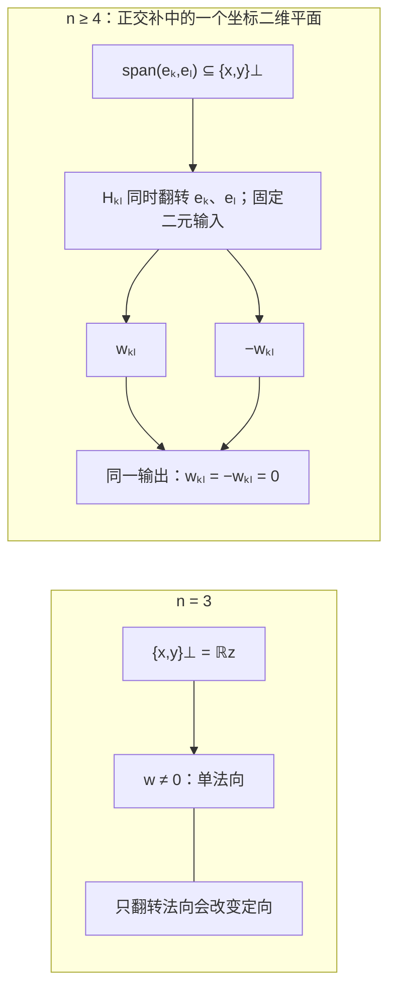

# AURIC R5-013：两对关系与内生归一化

> 来源：用户于 2026-11-07（Asia/Singapore）在本会话提供的 AURIC R5-013 LaTeX 研究工作稿；原稿署名为“一个候选：有限换轴相容、半层双端切向、对径总量零、同一输出非零”，未另标生成模型。本文为参考输入，Lean 是仓库的数学真源；本次仅转换 Markdown，未作形式化认证。正文中的固定快照、项目核读叙述、有理数精确秩核对与理论结论均保留原稿口径；本次未重跑原稿的精确有理数脚本；原 TikZ 双面板图转为 Mermaid 关系图，保留原图文字、坐标与图注。

AURIC / R5-013

两对关系与内生归一化

三维由相容性选择，尺度由原关系读出

一个候选：有限换轴相容、半层双端切向、对径总量零、同一输出非零

2026年11月7日（Asia/Singapore）

**唯一研究区域。** 有限正内积实空间 $V$，只给 $\dim V=n\ge2$； $E_n=\mathbb R\oplus V$ 取明确的 spin 乘法； 原关系 $D:E_n^2\to E_n$ 任意实双线性。 不预设 $n=3$、单位静止、无迹、交替或原关系的数值尺度。

$$
\boxed{\begin{gathered}
\mathsf S+\mathsf H+\mathsf Z+\mathsf W\\
\Longleftrightarrow\\
n=3,\qquad
D((\alpha,a),(\beta,b))=(0,\kappa\,a\times b),
\qquad \kappa\ne0 .
\end{gathered}}
$$

**本轮移出独立输入的内容**\
维数三成为结论。数值归一化改为定义： $\mu:=\|4D(p_x,p_y)\|=|\kappa|$， $\delta:=D/\mu$，同时保留 $D=\mu\delta$。\
三维分支中：$64$ 个系数，$63$ 条独立齐次线性约束， 另有一个非零条件；原尺度仍是一个自由参数。

**闭合结论。** 两侧单位静止、无迹、交替、全旋转协变、 Jordan–Lie 关系，以及 $A\star B=A\circ B-i\delta(A,B)$ 的结合性和 $M_2(\mathbb C)$ 表示； 正状态的 Born 表示、精确不确定性余量与数学可逆流随之成立。

**简化的准确范围。** R5-012 的 $44$ 对端点网格改为两对样本，代价是同一个 $D$ 的有限换轴相容条件； 独立线性余维仍为 $63$。 本轮确实删除了指定旧尺度的数值等式，同时明确保留其读出值 $\mu$。 原 $D$ 本身满足单位尺度，仍须另外证明 $\mu=1$。

固定源码：[the-omega-institute/trureturing，HEAD = dev](https://github.com/the-omega-institute/trureturing/tree/ca1f5a8b112bff0b4e7c3378557f8633053cf4e0)。

提交 `ca1f5a8b112bff0b4e7c3378557f8633053cf4e0`。

提交时间 2026-11-07 00:57:31；核对时间 00:59:56，均为新加坡时间。

普通手证明与有理数精确秩核对；未运行 Lean/kernel 验证。

## 1　项目进展、既有引理与本轮增量

对照上一轮提交 `b96eecce7d20`，完整递归子树的变化路径数为 `docs` $5$、`D5` $5$、`Library` $0$、 `Blueprint` $10$。本轮核对 $88$ 份相关理论文档的当前 Git blob 身份并定点检索； 不把这一范围写成全仓逐行证明审计。[\[1\]](#ref-repo)

| 来源 | 本轮消费的准确结果 |
|:---|:---|
| 稳定关系边界，3.1、8.2–8.5 | 任意三线性张量在完整 $SO(n)$ 或正行列式带符号置换群下不变， 非零时选出三维体积形式；有限坐标四分之一转动已能认证该三阶不动空间。 |
| 二阶关系完成，§§92–93 | 正交二帧的等变单位法向选择只有三维可行； 固定二帧的正交补稳定子是既有维数选择机制。 |
| V48，5.1、8.1–8.2 | 已给三维与单位的等变乘法分类、结合条件； qubit 方差的精确余量和归一化二阶 Gram 球。 |
| 最新 C128 词卷，§§357–361 | 新增同源插入比较，在完整序、分离评价、正核和线性插入等前件下， 共同构造忠实原对象、原 Born 配对和有符号旧 $D$；允许无限维。 |
| 最新 C128 正交迹续卷，§§410–416 | 有原右单位时，高阶块内部的零重叠层可以删除； 半层、跨中心零层及二阶块对径层仍保留。 |
| 本轮组织 | 保留完整 $E_n$ 上任意 $D$ 的标量与单位杂项； 用有限换轴相容及两对原子样本消去这些杂项， 选择三维并从原 $D$ 定义归一化尺度。 |

三维选择、叉积、复矩阵与不确定性本身均有上述仓库前身； 本轮给出同一完整 $D$ 上这组有限条件的自足组合证明。 在所检索 $88$ 份文档中，未定位到完全相同的完整载体两样本合同； 这不是外部数学优先权结论。[\[2\]](#ref-stable), [\[3\]](#ref-second), [\[4\]](#ref-v48), [\[5\]](#ref-word), [\[6\]](#ref-trace)

## 2　外部结构与唯一候选

#### 定义 2.1：固定类别

给定有限维正内积实空间 $V$，$\dim V=n\ge2$， 以及完整正交单位基 $e_1,\ldots,e_n$。 令 $x=e_1,y=e_2$，

$$
\begin{gathered}
E_n=\mathbb R\oplus V,\qquad \mathbf1=(1,0),\qquad \widehat a=(0,a),\\
(\alpha,a)\circ(\beta,b)
=(\alpha\beta+a\cdot b,\ \alpha b+\beta a),\\
\langle(\alpha,a),(\beta,b)\rangle_E=\alpha\beta+a\cdot b.
\end{gathered}
\tag{1}
$$

原 $D$ 为任意实双线性映射 $E_n\times E_n\to E_n$； 未约束时有 $(n+1)^3$ 个实系数。

#### 定义 2.2：正对象、原子与换轴

$$
C=\{A\circ A:A\in E_n\},\qquad
p_r=\frac12(1,r)\quad(|r|=1),\qquad
T_r=\{W:p_r\circ W=W/2\}.
$$

对每个 $i=1,\ldots,n-1$，定义

$$
Q_ie_i=e_{i+1},\qquad Q_ie_{i+1}=-e_i,\qquad
Q_ie_j=e_j\quad(j\ne i,i+1),
$$

并令 $\widetilde Q_i(\alpha,a)=(\alpha,Q_ia)$。 $\pi_0,\pi_V$ 分别表示 $E_n$ 的标量与向量投影。

#### 引理 2.3：正性与切空间

$$
C=\{(t,v):t\ge|v|\},\quad
C\cap(-C)=\{0\},\quad
T_r=\{(0,w):r\cdot w=0\}.
\tag{2}
$$

归一正线性泛函恰为

$$
\omega_s(t,v)=t+s\cdot v,\qquad |s|\le1.
\tag{3}
$$

非零正对象均有 $\omega_0(A)>0$。

**证明。**

$(\alpha,a)^2=(\alpha^2+|a|^2,2\alpha a)$，第一分量至少为第二分量范数。 反之，当 $t\ge|v|$ 时，用 $(t,v)=(t+|v|)p_{v/|v|}+(t-|v|)p_{-v/|v|}$ 及两个正交幂等元的平方根得到平方表示；$v=0$ 单独取 $\sqrt t\,\mathbf1$。 两者同时为正且互为负，立即给 $t=v=0$。 代入 $p_r\circ(t,w)=(t,w)/2$ 得 $t=0,r\cdot w=0$。 归一线性泛函写为 $t+s\cdot v$；在所有原子上非负等价于 $|s|\le1$， 此时 Cauchy–Schwarz 保证它在整个 $C$ 上非负。 非零正对象的 $t>0$。

$\square$

此处正交方向与正交原子的关系分别为

$$
x\cdot y=0\ \Longrightarrow\ \omega_x(p_y)=\tfrac12,
\qquad p_x\circ p_{-x}=0.
$$

因此三维指比较方向空间 $V$；闭合后的复 Hilbert 空间为二维， 不把三条正交比较轴当成三颗两两正交的量子原子。

#### 定义 2.4：唯一候选 $\mathcal Q_{13}$

在定义 2.1 的同一资料上，只输入

$$
\boxed{\begin{aligned}
\mathsf S:\quad&
D(\widetilde Q_iA,\widetilde Q_iB)=\widetilde Q_iD(A,B)
&&\forall A,B,\ 1\le i<n,\\
\mathsf H:\quad&
D(p_x,p_y)\in T_x\cap T_y,\\
\mathsf Z:\quad&
\pi_0D(p_x,p_{-x})=0,\\
\mathsf W:\quad&
D(p_x,p_y)\ne0 .
\end{aligned}}
\tag{4}
$$

不输入 $D\ne0$ 的替代弱式，不输入数值刻度，不输入取向符号。

| 外部输入 | 准确范围 |
|:---|:---|
| 结构背景 | 实线性、有限维正内积、至少两维、完整正交基、式 (1) 的乘法，以及同一 $D$ 的双线性。 |
| $\mathsf S$ | 同一个固定 $D$ 的换轴相容；不是同时改写 $D$ 分量的被动坐标变换。 未知 $n$ 时须检查全部 $n-1$ 个相邻转动。 |
| $\mathsf H,\mathsf Z$ | 两个有序输入对；$\mathsf H$ 对同一输出施加两端切向， $\mathsf Z$ 只要求对径对的一个标量读数为零。 |
| $\mathsf W$ | 指定半层样本的同一输出非零；全域有别的非零输出不能替代。 |
| 定义而非额外约束 | $C,p_r,T_r,Q_i$，以及证明后由原 $D$ 读出的 $\mu,\delta$。 |

两个样本对只涉及 $p_x,p_y,p_{-x}$； $\mathsf S$ 仍要求完整输入域的相容性。 由于双线性，它可在全部基输入对上有限检查，不能据此声称只有两次实验。

## 3　闭合主定理：三维与完整原关系

#### 定理 3.1：两样本闭合

在定义 2.1 的类别中，

$$
\boxed{
\mathsf S\land\mathsf H\land\mathsf Z\land\mathsf W
\iff
n=3,\quad
D((\alpha,a),(\beta,b))=(0,\kappa a\times b),
\quad \kappa\ne0 .
}
\tag{5}
$$

右侧叉积相对于给定的三维有序正交基。 两侧单位静止、全输出无迹、交替性均是结论。

### 3.1　维数选择：固定二元的换轴

**主定理的第一部分。**

由 $\mathsf S$，$D$ 对各 $Q_i$ 的幂、逆和有限乘积也协变。 $Q_i^2$ 只反转第 $i,i+1$ 个方向。对 $k<l$，

$$
H_{kl}:=Q_k^2Q_{k+1}^2\cdots Q_{l-1}^2
\tag{6}
$$

只反转第 $k,l$ 个方向；中间方向各被反转两次。 对 $k<l$ 另约定 $H_{lk}:=H_{kl}$。

令

$$
4D(p_x,p_y)=(0,w).
$$

$\mathsf H$ 与 $\mathsf W$ 给 $w\perp x,y$、$w\ne0$。 若 $n=2$，正交补为零，矛盾。 若 $n\ge4$，任取 $k\ge3$，可另取 $l\ge3,l\ne k$。 $H_{kl}$ 固定 $p_x,p_y$，因此同一 $D$ 的协变给

$$
H_{kl}w=w.
$$

其第 $k$ 分量满足 $-w_k=w_k$，故 $w_k=0$。 对所有 $k\ge3$ 重复，得到 $w=0$，仍矛盾。 于是 $n=3$。

$\square$

此处将项目既有的正交二帧稳定子论证用于一个同源非零输出； 只使用有限偶翻转，不需要预先假定全连续旋转群。[\[2\]](#ref-stable), [\[3\]](#ref-second)

左图为 $n=3$：$\{x,y\}^{\perp}=\mathbb R z$，非零 $w$ 沿唯一法向；只翻转法向会改变定向。右图为 $n\ge4$：$\operatorname{span}(e_k,e_l)\subseteq\{x,y\}^{\perp}$，同一个 $H_{kl}$ 固定二元输入，却将该坐标平面内的 $w_{kl}$ 变为 $-w_{kl}$，所以 $w_{kl}=-w_{kl}=0$。Mermaid 表示关系，不按比例绘制。原 TikZ 左图的 $z$ 箭头从 $(1.3,0)$ 指向 $(1.3,2.45)$，$w$ 箭头从同一起点指向 $(1.3,1.65)$。右图的着色坐标平面以 $(7.25,1.15)$ 为共同箭头起点：$e_k,e_l$ 的端点分别为 $(9.25,1.15)$、$(7.25,2.45)$，$w_{kl},-w_{kl}$ 的端点分别为 $(8.45,2.05)$、$(6.05,0.25)$。

**图 1：** 右图只表示正交补中的一个坐标二维平面。逐个选择此类平面消去全部法向分量；三维的单法向没有这种保定向的双翻转。

### 3.2　不预先消去单位或标量的五参数分类

#### 引理 3.2：完整载体的协变残余

在 $E_3=\mathbb R\oplus\mathbb R^3$ 上，$\mathsf S$ 当且仅当

$$
D((\alpha,a),(\beta,b))
=\left(c\alpha\beta+d\,a\cdot b,\
e\alpha b+f\beta a+\kappa a\times b\right)
\tag{7}
$$

其中 $c,d,e,f,\kappa$ 是任意实数。

**证明。**

按双线性将 $D$ 分解为

$$
\alpha\beta D(\mathbf1,\mathbf1)
+\alpha D(\mathbf1,\widehat b)
+\beta D(\widehat a,\mathbf1)
+D(\widehat a,\widehat b).
$$

两个坐标半转没有共同非零不动向量，因此第一项的向量部分为零， 中间两项的标量线性泛函也为零。 与两个半转都交换的线性矩阵必须为对角阵； 再与 $Q_1,Q_2$ 交换，使三个对角元相同。 所以中间两项的向量部分为 $e\alpha b,f\beta a$。 同样的矩阵论证使最后一项的标量部分为 $d\,a\cdot b$； 第一项的标量部分记为 $c\alpha\beta$。

最后记向量双线性部分为 $F$，令 $t_{ijk}=\langle e_i,F(e_j,e_k)\rangle$。 偶翻转相容使 $t_{ijk}=0$，除非三个指标各出现一次： 若有重复，可反转一个出现奇数次的方向及一个未出现的方向，使系数变号。 令 $F(x,y)=\kappa z$。 $Q_1$ 给 $F(y,x)=-\kappa z$， $Q_2$ 给 $F(x,z)=-\kappa y$； 继续代入这两个转动，得到其余全部 Levi–Civita 系数。 因此 $F=\kappa\times$。 此最后一步是项目已有三阶不动空间引理的坐标证明。[\[2\]](#ref-stable) 反向逐项验证式 (7) 的相容性即可。

$\square$

**主定理的第二部分。**

将两个样本代入式 (7)：

$$
4D(p_x,p_y)=(c,\ e y+f x+\kappa z),
\tag{8}
$$

$$
4D(p_x,p_{-x})=(c-d,\ (f-e)x).
\tag{9}
$$

$\mathsf H$ 给 $c=e=f=0$； $\mathsf Z$ 随后给 $d=0$； $\mathsf W$ 给 $\kappa\ne0$。 于是得到式 (5)。 反向，任意非零 $\kappa$ 的叉积均满足有限换轴、双端切向、对径总量零和指定输出非零。

$\square$

## 4　归一化改为定义，原尺度保留

#### 定义 4.1：由原关系确定的尺度

在主定理条件下，定义

$$
\boxed{
\mu:=\|4D(p_x,p_y)\|_E>0,\qquad
\delta:=\frac D\mu .
}
\tag{10}
$$

原 $D$ 继续保留，且 $D=\mu\delta$。

#### 定理 4.2：内生归一化与手性

$$
\mu=|\kappa|,\qquad
\delta((\alpha,a),(\beta,b))=(0,\varepsilon a\times b),
\quad \varepsilon=\kappa/|\kappa|\in\{-1,1\}.
$$

任意正交单位对 $(r,s)$ 都给同一个尺度

$$
\|4D(p_r,p_s)\|_E=\mu .
\tag{11}
$$

定义

$$
z_D:=-4\pi_V\delta(p_x,p_y),
\tag{12}
$$

则 $(x,y,z_D)$ 是由原 $D$ 确定的正交单位标架， 在它所定的叉积 $\times_D$ 下，

$$
\delta(A,B)=(0,-a\times_D b).
$$

**证明。**

主定理给 $4D(p_r,p_s)=(0,\kappa r\times s)$， 正交单位对的叉积范数为一，故尺度与样本选择无关。 $z_D=-\varepsilon z$，所以单位且垂直于 $x,y$。 按此标架定义的体积取向使 $\delta(\widehat x,\widehat y)=-\widehat{z_D}$， 三形式的唯一性将关系延拓至全部输入。

$\square$

本节没有加入 $\mu=1$。 它将旧的数值标定替换为一个由原 $D$ 计算的正参数和一份归一化关系。 固定原坐标时，$\varepsilon=\pm1$ 是两支；原 $D$ 决定所在分支，未将两份有符号旧关系混为同一对象。

### 4.1　独立约束数

#### 定理 4.3：精确账本

在已经由主定理选择出的 $n=3$ 分支：

$$
\begin{array}{c|c|c|c}
\text{条件}&\text{展示的实线性行数}&\text{累计秩}&\text{剩余维数}\\ \hline
\mathsf S&2\cdot4^3=128&59&5\\
\mathsf H&3&62&2\\
\mathsf Z&1&63&1\\
\mathsf W&\text{非零条件}&63&1
\end{array}
\tag{13}
$$

解集是非零直线 $\{D_\kappa:\kappa\ne0\}$。 定义 $\mu,\delta$ 不再增加独立等式。

**证明。**

任意 $D:E_3^2\to E_3$ 有 $64$ 个系数。 每个生成元在 $16$ 个基输入对上的完整四维输出给 $64$ 条标量等式。 引理 3.2 给 $\mathsf S$ 的解空间维数为 $5$，故其秩为 $59$。 式 (8) 中 $c,e,f$ 是三个独立系数； 式 (9) 的标量条件在它们消去后再消去独立的 $d$。 $\mathsf W$ 只删除 $\kappa=0$，不降低非零分支的维数。

$\square$

有理数精确核对得到：

$$
\begin{array}{c|r|r|r|r}
n&\dim\operatorname{Bil}(E_n^2,E_n)&\operatorname{rank}\mathsf S&
\operatorname{rank}(\mathsf S,\mathsf H,\mathsf Z)&D(p_x,p_y)\\ \hline
2&27&20&24&\text{强制为零}\\
3&64&59&63&\kappa\widehat z/4\\
4&125&121&125&\text{强制为零}
\end{array}
$$

一般维数结论由主定理的有限翻转证明承担，未以有限表外推。 三维的精确线性系统为 $132\times64$。

相对 R5-012，独立线性余维仍为 $63$；输入布局改为换轴相容加两对样本。 数值标定等式已经删除，代价是原尺度 $\mu$ 明确保留。 归一化后的量子结构不因此证明原 $D$ 已在项目的旧刻度上取单位值。

## 5　删除反例：每条关系的承重范围

### 5.1　删除某一端切向，二维能够通过

在 $V=\mathbb R^2$ 取 $Jx=y,Jy=-x$。 若删去第一端条件，令

$$
D_L((\alpha,a),(\beta,b))=(0,\alpha Jb).
$$

它实双线性，与 $Q_1=J$ 相容，满足 $\mathsf Z,\mathsf W$， 且 $4D_L(p_x,p_y)=-\widehat x$ 沿第二端 $y$ 切向，却不沿第一端 $x$ 切向。 若删去第二端，取

$$
D_R((\alpha,a),(\beta,b))=(0,\beta Ja);
$$

其半层输出为 $\widehat y/4$，第一端通过，第二端失败。 所以两端相容分别承担排除二维的作用。

### 5.2　删除对径的总量条件

在三维取

$$
D((\alpha,a),(\beta,b))=(a\cdot b,\ a\times b).
\tag{14}
$$

$\mathsf S,\mathsf H,\mathsf W$ 成立； 但 $\pi_0D(p_x,p_{-x})=-1/4$。 标量杂项没有消失，$D(A,A)$ 也不恒为零。

### 5.3　删除换轴相容，或漏查隐藏方向

在 $V=\mathbb R^4$，令 $P$ 为到前三维的正交投影，并将其叉积嵌回 $\mathbb R^4$：

$$
D((\alpha,a),(\beta,b))=(0,\iota(Pa\times Pb)).
\tag{15}
$$

它满足 $\mathsf H,\mathsf Z,\mathsf W$。 它甚至与 $Q_1,Q_2$ 相容，但不与连接第三、第四方向的 $Q_3$ 相容。 因此在未知维数时，不能只输入最终三维中出现的两个转动； 必须覆盖整个载体的 $n-1$ 个相邻转动。

若把四分之一转动削弱为偶反号与三轴循环，也会留下对称关系：

$$
B_{\mathrm{sym}}(a,b)=
(a_2b_3+a_3b_2,\ a_3b_1+a_1b_3,\ a_1b_2+a_2b_1).
\tag{16}
$$

$D=(0,B_{\mathrm{sym}})$ 通过两对样本及非零条件， 并保留这些较弱变换；但 $B_{\mathrm{sym}}$ 对称。 $Q_1$ 给 $B_{\mathrm{sym}}(y,-x)=-z\ne Q_1B_{\mathrm{sym}}(x,y)=z$， 故完整有限换轴条件确实有内容。

### 5.4　删除双线性

取三维单位叉积关系 $D_\times(A,B)=(0,a\times b)$，定义

$$
N(A,B)=\bigl(\|A\|_E^2+\|B\|_E^2\bigr)D_\times(A,B).
\tag{17}
$$

所有原子对的两范数平方和为一，所以两个样本完全不变； 正交换轴保持范数，故 $\mathsf S$ 仍成立。 但 $N(2\widehat x,\widehat y)=10\widehat z \ne2N(\widehat x,\widehat y)=4\widehat z$。 因此关系相容不自动供应实双线性。

### 5.5　删除指定输出非零

零映射在每个 $n\ge2$ 都通过其余条件。 即使另要求全域 $D\ne0$，也不够： 在二维取

$$
D((\alpha,a),(\beta,b))=(0,\alpha b-\beta Ja).
\tag{18}
$$

它非零，与 $J$ 相容，满足 $\mathsf H,\mathsf Z$， 但 $D(p_x,p_y)=0$。 所以 $\mathsf W$ 不能换成别处存在一个非零关系。

### 5.6　要求关系输出也为正

由 $T_r\cap C=\{0\}$， $D(p_x,p_y)\in C$ 与 $\mathsf H,\mathsf W$ 不相容。 正对象和切向变化属于不同类型；本区的“无负存在”是尖锥关系， 不是全部有向变化均为正。

## 6　同一区域内的量子理论

### 6.1　Jordan–Lie 关系与结合复乘法

#### 定理 6.1：归一化后的代数闭合

令 $\delta_A B=\delta(A,B)$、$L_A B=A\circ B$。则

$$
\begin{gathered}
D(\mathbf1,A)=D(A,\mathbf1)=0,\qquad
D(A,A)=0,\qquad D(A,B)=-D(B,A),\\
\delta_A(B\circ C)=\delta_AB\circ C+B\circ\delta_AC,\\
[\delta_A,\delta_B]=\delta_{\delta(A,B)}=-[L_A,L_B].
\end{gathered}
\tag{19}
$$

在通常复化 $E_{\mathbb C}$ 上，定义

$$
A\star B=A\circ B-i\delta(A,B).
\tag{20}
$$

复双线性延拓后，$\star$ 结合， 以 $E$ 为自伴部分的代数同构于 $M_2(\mathbb C)$。 原关系的表示为

$$
\Pi(D(A,B))=\frac{i\mu}{2}[\Pi(A),\Pi(B)].
\tag{21}
$$

**证明。**

主定理给单位、交替与无迹。 叉积的反对称矩阵保持内积，代入 spin 乘法给导子律； 三重叉积恒等式给式 (19)。 更一般地，对 $D_\kappa=(0,\kappa a\times b)$，未归一化乘法 $\star_\kappa=\circ-iD_\kappa$ 的结合子恰为

$$
(A\star_\kappa B)\star_\kappa C-A\star_\kappa(B\star_\kappa C)
=\bigl(0,(1-\kappa^2)((a\cdot b)c-(b\cdot c)a)\bigr).
\tag{22}
$$

这是逐项展开和 $(a\times b)\times c-a\times(b\times c) =(a\cdot b)c-(b\cdot c)a$ 的直接结果。 归一化后 $\kappa^2$ 被 $\varepsilon^2=1$ 替代，故结合。

在内生标架 $(x,y,z_D)$ 中，取

$$
X=\begin{pmatrix}0&1\\1&0\end{pmatrix},\quad
Y=\begin{pmatrix}0&-i\\i&0\end{pmatrix},\quad
Z=\begin{pmatrix}1&0\\0&-1\end{pmatrix},
$$

令 $\Pi(\alpha,a)=\alpha I+a_xX+a_yY+a_{z_D}Z$。 该标架中 $\delta=-\times_D$， Pauli 乘法给 $\Pi(A)\Pi(B)=\Pi(A\circ B)-i\Pi(\delta(A,B))$。 四个矩阵构成 $M_2(\mathbb C)$ 的复基，故得到忠实含幺 $`*`$-同构。 由 $D=\mu\delta$ 得式 (21)。

$\square$

特别地，直接用原 $D$ 的乘法 $A\circ B-iD(A,B)$ 结合， 当且仅当 $\mu=1$。本轮没有将此原尺度条件写成已由归一化定义证明。

### 6.2　正状态与 Born 表示

#### 定理 6.2：二能级静态结构

式 (3) 的正状态对应

$$
\rho_s=\frac12(I+s\cdot\sigma_D),\qquad
\rho_s\ge0,\quad \operatorname{Tr}\rho_s=1,
$$

且

$$
\omega_s(A)=\operatorname{Tr}(\rho_s\Pi(A)),\qquad
\omega_s(p_r)=\frac{1+s\cdot r}{2}.
\tag{23}
$$

极端状态满足 $|s|=1$，对应 $\mathbb C^2$ 的秩一投影； 纯态空间为 $\mathbb{CP}^1\simeq S^2$。

**证明。**

$\operatorname{Tr}\sigma_i=0$、$\operatorname{Tr}(\sigma_i\sigma_j)=2\delta_{ij}$ 给迹配对。 $(s\cdot\sigma_D)^2=|s|^2I$，所以 $\rho_s$ 的两个本征值为 $(1\pm|s|)/2$；正性恰为 $|s|\le1$。 单位球的极端点恰在球面，对应一个本征值为零的秩一投影。

$\square$

效果定义为 $0\le F\le\mathbf1$，数学菜单满足 $F_j\ge0,\sum_jF_j=\mathbf1$。 因此 $p_j=\omega_s(F_j)\ge0$ 且 $\sum_jp_j=1$。 将它绑定到原实验频率，仍须原准备与事件接口。

### 6.3　不确定性的精确余量

#### 定理 6.3：同一三元关系的正余量

对 $A=(\alpha,a),B=(\beta,b)$，定义

$$
\begin{aligned}
v_A&=\omega_s(A^2)-\omega_s(A)^2
=|a|^2-(s\cdot a)^2,\\
v_B&=|b|^2-(s\cdot b)^2,\\
c&=\omega_s(A\circ B)-\omega_s(A)\omega_s(B)
=a\cdot b-(s\cdot a)(s\cdot b),\\
d&=\omega_s(\delta(A,B))=\omega_s(D(A,B))/\mu .
\end{aligned}
$$

则

$$
\boxed{
v_Av_B-c^2-d^2
=(1-|s|^2)|a\times b|^2\ge0.
}
\tag{24}
$$

这在当前闭合结构中重得项目 V48 的既有精确恒等式。[\[4\]](#ref-v48)

**证明。**

若 $a,b$ 线性相关，两侧均为零。 否则令 $n=(a\times b)/|a\times b|$， 将 $s=s_\parallel+(s\cdot n)n$ 分解到二元平面及法向。 二维协方差 Gram 的行列式为

$$
v_Av_B-c^2
=|a\times b|^2(1-|s_\parallel|^2).
$$

而 $d^2=|a\times b|^2(s\cdot n)^2$， 相减即得。$|s|\le1$ 给非负性。

$\square$

若 $t=v_A+v_B>0$，归一化二阶关系表的三坐标为

$$
R=\frac{(2c,\ 2d,\ v_A-v_B)}{t},\qquad
|R|^2=1-\frac{4(v_Av_B-c^2-d^2)}{t^2}\le1 .
\tag{25}
$$

$t=0$ 时是零表，不作归一化。 纯态 $|s|=1$ 取等号；原 $D$ 的有向读数须除以同一 $\mu$ 才进入此单位球。

### 6.4　同一流保持全部二元关系

固定 $H=(h_0,h)$，数学演化 $\dot A=D(H,A)$ 给

$$
a(t)=\exp\bigl(t\kappa[h]_\times\bigr)a(0),\qquad
\frac{d}{dt}\bigl(a_i(t)\cdot a_j(t)\bigr)=0.
\tag{26}
$$

因此任意三份状态共同演化时，各对旧比较同时保持。 矩阵形式为

$$
\frac d{dt}\Pi(A)=\frac{i\mu}{2}[\Pi(H),\Pi(A)].
$$

物理时钟、Hamiltonian 和作用量单位的采用仍需来源对应； 数学 $\mu$ 不在此自动获得某个物理常数的数值。

## 7　与最新项目的共同表示接口

### 7.1　新增来源定理及其外部前件

最新 C128 词卷 357–358 的输入包括： 同一原全响应商 $E$、共同单位、给定对称双线性 $\circ$ 和旧双线性 $D$、 原右单位式；全部分离评价 $\alpha$ 及其决定的正锥、序单位有界性； 同源复配方空间 $V_0$、半正 Hermitian 核 $K$、 关于 $a$ 实线性且关于配方复线性的 $J_a$； 单位比较、原读数绑定、全部配方上的正性及张成性。 其新增二元插入关系为

$$
K(J_a z,J_b w)
=K(z,J_{a\circ b}w)-iK(z,J_{D(a,b)}w).
\tag{27}
$$

这些是该来源定理的前件，不属于本轮两样本条件的自动结论。[\[5\]](#ref-word)

复内积约定为第一槽共轭线性、第二槽线性。 在全部前件下，该定理共同构造 $H,F,\pi$，并给出

$$
\begin{gathered}
\langle Fz,Fw\rangle=K(z,w),\qquad
\pi(a)Fz=F(J_a z),\qquad \pi(u)=I,\\
\pi(a\circ b)=\frac{\pi(a)\pi(b)+\pi(b)\pi(a)}2,\qquad
\pi(D(a,b))=\frac i2[\pi(a),\pi(b)],\\
\alpha(a)=\langle F\xi_\alpha,\pi(a)F\xi_\alpha\rangle,\qquad
\|F\xi_\alpha\|^2=\alpha(u).
\end{gathered}
\tag{28}
$$

$\pi$ 忠实且保持、反映原序；复化像 $\pi_{\mathbb C}(E_{\mathbb C})$ 的算子范数闭包为一个复 $`C^*`$-代数， 不预设是全部 $B(H)$。 该定理允许无限维，因此不将保留全未来的 CountRead 商压进固定有限 EJA。[\[5\]](#ref-word)

#### 命题 7.1：同一旧 $D$ 的尺度何时闭合

若本轮局部区域同时满足式 (27) 所属定理的全部前件， 且两者的 $\circ,D,u$ 是同一份原资料，则 $\mu=1$。

**证明。**

来源定理给原复化上的忠实乘法表示

$$
\pi_{\mathbb C}(A\circ B-iD(A,B))=\pi(A)\pi(B).
$$

因此原乘法的结合子为零。 在式 (22) 取 $a=b=x,c=y$， 得到 $(1-\kappa^2)y=0$，故 $\kappa^2=1$。 $\mu=|\kappa|$，所以 $\mu=1$。

$\square$

这把原数值刻度接到一份更大来源关系的相容性中； 若把两层合并，输入必须包含完整来源前件，不能仍把总输入报为 $63$ 条局部线性约束。

### 7.2　有限局部结构与无限载体

#### 命题 7.2：二阶局部代数的重数空间

给定非零 Hilbert 空间 $H$ 上的含幺 $`*`$-表示 $\pi:M_2(\mathbb C)\to B(H)$，则存在 Hilbert 空间 $\mathcal K$ 和酉同构

$$
U:\mathbb C^2\otimes\mathcal K\longrightarrow H,
\qquad
U^*\pi(A)U=A\otimes I_{\mathcal K}.
\tag{29}
$$

不要求 $H$ 或 $\mathcal K$ 有限维。

**证明。**

令 $\mathcal K=\pi(E_{11})H$，定义 $U(e_j\otimes\xi)=\pi(E_{j1})\xi$。 矩阵单位关系给

$$
\langle\pi(E_{i1})\xi,\pi(E_{j1})\eta\rangle
=\delta_{ij}\langle\xi,\eta\rangle.
$$

$\pi(E_{11})+\pi(E_{22})=I$ 给其像为整个 $H$。 再由 $\pi(E_{ab})\pi(E_{j1})=\delta_{bj}\pi(E_{a1})$ 得到交织式。

$\square$

若上述表示已经绑定同一实际来源，则一个原向量写成 $`U^*F\xi_\alpha=e_1\otimes\eta_1+e_2\otimes\eta_2`$， 其局部评价由

$$
(\rho_\alpha)_{ij}=\langle\eta_j,\eta_i\rangle,\qquad
\rho_\alpha\ge0,\qquad
\operatorname{Tr}\rho_\alpha=\alpha(u)
$$

给出。这里没有增加实际准备，也没有把 $\mathcal K$ 自动认定为已经构造好的完整未来记忆。 命题只表明有限局部代数不要求整个表示空间有限。

### 7.3　同源三点关系与尚需的过程接口

最新来源定理的三个标签 $\xi_\alpha,J_a\xi_\alpha,J_b\xi_\alpha$ 给出同一个原 $D$ 的 Gram：

$$
\begin{pmatrix}
m&\alpha(a)&\alpha(b)\\
\alpha(a)&\alpha(a\circ a)&\alpha(a\circ b)-i\alpha(D(a,b))\\
\alpha(b)&\alpha(a\circ b)+i\alpha(D(a,b))&\alpha(b\circ b)
\end{pmatrix}\succeq0,\qquad m=\alpha(u).
\tag{30}
$$

$m>0$ 时定义同一未归一来源的四个量

$$
\begin{aligned}
V_a&=\alpha(a\circ a)-\frac{\alpha(a)^2}{m},&
V_b&=\alpha(b\circ b)-\frac{\alpha(b)^2}{m},\\
C_\alpha&=\alpha(a\circ b)-\frac{\alpha(a)\alpha(b)}m,&
\Delta_\alpha&=\alpha(D(a,b)).
\end{aligned}
$$

消去第一行列的投影，得到 $V_aV_b\ge C_\alpha^2+\Delta_\alpha^2$； $m=0$ 时原评价及整个表为零。 这是最新词卷 359.1 对旧 $D$ 的来源绑定； 本轮的式 (24) 则是已闭合 qubit 区域中的精确余量。[\[5\]](#ref-word), [\[4\]](#ref-v48)

| 其余目标 | 仍须独立供应的接口 |
|:---|:---|
| 实际 Born 读数 | 完整原准备、原事件和质量的绑定；式 (27) 的来源包是一种明确充分路径。 |
| 复合与纠缠 | 同一实际联合中的交换含幺复 $`*`$-代数嵌入、联合生成、中心支持及全部相关输入的对应。 |
| 一般过程 | 给定复线性映射的完整矩阵放大正性；或足够大的实际矩阵参考、完整正锥与同一设备放大的证明。 |
| 完整仪器 | 全部成功、失败、停止等出口、实际记录与完整效果和；只给成功支不供应完整仪器。 |
| 理想更新 | CP 事件的投影效果 $`P=P^*=P^2`$，及像内每条纯射线保持，才给 $P\rho P$。 |
| 物理时间 | 原连续可逆时钟、Hamiltonian 与作用量单位；式 (26) 本身是数学流。 |
| 完整 $\Omega$ | 原观察者、记录、控制、所有历史与合法未来的实际对应；有限局部因子不代替全域构造。 |

## 8　最终账本与本轮白话

$$
\boxed{
\begin{array}{c}
\text{有限正内积实 spin 载体、完整换轴范围、同一实双线性 }D\\
\mathsf S+\mathsf H+\mathsf Z+\mathsf W\\ \hline
n=3,\quad D=\kappa\times,\quad \kappa\ne0\\
\mu=|\kappa|,\quad \delta=D/\mu,\quad D=\mu\delta\\
(E_{\mathbb C},\circ-i\delta)\simeq M_2(\mathbb C)
\end{array}}
$$

外部输入中已经没有 $n=3$ 或 $\mu=1$； 三维成为结论，$\mu$ 成为原关系的内生读数。 实线性、正内积、spin 乘法及同一关系的有限换轴相容仍明确保留。 若要求原 $D$ 直接采用单位对易子刻度，须再证明 $\mu=1$； 命题 7.1 给出它在最新来源关系内的准确位置。

**本轮完整白话。** 先给一间有正比较尺、能作线性比较的小屋，暂不规定几维。 同一份关系规则在相邻两根轴转过四分之一圈后仍要对得上。 取两颗半重叠的珠子，它们确实产生一根非零箭头，而且同一箭头同时贴着两端的球面； 再要求一颗珠子与反向补珠的关系不凭空增减总量。 两维放不下这根法向箭头；四维以上又能在不碰原来两颗珠子的情况下， 把法向两轴同时翻转，迫使同一箭头既不变又变号。 所以只剩三维。两对检查随后清掉单位和标量杂项，整份关系只能是同一尺度的叉积。 用这根原箭头自己量出的长度作单位，就得到归一化的量子关系； 原来的长度仍完整记录为 $\mu$，没有被定义抹去。

## 来源与验证

\[1\] [trureturing 固定快照](https://github.com/the-omega-institute/trureturing/tree/ca1f5a8b112bff0b4e7c3378557f8633053cf4e0) `ca1f5a8b112b`，提交时间 2026-11-07 00:57:31 SGT。 完整树差分与 $88$ 份当前理论文档身份核对，未进行 Lean 构建。

\[2\] [FIB-ATOM：稳定关系边界与三维闭合](https://github.com/the-omega-institute/trureturing/blob/ca1f5a8b112bff0b4e7c3378557f8633053cf4e0/docs/develop/theory/AURIC_FIB_STABLE_RELATION_BOUNDARY_THREE_DIMENSIONAL_CLOSURE.md)， 3.1、3.2、8.2–8.5。 三阶旋转不动空间、有限带符号置换、维数与手性边界为项目既有结果。

\[3\] [AURIC FIB 二阶关系完成](https://github.com/the-omega-institute/trureturing/blob/ca1f5a8b112bff0b4e7c3378557f8633053cf4e0/docs/develop/theory/AURIC_FIB_SECOND_ORDER_RELATION_COMPLETION.md)， §§92–93。正交二帧的等变法向与稳定子维数选择。

\[4\] [V48：各向同性、手性与条件量子重构](https://github.com/the-omega-institute/trureturing/blob/ca1f5a8b112bff0b4e7c3378557f8633053cf4e0/docs/develop/theory/AURIC_ISOTROPY_CHIRALITY_AND_CONDITIONAL_QUANTUM_RECONSTRUCTION_V48.md)， 5.1、8.1–8.2。三维乘法分类、精确不确定性余量与二阶 Gram 球。

\[5\] [C128 原词校准与固定关系](https://github.com/the-omega-institute/trureturing/blob/ca1f5a8b112bff0b4e7c3378557f8633053cf4e0/docs/develop/theory/AURIC_C128_ORIGINAL_WORD_CALIBRATION_AND_FIXED_RELATION.md)， §§357–361。新同源插入比较、共同忠实表示、原 Born 配对和同一有符号旧 $D$； 允许无限载体，不自动供应实际完整 $\Omega$。

\[6\] [C128 正交迹与角关系续卷](https://github.com/the-omega-institute/trureturing/blob/ca1f5a8b112bff0b4e7c3378557f8633053cf4e0/docs/develop/theory/AURIC_C128_ORTHOGONAL_TRACE_AND_CORNER_RELATIONS_CONTINUATION.md)， §§410–416。原右单位前件下删去高阶块内部零层的恢复桥； 二阶块对径层及跨中心零层保留。

\[7\] [C115：二元平方、二分量组合与内部复结构](https://github.com/the-omega-institute/trureturing/blob/ca1f5a8b112bff0b4e7c3378557f8633053cf4e0/docs/develop/theory/AURIC_BINARY_SQUARE_TWO_COMPONENT_COMPOSITION_AND_INTERNAL_COMPLEX_STRUCTURE_C115.md)， §2。另一条已给单位／交替结构与结合闭合的三维选择路径。

\[8\] 本轮手证明完整列出变换、两个样本、五参数残余及尺度定义。 精确有理数脚本独立核对 $n=2,3,4$ 的完整系数矩阵； $n=3$ 为 $132\times64$，累计秩 $59,62,63$。 一般维数由有限翻转证明承担；未以浮点或有限维数表替代全域论证。

## 追加锚（本行以下为增补区）
