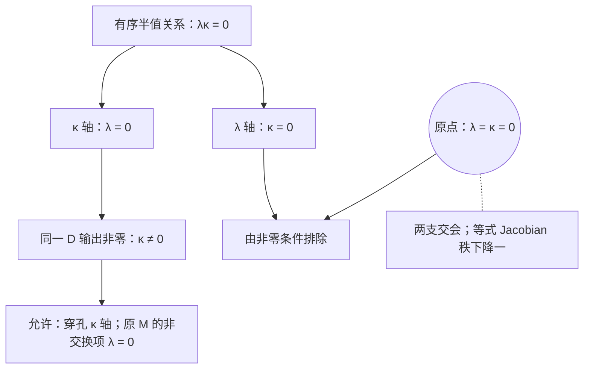

# AURIC R5-014：原乘法与比较尺的内生恢复

> 来源：用户于 2026-11-07（Asia/Singapore）在本会话提供的 AURIC R5-014 LaTeX 研究工作稿；原稿署名为“唯一候选：两份原双线性关系的有限联合约束”，未另标生成模型。本文为参考输入，Lean 是仓库的数学真源；本次仅转换 Markdown，未作形式化认证。正文中的固定快照、项目核读叙述、有理数精确秩核对与理论结论均保留原稿口径；本次未重跑原稿的精确有理数脚本；原 TikZ 坐标轴图转为 Mermaid 分支关系图，保留原图文字、坐标与图注。

AURIC / R5-014

原乘法与比较尺的内生恢复

一对互补样本与同一非零半关系

唯一候选：两份原双线性关系的有限联合约束

2026年11月7日（Asia/Singapore）

**唯一研究区域。** 给定有限实向量空间及完整坐标标架，维数 $n\ge2$ 未定； 在 $E=\mathbb Ru\oplus V$ 上给两份任意实双线性关系 $M,D$。 不指定正内积、正锥、$M$ 的单位律、交换律、Jordan 律或 spin 公式。

$$
\boxed{\begin{gathered}
\mathsf S_M+\mathsf S_D+\mathsf I+\mathsf O+
\mathsf H_p+\mathsf H_r+\mathsf Z+\mathsf W\\
\Longleftrightarrow\\
n=3,\quad M((\alpha,a),(\beta,b))=(\alpha\beta+\textstyle\sum_i a_ib_i,\alpha b+\beta a),\\
D((\alpha,a),(\beta,b))=(0,\kappa a\times b),\qquad\kappa\ne0.
\end{gathered}}
$$

**本轮闭合。** 原乘法的单位与交换性成为结论；同一原 $M$ 的标量读出 $g(a,b):=\pi_0M(\widehat a,\widehat b)$ 成为正定内积。 其平方集合自动成为尖的 Lorentz 正锥。 用此内积读出 $\mu=\|4D(p,r)\|=|\kappa|$，定义 $\delta=D/\mu$， 得到 $(E_\mathbb C,M-i\delta)\cong M_2(\mathbb C)$；原 $D=\mu\delta$ 完整保留。

**关系的关系。** 有限换轴与两个乘法样本之后，$M$ 尚有非交换系数 $\lambda$。 同一 $D$ 的双端有序半值关系给

$$
\boxed{\lambda\kappa=0,\qquad\kappa\ne0\quad\Longrightarrow\quad\lambda=0.}
$$

**约束计数。** 三维共同账本有 $128$ 个系数。 独立后果为 $126$ 条仿射线性约束、一条二次相容式和一个非零条件； 允许分支余维为 $127$。 上一轮若也计入被固定的 $64$ 个 $M$ 系数，同样为余维 $127$。 本轮移出的是显式背景结构，未声称减少独立数值信息。

固定源码：[the-omega-institute/trureturing，HEAD = dev](https://github.com/the-omega-institute/trureturing/tree/8ac280450a9aa61f64c06f3baaf2296c7356a0a5)。

提交 `8ac280450a9aa61f64c06f3baaf2296c7356a0a5`。

提交时间 2026-11-07 03:52:46；核对时间 03:53:39，均为新加坡时间。

自足手证明及有理数精确秩核对；未运行 Lean/kernel 验证。

## 1　项目进展与准确研究边界

相对 R5-013，完整递归子树变化数为 `docs` $18$、`D5` $15$、`Library` $8$、`Blueprint` $32$。 本轮取得并核对 $103$ 份相关理论文档的当前 Git blob 身份， 按完整文件名及这些正文定点检索；不把此范围当作全仓逐行证明认证。[\[1\]](#ref-repo)

| 来源 | 本轮消费的准确结果 |
|:---|:---|
| C128 原词卷，新增 362–369 | 原插入可先是任意总映射；共同正核、原校准、有向来源式及全词生成推出两种可见线性。 在保留背景上，全配方正插入等价于一次原实插入测试，也等价于旧 $Q_a$ 保原锥。 |
| C128 正交迹续卷，新增 417–423 | 先有复 Hermitian/Jordan 载体与原右单位时，有限谱星和三相半伙伴恢复原全域双端关系。 二阶块仍保留对径补元。 |
| V48，5.1；C115，2.1 | 已有给定欧氏三维／单位的等变乘法分类；已有从对称双线性、单位和全部纯方向平方极化得到 spin 乘法。 这些输入没有在旧结果中被删除。 |
| 稳定关系边界，3、8 | 三阶不动空间、有限带符号换轴及三维体积形式均为既有结构。 |
| 本轮联合区域 | 两份完整 $E$ 上的任意 $M,D$ 同时未知； 同一非零 $D$ 输出反过来排除原 $M$ 的非交换项， 原 $M$ 的标量比较尺随之被识别。 |

在已检索的 $103$ 份文档中未定位到本轮完整合取的相同陈述。 本轮不认领一般不变张量分类、极化、Jordan–Lie 或 qubit 重构的历史优先权。 派生平方锥与某个实际原来源正锥的等同性，另在第 8 节逐项列接口。[\[2\]](#ref-word), [\[3\]](#ref-trace), [\[4\]](#ref-v48), [\[5\]](#ref-c115), [\[6\]](#ref-stable)

## 2　外部资料、定义与唯一候选

#### 定义 2.1：外部结构背景

给定有限实向量空间 $V$，未知维数 $n\ge2$，以及完整有序基 $e_1,\ldots,e_n$。令

$$
E=\mathbb Ru\oplus V,\quad u=(1,0),\quad\widehat a=(0,a),
\quad x=e_1,\quad y=e_2.
$$

这里 $u$ 只是一个指定向量；尚未假设它是乘法单位。 原关系是两份任意实双线性映射

$$
M,D:E\times E\longrightarrow E.
$$

不预设其中任一映射的交换性、交替性、单位性或正性。

#### 定义 2.2：指定坐标动作与样本

对每个 $1\le i<n$，定义

$$
Q_ie_i=e_{i+1},\qquad Q_ie_{i+1}=-e_i,
\qquad Q_ie_j=e_j\quad(j\ne i,i+1),
$$

并令 $\widetilde Q_i(\alpha,a)=(\alpha,Q_i a)$。 这是外部指定的带符号坐标动作；此时尚无原比较尺可称为正交。 令

$$
p=\frac{u+\widehat x}{2},\qquad
q=\frac{u-\widehat x}{2},\qquad
r=\frac{u+\widehat y}{2},\qquad W=D(p,r).
$$

$p,q,r$ 是固定样本，尚未预断言它们正或幂等。

#### 定义 2.3：唯一候选 $\mathcal Q_{14}$

在同一份原资料上要求

$$
\boxed{\begin{aligned}
\mathsf S_M:\quad&M(\widetilde Q_iA,\widetilde Q_iB)
 =\widetilde Q_iM(A,B)&&\forall i,A,B,\\
\mathsf S_D:\quad&D(\widetilde Q_iA,\widetilde Q_iB)
 =\widetilde Q_iD(A,B)&&\forall i,A,B,\\
\mathsf I:\quad&M(p,p)=p,\\
\mathsf O:\quad&M(q,p)=0,\\
\mathsf H_p:\quad&M(p,W)=W/2,\\
\mathsf H_r:\quad&M(r,W)=W/2,\\
\mathsf Z:\quad&\pi_0D(p,q)=0,\\
\mathsf W:\quad&W\ne0.
\end{aligned}}
\tag{1}
$$

其中 $\pi_0$ 是给定直和的标量投影，$i$ 遍历全部 $1,\ldots,n-1$。

**类型与计数约定。** $\mathsf H_p,\mathsf H_r$ 是 *有序半值关系* 。 在 $M$ 还未证明交换时，幂等方程的微分只有

$$
M(p,W)+M(W,p)=W,
$$

弱于 $\mathsf H_p$。两者的差异将在删除反例中保留。 双线性使换轴等式可在全部基输入对上有限检查； 完整标架与全部生成元不能缩成未知维数下的两个动作。

| 项目 | 外部输入或定义 |
|:---|:---|
| 外部结构 | 实数域、有限实线性空间、$n\ge2$、完整基与直和标量读口；两份原实双线性映射。 |
| 关系要求 | 定义 2.3 的八组明确条件；两个换轴族覆盖全输入。 |
| 定义 | $p,q,r,W$ 与 $\widetilde Q_i$；这些定义不自动使条件成立。 |
| 本轮未先给 | 正内积、正锥、全局单位律、$M$ 交换律、Jordan 律、spin 公式、$n=3$、原 $D$ 的单位尺度。 |

## 3　从互补二元到全局单位与比较尺

#### 引理 3.1：一对互补样本传播单位

仅由 $\mathsf S_M,\mathsf I,\mathsf O$ 已有

$$
M(q,q)=q,\quad M(p,q)=0,\qquad
M(u,A)=M(A,u)=A\quad(A\in E).
$$

**证明。**

$Q_1^2$ 交换 $p,q$，故换轴相容把 $\mathsf I,\mathsf O$ 分别送为前两式。 由 $u=p+q$ 及双线性，$M(u,p)=M(p,u)=p$，对 $q$ 同样成立；并有 $M(u,u)=u$。 这些坐标动作的有限乘积可把 $x$ 送到任一 $e_i$，因此 $p_i=(u+\widehat e_i)/2$ 全部满足两侧单位式。 $u,p_1,\ldots,p_n$ 张成整个 $E$，双线性遂给全局结论。

$\square$

因此 $\mathsf I+\mathsf O$ 也可等价写为 $M(p,p)=p$、$M(u,p)=p$；后一个式子不是新增输入。

#### 引理 3.2：完整载体的有限协变分类

只为坐标计算记 $q_0(a,b)=\sum_i a_ib_i$；三维的 $a\times b$ 指给定有序基上的 Levi–Civita 坐标双线性式，尚未借用原内积。 任意实双线性映射 $F:E^2\to E$ 若与全部 $\widetilde Q_i$ 协变，则： 当 $n\ge3$ 时，

$$
F((\alpha,a),(\beta,b))=
\bigl(c\alpha\beta+dq_0(a,b),\ e\alpha b+f\beta a+T(a,b)\bigr),
\tag{2}
$$

其中 $n=3$ 时 $T=\lambda(a\times b)$，$n\ge4$ 时 $T=0$。 当 $n=2$ 时，令 $Jx=y,Jy=-x$，则完整形式为

$$
\begin{aligned}
F((\alpha,a),(\beta,b))=
\bigl(&c\alpha\beta+dq_0(a,b)+\tau\det(a,b),\\
&\alpha(eI+e'J)b+\beta(fI+f'J)a\bigr).
\end{aligned}
\tag{3}
$$

这些参数均可任取实数。$q_0$ 尚只是辅助坐标多项式，未被认定为原物理读出尺。

**证明。**

按两槽的 $\mathbb Ru$ 与 $V$ 分量分解 $F$。 没有非零向量或线性泛函被全部坐标动作固定，故单位–单位的向量项、混合项的标量部分均消失。 $Q_i^2$ 的乘积供应任意两个坐标的同时反号。 当 $n\ge3$ 时，取其中一个坐标和第三个坐标反号，可消去矩阵所有非对角元； 四分之一转动再使对角元相等。 这同时给混合线性块的标量倍数形式及 $dq_0$。

对向量双线性项，令 $t_{ijk}$ 为 $T(e_j,e_k)$ 的第 $i$ 坐标。 每个偶反号要求任何两个指标的出现次数之和为偶数， 因此全部坐标的出现次数具有同一奇偶性。次数总和为三，故必须全奇。 $n\ge4$ 不可能，所有系数为零；$n=3$ 则三个指标恰各出现一次， 两个四分之一转动把六个剩余系数锁成 Levi–Civita 符号，故 $T=\lambda\times$。

$n=2$ 时 $J^2=-I$ 已使 $T(-a,-b)=T(a,b)=-T(a,b)$，所以 $T=0$； $J$ 的矩阵交换子空间恰为 $\operatorname{span}\{I,J\}$，给式 (3)。 反向代入验证所有显示形式均相容。 此三阶有限不动空间机制复用项目既有结构。[\[6\]](#ref-stable)

$\square$

#### 命题 3.3：平方与正比较尺先行恢复

在 $\mathsf S_M,\mathsf I,\mathsf O$ 下：

$$
M(A,B)=
\begin{cases}
(\alpha\beta+q_0(a,b)+\tau\det(a,b),\alpha b+\beta a),&n=2,\\
(\alpha\beta+q_0(a,b),\alpha b+\beta a+\lambda a\times b),&n=3,\\
(\alpha\beta+q_0(a,b),\alpha b+\beta a),&n\ge4.
\end{cases}
\tag{4}
$$

因而对全部 $n\ge2$，

$$
M(A,A)=(\alpha^2+q_0(a,a),2\alpha a),
\qquad
g_{\rm sym}(a,b):=\frac12\pi_0\bigl(M(\widehat a,\widehat b)+M(\widehat b,\widehat a)\bigr)=q_0(a,b).
$$

同一原平方的极化读出 $g_{\rm sym}$ 正定；平方集合为

$$
\boxed{C_M:=\{M(A,A):A\in E\}
=\{(t,v):t\ge\sqrt{q_0(v,v)}\},\qquad C_M\cap(-C_M)=\{0\}.}
\tag{5}
$$

**证明。**

在式 (2) 代入两个样本，得到 $c+d=2,e+f=2,c-d=0,e-f=0$，所以 $c=d=e=f=1$。 二维另有 $e'+f'=e'-f'=0$，故两者为零。 剩余项均反对称，在平方及极化中消失。

平方的标量分量至少为向量分量范数。 反向，对 $t\ge|v|$ 且 $v\ne0$，设 $s=v/|v|$、$p_s=(u+\widehat s)/2$， 则 $M(p_s,p_s)=p_s$、$M(p_s,p_{-s})=M(p_{-s},p_s)=0$， 并有 $(t,v)=(t+|v|)p_s+(t-|v|)p_{-s}$。 取两系数的非负平方根即可写成一个平方；$v=0$ 取 $\sqrt t\,u$。 两者互为负且均在此集合中，立即迫出 $t=v=0$。

$\square$

到此为止，平方与对称比较已经确定，原 $M$ 的反对称部分仍须由与 $D$ 的共同关系决定。

## 4　主定理：同一非零关系消去乘法歧义

#### 定理 4.1：联合闭合

在定义 2.1 的类别中，$\mathcal Q_{14}$ 当且仅当

$$
\boxed{\begin{gathered}
n=3,\\
M((\alpha,a),(\beta,b))=(\alpha\beta+q_0(a,b),\alpha b+\beta a),\\
D((\alpha,a),(\beta,b))=(0,\kappa a\times b),\quad\kappa\ne0.
\end{gathered}}
\tag{6}
$$

于是原 $M$ 交换，且 $g(a,b):=\pi_0M(\widehat a,\widehat b)=q_0(a,b)$ 为正定内积。 同一原基成为此内积的正交单位基。

**二维排除。**

使用已校准的式 (4)，写 $W=(s,w_1x+w_2y)$。 $\mathsf H_p$ 给 $s=0,w_1+\tau w_2=0$； $\mathsf H_r$ 给 $s=0,w_2-\tau w_1=0$。 实系数矩阵的行列式 $1+\tau^2>0$，故 $W=0$，违反 $\mathsf W$。

$\square$

**四维及以上排除。**

此时 $M$ 已为 spin 公式，故两个半值关系给 $W=(0,w)$、$w_1=w_2=0$。 任取不同的 $k,l\ge3$；在 $k<l$ 时， $H_{kl}=Q_k^2\cdots Q_{l-1}^2$ 只反转第 $k,l$ 坐标，并约定 $H_{lk}=H_{kl}$。 它固定 $p,r$，所以 $\mathsf S_D$ 要求 $H_{kl}w=w$。 第 $k$ 坐标给 $w_k=-w_k$，故 $w_k=0$。 逐个 $k\ge3$ 重复，再次得到 $W=0$，矛盾。

$\square$

**三维的完整残余。**

令 $z=e_3$。引理 3.2 给

$$
\begin{aligned}
M(A,B)&=M_{\mathrm{sp}}(A,B)+(0,\lambda a\times b),\\
D(A,B)&=(d_0\alpha\beta+d_1a\cdot b,
e_0\alpha b+e_1\beta a+\kappa a\times b),\\
4W&=(d_0,e_1x+e_0y+\kappa z).
\end{aligned}
\tag{7}
$$

其中 $M_{\mathrm{sp}}$ 指已显示的 spin 坐标式，而不是预先给定的原 $M$。 两个有序半值等式的各分量，消去公共非零因子后，分别为

$$
\begin{array}{c|cccc}
\mathsf H_p&e_1=0&d_0=0&-\lambda\kappa=0&\lambda e_0=0\\
\mathsf H_r&e_0=0&\lambda\kappa=0&d_0=0&-\lambda e_1=0.
\end{array}
$$

等价地，

$$
d_0=e_0=e_1=0,\qquad\lambda\kappa=0.
$$

$\mathsf Z$ 给 $d_0-d_1=0$，所以 $d_1=0$。 此时 $\mathsf W$ 恰为 $\kappa\ne0$，于是 $\lambda=0$。 这给式 (6)；反向逐项代入即可。

$\square$

#### 推论 4.2：闭合后的端点几何

$$
T_s:=\{W:M(p_s,W)=W/2\}
=\{(0,w):g(s,w)=0\},\qquad g(s,s)=1.
$$

由于此时 $M$ 已交换，这才等价于幂等方程的切向条件。 同时有 $D(u,A)=D(A,u)=0$、$\pi_0D=0$、$D(A,A)=0$、$D(A,B)=-D(B,A)$。

## 5　独立约束账本与最简关系图

#### 定理 5.1：线性与非线性分开计数

在已选择出的三维分支，两份原双线性映射共 $128$ 个系数。

$$
\begin{array}{c|r|r}
\text{条件}&\text{累计独立仿射线性后果}&\text{线性残余维数}\\\hline
\mathsf S_M+\mathsf S_D&118&10\\
\mathsf I&120&8\\
\mathsf O&122&6\\
\mathsf H_p+\mathsf H_r\text{ 的线性部分}&125&3\\
\mathsf Z&126&2
\end{array}
$$

还须保留

$$
\boxed{\lambda\kappa=0,\qquad\kappa\ne0.}
\tag{8}
$$

允许解集是一条穿孔仿射直线，余维及等式 Jacobian 秩为 $127$。

**证明。**

每份协变关系在三维有五个自由参数，故两个独立块的秩为 $2(64-5)=118$。 两个乘法样本各增加两个独立仿射等式。 式 (7) 的 $d_0,e_0,e_1,d_1$ 再给四个独立线性条件。 余下等式理想恰为 $(\lambda\kappa)$。 在 $\kappa\ne0$ 上，它等价于 $\lambda=0$；其对 $\lambda$ 的导数为非零的 $\kappa$， 所以 Jacobian 再增加一秩。

$\square$

八组输入在三维共展示 $256+4+4+8+1=273$ 条标量等式及一个非零条件； 展示行数、独立线性秩和局部余维是三个不同数量。 在 $\lambda=\kappa=0$ 处，等式簇有两支交会，Jacobian 秩下降一。

原图在 $(\lambda,\kappa)$ 平面中展示 $\lambda\kappa=0$ 的两条坐标轴。灰色横轴为 $\kappa=0$，被同一输出的非零条件排除；青色纵轴保留 $\lambda=0,\ \kappa\ne0$，原点用空心圆标为不包含。原点满足 $\lambda=\kappa=0$，是等式簇两支的交会，Jacobian 秩下降一。Mermaid 表示分支关系，不按比例绘制。原 TikZ 横向 $\lambda$ 坐标箭头从 $(-3.1,0)$ 指向 $(3.25,0)$，纵向 $\kappa$ 坐标箭头从 $(0,-2.1)$ 指向 $(0,2.25)$；灰色水平分支从 $(-2.8,0)$ 到 $(2.8,0)$，青色纵向分支分别从 $(0,-1.9)$ 到 $(0,-0.09)$、从 $(0,0.09)$ 到 $(0,1.95)$，空心圆以 $(0,0)$ 为圆心、半径为 $0.12$。

**图 1：** 有序半值关系把两份未知结构的系数限制在两条坐标轴上。 同一 $D$ 输出非零选择穿孔的 $\kappa$ 轴，并使原 $M$ 的非交换项为零。

有理数精确核对单个 $M$ 的线性块如下；一般维数仍由手证明承担。

$$
\begin{array}{c|r|r|r|r}
n&\text{系数数}&\operatorname{rank}\mathsf S_M&\operatorname{rank}(\mathsf S_M,\mathsf I)&
\operatorname{rank}(\mathsf S_M,\mathsf I,\mathsf O)\\\hline
2&27&20&23&26\\
3&64&59&61&63\\
4&125&121&123&125
\end{array}
$$

**与上一轮的共同分母。** R5-013 若也使用这份 $128$ 系数账本，固定 $M=M_{\mathrm{sp}}$ 已指定 $64$ 个系数， 再加原 $D$ 的 $63$ 余维，同样得到 $127$。 本轮把固定公式改成互补样本与联合相容性的结论； 实双线性、完整坐标动作以及有序半值的强度仍是输入。 不将等价结构重构计作独立信息总量下降。

## 6　反向删除：八组条件各自排除什么

以下反例未特别写出的关系取标准坐标 spin 与叉积；全部仍满足背景的实双线性。

### 6.1　删除乘法换轴或原关系换轴

只删 $\mathsf S_M$，在三维取

$$
M(A,B)=M_{\mathrm{sp}}(A,B)-2a_3b_3u,\qquad D(A,B)=(0,a\times b).
$$

两个乘法样本只用 $x$；两个半值式的首槽只用 $x,y$，故新增项在全部这些测试中为零。 其余七组要求均成立，但原标量形式是 $\operatorname{diag}(1,1,-1)$。 $Q_2$ 把 $z$ 送到 $-y$，于是 $M(\widetilde Q_2\widehat z,\widetilde Q_2\widehat z)=u\ne-u=\widetilde Q_2M(\widehat z,\widehat z)$。

只删 $\mathsf S_D$，取 $V=\mathbb R^4$、$M=M_{\mathrm{sp}}$，令 $P$ 投影到前三维、$\iota$ 为嵌入，定义

$$
D(A,B)=(0,\iota(Pa\times Pb)).
$$

其余要求全部通过，$W=\widehat e_3/4\ne0$； $Q_3$ 固定两个输入却把该输出转到 $e_4$，所以原关系不相容，三维结论失败。

### 6.2　删除互补样本的自比较或交叉比较

只删 $\mathsf I$，取

$$
M(A,B)=(0,\alpha b+\beta a),\qquad D(A,B)=(0,a\times b).
$$

此时 $M(q,p)=0$，半值、换轴、对径标量零及指定非零均成立， 但 $M(p,p)=(0,x/2)\ne p$。 原标量比较为零，且平方集合等于 $\{0\}\oplus V$，包含每个向量及其负向量。

只删 $\mathsf O$，取

$$
M(A,B)=(3\alpha\beta-a\cdot b,\alpha b+\beta a),
\qquad D(A,B)=(0,a\times b).
$$

$M(p,p)=p$，其他条件均成立，却有 $M(q,p)=u$，原标量比较为负定。 平方集合同时包含

$$
M(u/\sqrt3,u/\sqrt3)=u,\qquad
M(\widehat x,\widehat x)=-u.
$$

因而“无非零双向存在”的派生性质确会随此条件删除而失败。

### 6.3　删除任意一个有序半值端点

在二维取 $Jx=y,Jy=-x$、$M=M_{\mathrm{sp}}$。 若只删 $\mathsf H_p$，令

$$
D(A,B)=(0,\alpha Jb),\qquad W=-\widehat x/4.
$$

它通过 $r$ 端的半值式，未通过 $p$ 端；其余全部成立。 若只删 $\mathsf H_r$，令

$$
D(A,B)=(0,\beta Ja),\qquad W=\widehat y/4.
$$

它通过 $p$ 端，未通过 $r$ 端。 因此两个端点分别承担排除二维的作用。

### 6.4　删除对径标量零或指定非零

只删 $\mathsf Z$，取三维 $M=M_{\mathrm{sp}}$、

$$
D(A,B)=(a\cdot b,a\times b).
$$

其余条件成立，而 $\pi_0D(p,q)=-1/4$，$D(A,A)$ 不恒为零。

只删 $\mathsf W$，二维的 $M=M_{\mathrm{sp}},D=0$ 即为反例。 即使补上全域 $D\ne0$ 也不够：

$$
D(A,B)=(0,\alpha b-\beta Ja)
$$

非零、与 $J$ 相容，但指定 $W=D(p,r)=0$，仍满足其余要求。 在三维也可取 $D=0$、$M=M_{\mathrm{sp}}+(0,\lambda a\times b)$，使原乘法的非交换项继续保留。

### 6.5　有序半值不能弱化为普通切向

若将 $\mathsf H_p,\mathsf H_r$ 换成

$$
M(p,W)+M(W,p)=W,\qquad
M(r,W)+M(W,r)=W,
\tag{9}
$$

则在三维，任取 $\lambda\ne0,\kappa\ne0$，

$$
M(A,B)=M_{\mathrm{sp}}(A,B)+(0,\lambda a\times b),\qquad
D(A,B)=(0,\kappa a\times b)
$$

满足其他全部条件及式 (9)。 原因是两个次序中的 $\lambda$ 项相消。 原 $M$ 仍不交换，所以仅有幂等曲面上的切向稳定不足以恢复它。

### 6.6　线性背景仍须明确保留

在三维保留 $M=M_{\mathrm{sp}}$，令

$$
N(A,B)=\bigl(\|A\|_0^2+\|B\|_0^2\bigr)(0,a\times b),
\qquad\|(\alpha,a)\|_0^2=\alpha^2+\sum_i a_i^2.
$$

所有指定原子样本的两范数平方和为一，坐标换轴也保持它， 故用 $N$ 替代 $D$ 可通过全部显示的样本与换轴关系。 但

$$
N(2\widehat x,\widehat y)=10\widehat z
\ne 4\widehat z=2N(\widehat x,\widehat y).
$$

因此本轮没有从样本稳定推出双线性。 八组条件在给定背景中分别不可删除；这不是表示无关的绝对最少公理数定理。

## 7　同一区域的完整代数与量子闭合

### 7.1　内生尺度、手性与标准复矩阵

#### 定义 7.1：从原关系读出的归一化

使用主定理推出的 $g$ 及其直和内积，定义

$$
\mu:=\|4D(p,r)\|_E=|\kappa|>0,
\qquad\delta:=D/\mu,\qquad D=\mu\delta.
\tag{10}
$$

任意 $g$-正交单位方向 $a,b$ 都给 $\|4D(p_a,p_b)\|=\mu$，因为 $\|a\times b\|=1$。 定义 $z_D=-4\pi_V\delta(p,r)$；标架 $(x,y,z_D)$ 正交归一， 在此标架确定的叉积 $\times_D$ 下 $\delta(A,B)=(0,-a\times_D b)$。

#### 定理 7.2：Jordan–Lie 与复结合闭合

记 $L_AB=M(A,B)$、$\delta_AB=\delta(A,B)$。则

$$
\delta_AM(B,C)=M(\delta_AB,C)+M(B,\delta_AC),
\qquad[\delta_A,\delta_B]=\delta_{\delta(A,B)}=-[L_A,L_B].
\tag{11}
$$

在通常复化 $E_\mathbb C$ 上定义并作复双线性延拓

$$
A\star B=M(A,B)-i\delta(A,B).
\tag{12}
$$

则 $\star$ 结合，且以 $E$ 为自伴部分的含幺 $`*`$-代数同构于 $M_2(\mathbb C)$。

**证明。**

叉积的反对称矩阵保持 $g$，直接代入 $M$ 给导子律； 三重叉积恒等式给式 (11)。 在 $(x,y,z_D)$ 中用标准 Pauli 矩阵 $X,Y,Z$，定义

$$
\Pi(\alpha,a)=\alpha I+a_xX+a_yY+a_{z_D}Z.
$$

由 $\delta=-\times_D$ 及 Pauli 乘法，

$$
\Pi(A)\Pi(B)=\Pi(M(A,B))-i\Pi(\delta(A,B)).
$$

$I,X,Y,Z$ 为全部 $2\times2$ 复矩阵的复基， 故 $\Pi$ 的复延拓为忠实含幺 $`*`$-同构。 结合性因此成立；也可由下一命题的结合子直接验证。

$\square$

#### 命题 7.3：局部相容式属于更大的结合关系

在式 (7) 的线性杂项已消去后，尚允许 $\lambda,\kappa$， 原复乘法 $A\diamond B=M(A,B)-iD(A,B)$ 的结合子为

$$
\begin{aligned}
&(A\diamond B)\diamond C-A\diamond(B\diamond C)\\
&\quad=(0,\ [1+\lambda^2-\kappa^2-2i\lambda\kappa]\,
       [(a\cdot b)c-(b\cdot c)a]).
\end{aligned}
\tag{13}
$$

所以 $\lambda\kappa=0$ 恰为此系数的虚部消失。 主定理已给 $\lambda=0$；原乘法结合当且仅当 $\mu=1$。

**证明。**

令 $h=\lambda-i\kappa$，则向量乘法的叉积系数为 $h$。 逐项展开得到系数 $1+h^2$；所用恒等式为 $(a\times b)\times c-a\times(b\times c) =(a\cdot b)c-(b\cdot c)a$。 取 $a=b=x,c=y$ 可知该系数为零是结合性的必要条件，展开又给充分性。 $\lambda=0$ 后条件为 $1-\kappa^2=0$，即 $\mu=1$。 归一化关系的系数为 $\kappa/|\kappa|$，其平方为一，故式 (12) 结合。

$\square$

原 $D$ 的同一表示仍为

$$
\Pi(D(A,B))=\frac{i\mu}{2}[\Pi(A),\Pi(B)].
$$

没有通过重命名 $D$ 抹去 $\mu$，也没有由归一化定义证明原刻度等于一。

### 7.2　正状态、平方律与可读出存在

#### 定理 7.4：二能级静态理论

相对于派生平方锥 $C_M$，全部归一正实线性泛函恰为

$$
\omega_s(t,v)=t+g(s,v),\qquad g(s,s)\le1.
$$

它们对应

$$
\rho_s=\frac12(I+s\cdot\sigma_D)\ge0,\qquad\operatorname{Tr}\rho_s=1,
$$

并满足

$$
\omega_s(A)=\operatorname{Tr}(\rho_s\Pi(A)),\qquad
\omega_s(p_a)=\frac{1+g(s,a)}2.
\tag{14}
$$

纯态满足 $|s|=1$，故纯态空间为 $\mathbb{CP}^1\cong S^2$。 若 $\rho_s=|\psi\rangle\langle\psi|$ 且 $\Pi(p_a)=|\phi\rangle\langle\phi|$，则

$$
\omega_s(p_a)=|\langle\phi,\psi\rangle|^2.
$$

每个非零 $A\in C_M$ 都有 $\omega_0(A)>0$。

**证明。**

归一实线性泛函写作 $t+g(s,v)$。 它在全部 $p_a$ 上非负恰为 $|s|\le1$，这也保证其在全部 $C_M$ 上非负。 $(s\cdot\sigma_D)^2=|s|^2I$，所以 $\rho_s$ 的本征值为 $(1\pm|s|)/2$； Pauli 的迹配对给式 (14)。 单位球的极端点为球面，对应秩一密度矩阵。 两个秩一投影的迹乘积给平方模公式。 非零 $(t,v)\in C_M$ 必有 $t>0$，即最后的严格读出。

$\square$

效果定义为 $0\le F\le u$；菜单 $F_j\ge0,\sum_jF_j=u$ 给 $p_j=\omega_s(F_j)\ge0,\sum_jp_j=1$。 这是完整的局部数学状态与效果结构，未把每个数学状态或菜单自动增加为原实际准备或设备。

| 对象类型 | 本区准确关系 |
|:---|:---|
| 比较方向 | $g(x,y)=0$；三维比较空间中有三条正交坐标轴。 |
| 纯态原子 | $M(p_a,p_b)=0$ 当且仅当 $b=-a$；$g(a,b)=0$ 时其 Born 重叠为 $1/2$。 |
| Hilbert 载体 | 复维数为二；三条正交比较轴不对应三颗两两正交的量子纯态。 |
| 关系输出 | 非零切向 $W$ 不在正锥中，因为 $T_a\cap C_M=\{0\}$；有向变化不被规定为正对象。 |

### 7.3　不确定性与二阶关系的三维提升

对 $A=(\alpha,a),B=(\beta,b)$ 和数学状态 $\omega_s$，定义

$$
\begin{aligned}
v_A&=|a|^2-g(s,a)^2,&v_B&=|b|^2-g(s,b)^2,\\
c&=g(a,b)-g(s,a)g(s,b),&d&=\omega_s(\delta(A,B))=\omega_s(D(A,B))/\mu.
\end{aligned}
$$

则

$$
\boxed{v_Av_B-c^2-d^2=(1-|s|^2)|a\times b|^2\ge0.}
\tag{15}
$$

证明：线性相关时为零；否则沿二元平面及单位法向 $n$ 分解 $s=s_\parallel+(s\cdot n)n$。 二维协方差行列式是 $|a\times b|^2(1-|s_\parallel|^2)$， 而 $d^2=|a\times b|^2(s\cdot n)^2$，相减即得。 这复现项目 V48 的既有精确余量。[\[4\]](#ref-v48)

对二阶正关系表

$$
G=\begin{pmatrix}v_A&c-id\\c+id&v_B\end{pmatrix}\succeq0,
\qquad t=v_A+v_B>0,
$$

有

$$
\frac Gt=\frac12(I+R\cdot\sigma),\qquad
R=\frac{(2c,2d,v_A-v_B)}t,
\quad |R|^2=1-\frac{4(v_Av_B-c^2-d^2)}{t^2}\le1.
$$

二元 Hermitian 关系表的归一化给三实坐标球；$t=0$ 时是零表，不作归一化。 这里原 $D$ 的读数须除以同一个 $\mu$。

### 7.4　共同运动保持所有两两关系

固定 $H=(h_0,h)$，数学流 $\dot A=D(H,A)$ 为

$$
a(t)=\exp(t\kappa[h]_\times)a(0),\qquad
\frac d{dt}g(a_i(t),a_j(t))=0\quad\forall i,j.
$$

矩阵形式满足

$$
\frac d{dt}\Pi(A)=\frac{i\mu}{2}[\Pi(H),\Pi(A)],\qquad
\Pi(A(t))=U(t)^*\Pi(A(0))U(t),\quad
U(t)=e^{-it\mu\Pi(H)/2}.
$$

物理时钟、能量及作用量单位的绑定仍为来源输入；此处只推出数学可逆流。

## 8　原存在集合的准确识别接口

本节不增加第二个核心候选。 它在已经闭合的同一 $E,M$ 上，明确列出把一个 *给定原集合* 识别为派生正锥所需的后置接口。

#### 定义 8.1：内生二次比较

令 $L_a b=M(a,b)$、$a^2=M(a,a)$，定义

$$
Q_a:=2L_a^2-L_{a^2}.
$$

在定理 7.2 的表示下，

$$
\Pi(Q_a b)=\Pi(a)\Pi(b)\Pi(a),\qquad Q_a u=a^2.
\tag{16}
$$

#### 定理 8.2：无预给凸性的存在集合闭合

给定任意集合 $X\subseteq E$；不预设它为锥、凸集或闭集。 则

$$
\boxed{
\left[
u\in X,\quad X\cap(-X)=\{0\},\quad
Q_a(X)\subseteq X\ \ \forall a\in E
\right]
\iff X=C_M.
}
\tag{17}
$$

因此满足这三组接口后，正锥、凸性、闭性和正对象的可读出性均为结论。

**证明。**

由 $u\in X$ 和二次比较稳定，所有平方 $Q_a u=a^2$ 都属于 $X$，故 $C_M\subseteq X$； 特别地 $0=Q_0u\in X$。 若 $c\in X$ 不在 $C_M$，则 $\Pi(c)$ 有负本征值 $\eta<0$。 令 $P$ 为对应非零秩一谱投影，$p=\Pi^{-1}(P)$。 式 (16) 给 $Q_p c=\eta p\in X$。 另一方面，$-\eta p\in C_M\subseteq X$， 所以 $X\cap(-X)$ 含非零元素，矛盾。 故 $X\subseteq C_M$。 反向，正半定矩阵包含单位、无非零双向元素，并在 $B\mapsto ABA$ 下稳定。

$\square$

三组接口分别不能删：

$$
\begin{array}{c|c}
\text{删除的接口}&\text{保留其余但未得到 }C_M\text{ 的集合}\\\hline
u\in X&X=\{0\}\\
X\cap(-X)=\{0\}&X=E\\
Q_a(X)\subseteq X\quad\forall a&X=\mathbb R_{\ge0}u
\end{array}
$$

最后一行中 $Q_pu=p\notin\mathbb R_{\ge0}u$。 这是三组带全域量词的来源接口，不是三条数值线性约束；它们不计入核心的 $126+1$ 系数账本。

## 9　与最新共同来源定理的接合

### 9.1　哪一种线性已经成为项目的结论

最新 C128 原词卷 362–369 保留原实响应空间、原实双线性 $\circ,D$、 原单位及原右单位、分离的原实线性评价、原锥和序单位界。 另有同源复配方空间 $V_0$、共同半正 Hermitian 形式 $K$、原标签 $\xi_\alpha$、 任意总集合映射 $J_a$，精确全词生成，以及

$$
\begin{gathered}
K(z,J_u w)=K(z,w),\qquad K(\xi_\alpha,J_a\xi_\alpha)=\alpha(a),\\
K(J_a z,J_b w)=K(z,J_{a\circ b}w)-iK(z,J_{D(a,b)}w).
\end{gathered}
\tag{18}
$$

复内积第一槽共轭线性、第二槽线性。 这些是来源前件；本轮有限比较条件没有自动供应它们。[\[2\]](#ref-word)

令 $N=\{z:K(z,z)=0\}$、$F:V_0\to V_0/N$。 该卷引理 366.1 在尚未要求正插入时，已给

$$
FJ_a(\lambda z+\nu w)=\lambda FJ_a z+\nu FJ_a w,
\qquad
FJ_{sa+tb}z=sFJ_a z+tFJ_b z,
$$

以及忠实代数表示

$$
T_aFz=FJ_a z,\qquad T_aT_b=T_{a\circ b}-iT_{D(a,b)}.
$$

其证明以 $a=0,b=u$ 的有向关系先推出 $J_0$ 可见为零，再得精确伴随关系； 全测试配对消去配方线性缺陷，原校准及任意词长归纳消去响应线性缺陷。 原不可见档案中的 $J$ 可以仍然非线性。 删除全词生成时，$J_a=\operatorname{diag}(a,a^2)$、$\xi_m=(\sqrt m,0)$ 给出保留全部裸校准却在第二轴非线性的反例。[\[2\]](#ref-word)

### 9.2　原尺度与原存在集合分别在哪一步闭合

若本轮 $M,D,u$ 是式 (18) 中的同一原资料，且该来源背景全部成立， 忠实代数表示使原 $M-iD$ 结合。 由命题 7.3，

$$
\boxed{\mu=1.}
$$

这个尺度结论已可在引理 366.1 的代数层取得，不必先假定插入关于两种变量线性。 它仍依赖共同正核、原校准、完整有向式及精确全词生成等保留前件。

项目定理 366.2 在同一来源背景上进一步证明

$$
\begin{aligned}
&K(z,J_cz)\ge0\quad\forall c\in E_+,z\in V_0\\
\iff\;&K(J_a\xi_\alpha,J_c(J_a\xi_\alpha))\ge0
        \quad\forall c\in E_+,a,\alpha\\
\iff\;&Q_a(E_+)\subseteq E_+\quad\forall a.
\end{aligned}
\tag{19}
$$

原评价分离保证原锥尖，原单位为正；再满足上述任一等价正性条件时， 在本轮有限局部区，定理 8.2 才给 $E_+=C_M$。 这就是“原存在集合”与“派生平方锥”之间实际要付出的接口。

该接口不能从裸读数为正推出：项目 367.1 在 $M_2(\mathbb C)_{\rm sa}$ 上只用 $|0\rangle,|1\rangle,|+\rangle,|+i\rangle$ 的四个分离读数定义原锥， $c=I+X+Y$ 的四个读数为 $(1,1,2,2)$，却不是正半定。 一次实夹乘便给读数 $-1$，从而违反同一 $Q$ 稳定性。[\[2\]](#ref-word)

### 9.3　局部闭合与其余量子公理

| 目标 | 本轮已闭合或仍须的准确输入 |
|:---|:---|
| 局部静态量子结构 | 核心候选给 $M_2(\mathbb C)$、正状态、效果、Born 数学配对、平方律与不确定性。 |
| 原 Born 与原质量 | 需同一原标签的校准及共同来源关系；保留 $\alpha(u)$，不自动把次归一状态归一化。 |
| 复合及纠缠 | 需实际联合中的同一复代数嵌入、交叉关系、联合生成及相关输入对应。 |
| CP 与完整仪器 | 需同一实际事件的完整参考放大、相关正锥、全部端口与失败记录；局部平方锥不供应这些实际过程。 |
| 状态更新 | 需指定事件自身的完整更新合同；相同效果不决定相同更新。 |
| 物理时间 | 数学流已给；时钟、Hamiltonian 与作用量单位的实际绑定另须来源。 |
| 完整 $\Omega$ | 原观察者、记录、控制、全部历史与未来接口仍须同源识别；有限局部结构不指定完整全局维数。 |

对任意非零含幺 $`*`$-表示 $\pi:M_2(\mathbb C)\to B(H)$，仍有 $H\cong\mathbb C^2\otimes\mathcal K$、$\pi(A)\cong A\otimes I_{\mathcal K}$，允许无限重数。 证明取 $\mathcal K=\pi(E_{11})H$、 $U(e_j\otimes\xi)=\pi(E_{j1})\xi$；矩阵单位关系给等距及满射，并给交织式。 这不把 $\mathcal K$ 自动认定为已经构造好的全部实际未来记忆。

## 10　最终账本与本轮白话

| 类别 | 最终结论 |
|:---|:---|
| 保留的背景 | 有限实线性、完整坐标框架、直和标量读口、两份原双线性关系。 |
| 核心关系输入 | 八组条件；三维账本为 $126$ 条独立仿射线性后果、$\lambda\kappa=0$ 和 $\kappa\ne0$。 |
| 闭合推出 | 全局单位、原 $M$ 的 spin 与交换性、原正比较尺、平方正锥、$n=3$、$D=\kappa\times$。 |
| 定义归一化 | $\mu=\vert \kappa\vert$、$\delta=D/\mu$；无新增数值标定，原 $D$ 保留。 |
| 量子后果 | $(E_\mathbb C,M-i\delta)\cong M_2(\mathbb C)$，局部 Born 配对、平方律、不确定性及数学可逆流。 |
| 原存在集合接口 | 给定 $X$ 后，$u\in X$、无非零双向元素、所有原 $Q_a$ 保 $X$，恰好识别 $X=C_M$。 |
| 原尺度接口 | 同一原有向插入关系的完整来源背景给原乘法结合，进而 $\mu=1$。 |

**本轮完整白话。** 先只给一组能线性组合的标签和两种比较规则，不先指定尺子、球面或乘法表。 取互补的两个标签：自己比较仍是自己，补标签按指定次序比较它则为零； 把这张小表沿所有坐标换轴，单位和平方比较就一起固定下来，平方读数自己给出一把正尺子。 这时比较规则还可能带一个看平方看不见的扭向。 再让另一份关系确实产生同一根非零箭头，并要求两个端点分别按指定次序比较这根箭头时，都恰好读出它的一半。 两维放不下，四维以上又能固定原输入而翻掉法向，最后只剩三维。 非零箭头还迫使那份隐藏扭向消失，于是原比较和原变化共同闭合为球上的量子关系。 箭头长度继续记录为原尺度；若原存在集合包含总量标签 $u$，不容许非零对象及其逆向同时存在，并在所有这些内部二次比较下保持，它便恰好是这份结构的正对象集合。

## 来源与验证

\[1\] [trureturing 固定快照](https://github.com/the-omega-institute/trureturing/tree/8ac280450a9aa61f64c06f3baaf2296c7356a0a5) `8ac280450a9a`，提交 2026-11-07 03:52:46 SGT。 四个完整子树差分与 $103$ 份理论文档身份核对；未进行 Lean 构建。

\[2\] [C128 原词校准与固定关系](https://github.com/the-omega-institute/trureturing/blob/8ac280450a9aa61f64c06f3baaf2296c7356a0a5/docs/develop/theory/AURIC_C128_ORIGINAL_WORD_CALIBRATION_AND_FIXED_RELATION.md)， 新增 §§362–369；既有 §§357–361。 原插入两种可见线性、一次实插入正性与原 $Q$ 保锥、同一原 $D$ 的共同表示。

\[3\] [C128 正交迹与角关系续卷](https://github.com/the-omega-institute/trureturing/blob/8ac280450a9aa61f64c06f3baaf2296c7356a0a5/docs/develop/theory/AURIC_C128_ORTHOGONAL_TRACE_AND_CORNER_RELATIONS_CONTINUATION.md)， 新增 §§417–423。 已给 Jordan 载体和原右单位前件下的有限谱星恢复。

\[4\] [V48：各向同性、手性与条件量子重构](https://github.com/the-omega-institute/trureturing/blob/8ac280450a9aa61f64c06f3baaf2296c7356a0a5/docs/develop/theory/AURIC_ISOTROPY_CHIRALITY_AND_CONDITIONAL_QUANTUM_RECONSTRUCTION_V48.md)， 5.1、8.1–8.2。既有乘法分类、精确不确定性余量与二阶关系球。

\[5\] [C115：二元平方、二分量组合与内部复结构](https://github.com/the-omega-institute/trureturing/blob/8ac280450a9aa61f64c06f3baaf2296c7356a0a5/docs/develop/theory/AURIC_BINARY_SQUARE_TWO_COMPONENT_COMPOSITION_AND_INTERNAL_COMPLEX_STRUCTURE_C115.md)， 2.1–2.3。先有正内积、对称双线性、单位和纯方向平方的 spin 恢复及条件结合闭合。

\[6\] [FIB：稳定关系边界与三维闭合](https://github.com/the-omega-institute/trureturing/blob/8ac280450a9aa61f64c06f3baaf2296c7356a0a5/docs/develop/theory/AURIC_FIB_STABLE_RELATION_BOUNDARY_THREE_DIMENSIONAL_CLOSURE.md)， 3.1、8.2–8.5。有限带符号坐标动作与三阶不动空间。

\[7\] 本轮全文给出所有维数的坐标证明、八组单独删除反例、普通切向弱化反例及原存在集合识别。 有理数精确脚本核对 $n=2,3,4$ 的协变与两个乘法样本矩阵， 并核对残余理想 $(d_0,d_1,e_0,e_1,\lambda\kappa)$ 及 $\kappa\ne0$ 上的局部化。 数值范围不替代全维手证明，手证明不等于 Lean/kernel 认证。

## 追加锚（本行以下为增补区）
