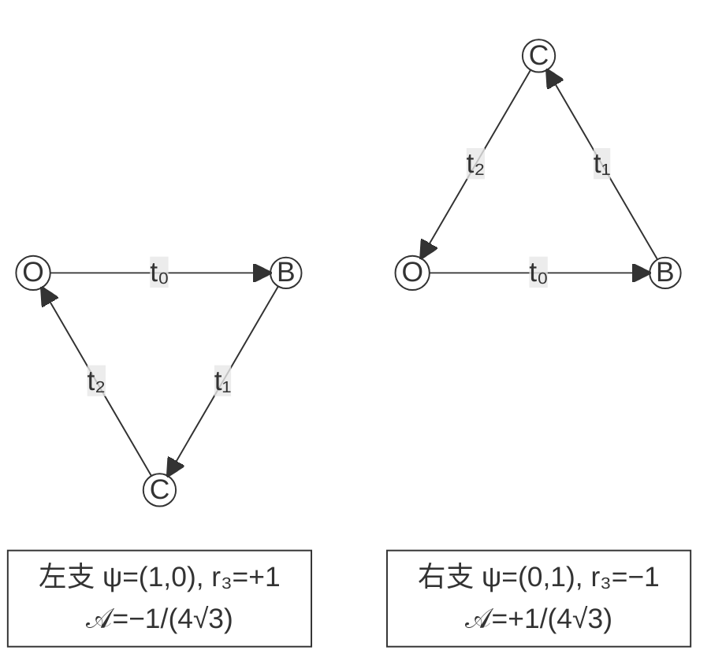

# AURIC 两基态与三通道

归一化、相位手性及递归平方律

定义、定理与纸面证明

v24.0 · 2026 年 10 月 30 日 · Asia/Singapore

## 摘要

本文研究“两通道加归一化给出三通道”在 AURIC 五模式、量子比特及递归观察中的精确意义。原始三占位均值满足
$X+Y+Z=1-p_0+p_{13}$，故一般不能据总归一化补第三项；两个归一化复振幅则确实通过 Hopf 商确定 Bloch 球面上的三个实二次关系坐标。两个固定均值仍通常留下法向正负分支。本文构造一个直接嵌入五模式的三元 Fourier 读口：三个概率为闭合复振幅三角的边长平方，隐藏 Bloch 法向恰为其有向面积的 $-4\sqrt3$ 倍。三边给出法向大小，态的实际手性给出符号。算符方面，反对易双读口以 $C=-iAB$ 闭合第三读口；三实对称反对易反射进一步产生相容复结构 $J=A_1A_2A_3$，最小非零载体为 $\mathbb{R}^4\simeq\mathbb{C}^2$。平方概率可由正交细分的统一非负标定推出，而仅有二结果归一化不足。结合项目新增 §§85–89，本文给出原生黄金门四时响应关系与二次终端律的条件刻画，并保留其全上下文、连续性、射线充分性与标定前提。最后证明归一化递归的中心、非结合边界及 Schur 有效度量：消去内部信息后，正确边界归一化为 $g^\dagger G(\lambda)g=1$，其中 $G=I-K'(\lambda)>0$。

**结果身份。**
经典 Bloch、Hopf、Clifford、POVM 和变分背景不主张原创优先权。三元测量的全朝向刻画及项目的原生响应刻画分别注明既有来源；本稿给出所用条件、连接计算、反例及证明。全部数学使用纸面推导，未运行数学数值、CAS、门字搜索、枚举或 Lean。排版编译与图形渲染只用于交付质量检查。


<a id="sec:scope"></a>
## 1. 固定项目快照与问题的精确分层


本轮固定项目 `dev` 提交为
`88a98cb974735eba23c7ece731a40ba9b48c19f5`。
时间为 2026-10-30 14:08:36 新加坡时间。相对 v23 的 `ae864ac4`，比较接口返回 54 个提交、43 条变化路径，其中六份理论文档变化；该比较没有触及返回截断。最相关实质新增由 PR \#24073 引入：量子重构续卷 II 增加 §§85–89，共 266 行，将原生全上下文四时关系与二次终端响应联系起来。金字塔基础公式本轮未变。[快照](#ref-snapshot) [金字塔基础](#ref-pyramid) [续卷 II](#ref-continuation)
这是一份定向源码核对；不将新增收录的旧研究稿视为独立验证，也不把本轮阅读称为全仓形式化重验。


#### 定义 1.1（读口、概率、振幅与关系坐标）

一个测量上下文的互斥穷尽结果概率记为 $q_j$，满足 $\sum q_j=1$。Hilbert 振幅记为 $a_j\in\mathbb{C}$，单位态满足 $\sum|a_j|^2=1$。Hermitian 算符的期望 $\operatorname{Tr}(\rho A_i)$ 是另一类实读出；不同算符不必构成同一测量的互斥结果。Bloch 坐标专指 qubit 的三项 Pauli 期望。原 AURIC 三占位均值使用大写 $X,Y,Z$。


| 对象 | 归一化或相容约束 | 两数之后还缺什么 |
|---|---|---|
| 三互斥结果 | $q_0+q_1+q_2=1$ | 第三概率唯一；量子相位仍可能未知 |
| 三实单位分量 | $r_1^2+r_2^2+r_3^2=1$ | 一般缺法向正负 |
| 两复振幅 | $\lvert \alpha \rvert^2+\lvert \beta \rvert^2=1$，再商共同相位 | 两振幅的相对相位不能删去 |
| 混合 qubit | $\operatorname{Tr}\rho=1$，$\lvert r \rvert\le1$ | 纯度并非迹归一化所给 |
| AURIC 三均值 | $X+Y+Z=1-p_0+p_{13}$ | 隐藏两模式的差及其它关系 |


所以本研究要证明的是三类明确桥梁：什么约束能补第三个数；什么代数能补第三个算符；什么跨上下文相容性会选择平方概率。三者分别承载不同信息。


<a id="sec:pyramid"></a>
## 2. 原 AURIC 五模式：归一化真正消去了哪一个自由度


#### 定义 2.1（五模式占位接口）

在 $H_A=\mathbb{C}^5$ 上取基 $\lvert 0\rangle,\lvert 1\rangle,\lvert 2\rangle,\lvert 3\rangle,\lvert 13\rangle$，与项目旧标记 $(0,2,3,5,25)$ 对应。令 $P_s=\lvert s\rangle\langle s\rvert$，并定义

$$

\widehat X=P_1+P_{13},
 \widehat Y=P_3+P_{13},
 \widehat Z=P_2.

$$

对密度态 $\rho$ 记 $p_s=\operatorname{Tr}(\rho P_s)$，则
$X=p_1+p_{13}$、$Y=p_3+p_{13}$、$Z=p_2$。

这正是项目金字塔的占位均值接口。三者同时为一的方式受到排斥规则限制，但 $\widehat X,\widehat Y$ 可以共同取一，且存在全部取零的空模式。[金字塔基础](#ref-pyramid)


<a id="thm:auricfiber"></a>
#### 定理 2.2（真实归一化恒等式与两通道纤维）

原五模式满足

$$

\widehat X+\widehat Y+\widehat Z=I-P_0+P_{13},
 
 \boxed{X+Y+Z=1-p_0+p_{13}.}

$$

可实现的三均值恰为

$$

X,Y,Z\ge0, X+Z\le1, Y+Z\le1.

$$

因此固定 $X,Y\in[0,1]$ 时，第三均值的完整范围是

$$

\boxed{0\le Z\le1-\max(X,Y).}

$$

固定合法 $X,Z$ 时，$0\le Y\le1-Z$；交换 $X,Y$ 同理。


**证明。**

逐个基模式相加得到算符恒等式。设 $\kappa=p_{13}$，解归一化与三个读出方程：

$$

p_0=1-Z-X-Y+\kappa, p_1=X-\kappa,
 p_2=Z, p_3=Y-\kappa, p_{13}=\kappa.

$$

非负性等价于

$$

\max(0,X+Y+Z-1)\le\kappa\le\min(X,Y).

$$

该区间非空恰等价于所列三均值不等式，反向按这些式子构造概率即实现。消去 $Z$ 或 $Y$ 便得各完整区间。

**证明完。** ∎


即使要求五模式为纯单位态也不够：$\lvert 0\rangle$ 与 $\lvert 2\rangle$ 的 $X=Y=0$ 相同，$Z$ 分别为零、一。对内部例子 $X=Y=1/4$，概率
$(1/2,1/4,0,1/4,0)$ 与 $(0,1/4,1/2,1/4,0)$ 也给不同的 $Z$；取各概率平方根为振幅，就得到两份归一化纯态。总归一化已经用于定理中的可行体，不能再次计成三个均值之间的另一条等式。


<a id="thm:linearcriterion"></a>
#### 定理 2.3（第三线性读出的全态重构判据）

设 $A_1,A_2,A_3$ 为有限维 Hilbert 空间上的 Hermitian 算符。在全部密度态上，$\operatorname{Tr}(\rho A_3)$ 由 $\operatorname{Tr}(\rho A_1),\operatorname{Tr}(\rho A_2)$ 与 $\operatorname{Tr}\rho=1$ 唯一决定，当且仅当

$$

A_3\in\operatorname{span}_{\mathbb{R}}\{I,A_1,A_2\}.

$$

这里不预先要求重构函数线性。


**证明。**

充分性直接代入。若不在该实线性包络中，取 $A_3$ 对该包络的 Hilbert–Schmidt 正交余量 $\Delta\ne0$。则
$\operatorname{Tr}\Delta=\operatorname{Tr}(\Delta A_1)=\operatorname{Tr}(\Delta A_2)=0$，且
$\operatorname{Tr}(\Delta A_3)=\operatorname{Tr}(\Delta^2)>0$。令维数为 $d$，取足够小的 $\varepsilon>0$，则
$\rho_\pm=I/d\pm\varepsilon\Delta$ 都正定、迹为一。二者前两读出相同，第三读出不同，矛盾。

**证明完。** ∎

原 AURIC 的 $I,\widehat X,\widehat Y,\widehat Z$ 线性独立：在空模式及三个单占位模式依次取值即可。因此任取两个都不满足这个全态补全判据。纯态球面是受限非线性域，不与本定理冲突。


#### 命题 2.4（三概率切面及未消除的相位）

另加条件 $p_0=p_{13}$ 后，三均值确实满足 $X+Y+Z=1$。若更强地限制到

$$

H_{\rm one}=\operatorname{span}\{\lvert 1\rangle,\lvert 3\rangle,\lvert 2\rangle\},

$$

则 $p_0=p_{13}=0$，三个占位效果在该扇区成为互斥完备的三结果投影测量。固定完整概率分布，且该分布恰有 $k$ 个非零项时，纯态射线仍有相位纤维 $\mathbb T^{k-1}$。


**证明。**

第一句由定理 [定理 2.2](#thm:auricfiber)。在 $H_{\rm one}$ 上三个效果分别是其三个基投影。固定非零概率后，各振幅只能写成 $\sqrt{q_j}e^{i\theta_j}$；商去一个共同相位，剩 $k-1$ 个独立圆相位。

**证明完。** ∎

仅有 $p_0=p_{13}$ 时隐藏的 $\kappa$ 仍可变化。几何三均值的平面 $X+Y+Z=1$ 是五点金字塔的一个截面；这里的 $H_{\rm one}$ 是另外明示的逻辑扇区，不能由该平面等式反推全部五模式支撑已经缩减。


<a id="sec:bloch"></a>
## 3. 两个复基态怎样产生三个实关系分量


采用标准 Pauli 矩阵

$$

\sigma_x=\begin{pmatrix}0&1\\1&0\end{pmatrix},
 \sigma_y=\begin{pmatrix}0&-i\\i&0\end{pmatrix},
 \sigma_z=\begin{pmatrix}1&0\\0&-1\end{pmatrix}.

$$

它们是三个算符方向；$\mathbb{C}^2$ 只有两个互相正交的基态。下面给出标准 Bloch 表示的全部所需计算。[Preskill](#ref-preskill)


<a id="thm:hopf"></a>
#### 定理 3.1（双复振幅的三实二次坐标与 Hopf 商）

对单位向量 $\psi=(\alpha,\beta)^T$，令

$$

r_1=2\operatorname{Re}(\bar\alpha\beta),
 r_2=2\operatorname{Im}(\bar\alpha\beta),
 r_3=|\alpha|^2-|\beta|^2.

$$

则 $r_1^2+r_2^2+r_3^2=1$，且

$$

\lvert \psi\rangle\langle \psi\rvert
 =\frac12\begin{pmatrix}1+r_3&r_1-ir_2\\r_1+ir_2&1-r_3\end{pmatrix}
 =\frac12(I+r\cdot\sigma).

$$

此映射诱导双射 $S^3/U(1)\simeq\mathbb{CP}^1\simeq S^2$。


**证明。**

平方恒等式为

$$

r_1^2+r_2^2+r_3^2
 =4|\alpha|^2|\beta|^2+(|\alpha|^2-|\beta|^2)^2
 =(|\alpha|^2+|\beta|^2)^2=1.

$$

矩阵式直接展开。相同三个坐标给相同秩一投影，所以两单位向量只差共同相位；反向共同相位显然消去。对球面上 $r_3\ne-1$ 的点，取

$$

\alpha=\sqrt{\frac{1+r_3}{2}},
 \beta=\frac{r_1+ir_2}{\sqrt{2(1+r_3)}},

$$

直接代入得到归一化与原坐标。南极取 $(0,1)$。故满射且纤维恰为 $U(1)$。

**证明完。** ∎

这里的 Hopf 纤维是一整个圆，不是二重覆盖。二重覆盖是另一个映射 $SU(2)\to SO(3)$，其核为 $\{\pm I\}$。两个复振幅提供四个实参数，单位范数扣去一个，共同相位再扣去一个；剩下两个实自由度，但并不意味着任意两个固定读出能全球单值重构。


<a id="thm:ball"></a>
#### 定理 3.2（球体、纯度与两个读出的精确余量）

每个 qubit 密度态唯一写为 $\rho=(I+r\cdot\sigma)/2$，且

$$

\rho\succeq0\iff |r|\le1,
 |r|^2=2\operatorname{Tr}(\rho^2)-1.

$$

固定 $r_1,r_2$ 且 $r_1^2+r_2^2\le1$ 时，一般态允许

$$

-\sqrt{1-r_1^2-r_2^2}\le r_3\le
 \sqrt{1-r_1^2-r_2^2}.

$$

圆盘外无合法态。纯态只允许两端点；圆盘内部有两个，边界上只有零。若已知纯度 $\mu$，则
$r_3^2=2\mu-1-r_1^2-r_2^2$，仍须决定符号。


**证明。**

Hermitian 迹一矩阵的 Pauli 展开唯一。由 $(r\cdot\sigma)^2=|r|^2I$，本征值为 $(1\pm|r|)/2$，得正性及纯态条件。再用
$\operatorname{Tr}(\sigma_i\sigma_j)=2\delta_{ij}$ 平方取迹，得纯度式。其余均由球体或指定半径的球面截线得到。

**证明完。** ∎

手性规定哪侧叫正，不决定未知态位于哪侧。固定同一右手 Pauli 三元组后，$\lvert 0\rangle,\lvert 1\rangle$ 仍有相同 $r_1=r_2=0$ 和相反的 $r_3$。原项目的三轴几何文件也已明确给出同样的平方剩余量与符号边界。[三轴几何](#ref-axes)


#### 命题 3.3（半球反演的稳定性边界）

即使另知 $r_3\ge0$，映射
$r_3=\sqrt{1-r_1^2-r_2^2}$ 在整个闭圆盘上也没有统一有限的 Lipschitz 常数。


**证明。**

在内盘其梯度为 $(-r_1/r_3,-r_2/r_3)$。更直接，比较 $(1,0,0)$ 与
$(1-\varepsilon,0,\sqrt{2\varepsilon-\varepsilon^2})$，前两读出之差为 $\varepsilon$，第三差值除以它趋于无穷。

**证明完。** ∎

因此“稳定”若指误差传播，还须指定远离退化边界的区域，不能只靠参数计数。


#### 命题 3.4（整体纯态与局部平方余量）

设复合系统纯态为 $\lvert \Psi\rangle=\lvert 0\rangle\otimes u+\lvert 1\rangle\otimes v$，且
$\|u\|^2+\|v\|^2=1$。记 $a=\|u\|^2,b=\|v\|^2,c=\langle u,v\rangle$，约化 qubit 的 Bloch 向量为 $(2\operatorname{Re} c,2\operatorname{Im} c,a-b)$，并有

$$

\boxed{1-|r|^2=4(ab-|c|^2)\ge0.}

$$

等号当且仅当 $u,v$ 线性相关，包括一个为零的情形。


**证明。**

部分迹给约化矩阵 $(\begin{smallmatrix}a&\bar c\\c&b\end{smallmatrix})$。展开 $1-|r|^2$ 得所列式，非负性与等号由 Cauchy–Schwarz。

**证明完。** ∎

这把局部“不满单位球面”解释为隐藏分支关系的 Gram 行列式。整体本体态为纯态，并不要求每个局部观察接口也纯。


<a id="sec:clifford"></a>
## 4. 第三读口、相容复结构与归一化 Gram 关系


<a id="thm:pauli"></a>
#### 定理 4.1（两个反对易读口的第三算符）

设 $A,B$ 为复 Hilbert 空间上的 Hermitian 算符，满足
$A^2=B^2=I$、$AB=-BA$。则

$$

C=-iAB

$$

为 Hermitian involution，且

$$

AB=iC, BC=iA, CA=iB.

$$

有限维时 $\dim_\mathbb{C} H=2m$，三者酉等价于一组 Pauli 算符张量 $I_m$。


**证明。**

$C^\dagger=iBA=-iAB$，$C^2=-ABAB=I$，其余乘积直接用反对易式化简。$B$ 等距交换 $A$ 的 $\pm1$ 本征空间，故二者同维。在正本征空间选正交基 $e_k$，用 $Be_k$ 作为负本征空间基，便有
$A=\sigma_z\otimes I_m,B=\sigma_x\otimes I_m,C=\sigma_y\otimes I_m$。

**证明完。** ∎

所以两个算符连同乘法关系确定第三算符；两个*均值*没有自动保留这个乘法关系的读出。


<a id="thm:gram"></a>
#### 定理 4.2（第三通道的复相关与 Gram 正性）

对上述三元组与状态 $\rho$，令 $x=\operatorname{Tr}\rho A,y=\operatorname{Tr}\rho B,z=\operatorname{Tr}\rho C$。则

$$

z=\operatorname{Im}\operatorname{Tr}(\rho AB)=\frac1{2i}\operatorname{Tr}(\rho[A,B]).

$$

中心化双读口 $\delta A=A-xI,\delta B=B-yI$ 的 Gram 矩阵为

$$

G=
 \begin{pmatrix}
 1-x^2&iz-xy\\
 -iz-xy&1-y^2
 \end{pmatrix}\succeq0,
 \boxed{\det G=1-x^2-y^2-z^2.}

$$

逻辑 qubit 的约化态纯时行列式为零。三方差和恒满足
$\operatorname{Var}(A)+\operatorname{Var}(B)+\operatorname{Var}(C)=3-x^2-y^2-z^2\ge2$。


**证明。**

由 $AB=iC$ 得第一式。Gram 的各项是 $\operatorname{Tr}\rho\delta A_i^\dagger\delta A_j$，所以任意复线性组合的二次型为一个正算符的期望，非负。展开给显示矩阵及其行列式。由定理 [定理 4.1](#thm:pauli) 的逻辑 qubit 表示及定理 [定理 3.2](#thm:ball)，纯性恰对应 $|r|=1$。方差用 $A_i^2=I$ 相加即可。

**证明完。** ∎

这就是此双读口的 Schrödinger–Robertson 不等式：
$(1-x^2)(1-y^2)\ge x^2y^2+z^2$。第三分量位于两通道关联的虚部。普通先投影测 $A$ 再测 $B$ 并不读取该虚部：$P_a=(I+aA)/2$ 满足 $P_aBP_a=0$，所以其二值结果乘积的均值恒为零。相干相关读口或直接测 $C$ 必须另行给出。


<a id="thm:realcomplex"></a>
#### 定理 4.3（三实反对易反射产生相容复结构）

设非零有限维实内积空间 $(V,g)$ 上有三个实自伴算符 $A_i$，满足

$$

A_i^2=I, A_iA_j=-A_jA_i(i\ne j).

$$

令 $J=A_1A_2A_3$，则

$$

J^2=-I, J^T=-J, JA_i=A_iJ.

$$

以 $J$ 定义乘以 $i$，并置

$$

h(u,v)=g(u,v)-ig(u,Jv),

$$

得到第一槽共轭线性、第二槽线性的正定复内积。三个 $A_i$ 成为复线性 Hermitian 算符，且
$A_3=-iA_1A_2$。$\dim_\mathbb{R} V=4m$，最小非零模型是 $\mathbb{R}^4\simeq\mathbb{C}^2$。


**证明。**

三次交换给
$(A_1A_2A_3)^2=-I$，反序取转置同样给负号。将任一 $A_i$ 穿过其余两项只产生两次负号，故 $J$ 与各 $A_i$ 对易。$J^T=-J$ 且 $J^2=-I$ 使 $J$ 正交。

直接计算
$h(u,Jv)=i h(u,v)$、$h(Ju,v)=-i h(u,v)$；
$g(u,Jv)=-g(Ju,v)$ 给共轭对称性，而
$h(v,v)=g(v,v)>0$。$A_i$ 与 $J$ 对易给复线性，其实自伴性给 $h$-自伴性。又
$J A_1A_2=-A_3$，得第三算符公式。最后 $A_2$ 交换 $A_1$ 的两个*复*本征空间，故复维数为 $2m$，实维数为 $4m$。标准 Pauli 三元组实化即实现 $m=1$。

**证明完。** ∎

这一构造给“复结构来自关系”一个严格版本，但承重前件是**算符反对易代数**，比几何轴正交强。原 AURIC 三个占位算符彼此对易，不满足它。仅给两实反射时，$AB$ 虽可满足平方为 $-I$，却与 $A,B$ 反对易；以它作为复结构会使原两算符反线性，不能直接宣称已经得到同一复 Hilbert 空间上的线性读口。


<a id="prop:cone"></a>
#### 命题 4.4（五模式中的有质量 Bloch 锥）

全空间 $\mathbb{C}^5$ 不可能承载定理 [定理 4.1](#thm:pauli) 的两个 involutions。若在选定二维投影 $\Pi$ 上定义 Pauli $A,B,C$，在正交补上置零，则
$A^2=B^2=C^2=\Pi$。对任意五模式态，令
$w=\operatorname{Tr}\rho\Pi$、$r=(\operatorname{Tr}\rho A,\operatorname{Tr}\rho B,\operatorname{Tr}\rho C)$，则

$$

\boxed{|r|^2\le w^2.}

$$

$w>0$ 时等号恰对应压缩后条件态 $\Pi\rho\Pi/w$ 为纯态。


**证明。**

奇数维障碍由定理 [定理 4.1](#thm:pauli)。$w>0$ 时对条件态应用 Bloch 球体定理；$w=0$ 时正半定压缩块的迹为零，只能为零。总五模式为纯向量时，该压缩块秩至多一，但质量 $w$ 仍未必为一。

**证明完。** ∎


<a id="sec:trine"></a>
## 5. 两复基态、三输出与闭合振幅三角


#### 定义 5.1（五模式中的三元 Fourier 编码）

令 $\omega=e^{2\pi i/3}$，取 $\psi=(\alpha,\beta)^T$。定义

$$

a_j=\frac{\alpha+\omega^{-j}\beta}{\sqrt3}, j=0,1,2,
  V\psi=(a_0,a_1,a_2)^T.

$$

将三个输出依次放到 AURIC 的 $\lvert 1\rangle,\lvert 3\rangle,\lvert 2\rangle$，空模式与 $\lvert 13\rangle$ 振幅取零。这样三个占位均值就是
$X=q_0,Y=q_1,Z=q_2$，其中 $q_j=|a_j|^2$。


<a id="thm:trineisometry"></a>
#### 定理 5.2（等距编码与三元非锐测量）

有

$$

V^\dagger V=I_2,
 \sum_j|a_j|^2=|\alpha|^2+|\beta|^2,
 \boxed{a_0+\omega^2a_1+\omega a_2=0.}

$$

该映射由三阶 Fourier 酉门作用于 $(\alpha,\beta,0)$ 得到。拉回三个正交输出基投影后，输入 qubit 上的效果为

$$

E_j=\frac13(I+n_j\cdot\sigma),
 n_j=(\cos(2\pi j/3),\sin(2\pi j/3),0).

$$

每个效果本征值为 $0,2/3$，三者之和为 $I_2$。


**证明。**

$1+\omega+\omega^2=0$。$V$ 的两列
$(1,1,1)^T/\sqrt3$ 与 $(1,\omega^2,\omega)^T/\sqrt3$ 正交归一；补上 $(1,\omega,\omega^2)^T/\sqrt3$ 就是三阶 Fourier 酉矩阵。乘 $\omega^{-j}$ 后求和得隐藏线性关系。逐行外积给
$E_j=\frac13(\begin{smallmatrix}1&\omega^{-j}\\\omega^j&1\end{smallmatrix})$，即显示 Pauli 式。

**证明完。** ∎

这是标准 trine POVM 的显式扩展实现。[Caves 等](#ref-caves) [Zhao 等](#ref-zhao) 三个*输出模式*在扩展空间正交；三个输入效果不正交，也不是 qubit 中三个正交基态。$F_3\oplus I_2$ 提供了数学上明确的五模式酉接口，其在原生黄金门菜单上的编译本稿未取得。


<a id="thm:trinedisk"></a>
#### 定理 5.3（三概率圆盘与法向两分支）

输入纯 qubit 的 Bloch 向量记为 $r$，$r_\parallel=(r_1,r_2,0)$。则

$$

q_j=\frac{1+n_j\cdot r}{3},
 r_\parallel=2\sum_jq_jn_j,
 r_1+ir_2=2\sum_j\omega^j q_j,

$$

$$

\sum_jq_j^2=\frac13+\frac{|r_\parallel|^2}{6}.

$$

允许的概率集合恰为

$$

\boxed{q_j\ge0, \sum_jq_j=1, \sum_jq_j^2\le\frac12.}

$$

其内部点有两条纯态原像，法向为
$r_3=\pm\sqrt{1-|r_\parallel|^2}$；边界两分支合并。


**证明。**

展开 $|a_j|^2$，用 $\bar\alpha\beta=(r_1+ir_2)/2$ 得第一式。
三向量满足 $\sum n_j=0$、$\sum n_jn_j^T=\frac32\Pi_\parallel$，得到逆式及平方和。任意总和为一的实三元组均由该二维线性关系恢复其 $r_\parallel$；平方和条件恰给 $|r_\parallel|\le1$，可补成球面点。该补全所得概率即原三元组，所以条件充分。最后用定理 [定理 3.2](#thm:ball)。

**证明完。** ∎

三概率并非整个单纯形：例如 $(1,0,0)$ 不在允许圆盘内。这里的“两个概率加归一化”补全了同一读口的三个概率，却一般没有补全态的法向分支。


<a id="thm:area"></a>
#### 定理 5.4（振幅三角的有向面积就是隐藏法向）

沿用前一定理的归一化输入纯 qubit，定义复平面边向量

$$

t_j=\omega^{-j}a_j, t_0+t_1+t_2=0.

$$

其边长为 $\sqrt{q_j}$。以
$\mathcal A=\frac12\operatorname{Im}(\overline{t_0}t_1)$ 为按 $t_0,t_1$ 顺序的有向面积，$\Delta=|\mathcal A|$ 为无向面积，则

$$

\boxed{
 16\Delta^2=1-2\sum_jq_j^2,
 r_3^2=48\Delta^2,
 r_3=-4\sqrt3\mathcal A.
 }

$$

因此三概率连同非退化振幅三角的实际手性，确定完整纯 qubit 射线。


**证明。**

边闭合由定理 [定理 5.2](#thm:trineisometry)。三边平方的 Heron 恒等式给

$$

16\Delta^2
 =2(q_0q_1+q_1q_2+q_2q_0)-(q_0^2+q_1^2+q_2^2)
 =1-2\sum_jq_j^2.

$$

亦可由 $t_2=-t_0-t_1$ 消去 $\operatorname{Re}(\bar t_0t_1)$，直接用
$4\Delta^2=|t_0|^2|t_1|^2-(\operatorname{Re}\bar t_0t_1)^2$ 得同式。
再代入定理 [定理 5.3](#thm:trinedisk) 和纯态 $|r|=1$，得到第二式。

最后 $t_0=(\alpha+\beta)/\sqrt3$、
$t_1=(\omega^2\alpha+\omega\beta)/\sqrt3$。乘积的交叉项为
$\omega\bar\alpha\beta+\omega^2\bar\beta\alpha$，是实数，所以

$$

\operatorname{Im}(\overline{t_0}t_1)
 =\frac{-\sqrt3|\alpha|^2/2+\sqrt3|\beta|^2/2}{3}
 =-\frac{\sqrt3}{6}r_3.

$$

再除以二得第三式。由三概率恢复 $r_\parallel$，由面积符号选择 $r_3$，然后用 Hopf 商的单射性恢复射线。

**证明完。** ∎




两图均采用实轴向右、虚轴向上的同一复平面方向；有向边依次为 $t_0:O\to B$、$t_1:B\to C$、$t_2:C\to O$。精确局部坐标为 $O=(0,0)$、$B=(1/\sqrt3,0)$；左支 $C=(1/(2\sqrt3),-1/2)$，右支 $C=(1/(2\sqrt3),+1/2)$。两支在原图中的整体平移分别为 $-1.2\,\mathrm{cm}$ 与 $+1.2\,\mathrm{cm}$；面积记号 A 对应 $\mathcal A$。

**图 1 原始 caption：** 固定同一复平面方向与边标记，两份态的三边长平方同为 $(1/3,1/3,1/3)$，但实际有向面积相反。选定坐标手性本身不能判定未知态属于哪一分支。图按解析坐标绘制。

编辑说明：可见图采用 Mermaid 的共享顶点与有向边绘制两个闭合三角形，顶点圆圈和布局比例为示意，不是按解析坐标等比例绘制；黑白线条替代原图的蓝色、橙色边线及浅色填充。箭头和边标签附在对应边上，精确坐标、状态与有向面积在图旁明示；下列原始 TikZ 保留精确绘图定义。

<details><summary>原始 TikZ 源码（逐字保留）</summary>

```tex
\begin{figure}[htbp]
\centering
\begin{tikzpicture}[scale=2.6,>=Stealth,line width=.7pt]
 \begin{scope}[xshift=-1.2cm]
 \coordinate (O) at (0,0); \coordinate (B) at ({1/sqrt(3)},0);
 \coordinate (C) at ({1/(2*sqrt(3))},-.5);
 \fill[blue!7] (O)--(B)--(C)--cycle;
 \draw[->,blue!60!black] (O)--(B) node[midway,above] {$t_0$};
 \draw[->,blue!60!black] (B)--(C) node[midway,right] {$t_1$};
 \draw[->,blue!60!black] (C)--(O) node[midway,left] {$t_2$};
 \node[below] at ({1/(2*sqrt(3))},-.63) {$\psi=(1,0),\quad r_3=+1$};
 \node[above] at ({1/(2*sqrt(3))},.18) {$\mathcal A=-1/(4\sqrt3)$};
 \end{scope}
 \begin{scope}[xshift=1.2cm]
 \coordinate (O) at (0,0); \coordinate (B) at ({1/sqrt(3)},0);
 \coordinate (C) at ({1/(2*sqrt(3))},.5);
 \fill[orange!12] (O)--(B)--(C)--cycle;
 \draw[->,orange!75!black] (O)--(B) node[midway,below] {$t_0$};
 \draw[->,orange!75!black] (B)--(C) node[midway,right] {$t_1$};
 \draw[->,orange!75!black] (C)--(O) node[midway,left] {$t_2$};
 \node[below] at ({1/(2*sqrt(3))},-.63) {$\psi=(0,1),\quad r_3=-1$};
 \node[above] at ({1/(2*sqrt(3))},.58) {$\mathcal A=+1/(4\sqrt3)$};
 \end{scope}
\end{tikzpicture}
\caption{固定同一复平面方向与边标记，两份态的三边长平方同为 $(1/3,1/3,1/3)$，但实际有向面积相反。选定坐标手性本身不能判定未知态属于哪一分支。图按解析坐标绘制。}
\end{figure}
```

</details>


这一构造精确实现“两个读出决定平面内关系，法向藏在关系的手性中”。但 $q_j=|a_j|^2$ 在本节采用通常量子读出；不能再把本节几何恒等式倒过来当作平方律已从无前提推出。平方律的独立相容条件见下节。


<a id="prop:threepovm"></a>
#### 命题 5.5（任何固定三结果 qubit 读口的共同限制）

对任意三效果 POVM，存在两个正交纯 qubit 态给出相同的全部三概率。


**证明。**

写 $E_j=c_jI+v_j\cdot\sigma$。完备性给 $\sum v_j=0$，所以三向量张成至多二维。取单位法向 $n$ 垂直于它们，则
$\rho_\pm=(I\pm n\cdot\sigma)/2$ 均给概率 $\operatorname{Tr}\rho_\pm E_j=c_j$，而二者是正交纯态。

**证明完。** ∎

算符级的“两效果加归一化”确有精确公式 $E_3=I-E_1-E_2$，但须 $E_1+E_2\le I$。若 $E_1,E_2$ 是 qubit 上两个秩一锐投影，该条件迫使二者正交，继而 $E_3=0$：其和的本征值为 $1\pm|\langle u,v\rangle|$。因此三条非零锐正交通道不可能都装在一个 qubit 内。


<a id="sec:square"></a>
## 6. 原生黄金块与平方概率的相容条件


<a id="prop:goldblock"></a>
#### 命题 6.1（原生黄金块的明确 Bloch 向量）

取 $x=\varphi^{-1}$、$y=\sqrt x$，故 $x+x^2=1$。项目原生门在两邻居为空的中心二维块使用

$$

Q=\begin{pmatrix}x&xy\\xy&x^2\end{pmatrix}.

$$

它恰为单位向量 $g=(\sqrt x,x)^T$ 的投影，并有

$$

\boxed{Q=\frac12(I+n\cdot\sigma),
 n=(2x\sqrt x,0,x-x^2), |n|=1.}

$$


**证明。**

$gg^\dagger=Q$，$\|g\|^2=x+x^2=1$。代入定理 [定理 3.1](#thm:hopf)，并用
$4x^3+(x-x^2)^2=(x+x^2)^2=1$。

**证明完。** ∎

这个 $Q$ 来自同一个原生三站点门
$K=\zeta[I+(\zeta-1)\mathcal P]$，
$\mathcal P=n_Ln_R+(1-n_L)(1-n_R)Q_C$，
$\zeta=e^{3\pi i/5}$。[续卷 II](#ref-continuation)
因此“两复振幅产生三实二次关系”已经有同源黄金实例。但 $n_2=0$ 来自所选实相位；用
$g_\theta=(\sqrt x,e^{i\theta}x)$ 会得到
$(2x\sqrt x\cos\theta,2x\sqrt x\sin\theta,x-x^2)$。归一化本身没有选定这个相位。


<a id="thm:bornrefine"></a>
#### 定理 6.2（正交递归细分唯一选择平方标定）

在已给 Hilbert 振幅与平方范数上，假设同一分量的概率标定为
$f(|a|^2)$，其中 $f:[0,1]\to[0,\infty)$、$f(0)=0$。若对所有
$s,t,u\ge0$、$s+t+u=1$ 都有

$$

f(s)+f(t)+f(u)=1,

$$

则 $f(s)=s$，因而 $p(a)=|a|^2$。不必另加连续性。


**证明。**

取 $(1,0,0)$ 得 $f(1)=1$。对 $s+t\le1$，比较
$(s,t,1-s-t)$ 与 $(s+t,0,1-s-t)$，得到
$f(s+t)=f(s)+f(t)$。非负性给单调性。加法性先给
$f(m/n)=m/n$，再用任意实数两侧的有理数夹逼得到 $f(s)=s$。

**证明完。** ∎

等价地，若模长权重 $w(r)=f(r^2)$ 对所有 $a,b\ge0$、$a^2+b^2\le1$ 在细分时满足

$$

w(\sqrt{a^2+b^2})=w(a)+w(b), w(1)=1,

$$

则 $w(r)=r^2$。这里平方来自**同一正交分支在粗细描述间保持同一非负总权重**。这是一条跨分辨率的相容性原则；幅度载体、同一标定及细分可用域都是明确前件。


<a id="prop:nonborn"></a>
#### 命题 6.3（两分量归一化允许非平方概率）

仅要求 $f(s)+f(1-s)=1$，不足以推出 $f(s)=s$。例如

$$

f(s)=\frac{s^2}{s^2+(1-s)^2}

$$

连续、非负、保持零一标定，且满足全部二分量归一化。相应规则为
$p_0=|\alpha|^4/(|\alpha|^4+|\beta|^4)$。


**证明。**

分母在 $[0,1]$ 上严格正，替换 $s\mapsto1-s$ 后相加为一。但
$f(3/4)=9/10\ne3/4$。

**证明完。** ∎

甚至对任意纯态 Bloch 向量 $r$ 与方向 $n$，规则
$p_r(n)=(1+(r\cdot n)^3)/2$ 也连续、旋转协变、满足
$p_r(n)+p_r(-n)=1$，并在 $n=\pm r$ 校准为一、零，却不是 Born 赋值。二结果归一化与各向同性仍没有规定跨测量的完整相容关系。Busch 的全效果可加性是另一条足够的条件路线，且适用于 qubit；其输入包括效果空间与同一效果的跨上下文赋值。[Busch](#ref-busch)


<a id="thm:alltrine"></a>
#### 定理 6.4（全部朝向的三元相融选择线性 Bloch 响应）

设 $F:S^2\to[0,\infty)$ 连续。对每一个共面、两两夹角 $120^\circ$ 的三元组
$n_0+n_1+n_2=0$，假设

$$

F(n_0)+F(n_1)+F(n_2)=1.

$$

相同方向的效果在不同三元组中使用同一 $F$。则存在唯一 $r\in\mathbb{R}^3$、$|r|\le1$，使

$$

\boxed{F(n)=\frac{1+r\cdot n}{3}
 =\operatorname{Tr}[\frac{I+r\cdot\sigma}{2}
             \frac{I+n\cdot\sigma}{3}].}

$$


**证明。**

使用球面调和分量的标准不可约旋转分解。对每个 $l>0$，向该分量的投影可由旋转群积分给出，故三元和条件使该分量的所有旋转也具有零三元和。若分量非零，其旋转张成整个次数 $l$ 的不可约空间。取三点
$(1,0,0),(-1/2,0,\sqrt3/2),(-1/2,0,-\sqrt3/2)$；
调和多项式 $(n_x+in_y)^l$ 的三元和是
$1+2(-1/2)^l$，仅在 $l=1$ 时为零。所以所有 $l\ge2$ 分量消失。调和多项式的稠密性与连续性给 $F=c+b\cdot n$；三元和固定 $c=1/3$，非负性给 $|b|\le1/3$。令 $r=3b$ 即得。反向代入显然成立。

**证明完。** ∎

这是 Caves–Fuchs–Manne–Renes 对 trine frame functions 的既有刻画，本文采用其明确的连续性与全旋转条件。[Caves 等](#ref-caves)
一个固定 trine 的归一化远弱于这个全称原则；甚至只在同一平面内旋转时，
$F(\theta)=1/3+\varepsilon\cos2\theta$、$0<\varepsilon\le1/3$ 也满足三元和，却保留二次角谐波。单个三角形的三边关系必须推广成*所有相关朝向之间的同一响应*，才能得到本定理。

另须区分两条充分路线：定理 [定理 6.2](#thm:bornrefine) 要求任意三个正交模式的全部概率单纯形；固定 trine 编码只覆盖定理 [定理 5.3](#thm:trinedisk) 的圆盘，不能未经证明将其视为前者的全部可用域。定理 [定理 6.4](#thm:alltrine) 则改用完整朝向族的相容性。


<a id="sec:native"></a>
## 7. 项目最新进展：原生四时关系如何选择二次终端律


### 7.1 同一来源、全部上下文及三个相对频率


#### 定义 7.1（固定原生终端来源）

沿用续卷 II §77，十站点依次为 $b_{-1},b_0,\ldots,b_8$。记占位投影为 $n=\lvert 1\rangle\langle 1\rvert$。定义

$$

\begin{gathered}
 H=\operatorname{span}_\mathbb{C}\{\lvert 10\beta010\rangle:
 \beta\in\{0,1\}^5,\ \beta_i\beta_{i+1}=0\ (1\le i<5)\},\\
 \dim H=13, v=\lvert 1000100010\rangle.
 \end{gathered}

$$

七个地址为 $0,\ldots,6$，原门 $K_j$ 由命题 [命题 6.1](#prop:goldblock) 的三站点式定义，作用于 $(b_{j-1},b_j,b_{j+1})$，中心为 $b_j$，其余站点取恒等。字
$p=j_1\cdots j_\ell$ 按调用先后书写，$K_p=K_{j_\ell}\cdots K_{j_1}$。空字允许，全部字均为有限正向字。

继承项目 §77.2 的同源表示与射影密度结论
$\overline{\{[K_p]\}}=PU(13)$；它以明确 Jones–Wenzl 扇区对应与 Freedman–Larsen–Wang 密度定理为供应。本稿不把理想闭包酉当成新增可执行菜单，也不重复认证其整个上游表示证明。[续卷 II](#ref-continuation) [Freedman–Larsen–Wang](#ref-flw)

终端接口采用 §78.1：对全部 $1024$ 个标签 $w$，$P_w$ 是单位球上连续、共同相位不变、非负且总和一的函数；当前射线对这个条件终端任务充分。原程序档案仍保留。此时尚未假设 Born、混态仿射性或测后态仪器。


原地址零在 $H$ 上满足

$$

K_0=\zeta[(I-\Pi)+\zeta\Pi],
 \operatorname{rank}\Pi=5,\dim\ker\Pi=8, K_0^{10}=I.

$$

投影 $\Pi$ 检查 $\beta_1=1$；若该位为一，下一位必须为零，剩三位有五条合法路径；若为零，剩四位有八条。计数由无相邻占据的递推 $a_n=a_{n-1}+a_{n-2}$、$a_0=1,a_1=2$ 得到。这与单个五模式空间是不同层级的载体。


<a id="lem:fourtime"></a>
#### 引理 7.2（二谱门的二次响应与黄金四时恒等式）

设 $Q$ 是正交投影，$U=\zeta[(I-Q)+\zeta Q]$，
$\zeta=e^{3\pi i/5}$。对 Hermitian $E$ 与任意向量 $\eta$，

$$

a_t=\langle U^t\eta,E U^t\eta\rangle
 =a+b\zeta^t+\bar b\zeta^{-t}

$$

其中 $a\in\mathbb{R}$。记 $x=\varphi^{-1}$，则

$$

\boxed{a_3+x^2a_1=a_0+x^2a_2.}

$$

也有 $\frac1{10}\sum_{t=0}^9\zeta^{-2t}a_t=0$。


**证明。**

写 $\eta_0=(I-Q)\eta,\eta_1=Q\eta$。消去共同相位后向量为
$\eta_0+\zeta^t\eta_1$，展开二次型即得三个频率。
因为 $\zeta+\zeta^{-1}=-x$、$1-x=x^2$，

$$

R(s)=s^3-x^2s^2+x^2s-1
 =(s-1)(s-\zeta)(s-\zeta^{-1}).

$$

移位算符以 $1,\zeta,\zeta^{-1}$ 为上述三个序列的特征值，故 $R$ 消去它们。十项根和同样消去这三个频率相对于禁频 $2$ 的系数。

**证明完。** ∎

这个恒等式先从*已有二次读出*得到。把方向倒过来，要求未知预测在所有上下文都保持它，才是项目新增的强原则。


### 7.2 全上下文刻画及其承重前提


设

$$

a_t(p,f,w)=P_w(K_fK_0^tK_pv).

$$

对全部有限 $p,f$（含空字）及全部原始标签定义

$$

(\mathrm T_4): a_3+x^2a_1=a_0+x^2a_2,
 
 (\mathrm T_{10}):
 \frac1{10}\sum_{t=0}^9\zeta^{-2t}a_t=0.

$$

调用次数只是程序中的离散重复标签；并不需要另供连续外部时钟。


<a id="thm:native"></a>
#### 定理 7.3（项目原生全上下文二次响应刻画）

在上述固定来源及终端接口前提下，

$$

\mathrm T_4\iff\mathrm T_{10}
 \iff
 P_w(\psi)=\langle \psi,E_w\psi\rangle,
 E_w\succeq0,\sum_wE_w=I_H.

$$

若另外要求每个合法基态的确定性基底标定
$P_w(e_\beta)=\delta_{w,\operatorname{label}(\beta)}$，则还等价于全部合法标签的
$P_w(\psi)=|\psi_w|^2$，其余标签恒零。


**证明。**

这是固定源码 §86.1 的条件结论。给出其关键完整逻辑，并将外部表示论供应列明。

令 $X=\mathbb P(H)$、$Cg=g\circ K_0$、
$\mathcal E_2=\frac1{10}\sum_{t=0}^9\zeta^{-2t}C^t$。
稠密制备射线及连续性先把任一实际 $f$ 上的关系延拓为整个 $X$ 的函数恒等式。射影门密度与紧空间上一致连续性，再将后接字的极限用于
$P_w\circ U$，其中 $U$ 为任意数学酉。$R(C),\mathcal E_2$ 是有限个等距拉回的线性组合，故极限保持恒等式；这一步没有增加执行权限。

使用已有复射影调和分解：

$$

L^2(X,\mu)=\widehat{\bigoplus}_{j\ge0}\mathcal H_j^\mathbb{C},
 \mathcal H_0^\mathbb{C}\oplus\mathcal H_1^\mathbb{C}
 =\{单位球上的复二次型\}.

$$

每个 $\mathcal H_j^\mathbb{C}$ 有限维、不可约、彼此不等价，酉作用保持各分量。这里 $\mu$ 是酉不变全支撑测度；这些表示论性质是 Galley–Masanes 与 Masanes–Galley–Müller 的已知中间结果。[Galley–Masanes](#ref-galley) [Masanes 等](#ref-masanes)
完备性也可按多项式代数说明：所有双齐次 $(j,j)$ 多项式在单位球上的限制，组成含常数、共轭封闭且分离射线的代数，Stone–Weierstrass 给一致稠密性，继而给 $L^2$ 完备性。

对每个 $j\ge2$，选 $a\in\operatorname{im}\Pi$，及 $\ker\Pi$ 中两个不同坐标 $b,c$，令

$$

Y_j(z)=z_a^2z_b^{j-2}\overline{z_c}^{j}.

$$

它为非零双次数 $(j,j)$ 多项式，收缩
$\sum_d\partial_{z_d}\partial_{\bar z_d}Y_j=0$，所以位于最高调和分量 $\mathcal H_j^\mathbb{C}$。这是双齐次调和分解中收缩核的标准描述。两谱分裂给

$$

CY_j=\zeta^{4+j-2-j}Y_j=\zeta^2Y_j.

$$

于是 $\mathcal E_2Y_j=Y_j\ne0$，且
$R(C)Y_j=R(\zeta^2)Y_j\ne0$；本原十次根保证 $\zeta^2$ 不在 $R$ 的三个根中。这个证据对任意高 $j$ 都成立，避免了模十频率混叠的漏洞。

记到 $\mathcal H_j^\mathbb{C}$ 的正交投影为 $Q_j$。它与酉拉回和两个有限和算子交换。若 $Q_jP_w\ne0$，其全酉平移因不可约性张成整个 $\mathcal H_j^\mathbb{C}$。全上下文恒等式因此会使 $\mathcal E_2$ 或 $R(C)$ 在该整个空间为零，与 $Y_j$ 矛盾。故所有 $j\ge2$ 分量消失。$L^2$ 完备性、连续性及全支撑将几乎处处二次表示提升为处处二次表示；实值性使系数 Hermitian。

非负性给 $E_w\succeq0$，总概率归一化给 $\sum E_w=I_H$。反向由引理 [引理 7.2](#lem:fourtime) 对任意共同后接酉成立。
最后若给基底标定，各 $E_w$ 的对角元只有相应的零或一。正性给
$|(E_w)_{ab}|^2\le(E_w)_{aa}(E_w)_{bb}$，零对角元消去整行列，所以合法标签恰为基投影，非法标签为零。

**证明完。** ∎


与前轮先给有限预测秩上界的路线相比，这个刻画不先假设响应属于有限多项式空间，也不先假设预测秩有限。它依赖*所有*制备、所有后接及所有标签，不能简写成“任意四个实验数值相等就证明 Born”。同样，标定独立于时间关系：常数律 $P_w=1/1024$ 满足两关系，却不是指定基底 Born 律。


<a id="prop:quartic"></a>
#### 命题 7.4（原生有限字见证归一化不足）

令 $q_w(\psi)=|\psi_w|^2$，取原固定标签
$u=\lvert 1000000010\rangle$、$v=\lvert 1000100010\rangle$。对 $0<\lambda<1$，定义

$$

P_u^\lambda=q_u+\lambda q_uq_v,
 P_v^\lambda=q_v-\lambda q_uq_v,
 P_w^\lambda=q_w(w\ne u,v).

$$

它们连续、相位不变、非负归一，且保留确定性基底标定；但在同一个原生上下文 $p=31,f=1,w=u$ 上，

$$

\boxed{a_3+x^2a_1-a_0-x^2a_2
 =-\lambda(1+2x)x^8\ne0,}

$$

$$

\frac1{10}\sum_{t=0}^9\zeta^{-2t}a_t
 =\lambda x^9\zeta^6\ne0.

$$


**证明。**

归一化由两项改变量相反，非负性由
$P_v^\lambda=q_v(1-\lambda q_u)\ge0$；基态上交叉乘积为零。
在项目固定来源，$K_3v=\alpha u+\beta v$，其模平方分别为 $x,x^2$。随后两次 $K_1$ 的中心块在共同相位外为

$$

\begin{gathered}
 M=\begin{pmatrix}A&B\\B&D\end{pmatrix},\\
 A=1+(\zeta-1)x, B=(\zeta-1)x\sqrt x,
 D=1+(\zeta-1)x^2.
 \end{gathered}

$$

中间 $K_0^t$ 在这块插入 $\operatorname{diag}(1,\zeta^t)$；回到中心零位的振幅是
$A^2+\zeta^tB^2$。故
$q_u=xd_t,q_v=x^2d_t$，其中 $d_t=|A^2+\zeta^tB^2|^2$。其它输出保留未返回的质量，没有先丢弃再归一。

令 $\nu=e^{2\pi i/5}$，由 $\zeta-1=\nu^2/x$ 与
$1+\nu^2=x\nu$，有 $A=x\nu,B=\sqrt x\nu^2$，从而

$$

d_t=x^4+x^2+c\zeta^t+\bar c\zeta^{-t},
  c=x^3\nu^2=x^3\zeta^8.

$$

直接代入并用 $x+x^2=1$ 给
$(d_0,d_1,d_2,d_3)=(x^4,x^2,1,x^2)$。
线性项满足四时关系，而

$$

d_3^2+x^2d_1^2-d_0^2-x^2d_2^2
 =x^4+x^6-x^8-x^2=-(1+2x)x^5.

$$

代入 $a_t=xd_t+\lambda x^3d_t^2$ 得第一式。第二式由 $d_t^2$ 的频率 $2$ 系数为 $c^2$，所以禁频为
$\lambda x^3c^2=\lambda x^9\zeta^6$。

**证明完。** ∎

这正是项目 §87.1 的同源见证，本稿保留其输入字与全部输出。[续卷 II](#ref-continuation)
因此，两谱门、单位范数、可逆性和校准没有独自强迫四时响应原则。


#### 命题 7.5（四时关系的正权相融解释）

写 $\eta=K_pv$、$\rho_t=\lvert K_0^t\eta\rangle\langle K_0^t\eta\rvert$。则

$$

\boxed{
 \frac{\rho_3+x^2\rho_1}{1+x^2}
 =
 \frac{\rho_0+x^2\rho_2}{1+x^2}.
 }

$$

共同后接任意 $K_f$ 后仍相等。$\mathrm T_4$ 要求这条正权外积关系在每一个终端预测中得到保持。


**证明。**

分解 $\eta=\eta_0+\eta_1$ 为 $\ker\Pi$ 与 $\operatorname{im}\Pi$ 两部分，外积展开只含常数、$\zeta^t$、$\zeta^{-t}$，由 $R$ 的三个根得式。共同酉共轭保持矩阵等式。

**证明完。** ∎

这个形式矩阵等式不能单独迫使未知响应保持它；命题 [命题 7.4](#prop:quartic) 正好提供反例。若另给随机选择程序的操作，两边可解释为不同准备的终端边缘，但完整程序长度与选择记录仍能区分它们。故终端等价不能删除观察者的历史档案。有限带噪通过也不认证上述精确全称条件；项目 §89 明确保留这一边界。


<a id="sec:variation"></a>
## 8. 把单位约束放回递归、变分与观察者增长


<a id="thm:centres"></a>
#### 定理 8.1（球面中心与射线中心）

给定 $w_j>0,y_j\in\mathbb{C}^d$，令 $W=\sum_jw_j$、
$s=\sum_jw_jy_j$。在 $\|z\|=1$ 上，

$$

\min\sum_jw_j\|z-y_j\|^2
 =W+\sum_jw_j\|y_j\|^2-2\|s\|.

$$

若 $s\ne0$，唯一极小元为 $z=s/\|s\|$；若 $s=0$，所有单位向量极小。

若各 $y_j$ 单位且只保留其射线，应使用相位不变目标

$$

F_{\rm ray}(z)=\sum_jw_j(1-|\langle z,y_j\rangle|^2).

$$

令 $A=\sum_jw_j\lvert y_j\rangle\langle y_j\rvert$，则最小值为
$W-\lambda_{\max}(A)$，极小向量为最高本征空间中的单位向量。


**证明。**

第一个目标展开为所列常数减 $2\operatorname{Re}\langle z,s\rangle$，Cauchy–Schwarz 给值与等号。第二个目标为
$W-\langle z,Az\rangle$，谱分解给最大 Rayleigh 商及全部等号态。

**证明完。** ∎

对 qubit 射线中心，若输入 Bloch 向量为 $r_j$，则
$A=(WI+b\cdot\sigma)/2$、$b=\sum w_jr_j$。$b\ne0$ 时极小射线方向为 $b/\|b\|$。这里相加的是射线的 Bloch 向量；第一个目标相加的是带相位的复振幅，两者不可混用。


<a id="prop:nonassoc"></a>
#### 命题 8.2（仅保留归一化方向会破坏递归合并）

定义 $N(v)=v/\|v\|$、$u\star v=N(u+v)$，仅在分母非零时使用。此运算一般不结合。


**证明。**

取 $u=e_1,v=e_2,w=-e_1$。$(u\star v)\star w$ 的方向为
$(1/\sqrt2-1,1/\sqrt2)$，而 $u\star(v\star w)$ 的方向为
$(1-1/\sqrt2,1/\sqrt2)$。两者首坐标符号相反，所有分母均非零。

**证明完。** ∎

若保留完整和 $s$，或保留其方向与长度，则可结合地合并 $s_A+s_B$。要恢复完整星心目标，还要保留总权重与常数项；射线中心应保留矩阵 $A$，仅保留当前最高本征射线不够。这说明归一化删去的尺度可能在下一层重新成为必要信息。

逐节点单位范数也会改变消元后的函数类。例如两个等权单位邻点 $u,v$ 的单位中心消元给

$$

F_{\rm eff}(u,v)=4-2\sqrt{2+2\operatorname{Re}\langle u,v\rangle}.

$$

它不是固定二次边权：令 $t=\operatorname{Re}\langle u,v\rangle$，端点 $t=\pm1$ 会使任何相应仿射函数只能为 $2-2t$，但在 $t=0$ 处不相等。在这些有限维紧单位球面上的连续目标中，极小值存在，真正的动态规划仍成立：
$\min_x\min_yF=\min_{x,y}F$；需要保留的是完整值函数，不能过早压缩成不充分的“中心加单位长度”。


<a id="thm:schurmetric"></a>
#### 定理 8.3（全局单位约束与有效边界度量）

设有限维 Hermitian 算符 $L$ 按边界与内部划分：

$$

L=\begin{pmatrix}L_{BB}&L_{BI}\\L_{IB}&L_{II}\end{pmatrix}.

$$

对实 $\lambda\notin\operatorname{spec} L_{II}$，记

$$

R_\lambda=(L_{II}-\lambda I)^{-1},
 K_{\rm eff}(\lambda)=L_{BB}-L_{BI}R_\lambda L_{IB}.

$$

完整本征问题 $L(g,x)^T=\lambda(g,x)^T$ 等价于

$$

K_{\rm eff}(\lambda)g=\lambda g,
 x=-R_\lambda L_{IB}g.

$$

完整归一化在边界上成为

$$

\boxed{
 \|g\|^2+\|x\|^2=g^\dagger G(\lambda)g,
 G(\lambda)=I+L_{BI}R_\lambda^2L_{IB}
 =I-K_{\rm eff}'(\lambda)>0.
 }

$$

全局单位态上的最小能量 $\psi^\dagger L\psi$ 为 $\lambda_{\min}(L)$。上述消元只适用于相应 $\lambda$ 满足所列可逆条件的本征态。


**证明。**

第二个分块方程解出 $x$，代入第一块得边界本征方程。由于 $R_\lambda$ 自伴，
$\|x\|^2=g^\dagger L_{BI}R_\lambda^2L_{IB}g$，故 $G\ge I$。
微分恒等式
$\frac{d}{d\lambda}(L_{II}-\lambda I)^{-1}=R_\lambda^2$
给 $K_{\rm eff}'=-L_{BI}R_\lambda^2L_{IB}$。
最后在 $L$ 的正交本征基展开单位向量，能量是各本征值的非负归一权重平均，故最小值及等号态如述。

**证明完。** ∎


这把“尺子也参与预测”写成精确式子：内部振幅消去后，正确边界约束一般为

$$

\boxed{g^\dagger G(\lambda)g=1,}

$$

而不是随意把 $\|g\|$ 重新设为一。被隐藏的分量通过一个正的有效度量返回边界。


#### 推论 8.4（保留重建映射的递归归一化与分组无关）

在各消元所需的逆都存在时，若递归保留整个算符铅笔 $L-\lambda I$ 与内部重建映射，则最终边界方程及完整范数与消元分组无关。


**证明。**

每次消元是同一线性方程组的精确代入，故最终解集与直接代入相同。若两步重建为 $T_1,T_2$，完整向量为 $T_1T_2g$，其度量是
$T_2^\dagger(T_1^\dagger T_1)T_2=(T_1T_2)^\dagger(T_1T_2)$。
因此完整 Gram 度量也与分组无关。

**证明完。** ∎

观察者的递归增长在这个模型中可以指边界可区分信息及其重建记录的扩展。每层都能使用同一种相容规则，但不能因此丢掉扇区质量、相位、有效度量或完整值函数。


<a id="sec:status"></a>
## 9. 所得理论与尚需取得的同源接口


用户直觉最准确的正面形式为：

$$

\boxed{
 两复振幅
 \xrightarrow{单位范数与共同相位商}
 三实二次关系坐标;
 }

$$

$$

\boxed{
 两个三元读口概率+归一化
 \longrightarrow三条振幅边长,
 
 实际三角手性\longrightarrow法向符号.
 }

$$

第三算符可由反对易关系闭合；第三均值的符号则必须来自态侧信息。复结构可由三实反对易关系代数产生，平方概率可由正交细分相融或全上下文响应关系选择。这些都是有明确前件的不同定理，不能将其中一个省略为另一个已经自动取得。


| 已闭合的数学桥梁 | 其必要范围 |
|---|---|
| AURIC 五模式三均值 | 原始占位接口；一般不是总和一的三个概率 |
| Hopf 与 Bloch 单位球 | 两复振幅、纯态、共同相位商；混态为球体 |
| 反对易三元组给复结构 | 实正定内积与三算符代数，强于几何正交 |
| 三元振幅三角 | 指定 Fourier 编码与平方读出；手性是态信息 |
| 正交细分选平方 | 同一非负分量标定、完整细分域与零分支标定 |
| 原生四时刻画 | 固定源、连续射线充分接口及全部上下文；基底 Born 另需标定 |
| 归一化递归变分 | 保留相位、质量、值函数或重建度量；可逆条件不能删除 |


对下一阶段，具体可检查的接口是：将三元读口编码接到项目的实际原生门字；证明所用相干相关或相位参考来自同一来源；在保留程序档案的未来域中验证响应充分性；给出有限误差下可以取得的识别与重构范围。本文的数学表示与全称条件刻画并未替这些操作提供物理实现或全部量子公理的来源。


## 文献与固定项目来源

<a id="ref-snapshot"></a>

**[快照]** the-omega-institute/trureturing，
[固定项目快照](https://github.com/the-omega-institute/trureturing/tree/88a98cb974735eba23c7ece731a40ba9b48c19f5)，
2026-10-30 14:08:36 Asia/Singapore。相关新增 PR \#24073；本轮 HEAD 合并 PR \#24077。

<a id="ref-pyramid"></a>

**[金字塔基础]** [AURIC FIB ATOM 金字塔基础公式与关系](https://github.com/the-omega-institute/trureturing/blob/88a98cb974735eba23c7ece731a40ba9b48c19f5/docs/develop/theory/AURIC_FIB_ATOM_PYRAMID_FOUNDATIONAL_FORMULAS_AND_RELATIONS.md)，
固定快照，尤其 §§2–4。五模式均值、概率纤维与合法凸体的原始来源。

<a id="ref-axes"></a>

**[三轴几何]** [观察者内生的三轴几何与预测接口](https://github.com/the-omega-institute/trureturing/blob/88a98cb974735eba23c7ece731a40ba9b48c19f5/docs/develop/theory/AURIC_FIB_OBSERVER_INTERNAL_THREE_AXIS_GEOMETRY_AND_PREDICTIVE_INTERFACE.md)，
固定快照，尤其 §§3、7、9.1。平方剩余、手性与未知响应的区别及局部 Bloch 接口。

<a id="ref-continuation"></a>

**[续卷 II]** [量子基本原则与相干重建续卷 II](https://github.com/the-omega-institute/trureturing/blob/88a98cb974735eba23c7ece731a40ba9b48c19f5/docs/develop/theory/AURIC_FIB_ATOM_QUANTUM_PRINCIPLES_AND_COHERENT_RECONSTRUCTION_CONTINUATION_II.md)，
固定快照，§§77–89。原生来源、连续终端接口、独立基底标定、四次反例与新增全上下文四时刻画。

<a id="ref-preskill"></a>

**[Preskill]** J. Preskill,
[Lecture Notes for Ph219/CS219: Quantum Information, Chapter 2](https://www.preskill.caltech.edu/ph219/chap2_15.pdf),
July 2015，§§2.2–2.3。作者讲义；Bloch 球体、纯态与约化态背景。

<a id="ref-busch"></a>

**[Busch]** P. Busch, Quantum states and generalized observables: a simple proof of Gleason's theorem.
Physical Review Letters 91, 120403 (2003).
[arXiv:quant-ph/9909073v3](https://arxiv.org/pdf/quant-ph/9909073);
[doi:10.1103/PhysRevLett.91.120403](https://doi.org/10.1103/PhysRevLett.91.120403).
全部效果上的非负归一可加赋值，包括二维情形。

<a id="ref-caves"></a>

**[Caves 等]** C. M. Caves, C. A. Fuchs, K. Manne, J. M. Renes,
Gleason-Type Derivations of the Quantum Probability Rule for Generalized Measurements.
[arXiv:quant-ph/0306179v1](https://arxiv.org/pdf/quant-ph/0306179) (2003)，尤其 §IV.A–IV.B.1。
连续 trine frame functions 的全旋转刻画。

<a id="ref-zhao"></a>

**[Zhao 等]** Y.-y. Zhao et al.,
Experimental realisation of generalised qubit measurements based on quantum walks.
[arXiv:1501.05096](https://arxiv.org/pdf/1501.05096)。
仅用于标准 trine 与扩展模式测量背景；本文 Fourier 编码及面积公式另给直接证明。

<a id="ref-galley"></a>

**[Galley–Masanes]** T. D. Galley, L. Masanes,
Classification of all alternatives to the Born rule in terms of informational properties.
[arXiv:1610.04859v3](https://arxiv.org/html/1610.04859v3)，§2.3、Appendix A.12。
复射影函数的表示论分量作为项目响应刻画的外部中间供应。

<a id="ref-masanes"></a>

**[Masanes 等]** L. Masanes, T. D. Galley, M. P. Müller,
The measurement postulates of quantum mechanics are operationally redundant.
[arXiv:1811.11060v2](https://arxiv.org/html/1811.11060v2)，Appendix A，Lemma 7。
本文不据其摘要省略组合、有限状态估计或仪器前件；只使用明确注明的中间表示论背景。

<a id="ref-flw"></a>

**[Freedman–Larsen–Wang]** M. H. Freedman, M. J. Larsen, Z. Wang,
The two-eigenvalue problem and density of Jones representation of braid groups.
[arXiv:math/0103200v1](https://arxiv.org/html/math/0103200v1)，Theorem 0.1 与 §2；
[doi:10.1007/s002200200636](https://doi.org/10.1007/s002200200636)。
项目 §77.2 给出同源十三维扇区对应后调用；本稿将该来源特定密度作为继承前件。

<a id="ref-v23"></a>

**[v23]** [相对门历史、观察商与递归闭合 v22](https://github.com/the-omega-institute/trureturing/blob/88a98cb974735eba23c7ece731a40ba9b48c19f5/docs/develop/theory/AURIC_RELATIVE_GATE_HISTORIES_OBSERVATION_QUOTIENTS_AND_RECURSIVE_CLOSURE_V22.md)；
以及本对话 v23《非周期单原型瓦片与 AURIC：高维酉投影、三角心及递归变分》。
前稿的自由振幅 Schur 消元在本稿补上全局单位约束与有效边界度量，不把两种问题混同。
## 追加锚（本行以下为增补区）

## 10. 未知三端口响应到整个 Bloch 族的定量距离

<a id="def:trine-residual"></a>

**定义 10.1（归一测度、响应类别与距离）。** 在 $S^2$ 上用面积除以 $4\pi$ 得到概率测度 $\sigma$；在 $SO(3)$ 上用总质量为一的 Haar 测度 $\mu$，两者均取完备化。固定

$$
n_j=(\cos(2\pi j/3),\sin(2\pi j/3),0),\qquad j=0,1,2.
$$

响应类别为可测函数 $F:S^2\to[0,1]$，按几乎处处相等识别。令

$$
\begin{aligned}
(TF)(O)&=\sum_{j=0}^2F(On_j),\qquad
\varepsilon(F)=\|TF-1\|_{L^2(\mu)},\\
B_r(n)&=(1+r\cdot n)/3,\qquad |r|\le1,\\
\mathcal B&=\{B_r:|r|\le1\},\qquad
\operatorname{dist}_2(F,\mathcal B)=\inf_{|r|\le1}\|F-B_r\|_{L^2(\sigma)}.
\end{aligned}
\tag{10.1}
$$

$O\mapsto On_j$ 将 $\mu$ 推送为 $\sigma$，所以 $T$ 在这些等价类上良定义。方向相同的效果必须在不同朝向和不同端口位置使用同一个 $F$。这是响应类别的一部分，不由各三端口分别归一化推出。这里的两个 $L^2$ 都是均方根范数，不是未归一的面积积分，也不是对有限朝向取最大值。

连续响应取其逐点代表；涉及实际方向点值时也须固定所供应的可测代表。$\mathcal B$ 是本卷定理 6.4／CFMR 已有的连续精确解族；定理 14.1 在对每个旋转精确成立的关系下给出可测代表的逐点识别。以下定量问题是未知 $F$ 在非零残差时离整个族多远，区别于 [V25 定理 7.3](AURIC_QUANTUM_TILINGS_PENTAGON_COHERENCE_GOLDEN_GATES_AND_GLOBAL_OBSERVATION_V25.md#statement-7-3) 中已经给定 Born 族之后的态参数层析。

<a id="thm:trine-stability"></a>

**定理 10.2（显式全轨道稳定性）。** 对每个定义 10.1 的 $F$，令

$$
b=3\int_{S^2}nF(n)\,d\sigma(n),\quad a=|b|,\quad
r_* =\begin{cases}3b,&a\le1/3,\\ b/a,&a>1/3.\end{cases}
\tag{10.2}
$$

在 $a=0$ 时使用第一支。对任意 $\varepsilon\ge\varepsilon(F)$，置

$$
d=\frac8{\sqrt{15}}\varepsilon,\qquad
\mathfrak b(\varepsilon)=
\min\left\{\frac23,
\left[d^2+\frac13\left(\frac92d^2\right)^{2/3}\right]^{1/2}\right\}.
\tag{10.3}
$$

则 $r_*$ 是唯一最小距离参数，并且

$$
\boxed{\operatorname{dist}_2(F,\mathcal B)=\|F-B_{r_*}\|_2
\le\mathfrak b(\varepsilon).}
\tag{10.4}
$$

所有 $\varepsilon\ge0$ 都在量词内，$\mathfrak b(0)=0$。特别地，当 $0\le\varepsilon\le1$ 时，

$$
\operatorname{dist}_2(F,\mathcal B)\le C_0\varepsilon^{2/3},\qquad
C_0=\left[\frac{64}{15}+
\frac13\left(\frac92\right)^{2/3}\left(\frac8{\sqrt{15}}\right)^{4/3}\right]^{1/2}.
\tag{10.5}
$$

该常数只求明确有效，不宣称最小。

证明。先作线性误差估计。由 Cauchy–Schwarz 和三个推送测度，$\|Tf\|_2\le3\|f\|_2$。令 $\mathcal Y_l$ 为次数 $l$ 的球面调和空间，采用与 $\sigma$ 正交归一的复基 $Y_{lm}$。标准加法定理在此归一化下为

$$
\sum_{m=-l}^l\overline{Y_{lm}(n)}Y_{lm}(n')=(2l+1)P_l(n\cdot n'),
\qquad P_l(1)=1.
\tag{10.6}
$$

球谐的正交性与加法定理参见 [NIST DLMF 14.30.8–9](https://dlmf.nist.gov/14.30#E9)；这里的基是该文未归一面积基的 $\sqrt{4\pi}$ 倍。$T$ 交织球面旋转和群上的左平移，故 $T^*T$ 在每个不可约 $\mathcal Y_l$ 上为标量，不同 $l$ 之间的交叉项为零。该标量可由迹算出：

$$
\begin{aligned}
(2l+1)\lambda_l
&=\int_{SO(3)}\sum_m\left|\sum_jY_{lm}(On_j)\right|^2d\mu(O)\\
&=(2l+1)\sum_{i,j}P_l(n_i\cdot n_j),\\
\lambda_l&=3+6P_l(-1/2).
\end{aligned}
\tag{10.7}
$$

此处的不可约分解及旋转交织与 [CFMR §IV.A](https://arxiv.org/html/quant-ph/0306179v1#S4.SS1) 相同；(10.7) 计算非零残差需要的模长，而不是再次把其精确零空间算作新刻画。对一般 $L^2$ 函数，先对有限球谐和成立，再用球谐完备性与 $T$ 的有界性取极限。

下面给不依赖 $l$ 的显式下界。[DLMF 18.10.5](https://dlmf.nist.gov/18.10#E5) 的 Laplace 积分给

$$
P_l(-1/2)=\frac1\pi\int_0^\pi
\left(-\frac12+i\frac{\sqrt3}{2}\cos\phi\right)^l d\phi.
$$

当 $l\ge4$ 时，被积项模长的 $l$ 次方至多为其四次方，因此

$$
\begin{aligned}
|P_l(-1/2)|
&\le\frac1\pi\int_0^\pi
(1-\tfrac34\sin^2\phi)^2d\phi\\
&=1-\frac34+\frac{27}{128}=\frac{59}{128},\\
\lambda_l&\ge3-6\frac{59}{128}=\frac{15}{64}.
\end{aligned}
\tag{10.8}
$$

其余次数直接为
$\lambda_0=9,\lambda_1=0,\lambda_2=9/4,\lambda_3=45/8$，因为
$P_2(-1/2)=-1/8,P_3(-1/2)=7/16$。于是对所有 $l\ne1$ 有 $\lambda_l\ge15/64$。

由于 $\int nn^{\mathsf T}d\sigma=I/3$，$b\cdot n$ 是 $F-1/3$ 的一次球谐正交投影。置

$$
h(n)=F(n)-\frac13-b\cdot n.
$$

它包含可能非零的常数偏差而不含一次分量，且 $Th=TF-1$。由 (10.7)–(10.8) 得

$$
\|h\|_2^2\le\frac{64}{15}\|TF-1\|_2^2\le d^2.
\tag{10.9}
$$

还须把仿射参数压回合法球，这一步不能由线性估计省去。若 $a>1/3$，令 $t=a-1/3$，并沿 $b$ 取坐标 $z\in[-1,1]$。$z$ 的边缘测度为 $dz/2$。仿射函数 $q=1/3+az$ 的负部满足

$$
\|q_-\|_2^2=\frac12\int_{-1}^{-1/(3a)}(1/3+az)^2dz
=\frac{t^3}{6a}.
\tag{10.10}
$$

因 $F\ge0$，负帽上 $|h|=|F-q|\ge q_-$。另一方面，由 $F\le1$ 及 $F\ge0$，

$$
a=3\int F(n)z\,d\sigma(n)
\le3\int_{z>0}z\,d\sigma=\frac34.
$$

所以 $t^3\le6a d^2\le(9/2)d^2$。若 $a\le1/3$，则直接取 $t=0$。

对任意 $|r|\le1$，正交性给精确式

$$
\|F-B_r\|_2^2=\|h\|_2^2+\frac13|b-r/3|^2.
\tag{10.11}
$$

欧氏球的唯一最近点给 (10.2)，相应右端为 $\|h\|_2^2+t^2/3$。代入上界得 (10.3) 的第二支。另取 $r=0$，由 $0\le F\le1$ 得距离至多 $2/3$，故可取两支之小。最后当 $\varepsilon\le1$ 时 $\varepsilon^2\le\varepsilon^{4/3}$，得到 (10.5)。∎

<a id="thm:trine-sharp-exponent"></a>

**定理 10.3（声明类别中的最优小误差指数）。** 在 (10.1) 的响应类别中，不存在 $\alpha>2/3$、有限常数 $C$ 和 $\varepsilon_0>0$，使所有 $\varepsilon(F)\le\varepsilon_0$ 的 $F$ 都满足

$$
\operatorname{dist}_2(F,\mathcal B)\le C\varepsilon(F)^\alpha.
\tag{10.12}
$$

即使把类别限制为连续且相对于弦距统一 $1/2$-Lipschitz 的 $F$，这个不可能性仍成立。因此结合 (10.5)，从群上 $L^2$ 残差到球面上 $L^2$ 距离的最优统一幂指数恰为 $2/3$；这不是对一致残差范数或其它加强类别的最优性断言。

证明。固定单位轴 $e$，令 $z=e\cdot n$。对 $0<t\le1/6$ 置

$$
a_t=1/3+t,\qquad q_t(n)=1/3+a_tz,\qquad
F_t(n)=\max\{0,q_t(n)\},\qquad e_t=F_t-q_t.
\tag{10.13}
$$

$0\le F_t\le2/3+t\le5/6$；取正部是实线上的 $1$-Lipschitz 映射，所以各 $F_t$ 都连续且弦距 Lipschitz 常数至多 $a_t\le1/2$。其差 $e_t=(q_t)_-$ 位于 (10.10) 的负帽，故

$$
\|e_t\|_2^2=\frac{t^3}{6a_t}\le\frac{t^3}{2},\qquad
Tq_t=1,\qquad
\varepsilon_t:=\varepsilon(F_t)=\|Te_t\|_2
\le\frac3{\sqrt2}t^{3/2}.
\tag{10.14}
$$

这些残差非零：$e_t\ge0$ 且球面均值为 $t^2/(4a_t)>0$，所以 $Te_t$ 的群均值为 $3t^2/(4a_t)>0$。仿射函数 $q_t$ 的参数超出合法球半径 $t$，由 (10.11) 或直接积分得

$$
\operatorname{dist}_2(q_t,\mathcal B)=\frac{t}{\sqrt3}.
$$

到非空集合的距离是 $1$-Lipschitz 的，因而

$$
\begin{aligned}
\operatorname{dist}_2(F_t,\mathcal B)
&\ge\frac{t}{\sqrt3}-\|e_t\|_2\\
&\ge\frac{t}{2\sqrt3},\qquad 0<t\le1/6.
\end{aligned}
\tag{10.15}
$$

最后一步使用 $t^{3/2}/\sqrt2\le t/(2\sqrt3)$。若 (10.12) 成立，充分小的 $t$ 给

$$
\frac1{2\sqrt3}\le C(3/\sqrt2)^\alpha t^{3\alpha/2-1},
$$

但当 $\alpha>2/3$ 时右端趋零，矛盾。∎

(10.13) 是近似 frame-response 函数的尖锐性例子。它没有逐朝向严格归一化，未声称是某个原生装置、某种实际读者或真实物理概率族；其用途恰为否定声明函数类别中的更高统一指数。

<a id="cor:trine-pointwise"></a>

**推论 10.4（共同连续模下的逐点界）。** 设 $F$ 连续，且对某个非减函数 $\omega:[0,2]\to[0,1]$ 有 $\omega(0)=0$、$\omega(s)\to0$ 当 $s\downarrow0$，以及

$$
|F(n)-F(n')|\le\omega(|n-n'|).
\tag{10.16}
$$

若 $\varepsilon(F)\le\varepsilon$，定义

$$
\mathfrak u(\varepsilon,\omega)=
\min\left\{1,\inf_{0<s\le2}
\left[\omega(s)+\frac{s}{3}+\frac{2\mathfrak b(\varepsilon)}{s}\right]\right\}.
\tag{10.17}
$$

则 $\|F-B_{r_*}\|_\infty\le\mathfrak u(\varepsilon,\omega)$。特别地，$\varepsilon=0$ 时连续代表逐点等于唯一的 $B_{r_*}$。

证明。弦距半径 $s\le2$ 的球帽在 $\sigma$ 下质量为 $s^2/4$，因为沿帽中心轴的坐标至少为 $1-s^2/2$。$B_{r_*}$ 的 Lipschitz 常数至多 $1/3$。置 $H=F-B_{r_*}$，对帽内每点 $n'$ 有
$|H(n)|\le|H(n')|+\omega(s)+s/3$。取帽上平均，再用 Cauchy–Schwarz 和 (10.4)，得 $|H(n)|\le2\mathfrak b(\varepsilon)/s+\omega(s)+s/3$。另有 $|H|\le1$，故 (10.17) 成立。零残差时令 $s\downarrow0$。∎

## 11. 同一十三维七地址载体中的真正三端口目标

<a id="def:native-trine-target"></a>

**定义 11.1（固定码、三个旧单标签事件及补集）。** 采用 [V37 §§8.1–8.2、14](AURIC_BINARY_RELATIONS_UNITARY_REPRESENTATION_AND_GOLDEN_GATE_UNIVERSALITY_V37.md#section-8-1) 的同一个十站点载体

$$
H_{13}=\operatorname{span}\{e_\beta=|10\,\beta\,010\rangle:
|\beta|=5,\ \beta\text{ 无相邻 }11\},\qquad
\iota|0\rangle=e_{00100}=v,\quad\iota|1\rangle=e_{10100}.
\tag{11.1}
$$

ready 仍只有 $v$，可调用门仍只有地址 $0,\ldots,6$ 的原 $K_j$，实际字为有限正向字。完整旧终端空间仍是 $\Omega=\{0,1\}^{10}$，旧记录字及其调用档案不作商。固定三个互斥单标签事件

$$
\begin{array}{c|ccc}
j&0&1&2\\ \hline
\beta^{(j)}&10000&01000&00100\\
\ell_j=10\beta^{(j)}010&1010000010&1001000010&1000100010
\end{array}
\qquad A_j=\{\ell_j\},\quad
C=\Omega\setminus(A_0\cup A_1\cup A_2).
\tag{11.2}
$$

$C$ 有 $1021$ 个旧标签；其中十条是 $H_{13}$ 中其余合法路径，另外 $1011$ 条不在 $H_{13}$。令 $Q_j$ 为 $H_{13}$ 上相应单标签投影，$Q_C=I-\sum_jQ_j$。令 $\zeta_3=e^{2\pi i/3}$，定义真正的三端口目标等距

$$
\mathcal V_3\binom\alpha\beta
=\frac1{\sqrt3}\sum_{j=0}^2(\alpha+\zeta_3^{-j}\beta)e_{\beta^{(j)}}.
\tag{11.3}
$$

这是本卷 §5 的 trine Fourier 编码在该旧载体的嵌入，不是 V37 的五效果信息完备码 $LJ$，也不将其三个占据事件替代为 trine。

<a id="thm:native-trine-compilation"></a>

**定理 11.2（几何目标与七地址有限字的对应）。** 有

$$
\mathcal V_3^*Q_j\mathcal V_3=\frac{I+n_j\cdot\sigma}{3}=E_j,
\qquad \mathcal V_3^*Q_C\mathcal V_3=0.
\tag{11.4}
$$

对每个 $O\in SO(3)$ 选择 $U_O\in SU(2)$ 使
$U_O^*(n_j\cdot\sigma)U_O=(On_j)\cdot\sigma$。则对每个 $\beta>0$，存在同一七地址的有限正向字 $w_{O,\beta}$，使

$$
\|K_{w_{O,\beta}}\iota-\mathcal V_3U_O\|_{\rm op}<\beta.
\tag{11.5}
$$

于是三个单标签事件及补集满足

$$
\begin{aligned}
\left\|\iota^*K_w^*Q_jK_w\iota-
\frac{I+(On_j)\cdot\sigma}{3}\right\|_{\rm op}&\le2\beta,\\
\|Q_CK_w\iota\|_{\rm op}&<\beta.
\end{aligned}
\tag{11.6}
$$

这些是同一数学载体上的等距与效果比较；(11.5)–(11.6) 本身没有实际概率结论。

证明。$\sum_j\zeta_3^j=0$ 给 (11.3) 两列正交归一。第 $j$ 行外积为
$\frac13\left(\begin{smallmatrix}1&\zeta_3^{-j}\\\zeta_3^j&1\end{smallmatrix}\right)$，即 (11.4)。补集在三列输出基之外，故压缩为零。$SU(2)$ 的伴随作用覆盖 $SO(3)$，选择满足所列约定的一个提升即可；不要求这些提升随 $O$ 有全局连续选择。

把 $\iota$ 与 $\mathcal V_3$ 的像基分别补成 $H_{13}$ 的正交基，得到酉 $S$ 满足 $S\iota=\mathcal V_3$；在输入码的十一维正交补中调整一条基向量的相位，使 $\det S=1$。对任意 $U\in U(2)$，取固定 $\eta\perp\operatorname{ran}\iota$，用 V37 定理 8.3 的同一相位平衡构造

$$
\mathcal D_U=\iota U\iota^*+\det(U)^{-1}|\eta\rangle\langle\eta|
+(I-\iota\iota^*-|\eta\rangle\langle\eta|).
\tag{11.7}
$$

三个正交块分别为 $U,\det(U)^{-1},I$，所以 $\mathcal D_U\in SU(13)$ 且 $S\mathcal D_U\iota=\mathcal V_3U$。复用 V37 引理 8.1、定理 8.2 证明中已经取得的七地址闭包包含 $SU(13)$，对整个 $S\mathcal D_{U_O}$ 作算符范数逼近。所有逆字母以 $K_j^9$ 代换，得到 (11.5) 的正向字，没有额外可调用矩阵。对两个等距 $A,B$，$\|A-B\|<\beta$ 给
$\|A^*QA-B^*QB\|\le2\beta\|Q\|$；又 $Q_C\mathcal V_3U_O=0$，故得 (11.6)。∎

<a id="cor:native-trine-budget"></a>

**推论 11.3（ready、已知制备及条件概率预算）。** 若某个固定合法制备前字 $p$ 满足

$$
\|K_pv-\iota\psi\|\le\alpha,\qquad \|\psi\|=1,
\tag{11.8}
$$

则接续 (11.5) 的同一 $w$ 后，

$$
\|K_wK_pv-\mathcal V_3U_O\psi\|<\alpha+\beta.
\tag{11.9}
$$

$p$ 为空字时可取 $\psi=|0\rangle,\alpha=0$。对任意已知纯 $\psi$ 和任意 $\alpha>0$，七地址的同一 $SU(13)$ 密度供应一个满足 (11.8) 的有限制备字；这不供应任意未知输入或随机混态。

若另外明确采用 Born 终端规则，则理想 (11.3) 的完整旧终端律为

$$
P^{\rm id}_{r,O}(\ell_j)=B_r(On_j),\qquad
P^{\rm id}_{r,O}(w)=0\ (w\in C),
\tag{11.10}
$$

其中纯输入时 $r$ 是 $\psi$ 的 Bloch 向量；数学上对给定逻辑密度态同样定义此律。精确执行有限字的 Born 终端律与 (11.10) 的 TV 至多 $\alpha+\beta$，补集质量至多 $(\alpha+\beta)^2$。若真实完整律相对该精确有限字 Born 律另有 TV 偏差 $\eta$，则完整 TV 至多 $\alpha+\beta+\eta$，补集及失败总质量至多 $(\alpha+\beta)^2+\eta$。

证明。(11.9) 是酉性和三角不等式。制备存在性用一个把 $v$ 送至 $\iota\psi$ 的 $SU(13)$ 目标及上述密度。对归一向量 $x,y$，纯态半迹距离至多 $\|x-y\|$；终端测量收缩该距离。补集投影在理想向量上为零，故概率至多向量误差平方。最后用 TV 的三角不等式及其对事件概率的控制。真实失败坐标在理想律中补零，而非按成功重新归一化。∎

(11.8) 不对任意离码的 $K_pv$ 自动成立，也不允许在终端测量后免费继续使用一个逻辑输入。全部程序仍为同一 ready 源、有限前字、有限接续、原完整终端；没有新增三结果 Lüders 仪器、中途反馈、可删失败或辅助载体。若两字长为 $\ell(p),\ell(w)$，一次程序花费 $\ell(p)+\ell(w)$ 次原门调用，档案保留两字及顺序。逐目标逐精度的字存在性不给统一字长、实际控制精度或置信预算。条件 Born 比较和未知实际响应的合同在下节分列。

## 12. 实际方向匹配、有限查询及可取得的结论

<a id="ass:actual-trine-matching"></a>

**假设 12.1（同一来源与同一响应的实际匹配合同）。** 固定原七地址 ready 来源及一个供应域 $\mathscr H$。域中每个 $h$ 是原合同允许的制备／历史及其全部档案，且从该处接续三端口字再读完整终端是合法程序。空前字 ready 属于可考虑的域；其它 $h$ 是否属于域须单独供应，尤其不把离码历史、未知输入或新增仪器纳入其中。已有全部理想、有限、失败与档案合同保持原量词。

对每个 $h\in\mathscr H$ 固定一个与朝向、端口位置和逼近指标无关的可测 $F_h:S^2\to[0,1]$。对每个被供应的 $O,k$，实际字 $w_{O,k}$ 取自 (11.5)，精度 $\beta_{O,k}$ 与字档案照实保留；供应该合法程序的完整无条件概率律 $P_{h,O,k}$。若 $h$ 本身是随机分支，此处仅指已供应且正概率分支上的条件接续律，不确定到达 $h$ 的概率。

$A_j$ 在实际档案空间中指具有 (11.2) 旧标签的所有细记录；记

$$
\begin{aligned}
p_{h,j,k}(O)&=P_{h,O,k}(A_j),\\
L_{h,k}(O)&=1-\sum_jp_{h,j,k}(O),\\
e_{h,j,k}(O)&=p_{h,j,k}(O)-F_h(On_j).
\end{aligned}
\tag{12.1}
$$

$L$ 包括 $C$ 的全部旧标签，以及一切失败、拒绝、停止、读取告警和未得到旧标签的输出；它们在原细档案中分别保留。绝不丢弃后按成功质量条件化。各函数须关于 $O$ 可测，并另供实际预算

$$
\|e_{h,j,k}\|_{L^2(\mu)}\le\delta_{h,j,k},\qquad
\|L_{h,k}\|_{L^2(\mu)}\le\lambda_{h,k}.
\tag{12.2}
$$

若只供应有限多个朝向，改用假设 12.4。相同方向跨程序的共同响应及 (12.2) 是实质统计关系；它们不以 $B_r$、迹公式或复正态定义 $F_h$，也不由 (11.6) 的矩阵误差推出。对每个程序，预算必须包括相应 ready／准备、完整控制累计误差、读取及所有失败质量；可用字长增加时这些预算仍然有效，是额外的可靠供应要求。

<a id="thm:actual-trine-consequences"></a>

**定理 12.2（实际合同的非零容差后果与精确极限）。** 对每个满足假设 12.1 的 $h,k$，令

$$
\varepsilon_{h,k}=\lambda_{h,k}+\sum_j\delta_{h,j,k}.
\tag{12.3}
$$

则存在由 $F_h$ 唯一拟合的 $r_h\in\overline B^3$，不依赖 $k$，满足

$$
\|F_h-B_{r_h}\|_2\le\mathfrak b(\varepsilon_{h,k}).
\tag{12.4}
$$

将无旧标签的失败输出记为额外坐标 $\bot$，但保留全部 $1024$ 个旧标签，令 $P^{\rm tag}_{h,O,k}$ 为此标签边缘律。则

$$
\int_{SO(3)}\operatorname{TV}
(P^{\rm tag}_{h,O,k},P^{\rm id}_{r_h,O})d\mu(O)
\le\min\left\{1,\frac{\varepsilon_{h,k}+3\mathfrak b(\varepsilon_{h,k})}{2}\right\}.
\tag{12.5}
$$

理想律在 $\bot$ 上置零。若 (12.2) 换成逐点统一界 $|e_j(O)|\le\delta_j$、$L(O)\le\lambda$，且 $F_h$ 有共同模 $\omega_h$，则每个实际被供应朝向均有

$$
\operatorname{TV}(P^{\rm tag}_{h,O,k},P^{\rm id}_{r_h,O})
\le\min\left\{1,\frac{\lambda+\sum_j\delta_j+
3\mathfrak u(\lambda+\sum_j\delta_j,\omega_h)}2\right\}.
\tag{12.6}
$$

若固定同一个 $F_h$，且存在被供应指标列使 $\varepsilon_{h,k}\to0$，则 $F_h=B_{r_h}$ 几乎处处；若所供应的代表 $F_h$ 连续（或满足推论 10.4 的共同模），则逐点成立。另有一个无需连续性前提的精确分支：若某个指标 $k$ 对每个 $O\in SO(3)$ 都供应 (12.1) 的实际程序律，并且所有 $e_{h,j,k}(O)=0$、$L_{h,k}(O)=0$ 对每个 $O$ 成立，则 $F_h=B_{r_h}$ 对每个方向成立，该指标的完整未条件化标签律在每个 $O$ 都精确等于 (11.10)。此分支使用定理 14.1 的全旋转可测代表刚性；仅有积分预算为零、或仅在某个朝向子集上精确，均不代替其全旋转假设。

证明。实际概率在每个程序内完整归一化，故恒有

$$
TF_h(O)-1=-L_{h,k}(O)-\sum_je_{h,j,k}(O).
\tag{12.7}
$$

Minkowski 不等式给残差至多 (12.3)，定理 10.2 给 (12.4) 与同一个拟合参数。在全旋转逐点零误差分支，(12.7) 对每个 $O$ 给出 $TF_h(O)=1$，定理 14.1 将几乎处处识别升级为每个方向的等式。三个 $A_j$ 是旧单标签，理想律在其余旧标签及失败坐标全为零，因此有精确等式

$$
\operatorname{TV}(P^{\rm tag}_{h,O,k},P^{\rm id}_{r_h,O})
=\frac12\left[\sum_j|p_{h,j,k}(O)-B_{r_h}(On_j)|+L_{h,k}(O)\right].
\tag{12.8}
$$

这里能恢复完整标签 TV，是因为补集每项都非负且理想质量为零，不是从三个一般粗事件的误差推出完整 TV。对 (12.8) 积分，用各 $On_j$ 的推送测度及 $L^1\le L^2$，得到 (12.5)。用推论 10.4 的一致界则得 (12.6)。令 $k$ 沿给定列趋于极限，(12.4) 右端趋零，故只凭此极限先得到几乎处处相等；若另有连续／共同模，推论 10.4 给出每个方向的等式。在全旋转逐点零误差分支，定理 14.1 已给出 $F_h=B_{r_h}$ 的逐点结论；再由 (12.1) 得 $p_{h,j,k}(O)=B_{r_h}(On_j)$ 及零补集，对每个 $O$ 成立。推论 14.2 给出这一实际合同应用的完整量词。∎

(12.5) 不给每个朝向的同一个界，也不给完整历史档案的 TV。相同标签内的细档案分布、到达随机 $h$ 的概率、不同 $h$ 的联合律均未被 (12.8) 比较。若将 $A_j$ 改成含多个旧标签的一般粗事件，(12.8) 通常只剩粗粒化 TV 的等式，不能声称完整标签上界。

<a id="cor:trine-calibration"></a>

**推论 12.3（拟合参数与准备态须另行校准）。** 在定理 12.2 的连续情形，设 $u$ 是 $\|F_h-B_{r_h}\|_\infty$ 的有效上界。若独立校准对某个声明的目标 $s\in\overline B^3$ 以及三个正交方向 $e_i$ 给

$$
\left|F_h(e_i)-\frac{1+s_i}{3}\right|\le c_i,
\qquad i=1,2,3,
\tag{12.9}
$$

则

$$
|r_h-s|\le3\left(\sum_{i=1}^3(c_i+u)^2\right)^{1/2}.
\tag{12.10}
$$

证明。逐坐标用三角不等式得 $|(r_h)_i-s_i|\le3(c_i+u)$，平方相加。特别地，$c_i=u=0$ 时，由这三项校准可确定 $r_h=s$。∎

所以“接近某个合法 Bloch 族成员”与“接近给定准备态的 Born 概率”是不同结论。后者可由推论 11.3 的已给 Born 接口，或 (12.9) 的独立实际校准支持；不能仅给拟合参数取准备态的名字。

<a id="ass:trine-finite-queries"></a>

**假设 12.4（有限朝向、共同模及可靠查询）。** 固定一个 $h$，供应连续的同一个 $F_h$ 及 (10.16) 的共同模 $\omega_h$。以

$$
d(O,O')=\|O-O'\|_{\rm op}
$$

度量朝向，给一个覆盖整个 $SO(3)$ 的有限 $\eta$-网 $O_1,\ldots,O_N$，$0<\eta\le1$。每个网点只调用相应有限正向字及完整旧终端，实际真概率为 $p_{aj}$。另供跨上下文方向匹配的确定界

$$
|p_{aj}-F_h(O_an_j)|\le\delta_{aj}.
\tag{12.11}
$$

可靠查询合同供应读数 $\widehat p_{aj}$、半径 $s_{aj}$ 及一个共同置信事件 $\mathcal C$，使在 $\mathcal C$ 上所有 $a,j$ 同时满足

$$
|\widehat p_{aj}-p_{aj}|\le s_{aj}.
\tag{12.12}
$$

共同事件的概率和取得成本按实际供应声明；不由单次 ready／终端或矩阵编译推得。若读数来自完整样本频率，必须保留所有失败试次，因而 $\sum_j\widehat p_{aj}=1-\widehat L_a$，而不是将成功样本内三项之和改成一。这里有限查询的对象是实际真概率，不将精确概率查询当免费原语。

<a id="thm:trine-finite-decision"></a>

**定理 12.5（有限数据下的确定性误差判据）。** 在假设 12.4 的共同事件上，令

$$
v_a=\left|\sum_j\widehat p_{aj}-1\right|
+\sum_j(\delta_{aj}+s_{aj}),\qquad
\varepsilon_{\rm net}=\max_av_a+3\omega_h(\eta).
\tag{12.13}
$$

则

$$
\|TF_h-1\|_\infty\le\varepsilon_{\rm net},\qquad
\operatorname{dist}_2(F_h,\mathcal B)\le\mathfrak b(\varepsilon_{\rm net}),\qquad
\|F_h-B_{r_h}\|_\infty\le\mathfrak u(\varepsilon_{\rm net},\omega_h).
\tag{12.14}
$$

对实际查询过的每个网点，标签律满足

$$
\begin{aligned}
\operatorname{TV}(P^{\rm tag}_{h,a},P^{\rm id}_{r_h,O_a})
&\le\min\left\{1,\frac12\left[
\sum_j\delta_{aj}+3\mathfrak u(\varepsilon_{\rm net},\omega_h)
+\overline L_a\right]\right\},\\
\overline L_a&=\min\{1,\max\{0,1-\sum_j\widehat p_{aj}+\sum_js_{aj}\}\}.
\end{aligned}
\tag{12.15}
$$

该有限判据是条件性的：可作出响应精度 $\tau$ 的断言，须实际给出使 $\mathfrak b(\varepsilon_{\rm net})\le\tau$ 的全部预算及共同事件。它不给未查询朝向的实际程序律安装 (12.11)；若要在那里使用 (12.6)，仍须供应该朝向的方向匹配及失败界。

证明。在网点逐项用 (12.11)–(12.12) 及三角不等式，得 $|TF_h(O_a)-1|\le v_a$。对任意 $O$ 取 $d(O,O_a)\le\eta$，三个方向分别相距至多 $\eta$，由共同模得
$|TF_h(O)-TF_h(O_a)|\le3\omega_h(\eta)$。这给第一界；$\mu$ 归一化后 $L^2$ 不超过一致范数，定理 10.2 及推论 10.4 给余下两界。实际补集质量为 $L_a=1-\sum_jp_{aj}\in[0,1]$，在共同事件上至多 $\overline L_a$。再用 (12.8)、(12.11) 及一致响应界即得 (12.15)。∎

**命题 12.6（朝向数量与原生查询成本）。** 可取

$$
N\le(\lceil6\pi/\eta\rceil+1)^3.
\tag{12.16}
$$

若 $h$ 是固定、无中途随机分支的制备前字，一个已供应的统计方案对每个设置使用 $m_a$ 次合法 ready／制备／接续／终端试次，且每次前字和接续长分别为 $\ell(h),\ell(w_a)$，则这些网点合计需要

$$
\sum_am_a\text{ 次 ready 与完整终端},\qquad
\sum_am_a[\ell(h)+\ell(w_a)]\text{ 次原门调用}.
\tag{12.17}
$$

若可靠查询按单事件接口计费，至多需要 $3N$ 个事件估计；完整标签样本可在一个设置上同时估计三项，不必增设三次物理读口。若 $h$ 是随机历史，取得这些条件试次的全部到达尝试、未到达分支及成本须另行供应，不能将 (12.17) 当作其无条件成本。该结论没有供应 $m_a$、置信半径、独立重复制备、重置或统一字长上界。

证明。任意旋转有 $R_z(\alpha)R_y(\theta)R_z(\gamma)$ 表示，$\alpha,\gamma\in[0,2\pi],\theta\in[0,\pi]$。令 $m=\lceil6\pi/\eta\rceil$，分别取分成 $m$ 段的端点网格。每个角的误差至多 $2\pi/m\le\eta/3$，单轴旋转的算符距离至多角差；乘积相减的三角不等式使总误差至多 $\eta$，网格三元组至多 $(m+1)^3$ 个。它们只是编译目标参数，不是增加可调用的连续旋转。式 (12.17) 按每次真实调用逐项相加；失败试次同样占用成本及档案。∎

## 13. 三端口定量桥的前提、来源与起源边界

**数学引文 13.1（承重对应及证据范围）。** (10.4)–(10.5)、(10.13)–(10.15)、定理 14.1 中消费的两层 trine 展开，以及它们在 (11.1)–(12.17)、推论 14.2 的源特定连接作为 `repo-derived` 的纸面推导使用，不主张全球文献优先权，也不宣称 Lean 内核认证。其先例和参数对应如下。

| 已有来源 | 本文实际消费及不承担的结论 |
| --- | --- |
| [CFMR，quant-ph/0306179v1，§IV.A、IV.B.1](https://arxiv.org/html/quant-ph/0306179v1#S4.SS2.SSS1)；本卷定理 6.4 | `literature-attested` 的连续全旋转 trine 精确响应族与球谐旋转方法。$N=3$、方向为 $On_j$、框架函数为 $F$；CFMR §IV.A 在球谐展开处显式假定连续性。定理 14.1 先消费本卷定理 10.2 的可测几乎处处识别，再用其证明内给出的绝对连续推送排除零测异常值；不将该代表步骤归给 CFMR，也不把已有连续精确刻画重新计为定量成果。 |
| [NIST DLMF 14.30.8–9](https://dlmf.nist.gov/14.30#E8)、[18.10.5](https://dlmf.nist.gov/18.10#E5) | `literature-attested` 的球谐正交／加法定理和 Legendre 积分；基缩放为 $\sqrt{4\pi}$ 倍，积分取 $\cos\theta=-1/2$。它们承担 (10.6)–(10.8) 的中间恒等式，不直接宣称 (10.4) 或指数最优性。 |
| 本卷 §§5.1–5.3；[V25 §7](AURIC_QUANTUM_TILINGS_PENTAGON_COHERENCE_GOLDEN_GATES_AND_GLOBAL_OBSERVATION_V25.md#statement-7-3) | 已有 Fourier trine 编码、概率圆盘及给定 Born 族内部的层析。它们不控制未知响应中的高阶分量或超球参数。 |
| [V37 §§8.1–8.2、14](AURIC_BINARY_RELATIONS_UNITARY_REPRESENTATION_AND_GOLDEN_GATE_UNIVERSALITY_V37.md#section-8-1) | 相同 $H_{13}$、$\iota=R$、ready $v$、七地址、$SU(13)$ 密度、相位平衡正向有限字及全部旧标签。这里只换目标等距为 (11.3)，不把原五效果码当三端口，不重做密度证明。 |
| [量子重建续卷 II §§121–125、136–137](AURIC_FIB_ATOM_QUANTUM_PRINCIPLES_AND_COHERENT_RECONSTRUCTION_CONTINUATION_II.md) | 已有全效果实际匹配、完整记录反例、可靠查询与共同模边界。本节只在 (11.2) 的三端口轨道上给 (12.3)–(12.15) 的定量后果，不宣称推翻已有反例或由有限查询取消共同模。尤其该卷全效果覆盖的十一地址／八十九维载体不是这里七地址／十三维的免费权限。 |

**命题 13.2（非循环性、减少的自由度与保留的前提）。** 假设 12.1／12.4 没有通过迹公式定义实际概率；在其声明供应域内，定理 10.2 排除离整个 Bloch 族超过 (10.3) 的共同响应，定理 10.3 排除仅凭该函数类别取得更好的统一 $L^2$ 幂指数。全旋转逐点精确分支由定理 14.1 推出连续性，无需将其另列为前提；这个减少只涉及该分支的正则性。但是这些结论不减少本卷定理 6.4 已要求的独立概率来源前提，不推出实际相位、非交换或组合规则的起源，也不确定完整历史律。

证明。推导的输入分为三类：第一类是复线性载体、Pauli 方向、原门矩阵与编译密度，第二类是各实际程序自身的完整非负归一律，第三类是这些律跨程序／端口的共同方向响应、误差预算，以及非零容差逐点界或有限网判据所用的连续模。第二、三类只在 (12.1)–(12.2)、(12.11)–(12.12) 进入，未由第一类计算；证明中第一次引入 Bloch 拟合是 (10.2)，不是对实际律的定义。因而作为条件推导没有用结论定义前提。

该类非空：在明确另加 Born 终端接口、固定实际逻辑输入及合格准备／控制／读取预算时，取对应 $F_h=B_s$；推论 11.3 给相应有限误差的相容实例。这个实例使用明列的 Born 前提，仅证明合同相容，不是该前提的取得。对未知实际读者，$2\beta$ 的几何效果界仍不蕴含任何 $\delta$ 或 $\lambda$。假设 12.1 没有给出 (12.9)，故拟合参数不自动等于实际准备态；没有可靠查询合同，(12.13) 也没有实际可用的置信意义。

即使终端标签完全具有 (11.10)，程序与历史档案仍未作商：相同终端标签可有不同到达历史及不同后续合法操作。若 $h$ 为随机记录，只给每个 $P(\cdot\mid h)$ 不给 $P(h)$，联合律 $P(h,\cdot)=P(h)P(\cdot\mid h)$ 尚未确定。三端口终端也没有规定多次读取的状态更新、任意输入、参考接入或复合系统。复相位及非交换关系已经存在于 (11.3)、$SU(2)$ 和原门中，没有从概率拟合反向产生；谱的作用是分解已给响应并约束其高阶自由度，不是证明该谱结构的物理来源。故完整量子起源问题仍保留实际匹配、相位、组合、历史与认证这些具体缺口。∎

## 追加锚（本行以下为增补区）

## 14. 全旋转精确关系对可测代表的逐点刚性

<a id="prop:trine-measurable-exact-bridge"></a>

**定理 14.1（全旋转 trine 关系消除零测异常值）。** 固定任意有序等边 trine $n_0,n_1,n_2\in S^2$，即 $n_0+n_1+n_2=0$。对每个关于完备化归一球面测度 $\sigma$ 可测的函数 $F:S^2\to[0,1]$，若

$$
\sum_{j=0}^2F(On_j)=1\qquad\text{对每个 }O\in SO(3),
\tag{14.1}
$$

则存在唯一 $r\in\mathbb R^3$、$|r|\le1$，使

$$
F(n)=\frac{1+r\cdot n}{3}=B_r(n)
\qquad\text{对每个 }n\in S^2.
\tag{14.2}
$$

因此连续性在此精确分支是结论，不是附加假设。(14.1) 的量词是每个旋转，不能换成几乎每个旋转，也不能只写 $\varepsilon(F)=0$。

**证明。** 任意两个有序等边 trine 经一个固定旋转相连；由旋转参数的重取，(14.1) 对定义 10.1 的标准 trine 也逐旋转成立。因此 $\varepsilon(F)=0$，定理 10.2 给出唯一拟合参数 $r$，$|r|\le1$，使 $F=B_r$ 几乎处处。以下只证明这个已知等价类内的代表没有异常点。令 $g=F-B_r$，取 Borel 集 $Z\subseteq S^2$，使

$$
\{n:g(n)\ne0\}\subseteq Z,\qquad \sigma(Z)=0.
\tag{14.3}
$$

这样的 $Z$ 存在，因为测度取完备化。任意有序单位三元组 $a,b,c$ 若满足 $a+b+c=0$，则两两内积均为 $-1/2$，并是固定有序 trine 的 $SO(3)$ 像：把前两向量生成的正交标架及其叉积映过去即可构造所需保向旋转。又因 $B_r(a)+B_r(b)+B_r(c)=1$，所以

$$
g(a)+g(b)+g(c)=0
\quad\text{对每个这样的三元组成立。}
\tag{14.4}
$$

固定任意 $x\in S^2$，取 $x^\perp$ 中的标准正交基 $e_1,e_2$。对 $\theta\in[0,2\pi)$ 及 $s\in\{-1,1\}$，定义

$$
\begin{aligned}
v_\theta&=\cos\theta\,e_1+\sin\theta\,e_2,&
w_\theta&=-\sin\theta\,e_1+\cos\theta\,e_2,\\
y_s(\theta)&=-\frac12x+s\frac{\sqrt3}{2}v_\theta,&
a_s(\theta)&=\frac{\sqrt3}{2}x+s\frac12v_\theta.
\end{aligned}
\tag{14.5}
$$

$y_s,a_s,w_\theta$ 是两两正交的单位向量，且 $x+y_++y_-=0$。再对 $\varphi\in[0,2\pi)$、$t\in\{-1,1\}$ 定义

$$
z_{s,t}(\theta,\varphi)
=-\frac12y_s(\theta)
+t\frac{\sqrt3}{2}
\bigl(\cos\varphi\,a_s(\theta)+\sin\varphi\,w_\theta\bigr).
\tag{14.6}
$$

这些向量都在 $S^2$ 上，且对每个 $s$ 有 $y_s+z_{s,+}+z_{s,-}=0$。将 (14.4) 用于第一层 $(x,y_+,y_-)$ 及第二层的两个 trine，得到对每个参数对都成立的恒等式

$$
g(x)=\sum_{s,t\in\{-1,1\}}g\bigl(z_{s,t}(\theta,\varphi)\bigr).
\tag{14.7}
$$

下面证明这四个末端方向可以同时避开 $Z$。仅在数学证明的参数空间上，令 $\theta,\varphi$ 关于归一 Lebesgue 测度独立均匀；这不是对实际装置增加随机调用权限。对每个固定 $s,t$，有

$$
u=x\cdot z_{s,t}(\theta,\varphi)
=\frac14+t\frac34\cos\varphi.
\tag{14.8}
$$

由一维换元，$u$ 在 $(-1/2,1)$ 上有密度

$$
q(u)=\frac{1}{\pi\sqrt{(3/4)^2-(u-1/4)^2}}
=\frac{1}{\pi\sqrt{(1-u)(u+1/2)}}.
\tag{14.9}
$$

两个端点没有原子，且 $\int_{-1/2}^1q(u)\,du=1$。固定除去零测端点的 $\varphi$ 时，改变 $\theta$ 正是绕 $x$ 轴旋转 $z_{s,t}$；其经度因而均匀，而轴坐标 $u$ 不变。于是对每个 $s,t$，$z_{s,t}$ 的推送律 $\nu_{s,t}$ 关于 $\sigma$ 绝对连续，密度为

$$
\frac{d\nu_{s,t}}{d\sigma}(n)=
\begin{cases}
\displaystyle\frac{2}{\pi\sqrt{(1-x\cdot n)(x\cdot n+1/2)}},
&-1/2<x\cdot n<1,\\
0,&\text{其它方向，除去任意赋值的零测边界。}
\end{cases}
\tag{14.10}
$$

这里因 $\sigma$ 的轴坐标／经度形式为 $(du/2)(d\lambda/2\pi)$，密度是 $2q$；只用到绝对连续性，不要求这个密度有界。各 $z_{s,t}$ 连续，$Z$ 是 Borel 零集，故 $z_{s,t}^{-1}(Z)$ 是参数环面上的可测零集。四个逆像的并仍为零集，因此可选一对 $\theta,\varphi$ 使四个 $z_{s,t}$ 同时不在 $Z$ 中。(14.3)、(14.7) 便给出 $g(x)=0$。

$x$ 任意，且上述参数选择允许依赖 $x$，所以 $g$ 在整个 $S^2$ 上为零；这里没有对不可数个 $x$ 取共同满测度事件。证明也没有把 $g$ 限制到单条纬圈后积分，因而不要求完备球面可测函数在任意零测纬圈上的限制仍然可测。最后，若 $B_r=B_{r'}$ 对每个方向成立，则 $(r-r')\cdot n=0$ 对每个单位 $n$ 成立，故 $r=r'$。∎

<a id="cor:actual-trine-pointwise-exact"></a>

**推论 14.2（实际合同的精确分支与均方极限分列）。** 固定假设 12.1 的同一个 $h$ 和所供应的同一个可测代表 $F_h$，保留全部旧标签、失败坐标与细档案。

若仅存在被供应指标列使 $\varepsilon_{h,k}\to0$，则定理 12.2 给出的唯一 $r_h$ 满足 $F_h=B_{r_h}$ 几乎处处；另有连续／共同模时，这一极限结论升级为每个方向的等式。仅有这些均方预算，不保证任意指定方向的点值。

若另有某个指标 $k_0$，对每个 $O\in SO(3)$ 都供应实际完整律 $P_{h,O,k_0}$，并且

$$
e_{h,j,k_0}(O)=0\quad(j=0,1,2),\qquad
L_{h,k_0}(O)=0
\quad\text{对每个 }O\in SO(3),
\tag{14.11}
$$

则无需连续性假设，$F_h(n)=B_{r_h}(n)$ 对每个 $n$ 成立，且

$$
\begin{aligned}
P_{h,O,k_0}(A_j)&=B_{r_h}(On_j)\quad(j=0,1,2),\\
P_{h,O,k_0}(\text{其余旧标签及全部失败输出})&=0
\end{aligned}
\quad\text{对每个 }O\in SO(3).
\tag{14.12}
$$

即 $P^{\rm tag}_{h,O,k_0}=P^{\rm id}_{r_h,O}$ 在全部 $1024$ 个旧标签及失败坐标上对每个朝向精确成立，不按成功重新归一化；同标签内的细档案分布和到达 $h$ 的概率仍未确定。若 $h$ 是已供应的正概率随机分支，以上各律仍只是该 $h$ 上的条件接续律。

**证明。** 指标列分支由 (12.4) 的右端趋零得到；连续／共同模的附加结论由推论 10.4 得到。对 (14.11) 的分支，实际完整概率律逐程序归一化，(12.7) 因而给出 $TF_h(O)=1$ 对每个 $O$ 成立。应用定理 14.1 得逐点等式；该参数由定理 10.2 的唯一性与原 $r_h$ 相同。(12.1) 再给出三项实际标签概率及零补集质量。三个 $A_j$ 各对应一个旧单标签，其余标签和失败项均非负，零补集迫使每项为零，得到 (14.12)。全程保留原细档案，没有对它们作商或确定其内部条件分布。∎

定理 14.1 的两层展开仅消费定理 10.2 已有的几乎处处识别和 (14.1) 的逐点全旋转关系；密度 (14.9)–(14.10) 是其证明内的球面坐标换元，不作为独立新重建结果。推论 14.2 去掉的是精确分支的额外连续性前提，并未从有限正向字的矩阵逼近供应 (14.11)，也未从均方预算趋零供应逐点全旋转恒等式。七地址／十三维载体、同一 ready 源、准备及控制误差、完整标签／失败／档案、调用成本、可靠查询和有限网的全部合同仍按 §§11–12 的原量词；完整量子起源的实际统计、相位、组合与历史缺口仍由命题 13.2 界定。

## 追加锚（本行以下为增补区）
