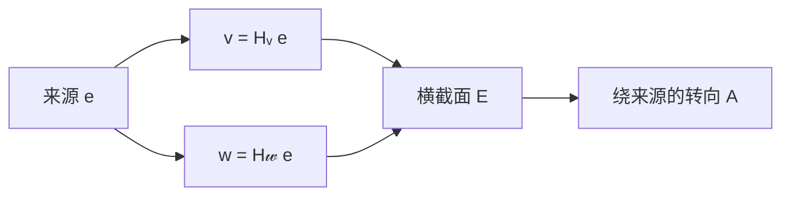
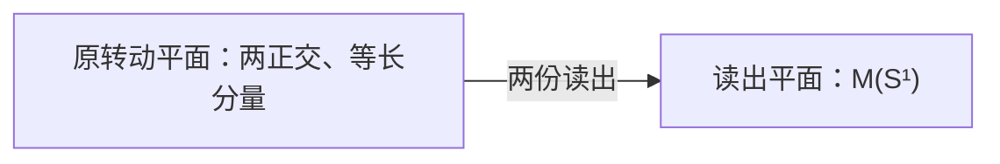

# 共源顺序差：整体确有顺序差，横向部分必须交换

> 来源：用户于 2026-11-05（Asia/Singapore）在本会话提供的 ΩQ-011 LaTeX 研究工作稿；原稿未另署作者或模型。本文为参考输入，Lean 是仓库的数学真源；本次仅转换 Markdown，未作形式化认证。正文中的固定快照、项目核读叙述与理论结论均保留原稿口径；两幅 TikZ 图转换为 Mermaid 示意图。

QUANTUM ORIGINS / $\Omega Q$-011

整体确有顺序差，横向部分必须交换

**本轮唯一候选。**

完整原预测空间给出来源 $e$、紧有效控制群 $G$、$\mathfrak g=\operatorname{Lie}(G)$ 与原轨道定义的比较 $B$。令

$$
E=e^{\perp_B},\qquad P_e:W\to E,\qquad
D_e(K)=P_eK|_E.
$$

要求

$$
\boxed{[\mathfrak g,\mathfrak g]\ne0,\qquad
[D_e(K),D_e(L)]=0\quad(K,L\in\mathfrak g).}
\tag{Q11}
$$

**白话：** 至少有两种微小变化交换先后，会留下差异；但把任意两种变化与同一个来源之间的往返分量单独记清，剩下的横向变化必须能够交换。

本轮把项目最新的“横向响应恰好一维”退回“横向作用两两交换”，去掉显式秩判定。特殊转向 $A$ 与唯一核继续作为结论出现。比较沿用完整原轨道的协方差定义；原来源、全部变化分量、概率与可读历史继续保留。

$$
\boxed{Q11\Longleftrightarrow
\dim W=3,\quad\mathfrak g=\mathfrak{so}(W,B).}
$$

存在同一对原作用 $K,L$，直接给出三维：

$$
W=\operatorname{span}\{e,Ke,Le\}.
$$

原特殊轴随后成为两种横向变化的交换子。再由比较、结合乘法及同源相位关系，构造复二维振幅、Born 配对、球面曲率与完整有限量子理论。

日期：2026-11-05，新加坡。\
固定源码：`dev@c30bb282a0b843a090ea926a779dc6d35c3e34e6`。\
提交时间：2026-11-05 02:20:30 +0800。\
远端核验：2026-11-05 02:28:19 +0800。\
承接：$\Omega Q$-010，固定版本 `c7d608b1...`。\
普通数学研究工作稿。证明在本文明确的前提下成立；本文未声明 Lean 认证、文献首创或物理实例已满足全部接口。

## 1　最新项目接点：从“一种响应”继续退回二元交换

本轮固定 `c30bb282...`，提交时间为 2026-11-05 02:20:30 +0800，远端核验为 02:28:19 +0800。最后一项合并正是新的横向关系起源稿。本文已按此快照重新核读相关定义、证明与范围。 [\[1\]](#ref-commit)

**本轮的直接比较基准。**

项目最新的 *OmegaQ-010：一种横向顺序差* 定义

$$
\mathfrak h=[\mathfrak g,\mathfrak g],\qquad
\mathcal C_e:\mathfrak h\to\mathfrak{so}(e^\perp),
\quad\mathcal C_e(K)=P_eK|_{e^\perp},
$$

以 $\operatorname{rank}\mathcal C_e=1$ 推出完整三维及 $\mathfrak g=\mathfrak{so}(3)$。 该稿已去掉特选 $A$ 与唯一核输入，并沿用项目早先的原轨道协方差比较；还给出压缩秩二不存在、秩三容许任意大完整维数，以及同一空间更多准备的外半径校准。 [\[2\]](#ref-projectq10)

本轮在这个最新入口上再退一步：把“导出响应像恰为一维”改成“原作用的横向部分两两交换，原连续作用本身不交换”。主证明独立从块公式开始，不调用项目三维结论来代替推导。下文的“项目 Q10”专指上述秩一判据；对话上一轮的单面秩二判据也由本轮结论恢复，但不混为同一公式。

**另外几项必须更新的进展。**

| 最新条目 | 已证明内容与本轮接入范围 |
|:---|:---|
| C117 续卷 §37 | 在既定十三维复源、七个原门和连续相位不变的射线充分终端接口下，局部制备的准确四时程序关系等价于整个源的 POVM 响应；不预设有限预测秩。独立坐标校准才给坐标 Born。加入档案读列仍可无限秩，复源与接口并未由该关系生成。 [\[4\]](#ref-c117cont) |
| C128 与 OR | Z、SC 已给原交替双导子，全对象协变缺陷仍须消去。OR 的完整模型又区分数学 CP 与同一原设备实际可旁接充分参考。本文只把完整参考当作一条充分接口，另证三维原 Jordan 块的局部协变。 [\[5\]](#ref-c127), [\[6\]](#ref-or) |
| C129／历史核 | 新 Lean 模块形式化完整核续写关系的有限 PSD 后果及有限支撑正形式；单个模块尚不包含奇异逆向、最小 Hilbert 表示及 CP/Born 全链。 [\[7\]](#ref-history) |
| C133 续卷 III | 正配方上的三读闭合刻画可见复 Hilbert 距离与效果；配方聚合是交换幺半群加法，区别于本轮的原顺序接续。实际仪器、复合及可用相干仍按其接口限定。 [\[8\]](#ref-c133) |
| FourPath IV §§52–53 | 原混态效果与任意整酉域的全局前缀、首边界及边界右侧一个存在性邻域内的全最优分支已推进；不能继续称负分支和前缀拼接全未解决，也不能扩称整个右区间全部最优轨道已分类。本文没有重跑其外部有理证书。 [\[9\]](#ref-fourpath) |

以上起源稿与分析正文是项目的数学文本；本稿不把它们自动称为 Lean 已认证。新 Lean 模块的声明、证明与 Blueprint 已核读，本文没有本地重跑仓库的形式验证流水线。

**完整性保持。**

本轮直接在全部原响应的 $W$ 上检验关系。$P_e$ 仅把同一个算子分成来源往返块与横向块，两者都保留，能够还原原算子；它不是实际擦除过程，也不是把 $C(S^2)$ 的高阶响应正投影成仿射响应。若实际可读档案或更多准备增加了维数，须扩充原窗口重新验证。 [\[3\]](#ref-c117), [\[4\]](#ref-c117cont)

## 2　定义：原预测、内生比较与唯一候选

#### 定义 2.1：完整有限原预测前端

固定 $\Omega$ 内一份归一准备。原总可逆控制有空词、接续封闭及同菜单内准确统计逆。共同未来域保留全部合法请求、完整结果标签、失败、实际可读历史和相关可用性区别。定义

$$
x_a(f,w)=p(a;f,w),\quad p\ge0,\quad\sum_w p(a;f,w)=1,
$$

$$
V=\operatorname{span}_\mathbb R\{x_a\},\qquad u(x_a)=1,\qquad
W=\ker u=\operatorname{span}_\mathbb R\{x_a-x_b\}.
$$

要求 $0<\dim W<\infty$。这是完整原响应的有限性，不是有限抽样或有限参数标签。

#### 引理 2.2：原接续给紧作用与来源循环

原接续 $T_gx_a=x_{ag}$ 良定义，其矩阵闭包 $H$ 为紧群。置

$$
c=\int_Hhx_\epsilon\,dh,\quad e=x_\epsilon-c,\quad
G=H|_W,\quad\mathfrak g=\operatorname{Lie}(G),
$$

则 $V=\mathbb Rc\oplus W$，$G$ 紧且有效，$e\ne0$，并且

$$
\boxed{W=\operatorname{span}(Ge).}
$$

**证明。**

原行关系对全部未来成立，故在以 $g$ 开头的未来也成立，接续良定义。取有限实际行基及有限分离评价坐标。各接续行的坐标在 $[0,1]$ 中，矩阵因而一致有界；准确逆使逆也一致有界，故闭包紧且无奇异矩阵。 平均 $c$ 固定且 $u(c)=1$。各 $x_a-c=T_ae$ 张成 $W$，得到循环性及 $e\ne0$。限制作用若在 $W$ 恒等，在固定的 $c$ 上也恒等，故有效。

$\square$

闭包中的无穷小方向不自动成为原菜单中的精确连续器件。数学平均也不自动供应实际随机准备。

#### 定义 2.3：由完整原轨道定义比较

令 $n=\dim W$。在原实对偶 $W^*$ 上定义轨道协方差映射

$$
\mathsf C:W^*\to W,\qquad
\mathsf C\alpha=\int_G\alpha(ge)\,ge\,dg.
$$

定义

$$
\boxed{B(v,w)=\frac1n(\mathsf C^{-1}v)(w).}
$$

#### 引理 2.4：比较完全由来源与原接续定义

$\mathsf C$ 对称、正定并可逆。$B$ 是 $G$-不变正内积，且 $B(e,e)=1$。

**证明。**

对偶配对给

$$
\alpha(\mathsf C\beta)=\int_G\alpha(ge)\beta(ge)\,dg.
$$

对 $\alpha\ne0$，来源循环使被积平方某处非零；连续性与 Haar 测度的满支撑使积分严格为正。因此 $\mathsf C$ 对称正定。Haar 不变性给 $g\mathsf Cg^\vee=\mathsf C$，其中 $g^\vee\alpha=\alpha\circ g$，故逆形式 $B_{\rm raw}(v,w)=(\mathsf C^{-1}v)(w)$ 不变。最后

$$
n=\operatorname{Tr}(\mathsf C^{-1}\mathsf C)
=\int_G B_{\rm raw}(ge,ge)\,dg=B_{\rm raw}(e,e).
$$

除以 $n$ 即得单位来源。

$\square$

这里的二次积分用于给实关系空间定比较，不把它解释为 Born 概率，也没有先选外部欧氏坐标或复振幅。

#### 定义 2.5：同一原作用的来源块与横向块

令 $E=e^{\perp_B}$、$P_e=I-e\otimes e^\flat$，其中 $e^\flat(w)=B(e,w)$。 对 $K\in\mathfrak g$，定义

$$
v_K=Ke\in E,\qquad D_e(K)=P_eK|_E\in\mathfrak{so}(E,B).
$$

于是同一完整算子准确写成

$$
K=\begin{pmatrix}0&-v_K^\flat\\v_K&D_e(K)\end{pmatrix}_{\mathbb Re\oplus E}.
\tag{2.1}
$$

这个分块是可逆记账：给定 $v_K,D_e(K)$ 就恢复原 $K$，没有遗漏任何分量。$D_e(K)$ 一般不属于原 $\mathfrak g$，也不被冒充实际可执行控制。

**唯一候选 $\Omega Q$-011：共源顺序差。**

$$
\boxed{[\mathfrak g,\mathfrak g]\ne0,\qquad
[D_e(K),D_e(L)]=0\quad\forall K,L\in\mathfrak g.}
\tag{Q11}
$$

第一项说原连续微变确有顺序差。第二项只约束两个原作用相对于同一来源的横向块：横向块之间没有独立顺序差。所有符号都由前述定义给出。

#### 命题 2.6：来源是内部参考点

若 $e'=g_0e$，则 $\mathsf C_{e'}=\mathsf C_e$，比较 $B$ 不变，并且

$$
D_{e'}(K)=g_0D_e(g_0^{-1}Kg_0)g_0^{-1}.
$$

因而 Q11 在一处原来源成立，就在整个原轨道成立。

**证明。**

协方差的积分中作 Haar 右平移 $g\mapsto gg_0$。再由 $B$ 不变得 $P_{e'}=g_0P_eg_0^{-1}$，代入定义即得；完整 $G$ 正常化 $\mathfrak g$，保持全部量词。

$\square$

**比项目最新 Q10 具体简在哪里。**

项目 Q10 检查 $\operatorname{rank}(D_e|_{[\mathfrak g,\mathfrak g]})=1$；Q11 改为普通交换等式，外加原非交换的非退化条件。给定同一 $B,P_e$ 和完整基 $K_i$，旧响应 $P_e[K_i,K_j]|_E$ 的条目是基矩阵的二次式，标准秩一二阶子式是四次式；新响应 $[D_eK_i,D_eK_j]$ 直接是二次式。这里比较的是固定前端后的等式次数，不把 $B$ 的构造或完整识别免费计成实验成本。

旧判据也能直接使用全部基对的括号，不一定要先另求导出代数的一组基。Q11 的准确简化是去掉导出响应之间的秩比较，改为原二元响应的交换关系；不声称总算术量、实验次数或独立条件数必然更少。两者最终允许的准确模型相同，也不称本轮逻辑上严格更弱。

## 3　反着推：不满足时究竟多出了什么

以下概率反模型明确采用终端读口：完整菜单是任意有限可逆控制词后接一次二标签终端请求，终端后没有继续请求。所有合法未来都已纳入；这不是对另有实际可读档案的系统删记录。

#### 反例 3.1：没有整体顺序差，维数可以任意大

令 $W=\bigoplus_{j=1}^m\mathbb R^2$，$G=S^1$ 在第 $j$ 块按角 $jt$ 旋转，取 $e=m^{-1/2}(e_1,\ldots,e_1)$。不同 Fourier 频率使 $Ge$ 张成整个 $W$，但 $\mathfrak g$ 一维，所有横向块自动交换。完整原概率可以取

$$
p(\pm\mid t,s)=\frac12\left(1\pm\frac1m\sum_{j=1}^m\cos j(t-s)\right).
$$

全部 $s,t$ 和未来接续仍在原域，完整 $V$ 为 $2m+1$ 维。即使波形看起来像“振幅”，没有非交换前件也不会选出量子位。

#### 反例 3.2：横向还有顺序差，五维原模型就通过其它前件

取 $W=\mathbb R^5,G=SO(5),e=e_5$，完整概率

$$
p(\pm\mid n,m)=\frac12(1\pm n\cdot m),\qquad n,m\in S^4.
$$

它给完整五维 $W$。令 $J_{ij}e_i=e_j,J_{ij}e_j=-e_i$。 $K=J_{12},L=J_{23}$ 都不动来源，横向块仍是它们本身，且 $[D_eK,D_eL]\ne0$。这份顺序差完全藏在来源以外，正是 Q11 排除的独立转动。

同一五维模型中，若只选 $K=X_{e_1}$，其横向块为零，与每个 $D_e(L)$ 都交换。因此检查一对、甚至固定一个非零 $K$ 检查所有 $L$，都不能代替完整的双变量关系。另外，不能把 $[\mathfrak g,\mathfrak g]\ne0$ 换成完整 $G$ 不交换：$G=O(2)$ 不交换，但 $\mathfrak g=\mathfrak{so}(2)$ 交换，完整内容仅二维。

#### 反例 3.3：只有裸菜单而没有原接续闭合，会误判

在 $W=\mathbb R^5,e=e_5$ 上，令

$$
X_v(te+z)=tv-B(v,z)e,\qquad v\in e^\perp.
$$

裸线性族 $\{X_v\}$ 的所有横向块都是零，但不同元不交换。它不是 Lie 代数，因为

$$
[X_v,X_w]z=B(v,z)w-B(w,z)v
$$

一般不在裸族内。加入真正的原接续闭包后，这些新增横向旋转也必须接受同一检查，五维模型因而失败。

#### 反例 3.4：只看可达块而隐去其它内容，会把局部结论当整体

取 $W=\mathbb R^3\oplus\mathbb R^m$、$G=SO(3)\oplus I_m$、$e=(e_3,0)$。若擅自另给欧氏比较，横向块只有一个平面转动，整体不交换，块条件会误把额外 $\mathbb R^m$ 当作同一窗口。来源却不循环，且本文规范定义的 $\mathsf C$ 在这些旁观方向上奇异，连 $\mathsf C^{-1}$ 的定义都不满足。完整原前端同时排除了两种错误。

这些反例对应可定位的关系缺口：有没有真实顺序差、差异是否另有横向来源、接续是否真的闭合、完整窗口是否与来源一致。若额外历史实际可读，它必须扩大原 $W$ 并重新检查；不能先宣布它“与量子无关”。

## 4　主定理：一条二元约束怎样迫出三维

### 4.1　一个完整块恒等式

以下 $B(e,e)=1$，记 $X_v$ 如上，并定义

$$
J_{v,w}z=B(v,z)w-B(w,z)v\quad(z\in E),
\qquad J_{v,w}e=0.
$$

#### 引理 4.1：横向非交换的准确来源

若 $K=X_v+\widetilde B_K,L=X_w+\widetilde B_L$，其中 $\widetilde B_K,\widetilde B_L$ 在 $e$ 上为零、在 $E$ 上分别为 $B_K=D_eK,B_L=D_eL$，则

$$
[K,L]=X_{B_Kw-B_Lv}+J_{v,w}
+\widetilde{[B_K,B_L]}.
\tag{4.1}
$$

特别地，

$$
\boxed{D_e([K,L])-[D_eK,D_eL]=J_{Ke,Le}|_E.}
\tag{4.2}
$$

**证明。**

直接相乘 (2.1)。右下块为 $-vw^\flat+wv^\flat+[B_K,B_L]$，左下块为 $B_Kw-B_Lv$，其它块由斜对称性决定。

$\square$

因此 Q11 等价于：原交换子在横向留下的作用，全部由两种变化分别改变来源所得的 $Ke,Le$ 决定。它约束的是同一原对象上的两种关系，没有分别挑选“最优代表”。

#### 定理 4.2：共源顺序差刚性

在引理 2.2 的完整前端，Q11 当且仅当

$$
\boxed{\dim W=3,\qquad\mathfrak g=\mathfrak{so}(W,B),\qquad
G^\circ=SO(W,B).}
$$

完整 $G$ 为 $SO(3)$ 或 $O(3)$。其中 $B$ 也是唯一满足 $B(e,e)=1$ 的 $G$-不变正内积。

**证明。**

**第一步：来源至多有两个切向变化。** 置 $T=\mathfrak ge\subset E$，$\mathfrak b=D_e(\mathfrak g)$。Q11 使 $\mathfrak b$ 中任意两元交换。 对任意 $v,w\in T$，选择 $K,L$ 使 $Ke=v,Le=w$。原 Lie 闭合与 (4.2) 给

$$
J_{v,w}|_E=D_e([K,L])\in\mathfrak b.
$$

若 $\dim T\ge3$，可取正交单位 $v,w,z\in T$。但

$$
[J_{v,w},J_{w,z}]v=-z\ne0,
$$

与 $\mathfrak b$ 交换矛盾，故 $\dim T\le2$。

**第二步：真实顺序差排除零维和一维。** 若 $T=0$，(4.1) 给 $[K,L]=0$。 若 $T=\mathbb Rt$，写 $Ke=at,Le=bt$。交换子的来源变化为

$$
[K,L]e=bB_Kt-aB_Lt.
$$

它既在 $T$ 内，又因各 $B_K$ 斜对称而垂直 $t$，故为零。其横向块也是 $J_{at,bt}=0$，所以完整交换子仍为零。两种情形都与 $[\mathfrak g,\mathfrak g]\ne0$ 矛盾。因此

$$
\dim T=2.
$$

**第三步：三维块包含全部非交换作用。** 取正交单位 $v,w\in T$，令 $J=J_{v,w}\ne0$。 所有 $B_K$ 都与 $J|_E$ 交换，因而保持 $\operatorname{im}J=T$ 与 $\ker(J|_E)=T^\perp_E$。所以

$$
U=\mathbb Re\oplus T,\qquad N=U^\perp
$$

都是 $\mathfrak g$-不变空间；在 $N$ 上，全部原作用交换。 而 $\mathfrak g|_U\subseteq\mathfrak{so}(U)$ 在 $e$ 处有二维像，故含两个独立元。 三维斜对称算子以叉积标定后，两个独立元的括号是垂直于它们的非零第三元，因此它们生成整个 $\mathfrak{so}(U)$。于是

$$
[\mathfrak g,\mathfrak g]=\mathfrak{so}(U)\oplus0_N.
\tag{4.3}
$$

这里的导出代数是括号的线性张成；其在 $N$ 上为零，在 $U$ 上满射 $[\mathfrak{so}(U),\mathfrak{so}(U)]=\mathfrak{so}(U)$，故等式准确。

**第四步：完整原轨道排除旁观块，包括断开群。** 整个 $G$ 的共轭保持 $[\mathfrak g,\mathfrak g]$。由 (4.3)，

$$
U=\sum_{Z\in[\mathfrak g,\mathfrak g]}\operatorname{im}Z
$$

是完整 $G$-不变空间。它包含 $e$，所以来源循环给 $W=\operatorname{span}(Ge)\subseteq U$，从而 $W=U$。 故 $\dim W=3,\mathfrak g=\mathfrak{so}(W,B)$，且 $G^\circ=SO(W,B)$。完整 $G\subseteq O(W,B)$ 只有所列两种可能。

反向，在三维完整旋转作用中，$E$ 二维，$\mathfrak{so}(E)$ 一维，全部 $D_e(K)$ 自动交换，而 $\mathfrak{so}(3)$ 不交换，所以 Q11 成立。 任意另一不变正形式相对于 $B$ 的正自伴算子与全部旋转交换；其各本征空间不变，而旋转作用无真非零不变子空间，故该算子为标量。单位来源使标量为一。

$\square$

主证明没有预设完整 $G$ 连通、原表示不可约、$A$ 的唯一核、三维球或复 Hilbert 空间，也没有调用可分二形式或紧群分类。

#### 推论 4.3：横向交换关系的完整二分

在同一完整前端，

$$
[D_e(\mathfrak g),D_e(\mathfrak g)]=0
$$

恰有两类解：$\mathfrak g$ 交换且 $\dim\mathfrak ge\le1$；或者 $W$ 三维且 $\mathfrak g=\mathfrak{so}(W,B)$。

**证明。**

非交换情形由主定理。若 $\mathfrak g$ 交换，(4.2) 给 $[D_eK,D_eL]=-J_{Ke,Le}|_E$，它恒零恰当且仅当所有 $Ke$ 共线，即 $\dim\mathfrak ge\le1$。

$\square$

### 4.2　三维有限提升与旧特殊轴的内生出现

#### 推论 4.4：同一对作用就给完整三维

存在 $K,L\in\mathfrak g$，使

$$
\boxed{W=\operatorname{span}\{e,Ke,Le\}.}
$$

适当取线性组合后可令 $v=Ke,w=Le$ 为正交单位。主定理后 $H_v=X_v,H_w=X_w$ 都在原 $\mathfrak g$ 中，并有

$$
A=[H_v,H_w]=J_{v,w},\qquad
[A,H_v]=H_w,\qquad[H_w,A]=H_v.
\tag{4.4}
$$

因此 $A\ne0,\ker A=\mathbb Re$，对话上一轮单面判据的轴见证由原关系生成。

**证明。**

前两项来自 $\dim T=2$。主定理使 $\mathfrak g$ 含所有斜对称算子。将 $X_v,X_w,J_{v,w}$ 作用于基 $e,v,w$ 逐项相乘，即得 (4.4) 及核结论。

$\square$

从此选定这一个派生的非零 $A$，并记 $D=A|_E$。其符号选择对应两种取向，不改变下文的概率。两步返回来源还直接给出 $-X_vw=B(v,w)e$，所以比较也可由同一原作用的返回系数恢复。三维是完整预测内容的维数，不是外部物理空间维数。

横向变化 $H_v,H_w$ 的换序产生绕来源的转向：

$$
[H_v,H_w]=A.
$$

旧公理指定的轴，现在由同一对关系产生。

**图 1：** 主定理之后的准确三维关系。图没有把预设三维用于证明。

### 4.3　整体关系在更大结构中成为曲率

令 $\mathfrak h=\{K:Ke=0\}=\mathbb RA$、$\mathfrak m=\{X_v:v\in E\}$。由 (4.4)，

$$
[\mathfrak h,\mathfrak h]=0,\quad
[\mathfrak h,\mathfrak m]\subseteq\mathfrak m,\quad
[\mathfrak m,\mathfrak m]\subseteq\mathfrak h.
$$

原来源轨道为 $SO(3)/SO(2)=S^2$。在 $SO(3)\to S^2$ 上，以 $\mathfrak m$ 的左平移为水平分布，连接为 $\omega=\operatorname{pr}_{\mathfrak h}(g^{-1}dg)$。

#### 命题 4.5：横向交换与球面曲率

该连接在来源处的曲率为

$$
\Omega(X_v,X_w)=-J_{v,w}.
$$

其关联切丛曲率为

$$
R(v,w)z=B(w,z)v-B(v,z)w,
$$

所以单位正交平面的截面曲率为 $+1$。

**证明。**

对水平左不变向量，$\omega(X_v)=\omega(X_w)=0$，故 $\Omega(X_v,X_w)=d\omega(X_v,X_w)=-\omega([X_v,X_w])=-J_{v,w}$。 关联表示就是 $\mathfrak h$ 在 $E$ 上的作用，得到 $R=-J|_E$；代入正交单位 $v,w$ 给 $B(R(v,w)w,v)=1$。 具体地，沿水平 $g(t)$，写 $g^{-1}\dot g=X_v,n=ge,Y=gz,z\in E$，有

$$
\dot Y=g\bigl(\dot z-B(v,z)e\bigr),\qquad P_n\dot Y=g\dot z.
$$

所以关联连接正是嵌入单位球后的切向投影连接。乘积微分给保度量，普通微分的交换律给无挠，因而是球面的 Levi–Civita 连接。

$\square$

两次横向变化的矩阵交换回路满足

$$
e^{sX_v}e^{tX_w}e^{-sX_v}e^{-tX_w}
=I+stJ_{v,w}+O(|s|^2|t|+|s||t|^2).
$$

二阶项固定来源，却转动来源旁的比较框架。这是后文相位曲率的原关系来源；有限参数的四个门并不自动组成严格闭合的来源路径。

## 5　夹持读数成为比较，原交换子直接成为地址

### 5.1　由夹持留下的系数定义比较

#### 定理 5.1：全局夹持律与内生比较

$Q11$ 成立后，对所有 $B,K\in\mathfrak g$，

$$
\boxed{BKB=-\kappa(B,K)B,\qquad
\kappa(B,K)=-\tfrac12\operatorname{Tr}_W(BK).}
\tag{5.1}
$$

所以对 $B\ne0$，可以先把 $\kappa(B,K)$ 定义为夹持后沿 $B$ 剩下的负系数，再由右式证明它对称、双线性且正定。

**证明。**

主定理后选证明用正交取向，将斜对称算子写成 $Bz=b\times z,Kz=k\times z$。向量三重积给

$$
BK=k b^\flat-B(b,k)I,\qquad
BKB=-B(b,k)B.
$$

取迹有 $-\frac12\operatorname{Tr}(BK)=B(b,k)$。此等式对相反取向也相同；迹的坐标不变性与原斜对称性给全部所列性质。

$\square$

这份比较来自同一原作用的返回系数；选择证明用取向没有进入最终定义。极化 (5.1) 得到更完整的关系：

$$
BKC+CKB=-\kappa(B,K)C-\kappa(C,K)B,
\tag{5.2}
$$

$$
[B,[K,C]]
=\kappa(B,C)K-\kappa(B,K)C.
\tag{5.3}
$$

第二式由第一式交换 $K,C$ 后相减得到。因此

$$
\|[B,K]\|_\kappa^2
=\kappa(B,B)\kappa(K,K)-\kappa(B,K)^2.
\tag{5.4}
$$

证明可将 (5.3) 与迹配对的不变性相结合。正交、面积和三重关系均由同一个二元夹持读数恢复。

#### 推论 5.2：自归一夹持就是实转向投影

对 $B\ne0$，定义

$$
\mathcal P_B(K)=-\frac{BKB}{\kappa(B,B)}
=\frac{\kappa(B,K)}{\kappa(B,B)}B.
$$

则 $\mathcal P_B^2=\mathcal P_B$，它是 $(\mathfrak g,\kappa)$ 到 $\mathbb RB$ 的正交投影，且 $B$ 的非零重标不改变它。

这是转向空间里的实轴投影。它的轴无向，因而不等同于后面的量子纯态投影；后者保留相反内容的区别。

### 5.2　原内容加切向变化，给出原地址加交换子变化

#### 定理 5.3：不用外给体积形式的地址构造

任何 $w\in W$ 唯一写成

$$
w=t e+K e,
$$

其中 $t$ 唯一、$K$ 只差一个 $A$ 的倍数。定义

$$
\boxed{\Phi(te+Ke)=tA+[K,A].}
\tag{5.5}
$$

则 $\Phi:W\to\mathfrak g$ 为实线性同构，$\Phi(e)=A$，且 $\ker\Phi(w)=\mathbb Rw$ 对 $w\ne0$ 成立。

**证明。**

主定理给 $\mathfrak ge=e^\perp$ 与 $\mathfrak g_e=\mathbb RA$，因此表示及独立性成立。若 $K$ 改成 $K+sA$，交换子不变，所以定义良定。

写 $v=Ke,K=sA+X_v$，则 $[K,A]=-X_{Dv}$。于是

$$
(tA-X_{Dv})(te+v)
=tDv-tDv+B(Dv,v)e=0.
$$

这同时说明 $\Phi(w)w=0$。若 $\Phi(w)=0$，其对角与非对角块分别给 $t=0,Dv=0$，所以 $w=0$。维数给同构；三维非零斜对称算子的核一维，故核恰为 $\mathbb Rw$。

$\square$

所有保持该核线的线性同构只差非零常数：两份之比保持每条直线，看基向量及其两两之和便知它是标量。条件 $\Phi(e)=A$ 因而固定唯一标定。

#### 推论 5.4：原规范比较的返回表达与转向

原轨道已经定义的规范比较满足下式，并由此定义归一转向：

$$
\boxed{
B(w,z)=\frac{\kappa(\Phi(w),\Phi(z))}{\kappa(A,A)},
\qquad R_w=\frac{\Phi(w)}{\sqrt{\kappa(A,A)}}.}
\tag{5.6}
$$

则 $B$ 是唯一满足 $B(e,e)=1$ 的原不变正比较，并有

$$
\kappa(R_w,R_z)=B(w,z),\quad
[R_w,R_z]=R_{R_wz},\quad
R_wR_zv=B(w,v)z-B(w,z)v.
$$

**证明。**

在主证明的 $B(e,e)=1$ 标定中，$A=\lambda(e\times\cdot)$；(5.5) 给 $\Phi(w)=\lambda(w\times\cdot)$。所以 (5.6) 中的比较恰为原轨道定义的 $B$，并给两种归一取向之一的叉积恒等式。更换来源轴的非零生成元或取向不改变 $B$。

$\square$

若完整 $G=O(3)$，有向提升满足 $\operatorname{Ad}_gR_w=\det(g)R_{gw}$；它不是对反射无扭曲协变的映射。原相反内容、相反转向及原速率均继续保留。

## 6　三项闭合、圆与两个读出的椭圆

#### 定理 6.1：单频与幂递推成为结论

对任意非零 $B\in\mathfrak g$，置 $\lambda=\sqrt{\kappa(B,B)}>0$，则

$$
\boxed{B^3=-\lambda^2B,\qquad B^{r+2}=-\lambda^2B^r\quad(r\ge1).}
\tag{6.1}
$$

因此

$$
e^{tB}=I+\frac{\sin(\lambda t)}{\lambda}B
+\frac{1-\cos(\lambda t)}{\lambda^2}B^2.
\tag{6.2}
$$

**证明。**

在 (5.1) 取 $K=B$ 得第一式，乘幂给递推，按奇偶幂对指数级数求和得到 (6.2)。

$\square$

令

$$
P_\parallel=I+B^2/\lambda^2,\qquad
P_\perp=-B^2/\lambda^2.
$$

由 (6.1) 可核对它们是互补正交投影，秩分别为一、二。置 $w_\parallel=P_\parallel w(0)$、$w_\perp=P_\perp w(0)$，任意内容的轨迹为

$$
w(t)=w_\parallel+
\cos(\lambda t)w_\perp+
\sin(\lambda t)\frac{Bw_\perp}{\lambda}.
\tag{6.3}
$$

横向两向量正交且等长。因而原三维轨迹是平面圆或静止点；在单位球上一般为小圆，$w_\parallel=0$ 时才是大圆。重复关系的幂在 $\{I,B,B^2\}$ 内停止增添新方向，并未由此离散化原转速。

#### 定理 6.2：两线性读出的椭圆

对两份固定仿射读出 $r=(f_1,f_2)$，沿 (6.3) 有

$$
r(t)=r_c+p\cos(\lambda t)+q\sin(\lambda t).
$$

令 $M=[p\ q]$。若 $\operatorname{rank}M=2$，其轨迹满足

$$
\boxed{(r-r_c)^T(MM^T)^{-1}(r-r_c)=1.}
\tag{6.4}
$$

它为圆当且仅当 $MM^T$ 是正标量矩阵；秩一时退化为线段，秩零时为点。

**证明。**

仿射读出施加于 (6.3) 即得前式。可逆 $M$ 把单位圆的两坐标映到读出平面，左乘 $M^{-1}$ 并取平方范数得到 (6.4)。奇异值相等恰为圆；其余秩的结论直接成立。

$\square$

这给“两个读出加一条归一关系”一份准确模型。椭圆形状由读口映射决定；当原生成元随历史改变，候选不强迫任意路径都是椭圆。初始切线也不唯一决定整条后续历史。

**图 2：** 固定生成元给圆；两线性读出一般给椭圆。图示的是准确投影关系，不把任意历史强制为椭圆。

## 7　振幅构造：四个实分量，内生复二维

### 7.1　由比较和交换子定义四元数代数

#### 定义 7.1：四实维振幅代数

在实空间 $\mathcal Q=\mathbb R1\oplus\mathfrak g$ 上定义

$$
(a,B)\star(b,K)
=\bigl(ab-\kappa(B,K),\,aK+bB+[B,K]\bigr),
\qquad (a,B)^*=(a,-B).
\tag{7.1}
$$

#### 定理 7.2：结合性、正范数与四元数

$\mathcal Q$ 是含幺结合实代数，满足

$$
q^*\star q=\|q\|^2\,1,\qquad
\|(a,B)\|^2=a^2+\kappa(B,B),\qquad
\|q\star r\|=\|q\|\|r\|.
$$

每个非零元可逆，且 $\mathcal Q\cong\mathbb H$。

**证明。**

只需验证三个纯转向的结合律。由 (5.3) 与迹配对不变性，$(B\star K)\star C$ 与 $B\star(K\star C)$ 的标量部分同为 $-\kappa([B,K],C)=-\kappa(B,[K,C])$，向量部分同为

$$
-\kappa(B,K)C-\kappa(K,C)B+\kappa(B,C)K.
$$

所以结合。直接代入得 $q^*q=\|q\|^2$，且 $(qr)^*=r^*q^*$；结合性于是给范数乘法。逆为 $q^*/\|q\|^2$。

取 $\kappa$-正交单位 $u,v$，令 $w=[u,v]$。式 (5.3)–(5.4) 给

$$
u^2=v^2=w^2=-1,\quad uv=w,\quad vu=-w
$$

及循环关系。这正是 Hamilton 四元数乘法表。[\[11\]](#ref-baez)

$\square$

从此本节省略 $\star$，但保留类型：$\mathcal Q$ 的乘法由比较和括号新定义。原 $W$ 上的算子顺序乘法仍在 $\operatorname{End}(W)$ 中；原三维斜对称生成元生成的结合代数是 $M_3(\mathbb R)$，不是 $\mathcal Q$ 或 $M_2(\mathbb C)$。具体地，正交单位轴生成元满足 $R_iR_j=E_{ji}$（$i\ne j$）、$R_i^2+I=E_{ii}$，故给全部实矩阵单位。这几种表示通过明确构造相连，不能相互冒名。

### 7.2　原来源挑出相位子代数，得到复二维 Hilbert 空间

取

$$
u=R_e=\frac{A}{\sqrt{\kappa(A,A)}},\qquad u^2=-1.
$$

定义原来源的相位子代数

$$
\mathbb C_u=\{a+bu:a,b\in\mathbb R\}.
$$

它在 $\mathcal Q$ 内已经存在。为固定通常复符号的取向，取

$$
j:\mathbb C\to\mathbb C_u,\qquad j(a+ib)=a-bu.
$$

将同一个四实维空间 $\mathcal Q$ 看成右复向量空间

$$
q\cdot z=q\,j(z).
$$

定义

$$
\pi_u(q)=\tfrac12(q-uqu),\qquad
\langle q,r\rangle=j^{-1}\!\left(\pi_u(q^*r)\right).
\tag{7.2}
$$

对 $q=a+K$，还有直接连接原作用的等式

$$
\boxed{\pi_u(a+K)=a+\kappa(u,K)u
=a-(uKu)_{\operatorname{End}(W)}.}
$$

最后一项用的是原算子夹持，中间和左侧在 $\mathcal Q$ 中。相位平面正是“原夹持留下的那根轴，加上单位方向”；两种乘法的类型保持明确。

#### 定理 7.3：复二维振幅

该空间是复二维 Hilbert 空间 $\mathcal H\cong\mathbb C^2$。若 $v\perp u$ 为单位纯转向，则

$$
\mathcal Q=\mathbb C_u\oplus v\mathbb C_u
$$

是两份正交实二维平面；写 $q=j(z_1)+v j(z_2)$，便有

$$
\|q\|^2=|z_1|^2+|z_2|^2.
$$

**证明。**

$\pi_u$ 保留 $1,u$ 分量并消去垂直纯转向，故值在 $\mathbb C_u$。对 $c,d\in\mathbb C_u$，因它们与 $u$ 交换， $\pi_u(csd)=c\pi_u(s)d$。这给内积的共轭线性、线性与共轭对称；$q^*q=\|q\|^2$ 给正定。四元数正交基 $1,u,v,uv$ 给所列直和、复维数二与范数式。有限维保证完备。

$\square$

$\mathbb C_u$ 不是四元数的中心。它的单位范数元素构成保持原来源读出不变的右相位圈；复线性算子代数 $\operatorname{End}_\mathbb C(\mathcal H)$ 的标量中心才是通常的 $\mathbb CI$。这里明确区分两者。

### 7.3　同一内容的全部振幅代表，恰好只差相位

#### 定义 7.4：内容读出

对单位振幅 $q\in\mathcal Q$，定义

$$
X(q)=q u q^*\in\mathfrak g,\qquad n(q)=R^{-1}(X(q))\in W.
\tag{7.3}
$$

#### 定理 7.5：Hopf 读出与复射线

$X(q)$ 为单位纯转向，读出覆盖整个 $S(W)$。两份单位振幅读出相同，当且仅当

$$
r=q\,j(e^{i\theta})
$$

对某个 $\theta$ 成立。因此

$$
\boxed{S^1\longrightarrow S^3\longrightarrow S^2,\qquad
\mathbb CP^1\cong S^2.}
$$

**证明。**

共轭保持纯转向与范数。对任一单位 $X\ne-u$，取

$$
q=\frac{1-Xu}{\sqrt{2(1+\kappa(X,u))}}.
$$

它范数一，且 $qu=Xq$，因此 $quq^*=X$。对 $X=-u$，取单位 $v\perp u$ 即可。

若 $quq^*=rur^*$，则 $q^*r$ 与 $u$ 交换。纯转向部分与 $u$ 的交换子为零，按 (5.4) 必平行于 $u$，所以 $q^*r\in\mathbb C_u$。它范数一，恰为所列相位。反向直接成立。

$\square$

因此保留内容的连续相位圈由原来源的稳定关系决定。把全部单位四元数都当成无差别标量，会把不同内容一起合并，违背同一读出。三维 $W$ 是内容嵌入空间；其纯态球面二维，单位振幅球面三维，去掉一个相位维后恰好二维。

### 7.4　Born 平方律的直接四元数证明

#### 定理 7.6：半角平方

对单位振幅 $q,r$，

$$
\boxed{
|\langle q,r\rangle|^2
=\frac{1+\kappa(X(q),X(r))}{2}
=\frac{1+B(n(q),n(r))}{2}.}
\tag{7.4}
$$

**证明。**

写单位 $p=q^*r=a+bu+cv+d\,uv$。则

$$
|\pi_u(p)|^2=a^2+b^2,\qquad
a^2+b^2+c^2+d^2=1.
$$

由四元数乘法直接算得

$$
\kappa(u,pup^*)=a^2+b^2-c^2-d^2.
$$

共轭保持 $\kappa$，所以该量就是 $\kappa(quq^*,rur^*)$。联立两式得到 (7.4)。

$\square$

若两份有向内容夹角为 $\theta$，则 (7.4) 为 $\cos^2(\theta/2)$。第 5 节的实转向轴投影给的是 $\cos^2\theta$；这里加回了有向内容、归一化与相位纤维，两个投影的类型不同。相反内容 $n,-n$ 对应正交纯态。

### 7.5　自伴算子与原概率的准确保持

对 $X\in\mathfrak g$，定义复线性算子

$$
\widehat X(r)=-Xru.
$$

记左、右乘为 $L_X,R_u$，则复结构 $i=-R_u$，有 $\widehat X=L_Xi$。

#### 定理 7.7：Pauli 关系与原 Born 配对

上述算子自伴，并满足

$$
\widehat X\widehat Y
=\kappa(X,Y)I+i\widehat{[X,Y]},\qquad
\operatorname{Tr}\widehat X=0,\quad
\operatorname{Tr}(\widehat X\widehat Y)=2\kappa(X,Y).
\tag{7.5}
$$

对单位 $X=X(q)$，

$$
P_X=\tfrac12(I+\widehat X)
$$

恰为振幅 $q$ 的复秩一正交投影。

**证明。**

左乘纯转向和右乘 $u$ 都反自伴且彼此交换，故它们的负乘积自伴。四元数乘法给 (7.5) 的乘法式。取单位 $Y\perp X$，$\widehat Y\widehat X\widehat Y=-\widehat X$，所以迹为零，再由乘法式得迹配对。

对任意 $r$，有

$$
P_{X(q)}r
=\tfrac12(r-quq^*ru)
=q\,\pi_u(q^*r)
=q\cdot\langle q,r\rangle.
$$

这正是复秩一正交投影公式。

$\square$

$I,\widehat{\mathfrak g}$ 张成全部自伴 $2\times2$ 复算子，因为它们四实维且线性独立。因此 $\operatorname{End}_\mathbb C(\mathcal H)\cong M_2(\mathbb C)$。它也满足早先的 Clifford 生成关系，所以两条构造准确相容；采用既有的直接振幅构造，无需先建八实维 Clifford 代数再取最小理想。

原轨道闭包为 $c+S(W)$，最小闭凸完成为 $c+\overline B(W)$。任一原事件唯一写成

$$
f(tc+w)=\alpha t+B(b,w).
$$

原概率界给 $\|b\|\le\min(\alpha,1-\alpha)$。对 $\|w\|_B\le1$，令

$$
\rho_w=\tfrac12(I+\widehat{R_w}),\qquad
E_f=\alpha I+\widehat{R_b}.
$$

则 $\rho_w\ge0,\operatorname{Tr}\rho_w=1,0\le E_f\le I$，由 (7.5) 得

$$
\boxed{f(c+w)=\operatorname{Tr}(\rho_wE_f).}
\tag{7.6}
$$

原完整标签归一化给 $\sum_kE_k=I$，失败标签继续保留。数学闭凸完成及全部锐效果的存在，不自动供应原随机准备、读口或原分支过程。

### 7.6　更多原准备的统一外半径

上述单位球首先是同一来源可逆轨道的闭凸完成。最新项目定理 7.2 已指出：若同一完整空间内实际还有更外面的准备，必须一并校准，不能把原来源直接宣布为全系统纯态。下面将这一结论接到本文坐标。 [\[2\]](#ref-projectq10)

#### 定理 7.8：同一原空间全部准备的 Born 校准

设 $\mathcal S\subset\{x\in V:u(x)=1\}$ 是同一 $V$ 内全部指定归一准备，包含原来源控制行；每个原概率坐标在 $\mathcal S$ 上仍取值于 $[0,1]$，原可逆接续保持其闭凸包。则存在有限 $R\ge1$，使

$$
\overline{\operatorname{conv}}(\mathcal S-c)=R\overline B(W).
$$

对每个原结果评价 $f(tc+w)=\alpha t+B(b,w)$ 及 $w\in R\overline B(W)$，定义

$$
\rho^{(R)}_w=\tfrac12(I+\widehat{R_{w/R}}),\qquad
E_f^{(R)}=\alpha I+R\,\widehat{R_b}.
\tag{7.7}
$$

它们保持全部指定准备和全部原结果概率：

$$
\rho^{(R)}_w\ge0,\quad\operatorname{Tr}\rho^{(R)}_w=1,\quad
0\le E_f^{(R)}\le I,\quad
f(c+w)=\operatorname{Tr}(\rho^{(R)}_wE_f^{(R)}).
$$

原来源的像 $\rho_e^{(R)}$ 为纯态，当且仅当 $R=1$。

**证明。**

有限组实际评价坐标分离 $V$；在这些坐标均有界使 $\mathcal S$ 有界。故 $C_{\mathcal S}=\overline{\operatorname{conv}}(\mathcal S-c)$ 紧。 原控制和准确逆保持它，连续性使闭包 $SO(3)$ 也保持它。其包含来源轨道的闭凸球，所以最大范数 $R$ 存在且至少一。最大范数向量的完整旋转轨道是半径 $R$ 的球面，凸包为 $R\overline B(W)$；最大性又给反向包含，得到等式。

每个原概率在该闭球上介于零和一，故

$$
R\|b\|\le\min(\alpha,1-\alpha).
$$

谱值计算给正性与效果界，Pauli 迹配对给 (7.7) 的概率等式。对每个固定完整测试的结果族 $\{f_k\}$，原归一化仍给 $\sum_kE_{f_k}^{(R)}=I$。 映射 $tc+w\mapsto\tfrac12(tI+\widehat{R_{w/R}})$ 为四实维线性同构，全部完整响应区别保持。来源矩阵的本征值是 $(1\pm1/R)/2$，其秩一恰在 $R=1$ 时成立。

$\square$

最大半径可只在数学闭凸完成中达到，不保证某个实际准备达到。若更多准备或可读历史扩大了 $V$，就须在扩大后的完整空间重新检查 Q11，不能只调一个半径。下文谈纯态相位时，指归一边界的数学表示；原起点是否纯由此定理判定。

### 7.7　同一原双导子的局部协变

最新 C128 的 Z 在其完整背景下给原 $D_a$ 的 Jordan 导子归属，SC 是 $D_a a=0$，极化后给原双导子 $F(a,b)=D_ab$ 的交替性。全对象的协变缺陷仍是待证桥。三维基本块允许证明其中一个准确的局部结论。 [\[5\]](#ref-c127)

#### 定义 7.9：同一原 Jordan 块的对齐条件

本小节要求一个实际原对象的含幺 Jordan 代数已经与

$$
\mathcal J_{\rm sp}=\mathbb R\oplus W,\qquad
(t,v)\circ(s,w)=(ts+B(v,w),tw+sv)
$$

同构，且同构逐项运输原 $F(a,b)=D_ab$。要求 $a\mapsto D_a$ 实线性、每个 $D_a$ 是这个同一乘法的导子，并且 $D_a a=0$。这里 $L_a$ 专指 Jordan 左乘，迹取在完整 $\mathcal J_{\rm sp}$ 上。对任意 $v,w\in W$，沿用公式 $J_{v,w}z=B(v,z)w-B(w,z)v$，并把 $R_v,J_{v,w}$ 在单位方向零延拓。向量 $v$ 在本小节可简记其嵌入 $(0,v)$。Q11 的预测行表示本身不供应这份原乘法对齐。

#### 定理 7.10：原双导子在基本块上自动协变

在上述条件下，有一个实数 $\lambda$，使原映射恰为

$$
F((t,v),(s,w))=(0,\lambda R_vw).
\tag{7.8}
$$

因此对所有原内导子 $K\in\operatorname{Der}(\mathcal J_{\rm sp})$，

$$
K F(a,b)=F(Ka,b)+F(a,Kb).
$$

若在这个同一对象上存在非零 $x=(0,v)$ 满足

$$
-\operatorname{Tr}_\mathbb R(D_x^2)=\operatorname{Tr}_\mathbb R(L_x^2),
$$

则 $\lambda=\pm1$，无需重标原 $D$，并且全部原曲率关系 $[D_a,D_b]=-[L_a,L_b]$ 在该同一对象上成立。

**证明。**

先求全部 Jordan 导子。任意导子 $\delta$ 满足 $\delta(1)=\delta(1\circ1)=2\delta(1)$，故消灭单位。 写 $\delta(0,v)=(a(v),Mv)$。对 $(0,v)^2=B(v,v)1$ 求导，得到

$$
0=2(0,v)\circ(a(v),Mv)
=(2B(v,Mv),\,2a(v)v).
$$

所以 $a=0$，并由极化得 $M$ 斜对称。反向每个这样的 $M$ 都是导子，故 $\operatorname{Der}(\mathcal J_{\rm sp})=\mathfrak{so}(W,B)$。 同时 $[L_{(0,v)},L_{(0,w)}]=-J_{v,w}$，这些算子张成全部 $\mathfrak{so}(W,B)$，所以这里全部导子也正是原内导子。

SC 极化给 $F(a,b)=-F(b,a)$。每个 $D_a$ 消灭单位，交替性又给 $F(1,b)=0$，所以只需考察向量部分。定义

$$
\tau(v,w,z)=B(F(v,w),z).
$$

交替性使它对前两槽反号，$D_v$ 的斜对称性使它对后两槽反号，所以它是三形式。在三维空间，全部三形式构成一维，故 $\tau(v,w,z)=\lambda B(R_vw,z)$，即得 (7.8)。 对 $K\in\mathfrak{so}(W)$，$\operatorname{Tr}K=0$，它在三形式上的无穷小作用为零；再用 $B$ 不变性便得所列协变等式。

最后，$D_x$ 在向量部分为 $\lambda R_v$、在单位方向为零，故

$$
-\operatorname{Tr}_\mathbb R(D_x^2)=2\lambda^2B(v,v).
$$

而 $L_x(t,w)=(B(v,w),tv)$，直接平方取迹给 $\operatorname{Tr}_\mathbb R(L_x^2)=2B(v,v)$。$v\ne0$ 使两式相等恰等价于 $\lambda^2=1$。 对一般 $a=(s,v),b=(t,w)$，$[D_a,D_b]=\lambda^2J_{v,w}$ 而 $[L_a,L_b]=-J_{v,w}$，故得全部曲率式。

$\square$

这一定理保留原 $F,D$，没有以新造叉积替换它们；结论是它们在该原块中必已具有所列形式。但它只覆盖已对齐的三维自旋块，不覆盖未识别的高维原对象、中心、跨块或所有实际联合。原指针在另一个对象上的 S 不能移用为这里的局部迹等式。Lie 协变也不自动成为非零 $F$ 对整个 $O(3)$ 的无扭曲协变：反射仍带取向符号。 [\[5\]](#ref-c127)

## 8　更大几何：锥、旋转、相位与路径

自伴矩阵 $aI+\widehat{R_w}$ 的本征值是 $a\pm\|w\|$，正锥为

$$
C=\{(a,w):a\ge\|w\|\},\qquad
\det(aI+\widehat{R_w})=a^2-B(w,w).
$$

其归一截面是三维球。定义

$$
L_w(t,z)=(B(w,z),tw),\qquad
\mathcal R_w(t,z)=(0,R_wz).
$$

由 (5.6) 逐项计算，

$$
[\mathcal R_w,\mathcal R_z]=\mathcal R_{R_wz},\quad
[\mathcal R_w,L_z]=L_{R_wz},\quad
[L_w,L_z]=-\mathcal R_{R_wz}.
$$

六个方向保持 $t^2-B(z,z)$，线性独立，故为 $\mathfrak{so}(1,3)$。其复矩阵实现是

$$
\mathcal R_w\mapsto-\tfrac i2\widehat{R_w},\qquad
L_w\mapsto\tfrac12\widehat{R_w}.
$$

这说明三维内容、四实维振幅和四维正锥属于同一组比较关系。这里未将响应总量 $t$ 认作物理时间。

#### 命题 8.1：旋转的半角提升

给定原生成元 $M=R_a$，单位振幅满足

$$
\dot q=\tfrac12M q
\quad\Longrightarrow\quad
\dot X=[M,X],\qquad
i\hbar\dot q=\tfrac\hbar2\widehat M q.
$$

因此内容转一圈时，振幅可得到负号；两圈才在该提升中返回。

**证明。**

微分 $X=quq^*$，四元数纯转向的乘法交换子是 $2[M,X]$，所以得到第一式。由 $\widehat M=L_Mi$ 得 $L_M=-i\widehat M$，给第二式。取单位轴 $v$，振幅 $q(t)=\cos(t/2)+v\sin(t/2)$ 直接显示 $2\pi$ 与 $4\pi$ 的区别。

$\square$

这给指定参数后的数学表示；实际连续控制、原速率及 $\hbar$ 的数值仍由原接口承担。

#### 命题 8.2：历史搬运与相位曲率

沿给定单位内容路径 $n(t)$，令 $A(t)=\lambda(t)R_{n(t)}\ne0$。则

$$
M_{\rm hor}
=\frac{[A,\dot A]}{\kappa(A,A)}
=R_{n\times\dot n},\qquad
M_{\rm hor}n=\dot n.
$$

全部搬运为 $M_{\rm hor}+\alpha R_n$，其中水平者唯一最小化瞬时 $\kappa$-范数。

**证明。**

$[A,\dot A]=\lambda^2R_{n\times\dot n}$、$\kappa(A,A)=\lambda^2$，故公式成立。两份搬运之差固定 $n$，所以属于 $\mathbb RR_n$。两项正交，范数平方为 $\|\dot n\|^2+\alpha^2$。

$\square$

若 $X(q)=R_n$ 且 $\dot q=\frac12M_{\rm hor}q$，则

$$
\langle q,\dot q\rangle
=\tfrac12j^{-1}\pi_u(q^*M_{\rm hor}q)
=-\tfrac i2\kappa(M_{\rm hor},R_n)=0.
$$

所以这份最小原搬运，确实提升为复振幅的水平连接。

在复二维坐标取局部单位代表

$$
\psi(\theta,\phi)=
\begin{pmatrix}\cos(\theta/2)\\e^{i\phi}\sin(\theta/2)\end{pmatrix}.
$$

直接微分给

$$
a=i\psi^\dagger d\psi=-\tfrac12(1-\cos\theta)d\phi,\qquad
da=-\tfrac12\sin\theta\,d\theta\wedge d\phi.
$$

水平提升 $\Psi=e^{i\chi}\psi$ 满足 $\Psi^\dagger d\Psi=0$，等价于 $d\chi=a$。因此闭路的几何相位为

$$
\boxed{\gamma=-\Omega_{\rm solid}/2\pmod{2\pi}.}
$$

跨图时加入过渡相位；两份跨面相差整球，曲率积分为 $-2\pi$，所以该相位模 $2\pi$ 良定。该积分也由 Stokes 定理排除全球光滑单位振幅截面。Hopf 几何恢复熟知的半立体角相位；Berry 原文讨论相应绝热量子相位。[\[12\]](#ref-berry) 实际干涉实现仍需原相干参考。给定路径与起始单位振幅后，水平提升唯一；终点内容却不包含全部路径相位。

## 9　完整有限量子理论：定义、定理与接口

本节把基本块发展为完整的有限数学理论，并列出把它接回原实际对象的一组充分关系；这些接口不被声称为量子数学的必要条件。$Q11$ 只选择基本窗口，不重复施加于全部复合内容。

### 9.1　复合与任意有限维系统

#### 定理 9.1：复张量的唯一性

若 $M_m(\mathbb C)$、$M_n(\mathbb C)$ 以同一复中心含幺 $*$-嵌入联合代数，两个像交换，且乘积复线性张成联合代数，则联合代数同构于 $M_{mn}(\mathbb C)$。

**证明。**

$a\otimes b\mapsto\iota_A(a)\iota_B(b)$ 为满射含幺 $*$-同态。源 $M_m\otimes_\mathbb CM_n\cong M_{mn}$ 单，核为零或全体；含幺排除全体，故为同构。

$\square$

量子位张量幂给 $M_{2^N}$，秩 $d\le2^N$ 的数学投影角给 $M_d$，再取有限直和，得到

$$
\mathcal A=\bigoplus_sM_{d_s}(\mathbb C).
$$

这给全部有限复矩阵代数的数学完成；实际支持角、实际复合与共用复中心仍须原接口供应。完整 C127 的某些满足族只有 $3^k$ 大小的块，并无实际 $M_2$ 对象；本文不能把数学角冒充原对象。[\[5\]](#ref-c127)

### 9.2　状态、效果与观测量

#### 定理 9.2：密度与迹配对

标准正锥上的归一正线性泛函恰为

$$
\omega(a)=\sum_s\operatorname{Tr}(\rho_sa_s),\qquad
\rho_s\ge0,\quad\sum_s\operatorname{Tr}\rho_s=1.
$$

效果是 $0\le E\le I$，完整 POVM 满足 $\sum_kE_k=I$。自伴量 $H=\sum_kh_kP_k$ 的谱概率与均值分别为 $\operatorname{Tr}(\rho P_k)$、$\operatorname{Tr}(\rho H)$。

**证明。**

非退化迹配对给唯一自伴 $\rho_s$。在全部秩一正投影上非负等价于 $\rho_s\ge0$，单位评价给总迹一。反向直接成立。自伴谱分解给观测量结论。

$\square$

### 9.3　完整参考推出 CP 与一般仪器

#### 定理 9.3：参考保正与 Kraus 表示

设同一原分支在自伴部分实线性，作唯一复线性延拓 $\mathcal E:M_d\to M_n$。若有实际完整矩阵参考 $M_r$、$r\ge d$，使 $\mathcal E\otimes\operatorname{id}_r$ 在完整联合标准正锥上保正，则

$$
\mathcal E(\rho)=\sum_\mu K_\mu\rho K_\mu^*.
$$

在全部归一态上迹不增，等价于 $\sum_\mu K_\mu^*K_\mu\le I$。完整仪器归一，等价于

$$
\sum_{k,\mu}K_{k\mu}^*K_{k\mu}=I.
$$

**证明。**

在参考中取 $d$ 维子空间，并取 $\lvert\Gamma\rangle=\sum_i\lvert i\rangle\otimes\lvert i\rangle$。联合保正使 Choi 矩阵 $C_{\mathcal E}=(\mathcal E\otimes\operatorname{id})(\lvert\Gamma\rangle\langle\Gamma\rvert)$ 为正。将其谱分解向量重排为矩阵 $K_\mu$，比较矩阵单位即得表示。反向的共轭和在任意参考上保正。迹配对给所列不等式与等式。

$\square$

这是标准有限维 Choi–Kraus 等价关系，参见 Watrous 定理 2.22。使用本定理这条充分路线时，原参考条件必须覆盖全部联合正锥，单有经典参考、乘积态或线性分离不足；数学 CP 本身不反推原设备确有这样的实际旁接接口。原标签 $k$ 与数学 Kraus 索引 $\mu$ 也不能自动合并为可访问的细记录。[\[13\]](#ref-watrous)

#### 推论 9.4：排除反射作为可附接的量子过程

如果原反射也满足完整量子参考条件，就产生矛盾。

**证明。**

Bloch 的一个反射由转置代表。对 Bell 态的一半转置得到 $\tfrac12\operatorname{Swap}$，有特征值 $-1/2$。任意其它反射只相差旋转，结论不变。

$\square$

这排除某类实际可附接过程，不选择一种绝对坐标手性。若原菜单真的有反射，则该原实例不满足后续完整参考接口，不能通过删去原门声称已经重建。

#### 命题 9.5：仪器的有限酉扩张

任一完整 Kraus 仪器都有一个数学等距扩张

$$
V\psi=\sum_{k,\mu}K_{k\mu}\psi\otimes\lvert k,\mu\rangle,
\qquad V^*V=I.
$$

在环境读出投影 $Q_k=\sum_\mu\lvert k,\mu\rangle\langle k,\mu\rvert$ 后取偏迹，得到原分支 $\mathcal E_k(\rho)=\sum_\mu K_{k\mu}\rho K_{k\mu}^*$。

**证明。**

由完整性， $V^*V=\sum_{k,\mu}K_{k\mu}^*K_{k\mu}=I$。 展开 $V\rho V^*$，投影 $Q_k$ 并对环境取迹即得分支。将输入、输出嵌入足够大的同维空间，补齐正交基，可将该等距映射延拓为一个酉算子。反向，任何这种酉扩张和环境读出都给 Kraus 仪器。

$\square$

任一数学 POVM 也有实现：取 $K_k=\sqrt{E_k}$，便有 $\sum K_k^*K_k=I$。实际原设备是否供应该环境、耦合与读出，是同一原过程接口的实现问题。数学环境索引 $\mu$ 不因此成为实际可读标签。

### 9.4　Lüders 更新的准确前提

#### 定理 9.6：理想投影更新

CP 分支的效果为投影 $P$，并且不扰动每个支撑于 $P$ 的态，则

$$
\mathcal E(\rho)=P\rho P.
$$

**证明。**

$\sum_\mu K_\mu^*K_\mu=P$ 给 $K_\mu=K_\mu P$。对 $\psi\in P\mathcal H$，秩一正和 $\sum_\mu\lvert K_\mu\psi\rangle\langle K_\mu\psi\rvert=\lvert\psi\rangle\langle\psi\rvert$ 迫使每项的向量与 $\psi$ 共线。对独立向量及其和用线性，得到 $K_\mu=c_\mu P$、$\sum_\mu|c_\mu|^2=1$。零投影和秩一情形直接包含。

$\square$

成功概率非零时，条件态为 $P\rho P/\operatorname{Tr}(\rho P)$。只可重复、或仅保持某组基态，不足以推出此定理：支撑内退相干提供反例。

### 9.5　连续可逆过程与 Schrödinger 形式

#### 定理 9.7：连续幺正演化

同一简单块上的连续 CPTP 单参数群，若逆也 CP，则存在自伴 $H$，使

$$
\mathcal E_t(\rho)=U_t\rho U_t^*,\quad
U_t=e^{-itH/\hbar},\quad
i\hbar\dot\psi=H\psi.
$$

相应密度方程为 $\dot\rho=-i[H,\rho]/\hbar$。

**证明。**

令 $F$ 为 Heisenberg 对偶，$S=F^{-1}$。两者都保单位且 CP，故

$$
F(a)^*F(a)\le F(a^*a),\qquad
a^*a\le S(F(a)^*F(a)).
$$

把第一式施加 $S$，与第二式合并，迫使两式取等。$S$ 单射，故 $F(a)^*F(a)=F(a^*a)$。对 $a+b$ 与 $a+ib$ 极化，得到 $F(a)^*F(b)=F(a^*b)$，所以 $F$ 为 $*$-自同构。

有限维连续单参数矩阵群可写成指数，生成元 $\delta$ 是保持 $*$ 的导子。它必为内导子：对矩阵单位，置

$$
B=\sum_i\delta(E_{i1})E_{1i}.
$$

微分恒等式 $E_{kl}E_{i1}=\delta_{li}E_{k1}$，右乘 $E_{1i}$ 并求和，得到 $[B,E_{kl}]=\delta(E_{kl})$。故 $\delta(a)=[B,a]$。 保持 $*$ 又给 $[B+B^*,a]=0$，所以减去一个中心标量后可取 $B^*=-B$。写 $B=iH/\hbar$，即得 Heisenberg 指数式及其 Schrödinger 对偶。直和的有限中心不能被连续群非平凡置换，逐块论证。

$\square$

该结论给定连续参数后的结构形式，不计算实际时钟、原生成元的速度、具体 $H$ 或 $\hbar$。

### 9.6　两个可检验的理论后果

完整局部 CPTP 操作并遗忘全部结果时，

$$
\operatorname{Tr}_B[(\operatorname{id}\otimes\mathcal E_B)(\rho_{AB})]=\operatorname{Tr}_B\rho_{AB},
$$

由 $\sum K_\mu^*K_\mu=I$ 直接推出无信号性。后选择不属于该命题。

正半内积 $\langle X,Y\rangle_\rho=\operatorname{Tr}(\rho X^*Y)$ 的 Cauchy–Schwarz 不等式给

$$
\operatorname{Var}_\rho(H)\operatorname{Var}_\rho(K)
\ge\left|\frac1{2i}\operatorname{Tr}(\rho[H,K])\right|^2.
$$

不确定性来自同一正比较与非交换乘法，不需要另立一条概率公理。

### 9.7　复合的实质后果：纠缠与 Bell 相关

在两个基本块的标准联合完成中，定义

$$
\lvert\Psi^-\rangle=\frac{\lvert 01\rangle-\lvert 10\rangle}{\sqrt2}.
$$

它的两个约化态都是 $I/2$，而联合态是秩一投影，不能是乘积态；也不能是乘积态的凸组合，因为秩一正和中的每项必须支撑在同一条射线上。

Pauli 矩阵直接给

$$
\langle\Psi^-|(a\cdot\sigma)\otimes(b\cdot\sigma)|\Psi^-\rangle=-B(a,b).
$$

取 $A_0=\sigma_z,A_1=\sigma_x$， $B=(\sigma_z+\sigma_x)/\sqrt2$、 $B_1=(\sigma_z-\sigma_x)/\sqrt2$，得到

$$
\langle A_0B\rangle+\langle A_0B_1\rangle+
\langle A_1B\rangle-\langle A_1B_1\rangle=-2\sqrt2.
$$

对共同概率空间中预先给定的 $a_0,a_1,b_0,b_1\in\{\pm1\}$，相同组合 $a_0(b_0+b_1)+a_1(b_0-b_1)$ 的绝对值恒为二，平均后仍不超过二。因此标准联合完成包含超过该共同赋值模型的相关；同时上节已证明完整局部操作不发信号。

这是复合接口与联合正锥的结果，不是单个三维球或 $Q11$ 单独保证原环境中已经存在 Bell 实验。

## 10　准确有限证书与近似边界

### 10.1　零个待寻找轴，只检验完整的基对

#### 定理 10.1：有限双线性证书

已识别完整 $\mathfrak g$ 的基 $K_1,\ldots,K_r$，令 $B_i=D_e(K_i)$。则 Q11 恰等价于

$$
\boxed{[B_i,B_j]=0\quad(i<j),\qquad
\text{至少一对 }[K_i,K_j]\ne0.}
\tag{10.1}
$$

**证明。**

$\mathcal F_e(K,L)=[D_eK,D_eL]$ 为交替双线性映射。若 $K=\sum_i a_iK_i,L=\sum_i b_iK_i$，则

$$
\mathcal F_e(K,L)=\sum_{i<j}(a_ib_j-a_jb_i)[B_i,B_j].
$$

所以基对为零等价于全部关系为零；原括号同理。

$\square$

这里至多检查 $r(r-1)/2$ 个固定矩阵交换子，没有未知 $A$ 的存在搜索、核秩条件或 Pfaffian 方程。全部线性组合由交替双线性自动覆盖；与项目最新 Q10 的导出响应秩一证书相比，不再比较整族响应的线性相关性。其前提仍是完整 $W,\mathfrak g$ 已识别，有限实验样本不自动证明这一前提。

#### 命题 10.2：不依赖基的残差与误差传播

以 $\kappa(K,L)=-\frac12\operatorname{Tr}_W(KL)$ 取 $\mathfrak g$ 的正交单位基，定义

$$
\mathcal E_e=\sum_{i<j}\|[B_i,B_j]\|_{\rm HS}^2.
$$

它不依赖该正交基，且 $\mathcal E_e=0$ 等价于横向交换。若每个基对残差的算子范数不超过 $\varepsilon$，则

$$
\|\mathcal F_e(K,L)\|_{\rm op}
\le\varepsilon\sqrt{\frac{r(r-1)}2}\,\|K\wedge L\|_\kappa.
\tag{10.2}
$$

**证明。**

$\mathcal E_e$ 是线性映射 $\mathcal F_e:\Lambda^2\mathfrak g\to\mathfrak{so}(E)$ 的 Hilbert–Schmidt 范数平方，正交换基保持它。上式展开中的系数平方和为 $\|K\wedge L\|_\kappa^2$；对系数绝对值之和用 Cauchy–Schwarz 即得 (10.2)。

$\square$

若读得的每个残差本身还有已知误差界 $\eta$，可将右侧 $\varepsilon$ 替换为 $\varepsilon+\eta$。这是固定完整表示上的误差传播，不是近似三维定理。

### 10.2　统一小残差仍可能对应任意高维

#### 定理 10.3：无维数无关的绝对容差判据

存在完整紧原概率模型 $(W_\ell,G_\ell,e_\ell)$，对每个整数 $\ell\ge3$，有

$$
\dim W_\ell=2\ell+1,\quad [\mathfrak g_\ell,\mathfrak g_\ell]\ne0,\quad
\dim\mathfrak g_\ell e_\ell=3,
$$

而以本文规范比较定义的

$$
R_\ell=
\sup_{\substack{K,L\in\mathfrak g_\ell\\
\|K\|_{\rm op},\,\|L\|_{\rm op}\le1}}
\|[D_{e_\ell}K,D_{e_\ell}L]\|_{\rm op}
$$

满足

$$
\boxed{
\frac1{\sqrt{2\ell}}-\frac1\ell
\le R_\ell\le
\frac1{\sqrt{2\ell}}+\frac1\ell
\longrightarrow0.}
\tag{10.3}
$$

因此“所有横向交换子小于某固定绝对容差”不能替代准确的零关系。

**证明。**

**一、完整实表示与来源。** 取 $V_\ell=\operatorname{Sym}^{2\ell}\mathbb C^2$ 的标准正交权基 $f_m$，$-\ell\le m\le\ell$，定义

$$
H_zf_m=mf_m,\qquad
H_+f_m=\sqrt{(\ell-m)(\ell+m+1)}f_{m+1},\quad H_+f_\ell=0,
$$

$$
H_-=H_+^*,\quad H_x=(H_++H_-)/2,\quad
H_y=(H_+-H_-)/(2i),\quad T_j=-iH_j.
$$

这些是整数自旋表示的显式矩阵，直接相乘给 $[T_x,T_y]=T_z$ 及循环式；它们积分为 $SU(2)$ 的紧像。标准权与阶梯表示亦见 Woit §8.3。 [\[10\]](#ref-woit)

反线性等距

$$
\mathcal J f_m=(-1)^{\ell-m}f_{-m}
$$

满足 $\mathcal J^2=I$，且与 $T_j$ 交换。令

$$
W_\ell=\operatorname{Fix}\mathcal J,\qquad
e_\ell=\frac{f_\ell+f_{-\ell}}{\sqrt2}.
$$

标准 Hermitian 形式在 $W_\ell$ 上为实正内积；其实维数为 $2\ell+1$，来源为实单位向量。设 $G_\ell$ 为上述紧像。 $e_\ell,T_ze_\ell$ 的复线性组合分离最高、最低权；施加阶梯算子便到达所有 $f_m$。所以来源实轨道循环。 不变向量必须被 $T_z$ 杀掉而落在 $\mathbb Cf_0$，但 $T_xf_0\ne0$，故来源平均为零。

复表示不可约：任意非零不变子空间可用 $H_z$ 的简单谱投影得到某个 $f_m$，再用阶梯算子得到全部权。因此实 $W_\ell$ 也不可约。标准比较下的原协方差与 $G_\ell$ 交换，正自伴算子的本征空间必须不变，所以

$$
\mathsf C=\frac1{2\ell+1}I
$$

（其迹是来源范数平方一）。故本文的规范 $B=(2\ell+1)^{-1}\mathsf C^{-1}$ 正是标准比较，没有更换计算范数。

**二、来源变化只有一个强方向与两个小方向。** 三份实向量 $T_ze_\ell,T_xe_\ell,T_ye_\ell$ 相互正交，范数分别为

$$
\ell,\qquad\sqrt{\ell/2},\qquad\sqrt{\ell/2}.
$$

记 $T_a=a_xT_x+a_yT_y+a_zT_z$。旋转共轭及权谱给 $\|T_a\|_{\rm op}=\ell|a|$，故全部范数至多一的原生成元是 $K=T_a/\ell$、$|a|\le1$。映射

$$
a\longmapsto (T_a/\ell)e_\ell
$$

的奇异值为 $1,\epsilon_\ell,\epsilon_\ell$，其中 $\epsilon_\ell=1/\sqrt{2\ell}$。 其第二外幂范数为 $\epsilon_\ell$，因而

$$
\|J_{Ke_\ell,Le_\ell}\|_{\rm op}
=\|Ke_\ell\wedge Le_\ell\|
\le \epsilon_\ell |a\wedge b|.
$$

**三、同一原二元关系给上下界。** 对 $K=T_a/\ell,L=T_b/\ell$，有

$$
[K,L]=T_{a\times b}/\ell^2,\qquad
\|[K,L]\|_{\rm op}=|a\times b|/\ell.
$$

由 (4.2)，

$$
[D_eK,D_eL]=P_e[K,L]|_E-J_{Ke,Le}|_E,
$$

三角不等式给 (10.3) 的上界。取 $a$ 为 $z$ 轴、$b$ 为 $x$ 轴时，第二项范数恰为 $\epsilon_\ell$，第一项至多 $1/\ell$，反三角不等式给下界。它对 $\ell\ge3$ 严格为正。

**四、原概率和全部合法未来。** 指定模型的合法菜单为任意有限可逆控制词后接一个终端二标签读口，定义

$$
p(s\mid g,h)=\tfrac12\bigl(1+sB(ge_\ell,he_\ell)\bigr),
\qquad s=\pm1,\quad g,h\in G_\ell.
$$

它非负、归一，全部未来控制尾可吸收进 $h$。终端后没有继续请求，这一菜单本身就是该反模型的完整请求域。 线性响应映射

$$
(t,w)\longmapsto
\left[\tfrac12\bigl(t+sB(w,he_\ell)\bigr)\right]_{s,h}
$$

单射：两标签相加先给 $t=0$，相减与来源循环再给 $w=0$。 来源零平均与轨道循环使全部原行张成 $\mathbb R\oplus W_\ell$，完整 $V$ 的维数为 $2\ell+2$。没有通过丢弃未来响应来制造高维反例。

$\square$

这只否定 (10.3) 所对应的绝对容差判据，不否定尚可另证的相对稳定结论。这里 $\mathfrak g_\ell e_\ell$ 三维，所以没有非零原生成元固定来源；它不满足此前单面判据的唯一停轴前提，也不与该额外前提下的相对 $1/2$ 间隙矛盾。

## 11　量子公理的来源、原身份与尚未证明的选择律

| 既有量子表述 | 本文给出的定义与定理 | 对实际原系统的准确接口 |
|:---|:---|:---|
| 基本复 Hilbert 空间 | Q11 迫出三维，比较与括号构造四元数，来源稳定子给 $\mathbb C^2$ | 属于数学表示；不新增原对象或设备 |
| 纯态射线与相位 | 同一 Hopf 内容的单位振幅恰差 $U(1)$ | 同一可逆轨道的凸完成；更多准备须先校准 $R$ |
| 密度与 Born 配对 | 全部原评价以 $\operatorname{Tr}(\rho E)$ 保持；半角平方有直接证明 | 原失败、标签、可读记录均保留；数学全部效果不等于设备供应 |
| 张量复合 | 共同复中心、交换含幺嵌入、乘积张成给 $M_{mn}(\mathbb C)$ | 必须是同一个实际联合，含完整联合正锥 |
| 一般仪器 | 充分矩阵参考上的保正给 Choi–Kraus；原分支和给 TNI/TP | 这是充分接口；数学 CP 不反推同设备实际参考可调用 |
| 理想投影更新 | CP、投影效果、支撑内全部态不扰动给 $P\rho P$ | 只可重复或只同结果概率不足 |
| 连续 Schrödinger 形式 | 连续 CPTP 群且逆 CP 给内导子和酉群 | 原时钟、实际连续器件、具体 $H$ 与能标另须供应 |
| 原 $D$ 的局部协变 | 同一三维自旋 Jordan 块上的原交替双导子必为 $\lambda$ 倍叉积 | 原 Jordan 乘法及原 $F$ 须已经逐项对齐；不是全对象 C128 桥 |

**候选与实际接口的逻辑位置。**

Q11 选择基本三维窗口；不要求每个复合系统的完整高维内容再次满足它。第 9 节构造了全部有限复矩阵代数、密度、效果、仪器、复合和可逆动力的数学理论。原对象能否实现这些数学元素，必须由同一原签名中的对象、联合、过程和合法历史逐项见证。尤其 C123–C128 的原 $D$、原中心和只含 $3^k$ 简单块而不供应实际 $M_2$ 的模型仍保留。这里新构造的 $R_w,\Phi,\mathcal Q$ 不替换这些原身份。 [\[5\]](#ref-c127)

完整矩阵参考是本文从原保正推出 CP 的一条充分路线。最新 OR 分离模型已经说明，数学 CP 与同一实际设备的充分参考旁接供应是不同命题；不能由前者倒推后者。 [\[6\]](#ref-or) 同样，Born 读数不唯一决定测后过程：对同一 POVM，$\mathcal I_k(\rho)=\operatorname{Tr}(E_k\rho)\tau_k$ 随输出态 $\tau_k$ 改变而保持全部结果概率。

**“内生”的严格实现。**

原概率定义 $W$，原接续定义 $G,\mathfrak g$，原准备定义 $e$，同一原轨道定义 $\mathsf C,B,P_e$，原算子乘法定义二元交换子。Q11 只约束这些定义之间的等式与非退化关系。三维、特殊轴、比较返回、球面曲率、复振幅和 Born 配对均在它之后得到。

然而，所有对象都属于 $\Omega$，并不使所有 $\Omega$ 自动满足 Q11。高维旋转和多频圆反模型也完全内生。把“满足 Q11 的窗口”作为定义，是准确分类；要证明自然界为何选择这个关系，仍需一条与实际原实例相接的选择律。本文没有把定义内部化误写成无前提的物理必然性，也没有用有限零读数认证全部未来。

**理论范围。**

本轮完成有限维数学重建及明确的条件性原对象对应。无限维、无界算子、连续位置与动量、场论和连续极限需要另外的拓扑及定义域条件。有限矩阵不能满足 $[Q,P]=i\hbar I$，因为两边取迹不等。本文所有准确新等式均给普通数学证明；没有声明本稿已通过 Lean 或具有文献优先权。

### 一段完整白话

先把一个真实来源以后可能留下的读数、失败和可读旧记录全部摊开，由它自己的变化轨道定出比较尺。任取两种微小变化，把它们与这个来源之间的往返分量记在一边，横着留下的作用记在另一边。新候选只要求：整体里确有交换先后造成的差异，但横向部分彼此能够交换。两种变化各自把来源推向哪里，它们的顺序差在横向留下的部分，就只在这两个方向张成的面里转；如果还有第三个独立横向方向，这些新转动又会互相不交换，立即破坏候选。如果横向方向不到两个，整体又根本生不出顺序差。因此恰好两个横向方向，加上来源轴，组成三维。原控制的完整轨道再保证旁边没有漏算的内容。稳定来源的特殊轴，就是两次横向变化的顺序差；它在球面上表现为曲率，在振幅里留下半角相位。比较与顺序合成四个实振幅，保持同一内容的自由恰是一圈，因而成为两个复分量；同一原读数随之准确写成 Born 配对。如果同一窗口还有更外面的原准备，就先统一按最外半径校准，原起点也可以是混合态。再按同一实际联合、原分支和相容参考连接，得到有限量子理论。本轮回溯到的关系很短：不再数有几种横向响应，直接问它们能不能交换。

## 参考文献

\[1\] trureturing，[本轮固定提交](https://github.com/the-omega-institute/trureturing/commit/c30bb282a0b843a090ea926a779dc6d35c3e34e6)，2026-11-05 02:20:30 +0800；远端核验 02:28:19 +0800。

\[2\] trureturing，[《一种横向顺序差：完整关系的三维刚性与量子表示》](https://github.com/the-omega-institute/trureturing/blob/c30bb282a0b843a090ea926a779dc6d35c3e34e6/docs/develop/theory/OMEGAQ_010_ONE_TRANSVERSE_COMMUTATOR_RELATION.md)，§§1–9，尤其定理 3.1、4.1–4.3、7.2。本稿的直接最新比较基准。

\[3\] trureturing，[C117 固定正文](https://github.com/the-omega-institute/trureturing/blob/c30bb282a0b843a090ea926a779dc6d35c3e34e6/docs/develop/theory/AURIC_COMMON_SOURCE_SELF_REFERENCE_AND_OBSERVER_SEQUENCES_C117.md)，§29 及记录、完整响应范围。

\[4\] trureturing，[C117 续卷：原地址四时关系](https://github.com/the-omega-institute/trureturing/blob/c30bb282a0b843a090ea926a779dc6d35c3e34e6/docs/develop/theory/AURIC_COMMON_SOURCE_SELF_REFERENCE_AND_OBSERVER_SEQUENCES_C117_CONTINUATION.md)，§37；完整十三维终端效果及保留档案边界。

\[5\] trureturing，[C123–C128 原卷](https://github.com/the-omega-institute/trureturing/blob/c30bb282a0b843a090ea926a779dc6d35c3e34e6/docs/develop/theory/AURIC_NATIVE_RECIPROCAL_COMPARISON_AND_FINITE_ENDPOINT_QUANTUM_C123.md)，尤其 §§35–44 的原对象、原 $D$ 与全范围协变缺陷。

\[6\] 同上原卷，§§46–56，尤其定理 50.2、51.1 与 §52 的实际参考分离及条件依赖。

\[7\] trureturing，[HistoryKernelExtension.lean](https://github.com/the-omega-institute/trureturing/blob/c30bb282a0b843a090ea926a779dc6d35c3e34e6/D5/S3/Quantum/Completion/HistoryKernelExtension.lean)；[对应 Blueprint](https://github.com/the-omega-institute/trureturing/blob/c30bb282a0b843a090ea926a779dc6d35c3e34e6/Blueprint/D5/S3/Quantum/Completion/HistoryKernelExtension.md)。

\[8\] trureturing，[C133 三读闭合续卷 III](https://github.com/the-omega-institute/trureturing/blob/c30bb282a0b843a090ea926a779dc6d35c3e34e6/docs/develop/theory/AURIC_C133_THREE_READ_CLOSURE_VISIBLE_COMPLEX_GEOMETRY_CONTINUATION_III.md)，正配方、可见复几何与实际接口范围。

\[9\] trureturing，[FourPath Continuation IV](https://github.com/the-omega-institute/trureturing/blob/c30bb282a0b843a090ea926a779dc6d35c3e34e6/docs/develop/theory/QUANTUM_REALITY_FOUR_PATH_FULL_RECORD_RECOVERY_BOUND_CONTINUATION_IV.md)，§§52–53 的原量子域全局前缀分析。

\[10\] P. Woit，*Quantum Theory, Groups and Representations*，[作者版 §8.3](https://www.math.columbia.edu/~woit/QMbook/qmbook.pdf)，2025-10-20 版本；标准权与阶梯表示。

\[11\] J. C. Baez，*The Octonions*，Bull. Amer. Math. Soc. 39 (2002), 145–205，[作者正文 §2.1](https://math.ucr.edu/home/baez/octonions/node4.html)。

\[12\] M. V. Berry，*Quantal phase factors accompanying adiabatic changes*，Proc. R. Soc. Lond. A 392 (1984), 45–57，[作者提供原论文](https://michaelberryphysics.wordpress.com/wp-content/uploads/2013/07/berry120.pdf)。

\[13\] J. Watrous，*The Theory of Quantum Information*，[第 2 章，Theorem 2.22](https://cs.uwaterloo.ca/~watrous/TQI/TQI.2.pdf)。
