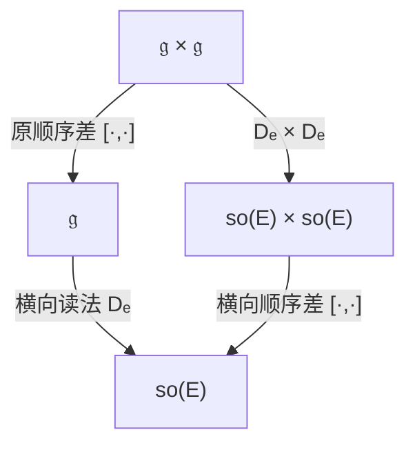
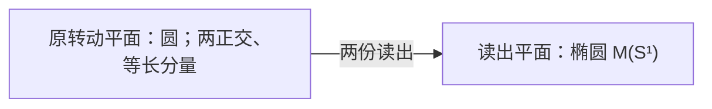

# 两路顺序差：从整族矩阵零式，退到一个内生相关量

> 来源：用户于 2026-11-05（Asia/Singapore）在本会话提供的 ΩQ-012 LaTeX 研究工作稿；原稿未另署作者或模型。本文为参考输入，Lean 是仓库的数学真源；本次仅转换 Markdown，未作形式化认证。正文中的固定快照、项目核读叙述与理论结论均保留原稿口径；两幅 TikZ 图转换为 Mermaid 示意图。

QUANTUM ORIGINS / $\Omega Q$-012

从整族矩阵零式，退到一个内生相关量

**本轮唯一候选：两路顺序差的平均正交。**

同一对微小变化有两条比较路径：先求顺序差再读横向，或先读横向再求顺序差。把全部方向按同一原作用的迹比较公平计入，要求两条路径留下的差异平均正交；整体须确有非零顺序差。

$$
\Phi_e(K,L)=D_e([K,L]),\qquad
\Psi_e(K,L)=[D_e(K),D_e(L)].
$$

对原迹比较的一组正交单位基 $K_1,\ldots,K_r$，定义

$$
\mathcal N=\sum_{i,j}\|[K_i,K_j]\|_\kappa^2,\qquad
\mathcal A_e=\sum_{i,j}\kappa_E(\Psi_e(K_i,K_j),\Phi_e(K_i,K_j)).
$$

唯一选择关系为

$$
\boxed{\mathcal N>0,\qquad \mathcal A_e=0.}
$$

两个求和均与正交基无关，不是给一个特选作用对另配标尺。

在完整原有限响应背景中，本轮证明精确恒等式

$$
\boxed{\eta_e:=\frac{\mathcal A_e}{\mathcal N}
=1-\frac{3}{\dim W}.}
$$

因此 $Q12$ 恰好选择完整三维旋转基本块，继而恢复上一轮的所有横向交换关系。三维以上具有锐的归一间隙 $\eta_e\ge1/4$。几何再展开为球面、四元数、复二维振幅与原概率的 Born 配对。

日期：2026-11-05，新加坡。\
固定项目版本：`dev@664de54986944b49cda0200e15020602fc8dae65`。\
提交：2026-11-05 03:24:54 +0800；分支核查：03:34:20 +0800。\
承接：上一轮对话 $\Omega Q$-011 及项目最新 $\Omega Q$-010。\
普通数学研究工作稿。本文给出完整限定范围的证明、反模型和接口；不声明 Lean 认证、文献优先权或所有实际系统已满足候选。

## 1　无限对象、有限关系与公理回溯

用户关于素数的新直觉，把问题从“再补一条公理”推进到“不断出现的公理，是否只是同一整体关系的不同读出”。这里需要同时保留两层：对象可以无穷多，描述这些对象的关系可以很短；一份短关系也未必能消除全部物理选择条件。

#### 定义 1.1：素数的共同坐标结构

令 $\mathcal P$ 为全部素数，$\mathbb N_0^{(\mathcal P)}$ 为有限支撑的非负整数族。对正整数 $m$，令

$$
\nu(m)=(\nu_p(m))_{p\in\mathcal P},
$$

其中 $\nu_p(m)$ 为 $p$ 在 $m$ 中的指数。

#### 命题 1.2：新素数不是新的乘法规律

算术基本定理给出交换幺半群同构

$$
(\mathbb N_{>0},\times)\simeq
(\mathbb N_0^{(\mathcal P)},+),\qquad
\nu(mn)=\nu(m)+\nu(n).
$$

并且

$$
m\mid n\iff\nu_p(m)\le\nu_p(n)\quad(\forall p),
$$

最大公因数与最小公倍数分别对应逐坐标的最小值和最大值。

**证明。**

每个大于一的整数有素因子，按数值归纳可得素因子分解的存在；Euclid 引理使一个素因子必须整除另一分解的某一因子，逐次消去即得唯一性。乘法拼合分解，指数相加；整除及两种极值由指数比较得到。此处使用的是成熟的算术基本定理，而非提出新的素数规律。[\[9\]](#ref-maynard)

$\square$

素数无穷多：任何有限列表 $p_1,\ldots,p_s$ 之外，$p_1\cdots p_s+1$ 的某个素因子不在表中。这不要求每个新素数伴随一条新乘法公理。上面的坐标数是可数无穷；$\prod_p p^{a_p}$ 与指数坐标之间是双射，不能把它误写成已经证明了某个未知有限维实体的有损物理投影。

#### 命题 1.3：有限描述、有限生成与无穷输出是三件事

正整数乘法幺半群不是有限生成的；但素数有一个固定有限算法逐一枚举，而自然数半环由 $1$ 生成。

**证明。**

有限个乘法生成元仅含有限种素因子，它们的任意有限乘积不可能产生列表外的素数。另一方面，按顺序检查每个整数是否有较小的非平凡因子，是一份固定有限程序；对每个待检整数执行的检查有限，因而枚举全部素数。允许加法后，每个自然数是有限次把 $1$ 相加所得。三项结论使用的原运算签名不同。 $\square$

有限观察者发现一个新素数仍支付计算与验证成本；短描述不等于免费读出或高效求解。量子公理的回溯也应区分规律的描述、实际可调用的运算，以及读出某个具体结果的资源。

#### 命题 1.4：严格缩短不能被预设为无穷过程

固定一个表达语言，并把所有缩写展开后的描述长度记为 $L\in\mathbb N$。若每轮满足 $L_{j+1}<L_j$，则这样的严格递减轮数有限。

**证明。**

非负整数不存在无限严格递减链。每轮至少减一，故至多进行初始长度所允许的次数。 $\square$

所以“每轮更简洁”必须给可复查的指标，也要允许到达一个局部闭合点。本轮减少的是**作为候选要求为零的输出对象**：从全部二元交换子的矩阵零式，退到一个整体收缩得到的实数零式。它仍需完整作用代数与同一轨道的标尺；不声称实验采样更少、总计算更便宜或展开后的文字全局最短。后文精确说明这个实数事实上读出了完整维数。

本轮只提出 $Q12$ 一个候选。其余弱化形式作为失败反例分析；球面、复幅度、Born 公式和过程规则作为推导结果或注明前件的接口出现。

## 2　固定项目版本与本轮的承接范围

本轮核查固定于项目 `dev` 的提交 `664de5498694`；完整提交号与不可变来源见参考文献。提交时间为 2026 年 11 月 5 日 03:24:54，新加坡时间；分支头读取时间为同日 03:34:20。该提交合并了原记录恢复的统一误差下界。相对上一轮固定版本 `c30bb282a0b84`，完整 Git 树比较给出理论目录两份新增、五份修改；所消费原文的下载字节均与 Git blob 核对。这里的版本范围以这一固定时点为准。[\[1\]](#ref-q012commit)

最新项目 $\Omega Q$-010 的主选择条件仍是

$$
\operatorname{rank}\!\left(
 [\mathfrak g,\mathfrak g]\longrightarrow\mathfrak{so}(e^\perp),\quad
 K\longmapsto P_eK|_{e^\perp}\right)=1.
$$

它已有完整三维证明、不连通群处理、规范轨道比较及更多原准备的外半径校准。本轮承接这些背景，并以对话 $\Omega Q$-011 的横向两两交换为直接比较对象。固定分支中尚无同名 `OMEGAQ_011` 文件；对话推导与已入库原文保持各自归属。项目 $\Omega Q$-010 的新 §10 接入下述全对象协变桥，其秩一候选本身未改。[\[2\]](#ref-q010latest)

### 2.1　原 C128 的全范围协变及单对标定已有新闭合

C123–C128 原卷新 §§57–62 改变了上一轮的开放边界。精确前提是原定义 41.1 的同一保留背景：所有原对象及实际联合上的 P/G、原 AC、精确 $N_u$、保持同一个原 $D$ 的 Jordan 嵌入 X、同记录旁接 $X_s$、全事件 R、原细化、遗忘、具名支持双返回，以及全部准备、失败与合法有限历史。X 还保留交叉 $D=0$、乘积张成和每对实际乘积准备。每个对象只使用原身份事件与全事件 R 已供应的某个实际 $AP^{\otimes k}$。这些多对象前件须在原签名中逐项成立；本轮的单来源紧循环前端不代替它们。[\[4\]](#ref-c128latest)

在该背景下，原零接触条件 Z 给每个 $D_a$ 对同一 Jordan 乘法的导子归属，原自守恒 $\mathrm{SC}:D_a a=0$ 给原交替双导子 $F(a,b)=D_ab$。新定理 57.2 进一步证明

$$
\mathcal C_A(K;a,b)
 =KF_A(a,b)-F_A(Ka,b)-F_A(a,Kb)=0
$$

对全部原对象、实际联合及内导子 $K$ 成立。其承重步骤如下。简单 Jordan 秩至少三时，原 $F$ 给无迹部分上的三形式 $T$，每个收缩 $\iota_xT$ 都属于导子表示。该表示忠实不可约，非零的奇次不变量 $\operatorname{tr}(x^3)$ 又排除整个正交代数。Nagy 的斜延拓定理遂使 $T$ 为零或不变 Cartan 三形式，给出高秩协变。[\[8\]](#ref-nagy), [\[4\]](#ref-c128latest)

剩余秩二情形由同一实际联合约束。定理 57.2 以纯边缘和有限简单分量的计数迫使活动局部理想被高秩联合分量忠实看见；§60 又给更短的单乘积见证：原 AC 使同一效果 $d$ 为原子且同一准备在其上取一；取原局部原子 $p$ 使 $F(p,c)\ne0$。若承载这对边缘的正权联合分量秩二，则两个期望一的原子必须重合，原交叉零与保持原 $F$ 的单射随即矛盾。因此承载分量必须升到高秩，那里为零的协变缺陷沿原嵌入返回局部。此证明保留原 $F$，并允许数学纯态仅通过原准备的有限正锥组合进入论证。[\[4\]](#ref-c128latest)

新 §61 还把整算子迹标定 S 等价地缩为同一原指针中的一对元素：存在 $x\ne0$，满足

$$
d\circ x=\tfrac12x,\qquad
 4q_P(F_P(d,x),F_P(d,x))=q_P(x,x).
\tag{P-S2}
$$

在上述保留背景、Z、SC 下，它也等价于同一横向元上的 $4F(d,F(d,x))=-x$。已取得的协变使原关系在复简单块上为 $F(a,b)=\lambda i[a,b]/2$，而在其余非经典类型上为零；该单对关系精确固定 $\lambda^2=1$，未重标原 $D$。于是原全范围曲率和 C124 的相应有限量子消费者接回。该见证生成的是同一指针内的数学三维自旋角；它不把整个指针缩成三维，也不自动供应新的实际量子比特。[\[4\]](#ref-c128latest)

因此，本轮不再把原 C128 的全对象协变列为未闭合项，也不把单对回转标定作为本轮首创。原文关于数学 CP 与同一设备实际参考可用性的分离仍保留；具体时钟、作用量单位、旧输出校准和任意独立仪器组装仍由各自接口承担。

### 2.2　C133 的复几何已允许原始非结合配方

C133 新续篇 V 的原域只要求一个有双侧单位 $1$ 的二元运算集合 $M$、任意 $U1=1$，以及处处有限的非负比较 $c$，其中 $c(a,a)=0$。原始结合、交换、相减和线性均未预设。完整关系是

$$
\sum_{k=0}^{2}c(a\cdot U^ku,b\cdot U^kv)
 =3c(a,b)+3c(u,v).
\tag{P-B3}
$$

其定理 1.3 给出双向分类：存在最小复 Hilbert 表示，令

$$
F1=0,\quad F(a\cdot b)=Fa+Fb,\quad
 F(Ua)=\omega Fa,\quad
 c(a,b)=\|Fa-Fb\|^2,\qquad \omega=e^{2\pi i/3}.
$$

证明先保留乘法缺陷，利用全部有限三分支历史的 Fourier 平方平均与统一界消去可见缺陷，再由三相关系推出平行四边形律及正 Gram 完成。可见商的结合、交换和负元因此是结论；原树的次序、括号、来历与附加记录仍保留。[\[5\]](#ref-c133v)

这条路线的三个正历史方向描述复振幅平面的关系，最小非零块可以仅为复一维；它没有给出本轮所证明的完整三维响应刚性。全局有界的 $c$ 只能为零，故原比较总量也不能直接当成已归一到 $[0,1]$ 的概率。完整事件和全部成对过程校准、共同相位条件分别接回效果与 Kraus 表示；实际参考、联合、准备及物理时间仍须有原来源。[\[5\]](#ref-c133v)

### 2.3　C117 的同一终端响应已有相位敏感比较接口

C117 续篇新 §§38–42 保留原整个十三维复空间、同一 ready、七门、全部 1024 标签、全部七门未来及同一个连续相位不变终端响应 $P$。新增局部正多重集比较合同，包括逐事件五项配平、两个总追加等距律、正原单位锚 $m_0>0$、全称单字校准和三个固定原字零比较。它们推出原局部复二维角 $L$ 上

$$
c_*(A,B)=m_0\|V(A)-V(B)\|_L^2,
$$

再经原四时刻桥，得到同一个 $P$ 在整个十三维空间上的 POVM。新增比较请求的实现及其原读数均是有实质内容的前提；已有复振幅恒等式本身不供应这些请求。[\[6\]](#ref-c117latest)

此比较对相位敏感，不能只由相位不变的终端预测行后处理取得。坐标 Born 与预测秩恰为 169 仍需独立逐基完整标签校准；均匀常数响应具有上述比较扩张，却只有秩一。加入实际档案读者后的无限秩结论仍保留。该接口推进了原局部比较到同一整体终端响应的连接，同时继续消费原复门源及终端充分性。

### 2.4　固定记录恢复目标的统一误差下界

最新合并的 RRO 续篇 I §8 在固定十六位原源、原门和完整有限反馈语言上，比较保留同一次原读数 $j$ 的指定强局部 Petz 目标。所有实际分支保持相邻双一缺陷为零；目标却给同一个原事件 $\{j=0,z_1=z_2=1\}$ 正质量

$$
\delta=\frac{16-7\sqrt5}{11}>0.
$$

因此每个允许的完整有限原继续程序 $C$ 都满足 $\operatorname{TV}(\bar P_C,P_\chi)\ge\delta$，即使其有限资源沿序列无界增长也不能收敛到该目标。求和只遗忘新增记录，原程序、旧档案、终端结果、失败和停机坐标保持。结论针对这一固定强目标及其对原补系统的恒等作用；它不否定所有恢复映射或仅恢复无条件边缘的任务。[\[7\]](#ref-rrolatest)

这些更新共同说明：一个数学表示、一个原比较合同、一个实际过程及其完整记录之间，必须以保持原身份的关系逐段接合。下文的单个汇总判据在完整紧循环前端中独立证明；上述多对象和过程结果只在其原前件确实具备时接入。

## 3　完整原响应与内生比较

#### 定义 3.1：原数据与有限背景

固定 $\Omega$ 中一个原对象和真实来源。对原控制或准备历史 $a$，将全部合法未来请求 $f$、全部原结果标签 $w$ 的概率记成完整响应行

$$
x_a(f,w)=p(a;f,w).
$$

原失败、实际可读档案、合法性与可用性继续列在同一个原菜单中；原历史和设备身份作为索引保持。不同索引即使响应相同也不因此从 $\Omega$ 中删除。取来源在全定义原可逆连接及其准确统计逆下的完整轨道，置

$$
V=\operatorname{span}_\mathbb R\{x_a\},\qquad u(x_a)=1,\qquad W=\ker u.
$$

本轮背景要求 $0<\dim W<\infty$。原接续及其逆在完整未来上定义，因而诱导 $V$ 上的线性可逆作用。若实际可读历史增大张成空间，必须使用扩大后的 $V$，不能以删列强行维持有限性。

#### 引理 3.2：紧闭包、固定中心与完整循环性

原可逆作用在 $V$ 上的闭包 $H$ 为紧群。定义

$$
c=\int_Hh x_\epsilon\,dh,\qquad e=x_\epsilon-c,
\qquad G=H|_W,\qquad\mathfrak g=\operatorname{Lie}(G).
$$

则 $G$ 紧且作用忠实，$e\ne0$，并且

$$
W=\operatorname{span}(Ge).
$$

**证明。**

有限维中可选有限个原实际评价坐标分离 $V$，并可从原响应行中选一组基。任一原控制把这些基行送到其他原响应行，其全部所选坐标均有界，故矩阵一致有界。逆也属于同一原可逆集合，所以逆矩阵一致有界；矩阵闭包因此紧且不含奇异矩阵，是群。 Haar 平均固定 $c$，且 $u(c)=1$，故 $V=\mathbb Rc\oplus W$。在 $W$ 上作用平凡者也固定 $c$，故在整个 $V$ 上平凡，给忠实性。所有归一行减去 $c$ 张成 $W$，正是 $Ge$ 的张成。若 $e=0$，整个来源轨道只有 $c$，与 $\dim W>0$ 矛盾。

$\square$

闭包中的每个极限控制或连续单参数族，不自动成为准确可调用的原装置；平均也不命名新的实际随机化准备。这里先构造同一原响应的数学作用，不改变实际操作菜单。

#### 定义 3.3：轨道协方差比较

设 $n=\dim W$。对 $\alpha\in W^*$ 定义

$$
\mathsf C\alpha=\int_G\alpha(ge)\,ge\,dg,
\qquad
B(v,w)=\frac1n(\mathsf C^{-1}v)(w).
$$

#### 引理 3.4：原轨道的规范紧框架

上述 $B$ 正定且 $G$ 不变，$B(e,e)=1$。以 $v^{\flat_B}=B(v,\cdot)$ 记降指标，则

$$
\boxed{\int_G ge\otimes(ge)^{\flat_B}\,dg=\frac1n I_W.}
$$

特别地，若 $S\in\operatorname{End}(W)$ 与整个 $G$ 交换，则

$$
B(e,Se)=\frac1n\operatorname{Tr}_W S.
$$

**证明。**

循环性给 $\alpha(\mathsf C\alpha)=\int\alpha(ge)^2dg>0$ 对全部 $\alpha\ne0$ 成立，故 $\mathsf C$ 可逆。Haar 不变性给 $B$ 的不变性。令 $B_0=\mathsf C^{-1}$，则 $n=\operatorname{Tr}(\mathsf C^{-1}\mathsf C)=\int B_0(ge,ge)dg=B_0(e,e)$，所以 $B(e,e)=1$。 对任意 $w$，紧框架积分作用于 $w$ 等于 $\mathsf C(w^{\flat_B})=w/n$，证明算子恒等式。若 $S$ 与 $G$ 交换，则 $B(ge,Sge)=B(e,Se)$；对紧框架式取与 $S$ 的迹配对即得最后一式。

$\square$

#### 命题 3.5：原表示同构不改变比较

若 $T:W\to W'$ 为保来源、保全部原群作用的线性同构，$e'=Te$、$G'=TGT^{-1}$，则两边各自由原轨道定义的比较满足 $B'(Tv,Tw)=B(v,w)$。同一轨道内改选 $e'=g_0e$ 也只使后续关系共轭。因而后续迹、横向读数与归一相关量均不依赖坐标。

**证明。**

协方差满足 $\mathsf C'=T\mathsf C T^*$，代入定义即得比较运输；轨道内换源使用 Haar 右不变性。共轭保持迹与算子乘法。 $\square$

这条不变性只针对保全部原响应的同构。删去可读坐标的非单射映射不属于它。有限观察者只掌握部分菜单时，不能据此声称已识别整个 $\Omega$ 的维数。

## 4　两个二元顺序读法与唯一候选

沿用前节完整原响应构造出的 $W,G,e,B$，令 $n=\dim W$、$\mathfrak g=\operatorname{Lie}(G)$。这里 $G$ 是原可逆作用的紧闭包；$\mathfrak g$ 中的方向是这个原表示的无穷小生成元，并不自动表示原菜单已经具有每一条精确连续控制。前节的规范比较给出

$$
B(e,e)=1,\qquad
\int_G(ge)\otimes(ge)^{\flat_B}\,dg=\frac1n I_W,
\qquad W=\operatorname{span}(Ge).
\tag{4.1}
$$

第二式是后续证明使用的规范紧框架恒等式，包含完整群的全部分支。

#### 定义 4.1：横向读法与两种顺序路线

令

$$
E=e^{\perp_B},\qquad P_e=I-e\otimes e^{\flat_B},
\qquad D_e(K)=P_eK|_E.
$$

对同一对原生成元 $K,L\in\mathfrak g$，定义

$$
\begin{aligned}
\Phi_e(K,L)&=D_e([K,L]),
&&\text{先比较原顺序，再读横向；}
\end{aligned}
\tag{4.2}
$$

$$
\begin{aligned}
\Psi_e(K,L)&=[D_e(K),D_e(L)],
&&\text{先读横向，再比较顺序。}
\end{aligned}
\tag{4.3}
$$

在实反对称算子上分别使用

$$
\kappa_W(K,L)=-\tfrac12\operatorname{Tr}_W(KL),\qquad
\kappa_E(S,T)=-\tfrac12\operatorname{Tr}_E(ST).
$$

原作用有效，因此 $\kappa_W|_\mathfrak g$ 正定；下文在 $\mathfrak g$ 上也简记 $\kappa=\kappa_W|_\mathfrak g$。定义二元相关

$$
\chi_e(K,L)=\kappa_E\bigl(\Psi_e(K,L),\Phi_e(K,L)\bigr).
\tag{4.4}
$$

$P_e$ 是同一个原算子的分块读法，不是删去来源方向或实际擦除过程。两条路线都保持原 $K,L$ 的身份，也没有把原顺序接续换成配方加法。$\chi_e$ 是两个算子之间的实迹配对；它可以有任意符号，不是一个概率。

#### 定义 4.2：完整二元相关及非退化域

选取完整 $\mathfrak g$ 的任意 $\kappa_W$-正交归一基 $K_1,\ldots,K_r$，定义有序对收缩

$$
\mathcal A_e=\sum_{i,j=1}^{r}\chi_e(K_i,K_j),\qquad
\mathcal N=\sum_{i,j=1}^{r}\lVert[K_i,K_j]\rVert_{\kappa_W}^{2}.
\tag{4.5}
$$

在 $\mathcal N>0$ 的非交换域上定义

$$
\eta_e=\frac{\mathcal A_e}{\mathcal N}.
$$

#### 引理 4.3：基无关性与二元平均

$\mathcal A_e,\mathcal N$ 不依赖完整正交基的选择。$\mathcal N>0$ 等价于 $[\mathfrak g,\mathfrak g]\ne0$。当 $r\ge1$ 时，若 $K,L$ 是 $\mathfrak g$ 单位球面上两个独立的各向同性数学变量，则

$$
\mathbb E\chi_e(K,L)=\frac{\mathcal A_e}{r^2},\qquad
\mathbb E\lVert[K,L]\rVert_{\kappa_W}^{2}=\frac{\mathcal N}{r^2}.
$$

**证明。**

$\Phi_e,\Psi_e$ 及原交换子都是交替双线性映射。正交换基后，两个输入槽的系数分别按正交矩阵变换；求和时用两次 $\sum_i O_{ia}O_{ib}=\delta_{ab}$，便得到不变性。 $\mathcal N$ 为原交换子映射的平方范数；它为零当且仅当该映射为零。 写 $K=\sum_i x_iK_i$、$L=\sum_j y_jK_j$，各向同性给出 $\mathbb E x_ix_k=\delta_{ik}/r$、$\mathbb E y_jy_\ell=\delta_{j\ell}/r$，再用独立性即可。

$\square$

这一数学平均不额外供应原随机门装置。有限求和已足以定义候选；也不能把对完整基的收缩解释成只需检查一对任意控制。

**本轮唯一候选 $\Omega Q$-012：**

$$
\boxed{\mathcal N>0,\qquad\mathcal A_e=0.}
\tag{Q12}
$$

等价地，在整体确有无穷小顺序差的域上，要求 $\eta_e=0$。

**白话：** 把同一对变化按两种次序读出来：先比较整体顺序再看横向，或先看横向再比较顺序。由全部原变化自己给出比较尺，要求两种读法的总体相关为零。

本候选不要求每个 $\chi_e(K,L)$ 分别为零，也不直接要求算子 $\Psi_e$ 为零。下文将证明，在完整背景中，单个总体等式已经迫使后者成立。它不是把上一轮所有算子分量的平方相加后重新命名。

## 5　总体相关的精确恒等式

#### 引理 5.1：完整算子的可逆分块

对 $v\in E$ 定义

$$
X_v(te+z)=tv-B(v,z)e.
$$

对 $v,w\in E$ 定义

$$
J_{v,w}z=B(v,z)w-B(w,z)v,\qquad J_{v,w}e=0.
$$

任取 $K\in\mathfrak g$，令 $v_K=Ke$、$B_K=D_e(K)$，并将 $B_K$ 零延拓到 $\mathbb Re$，记为 $\widetilde B_K$。则

$$
\begin{aligned}
K&=X_{v_K}+\widetilde B_K,
\end{aligned}
\tag{5.1}
$$

$$
\begin{aligned}
[K,L]&=X_{B_Kv_L-B_Lv_K}+J_{v_K,v_L}
+\widetilde{[B_K,B_L]},
\end{aligned}
\tag{5.2}
$$

$$
\begin{aligned}
\Phi_e(K,L)&=\Psi_e(K,L)+J_{Ke,Le}|_E,
\end{aligned}
\tag{5.3}
$$

$$
\begin{aligned}
\kappa_W(K,L)&=B(Ke,Le)+\kappa_E(B_K,B_L).
\end{aligned}
\tag{5.4}
$$

**证明。**

反对称性及 $B(e,e)=1$ 给出块矩阵

$$
K=\begin{pmatrix}0&-v_K^\flat\\v_K&B_K\end{pmatrix}.
$$

直接相乘得 $[X_v,X_w]=J_{v,w}$ 与 $[\widetilde B_K,X_w]=X_{B_Kw}$，遂有交换子公式。 两个往返块乘积的迹为 $-2B(v_K,v_L)$，横向块的迹保留在 $E$，交叉块迹为零，得到最后一式。

$\square$

#### 定义 5.2：原 Lie 比较与加权 Casimir

在同一个完整 $\kappa_W$-正交基上令

$$
v_i=K_ie,\qquad B_i=D_e(K_i),\qquad
c_{ijk}=\kappa_W([K_i,K_j],K_k).
$$

由迹的不变性，$c_{ijk}$ 对三个下标完全反对称。定义自伴算子 $Q:\mathfrak g\to\mathfrak g$ 为

$$
\kappa_W(QK,L)=-\operatorname{Tr}_\mathfrak g(\operatorname{ad}K\,\operatorname{ad}L).
\tag{5.5}
$$

其矩阵及在 $W$ 上的收缩为

$$
Q_{k\ell}=\sum_{i,j}c_{ijk}c_{ij\ell},\qquad
\mathcal C_Q=-\sum_{k,\ell}Q_{k\ell}K_kK_\ell.
\tag{5.6}
$$

#### 引理 5.3：完整群不变量

$Q$ 与 $\mathcal C_Q$ 均为正半定自伴算子，并有

$$
\mathcal N=\operatorname{Tr}_\mathfrak gQ,
\qquad \operatorname{Tr}_W\mathcal C_Q=2\mathcal N.
\tag{5.7}
$$

$\mathcal C_Q$ 与完整 $G$ 的作用交换，包括不连通分支。

**证明。**

$\operatorname{ad}K$ 关于 $\kappa_W$ 反对称，故

$$
\kappa_W(QK,K)=-\operatorname{Tr}_\mathfrak g(\operatorname{ad}K)^2\ge0.
$$

将 $Q$ 在 $\mathfrak g$ 中正交对角化，有 $\mathcal C_Q=-\sum_i q_iK_i^2$、$q_i\ge0$，所以 $\mathcal C_Q\ge0$。 展开交换子到正交基得 $\mathcal N=\sum_{ijk}c_{ijk}^2=\operatorname{Tr}Q$。又由 $-\operatorname{Tr}_W(K_kK_\ell)=2\delta_{k\ell}$，得第二个迹式。

任取 $g\in G$。共轭 $\operatorname{Ad}_g$ 保持 $\mathfrak g$、原交换子与 $\kappa_W$，也保持式 (5.5) 的实迹，因此 $Q$ 是 $\operatorname{Ad}_g$-等变的。将 (5.6) 中的完整正交基同时变成 $\operatorname{Ad}_gK_i$，收缩不变，故 $g\mathcal C_Qg^{-1}=\mathcal C_Q$。这里没有要求 $g\in G^\circ$。

$\square$

#### 引理 5.4：三槽收缩恒等式

只要求 $B$ 为不变内积且 $e$ 为单位向量时，已有

$$
\boxed{\mathcal A_e=\mathcal N-\frac32B(e,\mathcal C_Qe).}
\tag{5.8}
$$

**证明。**

记

$$
b_{ijk}=\kappa_E([B_i,B_j],B_k),\qquad
\tau_{ijk}=B(B_iv_j,v_k).
$$

由引理 5.1，横向 $J$ 项贡献 $\kappa_E(J_{v_i,v_j},B_k)=B(B_kv_i,v_j)$，而来源分量贡献 $B(B_iv_j-B_jv_i,v_k)$。所以

$$
c_{ijk}=b_{ijk}+\tau_{ijk}+\tau_{jki}+\tau_{kij}.
\tag{5.9}
$$

同时

$$
\Phi_e(K_i,K_j)=\sum_kc_{ijk}B_k,
\qquad
\mathcal A_e=\sum_{ijk}c_{ijk}b_{ijk}.
$$

在式 (5.9) 两边乘以 $c_{ijk}$ 后求和。由于三循环不改变完全反对称的 $c$，三个 $\tau$ 收缩相等。 又因为

$$
B([K_i,K_j]e,v_k)=\tau_{ijk}+\tau_{jki},
$$

有

$$
\begin{aligned}
2\sum_{ijk}c_{ijk}\tau_{ijk}
&=\sum_{ijk}c_{ijk}B([K_i,K_j]e,v_k)\\
&=\sum_{k,\ell}Q_{k\ell}B(v_\ell,v_k)
=B(e,\mathcal C_Qe).
\end{aligned}
$$

因此

$$
\mathcal A_e
=\sum_{ijk}c_{ijk}^2-3\sum_{ijk}c_{ijk}\tau_{ijk}
=\mathcal N-\tfrac32B(e,\mathcal C_Qe).
$$

$\square$

#### 定理 5.5：规范总体相关精确读出完整维数

在前节的完整规范背景中，恒有

$$
\boxed{\mathcal A_e=\left(1-\frac3n\right)\mathcal N.}
\tag{5.10}
$$

若 $\mathcal N>0$，则

$$
\boxed{\eta_e=1-\frac3n,\qquad n=\frac3{1-\eta_e}.}
\tag{5.11}
$$

**证明。**

由引理 5.3，$\mathcal C_Q$ 与完整 $G$ 交换，所以 $B(ge,\mathcal C_Qge)=B(e,\mathcal C_Qe)$。用规范紧框架式 (4.1)，

$$
\begin{aligned}
B(e,\mathcal C_Qe)
&=\int_GB(ge,\mathcal C_Qge)\,dg\\
&=\operatorname{Tr}_W\!\left(\mathcal C_Q
\int_G(ge)\otimes(ge)^{\flat_B}\,dg\right)\\
&=\frac1n\operatorname{Tr}_W\mathcal C_Q
=\frac{2\mathcal N}{n}.
\end{aligned}
$$

代入式 (5.8) 即得。

$\square$

式中系数 $3$ 来自 (5.9) 的三个循环槽；它没有作为目标维数进入候选。所有迹都在同一个完整原表示中计算。因而这条关系不能用某个预先截下来的三维窗口代替。

## 6　从一个总体等式到完整三维几何

#### 定理 6.1：唯一候选的完整刻画

在完整规范背景中，以下条件等价：

1.  Q12 成立；

2.  $\dim W=3$ 且 $\mathfrak g=\mathfrak{so}(W,B)$；

3.  Q11 成立，即 $[\mathfrak g,\mathfrak g]\ne0$，并且 $[D_e(K),D_e(L)]=0$ 对全部 $K,L\in\mathfrak g$ 成立。

此时

$$
G^\circ=SO(W,B),\qquad G=SO(W,B)\ \text{或}\ O(W,B).
$$

**证明。**

Q12 给 $\mathcal N>0$，所以 $\mathfrak g$ 非交换。忠实反对称作用在一、二维空间上只有交换 Lie 代数，因此 $n\ge3$。由式 (5.10)，$\mathcal A_e=0$ 强迫 $n=3$。

在三维中取 $[K,L]\ne0$。迹不变性给

$$
\kappa_W([K,L],K)=\kappa_W([K,L],L)=0.
$$

故 $K,L,[K,L]$ 三者线性独立。它们属于三维的 $\mathfrak{so}(W,B)$，从而 $\mathfrak g=\mathfrak{so}(W,B)$。

反过来，若第二项成立，$E$ 为二维，$\mathfrak{so}(E)$ 为一维交换代数，故 $\Psi_e\equiv0$，且原 $\mathfrak g$ 非交换，得到第三项。 第三项使 $\mathcal N>0$ 且 $\mathcal A_e=0$，直接给第一项。

最后，具有整个 $\mathfrak{so}(W,B)$ 的连通子群为 $SO(W,B)$。而 $G\subseteq O(W,B)$，所以完整群只有所列两种可能。

$\square$

本证明直接从标量收缩推出三维，并没有调用上一轮的三维定理。因此也给 Q11 一个新的独立证明。两轮在完整背景中的模型类相同；本轮减少的是选择条件的输出类型和数量，而非声称扩大模型类或取得普遍最小的计算成本。

#### 推论 6.2：有限二元提升与内生特殊轴

Q12 下存在 $K,L\in\mathfrak g$，使

$$
\boxed{W=\operatorname{span}\{e,Ke,Le\}.}
$$

更具体地，取 $E$ 的任意正交单位基 $v,w$，则

$$
X_v,X_w\in\mathfrak g,\qquad A=[X_v,X_w]=J_{v,w},
$$

并有

$$
Ae=0,\quad Av=w,\quad Aw=-v,\quad
\ker A=\mathbb Re,\quad\kappa_W(A,A)=1,
$$

$$
[A,X_v]=X_w,\qquad [X_w,A]=X_v.
$$

**证明。**

主定理给出全部三维反对称生成元，故 $X_v,X_w$ 均属于同一个原作用表示的 Lie 代数。$X_ve=v$、$X_we=w$ 给张成式；其余等式由引理 5.1 或在基 $e,v,w$ 上直接计算。

$\square$

这里的有限提升包含整个 $W$。$A$ 是由一对来源变化产生的结论；更换横向基只改变取向与坐标。来源轨道因此是

$$
Ge\simeq S^2\simeq SO(3)/SO(2).
$$

旧的球面曲率、四元数乘法、$\mathbb C^2$ 幅度与 $U(1)$ 纤维构造，可以在这一同一空间中继续发展。实际门、准备、仪器和联合对象是否实现这些数学构造，仍须使用各自原接口。

### 6.1　补充：不使用规范紧框架时的零点刚性

下面的结果说明零点并非只靠规范化制造出来。精确维数公式和后文固定误差间隙需要规范比较；零点的三维刚性在任意不变单位源比较下仍成立。

#### 定理 6.3：任意不变比较下的非负性与零点

设 $B$ 只是不变正定内积，$B(e,e)=1$，仍保持完整紧有效作用和 $W=\operatorname{span}(Ge)$。按相同公式定义 $\mathcal A_e,\mathcal N$。若 $\mathcal N>0$，则

$$
\mathcal A_e\ge0,
$$

且等号当且仅当 $W$ 三维并且 $\mathfrak g=\mathfrak{so}(W,B)$。

**证明。**

令 $\mathfrak h=[\mathfrak g,\mathfrak g]$。对紧 Lie 代数的迹比较，

$$
\mathfrak h^\perp=\mathfrak z(\mathfrak g),\qquad
\ker Q=\mathfrak z(\mathfrak g),\qquad\operatorname{im}Q=\mathfrak h.
$$

第一式来自不变性：$K\perp[\mathfrak g,\mathfrak g]$ 当且仅当 $[K,L]=0$ 对所有 $L$ 成立。$\mathfrak h$ 的中心为零，因为其中的中心元也与 $\mathfrak z(\mathfrak g)$ 交换，于是落入 $\mathfrak h\cap\mathfrak z(\mathfrak g)=0$。再次使用同一正交恒等式，得 $[\mathfrak h,\mathfrak h]=\mathfrak h$。

将 $Q$ 对角化，$\mathcal C_Q=-\sum_i q_iK_i^2$，正权 $q_i>0$ 的方向张成 $\mathfrak h$。$\mathcal C_Q$ 的每个正特征空间都是非平凡的正交 $\mathfrak h$-模。它的实维数至少为三：若为一或二，作用像落入交换的 $\mathfrak{so}(1)$ 或 $\mathfrak{so}(2)$，而完美代数 $\mathfrak h$ 的这种像必为零，矛盾。

因此

$$
\lambda_{\max}(\mathcal C_Q)
\le\frac13\operatorname{Tr}_W\mathcal C_Q=\frac{2\mathcal N}{3},
$$

再由单位源 Rayleigh 界和式 (5.8) 得 $\mathcal A_e\ge0$。

若等号成立，上述两处不等式都必须取等。$e$ 属于最大特征空间，而迹恰好为最大特征值的三倍，故 $\mathcal C_Q$ 的支撑 $U$ 恰为三维。对 $z\in U^\perp$，

$$
0=B(z,\mathcal C_Qz)=\sum_iq_i\lVert K_iz\rVert_B^2,
$$

所以整个 $\mathfrak h$ 杀死 $U^\perp$。其在 $U$ 上的忠实非零完美像遂为 $\mathfrak{so}(U)$。完整 $G$ 归一化 $\mathfrak h$，因此保持其支撑 $U$。由 $e\in U$ 及完整循环性，$W=\operatorname{span}(Ge)=U$。逆向由二维横向块交换立即成立。

$\square$

## 7　精确维数读出与尖锐的相对间隙

#### 推论 7.1：离散相关值与第一间隙

在完整规范的非交换域内，所有可能的相关值为

$$
\eta_n=1-\frac3n\quad(n=3,4,5,\ldots),
$$

即

$$
0,\quad\frac14,\quad\frac25,\quad\frac12,\quad\frac47,\ldots.
$$

所有 $n\ge3$ 都可实现，例如取标准 $SO(n)$ 作用。因此

$$
\boxed{\eta_e<\frac14\quad\Longrightarrow\quad
\eta_e=0,\ \dim W=3.}
$$

**证明。**

由定理 5.5，$\eta_e=1-3/n$，其中整数 $n\ge3$。该表达随 $n$ 严格递增。标准 $SO(n)$ 的单位源轨道为 $S^{n-1}$，其规范协方差为 $I/n$，且 $n\ge3$ 时非交换，所以实现全部列值。

$\square$

#### 反例 7.2：第一非三维值由四元数左作用实现

取 $W=\mathbb H\simeq\mathbb R^4$，$G$ 为单位四元数的左乘作用，$e=1$。其轨道为整个 $S^3$，比较是标准实内积。令 $L_i,L_j,L_k$ 为三个虚单位的左乘算子，置

$$
K_a=L_a/\sqrt2\quad(a=i,j,k).
$$

由于 $-\frac12\operatorname{Tr}_WL_a^2=2$，这是一组 $\kappa_W$-正交单位基；且

$$
[K_i,K_j]=\sqrt2K_k
$$

及循环式给出 $\mathcal N=12$。在 $E=\operatorname{Im}\mathbb H$ 上，若 $R_ax=a\times x$，则

$$
D_eK_a=R_a/\sqrt2,\qquad
\Psi_e(K_i,K_j)=\tfrac12R_k,
\qquad\Phi_e(K_i,K_j)=R_k.
$$

六个不同有序对各贡献 $1/2$，所以

$$
\mathcal A_e=3,\qquad\eta_e=\frac14.
$$

这证明前述相对间隙常数不能增大。

若 $\eta_e$ 的经证明误差区间上端严格小于 $1/4$，且完整前端、规范比较与完整 Lie 代数的识别已另外成立，则可使用这个间隙。有限样本本身不证明前端完整，也不证明额外可读档案不存在。这个相对结论与上一轮的绝对残差反例相容：整数自旋 $\ell$ 模型有 $n=2\ell+1$，因此

$$
\eta_e=1-\frac3{2\ell+1}\longrightarrow1,
$$

即使其单位算子生成元的横向交换子绝对范数可以趋于零。

**规范比较对固定间隙的作用。**

任取 $0<\varepsilon<1$，在非规范的标准欧氏比较中取

$$
W=\mathbb R^3\oplus\mathbb R^2,\quad G=SO(3)\times SO(2),\quad
e=(\sqrt{1-\varepsilon}\,e_1,\sqrt\varepsilon\,f_1).
$$

来源对完整群循环，而 $\mathcal N=6$、 $\mathcal C_Q=4P_{\mathbb R^3}$，所以 $\eta_e=\varepsilon$。任意小的正值均可发生在五维中。对同一轨道使用规范协方差比较后，精确恒等式恢复 $\eta_e=2/5$。因此固定间隙来自完整轨道的内部校准，不能用任意外加的比较尺替代。

## 8　反着推：哪些较弱读法会误认高维模型

本节只检验前述同一个候选，不另列竞争公理。简记 $\kappa=\kappa_W$，并沿用

$$
B_K=D_e(K),\qquad
 \chi_e(K,L)=\kappa_E([B_K,B_L],D_e([K,L])),
$$

并对一组完整的 $\kappa$-正交单位基 $K_1,\ldots,K_r$ 定义有序对之和

$$
\mathcal A_e=\sum_{i,j=1}^r\chi_e(K_i,K_j),\qquad
 \mathcal N=\sum_{i,j=1}^r\lVert[K_i,K_j]\rVert_\kappa^2,
 \qquad \eta_e=\frac{\mathcal A_e}{\mathcal N}.
$$

其中 $\eta_e$ 只在 $\mathcal N>0$ 时使用。各反例保留自己的完整原操作菜单；它们不是从某个已有原模型里删去不利记录。

### 8.1　去掉非交换性：零除问题后面是任意高维的圆周族

#### 反例 8.1：完整谐波圆周

对任意正整数 $m$，取

$$
W=\bigoplus_{j=1}^{m}\mathbb R^2,
 \qquad
 g(t)=\bigoplus_{j=1}^{m}\operatorname{Rot}(jt),
 \qquad
 e=\frac1{\sqrt m}\bigoplus_{j=1}^{m}(1,0).
$$

不同频率的正弦、余弦线性独立，故 $\operatorname{span}\{g(t)e:t\in\mathbb R\}=W$。其轨道协方差为 $I/(2m)$，因而规范内积就是标准内积。原 Lie 代数只有一个生成元，故

$$
\mathcal N=0,\qquad\mathcal A_e=0,
 \qquad\dim W=2m.
$$

因此，单独使用未归一化等式 $\mathcal A_e=0$ 而去掉 $\mathcal N>0$，不能推出三维；也不能把 $0/0$ 指定成零来绕开这一问题。

这个模型可取实际控制为所有相位平移，终端请求由相位 $s$ 标记，保留两个结果 $\pm$，定义

$$
p_\pm(t;s)=\frac12\left(1\pm\frac1m
       \sum_{j=1}^{m}\cos j(t-s)\right).
$$

读数在 $[0,1]$ 内且两标签之和为一。有限控制词后接一次终端读数，就是该反例的完整菜单；其完整响应空间具有一个归一方向和 $2m$ 个差异方向。

### 8.2　只把横向顺序差配对到来源速度，会漏掉完整方向

#### 反例 8.2：两个三维块及原交换控制

令

$$
W=\mathbb R^3\oplus\mathbb R^3,\qquad
 G=(SO(3)\times SO(3))\rtimes S_2,
 \qquad e=(e_3,0),
$$

其中 $S_2$ 实际交换两个三维块。来源的完整 $G$-轨道包括两个块各自的单位球面，故张成全部六维空间。其协方差为 $I/6$，规范内积为标准内积。

写 $K=(K_1,K_2)$、$L=(L_1,L_2)$。则 $Ke,Le$ 都在第一个块的来源切平面中。第一个块的横向压缩属于一维的 $\mathfrak{so}(2)$，彼此交换；第二个块的横向压缩仍可任意属于 $\mathfrak{so}(3)$。所以对所有 $K,L$ 都有

$$
B\bigl([D_eK,D_eL]Ke,Le\bigr)=0,
$$

但选取仅作用于第二个块的非交换 $K_2,L_2$，就有

$$
[D_eK,D_eL]\ne0.
$$

这说明只检验来源的两条速度会遗漏别处仍然实际可达的顺序差。由共轭性，该较弱等式在完整轨道的每个来源上也都成立。

本轮的完整平均判据对此给出

$$
\eta_e=1-\frac36=\frac12,
$$

所以不会把它误认为量子比特基本块。

同样可以取全部原可逆控制为上述 $G$，终端两标签读数为

$$
p(s\mid g,h)=\frac12\bigl(1+sB(ge,he)\bigr),\qquad s\in\{+1,-1\}.
$$

轨道张成保证这些完整响应分离全部六维差异方向。

### 8.3　只比较顺序差的长度与来源面积，会误认五维四极矩

#### 反例 8.3：精确满足长度等式的五维模型

取

$$
W=\operatorname{Sym}_0(3,\mathbb R),\qquad B(X,Y)=\operatorname{Tr}(XY),
 \qquad e=\frac1{\sqrt2}\operatorname{diag}(1,-1,0).
$$

让 $SO(3)$ 以 $X\mapsto gXg^{-1}$ 作用。这个作用忠实，来源轨道张成全部五维空间，并且规范内积恰为上述 Frobenius 内积。

若 $R_a x=a\times x$，定义原生成元

$$
T_a(X)=[R_a,X].
$$

则

$$
[T_a,T_b]=T_{a\times b},\qquad
 \kappa(T_a,T_b)=5a\cdot b.
$$

来源速度的 Gram 矩阵为

$$
S=\operatorname{diag}(1,1,4),\qquad
 B(T_a e,T_b e)=a^{\mathsf T}Sb.
$$

这里以 $\lVert v\wedge w\rVert_B^2=B(v,v)B(w,w)-B(v,w)^2$ 表示面积平方。 因此，对每一对 $a,b$，若 $u=a\times b$，就有

$$
\begin{aligned}
 \lVert[T_a,T_b]\rVert_\kappa^2
     -\lVert[T_a,T_b]e\rVert_B^2
 &=5|u|^2-u^{\mathsf T}Su\\
 &=4u_1^2+4u_2^2+u_3^2\\
 &=u^{\mathsf T}\operatorname{adj}(S)u\\
 &=\lVert T_a e\wedge T_b e\rVert_B^2.
\end{aligned}
$$

故这个五维模型对所有生成元对精确满足

$$
\lVert[K,L]\rVert_\kappa^2
 =\lVert[K,L]e\rVert_B^2+\lVert Ke\wedge Le\rVert_B^2.
$$

单凭这个看起来很自然的“顺序差能量等于来源速度项加面积项”，不能推出三维。

**反例细节。**

若一个非零子空间在全部共轭旋转下不变，先把其中非零对称矩阵正交对角化。对角元置换之差生成迹零对角平面，再用平面四十五度旋转生成三个对称非对角方向。因此这个五维作用不可约。来源非零，故循环；正的轨道协方差与群交换，其每个特征空间也不变，遂只能为标量。其迹为 $\lVert e\rVert^2=1$，所以协方差为 $I/5$，规范内积确为 $B$。

$T_{e_3}$ 在五维空间的实转动频率为 $2,1,0$，故

$$
-\frac12\operatorname{Tr}_W(T_{e_3}^2)
 =\frac12(2\cdot2^2+2\cdot1^2)=5.
$$

旋转不变性给出 $\kappa(T_a,T_b)=5a\cdot b$。三个来源速度分别支撑在 $23,13,12$ 非对角位置，所以正交且平方长度为 $1,1,4$。最后一个面积恒等式是三维 Gram 行列式公式：对正定 $S$，

$$
(a^{\mathsf T}Sa)(b^{\mathsf T}Sb)
       -(a^{\mathsf T}Sb)^2
 =(a\times b)^{\mathsf T}\operatorname{adj}(S)(a\times b).
$$

这证明了所列全部等式。其操作菜单也可使用上一反例的终端两标签构造，故不是只给出抽象矩阵而没有概率实现。

$\square$

对本轮判据，用 $K_i=T_{e_i}/\sqrt5$ 作 $\kappa$-正交单位基，有

$$
\mathcal N=\frac65,\qquad
 \mathcal A_e=\frac{12}{25},\qquad
 \eta_e=\frac25.
$$

本轮的有符号顺序重叠保留了长度等式所消去的区别。

### 8.4　单对重叠可以为负：正性属于完整平均

#### 反例 8.4：标准四维旋转中的负重叠

令 $W=\mathbb R^4$、$G=SO(4)$、$e=e_4$，规范内积为标准内积。记

$$
J_{ij}e_i=e_j,\quad J_{ij}e_j=-e_i,
 \qquad X_i=X_{e_i}.
$$

取 $0<\sigma<1$，定义

$$
K=X_1+\sqrt\sigma J_{13},\qquad
 L=X_2-\sqrt\sigma J_{23}.
$$

因 $[J_{13},J_{23}]=J_{12}$，得到

$$
[B_K,B_L]=-\sigma J_{12},\qquad
 D_e([K,L])=(1-\sigma)J_{12}.
$$

而 $\kappa_E(J_{12},J_{12})=1$，所以

$$
\boxed{\chi_e(K,L)=-\sigma(1-\sigma)<0.}
$$

若把两者都除以 $\sqrt{1+\sigma}$ 使其 $\kappa$-范数为一，则负值为

$$
-\frac{\sigma(1-\sigma)}{(1+\sigma)^2}.
$$

因此不能把 $\chi_e$ 本身称为逐对非负的残差。非负性及零值刚性属于全部原作用的规范平均 $\mathcal A_e$ 或 $\eta_e$。

### 8.5　遗漏原方向会使规范比较失去定义

如果人为取

$$
W=\mathbb R^3\oplus\mathbb R^m,\qquad
 G=SO(3)\oplus I_m,\qquad e\in\mathbb R^3,
$$

并从外面给定标准内积，那么三维部分仍可使 $\mathcal A_e=0$。但来源轨道没有张成后 $m$ 个方向，轨道协方差在这些方向上为零，$C^{-1}$ 不存在。

这不是满足本轮完整规范前端的反例；它说明为什么不能一方面丢失循环性，另一方面继续假装已经获得规范内积。若这些额外方向来自真实可读档案，必须按完整原模型重建响应空间及来源族，而不能借三维部分的结论覆盖它们。

## 9　有限证书与有明确条件的相对误差间隔

完整基上的有限证书由引理 4.3 和定理 6.1 给出：只须计算同一份有序对收缩的 $\mathcal N>0$ 与 $\mathcal A_e=0$。各向同性数学平均、精确相对间隙及其四维取等例已在前文证明；下面给出使用这个间隙必须同时控制的误差。

#### 定理 9.1：分母受控时的认证误差界

设真实对象满足完整规范背景且 $\mathcal N\ge s_0>0$。给定近似值 $\widehat{\mathcal A},\widehat{\mathcal N}$，并有经证明的误差界

$$
|\widehat{\mathcal A}-\mathcal A_e|\le\varepsilon_A,
 \qquad
 |\widehat{\mathcal N}-\mathcal N|\le\varepsilon_N<s_0.
$$

定义 $\widehat\eta=\widehat{\mathcal A}/\widehat{\mathcal N}$。则

$$
\boxed{
 |\widehat\eta-\eta_e|
 \le
 \frac{\varepsilon_A+\varepsilon_N}{s_0-\varepsilon_N}.
 }
$$

特别地，若

$$
\widehat\eta+
 \frac{\varepsilon_A+\varepsilon_N}{s_0-\varepsilon_N}
 <\frac14,
$$

则真实 $n=3$，从而真实候选精确成立。

**证明。**

有 $\widehat{\mathcal N}\ge s_0-\varepsilon_N>0$，且规范模型给出 $0\le\eta_e<1$。所以

$$
\begin{aligned}
 |\widehat\eta-\eta_e|
 &=\frac{|(\widehat{\mathcal A}-\mathcal A_e)
       -\eta_e(\widehat{\mathcal N}-\mathcal N)|}
       {\widehat{\mathcal N}}\\
 &\le\frac{\varepsilon_A+\eta_e\varepsilon_N}
            {s_0-\varepsilon_N}
 \le\frac{\varepsilon_A+\varepsilon_N}
            {s_0-\varepsilon_N}.
\end{aligned}
$$

若所列上界使真实 $\eta_e<1/4$，离散间隔只容许 $\eta_e=0$，故 $n=3$。

$\square$

这个定理要求误差界覆盖实际所用的完整代数与规范比较。没有分母下界、没有可靠的矩阵识别，或没有排除遗漏原记录时，不能把有限次经验频率直接代入它来认证精确维数。

### 9.1　为何没有与上一轮的高自旋反例冲突

上一轮构造了整数自旋 $\ell\ge3$ 的完整实模型，维数 $2\ell+1$，来源为极端权向量之和的实单位向量。其全部算子范数不超过一的生成元对具有以下已证明的绝对横向残差。[\[3\]](#ref-q011), [\[13\]](#ref-woit)

$$
\frac1{\sqrt{2\ell}}-\frac1\ell
 \le
 \sup_{\lVert K\rVert_{\rm op},\lVert L\rVert_{\rm op}\le1}
       \lVert[D_eK,D_eL]\rVert_{\rm op}
 \le
 \frac1{\sqrt{2\ell}}+\frac1\ell.
$$

该残差趋于零，而完整维数趋于无穷。

对同一族，本轮的规范相对重叠却是

$$
\boxed{\eta_e=1-\frac3{2\ell+1}\longrightarrow1.}
$$

两者测量的是不同量：前者把所有生成元限制在固定的绝对算子范数尺度，后者以同一完整 Lie 代数的总顺序差 $\mathcal N$ 归一化。旧反例仍然有效；新间隔来自保留并比较这份非交换总量，不能扩大为任意未知模型的无条件实验稳健性。

#### 推论 9.2：直接用认证区间作相对检验

若同一完整模型的数据满足

$$
|\widehat{\mathcal A}-\mathcal A_e|\le\delta_A,\qquad
|\widehat{\mathcal N}-\mathcal N|\le\delta_N,\qquad
\widehat{\mathcal N}-\delta_N>0,
$$

并且

$$
4(\widehat{\mathcal A}+\delta_A)
<\widehat{\mathcal N}-\delta_N,
$$

则真实完整维数为三。

**证明。**

真实 $\eta_e\ge0$，且 $\eta_e\le(\widehat{\mathcal A}+\delta_A)/(\widehat{\mathcal N}-\delta_N)<1/4$。应用锐间隙。 $\square$

**未归一化总和也可能任意小。**

在整数自旋 $\ell$ 的标准表示中，令 $[T_i,T_j]=\epsilon_{ijk}T_k$。由权 $m=-\ell,\ldots,\ell$ 的平方和，

$$
\kappa(T_i,T_j)=s_\ell\delta_{ij},\qquad
s_\ell=\frac{\ell(\ell+1)(2\ell+1)}6.
$$

用 $K_i=T_i/\sqrt{s_\ell}$ 归一，六个非零有序交换子的平方范数均为 $1/s_\ell$，故

$$
\mathcal N=\frac6{s_\ell}\longrightarrow0,
\qquad
\mathcal A_e=\left(1-\frac3{2\ell+1}\right)\frac6{s_\ell}
\longrightarrow0.
$$

所以只观察 $\mathcal A_e$ 的绝对小量仍不够；分母控制是本轮相对认证不可省掉的一部分。

## 10　关系的关系：三槽闭合与球面曲率

**图 1：** 同一对原变化的两条定义路径。图不被假定交换：两路的差是 $J_{Ke,Le}$。本轮只输入两路输出的总体迹配对为零。

#### 定义 10.1：原交换子的 Cartan 三形式

在同一个 $\mathfrak g$ 上定义

$$
\mathfrak c(K,L,M)=\kappa_W([K,L],M),\qquad
\mathfrak b_e(K,L,M)
=\kappa_E([D_eK,D_eL],D_eM).
$$

二者都是交替三形式。$\mathfrak b_e$ 是 $\mathfrak{so}(E)$ 上标准三形式经线性读法 $D_e$ 的拉回，因而不要求 $D_e$ 是 Lie 同态。

#### 命题 10.2：二元总相关是两个三形式的重叠

按全部有序三指标收缩，有

$$
\mathcal A_e=\sum_{i,j,k}
\mathfrak c(K_i,K_j,K_k)\,
\mathfrak b_e(K_i,K_j,K_k).
$$

在标准外三次幂的正交基约定下，这个量等于 $6\langle\mathfrak c,\mathfrak b_e\rangle$。原三形式 $\mathfrak c$ 是 Lie 代数上闭的三形式。

**证明。**

前式即 $\Phi_e(K_i,K_j)=\sum_kc_{ijk}B_k$ 的展开；交替三形式的每个递增三指标在有序求和中出现六次。对左不变形式用 Chevalley–Eilenberg 微分，由迹不变性可将六项配成

$$
\begin{aligned}
(d\mathfrak c)(W,X,Y,Z)
=-2\kappa_W\bigl(W,
 &[X,[Y,Z]]+[Y,[Z,X]]\\
 &+[Z,[X,Y]]\bigr)=0.
\end{aligned}
$$

最后等式是原算子交换子的 Jacobi 恒等式。

$\square$

因此“三”有一个明确来源：在三槽顺序形式里，同一个来源往返分量可以出现在每一个循环位置，给出三个相同的收缩项；完整轨道平均把其中的来源投影换成 $I/n$，得到 $3/n$。这不是把任何两个元都先画成三维，而是从原顺序、迹比较、Jacobi 与完整轨道之间的约束推出一个确定的维数读数。

#### 定理 10.3：单位球面的曲率

Q12 下令 $\mathfrak h=\mathbb RA$、$\mathfrak m=\{X_v:v\in E\}$，则

$$
[\mathfrak h,\mathfrak h]=0,\qquad
[\mathfrak h,\mathfrak m]\subseteq\mathfrak m,\qquad
[\mathfrak m,\mathfrak m]\subseteq\mathfrak h.
$$

在 $SO(3)\to SO(3)/SO(2)=S^2$ 上，连接 $\omega=\operatorname{pr}_{\mathfrak h}(g^{-1}dg)$ 的曲率为

$$
\Omega(X_v,X_w)=-J_{v,w}.
$$

诱导的切向曲率为

$$
R(v,w)z=B(w,z)v-B(v,z)w,
$$

因而球面的每个截面曲率为一。

**证明。**

所有括号式由完整块公式及 $E$ 二维得到。水平左不变场上 $\omega$ 为零，故 $\Omega(X_v,X_w)=-\omega([X_v,X_w])=-J_{v,w}$。其对切向表示的作用为 $-J_{v,w}z$，即所列公式。 这条连接确为球面 Levi–Civita 连接：写球面路径 $n=ge$、切向场 $Y=gz$，若水平提升满足 $g^{-1}\dot g=X_v$，则

$$
\dot Y=g(\dot z-B(v,z)e),\qquad
P_n\dot Y=g\dot z.
$$

因此诱导协变导数就是欧氏导数的切向投影。对正交单位 $v,w$，$B(R(v,w)w,v)=1$。

$\square$

微小四步乘积为

$$
e^{sX_v}e^{tX_w}e^{-sX_v}e^{-tX_w}
=I+stJ_{v,w}+O(|s|^2|t|+|s||t|^2).
$$

它到二阶保持来源，却旋转横向标架；有限四步乘积并未被说成精确闭合回路。接下来的四元数构造给出旋转群的双覆盖 $SU(2)\simeq S^3$，原 Cartan 三形式在那里成为一个非零常数倍的体积形式；方向内容则由 $S^3/U(1)=S^2$ 读出。

## 11　夹持读数成为比较，原交换子直接成为地址

### 11.1　由夹持留下的系数定义比较

#### 定理 11.1：全局夹持律与内生比较

$Q12$ 成立后，对所有 $B,K\in\mathfrak g$，

$$
\boxed{BKB=-\kappa(B,K)B,\qquad
\kappa(B,K)=-\tfrac12\operatorname{Tr}_W(BK).}
\tag{11.1}
$$

所以对 $B\ne0$，可以先把 $\kappa(B,K)$ 定义为夹持后沿 $B$ 剩下的负系数，再由右式证明它对称、双线性且正定。

**证明。**

主定理后选证明用正交取向，将斜对称算子写成 $Bz=b\times z,Kz=k\times z$。向量三重积给

$$
BK=k b^\flat-B(b,k)I,\qquad
BKB=-B(b,k)B.
$$

取迹有 $-\frac12\operatorname{Tr}(BK)=B(b,k)$。此等式对相反取向也相同；迹的坐标不变性与原斜对称性给全部所列性质。

$\square$

这份比较来自同一原作用的返回系数；选择证明用取向没有进入最终定义。极化 (11.1) 得到更完整的关系：

$$
BKC+CKB=-\kappa(B,K)C-\kappa(C,K)B,
\tag{11.2}
$$

$$
[B,[K,C]]
=\kappa(B,C)K-\kappa(B,K)C.
\tag{11.3}
$$

第二式由第一式交换 $K,C$ 后相减得到。因此

$$
\|[B,K]\|_\kappa^2
=\kappa(B,B)\kappa(K,K)-\kappa(B,K)^2.
\tag{11.4}
$$

证明可将 (11.3) 与迹配对的不变性相结合。正交、面积和三重关系均由同一个二元夹持读数恢复。

#### 推论 11.2：自归一夹持就是实转向投影

对 $B\ne0$，定义

$$
\mathcal P_B(K)=-\frac{BKB}{\kappa(B,B)}
=\frac{\kappa(B,K)}{\kappa(B,B)}B.
$$

则 $\mathcal P_B^2=\mathcal P_B$，它是 $(\mathfrak g,\kappa)$ 到 $\mathbb RB$ 的正交投影，且 $B$ 的非零重标不改变它。

这是转向空间里的实轴投影。它的轴无向，因而不等同于后面的量子纯态投影；后者保留相反内容的区别。

### 11.2　原内容加切向变化，给出原地址加交换子变化

#### 定理 11.3：不用外给体积形式的地址构造

任何 $w\in W$ 唯一写成

$$
w=t e+K e,
$$

其中 $t$ 唯一、$K$ 只差一个 $A$ 的倍数。定义

$$
\boxed{\Phi(te+Ke)=tA+[K,A].}
\tag{11.5}
$$

则 $\Phi:W\to\mathfrak g$ 为实线性同构，$\Phi(e)=A$，且 $\ker\Phi(w)=\mathbb Rw$ 对 $w\ne0$ 成立。

**证明。**

主定理给 $\mathfrak ge=e^\perp$ 与 $\mathfrak g_e=\mathbb RA$，因此表示及独立性成立。若 $K$ 改成 $K+sA$，交换子不变，所以定义良定。

本段令 $D=A|_E$。写 $v=Ke,K=sA+X_v$，则 $[K,A]=-X_{Dv}$。于是

$$
(tA-X_{Dv})(te+v)
=tDv-tDv+B(Dv,v)e=0.
$$

这同时说明 $\Phi(w)w=0$。若 $\Phi(w)=0$，其对角与非对角块分别给 $t=0,Dv=0$，所以 $w=0$。维数给同构；三维非零斜对称算子的核一维，故核恰为 $\mathbb Rw$。

$\square$

所有保持该核线的线性同构只差非零常数：两份之比保持每条直线，看基向量及其两两之和便知它是标量。条件 $\Phi(e)=A$ 因而固定唯一标定。

#### 推论 11.4：原规范比较的返回表达与转向

原轨道已经定义的规范比较满足下式，并由此定义归一转向：

$$
\boxed{
B(w,z)=\frac{\kappa(\Phi(w),\Phi(z))}{\kappa(A,A)},
\qquad R_w=\frac{\Phi(w)}{\sqrt{\kappa(A,A)}}.}
\tag{11.6}
$$

则 $B$ 是唯一满足 $B(e,e)=1$ 的原不变正比较，并有

$$
\kappa(R_w,R_z)=B(w,z),\quad
[R_w,R_z]=R_{R_wz},\quad
R_wR_zv=B(w,v)z-B(w,z)v.
$$

**证明。**

在主证明的 $B(e,e)=1$ 标定中，$A=\lambda(e\times\cdot)$；(11.5) 给 $\Phi(w)=\lambda(w\times\cdot)$。所以 (11.6) 中的比较恰为原轨道定义的 $B$，并给两种归一取向之一的叉积恒等式。更换来源轴的非零生成元或取向不改变 $B$。

$\square$

若完整 $G=O(3)$，有向提升满足 $\operatorname{Ad}_gR_w=\det(g)R_{gw}$；它不是对反射无扭曲协变的映射。原相反内容、相反转向及原速率均继续保留。

## 12　三项闭合、圆与两个读出的椭圆

#### 定理 12.1：单频与幂递推成为结论

对任意非零 $B\in\mathfrak g$，置 $\lambda=\sqrt{\kappa(B,B)}>0$，则

$$
\boxed{B^3=-\lambda^2B,\qquad B^{r+2}=-\lambda^2B^r\quad(r\ge1).}
\tag{12.1}
$$

因此

$$
e^{tB}=I+\frac{\sin(\lambda t)}{\lambda}B
+\frac{1-\cos(\lambda t)}{\lambda^2}B^2.
\tag{12.2}
$$

**证明。**

在 (11.1) 取 $K=B$ 得第一式，乘幂给递推，按奇偶幂对指数级数求和得到 (12.2)。

$\square$

令

$$
P_\parallel=I+B^2/\lambda^2,\qquad
P_\perp=-B^2/\lambda^2.
$$

由 (12.1) 可核对它们是互补正交投影，秩分别为一、二。置 $w_\parallel=P_\parallel w(0)$、$w_\perp=P_\perp w(0)$，任意内容的轨迹为

$$
w(t)=w_\parallel+
\cos(\lambda t)w_\perp+
\sin(\lambda t)\frac{Bw_\perp}{\lambda}.
\tag{12.3}
$$

横向两向量正交且等长。因而原三维轨迹是平面圆或静止点；在单位球上一般为小圆，$w_\parallel=0$ 时才是大圆。重复关系的幂在 $\{I,B,B^2\}$ 内停止增添新方向，并未由此离散化原转速。

#### 定理 12.2：两线性读出的椭圆

对两份固定仿射读出 $r=(f_1,f_2)$，沿 (12.3) 有

$$
r(t)=r_c+p\cos(\lambda t)+q\sin(\lambda t).
$$

令 $M=[p\ q]$。若 $\operatorname{rank}M=2$，其轨迹满足

$$
\boxed{(r-r_c)^T(MM^T)^{-1}(r-r_c)=1.}
\tag{12.4}
$$

它为圆当且仅当 $MM^T$ 是正标量矩阵；秩一时退化为线段，秩零时为点。

**证明。**

仿射读出施加于 (12.3) 即得前式。可逆 $M$ 把单位圆的两坐标映到读出平面，左乘 $M^{-1}$ 并取平方范数得到 (12.4)。奇异值相等恰为圆；其余秩的结论直接成立。

$\square$

这给“两个读出加一条归一关系”一份准确模型。椭圆形状由读口映射决定；当原生成元随历史改变，候选不强迫任意路径都是椭圆。初始切线也不唯一决定整条后续历史。

**图 2：** 固定生成元给圆；两线性读出一般给椭圆。图示的是准确投影关系，不把任意历史强制为椭圆。

## 13　振幅构造：四个实分量，内生复二维

### 13.1　由比较和交换子定义四元数代数

#### 定义 13.1：四实维振幅代数

在实空间 $\mathcal Q=\mathbb R1\oplus\mathfrak g$ 上定义

$$
(a,B)\star(b,K)
=\bigl(ab-\kappa(B,K),\,aK+bB+[B,K]\bigr),
\qquad (a,B)^*=(a,-B).
\tag{13.1}
$$

#### 定理 13.2：结合性、正范数与四元数

$\mathcal Q$ 是含幺结合实代数，满足

$$
q^*\star q=\|q\|^2\,1,\qquad
\|(a,B)\|^2=a^2+\kappa(B,B),\qquad
\|q\star r\|=\|q\|\|r\|.
$$

每个非零元可逆，且 $\mathcal Q\cong\mathbb H$。

**证明。**

只需验证三个纯转向的结合律。由 (11.3) 与迹配对不变性，$(B\star K)\star C$ 与 $B\star(K\star C)$ 的标量部分同为 $-\kappa([B,K],C)=-\kappa(B,[K,C])$，向量部分同为

$$
-\kappa(B,K)C-\kappa(K,C)B+\kappa(B,C)K.
$$

所以结合。直接代入得 $q^*q=\|q\|^2$，且 $(qr)^*=r^*q^*$；结合性于是给范数乘法。逆为 $q^*/\|q\|^2$。

取 $\kappa$-正交单位 $u,v$，令 $w=[u,v]$。式 (11.3)–(11.4) 给

$$
u^2=v^2=w^2=-1,\quad uv=w,\quad vu=-w
$$

及循环关系。这正是 Hamilton 四元数乘法表。[\[10\]](#ref-baez)

$\square$

从此本节省略 $\star$，但保留类型：$\mathcal Q$ 的乘法由比较和括号新定义。原 $W$ 上的算子顺序乘法仍在 $\operatorname{End}(W)$ 中；原三维斜对称生成元生成的结合代数是 $M_3(\mathbb R)$，不是 $\mathcal Q$ 或 $M_2(\mathbb C)$。具体地，正交单位轴生成元满足 $R_iR_j=E_{ji}$（$i\ne j$）、$R_i^2+I=E_{ii}$，故给全部实矩阵单位。这几种表示通过明确构造相连，不能相互冒名。

### 13.2　原来源挑出相位子代数，得到复二维 Hilbert 空间

取

$$
u=R_e=\frac{A}{\sqrt{\kappa(A,A)}},\qquad u^2=-1.
$$

定义原来源的相位子代数

$$
\mathbb C_u=\{a+bu:a,b\in\mathbb R\}.
$$

它在 $\mathcal Q$ 内已经存在。为固定通常复符号的取向，取

$$
j:\mathbb C\to\mathbb C_u,\qquad j(a+ib)=a-bu.
$$

将同一个四实维空间 $\mathcal Q$ 看成右复向量空间

$$
q\cdot z=q\,j(z).
$$

定义

$$
\pi_u(q)=\tfrac12(q-uqu),\qquad
\langle q,r\rangle=j^{-1}\!\left(\pi_u(q^*r)\right).
\tag{13.2}
$$

对 $q=a+K$，还有直接连接原作用的等式

$$
\boxed{\pi_u(a+K)=a+\kappa(u,K)u
=a-(uKu)_{\operatorname{End}(W)}.}
$$

最后一项用的是原算子夹持，中间和左侧在 $\mathcal Q$ 中。相位平面正是“原夹持留下的那根轴，加上单位方向”；两种乘法的类型保持明确。

#### 定理 13.3：复二维振幅

该空间是复二维 Hilbert 空间 $\mathcal H\cong\mathbb C^2$。若 $v\perp u$ 为单位纯转向，则

$$
\mathcal Q=\mathbb C_u\oplus v\mathbb C_u
$$

是两份正交实二维平面；写 $q=j(z_1)+v j(z_2)$，便有

$$
\|q\|^2=|z_1|^2+|z_2|^2.
$$

**证明。**

$\pi_u$ 保留 $1,u$ 分量并消去垂直纯转向，故值在 $\mathbb C_u$。对 $c,d\in\mathbb C_u$，因它们与 $u$ 交换， $\pi_u(csd)=c\pi_u(s)d$。这给内积的共轭线性、线性与共轭对称；$q^*q=\|q\|^2$ 给正定。四元数正交基 $1,u,v,uv$ 给所列直和、复维数二与范数式。有限维保证完备。

$\square$

$\mathbb C_u$ 不是四元数的中心。它的单位范数元素构成保持原来源读出不变的右相位圈；复线性算子代数 $\operatorname{End}_\mathbb C(\mathcal H)$ 的标量中心才是通常的 $\mathbb CI$。这里明确区分两者。

### 13.3　同一内容的全部振幅代表，恰好只差相位

#### 定义 13.4：内容读出

对单位振幅 $q\in\mathcal Q$，定义

$$
X(q)=q u q^*\in\mathfrak g,\qquad n(q)=R^{-1}(X(q))\in W.
\tag{13.3}
$$

#### 定理 13.5：Hopf 读出与复射线

$X(q)$ 为单位纯转向，读出覆盖整个 $S(W)$。两份单位振幅读出相同，当且仅当

$$
r=q\,j(e^{i\theta})
$$

对某个 $\theta$ 成立。因此

$$
\boxed{S^1\longrightarrow S^3\longrightarrow S^2,\qquad
\mathbb CP^1\cong S^2.}
$$

**证明。**

共轭保持纯转向与范数。对任一单位 $X\ne-u$，取

$$
q=\frac{1-Xu}{\sqrt{2(1+\kappa(X,u))}}.
$$

它范数一，且 $qu=Xq$，因此 $quq^*=X$。对 $X=-u$，取单位 $v\perp u$ 即可。

若 $quq^*=rur^*$，则 $q^*r$ 与 $u$ 交换。纯转向部分与 $u$ 的交换子为零，按 (11.4) 必平行于 $u$，所以 $q^*r\in\mathbb C_u$。它范数一，恰为所列相位。反向直接成立。

$\square$

因此保留内容的连续相位圈由原来源的稳定关系决定。把全部单位四元数都当成无差别标量，会把不同内容一起合并，违背同一读出。三维 $W$ 是内容嵌入空间；其纯态球面二维，单位振幅球面三维，去掉一个相位维后恰好二维。

### 13.4　Born 平方律的直接四元数证明

#### 定理 13.6：半角平方

对单位振幅 $q,r$，

$$
\boxed{
|\langle q,r\rangle|^2
=\frac{1+\kappa(X(q),X(r))}{2}
=\frac{1+B(n(q),n(r))}{2}.}
\tag{13.4}
$$

**证明。**

写单位 $p=q^*r=a+bu+cv+d\,uv$。则

$$
|\pi_u(p)|^2=a^2+b^2,\qquad
a^2+b^2+c^2+d^2=1.
$$

由四元数乘法直接算得

$$
\kappa(u,pup^*)=a^2+b^2-c^2-d^2.
$$

共轭保持 $\kappa$，所以该量就是 $\kappa(quq^*,rur^*)$。联立两式得到 (13.4)。

$\square$

若两份有向内容夹角为 $\theta$，则 (13.4) 为 $\cos^2(\theta/2)$。前述实转向轴投影给的是 $\cos^2\theta$；这里加回了有向内容、归一化与相位纤维，两个投影的类型不同。相反内容 $n,-n$ 对应正交纯态。

### 13.5　自伴算子与原概率的准确保持

对 $X\in\mathfrak g$，定义复线性算子

$$
\widehat X(r)=-Xru.
$$

记左、右乘为 $L_X,R_u$，则复结构 $i=-R_u$，有 $\widehat X=L_Xi$。

#### 定理 13.7：Pauli 关系与原 Born 配对

上述算子自伴，并满足

$$
\widehat X\widehat Y
=\kappa(X,Y)I+i\widehat{[X,Y]},\qquad
\operatorname{Tr}\widehat X=0,\quad
\operatorname{Tr}(\widehat X\widehat Y)=2\kappa(X,Y).
\tag{13.5}
$$

对单位 $X=X(q)$，

$$
P_X=\tfrac12(I+\widehat X)
$$

恰为振幅 $q$ 的复秩一正交投影。

**证明。**

左乘纯转向和右乘 $u$ 都反自伴且彼此交换，故它们的负乘积自伴。四元数乘法给 (13.5) 的乘法式。取单位 $Y\perp X$，$\widehat Y\widehat X\widehat Y=-\widehat X$，所以迹为零，再由乘法式得迹配对。

对任意 $r$，有

$$
P_{X(q)}r
=\tfrac12(r-quq^*ru)
=q\,\pi_u(q^*r)
=q\cdot\langle q,r\rangle.
$$

这正是复秩一正交投影公式。

$\square$

$I,\widehat{\mathfrak g}$ 张成全部自伴 $2\times2$ 复算子，因为它们四实维且线性独立。因此 $\operatorname{End}_\mathbb C(\mathcal H)\cong M_2(\mathbb C)$。由乘法式还直接得到反对易关系

$$
\widehat X\widehat Y+\widehat Y\widehat X=2\kappa(X,Y)I.
$$

这正是相应的 Clifford 关系；本稿从四元数直接构造振幅与自伴算子。

原轨道闭包为 $c+S(W)$，最小闭凸完成为 $c+\overline B(W)$。任一原事件唯一写成

$$
f(tc+w)=\alpha t+B(b,w).
$$

原概率界给 $\|b\|\le\min(\alpha,1-\alpha)$。对 $\|w\|_B\le1$，令

$$
\rho_w=\tfrac12(I+\widehat{R_w}),\qquad
E_f=\alpha I+\widehat{R_b}.
$$

则 $\rho_w\ge0,\operatorname{Tr}\rho_w=1,0\le E_f\le I$，由 (13.5) 得

$$
\boxed{f(c+w)=\operatorname{Tr}(\rho_wE_f).}
\tag{13.6}
$$

原完整标签归一化给 $\sum_kE_k=I$，失败标签继续保留。数学闭凸完成及全部锐效果的存在，不自动供应原随机准备、读口或原分支过程。

### 13.6　更多原准备的统一外半径

上述单位球首先是同一来源可逆轨道的闭凸完成。最新项目定理 7.2 已指出：若同一完整空间内实际还有更外面的准备，必须一并校准，不能把原来源直接宣布为全系统纯态。下面将这一结论接到本文坐标。 [\[2\]](#ref-q010latest)

#### 定理 13.8：同一原空间全部准备的 Born 校准

设 $\mathcal S\subset\{x\in V:u(x)=1\}$ 是同一 $V$ 内全部指定归一准备，包含原来源控制行；每个原概率坐标在 $\mathcal S$ 上仍取值于 $[0,1]$，原可逆接续保持其闭凸包。则存在有限 $R\ge1$，使

$$
\overline{\operatorname{conv}}(\mathcal S-c)=R\overline B(W).
$$

对每个原结果评价 $f(tc+w)=\alpha t+B(b,w)$ 及 $w\in R\overline B(W)$，定义

$$
\rho^{(R)}_w=\tfrac12(I+\widehat{R_{w/R}}),\qquad
E_f^{(R)}=\alpha I+R\,\widehat{R_b}.
\tag{13.7}
$$

它们保持全部指定准备和全部原结果概率：

$$
\rho^{(R)}_w\ge0,\quad\operatorname{Tr}\rho^{(R)}_w=1,\quad
0\le E_f^{(R)}\le I,\quad
f(c+w)=\operatorname{Tr}(\rho^{(R)}_wE_f^{(R)}).
$$

原来源的像 $\rho_e^{(R)}$ 为纯态，当且仅当 $R=1$。

**证明。**

有限组实际评价坐标分离 $V$；在这些坐标均有界使 $\mathcal S$ 有界。故 $C_{\mathcal S}=\overline{\operatorname{conv}}(\mathcal S-c)$ 紧。 原控制和准确逆保持它，连续性使闭包 $SO(3)$ 也保持它。其包含来源轨道的闭凸球，所以最大范数 $R$ 存在且至少一。最大范数向量的完整旋转轨道是半径 $R$ 的球面，凸包为 $R\overline B(W)$；最大性又给反向包含，得到等式。

每个原概率在该闭球上介于零和一，故

$$
R\|b\|\le\min(\alpha,1-\alpha).
$$

谱值计算给正性与效果界，Pauli 迹配对给 (13.7) 的概率等式。对每个固定完整测试的结果族 $\{f_k\}$，原归一化仍给 $\sum_kE_{f_k}^{(R)}=I$。 映射 $tc+w\mapsto\tfrac12(tI+\widehat{R_{w/R}})$ 为四实维线性同构，全部完整响应区别保持。来源矩阵的本征值是 $(1\pm1/R)/2$，其秩一恰在 $R=1$ 时成立。

$\square$

最大半径可只在数学闭凸完成中达到，不保证某个实际准备达到。若更多准备或可读历史扩大了 $V$，就须在扩大后的完整空间重新检查 Q12，不能只调一个半径。下文谈纯态相位时，指归一边界的数学表示；原起点是否纯由此定理判定。

### 13.7　同一原双导子的局部协变

最新 C128 已在其完整保留背景中从 Z、SC 证明原全对象协变，并用同一对原元素的 S2 接回标定。这里保留一个不依赖高秩分类的三维直接证明，用来展示原关系如何与本轮几何相接。Z 的导子归属与 SC 的交替性继续针对同一个原乘法和同一个原 $D$，不以本文新构造的叉积替换它们。 [\[4\]](#ref-c128latest)

#### 定义 13.9：同一原 Jordan 块的对齐条件

本小节要求一个实际原对象的含幺 Jordan 代数已经与

$$
\mathcal J_{\rm sp}=\mathbb R\oplus W,\qquad
(t,v)\circ(s,w)=(ts+B(v,w),tw+sv)
$$

同构，且同构逐项运输原 $F(a,b)=D_ab$。要求 $a\mapsto D_a$ 实线性、每个 $D_a$ 是这个同一乘法的导子，并且 $D_a a=0$。这里 $L_a$ 专指 Jordan 左乘，迹取在完整 $\mathcal J_{\rm sp}$ 上。对任意 $v,w\in W$，沿用公式 $J_{v,w}z=B(v,z)w-B(w,z)v$，并把 $R_v,J_{v,w}$ 在单位方向零延拓。向量 $v$ 在本小节可简记其嵌入 $(0,v)$。Q12 的预测行表示本身不供应这份原乘法对齐。

#### 定理 13.10：原双导子在基本块上自动协变

在上述条件下，有一个实数 $\lambda$，使原映射恰为

$$
F((t,v),(s,w))=(0,\lambda R_vw).
\tag{13.8}
$$

因此对所有原内导子 $K\in\operatorname{Der}(\mathcal J_{\rm sp})$，

$$
K F(a,b)=F(Ka,b)+F(a,Kb).
$$

若在这个同一对象上存在非零 $x=(0,v)$ 满足

$$
-\operatorname{Tr}_\mathbb R(D_x^2)=\operatorname{Tr}_\mathbb R(L_x^2),
$$

则 $\lambda=\pm1$，无需重标原 $D$，并且全部原曲率关系 $[D_a,D_b]=-[L_a,L_b]$ 在该同一对象上成立。

**证明。**

先求全部 Jordan 导子。任意导子 $\delta$ 满足 $\delta(1)=\delta(1\circ1)=2\delta(1)$，故消灭单位。 写 $\delta(0,v)=(a(v),Mv)$。对 $(0,v)^2=B(v,v)1$ 求导，得到

$$
0=2(0,v)\circ(a(v),Mv)
=(2B(v,Mv),\,2a(v)v).
$$

所以 $a=0$，并由极化得 $M$ 斜对称。反向每个这样的 $M$ 都是导子，故 $\operatorname{Der}(\mathcal J_{\rm sp})=\mathfrak{so}(W,B)$。 同时 $[L_{(0,v)},L_{(0,w)}]=-J_{v,w}$，这些算子张成全部 $\mathfrak{so}(W,B)$，所以这里全部导子也正是原内导子。

SC 极化给 $F(a,b)=-F(b,a)$。每个 $D_a$ 消灭单位，交替性又给 $F(1,b)=0$，所以只需考察向量部分。定义

$$
\tau(v,w,z)=B(F(v,w),z).
$$

交替性使它对前两槽反号，$D_v$ 的斜对称性使它对后两槽反号，所以它是三形式。在三维空间，全部三形式构成一维，故 $\tau(v,w,z)=\lambda B(R_vw,z)$，即得 (13.8)。 对 $K\in\mathfrak{so}(W)$，$\operatorname{Tr}K=0$，它在三形式上的无穷小作用为零；再用 $B$ 不变性便得所列协变等式。

最后，$D_x$ 在向量部分为 $\lambda R_v$、在单位方向为零，故

$$
-\operatorname{Tr}_\mathbb R(D_x^2)=2\lambda^2B(v,v).
$$

而 $L_x(t,w)=(B(v,w),tv)$，直接平方取迹给 $\operatorname{Tr}_\mathbb R(L_x^2)=2B(v,v)$。$v\ne0$ 使两式相等恰等价于 $\lambda^2=1$。 对一般 $a=(s,v),b=(t,w)$，$[D_a,D_b]=\lambda^2J_{v,w}$ 而 $[L_a,L_b]=-J_{v,w}$，故得全部曲率式。

$\square$

这份三维证明保留原 $F,D$，结论是它们在该原块中必已具有所列形式。全对象、中心、跨块与实际联合的结论使用最新 C128 的完整前件和全局证明；本节的单块推导没有自动供应这些前件。原指针在另一个对象上的 S 不能移用为这里的局部迹等式。Lie 协变也不自动成为非零 $F$ 对整个 $O(3)$ 的无扭曲协变：反射仍带取向符号。 [\[4\]](#ref-c128latest)

## 14　更大几何：锥、旋转、相位与路径

自伴矩阵 $aI+\widehat{R_w}$ 的本征值是 $a\pm\|w\|$，正锥为

$$
C=\{(a,w):a\ge\|w\|\},\qquad
\det(aI+\widehat{R_w})=a^2-B(w,w).
$$

其归一截面是三维球。定义

$$
L_w(t,z)=(B(w,z),tw),\qquad
\mathcal R_w(t,z)=(0,R_wz).
$$

由 (11.6) 逐项计算，

$$
[\mathcal R_w,\mathcal R_z]=\mathcal R_{R_wz},\quad
[\mathcal R_w,L_z]=L_{R_wz},\quad
[L_w,L_z]=-\mathcal R_{R_wz}.
$$

六个方向保持 $t^2-B(z,z)$，线性独立，故为 $\mathfrak{so}(1,3)$。其复矩阵实现是

$$
\mathcal R_w\mapsto-\tfrac i2\widehat{R_w},\qquad
L_w\mapsto\tfrac12\widehat{R_w}.
$$

这说明三维内容、四实维振幅和四维正锥属于同一组比较关系。这里未将响应总量 $t$ 认作物理时间。

#### 命题 14.1：旋转的半角提升

给定原生成元 $M=R_a$，单位振幅满足

$$
\dot q=\tfrac12M q
\quad\Longrightarrow\quad
\dot X=[M,X],\qquad
i\hbar\dot q=\tfrac\hbar2\widehat M q.
$$

因此内容转一圈时，振幅可得到负号；两圈才在该提升中返回。

**证明。**

微分 $X=quq^*$，四元数纯转向的乘法交换子是 $2[M,X]$，所以得到第一式。由 $\widehat M=L_Mi$ 得 $L_M=-i\widehat M$，给第二式。取单位轴 $v$，振幅 $q(t)=\cos(t/2)+v\sin(t/2)$ 直接显示 $2\pi$ 与 $4\pi$ 的区别。

$\square$

这给指定参数后的数学表示；实际连续控制、原速率及 $\hbar$ 的数值仍由原接口承担。

#### 命题 14.2：历史搬运与相位曲率

沿给定单位内容路径 $n(t)$，令 $A(t)=\lambda(t)R_{n(t)}\ne0$。则

$$
M_{\rm hor}
=\frac{[A,\dot A]}{\kappa(A,A)}
=R_{n\times\dot n},\qquad
M_{\rm hor}n=\dot n.
$$

全部搬运为 $M_{\rm hor}+\alpha R_n$，其中水平者唯一最小化瞬时 $\kappa$-范数。

**证明。**

$[A,\dot A]=\lambda^2R_{n\times\dot n}$、$\kappa(A,A)=\lambda^2$，故公式成立。两份搬运之差固定 $n$，所以属于 $\mathbb RR_n$。两项正交，范数平方为 $\|\dot n\|^2+\alpha^2$。

$\square$

若 $X(q)=R_n$ 且 $\dot q=\frac12M_{\rm hor}q$，则

$$
\langle q,\dot q\rangle
=\tfrac12j^{-1}\pi_u(q^*M_{\rm hor}q)
=-\tfrac i2\kappa(M_{\rm hor},R_n)=0.
$$

所以这份最小原搬运，确实提升为复振幅的水平连接。

在复二维坐标取局部单位代表

$$
\psi(\theta,\phi)=
\begin{pmatrix}\cos(\theta/2)\\e^{i\phi}\sin(\theta/2)\end{pmatrix}.
$$

直接微分给

$$
a=i\psi^\dagger d\psi=-\tfrac12(1-\cos\theta)d\phi,\qquad
da=-\tfrac12\sin\theta\,d\theta\wedge d\phi.
$$

水平提升 $\Psi=e^{i\chi}\psi$ 满足 $\Psi^\dagger d\Psi=0$，等价于 $d\chi=a$。因此闭路的几何相位为

$$
\boxed{\gamma=-\Omega_{\rm solid}/2\pmod{2\pi}.}
$$

跨图时加入过渡相位；两份跨面相差整球，曲率积分为 $-2\pi$，所以该相位模 $2\pi$ 良定。该积分也由 Stokes 定理排除全球光滑单位振幅截面。Hopf 几何恢复熟知的半立体角相位；Berry 原文讨论相应绝热量子相位。[\[12\]](#ref-berry) 实际干涉实现仍需原相干参考。给定路径与起始单位振幅后，水平提升唯一；终点内容却不包含全部路径相位。

## 15　完整有限量子理论：定义、定理与接口

本节把基本块发展为完整的有限数学理论，并列出把它接回原实际对象的一组充分关系；这些接口不被声称为量子数学的必要条件。$Q12$ 只选择基本窗口，不重复施加于全部复合内容。

### 15.1　复合与任意有限维系统

#### 定理 15.1：复张量的唯一性

若 $M_m(\mathbb C)$、$M_n(\mathbb C)$ 以同一复中心含幺 $*$-嵌入联合代数，两个像交换，且乘积复线性张成联合代数，则联合代数同构于 $M_{mn}(\mathbb C)$。

**证明。**

$a\otimes b\mapsto\iota_A(a)\iota_B(b)$ 为满射含幺 $*$-同态。源 $M_m\otimes_\mathbb CM_n\cong M_{mn}$ 单，核为零或全体；含幺排除全体，故为同构。

$\square$

量子位张量幂给 $M_{2^N}$，秩 $d\le2^N$ 的数学投影角给 $M_d$，再取有限直和，得到

$$
\mathcal A=\bigoplus_sM_{d_s}(\mathbb C).
$$

这给全部有限复矩阵代数的数学完成；实际支持角、实际复合与共用复中心仍须原接口供应。完整 C127 的某些满足族只有 $3^k$ 大小的块，并无实际 $M_2$ 对象；本文不能把数学角冒充原对象。[\[4\]](#ref-c128latest)

### 15.2　状态、效果与观测量

#### 定理 15.2：密度与迹配对

标准正锥上的归一正线性泛函恰为

$$
\omega(a)=\sum_s\operatorname{Tr}(\rho_sa_s),\qquad
\rho_s\ge0,\quad\sum_s\operatorname{Tr}\rho_s=1.
$$

效果是 $0\le E\le I$，完整 POVM 满足 $\sum_kE_k=I$。自伴量 $H=\sum_kh_kP_k$ 的谱概率与均值分别为 $\operatorname{Tr}(\rho P_k)$、$\operatorname{Tr}(\rho H)$。

**证明。**

非退化迹配对给唯一自伴 $\rho_s$。在全部秩一正投影上非负等价于 $\rho_s\ge0$，单位评价给总迹一。反向直接成立。自伴谱分解给观测量结论。

$\square$

### 15.3　完整参考推出 CP 与一般仪器

#### 定理 15.3：参考保正与 Kraus 表示

设同一原分支在自伴部分实线性，作唯一复线性延拓 $\mathcal E:M_d\to M_n$。若有实际完整矩阵参考 $M_r$、$r\ge d$，使 $\mathcal E\otimes\operatorname{id}_r$ 在完整联合标准正锥上保正，则

$$
\mathcal E(\rho)=\sum_\mu K_\mu\rho K_\mu^*.
$$

在全部归一态上迹不增，等价于 $\sum_\mu K_\mu^*K_\mu\le I$。完整仪器归一，等价于

$$
\sum_{k,\mu}K_{k\mu}^*K_{k\mu}=I.
$$

**证明。**

在参考中取 $d$ 维子空间，并取 $\lvert\Gamma\rangle=\sum_i\lvert i\rangle\otimes\lvert i\rangle$。联合保正使 Choi 矩阵 $C_{\mathcal E}=(\mathcal E\otimes\operatorname{id})(\lvert\Gamma\rangle\langle\Gamma\rvert)$ 为正。将其谱分解向量重排为矩阵 $K_\mu$，比较矩阵单位即得表示。反向的共轭和在任意参考上保正。迹配对给所列不等式与等式。

$\square$

这是标准有限维 Choi–Kraus 等价关系，参见 Watrous 定理 2.22。使用本定理这条充分路线时，原参考条件必须覆盖全部联合正锥，单有经典参考、乘积态或线性分离不足；数学 CP 本身不反推原设备确有这样的实际旁接接口。原标签 $k$ 与数学 Kraus 索引 $\mu$ 也不能自动合并为可访问的细记录。[\[11\]](#ref-watrous)

#### 推论 15.4：排除反射作为可附接的量子过程

如果原反射也满足完整量子参考条件，就产生矛盾。

**证明。**

Bloch 的一个反射由转置代表。对 Bell 态的一半转置得到 $\tfrac12\operatorname{Swap}$，有特征值 $-1/2$。任意其它反射只相差旋转，结论不变。

$\square$

这排除某类实际可附接过程，不选择一种绝对坐标手性。若原菜单真的有反射，则该原实例不满足后续完整参考接口，不能通过删去原门声称已经重建。

#### 命题 15.5：仪器的有限酉扩张

任一完整 Kraus 仪器都有一个数学等距扩张

$$
V\psi=\sum_{k,\mu}K_{k\mu}\psi\otimes\lvert k,\mu\rangle,
\qquad V^*V=I.
$$

在环境读出投影 $Q_k=\sum_\mu\lvert k,\mu\rangle\langle k,\mu\rvert$ 后取偏迹，得到原分支 $\mathcal E_k(\rho)=\sum_\mu K_{k\mu}\rho K_{k\mu}^*$。

**证明。**

由完整性， $V^*V=\sum_{k,\mu}K_{k\mu}^*K_{k\mu}=I$。 展开 $V\rho V^*$，投影 $Q_k$ 并对环境取迹即得分支。将输入、输出嵌入足够大的同维空间，补齐正交基，可将该等距映射延拓为一个酉算子。反向，任何这种酉扩张和环境读出都给 Kraus 仪器。

$\square$

任一数学 POVM 也有实现：取 $K_k=\sqrt{E_k}$，便有 $\sum K_k^*K_k=I$。实际原设备是否供应该环境、耦合与读出，是同一原过程接口的实现问题。数学环境索引 $\mu$ 不因此成为实际可读标签。

### 15.4　Lüders 更新的准确前提

#### 定理 15.6：理想投影更新

CP 分支的效果为投影 $P$，并且不扰动每个支撑于 $P$ 的态，则

$$
\mathcal E(\rho)=P\rho P.
$$

**证明。**

$\sum_\mu K_\mu^*K_\mu=P$ 给 $K_\mu=K_\mu P$。对 $\psi\in P\mathcal H$，秩一正和 $\sum_\mu\lvert K_\mu\psi\rangle\langle K_\mu\psi\rvert=\lvert\psi\rangle\langle\psi\rvert$ 迫使每项的向量与 $\psi$ 共线。对独立向量及其和用线性，得到 $K_\mu=c_\mu P$、$\sum_\mu|c_\mu|^2=1$。零投影和秩一情形直接包含。

$\square$

成功概率非零时，条件态为 $P\rho P/\operatorname{Tr}(\rho P)$。只可重复、或仅保持某组基态，不足以推出此定理：支撑内退相干提供反例。

### 15.5　连续可逆过程与 Schrödinger 形式

#### 定理 15.7：连续幺正演化

同一简单块上的连续 CPTP 单参数群，若逆也 CP，则存在自伴 $H$，使

$$
\mathcal E_t(\rho)=U_t\rho U_t^*,\quad
U_t=e^{-itH/\hbar},\quad
i\hbar\dot\psi=H\psi.
$$

相应密度方程为 $\dot\rho=-i[H,\rho]/\hbar$。

**证明。**

令 $F$ 为 Heisenberg 对偶，$S=F^{-1}$。两者都保单位且 CP，故

$$
F(a)^*F(a)\le F(a^*a),\qquad
a^*a\le S(F(a)^*F(a)).
$$

把第一式施加 $S$，与第二式合并，迫使两式取等。$S$ 单射，故 $F(a)^*F(a)=F(a^*a)$。对 $a+b$ 与 $a+ib$ 极化，得到 $F(a)^*F(b)=F(a^*b)$，所以 $F$ 为 $*$-自同构。

有限维连续单参数矩阵群可写成指数，生成元 $\delta$ 是保持 $*$ 的导子。它必为内导子：对矩阵单位，置

$$
B=\sum_i\delta(E_{i1})E_{1i}.
$$

微分恒等式 $E_{kl}E_{i1}=\delta_{li}E_{k1}$，右乘 $E_{1i}$ 并求和，得到 $[B,E_{kl}]=\delta(E_{kl})$。故 $\delta(a)=[B,a]$。 保持 $*$ 又给 $[B+B^*,a]=0$，所以减去一个中心标量后可取 $B^*=-B$。写 $B=iH/\hbar$，即得 Heisenberg 指数式及其 Schrödinger 对偶。直和的有限中心不能被连续群非平凡置换，逐块论证。

$\square$

该结论给定连续参数后的结构形式，不计算实际时钟、原生成元的速度、具体 $H$ 或 $\hbar$。

### 15.6　两个可检验的理论后果

完整局部 CPTP 操作并遗忘全部结果时，

$$
\operatorname{Tr}_B[(\operatorname{id}\otimes\mathcal E_B)(\rho_{AB})]=\operatorname{Tr}_B\rho_{AB},
$$

由 $\sum K_\mu^*K_\mu=I$ 直接推出无信号性。后选择不属于该命题。

正半内积 $\langle X,Y\rangle_\rho=\operatorname{Tr}(\rho X^*Y)$ 的 Cauchy–Schwarz 不等式给

$$
\operatorname{Var}_\rho(H)\operatorname{Var}_\rho(K)
\ge\left|\frac1{2i}\operatorname{Tr}(\rho[H,K])\right|^2.
$$

不确定性来自同一正比较与非交换乘法，不需要另立一条概率公理。

### 15.7　复合的实质后果：纠缠与 Bell 相关

在两个基本块的标准联合完成中，定义

$$
\lvert\Psi^-\rangle=\frac{\lvert 01\rangle-\lvert 10\rangle}{\sqrt2}.
$$

它的两个约化态都是 $I/2$，而联合态是秩一投影，不能是乘积态；也不能是乘积态的凸组合，因为秩一正和中的每项必须支撑在同一条射线上。

Pauli 矩阵直接给

$$
\langle\Psi^-|(a\cdot\sigma)\otimes(b\cdot\sigma)|\Psi^-\rangle=-B(a,b).
$$

取 $A_0=\sigma_z,A_1=\sigma_x$， $B=(\sigma_z+\sigma_x)/\sqrt2$、 $B_1=(\sigma_z-\sigma_x)/\sqrt2$，得到

$$
\langle A_0B\rangle+\langle A_0B_1\rangle+
\langle A_1B\rangle-\langle A_1B_1\rangle=-2\sqrt2.
$$

对共同概率空间中预先给定的 $a_0,a_1,b_0,b_1\in\{\pm1\}$，相同组合 $a_0(b_0+b_1)+a_1(b_0-b_1)$ 的绝对值恒为二，平均后仍不超过二。因此标准联合完成包含超过该共同赋值模型的相关；同时上节已证明完整局部操作不发信号。

这是复合接口与联合正锥的结果，不是单个三维球或 $Q12$ 单独保证原环境中已经存在 Bell 实验。

## 16　简洁性、内生选择与全理论的边界

### 16.1　本轮确实缩短了哪一层

| 比较项 | 对话 Q11 | 本轮 Q12 |
|:---|:---|:---|
| 候选中的等式 | 整个算子值双线性映射 $\Psi_e$ 为零 | 一个有符号收缩 $\mathcal A_e$ 为零 |
| 要显式置零的输出 | 全部基对的全部反对称矩阵分量 | 一个基无关实数 |
| 固定前端下的次数 | 每个分量对生成元矩阵为二次 | 单个相关为四次 |
| 全部精确模型 | 完整三维旋转基本块 | 同一类基本块 |
| 完整性成本 | 全部原响应和完整作用代数 | 同样需要，未被消除 |
| 额外结论 | 绝对小残差可误认高维 | 规范相对相关精确读出维数，首间隙为 $1/4$ |

逐对相关可以为负，所以本轮不是把旧矩阵零式逐项平方后改名。真正的推导是：完整 Lie 关系与轨道比较使这些有符号项的总和满足精确恒等式，进而不容许高维模型靠正负抵消到零。零点刚性甚至对任意不变单位源比较成立；规范轨道比较进一步给出精确维数公式和固定的相对间隙。

这个实数确实是一个从二元关系推导出来的**维数见证**。其选择 $\eta_e=0$ 没有消除模型选择本身；也没有声称在所有复杂度指标下同时更短。只有在把前端和成熟线性代数背景固定之后，“矩阵族零式退到一个实数零式”才是本轮明确的简化指标。

### 16.2　由新关系到现有量子公理

| 标准表述 | 本文中的定理来源 | 保留的实际条件 |
|:---|:---|:---|
| 基本 Hilbert 空间 | Q12 强迫三维；比较与交换子定义四元数，来源给右复结构，形成 $\mathbb C^2$ | 数学表示不增加原对象 |
| 整体相位与纯态 | 单位四元数同一内容的纤维为 $U(1)$，故 $S^3/U(1)=\mathbb{CP}^1$ | 原来源是否纯由全部准备的外半径判定 |
| Born 规则 | 四元数重叠给平方模；原仿射评价成对运输为 $\operatorname{Tr}(\rho E)$ | 全部原标签、失败和归一关系原样保留 |
| 复合张量 | 共同复中心、相互交换的保幺 $*$ 嵌入及乘积张成给矩阵张量 | 必须由同一实际联合见证 |
| CP 与一般仪器 | 完整相关参考上的原正性给 Choi 正性，谱分解给 Kraus | 数学 CP 不反推同一设备的参考接口 |
| Lüders 更新 | CP 分支、投影效果及其支撑子空间上完全不扰动 | 仅重复读数不够 |
| 连续酉演化 | 连续 CPTP 群及 CP 逆推出 $*$ 自同构，再得 $e^{-itH/\hbar}$ | 原时钟、具体 $H$、作用量单位需标定 |
| 原 $D$ 与全对象曲率 | 最新 C128 在完整保留背景下由 Z、SC 推全域 II；单对 S2 接回原曲率 | 此完整背景不由 Q12 单来源条件自动供应 |
| 不确定度、无信号、Bell | 内积正性、完整保迹操作及量子联合的推论 | 所用原联合态与测量必须可用 |

#### 命题 16.1：基本块选择不施加于所有复合对象

在已经构造的标准 $d$ 能级有限量子模型中，取全部效果作为终端读出，全部酉共轭作为可逆作用，以及一个纯来源。其中心化完整响应空间为

$$
W_d=\{X\in\operatorname{Herm}_d:\operatorname{Tr}X=0\},\qquad
\dim W_d=d^2-1.
$$

对于 $d\ge2$，按本轮同一规范构造有

$$
\eta_d=1-\frac3{d^2-1}.
$$

所以单个量子比特给零，三能级给 $5/8$，四能级给 $4/5$。

**证明。**

全部 Hermitian 效果的线性张成分离 Hermitian 矩阵，归一迹移除一个方向。秩一投影的酉轨道经谱分解张成全部 Hermitian 空间，故中心化轨道循环；其群紧且在 $d\ge2$ 的差异空间上具有非交换 Lie 作用。直接应用维数恒等式。

$\square$

因此本轮没有把整个 $\Omega$、整个多系统理论或全部原档案宣称为三维。Q12 是同一完整有限基本块的选择关系；更大对象由保原身份的实际联合及其他原条件接入。三维是差异响应空间的维数，不是已经推导了物理空间恰有三维。

### 16.3　定义内生与物理选择的形式区别

#### 命题 16.2：唯一可定义对象的扩张不额外筛选旧模型

设旧语言理论 $T$ 已证明公式 $\delta(x,y)$ 对每个 $x$ 存在唯一 $y$。加入新记号 $f$ 及定义 $\delta(x,f(x))$，则每个 $T$ 的模型都有唯一扩张；任何旧语言句子的语义有效性不因这个扩张改变。

**证明。**

在每个旧模型中，对每个 $x$ 取 $\delta$ 指定的唯一 $y$，得到唯一的 $f$。新模型忘掉 $f$ 又返回原模型，所以两个模型类对旧语言有完全相同的真值情况。 $\square$

本轮的 $W,e,B,D_e,\Phi_e,\Psi_e,\mathcal A_e,\mathcal N$ 都由原 $\Omega$ 的数据定义，不需要一个外部挑选的旋转轴或另造的原动力。但进一步要求 $\mathcal A_e=0$ 会排除标准四维旋转等完整模型，所以它是内生可判断的*选择谓词*，不是纯定义展开的必然真理。

形式上，本文刻画

$$
\mathsf Q_{12}(\Omega)
\iff \text{完整有限前端成立且 }\mathcal N>0,\ \mathcal A_e=0.
$$

其后所有单块数学结论都是条件定理。若要证明某个实际世界为何满足这个谓词，需要把实际实例接入这些关系；“全部属于 $\Omega$”本身不排除同样内部定义的反模型。

这是本轮对“无穷回溯”的具体回答：某一层可以闭合为一个有限关系，多种熟悉公理于是成为同一几何的不同读出；但这一局部闭合没有证明所有物理问题都已有一个唯一的最短终点。新的原对象、原联合、可读历史及过程供应仍可能要求新的关系检查。

**有限与无限的准确边界。**

本文没有删去已有历史来保证有限维。如果新增真实档案读数导致无限预测秩，有限迹与紧框架公式不能直接套用；须另建相应的拓扑、收敛及定义域理论。有限矩阵不能满足精确 $[Q,P]=i\hbar I$，因为两边取迹不同。连续位置与动量、无界算子、场论、时空维度及具体 Hamiltonian 仍有额外数学或物理工作。本文给普通证明及源范围复核，未运行新的 Lean 认证，也未据有限文献检索声明历史首创。

### 本轮完整白话

素数可以一个接一个出现，但每出现一个素数，并不需要重新发明乘法。量子的几条熟悉公理也可以这样看：先找出它们是不是同一张关系网的不同读法。把一个真实来源以后能留下的读数、失败和可读旧记录全部保留，让它自己的完整变化轨道定出比较尺。任取两种微小变化，走两条路：一条先比较完整变化交换先后的差，再看横向留下什么；另一条先分别看横向，再交换先后。新候选只要求，整体确实有顺序差，而两条路留下的差异在全部原方向上没有总体重叠。单独一对可以正相关，也可以负相关，但完整关系不允许随便相消；三槽顺序关系把总重叠锁成一个准确的维数读数。它为零时，所有横向顺序差都消失，来源只剩两个独立变化方向，加上来源自身，恰好组成完整三维。两个方向的顺序差给出第三种转动，小回路把它读成球面曲率；完整转动又能写成四元数，由来源选出的一圈是相位，四个实分量于是成为两个复分量，原概率准确变成内积平方模或密度与效果的配对。若同一空间还有更外层的原准备，就同时调整准备和读数的半径，原来源也可以是混态。更大系统怎样联合、原装置怎样保持记录、时间怎样标定，继续沿同一整体中的实际关系接上。本轮退到的条件更短：不再逐个要求横向差异消失，只要求两种读法的总体相关为零；完整结构会把其余零式自己补齐。

## 参考文献

\[1\] trureturing，[本轮不可变提交](https://github.com/the-omega-institute/trureturing/commit/664de54986944b49cda0200e15020602fc8dae65)，2026-11-05 03:24:54 +0800；分支头核查 03:34:20 +0800。

\[2\] trureturing，[OmegaQ-010：一种横向顺序差](https://github.com/the-omega-institute/trureturing/blob/664de54986944b49cda0200e15020602fc8dae65/docs/develop/theory/OMEGAQ_010_ONE_TRANSVERSE_COMMUTATOR_RELATION.md)，特别是原主判据、定理 7.2 及新增 §10。

\[3\] 本会话上一轮工作稿，*OmegaQ-011：共源顺序差*，2026-11-05，24 页；完整普通证明与高自旋绝对残差反例。对话结果未冒认为本轮固定仓库中已有同名文件。

\[4\] trureturing，[C123–C128 原卷](https://github.com/the-omega-institute/trureturing/blob/664de54986944b49cda0200e15020602fc8dae65/docs/develop/theory/AURIC_NATIVE_RECIPROCAL_COMPARISON_AND_FINITE_ENDPOINT_QUANTUM_C123.md)，原定义 41.1、§§57–62 及保原身份的参考接口分离。

\[5\] trureturing，[C133 三读闭合续篇 V](https://github.com/the-omega-institute/trureturing/blob/664de54986944b49cda0200e15020602fc8dae65/docs/develop/theory/AURIC_C133_THREE_READ_CLOSURE_VISIBLE_COMPLEX_GEOMETRY_CONTINUATION_V.md)，定理 1.3 及事件、过程、实际联合接口。

\[6\] trureturing，[C117 共源自指与观察者序列续篇](https://github.com/the-omega-institute/trureturing/blob/664de54986944b49cda0200e15020602fc8dae65/docs/develop/theory/AURIC_COMMON_SOURCE_SELF_REFERENCE_AND_OBSERVER_SEQUENCES_C117_CONTINUATION.md)，§§37–42。

\[7\] trureturing，[递归关系观察与相对量子边界续篇 I](https://github.com/the-omega-institute/trureturing/blob/664de54986944b49cda0200e15020602fc8dae65/docs/develop/theory/RECURSIVE_RELATIONAL_OBSERVATION_MEASUREMENT_RELATIVE_QUANTUM_BOUNDARY_CONTINUATION_I.md)，§8。

\[8\] P.-A. Nagy，*Skew-symmetric prolongations of Lie algebras and applications*，[arXiv:0712.1398v2](https://arxiv.org/abs/0712.1398)，Theorem 1.1。本文仅在说明项目全对象协变桥时使用；Q12 核心恒等式有独立证明。

\[9\] J. Maynard，*Patterns in the primes*，[Clay Mathematics Institute 讲义](https://www.claymath.org/library/Maynard/maynard.pdf)；算术基本定理与素数结构的经典背景。

\[10\] J. C. Baez，*The Octonions*，[作者全文](https://math.ucr.edu/home/baez/octonions/octonions.pdf)；四元数、Clifford、射影与 Lorentz 几何背景。

\[11\] J. Watrous，*The Theory of Quantum Information*，[第 2 章](https://cs.uwaterloo.ca/~watrous/TQI/TQI.2.pdf)，Choi–Kraus–Stinespring 等价。

\[12\] M. V. Berry，*Quantal phase factors accompanying adiabatic changes*，Proc. R. Soc. A 392 (1984)，[作者归档版本](https://michaelberryphysics.wordpress.com/wp-content/uploads/2013/07/berry120.pdf)。

\[13\] P. Woit，*Quantum Theory, Groups and Representations: An Introduction*，[作者版本](https://www.math.columbia.edu/~woit/QMbook/qmbook.pdf)，整数自旋表示与权基背景。
