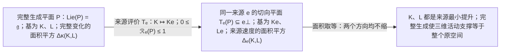
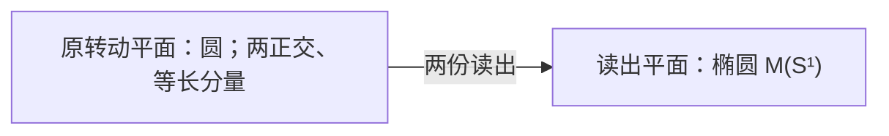

# 两种变化，不丢面积：完整二元关系的有限三维提升

> 来源：用户于 2026-11-05（Asia/Singapore）在本会话提供的 ΩQ-013 LaTeX 研究工作稿；原稿未另署作者或模型。本文为参考输入，Lean 是仓库的数学真源；本次仅转换 Markdown，未作形式化认证。正文中的固定快照、项目核读叙述与理论结论均保留原稿口径；两幅 TikZ 图转换为 Mermaid 示意图。

QUANTUM ORIGINS / $\Omega Q$-013

完整二元关系的有限三维提升

**本轮唯一候选：完整生成对在来源读出下保持非零面积。**

在同一个完整原响应空间上，令 $\mathfrak g$ 为原可逆作用的 Lie 代数，$e$ 为单位来源，$B$ 为原轨道内生比较，$\kappa(K,L)=-\tfrac12\operatorname{Tr}_W(KL)$。要求存在一对 $K,L\in\mathfrak g$，使

$$
\boxed{\quad \operatorname{Lie}\langle K,L\rangle=\mathfrak g,\qquad
\lVert Ke\wedge Le\rVert_B^2=\lVert K\wedge L\rVert_\kappa^2>0.\quad}
$$

“完整生成”保留原有全部无穷小变化；面积取等只在这一对变化上检查。任意换用这同一生成平面的基，候选保持不变。

本文独立证明

$$
\boxed{Q13\ \Longleftrightarrow\ \dim W=3,\quad
\mathfrak g=\mathfrak{so}(W,B).}
$$

来源投影是压缩。非零面积取等使整对变化没有横向余项，故其反复顺序组合只能生成 $\operatorname{span}\{e,Ke,Le\}$ 上的转动；完整生成与完整来源循环性把这个三维支撑变成整个原空间。

更一般地，完整 $k$ 维生成平面的体积取等，给 $k+1$ 维球面转动。二元情形随后展开为 $S^2$、四元数、$\mathbb C^2$、相位与保原概率的 Born 配对。全部有限量子过程按各自原联合、参考和时钟关系接入。

本轮还证明一条必要边界：面积*近似*保真只保证这一对算子接近三维对；任意高维完整旋转都可有任意接近一的面积比。因此精确判据更短，并不保留上一轮总体判据的固定误差间隙。

日期：2026-11-05，新加坡。\
固定项目版本：`dev@0b9f2dda45b880862865f2c34ba94bf8ff1063ee`。\
提交时间：04:16:19 +0800；分支核查：04:18:11 +0800。\
承接：对话 $\Omega Q$-012 与固定仓库 $\Omega Q$-010。

普通数学研究工作稿。完整列明前件、证明、反模型与实际接口；本轮未作 Lean 认证，不声明历史首创或所有实际系统已满足候选。

## 1　从无穷读出，回到有限生成关系

素数可以一个接一个出现，但一个新素数不要求一条新的乘法规律。算术基本定理给出

$$
\nu:\bigl(\mathbb N_{>0},\times\bigr)
\xrightarrow{\cong}\bigl(\mathbb N_0^{(\mathcal P)},+\bigr),
\qquad \nu(mn)=\nu(m)+\nu(n),
$$

其中 $\mathcal P$ 为全部素数，指数族只有有限支撑。它是可数无穷坐标上的准确同构，并未证明素数来自某个未知有限维物理实体的投影。[\[7\]](#ref-maynard)

#### 命题 1.1：无穷对象不等于无穷独立规律

正整数乘法幺半群不可能由有限个元素生成，但全部素数可由一份固定有限程序枚举；允许加法后，自然数半环由 $1$ 生成。

**证明。**

有限乘法生成元只含有限种素因子，其任意有限乘积不可能产生名单外的素数。对任意有限素数表，乘积加一的某个素因子不在其中，故有限乘法生成不可能。依次检查每个整数的有限个非平凡因子则是一份固定有限程序，可枚举所有素数。允许加法后，任一自然数是有限个 $1$ 相加。三项结论使用的运算签名不同。 $\square$

所以本轮把注意力从“每个读数对应一条规则”移到“哪些原变化能生成全部关系”。量子公理是否只是共同结构的不同读出，要由一条明确的生成关系来回答。有限生成也不保证求出某个具体结果便宜：后文将构造一族只需两个生成元、却能在任意高维展开全部旋转的模型。

**本轮的缩减尺度。**

上一轮 Q12 对完整作用代数的一组正交基进行全部二元收缩，要求一个有符号四次总和为零。本轮先明确一对原变化的 Lie 闭包确实等于完整原代数，然后只对这同一对变化比较面积。核心证明从三槽总收缩缩为“压缩取等、最小平面提升、完整生成”。存在见证、完整生成和全部原响应仍是实质条件；此处没有将其藏进“局部”一词。

#### 命题 1.2：严格缩短须有固定尺度

固定一种表达语言，若把全部缩写展开后的长度记为非负整数 $L$，则每轮严格降低 $L$ 的过程不能无限持续。

**证明。**

非负整数没有无限严格递减链。 $\square$

这一命题不判定物理是否存在唯一终极公理。它要求我们每轮说清何处缩短、何处只是换了一份代价。本轮减少了取等检查的作用对数，并给出更短的生成证明；完整性认证和近似稳定性并未免费获得。

## 2　固定项目版本与本轮的实际承接

本次只读核查固定项目 `dev` 于提交 `0b9f2dda45b880862865f2c34ba94bf8ff1063ee`。 提交时间为 2026 年 11 月 5 日 04:16:19，新加坡时间；分支头读取时间为同日 04:18:11。 相对上一轮固定的 `664de5498694`，完整 Git 树比较给理论目录一份新增、两份修改。所消费原文的字节均与该固定树中的 Git blob 核对。以下报告源码中的普通数学证明，不声明新 Lean 核验。[\[1\]](#ref-q013commit)

项目 $\Omega Q$-010 的选择条件没有改变；固定树中仍无 `OMEGAQ_011`、`OMEGAQ_012` 文件。上一轮对话与本轮推导各保持自己的版本归属。本轮需要更新的主要是原 C128 的全网尺度结论、闭准备接口，以及 C133 的未固定标记比较桥。

### 2.1　原 C128：未标定时已有一个共同尺度

原 C123–C128 卷新增 §§63–66。在原定义 41.1 的同一完整非 $D$ 背景、Z 和 SC 下，不要求 S 或 S2，沿同一个原 AC 原子 $d$ 定义

$$
W_d=\{x:d\circ x=x/2\},\qquad
J_d=2D_d|_{W_d}.
$$

该背景保留原有限准备生成、原比较群、实际指针与准备、精确归一、保持同一原 $D$ 的实际联合嵌入及交叉零、完整事件参考、同记录旁接、细化、失败与具名支持返回。它比本轮单来源的紧循环前端包含更多实际多对象条件。

定理 63.3 已证明唯一共同尺度。为避免与本文的迹内积 $\kappa$ 冲突，将项目原文的尺度符号改记为 $\varkappa$：

$$
\varkappa\ge0,\qquad
J_d^2=-\varkappa I_{W_d},\qquad
[D_a,D_b]=-\varkappa[L_a,L_b]
\quad\text{于全部原对象及实际联合。}
$$

若 $\varkappa=0$，全部原有向关系 $F(a,b)=D_ab$ 为零；若 $\varkappa>0$，全部非经典简单块为复矩阵自伴块，原 $F_s=\lambda_s i[\,\cdot,\cdot\,]/2$ 且 $\lambda_s^2=\varkappa$。原嵌入仍约束各坐标取向。[\[4\]](#ref-c128new)

证明的新压缩有两个承重点。对一个活动简单块，已得协变使原映射 $D:u^\perp\to\operatorname{Der}(E)$ 单射；其像为理想，正交余理想与像交换，协变和忠实性迫使余理想为零。因此该映射是双射。不变迹配对再给局部曲率系数。原实际联合中同一 AC 准备的乘积边缘，使每个相关简单分量同时忠实看见局部块与同一指针；原半 Peirce 元的二次作用沿嵌入保持，因而把这些系数全部锁为同一个 $\varkappa$。这一步保留了上一轮已闭合的全对象协变，不以新构造的叉积替换原 $D$。

新 §64 将标定写为整个同一原指针上的一个算子等式：

$$
\boxed{D_d^2=L_d^2-L_d.}\tag{P-SJ}
$$

在上述准确背景中，它与原 S、单对 S2 等价，均恰好选择 $\varkappa=1$。正分支还可直接定义数学复乘法

$$
a\star b=a\circ b-\frac{i}{\sqrt{\varkappa}}F(a,b).
$$

对应左右乘算子为 $M_a=L_a-iD_a/\sqrt{\varkappa}$、 $N_b=L_b+iD_b/\sqrt{\varkappa}$。原导子律与曲率给

$$
[M_a,N_b]=[L_a,L_b]+\varkappa^{-1}[D_a,D_b]=0,
$$

从而乘法结合；正 Frobenius 比较使左正则表示成为忠实 $*$ 表示，得到有限复 $C^*$ 结构。这里原 $D$ 的大小没有被修改。[\[4\]](#ref-c128new)

本轮一对生成方向的面积比，对非零重标 $K,L$ 不变。因此它本身不能固定项目原完整族 $D=t\delta$ 的 $\varkappa=t^2$，也不能代替 SJ。两种判据分别承担完整作用空间的几何选择和同一原有向关系的尺度标定。

### 2.2　更大的射影几何与局部伙伴的边界

项目 §65 已把 SJ 放进原指针的更大几何。若原指针简单块为 $H_r(\mathbb C)$，则

$$
W_d=T_d\mathbb{CP}^{r-1},\qquad
J_d^2=-I,
\qquad
(W_d\setminus\{0\})/\mathbb C^\times\simeq\mathbb{CP}^{r-2}.
$$

最后一个空间参数化同一原子 $d$ 的数学伙伴角。$r=2$ 时伙伴唯一；$r>2$ 时，稳定 $d$ 的原对称群在伙伴直线上传递，因而不能只凭这些对称数据自然选出唯一伙伴。每个选择仍给一个数学三维 Pauli 截面。一般投影的半 Peirce 空间则给固定秩复 Grassmann 流形的切空间与正交复结构。[\[4\]](#ref-c128new)

这一结果要求本轮继续区分两个范围：一个较大原对象内存在三维角，与同一完整响应空间本身为三维。后文的生成条件作用于完整 $\mathfrak g$，证明后者；不能用先截下来的角代替它，也不能由数学角推断新的实际量子比特或合法旁接。

### 2.3　闭准备与平方近零估计：前提的明确交换

新增 §§67–75 另行命名背景 $\mathsf B_{\rm cl}$，把每个原对象和每个实际联合的有限正准备生成改为

$$
\overline{\operatorname{cone}(\mathcal P_A)}=C_A^*.
$$

闭包取固定有限维空间中的通常拓扑；保留全部原实际多对象合同。旧 P 及旧候选的定义没有被改写。新的有向关系入口为：对每个原 $A,a$，存在独立于准备和效果的有限 $K(A,a)\ge0$，使

$$
\boxed{
|\alpha(D_a x)|^2
\le K(A,a)\,\alpha(x)\alpha(u_A)
\quad(\alpha\in\mathcal P_A,\ 0\le x\le u_A).
}\tag{P-Q}
$$

这里量化全部数学效果、全部原准备以及任意小原质量，不只检查有限样本；也没有断言每个有符号评价已有实际读口。[\[4\]](#ref-c128new)

定理 68.1 在任意有限 Archimedean 有序单位空间中证明：另有 $Hu=0$ 时，上述统一估计等价于同一 $H$ 生成保正保单位实参数群。正向由加权 Cauchy–Schwarz 把估计延伸到正和，再由连续性延伸到整个正对偶锥，取得全状态零接触；反向对 $f(t)=\beta(e^{tH}x)\ge0$ 使用二阶 Taylor 上界，可取

$$
K=\|H^2\|_{u\to u}.
$$

全状态零接触到序导子的中间判据采用 Niestegge §4 Lemma 3 的成熟结果。[\[10\]](#ref-niestegge) 保单位由原联合接口独立供应。闭准备下只要求实际零接触不够：局部正象限模型中，稠密实际态 $\alpha_t(s,v)=ts+(1-t)v$、$0<t<1$，会漏掉端点零接触，所需比值可以按 $t^2/(1-t)$ 发散。

后续证明先固定一个原实际联合 $AP^{\otimes k}$，再在该固定空间内以有界质量的数学正和取得纯边缘极限；没有把极限命名为实际准备。每次原参考执行又利用该实际联合自身的完整准备闭密度，延伸为整个相关锥上的正映射，之后才接入 CP 判据。由此在新背景加 P-Q、SC 和逐字 S/S2/SJ 后，重新取得原曲率、复矩阵结构、原质量 Born 配对、已声明张量、全事件 CP、所选完整测量词及全部原历史。[\[4\]](#ref-c128new)

这是精确有限生成加实际零接触，与闭生成加统一定量近零之间的前提交换。统一证书允许 $D\mapsto tD$、$K\mapsto t^2K$，所以既不固定 $\varkappa=1$，也不替代 SC、具体时钟、作用量单位或实际器件供应。

### 2.4　C133：未固定标记的五点正性桥

新卷允许带双侧单位的任意二元运算集合 $M$、完全任意的标记 $U$，不再输入 $U1=1$。比较 $c:M^2\to[0,\infty)$ 处处有限且 $c(a,a)=0$，仍要求完整关系

$$
\sum_{k=0}^2c(a\cdot U^ku,b\cdot U^kv)
=3c(a,b)+3c(u,v).
\tag{P-R}
$$

在此背景上，定理 1.3 证明以下条件等价：全部至多五点配置的条件负型加对称性；所有乘法四点缺陷属于双侧根空间；完整有限负型；以及复 Hilbert 仿射表示

$$
F1=0,\quad F(ab)=Fa+Fb,\quad
F(Ua)=\omega Fa+t,\quad
c(a,b)=\|Fa-Fb\|^2,
\qquad\omega=e^{2\pi i/3}.
$$

五点条件量化任意标签和任意零总和实系数，绝非对五个指定样本的检验。证明的关键是四点乘法缺陷先有零平方，再加入任意第五点；小实参数的一次项必须为零，遂使缺陷对整个空间的两侧配对都为零。[\[5\]](#ref-c133marker)

实际有限纠偏配方

$$
V_U(a)=U(a\cdot U^21)
$$

满足 $F(V_Ua)=\omega Fa$。聚合原点 $F1=0$ 与旋转中心 $t/(1-\omega)$ 可以不同，后者未必对应实际标签。原树的顺序、括号和档案保持；完成空间中的极限及任意复缩放不因此成为可调用配方。该卷明确保留 P-R 单独能否推出五点正性的开放问题，也未证明五为最小点数。完整事件与细过程还分别需要各事件核的表示、全成对校准和纠偏相位相容；它没有单独推出完整三维响应空间。[\[5\]](#ref-c133marker)

### 2.5　共同原读出的推进仍保留完整三时刻余项

FIB Appendix III 新 §153，在其同一原扩散来源及全部解析供应条件下，用一份共同原 Borel 分区同时取得全部三组有序二时刻律，以及三个指定三时刻系数 $013,103,031$。证明保留一份分区自身的末端热作用，构造三十九方向的满秩校正，再以一个有限分区和有限维不动点取得准确目标。三时刻余项位于二十七维环境线性空间，其中这三个坐标已为零，另外二十四个仍是同一分区上的方程；完整六十四坐标问题未被改写为已解。[\[6\]](#ref-fibiii)

这些新进展给本轮的共同约束是：局部关系能否传到整体，必须由同一来源、同一实际联合或完整生成性承担；保留可读历史后再证明，不能用不同局部见证拼成一个未存在的整体。

## 3　同一完整原响应与来源比较

#### 定义 3.1：原概率行与完整有限前端

在同一原签名 $\Omega$ 内固定一个真实归一来源。对原可逆控制历史 $a$、合法未来请求 $f$ 和原结果标签 $w$，记完整响应行

$$
x_a(f,w)=p(a;f,w),\qquad p\ge0,\quad \sum_w p(a;f,w)=1.
$$

共同未来保留全部合法终端请求、原结果、失败、实际可读旧记录及后续合法性区别；原身份、端口、设备和历史索引继续保留。没有原定义的请求不人为补概率。总可逆连接含空历史、对复合封闭、在同一菜单内有准确统计逆，并在全未来线性关系上良定。

取同一来源的完整原可逆轨道，置

$$
V=\operatorname{span}_{\mathbb R}\{x_a\},\qquad u(x_a)=1,\qquad
W=\ker u=\operatorname{span}\{x_a-x_b\}.
$$

本轮明确要求 $0<\dim W<\infty$。原身份相同与响应相同是不同关系；构造线性表示不删除原索引。若已有可读历史使张成空间更大，使用更大的完整空间。

#### 引理 3.2：紧作用、固定中心与完整循环性

原可逆作用在 $V$ 上的矩阵闭包 $H$ 是紧群。定义

$$
c=\int_Hhx_\epsilon\,dh,\qquad e=x_\epsilon-c,
\qquad G=H|_W,\qquad \mathfrak g=\operatorname{Lie}(G).
$$

则 $G$ 紧、作用有效，$e\ne0$，并且

$$
W=\operatorname{span}(Ge).
$$

**证明。**

有限维中可选有限个实际评价坐标分离 $V$，并从原响应行中选一组基。任一原控制将这些基行送到其他响应行；所选概率坐标有界，故其矩阵一致有界。准确逆也在原集合内，故逆矩阵一致有界；闭包紧且不含奇异矩阵，是群。 Haar 平均固定 $c$，且 $u(c)=1$，故 $V=\mathbb Rc\oplus W$。在 $W$ 上平凡的原矩阵也固定 $c$，因而在 $V$ 上平凡。所有轨道行减去 $c$ 正好张成 $W$；若 $e=0$，轨道只有一点，违背 $W\ne0$。 $\square$

闭包中的极限矩阵与连续生成元首先是原响应的数学表示，不自动成为准确可调用的原装置。Haar 平均也不供应实际随机准备。

#### 定义 3.3：由轨道内生的比较

记 $n=\dim W$。对 $\alpha\in W^*$ 定义

$$
\mathsf C\alpha=\int_G\alpha(ge)\,ge\,dg,
\qquad B(v,w)=\frac1n(\mathsf C^{-1}v)(w).
$$

#### 引理 3.4：规范比较及完整轨道恒等式

$\mathsf C$ 可逆，$B$ 正定且 $G$ 不变，并有

$$
B(e,e)=1,\qquad
\int_Gge\otimes(ge)^{\flat_B}\,dg=\frac1nI_W.
$$

**证明。**

完整循环性给 $\alpha(\mathsf C\alpha)=\int\alpha(ge)^2dg>0$ 对全部 $\alpha\ne0$ 成立。Haar 不变性给 $B$ 不变。取迹有 $\int B(ge,ge)dg=\operatorname{Tr}(B\mathsf C)=1$，而轨道上长度相同，故 $B(e,e)=1$。对任意 $w$，积分算子作用于 $w$ 等于 $\mathsf C(w^{\flat_B})=w/n$。 $\square$

若 $T:W\to W'$ 保来源并共轭全部原作用，则 $\mathsf C'=T\mathsf C T^*$，从而 $B'(Tv,Tw)=B(v,w)$。换源到同一轨道点也只共轭后续关系。删去可读坐标的非单射投影不属于这种同构。

本轮核心定理实际上对*任意*不变正定比较、任意单位循环来源成立。上述规范构造只使比较本身完全由原来源确定。精确取等将另有不依赖度量选择的像空间刻画。

## 4　完整二元面与不缩面积候选

本节只使用前端已经得到的有限实空间 $W$、完整紧群 $G\subseteq O(W,B)$、单位来源 $e$，以及

$$
\mathfrak g=\operatorname{Lie}(G),\qquad B(e,e)=1,\qquad W=\operatorname{span}(Ge).
$$

$B$ 可以取由原轨道协方差生成的规范比较。本节的精确刚性实际上对任意满足这些条件的不变正定比较都成立；不需要上一轮的紧框架收缩、负 Killing 算子或维数公式。

#### 定义 4.1：原横向读法与来源评价

令

$$
E=e^{\perp_B},\qquad P_e=I-e\otimes e^{\flat_B},
\qquad D_eK=P_eK|_E.
$$

来源评价是同一个原作用的线性映射

$$
T_e:\mathfrak g\longrightarrow E,\qquad T_eK=Ke.
$$

在原反对称算子上取

$$
\kappa(K,L)=-\tfrac12\operatorname{Tr}_W(KL),\qquad
\kappa_E(S,T)=-\tfrac12\operatorname{Tr}_E(ST).
$$

原作用以矩阵表示，故 $\kappa$ 在 $\mathfrak g$ 上正定。

这里比较的两个层次是同一变化 $K$ 的完整作用与它对同一来源产生的速度 $Ke$。$D_e$ 只记录完整算子的横向块；该定义没有删除原结果、失败或可读历史。

#### 定义 4.2：完整二元面

二维实子空间 $P\subseteq\mathfrak g$ 称为*完整二元面*，当且仅当

$$
\operatorname{Lie}(P)=\mathfrak g.
$$

等价地，取 $P$ 的任意基 $K,L$，由 $K,L$ 的有限线性组合和反复原交换子生成的最小 Lie 子代数恰为同一个完整 $\mathfrak g$。这样的 $(K,L)$ 称为完整对。

完整性是候选中必须满足的全局条件，并非紧性、有限性或“选了两个变化”的自动结论。它保留全部原无穷小作用；完整群的不连通分支也仍在前端 $G$ 中。此条件没有把 $\mathfrak g$ 重新定义成所选两个生成元的闭包。

#### 定义 4.3：二元面积与面积保留率

对 $P$ 的一组基 $K_1=K,K_2=L$，定义两个 $2\times2$ Gram 矩阵

$$
\Gamma_{ij}=\kappa(K_i,K_j),\qquad
S_{ij}=B(K_ie,K_je).
$$

$\Gamma$ 正定。完整变化的平方比较面积及来源速度的平方比较面积分别为

$$
\begin{aligned}
\Delta_\kappa(K,L)
&=\det\Gamma
=\kappa(K,K)\kappa(L,L)-\kappa(K,L)^2>0,
\end{aligned}
\tag{4.1}
$$

$$
\begin{aligned}
\Delta_e(K,L)
&=\det S
=B(Ke,Ke)B(Le,Le)-B(Ke,Le)^2.
\end{aligned}
\tag{4.2}
$$

定义

$$
\mathcal R_e(P)
=\mathcal R_e(K,L)
=\frac{\Delta_e(K,L)}{\Delta_\kappa(K,L)},
\qquad \delta_e(P)=1-\mathcal R_e(P).
\tag{4.3}
$$

#### 引理 4.4：完整二元面的坐标不变性

$\mathcal R_e(P)$ 只依赖二元面 $P$，不依赖它的有序基。完整性也不依赖基。更内在地，

$$
\mathcal R_e(P)=\det\bigl((T_e|_P)^*(T_e|_P)\bigr),
$$

其中伴随使用 $P$ 上的 $\kappa$ 与 $E$ 上的 $B$。

**证明。**

若以可逆实矩阵 $M\in GL_2(\mathbb R)$ 换基，两个 Gram 矩阵同时变成 $M^{\mathsf T}\Gamma M$ 和 $M^{\mathsf T}SM$。两个行列式都乘以 $(\det M)^2$，比值不变。两个基张成同一 $P$，生成的最小 Lie 子代数也相同。最后取 $\kappa$-正交单位基使 $\Gamma=I_2$，此时 $S$ 恰是 $(T_e|_P)^*(T_e|_P)$ 的矩阵。 $\square$

#### 命题 4.5：原表示运输与轨道内换源

若线性同构 $F:W\to W'$ 保持完整原作用、来源与比较，即

$$
e'=Fe,\qquad G'=FGF^{-1},\qquad
B'(Fv,Fw)=B(v,w),
$$

则 $P'=FPF^{-1}$ 完整当且仅当 $P$ 完整，且 $\mathcal R_{e'}(P')=\mathcal R_e(P)$。两边采用原轨道协方差比较时，前端的比较运输定理保证上述等距关系。特别地，同一原轨道内换源 $e'=he$ 时，同时取 $P'=hPh^{-1}$，候选及面积保留率保持。

**证明。**

共轭保持原交换子和实迹，故保持 Lie 生成关系与完整 Gram 矩阵。来源速度变成 $(FKF^{-1})e'=F(Ke)$，比较运输保证来源 Gram 矩阵也保持。于是两边的行列式比相同。轨道内换源取 $F=h$，使用 $G$-不变比较即可。 $\square$

这仅是完整原表示的同构与换源；删去可读结果的非单射压缩不属于它，也不据此识别不同原历史的身份。

**本轮唯一候选 $\Omega Q$-013：完整对的来源面积不缩。**

$$
\boxed{\exists P\subseteq\mathfrak g:\quad
\dim P=2,\quad \operatorname{Lie}(P)=\mathfrak g,\quad \mathcal R_e(P)=1.}
\tag{Q13}
$$

展开成同一对原变化，就是

$$
\operatorname{Lie}\langle K,L\rangle=\mathfrak g,\qquad
\boxed{\Delta_e(K,L)=\Delta_\kappa(K,L)>0.}
$$

这是一条必须由某个*实际达到等号的数学见证对*满足的存在关系。将存在等号改为上确界等于一，会改变模型类；后面的反例将证明这一差别。

**白话：** 找到能够生成全部原连续变化的两种基本变化。把它们在整体中的比较面积，与它们推动同一来源时留下的面积相比；这次来源读出完整保留了这块面积。

## 5　面积不缩为何消去全部横向余量

#### 引理 5.1：原算子的正交分块

对 $v\in E$ 定义

$$
X_v(te+z)=tv-B(v,z)e.
$$

任取 $K\in\mathfrak g$，则

$$
K=X_{Ke}+\widetilde{D_eK},
\tag{5.1}
$$

其中波浪号表示在 $\mathbb Re$ 上零延拓，并且

$$
\boxed{\kappa(K,L)
=B(Ke,Le)+\kappa_E(D_eK,D_eL).}
\tag{5.2}
$$

因而来源评价 $T_e$ 是收缩，且

$$
\lVert K\rVert_\kappa^2-\lVert Ke\rVert_B^2
=\lVert D_eK\rVert_{\kappa_E}^2\ge0.
$$

**证明。**

相对于 $W=\mathbb Re\oplus E$，反对称性给出唯一块矩阵

$$
K=\begin{pmatrix}0&-(Ke)^\flat\\ Ke&D_eK\end{pmatrix}.
$$

计算 $-\tfrac12\operatorname{Tr}(KL)$，两个往返块贡献 $B(Ke,Le)$，横向对角块贡献 $\kappa_E(D_eK,D_eL)$，得到所列等式。 $\square$

#### 命题 5.2：来源最小提升的变分与像空间刻画

给定 $v\in E$，在全部 $B$-反对称算子 $K$ 且 $Ke=v$ 的集合中，$X_v$ 是唯一的最小 $\kappa$-范数元素，其平方范数为 $B(v,v)$。若 $K\ne0$，下列条件等价：

$$
D_eK=0;\qquad K=X_{Ke};\qquad
\operatorname{im}K=\operatorname{span}\{e,Ke\};\qquad
\operatorname{rank}K=2\ \text{且}\ e\in\operatorname{im}K.
$$

**证明。**

每个满足 $Ke=v$ 的反对称算子唯一写成 $X_v+\widetilde T$，其中 $T\in\mathfrak{so}(E)$。分块正交性给

$$
\lVert K\rVert_\kappa^2=B(v,v)+\lVert T\rVert_{\kappa_E}^2,
$$

所以最小值仅在 $T=0$ 达到。对非零 $K=X_{Ke}$，$Ke\ne0$，定义式给它的像恰为 $\operatorname{span}\{e,Ke\}$。

反过来，若 $\operatorname{rank}K=2$ 且 $e\in\operatorname{im}K$，反对称性给 $\ker K=(\operatorname{im}K)^\perp$。令 $F=\operatorname{im}K$。$K$ 在二维 $F$ 上是不退化反对称算子；因 $e\in F$，有 $Ke\ne0$、$B(e,Ke)=0$，故 $F=\operatorname{span}\{e,Ke\}$。$K$ 在 $F^\perp$ 上为零，且 $K(Ke)=-B(Ke,Ke)e$，因此它正是 $X_{Ke}$。其余蕴含直接成立。 $\square$

该极小化最初在全部 $\mathfrak{so}(W,B)$ 中进行；$X_v$ 此时未必属于原 $\mathfrak g$。面积等号才证明所选来源速度的最小提升已经是同一个原生成元。此处的范数是原作用的比较成本，尚未被认作以物理单位标定的能量。

#### 引理 5.3：二元面积收缩及等号

对任意二维 $P\subseteq\mathfrak g$，都有

$$
0\le\mathcal R_e(P)\le1.
$$

以下四项等价：

1.  $\mathcal R_e(P)=1$；

2.  $T_e|_P$ 为等距嵌入；

3.  $D_eK=0$ 对全部 $K\in P$ 成立；

4.  对 $P$ 的某一组、从而每一组基 $K,L$，都有 $K=X_{Ke}$、$L=X_{Le}$。

特别地，面积等号自动保证来源速度独立。

**证明。**

由式 (5.2)，$\Gamma=S+H$，其中

$$
H_{ij}=\kappa_E(D_eK_i,D_eK_j),\qquad H\succeq0
$$

是横向块的 Gram 矩阵。取 $P$ 的 $\kappa$-正交单位基，便有

$$
S+H=I_2,\qquad 0\le S\le I_2.
$$

设 $S$ 的两个特征值为 $\lambda_1,\lambda_2\in[0,1]$。则 $\mathcal R_e(P)=\lambda_1\lambda_2\in[0,1]$。乘积为一当且仅当两者均为一，即 $S=I_2$、$H=0$。这同时等价于等距性和全部横向块为零。式 (5.1) 给最后一项。此时 $S$ 正定，来源速度必独立。 $\square$

这里的等号是一个真正的二元约束：来源评价单独可以缩短任一方向，也可以压扁夹角，但它在两个方向上均为收缩。完整二维面积达到上界时，两种缩短都不再允许。这一结论不需要先给定任何三维子空间。

#### 推论 5.4：同一候选的二次表达

对完整二元面的 $\kappa$-正交单位基 $K,L$，Q13 的面积等号等价于

$$
\boxed{B(Ke,Ke)+B(Le,Le)=2.}
$$

等价地，$\lVert D_eK\rVert_{\kappa_E}^2+\lVert D_eL\rVert_{\kappa_E}^2=0$。

**证明。**

两个来源速度的平方长度分别不大于一，和为二当且仅当两项均为一；分块恒等式随即给两个横向块为零。反向由上一个引理成立。 $\square$

该二次式只是在正交单位坐标中的同一个候选；本轮没有另外提出第二个选择关系。面积比形式使任意 $GL_2$ 换基的不变性直接可见。

## 6　由一对完整变化推出整个三维空间

#### 引理 6.1：一对来源最小提升的精确闭包

若 $v,w\in E$ 线性独立，置

$$
U=\operatorname{span}\{e,v,w\},\qquad
J_{v,w}z=B(v,z)w-B(w,z)v,\qquad J_{v,w}e=0.
$$

则 $\dim U=3$，并且

$$
\operatorname{Lie}\langle X_v,X_w\rangle
=\operatorname{span}\{X_v,X_w,J_{v,w}\}
=\mathfrak{so}(U,B|_U)\oplus0_{U^\perp}.
$$

**证明。**

由于 $v,w\in e^\perp$，三者独立。由定义直接计算：

$$
\begin{aligned}
[X_v,X_w]&=J_{v,w},\\
[J_{v,w},X_v]
&=B(v,v)X_w-B(v,w)X_v,\\
[J_{v,w},X_w]
&=B(v,w)X_w-B(w,w)X_v.
\end{aligned}
$$

所以右边三个算子的张成空间对原交换子闭合。前两个作用于 $e$ 的值独立，第三个固定 $e$ 且非零，故三个算子线性独立。它们都在 $U^\perp$ 上为零；在 $U$ 上组成三维的反对称代数。 $\square$

#### 定理 6.2：Q13 的完整三维刻画

在本节明确保留的完整紧循环背景中，以下两项等价：

1.  Q13 成立；

2.  $\dim W=3$，且 $\mathfrak g=\mathfrak{so}(W,B)$。

此时

$$
G^\circ=SO(W,B),\qquad
G=SO(W,B)\ \text{或}\ O(W,B).
$$

非交换性是结论，无需另外输入 $\mathcal N>0$。

**证明。**

先设 Q13 成立，取完整对 $K,L$。面积等号引理给

$$
K=X_v,\qquad L=X_w,
\qquad v=Ke,\quad w=Le,
$$

其中 $v,w$ 独立。上一个引理给

$$
\operatorname{Lie}\langle K,L\rangle
=\mathfrak{so}(U)\oplus0_{U^\perp},
\qquad U=\operatorname{span}\{e,v,w\}.
$$

由完整性，这正是原 $\mathfrak g$，而不是另选的局部子代数。

还需排除 $U$ 之外的方向以及完整群的不连通分支。定义原作用的活动支撑

$$
S(\mathfrak g)=\operatorname{span}\{Az:A\in\mathfrak g,\ z\in W\}.
$$

此处 $S(\mathfrak g)=U$。任取 $h\in G$，有 $h\mathfrak gh^{-1}=\mathfrak g$，所以

$$
h(Az)=(hAh^{-1})(hz)\in S(\mathfrak g).
$$

同样使用 $h^{-1}$ 得 $hS(\mathfrak g)=S(\mathfrak g)$。因此完整 $G$ 保持 $U$。由于 $e\in U$，全部 $Ge$ 位于 $U$；原循环性遂给

$$
W=\operatorname{span}(Ge)\subseteq U\subseteq W.
$$

故 $W=U$，整个空间恰好三维。此时原 $\mathfrak g$ 正是 $\mathfrak{so}(W,B)$，并且 $[K,L]=J_{v,w}\ne0$。

反过来，设 $W$ 三维且原 $\mathfrak g$ 为全部反对称代数。选 $E$ 的正交单位基 $v,w$，置 $K=X_v,L=X_w$。前引理证明这对生成整个 $\mathfrak g$，且 $D_eK=D_eL=0$。故来源面积与完整面积都为一，Q13 成立。

最后，$G\subseteq O(W,B)$，而其 Lie 代数为整个 $\mathfrak{so}(W,B)$，因此连通分支是 $SO(W,B)$。包含它的紧子群只可能是 $SO(W,B)$ 或 $O(W,B)$。 $\square$

#### 推论 6.3：精确选择的度量独立形式

Q13 等价于存在同一原完整对 $K,L$，使 $Ke,Le$ 独立，并满足

$$
\boxed{\operatorname{im}K=\operatorname{span}\{e,Ke\},\qquad
\operatorname{im}L=\operatorname{span}\{e,Le\}.}
$$

因此，若更换 $G$-不变正定内积并仍使同一个 $e$ 为单位向量，Q13 的精确真假不变。

**证明。**

面积等号引理与命题 5.2 给所列双向等价。像空间、原 Lie 生成关系和线性独立性均不涉及内积的选择，故最后一项成立。 $\square$

规范轨道协方差提供一种由原数据确定的比较证书；它没有把精确三维结论制造进某个特选尺中。上一轮已经证明过任意不变比较下的零点刚性；这里给出的是同一事实的完整二元像空间形式。

这段证明给出完整有限提升

$$
\boxed{W=\operatorname{span}\{e,Ke,Le\}.}
$$

它没有把观测空间截成三维。三维先作为两种最小变化的活动支撑出现，再由完整生成性与完整群循环性被迫等于整个原空间。不连通群可以交换旁观块的漏洞，也在活动支撑不变性的步骤中被排除。

### 6.1　更大的结构：完整体积提升族

下面给出 Q13 所属的同一几何族。这是对既有条件的结构推广定理，不是本轮另提一个候选。

#### 定理 6.4：完整 $k$ 元面的体积提升刚性

固定整数 $k\ge1$。在同一个完整紧循环背景中，若存在 $k$ 维子空间 $P\subseteq\mathfrak g$，满足

$$
\operatorname{Lie}(P)=\mathfrak g,\qquad
\det\bigl((T_e|_P)^*(T_e|_P)\bigr)=1,
$$

则

$$
\boxed{\dim W=k+1,\qquad \mathfrak g=\mathfrak{so}(W,B).}
$$

反过来，若 $W$ 为 $k+1$ 维、$\mathfrak g=\mathfrak{so}(W,B)$，则来源横向最小提升组成这样的完整 $k$ 元面。所得来源轨道为 $S^k$。

**证明。**

引理 5.1 对任意子空间都成立，因此 $(T_e|_P)^*(T_e|_P)$ 的全部 $k$ 个特征值位于 $[0,1]$。行列式为一迫使它们全部为一。于是 $T_e|_P$ 等距，且 $D_eK=0$ 对所有 $K\in P$ 成立。

令 $T=T_e(P)\subseteq E$，则 $\dim T=k$，并且

$$
P=\{X_v:v\in T\},\qquad U=\mathbb Re\oplus T.
$$

选择 $T$ 的正交单位基 $v_1,\ldots,v_k$。原交换子给出全部

$$
[X_{v_i},X_{v_j}]=J_{v_i,v_j}\qquad(i<j).
$$

这 $k$ 个来源提升与 $k(k-1)/2$ 个横向平面转动，在基 $e,v_1,\ldots,v_k$ 上正好是所有基本反对称矩阵，故它们张成 $\mathfrak{so}(U)\oplus0_{U^\perp}$。完整性使这个 Lie 代数等于原 $\mathfrak g$。与定理 6.2 相同的活动支撑论证给出：完整 $G$ 保持 $U$，而原循环性及 $e\in U$ 强迫 $W=U$。

反向取 $T=E$ 以及 $P=\{X_v:v\in E\}$。分块恒等式使来源评价在 $P$ 上等距；上述基本矩阵证明 $P$ 生成全部 $\mathfrak{so}(W,B)$。完整连通旋转群在单位球面传递作用，因此来源轨道为 $S^k$。 $\square$

作为实向量空间，此族具有统一分解

$$
\mathfrak{so}(k+1)=\mathfrak{so}(k)\oplus\mathbb R^k,
\qquad S^k=SO(k+1)/SO(k).
$$

来源速度占 $k$ 个方向，来源自身增加一个方向；两种来源速度的顺序差生成相应横向平面转动。$k=1$ 时只有一个可交换的连续转动方向；$k=2$ 是该旋转族第一个非交换成员，恰是 Q13。因而“二元到三维”的完整结论来自*二元完整性加上体积不缩*；任意两段局部关系并不自动让整个系统三维。

#### 推论 6.5：见证平面唯一，基的选择只是坐标

Q13 成立时，满足候选的二维平面唯一，恰为同一原作用内的

$$
P_e^{\min}=\ker D_e=\{X_v:v\in e^{\perp_B}\}.
$$

因此候选中的存在见证不会在结论中留下一个外部特选的平面；任选其基只改变两种变化的坐标。

**证明。**

面积取等使任一见证平面包含于 $\ker D_e$。主定理给 $W$ 三维且 $\mathfrak g=\mathfrak{so}(W,B)$，故该核正好二维，并且由全部 $X_v$ 组成。因此每个见证平面都等于它。 $\square$

#### 推论 6.6：内生转轴、取向与后续相位圈

将 Q13 见证面正交归一，记其基为 $K,L$，则

$$
v=Ke,\quad w=Le
$$

是 $E$ 的正交单位基。令

$$
A=[K,L].
$$

有

$$
Ae=0,\quad Av=w,\quad Aw=-v,
\quad\ker A=\mathbb Re,\quad\kappa(A,A)=1,
$$

以及

$$
[K,L]=A,\qquad [A,K]=L,\qquad [L,A]=K.
$$

由此来源轨道为 $S^2=SO(3)/SO(2)$，固定来源轴的连通稳定子为 $SO(2)$。

**证明。**

面积等号引理使来源评价在见证面上等距，故 $v,w$ 正交单位。前引理的三条交换子公式给所列关系，转轴的核与范数可在基 $e,v,w$ 上直接计算。完整旋转群在单位球面传递作用，来源的连通稳定子恰是横向二维旋转群。 $\square$

同一见证面更换基 $(K,L)\mapsto(K',L')$ 时，$[K',L']=(\det M)[K,L]$。归一化后，正向换基保持转轴取向，反向换基翻转取向。候选不预先指定手性；选定取向后，后续四元数提升把单位转轴写成满足 $u^2=-1$ 的元素，$\mathbb R+\mathbb Ru$ 成为同一来源选出的复数圈。完整转动群的二重覆盖与相位纤维在后续重建中推导，不能由这里的 $SO(2)$ 直接宣称某个新相位仪器已经实际可用。

## 7　完整性有有限代数证书，但没有免费全局视野

#### 命题 7.1：Lie 闭包的有限证书

对已明确给出的完整有限维原 $\mathfrak g$ 及二维 $P\subseteq\mathfrak g$，递归定义

$$
P_0=P,\qquad
P_{m+1}=P_m+\operatorname{span}\{[A,B]:A,B\in P_m\}.
$$

此递增链在有限步稳定，稳定值为 $\operatorname{Lie}(P)$。若 $r=\dim\mathfrak g$，严格维数增长至多发生 $r-2$ 次。

**证明。**

每个 $P_m$ 是原 $\mathfrak g$ 的子空间，维数单调不减且不超过 $r$。若某步维数不再增长，则 $P_{m+1}=P_m$，按定义该空间对交换子闭合，此后全部步骤不变。另一方面，任何包含 $P$ 的 Lie 子代数归纳地包含全部 $P_m$，故稳定值正是最小的 $\operatorname{Lie}(P)$。从初始维数二出发，每次严格增长至少一，给出上界。 $\square$

如果原矩阵的系数具有可执行的精确运算与判等表示，则可在每步对一组基作有限次原交换子并消去线性相关，直到稳定，最后与完整 $\mathfrak g$ 的已给基比较。这给出有限的精确算法；不具备这样的系数表示时，上述命题仍给数学上的有限张成证书，并不自动提供任意实数输入的判等算法。实际噪声下的近似闭包也不能直接充当准确证书。

Q13 等号成立时，上述闭包尤其短：从 $K,L$ 出发只需加入 $[K,L]$，三维张成已经对交换子闭合。要称它*完整*，还须验证它等于原 $\mathfrak g$。若观察者只看到部分原门和部分未来，就只能证明对所见部分的闭合；本定理没有赋予观察者识别全部未见结构的能力。

此外，$\operatorname{Lie}(P)=\mathfrak g$ 是原紧作用闭包中的无穷小生成关系。交换子可由小回路的极限读出，线性组合也属于同一有限维 Lie 代数；这些数学事实不自动把每个极限门、连续时间流或任意有限精度实现指定成现成的原控制装置。实际接续与可用性仍沿原菜单检查。

### 7.1　本轮简洁性的精确范围

Q12 对完整 $\mathfrak g$ 的正交基上全部有序对作四次的有符号收缩；Q13 对*一个完整二元面*比较两个 Gram 行列式。每个行列式仍是生成元坐标的四次式，选正交单位基后可写成推论 5.4 的二次式。主证明则缩为：评价收缩的面积等号、两个来源最小提升的三维 Lie 闭包、完整支撑的群不变性。

新增的存在见证及 $\operatorname{Lie}(P)=\mathfrak g$ 是明确的全局成本。Q13 与完整三维模型等价，故在此前 Q12 的规范背景内二者选择同一个精确模型类；Q13 并不逻辑更弱，也没有普遍更少的实验或计算成本保证。后续反例还将说明，它失去 Q12 的固定归一维数间隙。这里得到的是一个更局部、更短的*精确二元刻画*，并保留了哪些全局关系仍须被证明。

## 8　反向检验：每一项前件排除什么

本节保持本轮只有一个主要候选：同一完整生成对上的正面积保持。以下被删减的版本均作为反例分析，不另列新的量子公理。 在一组 $B$-正交单位坐标 $e_1,\ldots,e_n$ 中，统一记

$$
J_{ab}e_a=e_b,\qquad J_{ab}e_b=-e_a,\qquad
J_{ab}e_c=0\quad(c\notin\{a,b\}),
$$

并令 $J_{ba}=-J_{ab}$。这些算子满足 $\kappa(J_{ab},J_{ab})=1$，不同无序指标对对应正交方向。

### 8.1　面积保持的一对变化，必须生成同一个完整原作用

#### 反例 8.1：遗漏生成性会接受任意高维球面

对任意 $n\ge4$，取

$$
W=\mathbb R^n,\qquad G=SO(n),\qquad e=e_1,\qquad
K=J_{12},\quad L=J_{13}.
$$

完整来源轨道张成 $W$，其协方差为 $I/n$，所以规范比较正是标准欧氏比较。对所选同一对，

$$
\begin{pmatrix}
\kappa(K,K)&\kappa(K,L)\\
\kappa(L,K)&\kappa(L,L)
\end{pmatrix}
=I_2 =
\begin{pmatrix}
B(Ke,Ke)&B(Ke,Le)\\
B(Le,Ke)&B(Le,Le)
\end{pmatrix}.
$$

故二元面积完全保持，而且面积非零；但完整空间的维数为 $n$。

**证明。**

所选两算子仅作用于 $U=\operatorname{span}\{e_1,e_2,e_3\}$，且

$$
[K,L]=J_{23},\qquad
\operatorname{Lie}\{K,L\}=\mathfrak{so}(U)\oplus0_{U^\perp}.
$$

它是完整原 $\mathfrak{so}(n)$ 的真子代数，故完整生成性恰好在此失败。其余陈述直接由球面轨道和上述矩阵作用得到。

$\square$

因此，只在已选三维窗口里找到正确的二元关系，并未约束窗口外的原方向。定义 $\mathfrak h=\operatorname{Lie}\{K,L\}$ 本身没有问题；还必须检查 $\mathfrak h=\mathfrak g$，其中 $\mathfrak g$ 是全部原可逆作用给出的同一个代数。不能用重新命名 $\mathfrak h$ 来省掉这个等号。

### 8.2　零面积关系不能取代非退化关系

#### 反例 8.2：任意多旋转平面上的零面积完整对

取

$$
W=\bigoplus_{j=1}^{m}\mathbb R^2,\qquad
G=\{\operatorname{diag}(R(t),R(2t),\ldots,R(mt)):t\in\mathbb R\},
$$

$$
e=\frac1{\sqrt m}(u_1,\ldots,u_m),
$$

其中每个 $u_j=(1,0)$，$R(t)$ 为二维旋转。令

$$
K=\operatorname{diag}(J,2J,\ldots,mJ),\qquad L=2K,
$$

其中 $J(1,0)=(0,1)$。则 $K,L$ 生成完整 $\mathfrak g=\mathbb RK$，并满足两边面积均为零的等式；完整响应维数却为 $2m$。

**证明。**

不同正整数频率的正余弦正交，因此轨道张成全部 $2m$ 个坐标，并有

$$
\mathsf C=\frac1{2m}I_W.
$$

规范比较仍是标准欧氏比较。由于 $L=2K$，变化平面与来源速度平面的两个 Gram 行列式都为零，生成代数也确为原一维代数。

$\square$

原概率可直接取为

$$
p_\pm(t;s)=\frac12\left(
1\pm\frac1m\sum_{j=1}^{m}\cos j(t-s)
\right).
$$

它们处处非负、和为一，完整 $s$ 菜单分离上述轨道。因而这里的高维性可以出现在规范的原概率响应中，并非仅是形式添加的坐标。

### 8.3　比较必须来自同一个完整原表示

#### 反例 8.3：另配尺度会误认五维旋转表示

令

$$
W=\operatorname{Sym}_0(3,\mathbb R),\qquad
B(X,Y)=\operatorname{Tr}(XY),\qquad
e=\frac1{\sqrt2}\operatorname{diag}(1,-1,0),
$$

让 $SO(3)$ 以 $X\mapsto gXg^{-1}$ 作用。取三维旋转生成元

$$
A_1=J_{23},\qquad A_2=J_{31},\qquad A_3=J_{12},
$$

并令 $T_iX=[A_i,X]$。则

$$
[T_1,T_2]=T_3,\qquad
\kappa(T_i,T_j)=5\delta_{ij},
$$

$$
B(T_ie,T_je)=\operatorname{diag}(1,1,4)_{ij}.
$$

特别地，$T_1,T_2$ 是完整 Lie 生成对，原变化面积平方为 $25$，来源速度面积平方为 $1$，没有满足本轮条件。但若将比较擅自改成另一个不变内积 $\kappa'=\kappa/5$，同一对的两个面积平方就都变为 $1$，错误接受完整五维模型。

**证明。**

交换子关系由三维旋转交换子和伴随作用的 Jacobi 恒等式得到。 对 $T_1$，五维实空间分解为一个固定轴、一个频率一的旋转平面和一个频率二的旋转平面。因此

$$
-\tfrac12\operatorname{Tr}_W(T_1^2)
=\tfrac12(1+1+4+4)=5.
$$

共轭对称给出三条对角相同；对角符号旋转给出混合迹为零。对所给对角来源直接计算 $[A_i,e]$，即得来源 Gram 矩阵 $\operatorname{diag}(1,1,4)$。

该 $SO(3)$ 表示不可约，可直接证明：非零不变子空间包含某个非零对角无迹矩阵的共轭；置换对角元并作差，得到所有对角无迹方向；再在坐标平面转过 $45^\circ$，得到全部对称非对角方向。这五个方向张成 $W$。因此来源轨道完整循环，轨道协方差的各特征空间不变，迫使 $\mathsf C=I_W/5$；这里的 $B$ 正是规范轨道比较。最后对两种变化比较分别取 Gram 行列式即可。

$\square$

对生成对作同一个可逆二元换基会同时乘上两边面积，保持候选真假。另改 $\kappa$ 却改变完整原表示的迹标尺；两种操作不能混同。

### 8.4　来源必须遍历整个原空间

#### 反例 8.4：删去完整循环性会保留任意旁观方向

令

$$
W=\mathbb R^3\oplus\mathbb R^s,\qquad
G=SO(3)\oplus I_{\mathbb R^s},\qquad e=(e_1,0),
$$

采用标准正定比较。取 $K=J_{12}\oplus0$、$L=J_{13}\oplus0$。它们生成整个原 Lie 代数，并正面积保持，但 $\dim W=3+s$。

**证明。**

两个算子及其交换子完全张成所给原作用代数；变化与来源速度的 Gram 矩阵都为 $I_2$。而

$$
\operatorname{span}(Ge)=\mathbb R^3\oplus0
$$

没有达到所宣称的整个 $W$。

$\square$

这里的轨道协方差在旁观方向上为零，不能逆转成前端的规范比较。因此该例只说明完整循环性的作用，不是保留全部前端后的反例。若这些方向确实有原读数，就必须把它们保留并重新检验完整来源；若它们没有原响应，则不能先凭空把它们加入，再宣称已经证明实际更高维。

### 8.5　存在一对，不等于任意一对

即使在真正的三维模型中，也不能要求所有完整生成对都保持面积。例如取

$$
W=\mathbb R^3,\quad e=e_1,\quad K=J_{12},\quad L=J_{23}.
$$

该对生成 $\mathfrak{so}(3)$，其变化面积平方为 $1$，但 $Le=0$，所以来源面积为零。本轮使用的是 *存在一个完整原生成平面使来源读法保面积*。 一旦该平面被找到，对它作任意可逆二元换基都保留同一关系；原来源沿 $G$ 移动时，整个见证平面随共轭移动。

### 8.6　反例可以保留完整概率语义

上面球面与五维共轭轨道的有效模型，都可用统一原菜单实现：

$$
p_\pm(g;h)=\frac12\bigl(1\pm B(ge,he)\bigr),
\qquad g,h\in G.
$$

单位轨道保证非负性与归一化，完整循环性保证全部 $h$ 的评价分离 $W$，群作用及其逆给原可逆控制。原历史仍保留为不同索引；模型没有设置能读出完整旧字串的额外档案装置。若增加这种实际档案请求，必须用其扩大的完整响应空间重新计算，不能沿用原有限维结论。

## 9　近似面积保持：局部接近与全局维数的区别

沿用定义 4.3 的同一原 Gram 矩阵 $\Gamma,S$ 与

$$
\mathcal R_e(P)=\frac{\det S}{\det\Gamma},\qquad
\delta_e(P)=1-\mathcal R_e(P).
$$

由完整算子分块， $\Gamma=S+H$，其中 $H_{ij}=\kappa_E(D_eK_i,D_eK_j)$ 且 $H\succeq0$。 因此 $0\le\mathcal R_e\le1$。严格候选要求在完整生成平面上恰有 $\mathcal R_e=1$，且来源面积非零。

#### 定理 9.1：近保面积给出同一对的定量接近

将 $K,L$ 在其平面内改成 $\kappa$-正交单位基。若

$$
\mathcal R_e(K,L)\ge1-\delta,\qquad 0\le\delta<1,
$$

则对横向 Gram 矩阵 $H$ 有

$$
0\le H\le\delta I_2,
$$

$$
\boxed{
\lVert D_eK\rVert_{\kappa_E}^2+\lVert D_eL\rVert_{\kappa_E}^2
\le2\bigl(1-\sqrt{1-\delta}\bigr)\le2\delta.
}
$$

令 $v=Ke,w=Le$，则 $v,w$ 独立，而同一分块中的纯来源算子

$$
K_0=X_v,\qquad L_0=X_w
$$

满足

$$
\lVert K-K_0\rVert_{\kappa}^2+
\lVert L-L_0\rVert_{\kappa}^2
\le2\bigl(1-\sqrt{1-\delta}\bigr).
$$

这里差算子的 $\kappa$-范数按同一个原迹公式在 $\mathfrak{so}(W,B)$ 上计算；不预先要求 $K_0,L_0\in\mathfrak g$。

**证明。**

此时 $\Gamma=I_2=S+H$。设 $S$ 的特征值为 $\lambda_1,\lambda_2$，则

$$
0\le\lambda_i\le1,\qquad
\lambda_1\lambda_2=\det S\ge1-\delta>0.
$$

每个 $\lambda_i\ge1-\delta$，给出 $H\le\delta I_2$。 又由算术–几何平均，

$$
\operatorname{Tr}H=2-(\lambda_1+\lambda_2)
\le2-2\sqrt{\lambda_1\lambda_2}
\le2(1-\sqrt{1-\delta}).
$$

最后用 $1-\sqrt{1-\delta}=\delta/(1+\sqrt{1-\delta})\le\delta$。 来源 Gram 行列式为正给 $v,w$ 独立；分块恒等式给 $\lVert K-X_v\rVert_{\kappa}^2=\lVert D_eK\rVert_{\kappa_E}^2$，另一项同理。

$\square$

该定理准确控制这两个原算子的横向余量。 $K_0,L_0$ 是同一 $W$ 上的数学近似算子，它们生成 $\mathfrak{so}(\operatorname{span}\{e,v,w\})$；在 $\delta>0$ 时，不能自动把它们认作已存在的原控制或完整原作用代数中的元素。下一定理说明完整 Lie 闭包不能由这个局部估计连续控制。

#### 定理 9.2：完整生成对可任意接近保面积而维数任意高

对任意 $n\ge4$ 及任意 $\varepsilon\ne0$，存在标准 $SO(n)$ 完整模型和完整 Lie 生成对，满足

$$
\boxed{
\mathcal R_e(K,L_\varepsilon)=\frac1{1+\varepsilon^2},
\qquad
\delta_e(K,L_\varepsilon)=
\frac{\varepsilon^2}{1+\varepsilon^2}.
}
$$

所以在不增加生成稳定性条件时，没有任何正的面积缺陷阈值能够认证完整维数为三。

**证明。**

先看四维。令

$$
W=\mathbb R^4,\quad G=SO(4),\quad e=e_1,\quad
K=J_{12},\quad L_\varepsilon=J_{13}+\varepsilon J_{34}.
$$

直接计算，

$$
[K,L_\varepsilon]=J_{23},\qquad
[K,[K,L_\varepsilon]]=-J_{13}.
$$

故 $J_{13}$ 属于生成代数，而

$$
L_\varepsilon+[K,[K,L_\varepsilon]]
=\varepsilon J_{34}
$$

给出 $J_{34}$。$J_{12},J_{13},J_{34}$ 及其交换子生成全部 $\mathfrak{so}(4)$。另一方面，

$$
\Gamma=\operatorname{diag}(1,1+\varepsilon^2),\qquad S=I_2,
$$

立即得到所列比例。

任意 $n\ge4$ 时，选择全部非零的实数 $a_3,\ldots,a_{n-1}$，使 $\sum_{j=3}^{n-1}a_j^2=1$，并令

$$
Z=\sum_{j=3}^{n-1}a_jJ_{j,j+1},\qquad
K=J_{12},\qquad
L_\varepsilon=J_{13}+\varepsilon Z.
$$

$K$ 与 $Z$ 交换，所以前述两条交换子仍成立，进而

$$
Z=\frac1\varepsilon
\bigl(L_\varepsilon+[K,[K,L_\varepsilon]]\bigr)
$$

属于原生成代数。首先

$$
[J_{13},Z]=-a_3J_{14},
$$

给出 $J_{14}$。对 $4\le k\le n-1$，

$$
[J_{1k},Z]
=a_{k-1}J_{1,k-1}-a_kJ_{1,k+1}.
$$

各 $a_k\ne0$，所以归纳得到所有 $J_{1k}$。 再由

$$
[J_{1i},J_{1j}]=J_{ij}\qquad(2\le i<j\le n),
$$

得到全部 $\mathfrak{so}(n)$。

因 $Ze_1=0$、$\kappa(Z,Z)=1$，两个 Gram 矩阵仍为 $\operatorname{diag}(1,1+\varepsilon^2)$ 和 $I_2$。 标准球面的完整轨道给规范比较 $B=I$，所以所有前端条件均保留。令 $\varepsilon\to0$ 即得结论。

$\square$

#### 推论 9.3：上确界为一不能替代一个准确见证

在标准 $SO(n)$ 模型中，对每个 $n\ge4$，若 $\mathcal P_{\mathrm{gen}}$ 表示生成完整原 $\mathfrak{so}(n)$ 的二维变化平面集合，则

$$
\sup_{P\in\mathcal P_{\mathrm{gen}}}\mathcal R_e(P)=1,
$$

但这个上确界没有在该集合中取到。

**证明。**

收缩性给 $\mathcal R_e\le1$；上一定理给趋于一的完整生成平面。 若某个完整生成平面达到一，正面积保持使其两个横向块为零，它们的 Lie 闭包仅支撑于 $\operatorname{span}\{e,Ke,Le\}$，故不可能等于 $n\ge4$ 的整个 $\mathfrak{so}(n)$。

$\square$

完整生成性在生成对附近是开条件：有限维代数若由一对生成，就能从其有限多个 Lie 字中选出一组基；这组基的一个行列式在原对处非零，在小邻域中仍非零。 但生成平面集合并不闭。上一定理中的

$$
P_\varepsilon=\operatorname{span}\{J_{12},J_{13}+\varepsilon Z\}
$$

在 $\varepsilon\ne0$ 时完整生成，极限 $P_0=\operatorname{span}\{J_{12},J_{13}\}$ 却仅生成三维支撑上的旋转。 因此对闭包优化、然后把极限极值当成完整原见证，会改变候选的含义。

### 9.1　与上一轮固定维数间隙的精确比较

上一轮的规范总体量满足[\[3\]](#ref-q012)

$$
\eta_e=\frac{\mathcal A_e}{\mathcal N}
=1-\frac3n.
$$

故所有 $n\ge4$ 都有 $\eta_e\ge1/4$，不依赖怎样选一对生成元。本轮的局部面积比例在上面同一完整模型中，却可任意接近一。 二者的精确零集合相同，近似误差的几何性质不同：本轮把选择等式压缩到一对关系，同时把完整性的检验显露在生成条件中。

在反例族中，恢复遗漏方向已出现

$$
Z=\frac1\varepsilon
\bigl(L_\varepsilon+[K,[K,L_\varepsilon]]\bigr).
$$

当面积缺陷变小时，提取这个单位原方向的系数反而无界增长。更深链方向需要继续作交换子并分离已知项，生成的稳定性随之恶化。 这是所展示代数恢复的病态；它没有单独证明某台实际装置的时间或计算成本下界。

**本轮的准确结论和近似边界。** 一个完整原生成平面若准确保留正面积，就足以推出整个三维结构。近保面积则准确说明这一对变化接近只推动来源的三维动作；在没有额外生成稳定性界时，它无法排除其他原方向通过极弱耦合参与。 因此，完整生成关系、准确等式和近似读数应分别保留。不能把条件中的“存在准确见证”换成“上确界达到一附近”，也不能沿用上一轮的 $1/4$ 间隙来解释本轮局部误差。

## 10　几何图像：同一生成平面的投影与球面曲率

**图 1：** 图中平行四边形表示 Gram 面积，并非物理空间的额外投影设备。一般来源评价只缩不涨；面积准确取等使两个原生成元都是来源最小提升。完整生成条件再将其三维活动支撑识别为整个原空间。

### 10.1　最小变化与两个读出的有限提升

命题 5.2 给出一份直接的变分意义：给定来源速度 $v$，完整反对称变化的强度满足

$$
\lVert K\rVert_\kappa^2=B(v,v)+\lVert D_eK\rVert_{\kappa_E}^2,
\qquad Ke=v.
$$

因此 $X_v$ 是实现这份来源速度的唯一最小提升。Q13 说存在一对*同时达到最小值而又完整生成*的变化。单独一份最小变化只能在 $\operatorname{span}\{e,v\}$ 内转动；第二份独立最小变化加入 $w$，二者的顺序差就给该三维空间的第三种转动。

这与“两读出先定平面，再由关系定法向”的图像有准确对应：$v=Ke,w=Le$ 定出切向平面，$e$ 为其唯一法线方向所在的轴，$A=[K,L]$ 在该平面中转动并固定来源。归一化取 $B(e,e)=1$，有序生成对提供横向取向；候选本身保持换基与换源不变。这里没有将任何预先指定的三个符号自动当作完整空间，也没有从面积平方直接认定概率平方律。

| 完整保真生成面 | 来源与速度方向的全空间 | 来源轨道与顺序结构 |
|:---|:---|:---|
| $k=1$ | $\mathbb Re\oplus\mathbb Rv$ | 圆 $S^1$，单个交换旋转方向 |
| $k=2$ | $\mathbb Re\oplus\operatorname{span}\{v,w\}$ | 球面 $S^2$，顺序差补出第三个生成元 |
| 一般 $k\ge1$ | $\mathbb Re\oplus T$，$\dim T=k$ | $S^k=SO(k+1)/SO(k)$，全部横向楔转动由顺序差生成 |

这个球面族是完整体积取等的几何族。较大复量子系统的原子空间一般为复射影空间，不能将其与上表任意一个球面直接等同。后文在 Q13 的三维内容上构造的 $S^3$ 则是旋转群的幅度覆盖，属于另一个明确的对象层次。

### 10.2　顺序差就是小回路读出的曲率

#### 定理 10.1：原二元闭包的球面曲率

Q13 下取归一见证对 $K=X_v,L=X_w$ 及 $A=[K,L]$。置

$$
\mathfrak h=\mathbb RA,\qquad
\mathfrak m=\{X_z:z\in E\}.
$$

则

$$
[\mathfrak h,\mathfrak h]=0,\quad
[\mathfrak h,\mathfrak m]\subseteq\mathfrak m,\quad
[\mathfrak m,\mathfrak m]\subseteq\mathfrak h.
$$

在 $SO(3)\to SO(3)/SO(2)=S^2$ 上，连接 $\omega=\operatorname{pr}_{\mathfrak h}(g^{-1}dg)$ 的曲率满足

$$
\Omega(X_v,X_w)=-J_{v,w},\qquad
R(v,w)z=B(w,z)v-B(v,z)w.
$$

其诱导连接为单位球面的 Levi–Civita 连接，截面曲率等于一。

**证明。**

前三式由完整三维括号关系成立。对水平左不变场，连接形式为零，因此 $\Omega(X_v,X_w)=-\omega([X_v,X_w])=-J_{v,w}$。在切向表示中作用于 $z$ 即得 $R(v,w)z=-J_{v,w}z$。 写球面路径为 $n=ge$、切向场为 $Y=gz$，若取水平提升 $g^{-1}\dot g=X_v$，则

$$
\dot Y=g(\dot z-B(v,z)e),\qquad
P_n\dot Y=g\dot z.
$$

诱导导数正是欧氏导数的切向投影，因此得到球面的 Levi–Civita 连接。对任意正交单位 $v,w$，曲率公式给出

$$
B(R(v,w)w,v)=1.\qedhere
$$

$\square$

四个微小原转动的数学乘积满足

$$
e^{sX_v}e^{tX_w}e^{-sX_v}e^{-tX_w}
=I+stJ_{v,w}+O(|s|^2|t|+|s||t|^2).
$$

它到二阶固定来源而转动横向标架。有限四步乘积不被宣称精确回到原来源；实际是否存在每一条连续控制仍要查原菜单。来源上的一点、切向的一对变化、顺序回路的曲率，至此都由同一二元生成关系给出。

### 10.3　与上一轮关系的准确对应

在 Q13 结论下 $E$ 二维，故 $\mathfrak{so}(E)$ 一维。于是对全部原 $S,T\in\mathfrak g$，都有

$$
[D_eS,D_eT]=0.
$$

这直接恢复 Q11 的完整横向交换关系。原 $\mathfrak g=\mathfrak{so}(3)$ 非交换，又恢复 Q12 的

$$
\mathcal N>0,\qquad
\mathcal A_e=\sum_{i,j}\kappa_E([D_eK_i,D_eK_j],D_e[K_i,K_j])=0.
$$

反向，上一轮已经独立证明的 Q12 三维刚性给 Q13 的归一见证对。因此两轮在同一完整背景中具有相同精确模型类。[\[3\]](#ref-q012)

单个见证对的短证明与完整总体判据承担不同的认证任务。前面的任意高维近取等族说明，Q13 的近似面积本身不能替代 Q12 的完整归一误差间隙；两者的等价仅针对精确关系。后续量子重建直接消费本轮独立取得的完整三维结论，不需要再调用 Q12 的总体恒等式。

## 11　夹持读数成为比较，原交换子直接成为地址

### 11.1　由夹持留下的系数定义比较

#### 定理 11.1：全局夹持律与内生比较

$Q13$ 成立后，对所有 $B,K\in\mathfrak g$，

$$
\boxed{BKB=-\kappa(B,K)B,\qquad
\kappa(B,K)=-\tfrac12\operatorname{Tr}_W(BK).}
\tag{11.1}
$$

所以对 $B\ne0$，可以先把 $\kappa(B,K)$ 定义为夹持后沿 $B$ 剩下的负系数，再由右式证明它对称、双线性且正定。

**证明。**

主定理后选证明用正交取向，将斜对称算子写成 $Bz=b\times z,Kz=k\times z$。向量三重积给

$$
BK=k b^\flat-B(b,k)I,\qquad
BKB=-B(b,k)B.
$$

取迹有 $-\frac12\operatorname{Tr}(BK)=B(b,k)$。此等式对相反取向也相同；迹的坐标不变性与原斜对称性给全部所列性质。

$\square$

这份比较来自同一原作用的返回系数；选择证明用取向没有进入最终定义。极化 (11.1) 得到更完整的关系：

$$
BKC+CKB=-\kappa(B,K)C-\kappa(C,K)B,
\tag{11.2}
$$

$$
[B,[K,C]]
=\kappa(B,C)K-\kappa(B,K)C.
\tag{11.3}
$$

第二式由第一式交换 $K,C$ 后相减得到。因此

$$
\|[B,K]\|_\kappa^2
=\kappa(B,B)\kappa(K,K)-\kappa(B,K)^2.
\tag{11.4}
$$

证明可将 (11.3) 与迹配对的不变性相结合。正交、面积和三重关系均由同一个二元夹持读数恢复。

#### 推论 11.2：自归一夹持就是实转向投影

对 $B\ne0$，定义

$$
\mathcal P_B(K)=-\frac{BKB}{\kappa(B,B)}
=\frac{\kappa(B,K)}{\kappa(B,B)}B.
$$

则 $\mathcal P_B^2=\mathcal P_B$，它是 $(\mathfrak g,\kappa)$ 到 $\mathbb RB$ 的正交投影，且 $B$ 的非零重标不改变它。

这是转向空间里的实轴投影。它的轴无向，因而不等同于后面的量子纯态投影；后者保留相反内容的区别。

### 11.2　原内容加切向变化，给出原地址加交换子变化

#### 定理 11.3：不用外给体积形式的地址构造

任何 $w\in W$ 唯一写成

$$
w=t e+K e,
$$

其中 $t$ 唯一、$K$ 只差一个 $A$ 的倍数。定义

$$
\boxed{\Phi(te+Ke)=tA+[K,A].}
\tag{11.5}
$$

则 $\Phi:W\to\mathfrak g$ 为实线性同构，$\Phi(e)=A$，且 $\ker\Phi(w)=\mathbb Rw$ 对 $w\ne0$ 成立。

**证明。**

主定理给 $\mathfrak ge=e^\perp$ 与 $\mathfrak g_e=\mathbb RA$，因此表示及独立性成立。若 $K$ 改成 $K+sA$，交换子不变，所以定义良定。

本段令 $D=A|_E$。写 $v=Ke,K=sA+X_v$，则 $[K,A]=-X_{Dv}$。于是

$$
(tA-X_{Dv})(te+v)
=tDv-tDv+B(Dv,v)e=0.
$$

这同时说明 $\Phi(w)w=0$。若 $\Phi(w)=0$，其对角与非对角块分别给 $t=0,Dv=0$，所以 $w=0$。维数给同构；三维非零斜对称算子的核一维，故核恰为 $\mathbb Rw$。

$\square$

所有保持该核线的线性同构只差非零常数：两份之比保持每条直线，看基向量及其两两之和便知它是标量。条件 $\Phi(e)=A$ 因而固定唯一标定。

#### 推论 11.4：原规范比较的返回表达与转向

原轨道已经定义的规范比较满足下式，并由此定义归一转向：

$$
\boxed{
B(w,z)=\frac{\kappa(\Phi(w),\Phi(z))}{\kappa(A,A)},
\qquad R_w=\frac{\Phi(w)}{\sqrt{\kappa(A,A)}}.}
\tag{11.6}
$$

则 $B$ 是唯一满足 $B(e,e)=1$ 的原不变正比较，并有

$$
\kappa(R_w,R_z)=B(w,z),\quad
[R_w,R_z]=R_{R_wz},\quad
R_wR_zv=B(w,v)z-B(w,z)v.
$$

**证明。**

在主证明的 $B(e,e)=1$ 标定中，$A=\lambda(e\times\cdot)$；(11.5) 给 $\Phi(w)=\lambda(w\times\cdot)$。所以 (11.6) 中的比较恰为原轨道定义的 $B$，并给两种归一取向之一的叉积恒等式。更换来源轴的非零生成元或取向不改变 $B$。

$\square$

若完整 $G=O(3)$，有向提升满足 $\operatorname{Ad}_gR_w=\det(g)R_{gw}$；它不是对反射无扭曲协变的映射。原相反内容、相反转向及原速率均继续保留。

## 12　三项闭合、圆与两个读出的椭圆

#### 定理 12.1：单频与幂递推成为结论

对任意非零 $B\in\mathfrak g$，置 $\lambda=\sqrt{\kappa(B,B)}>0$，则

$$
\boxed{B^3=-\lambda^2B,\qquad B^{r+2}=-\lambda^2B^r\quad(r\ge1).}
\tag{12.1}
$$

因此

$$
e^{tB}=I+\frac{\sin(\lambda t)}{\lambda}B
+\frac{1-\cos(\lambda t)}{\lambda^2}B^2.
\tag{12.2}
$$

**证明。**

在 (11.1) 取 $K=B$ 得第一式，乘幂给递推，按奇偶幂对指数级数求和得到 (12.2)。

$\square$

令

$$
P_\parallel=I+B^2/\lambda^2,\qquad
P_\perp=-B^2/\lambda^2.
$$

由 (12.1) 可核对它们是互补正交投影，秩分别为一、二。置 $w_\parallel=P_\parallel w(0)$、$w_\perp=P_\perp w(0)$，任意内容的轨迹为

$$
w(t)=w_\parallel+
\cos(\lambda t)w_\perp+
\sin(\lambda t)\frac{Bw_\perp}{\lambda}.
\tag{12.3}
$$

横向两向量正交且等长。因而原三维轨迹是平面圆或静止点；在单位球上一般为小圆，$w_\parallel=0$ 时才是大圆。重复关系的幂在 $\{I,B,B^2\}$ 内停止增添新方向，并未由此离散化原转速。

#### 定理 12.2：两线性读出的椭圆

对两份固定仿射读出 $r=(f_1,f_2)$，沿 (12.3) 有

$$
r(t)=r_c+p\cos(\lambda t)+q\sin(\lambda t).
$$

令 $M=[p\ q]$。若 $\operatorname{rank}M=2$，其轨迹满足

$$
\boxed{(r-r_c)^T(MM^T)^{-1}(r-r_c)=1.}
\tag{12.4}
$$

它为圆当且仅当 $MM^T$ 是正标量矩阵；秩一时退化为线段，秩零时为点。

**证明。**

仿射读出施加于 (12.3) 即得前式。可逆 $M$ 把单位圆的两坐标映到读出平面，左乘 $M^{-1}$ 并取平方范数得到 (12.4)。奇异值相等恰为圆；其余秩的结论直接成立。

$\square$

这给“两个读出加一条归一关系”一份准确模型。椭圆形状由读口映射决定；当原生成元随历史改变，候选不强迫任意路径都是椭圆。初始切线也不唯一决定整条后续历史。

**图 2：** 固定生成元给圆；两线性读出一般给椭圆。图示的是准确投影关系，不把任意历史强制为椭圆。

## 13　振幅构造：四个实分量，内生复二维

### 13.1　由比较和交换子定义四元数代数

#### 定义 13.1：四实维振幅代数

在实空间 $\mathcal Q=\mathbb R1\oplus\mathfrak g$ 上定义

$$
(a,B)\star(b,K)
=\bigl(ab-\kappa(B,K),\,aK+bB+[B,K]\bigr),
\qquad (a,B)^*=(a,-B).
\tag{13.1}
$$

#### 定理 13.2：结合性、正范数与四元数

$\mathcal Q$ 是含幺结合实代数，满足

$$
q^*\star q=\|q\|^2\,1,\qquad
\|(a,B)\|^2=a^2+\kappa(B,B),\qquad
\|q\star r\|=\|q\|\|r\|.
$$

每个非零元可逆，且 $\mathcal Q\cong\mathbb H$。

**证明。**

只需验证三个纯转向的结合律。由 (11.3) 与迹配对不变性，$(B\star K)\star C$ 与 $B\star(K\star C)$ 的标量部分同为 $-\kappa([B,K],C)=-\kappa(B,[K,C])$，向量部分同为

$$
-\kappa(B,K)C-\kappa(K,C)B+\kappa(B,C)K.
$$

所以结合。直接代入得 $q^*q=\|q\|^2$，且 $(qr)^*=r^*q^*$；结合性于是给范数乘法。逆为 $q^*/\|q\|^2$。

取 $\kappa$-正交单位 $u,v$，令 $w=[u,v]$。式 (11.3)–(11.4) 给

$$
u^2=v^2=w^2=-1,\quad uv=w,\quad vu=-w
$$

及循环关系。这正是 Hamilton 四元数乘法表。[\[8\]](#ref-baez)

$\square$

从此本节省略 $\star$，但保留类型：$\mathcal Q$ 的乘法由比较和括号新定义。原 $W$ 上的算子顺序乘法仍在 $\operatorname{End}(W)$ 中；原三维斜对称生成元生成的结合代数是 $M_3(\mathbb R)$，不是 $\mathcal Q$ 或 $M_2(\mathbb C)$。具体地，正交单位轴生成元满足 $R_iR_j=E_{ji}$（$i\ne j$）、$R_i^2+I=E_{ii}$，故给全部实矩阵单位。这几种表示通过明确构造相连，不能相互冒名。

### 13.2　原来源挑出相位子代数，得到复二维 Hilbert 空间

取

$$
u=R_e=\frac{A}{\sqrt{\kappa(A,A)}},\qquad u^2=-1.
$$

定义原来源的相位子代数

$$
\mathbb C_u=\{a+bu:a,b\in\mathbb R\}.
$$

它在 $\mathcal Q$ 内已经存在。为固定通常复符号的取向，取

$$
j:\mathbb C\to\mathbb C_u,\qquad j(a+ib)=a-bu.
$$

将同一个四实维空间 $\mathcal Q$ 看成右复向量空间

$$
q\cdot z=q\,j(z).
$$

定义

$$
\pi_u(q)=\tfrac12(q-uqu),\qquad
\langle q,r\rangle=j^{-1}\!\left(\pi_u(q^*r)\right).
\tag{13.2}
$$

对 $q=a+K$，还有直接连接原作用的等式

$$
\boxed{\pi_u(a+K)=a+\kappa(u,K)u
=a-(uKu)_{\operatorname{End}(W)}.}
$$

最后一项用的是原算子夹持，中间和左侧在 $\mathcal Q$ 中。相位平面正是“原夹持留下的那根轴，加上单位方向”；两种乘法的类型保持明确。

#### 定理 13.3：复二维振幅

该空间是复二维 Hilbert 空间 $\mathcal H\cong\mathbb C^2$。若 $v\perp u$ 为单位纯转向，则

$$
\mathcal Q=\mathbb C_u\oplus v\mathbb C_u
$$

是两份正交实二维平面；写 $q=j(z_1)+v j(z_2)$，便有

$$
\|q\|^2=|z_1|^2+|z_2|^2.
$$

**证明。**

$\pi_u$ 保留 $1,u$ 分量并消去垂直纯转向，故值在 $\mathbb C_u$。对 $c,d\in\mathbb C_u$，因它们与 $u$ 交换， $\pi_u(csd)=c\pi_u(s)d$。这给内积的共轭线性、线性与共轭对称；$q^*q=\|q\|^2$ 给正定。四元数正交基 $1,u,v,uv$ 给所列直和、复维数二与范数式。有限维保证完备。

$\square$

$\mathbb C_u$ 不是四元数的中心。它的单位范数元素构成保持原来源读出不变的右相位圈；复线性算子代数 $\operatorname{End}_\mathbb C(\mathcal H)$ 的标量中心才是通常的 $\mathbb CI$。这里明确区分两者。

### 13.3　同一内容的全部振幅代表，恰好只差相位

#### 定义 13.4：内容读出

对单位振幅 $q\in\mathcal Q$，定义

$$
X(q)=q u q^*\in\mathfrak g,\qquad n(q)=R^{-1}(X(q))\in W.
\tag{13.3}
$$

#### 定理 13.5：Hopf 读出与复射线

$X(q)$ 为单位纯转向，读出覆盖整个 $S(W)$。两份单位振幅读出相同，当且仅当

$$
r=q\,j(e^{i\theta})
$$

对某个 $\theta$ 成立。因此

$$
\boxed{S^1\longrightarrow S^3\longrightarrow S^2,\qquad
\mathbb CP^1\cong S^2.}
$$

**证明。**

共轭保持纯转向与范数。对任一单位 $X\ne-u$，取

$$
q=\frac{1-Xu}{\sqrt{2(1+\kappa(X,u))}}.
$$

它范数一，且 $qu=Xq$，因此 $quq^*=X$。对 $X=-u$，取单位 $v\perp u$ 即可。

若 $quq^*=rur^*$，则 $q^*r$ 与 $u$ 交换。纯转向部分与 $u$ 的交换子为零，按 (11.4) 必平行于 $u$，所以 $q^*r\in\mathbb C_u$。它范数一，恰为所列相位。反向直接成立。

$\square$

因此保留内容的连续相位圈由原来源的稳定关系决定。把全部单位四元数都当成无差别标量，会把不同内容一起合并，违背同一读出。三维 $W$ 是内容嵌入空间；其纯态球面二维，单位振幅球面三维，去掉一个相位维后恰好二维。

### 13.4　Born 平方律的直接四元数证明

#### 定理 13.6：半角平方

对单位振幅 $q,r$，

$$
\boxed{
|\langle q,r\rangle|^2
=\frac{1+\kappa(X(q),X(r))}{2}
=\frac{1+B(n(q),n(r))}{2}.}
\tag{13.4}
$$

**证明。**

写单位 $p=q^*r=a+bu+cv+d\,uv$。则

$$
|\pi_u(p)|^2=a^2+b^2,\qquad
a^2+b^2+c^2+d^2=1.
$$

由四元数乘法直接算得

$$
\kappa(u,pup^*)=a^2+b^2-c^2-d^2.
$$

共轭保持 $\kappa$，所以该量就是 $\kappa(quq^*,rur^*)$。联立两式得到 (13.4)。

$\square$

若两份有向内容夹角为 $\theta$，则 (13.4) 为 $\cos^2(\theta/2)$。前述实转向轴投影给的是 $\cos^2\theta$；这里加回了有向内容、归一化与相位纤维，两个投影的类型不同。相反内容 $n,-n$ 对应正交纯态。

### 13.5　自伴算子与原概率的准确保持

对 $X\in\mathfrak g$，定义复线性算子

$$
\widehat X(r)=-Xru.
$$

记左、右乘为 $L_X,R_u$，则复结构 $i=-R_u$，有 $\widehat X=L_Xi$。

#### 定理 13.7：Pauli 关系与原 Born 配对

上述算子自伴，并满足

$$
\widehat X\widehat Y
=\kappa(X,Y)I+i\widehat{[X,Y]},\qquad
\operatorname{Tr}\widehat X=0,\quad
\operatorname{Tr}(\widehat X\widehat Y)=2\kappa(X,Y).
\tag{13.5}
$$

对单位 $X=X(q)$，

$$
P_X=\tfrac12(I+\widehat X)
$$

恰为振幅 $q$ 的复秩一正交投影。

**证明。**

左乘纯转向和右乘 $u$ 都反自伴且彼此交换，故它们的负乘积自伴。四元数乘法给 (13.5) 的乘法式。取单位 $Y\perp X$，$\widehat Y\widehat X\widehat Y=-\widehat X$，所以迹为零，再由乘法式得迹配对。

对任意 $r$，有

$$
P_{X(q)}r
=\tfrac12(r-quq^*ru)
=q\,\pi_u(q^*r)
=q\cdot\langle q,r\rangle.
$$

这正是复秩一正交投影公式。

$\square$

$I,\widehat{\mathfrak g}$ 张成全部自伴 $2\times2$ 复算子，因为它们四实维且线性独立。因此 $\operatorname{End}_\mathbb C(\mathcal H)\cong M_2(\mathbb C)$。由乘法式还直接得到反对易关系

$$
\widehat X\widehat Y+\widehat Y\widehat X=2\kappa(X,Y)I.
$$

这正是相应的 Clifford 关系；本稿从四元数直接构造振幅与自伴算子。

原轨道闭包为 $c+S(W)$，最小闭凸完成为 $c+\overline B(W)$。任一原事件唯一写成

$$
f(tc+w)=\alpha t+B(b,w).
$$

原概率界给 $\|b\|\le\min(\alpha,1-\alpha)$。对 $\|w\|_B\le1$，令

$$
\rho_w=\tfrac12(I+\widehat{R_w}),\qquad
E_f=\alpha I+\widehat{R_b}.
$$

则 $\rho_w\ge0,\operatorname{Tr}\rho_w=1,0\le E_f\le I$，由 (13.5) 得

$$
\boxed{f(c+w)=\operatorname{Tr}(\rho_wE_f).}
\tag{13.6}
$$

原完整标签归一化给 $\sum_kE_k=I$，失败标签继续保留。数学闭凸完成及全部锐效果的存在，不自动供应原随机准备、读口或原分支过程。

### 13.6　更多原准备的统一外半径

上述单位球首先是同一来源可逆轨道的闭凸完成。最新项目定理 7.2 已指出：若同一完整空间内实际还有更外面的准备，必须一并校准，不能把原来源直接宣布为全系统纯态。下面将这一结论接到本文坐标。 [\[2\]](#ref-q010latest)

#### 定理 13.8：同一原空间全部准备的 Born 校准

设 $\mathcal S\subset\{x\in V:u(x)=1\}$ 是同一 $V$ 内全部指定归一准备，包含原来源控制行；每个原概率坐标在 $\mathcal S$ 上仍取值于 $[0,1]$，原可逆接续保持其闭凸包。则存在有限 $R\ge1$，使

$$
\overline{\operatorname{conv}}(\mathcal S-c)=R\overline B(W).
$$

对每个原结果评价 $f(tc+w)=\alpha t+B(b,w)$ 及 $w\in R\overline B(W)$，定义

$$
\rho^{(R)}_w=\tfrac12(I+\widehat{R_{w/R}}),\qquad
E_f^{(R)}=\alpha I+R\,\widehat{R_b}.
\tag{13.7}
$$

它们保持全部指定准备和全部原结果概率：

$$
\rho^{(R)}_w\ge0,\quad\operatorname{Tr}\rho^{(R)}_w=1,\quad
0\le E_f^{(R)}\le I,\quad
f(c+w)=\operatorname{Tr}(\rho^{(R)}_wE_f^{(R)}).
$$

原来源的像 $\rho_e^{(R)}$ 为纯态，当且仅当 $R=1$。

**证明。**

有限组实际评价坐标分离 $V$；在这些坐标均有界使 $\mathcal S$ 有界。故 $C_{\mathcal S}=\overline{\operatorname{conv}}(\mathcal S-c)$ 紧。 原控制和准确逆保持它，连续性使闭包 $SO(3)$ 也保持它。其包含来源轨道的闭凸球，所以最大范数 $R$ 存在且至少一。最大范数向量的完整旋转轨道是半径 $R$ 的球面，凸包为 $R\overline B(W)$；最大性又给反向包含，得到等式。

每个原概率在该闭球上介于零和一，故

$$
R\|b\|\le\min(\alpha,1-\alpha).
$$

谱值计算给正性与效果界，Pauli 迹配对给 (13.7) 的概率等式。对每个固定完整测试的结果族 $\{f_k\}$，原归一化仍给 $\sum_kE_{f_k}^{(R)}=I$。 映射 $tc+w\mapsto\tfrac12(tI+\widehat{R_{w/R}})$ 为四实维线性同构，全部完整响应区别保持。来源矩阵的本征值是 $(1\pm1/R)/2$，其秩一恰在 $R=1$ 时成立。

$\square$

最大半径可只在数学闭凸完成中达到，不保证某个实际准备达到。若更多准备或可读历史扩大了 $V$，就须在扩大后的完整空间重新检查 Q13，不能只调一个半径。下文谈纯态相位时，指归一边界的数学表示；原起点是否纯由此定理判定。

### 13.7　同一原双导子的局部协变

最新 C128 已在其完整保留背景中从 Z、SC 证明原全对象协变，并进一步取得全网共同尺度 $\varkappa$；S、S2 与 SJ 在该背景上都恰好选择 $\varkappa=1$。新具名闭准备背景则通过统一平方近零估计和固定原联合极限接回相应结论。这里保留一个不依赖高秩分类的三维直接证明，用来展示同一个原关系如何与本轮几何相接。导子律与 SC 始终针对同一原乘法和原 $D$，不以本文新构造的叉积替换它们。 [\[4\]](#ref-c128new)

#### 定义 13.9：同一原 Jordan 块的对齐条件

本小节要求一个实际原对象的含幺 Jordan 代数已经与

$$
\mathcal J_{\rm sp}=\mathbb R\oplus W,\qquad
(t,v)\circ(s,w)=(ts+B(v,w),tw+sv)
$$

同构，且同构逐项运输原 $F(a,b)=D_ab$。要求 $a\mapsto D_a$ 实线性、每个 $D_a$ 是这个同一乘法的导子，并且 $D_a a=0$。这里 $L_a$ 专指 Jordan 左乘，迹取在完整 $\mathcal J_{\rm sp}$ 上。对任意 $v,w\in W$，沿用公式 $J_{v,w}z=B(v,z)w-B(w,z)v$，并把 $R_v,J_{v,w}$ 在单位方向零延拓。向量 $v$ 在本小节可简记其嵌入 $(0,v)$。Q13 的预测行表示本身不供应这份原乘法对齐。

#### 定理 13.10：原双导子在基本块上自动协变

在上述条件下，有一个实数 $\lambda$，使原映射恰为

$$
F((t,v),(s,w))=(0,\lambda R_vw).
\tag{13.8}
$$

因此对所有原内导子 $K\in\operatorname{Der}(\mathcal J_{\rm sp})$，

$$
K F(a,b)=F(Ka,b)+F(a,Kb).
$$

若在这个同一对象上存在非零 $x=(0,v)$ 满足

$$
-\operatorname{Tr}_\mathbb R(D_x^2)=\operatorname{Tr}_\mathbb R(L_x^2),
$$

则 $\lambda=\pm1$，无需重标原 $D$，并且全部原曲率关系 $[D_a,D_b]=-[L_a,L_b]$ 在该同一对象上成立。

**证明。**

先求全部 Jordan 导子。任意导子 $\delta$ 满足 $\delta(1)=\delta(1\circ1)=2\delta(1)$，故消灭单位。 写 $\delta(0,v)=(a(v),Mv)$。对 $(0,v)^2=B(v,v)1$ 求导，得到

$$
0=2(0,v)\circ(a(v),Mv)
=(2B(v,Mv),\,2a(v)v).
$$

所以 $a=0$，并由极化得 $M$ 斜对称。反向每个这样的 $M$ 都是导子，故 $\operatorname{Der}(\mathcal J_{\rm sp})=\mathfrak{so}(W,B)$。 同时 $[L_{(0,v)},L_{(0,w)}]=-J_{v,w}$，这些算子张成全部 $\mathfrak{so}(W,B)$，所以这里全部导子也正是原内导子。

SC 极化给 $F(a,b)=-F(b,a)$。每个 $D_a$ 消灭单位，交替性又给 $F(1,b)=0$，所以只需考察向量部分。定义

$$
\tau(v,w,z)=B(F(v,w),z).
$$

交替性使它对前两槽反号，$D_v$ 的斜对称性使它对后两槽反号，所以它是三形式。在三维空间，全部三形式构成一维，故 $\tau(v,w,z)=\lambda B(R_vw,z)$，即得 (13.8)。 对 $K\in\mathfrak{so}(W)$，$\operatorname{Tr}K=0$，它在三形式上的无穷小作用为零；再用 $B$ 不变性便得所列协变等式。

最后，$D_x$ 在向量部分为 $\lambda R_v$、在单位方向为零，故

$$
-\operatorname{Tr}_\mathbb R(D_x^2)=2\lambda^2B(v,v).
$$

而 $L_x(t,w)=(B(v,w),tv)$，直接平方取迹给 $\operatorname{Tr}_\mathbb R(L_x^2)=2B(v,v)$。$v\ne0$ 使两式相等恰等价于 $\lambda^2=1$。 对一般 $a=(s,v),b=(t,w)$，$[D_a,D_b]=\lambda^2J_{v,w}$ 而 $[L_a,L_b]=-J_{v,w}$，故得全部曲率式。

$\square$

这份三维证明保留原 $F,D$，结论是它们在该原块中必已具有所列形式。全对象、中心、跨块与实际联合的结论使用最新 C128 的完整前件和全局证明；本节的单块推导没有自动供应这些前件。原指针在另一个对象上的 S 不能移用为这里的局部迹等式。Lie 协变也不自动成为非零 $F$ 对整个 $O(3)$ 的无扭曲协变：反射仍带取向符号。 [\[4\]](#ref-c128new)

#### 命题 13.11：面积关系不标定原有向尺度

在上述同一三维 Jordan 块中，每个实数 $\lambda$ 都给一个原关系赋值

$$
F_\lambda((t,v),(s,w))=(0,\lambda R_vw),
$$

满足导子律与 SC，而 Q13 的原作用几何可以保持不变。其曲率为

$$
[D_a,D_b]=-\lambda^2[L_a,L_b].
$$

所以 Q13 本身不能强迫这个既定原关系的单位尺度；对一个给定对象，不能靠改写 $\lambda$ 冒充已经验证标定。

**证明。**

每个 $R_v$ 都是同一 Jordan 乘法的导子，且 $R_vv=0$，故任意实倍数保留导子律与 SC。前一定理的计算给曲率系数 $\lambda^2$。Q13 只读取原 $G,e,B$ 及其中的完整生成关系；它没有引入 $F_\lambda$ 作为自动确定的有向标尺。项目在完整多对象背景上的同类尺度族与 SJ 独立性见其原证明。[\[4\]](#ref-c128new) $\square$

## 14　更大几何：锥、旋转、相位与路径

自伴矩阵 $aI+\widehat{R_w}$ 的本征值是 $a\pm\|w\|$，正锥为

$$
C=\{(a,w):a\ge\|w\|\},\qquad
\det(aI+\widehat{R_w})=a^2-B(w,w).
$$

其归一截面是三维球。定义

$$
L_w(t,z)=(B(w,z),tw),\qquad
\mathcal R_w(t,z)=(0,R_wz).
$$

由 (11.6) 逐项计算，

$$
[\mathcal R_w,\mathcal R_z]=\mathcal R_{R_wz},\quad
[\mathcal R_w,L_z]=L_{R_wz},\quad
[L_w,L_z]=-\mathcal R_{R_wz}.
$$

六个方向保持 $t^2-B(z,z)$，线性独立，故为 $\mathfrak{so}(1,3)$。其复矩阵实现是

$$
\mathcal R_w\mapsto-\tfrac i2\widehat{R_w},\qquad
L_w\mapsto\tfrac12\widehat{R_w}.
$$

这说明三维内容、四实维振幅和四维正锥属于同一组比较关系。这里未将响应总量 $t$ 认作物理时间。

#### 命题 14.1：旋转的半角提升

给定原生成元 $M=R_a$，单位振幅满足

$$
\dot q=\tfrac12M q
\quad\Longrightarrow\quad
\dot X=[M,X],\qquad
i\hbar\dot q=\tfrac\hbar2\widehat M q.
$$

因此内容转一圈时，振幅可得到负号；两圈才在该提升中返回。

**证明。**

微分 $X=quq^*$，四元数纯转向的乘法交换子是 $2[M,X]$，所以得到第一式。由 $\widehat M=L_Mi$ 得 $L_M=-i\widehat M$，给第二式。取单位轴 $v$，振幅 $q(t)=\cos(t/2)+v\sin(t/2)$ 直接显示 $2\pi$ 与 $4\pi$ 的区别。

$\square$

这给指定参数后的数学表示；实际连续控制、原速率及 $\hbar$ 的数值仍由原接口承担。

#### 命题 14.2：历史搬运与相位曲率

沿给定单位内容路径 $n(t)$，令 $A(t)=\lambda(t)R_{n(t)}\ne0$。则

$$
M_{\rm hor}
=\frac{[A,\dot A]}{\kappa(A,A)}
=R_{n\times\dot n},\qquad
M_{\rm hor}n=\dot n.
$$

全部搬运为 $M_{\rm hor}+\alpha R_n$，其中水平者唯一最小化瞬时 $\kappa$-范数。

**证明。**

$[A,\dot A]=\lambda^2R_{n\times\dot n}$、$\kappa(A,A)=\lambda^2$，故公式成立。两份搬运之差固定 $n$，所以属于 $\mathbb RR_n$。两项正交，范数平方为 $\|\dot n\|^2+\alpha^2$。

$\square$

若 $X(q)=R_n$ 且 $\dot q=\frac12M_{\rm hor}q$，则

$$
\langle q,\dot q\rangle
=\tfrac12j^{-1}\pi_u(q^*M_{\rm hor}q)
=-\tfrac i2\kappa(M_{\rm hor},R_n)=0.
$$

所以这份最小原搬运，确实提升为复振幅的水平连接。

在复二维坐标取局部单位代表

$$
\psi(\theta,\phi)=
\begin{pmatrix}\cos(\theta/2)\\e^{i\phi}\sin(\theta/2)\end{pmatrix}.
$$

直接微分给

$$
a=i\psi^\dagger d\psi=-\tfrac12(1-\cos\theta)d\phi,\qquad
da=-\tfrac12\sin\theta\,d\theta\wedge d\phi.
$$

水平提升 $\Psi=e^{i\chi}\psi$ 满足 $\Psi^\dagger d\Psi=0$，等价于 $d\chi=a$。因此闭路的几何相位为

$$
\boxed{\gamma=-\Omega_{\rm solid}/2\pmod{2\pi}.}
$$

跨图时加入过渡相位；两份跨面相差整球，曲率积分为 $-2\pi$，所以该相位模 $2\pi$ 良定。该积分也由 Stokes 定理排除全球光滑单位振幅截面。Hopf 几何恢复熟知的半立体角相位；Berry 原文讨论相应绝热量子相位。[\[11\]](#ref-berry) 实际干涉实现仍需原相干参考。给定路径与起始单位振幅后，水平提升唯一；终点内容却不包含全部路径相位。

## 15　完整有限量子理论：定义、定理与接口

本节把基本块发展为完整的有限数学理论，并列出把它接回原实际对象的一组充分关系；这些接口不被声称为量子数学的必要条件。$Q13$ 只选择基本窗口，不重复施加于全部复合内容。

### 15.1　复合与任意有限维系统

#### 定理 15.1：复张量的唯一性

若 $M_m(\mathbb C)$、$M_n(\mathbb C)$ 以同一复中心含幺 $*$-嵌入联合代数，两个像交换，且乘积复线性张成联合代数，则联合代数同构于 $M_{mn}(\mathbb C)$。

**证明。**

$a\otimes b\mapsto\iota_A(a)\iota_B(b)$ 为满射含幺 $*$-同态。源 $M_m\otimes_\mathbb CM_n\cong M_{mn}$ 单，核为零或全体；含幺排除全体，故为同构。

$\square$

量子位张量幂给 $M_{2^N}$，秩 $d\le2^N$ 的数学投影角给 $M_d$，再取有限直和，得到

$$
\mathcal A=\bigoplus_sM_{d_s}(\mathbb C).
$$

这给全部有限复矩阵代数的数学完成；实际支持角、实际复合与共用复中心仍须原接口供应。完整 C127 的某些满足族只有 $3^k$ 大小的块，并无实际 $M_2$ 对象；本文不能把数学角冒充原对象。[\[4\]](#ref-c128new)

### 15.2　状态、效果与观测量

#### 定理 15.2：密度与迹配对

标准正锥上的归一正线性泛函恰为

$$
\omega(a)=\sum_s\operatorname{Tr}(\rho_sa_s),\qquad
\rho_s\ge0,\quad\sum_s\operatorname{Tr}\rho_s=1.
$$

效果是 $0\le E\le I$，完整 POVM 满足 $\sum_kE_k=I$。自伴量 $H=\sum_kh_kP_k$ 的谱概率与均值分别为 $\operatorname{Tr}(\rho P_k)$、$\operatorname{Tr}(\rho H)$。

**证明。**

非退化迹配对给唯一自伴 $\rho_s$。在全部秩一正投影上非负等价于 $\rho_s\ge0$，单位评价给总迹一。反向直接成立。自伴谱分解给观测量结论。

$\square$

### 15.3　完整参考推出 CP 与一般仪器

#### 定理 15.3：参考保正与 Kraus 表示

设同一原分支在自伴部分实线性，作唯一复线性延拓 $\mathcal E:M_d\to M_n$。若有实际完整矩阵参考 $M_r$、$r\ge d$，使 $\mathcal E\otimes\operatorname{id}_r$ 在完整联合标准正锥上保正，则

$$
\mathcal E(\rho)=\sum_\mu K_\mu\rho K_\mu^*.
$$

在全部归一态上迹不增，等价于 $\sum_\mu K_\mu^*K_\mu\le I$。完整仪器归一，等价于

$$
\sum_{k,\mu}K_{k\mu}^*K_{k\mu}=I.
$$

**证明。**

在参考中取 $d$ 维子空间，并取 $\lvert\Gamma\rangle=\sum_i\lvert i\rangle\otimes\lvert i\rangle$。联合保正使 Choi 矩阵 $C_{\mathcal E}=(\mathcal E\otimes\operatorname{id})(\lvert\Gamma\rangle\langle\Gamma\rvert)$ 为正。将其谱分解向量重排为矩阵 $K_\mu$，比较矩阵单位即得表示。反向的共轭和在任意参考上保正。迹配对给所列不等式与等式。

$\square$

这是标准有限维 Choi–Kraus 等价关系，参见 Watrous 定理 2.22。使用本定理这条充分路线时，原参考条件必须覆盖全部联合正锥，单有经典参考、乘积态或线性分离不足；数学 CP 本身不反推原设备确有这样的实际旁接接口。原标签 $k$ 与数学 Kraus 索引 $\mu$ 也不能自动合并为可访问的细记录。[\[9\]](#ref-watrous)

#### 推论 15.4：排除反射作为可附接的量子过程

如果原反射也满足完整量子参考条件，就产生矛盾。

**证明。**

Bloch 的一个反射由转置代表。对 Bell 态的一半转置得到 $\tfrac12\operatorname{Swap}$，有特征值 $-1/2$。任意其它反射只相差旋转，结论不变。

$\square$

这排除某类实际可附接过程，不选择一种绝对坐标手性。若原菜单真的有反射，则该原实例不满足后续完整参考接口，不能通过删去原门声称已经重建。

#### 命题 15.5：仪器的有限酉扩张

任一完整 Kraus 仪器都有一个数学等距扩张

$$
V\psi=\sum_{k,\mu}K_{k\mu}\psi\otimes\lvert k,\mu\rangle,
\qquad V^*V=I.
$$

在环境读出投影 $Q_k=\sum_\mu\lvert k,\mu\rangle\langle k,\mu\rvert$ 后取偏迹，得到原分支 $\mathcal E_k(\rho)=\sum_\mu K_{k\mu}\rho K_{k\mu}^*$。

**证明。**

由完整性， $V^*V=\sum_{k,\mu}K_{k\mu}^*K_{k\mu}=I$。 展开 $V\rho V^*$，投影 $Q_k$ 并对环境取迹即得分支。将输入、输出嵌入足够大的同维空间，补齐正交基，可将该等距映射延拓为一个酉算子。反向，任何这种酉扩张和环境读出都给 Kraus 仪器。

$\square$

任一数学 POVM 也有实现：取 $K_k=\sqrt{E_k}$，便有 $\sum K_k^*K_k=I$。实际原设备是否供应该环境、耦合与读出，是同一原过程接口的实现问题。数学环境索引 $\mu$ 不因此成为实际可读标签。

### 15.4　Lüders 更新的准确前提

#### 定理 15.6：理想投影更新

CP 分支的效果为投影 $P$，并且不扰动每个支撑于 $P$ 的态，则

$$
\mathcal E(\rho)=P\rho P.
$$

**证明。**

$\sum_\mu K_\mu^*K_\mu=P$ 给 $K_\mu=K_\mu P$。对 $\psi\in P\mathcal H$，秩一正和 $\sum_\mu\lvert K_\mu\psi\rangle\langle K_\mu\psi\rvert=\lvert\psi\rangle\langle\psi\rvert$ 迫使每项的向量与 $\psi$ 共线。对独立向量及其和用线性，得到 $K_\mu=c_\mu P$、$\sum_\mu|c_\mu|^2=1$。零投影和秩一情形直接包含。

$\square$

成功概率非零时，条件态为 $P\rho P/\operatorname{Tr}(\rho P)$。只可重复、或仅保持某组基态，不足以推出此定理：支撑内退相干提供反例。

### 15.5　连续可逆过程与 Schrödinger 形式

#### 定理 15.7：连续幺正演化

同一简单块上的连续 CPTP 单参数群，若逆也 CP，则存在自伴 $H$，使

$$
\mathcal E_t(\rho)=U_t\rho U_t^*,\quad
U_t=e^{-itH/\hbar},\quad
i\hbar\dot\psi=H\psi.
$$

相应密度方程为 $\dot\rho=-i[H,\rho]/\hbar$。

**证明。**

令 $F$ 为 Heisenberg 对偶，$S=F^{-1}$。两者都保单位且 CP，故

$$
F(a)^*F(a)\le F(a^*a),\qquad
a^*a\le S(F(a)^*F(a)).
$$

把第一式施加 $S$，与第二式合并，迫使两式取等。$S$ 单射，故 $F(a)^*F(a)=F(a^*a)$。对 $a+b$ 与 $a+ib$ 极化，得到 $F(a)^*F(b)=F(a^*b)$，所以 $F$ 为 $*$-自同构。

有限维连续单参数矩阵群可写成指数，生成元 $\delta$ 是保持 $*$ 的导子。它必为内导子：对矩阵单位，置

$$
B=\sum_i\delta(E_{i1})E_{1i}.
$$

微分恒等式 $E_{kl}E_{i1}=\delta_{li}E_{k1}$，右乘 $E_{1i}$ 并求和，得到 $[B,E_{kl}]=\delta(E_{kl})$。故 $\delta(a)=[B,a]$。 保持 $*$ 又给 $[B+B^*,a]=0$，所以减去一个中心标量后可取 $B^*=-B$。写 $B=iH/\hbar$，即得 Heisenberg 指数式及其 Schrödinger 对偶。直和的有限中心不能被连续群非平凡置换，逐块论证。

$\square$

该结论给定连续参数后的结构形式，不计算实际时钟、原生成元的速度、具体 $H$ 或 $\hbar$。

### 15.6　两个可检验的理论后果

完整局部 CPTP 操作并遗忘全部结果时，

$$
\operatorname{Tr}_B[(\operatorname{id}\otimes\mathcal E_B)(\rho_{AB})]=\operatorname{Tr}_B\rho_{AB},
$$

由 $\sum K_\mu^*K_\mu=I$ 直接推出无信号性。后选择不属于该命题。

正半内积 $\langle X,Y\rangle_\rho=\operatorname{Tr}(\rho X^*Y)$ 的 Cauchy–Schwarz 不等式给

$$
\operatorname{Var}_\rho(H)\operatorname{Var}_\rho(K)
\ge\left|\frac1{2i}\operatorname{Tr}(\rho[H,K])\right|^2.
$$

不确定性来自同一正比较与非交换乘法，不需要另立一条概率公理。

### 15.7　复合的实质后果：纠缠与 Bell 相关

在两个基本块的标准联合完成中，定义

$$
\lvert\Psi^-\rangle=\frac{\lvert 01\rangle-\lvert 10\rangle}{\sqrt2}.
$$

它的两个约化态都是 $I/2$，而联合态是秩一投影，不能是乘积态；也不能是乘积态的凸组合，因为秩一正和中的每项必须支撑在同一条射线上。

Pauli 矩阵直接给

$$
\langle\Psi^-|(a\cdot\sigma)\otimes(b\cdot\sigma)|\Psi^-\rangle=-B(a,b).
$$

取 $A_0=\sigma_z,A_1=\sigma_x$， $B=(\sigma_z+\sigma_x)/\sqrt2$、 $B_1=(\sigma_z-\sigma_x)/\sqrt2$，得到

$$
\langle A_0B\rangle+\langle A_0B_1\rangle+
\langle A_1B\rangle-\langle A_1B_1\rangle=-2\sqrt2.
$$

对共同概率空间中预先给定的 $a_0,a_1,b_0,b_1\in\{\pm1\}$，相同组合 $a_0(b_0+b_1)+a_1(b_0-b_1)$ 的绝对值恒为二，平均后仍不超过二。因此标准联合完成包含超过该共同赋值模型的相关；同时上节已证明完整局部操作不发信号。

这是复合接口与联合正锥的结果，不是单个三维球或 $Q13$ 单独保证原环境中已经存在 Bell 实验。

## 16　本轮的缩减、内生性与全理论范围

### 16.1　缩短的是哪一层，哪些代价仍保留

| 比较项 | 上一轮 Q12 | 本轮 Q13 |
|:---|:---|:---|
| 选择关系 | 完整基上二元顺序差的有符号总体相关为零 | 一对完整原生成元的来源面积准确保持 |
| 取等检查域 | 完整 $\mathfrak g$ 的全部基对 | 一个完整生成平面 |
| 单项代数次数 | 生成元坐标中的四次式 | Gram 面积仍为四次；正交单位基下等价于二次长度和 |
| 完整性如何出现 | 总体收缩直接使用全部原方向 | 必须另行验证 $\operatorname{Lie}(P)=\mathfrak g$，且 $\mathfrak g$ 仍由全部原作用定义 |
| 非交换性 | 单独保留 $\mathcal N>0$ 的非退化域 | 正面积、取等与完整生成使非交换性成为结论 |
| 精确模型类 | 完整三维旋转基本块 | 同一类，精确见证平面唯一为 $\ker D_e$ |
| 误差性质 | 规范总体量在三维以上有 $1/4$ 间隙 | 对可任意近保面积，完整维数仍可任意高 |
| 数学可调用性 | 闭包生成元不自动是原实际器件 | 同样保留；有限 Lie 证书不自动供应连续执行 |

本轮把准确刻画变得更局部，把承重证明缩为三个步骤：来源评价的收缩取等、两个最小平面提升的 Lie 闭合、完整来源对活动支撑的穷尽。$\operatorname{Lie}(P)=\mathfrak g$ 的全局检查、精确等号与存在见证均被计入条件。没有声称其在所有语言、计算模型或实验资源下更短，也没有用上确界或近似数值代替准确存在。

主定理之后，见证平面由同一原 $D_e$ 的核唯一确定；不存在另一份外部特选的二维面。选哪两根基轴只是这份内生平面的坐标自由。存在条件的用途，是证明这个原平面确实完整生成；它没有预先把所有未见方向声明为不存在。

### 16.2　现有量子公理在理论中的位置

| 标准量子结构 | 本文的推导来源 | 保留的原关系 |
|:---|:---|:---|
| 复二维基本幅度 | Q13 给整个三维旋转；原迹和交换子定义四元数，来源轴指定右复结构 | 精确完整生成、完整来源循环 |
| 纯射线和相位 | 单位四元数同内容纤维为 $U(1)$，$S^3/U(1)=\mathbb{CP}^1$ | 相位敏感实际比较仍须有原接口 |
| Born 规则 | 四元数重叠为半角平方；全部原准备与效果成对运输为 $\operatorname{Tr}(\rho E)$ | 保留质量、失败、完整结果和准备半径 |
| 复合与有限能级 | 共同复中心、交换的保幺 $*$ 嵌入及乘积张成给张量；角和直和给数学有限代数 | 实际联合与角执行不由数学构造凭空供应 |
| CP 与一般仪器 | 同一原事件在完整参考相关锥上保正，给 Choi 正性和 Kraus 表示 | 原参考、原细记录与全部合法执行 |
| Lüders 更新 | CP 分支、投影效果及其支撑内完全无扰动 | 仅重复同一读数不足以确定更新 |
| 连续酉与 Schrödinger 形式 | 连续 CPTP 群及 CP 逆给 $*$ 自同构，再给幺正群 | 物理时钟、具体生成元与作用量单位 |
| 原有向关系全网标定 | 项目新共同 $\varkappa$ 与 SJ 连接同一原 $D$、Jordan 乘法及全部对象 | 原多对象背景；Q13 面积比不固定 $\varkappa$ |
| 闭准备过程 | 统一平方近零证书与固定原联合极限，接回完整相关正性和有限 QM | 新具名闭背景及逐对象、逐联合的供应 |
| 不确定性、无信号、Bell | 内积正性、保迹和已得联合结构的推论 | 所用联合态与读口实际可用 |

#### 命题 16.1：完整三维条件只选择基本块

在标准 $d$ 能级复量子模型中，若保留全部效果、全部酉共轭及一个纯来源，则中心化完整响应空间为

$$
W_d=\{X\in\operatorname{Herm}_d:\operatorname{Tr}X=0\},
\qquad\dim W_d=d^2-1.
$$

因此 $d\ge3$ 时，该完整系统不满足 Q13，虽然它包含数学量子比特角。

**证明。**

Hermitian 效果张成并分离全部 Hermitian 矩阵；归一迹移除一个方向。纯来源的酉轨道包含全部秩一投影，谱分解使其张成全部 Hermitian 空间，故中心化轨道完整循环。$d\ge3$ 时 $d^2-1>3$，主定理排除 Q13。存在某个二维 Hilbert 角只给该角中的局部三维代数，并不生成这个完整系统的全部原作用。 $\square$

本轮没有把整个 $\Omega$、全部档案或所有联合对象压成三维。基本块的完整响应空间、较大对象中的数学截面，以及由实际联合构成的复合系统各有明确类型。三维响应差异也不是已经证明物理时空维数恰为三。

### 16.3　定义内生，选择仍有内容

#### 命题 16.2：定义扩张与模型选择的区别

若旧理论 $T$ 已证明公式 $\delta(x,y)$ 对每个 $x$ 存在唯一 $y$，添加名字 $f$ 及 $\delta(x,f(x))$ 时，每个旧模型都有唯一扩张，旧语言句子的语义有效性保持。要求某个新定义的量达到特定值，则可能排除旧模型。

**证明。**

前一项在每个旧模型中用唯一的 $y$ 解释 $f(x)$；忘掉 $f$ 又返回旧模型，因此旧句子的真值情况相同。后一项由本轮两个完整模型见证：标准 $SO(3)$ 满足 Q13，而标准 $SO(4)$ 满足同一有限紧循环前端却不满足 Q13。 $\square$

本轮的所有量都沿同一原数据定义：

$$
\Omega\longmapsto(V,W,G,e)\longmapsto B,\kappa,T_e
\longmapsto\{P:\operatorname{Lie}(P)=\mathfrak g\},\mathcal R_e(P).
$$

Q13 因而是这些内生定义间的准确约束。它也可以写成一个可在原模型内解释的谓词

$$
\mathsf Q_{13}(\Omega)\iff
\text{完整有限前端成立，且存在完整二元面 }P
\text{ 使 }\mathcal R_e(P)=1.
$$

主定理与后续单块结论都是这个谓词下的条件定理。要证明一个具体原系统满足它，需要建立该实例的完整生成与准确取等；“一切关系属于 $\Omega$”没有自动删除同样内生的四维反例。不存在观察者凭有限已见菜单就必然认证全部未见结构的推论。

**对无限回溯的本轮回答。**

一个关系族可以拥有无穷多个读出而只有有限生成描述；完整二元面正是一份可检查的有限描述。但描述紧凑、覆盖完整、读出准确和计算稳定是不同性质。任意高维近取等族证明：局部式子可以越来越接近最简形式，同时仍保留完整的额外结构。准确达到等号、以及原生成性没有在极限中丢失，都是停止这一层递归所需的内容。这里得到了一个有限闭合的基本块，而没有把全部物理问题的唯一最短终点预先写入结论。

**有限范围与证明状态。**

本文给出普通数学的完整限定范围证明，并对候选及反模型作独立交叉核对。没有运行新的 Lean 认证，没有修改或合并仓库，也没有据有限文献检索作历史优先权主张。若原实际档案使预测秩无限，有限迹和上述紧矩阵论证需要改建；连续位置、无界算子、量子场、时空结构及具体 Hamiltonian 不由本轮有限理论自动获得。有限矩阵不能满足精确 $[Q,P]=i\hbar I$，因为两边取迹不同。

### 本轮完整白话

素数可以不断出现，但乘法不必跟着一条条增加。量子规律也可以往同一个生成结构里找：先把来源未来能留下的读数、失败和可读旧记录都保住，再问有没有两种变化，通过线性组合与反复顺序差就能生成全部原无穷小变化。每一种变化既会推动眼前来源，也可能在来源之外继续转动；整体变化的强度把这两部分一起计入，所以只看来源时，两个变化张成的面积通常会缩小。本轮只要求找到一对完整的变化，它们在来源上留下的面积一点也不缩。由于来源读出在每个方向都只会缩、不可能放大，一对面积完全保住，就迫使这两个变化都没有额外横向动作：一个只在来源和第一条速度之间转，另一个只在来源和第二条速度之间转。两者交换先后产生第三种转动；反复组合仍然走不出来源与两条速度张成的三维。既然这一对确实生成全部原无穷小变化，其活动支撑又被整个原群保持，而来源的全部轨道也覆盖整个响应空间，三维就是这个完整基本块。它的轨道是球面，小回路读出曲率，完整转动提升为四元数，来源轴选出相位圈，四个实分量便成为两个复分量，原概率随后准确写成 Born 配对。更大的量子系统继续通过原联合、记录、参考和时钟接入。这一轮的式子更短，但准确二字有内容：一点极弱的横向动作，也可能经反复组合打开许多额外方向。因此，完整生成、面积准确取等、有限读数近似接近，三者始终分别讲清。

## 参考文献

\[1\] trureturing，[本轮固定提交](https://github.com/the-omega-institute/trureturing/commit/0b9f2dda45b880862865f2c34ba94bf8ff1063ee)，2026-11-05 04:16:19 +0800；分支头核查 04:18:11 +0800。

\[2\] trureturing，[OmegaQ-010：一种横向顺序差](https://github.com/the-omega-institute/trureturing/blob/0b9f2dda45b880862865f2c34ba94bf8ff1063ee/docs/develop/theory/OMEGAQ_010_ONE_TRANSVERSE_COMMUTATOR_RELATION.md)；完整有限前端、原比较与完整支撑的既有背景。

\[3\] 本会话上一轮工作稿，*OmegaQ-012：两路顺序差的平均正交*，2026-11-05，31 页；完整普通证明、精确维数读数与 $1/4$ 归一间隙。对话结果未冒认为固定仓库中已有同名文件。

\[4\] trureturing，[原 C123–C128 卷](https://github.com/the-omega-institute/trureturing/blob/0b9f2dda45b880862865f2c34ba94bf8ff1063ee/docs/develop/theory/AURIC_NATIVE_RECIPROCAL_COMPARISON_AND_FINITE_ENDPOINT_QUANTUM_C123.md)，特别是新增 §§63–75、原定义 41.1 与上游协变接口。

\[5\] trureturing，[任意标记的五点正性桥梁与仿射复几何](https://github.com/the-omega-institute/trureturing/blob/0b9f2dda45b880862865f2c34ba94bf8ff1063ee/docs/develop/theory/AURIC_C133_UNANCHORED_MARKER_FINITE_POSITIVITY_BRIDGE.md)，定理 1.3、原接口与开放问题 7.1。

\[6\] trureturing，[FIB 递归边界几何 Appendix III](https://github.com/the-omega-institute/trureturing/blob/0b9f2dda45b880862865f2c34ba94bf8ff1063ee/docs/develop/theory/FIB_ATOM_RECURSIVE_HOLOGRAPHIC_BOUNDARY_GEOMETRY_CONTINUATION_III_APPENDIX_III.md)，新 §153 的同一原分区及保留余项。

\[7\] J. Maynard，*Patterns in the primes*，[Clay Mathematics Institute 讲义](https://www.claymath.org/library/Maynard/maynard.pdf)；算术基本定理的经典背景。

\[8\] J. C. Baez，*The Octonions*，[作者全文](https://math.ucr.edu/home/baez/octonions/octonions.pdf)；四元数、Clifford、射影与 Lorentz 几何背景。

\[9\] J. Watrous，*The Theory of Quantum Information*，[第 2 章](https://cs.uwaterloo.ca/~watrous/TQI/TQI.2.pdf)，特别是有限维 Choi–Kraus–Stinespring 等价。

\[10\] G. Niestegge，*Dynamical Correspondence in a Generalized Quantum Theory*，[arXiv:1402.0158v2](https://arxiv.org/html/1402.0158v2)，§4 Lemma 3 及 §5；项目新闭准备与动力对应接口采用的成熟工具。

\[11\] M. V. Berry，*Quantal phase factors accompanying adiabatic changes*，Proc. R. Soc. A 392 (1984)，[作者归档版本](https://michaelberryphysics.wordpress.com/wp-content/uploads/2013/07/berry120.pdf)。
