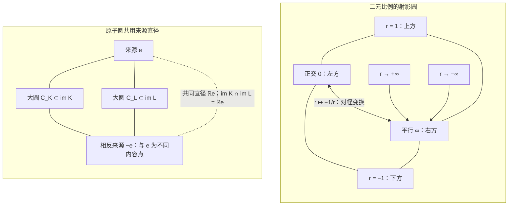
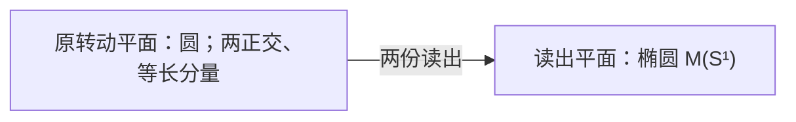

# 两圆共径，三维闭合

> 来源：用户于 2026-11-05（Asia/Singapore）在本会话提供的 ΩQ-014 LaTeX 研究工作稿；原稿未另署作者或模型。本文为参考输入，Lean 是仓库的数学真源；本次仅转换 Markdown，未作形式化认证。正文中的固定快照、项目核读叙述与理论结论均保留原稿口径；两幅 TikZ 图转换为 Mermaid 示意图，第一幅保留两个面板。

QUANTUM ORIGINS / $\Omega Q$-014

从零、无穷远与射影关系回溯量子基本块

**本轮唯一候选：两种最小原转动共用来源直径，并完整生成原作用。**

同一完整有限响应空间 $W$、原可逆作用 $G$、原来源 $e$ 与 $\mathfrak g=\operatorname{Lie}(G)$ 已由原数据确定。要求存在 $K,L\in\mathfrak g$，使

$$
\boxed{\begin{gathered}
\operatorname{Lie}\langle K,L\rangle=\mathfrak g,\qquad \operatorname{rank}K=\operatorname{rank}L=2,\\
\operatorname{im}K\cap\operatorname{im}L=\mathbb Re.
\end{gathered}}
$$

秩二是实正定旋转的最小非零活动规模。两圆在单位来源球上交于 $e,-e$，其支撑平面共用同一条直径；相反来源仍作为不同内容保留。

整个三维提升的核心为

$$
S\bigl(\operatorname{Lie}\langle K,L\rangle\bigr)
=\operatorname{im}K+\operatorname{im}L,
\qquad \dim S=2+2-1=3.
$$

完整生成、整个原群的支撑不变性与完整来源轨道使 $W=S$。紧作用随后给出 $\mathfrak g=\mathfrak{so}(3)$。上一轮的面积等式成为推论；本轮选择式不再使用迹、比较强度或 Gram 行列式。

在同一个二维关系平面中，内积与有向面积之比把正交记作 $0$、平行记作 $\infty$；接起无穷远给射影圆。圆本身允许两种取向。完整非交换结构继续给四元数、复二维振幅、相位纤维与 Born 配对；完整有限量子过程按其原联合、参考和时钟接口展开。

日期：2026-11-05，新加坡。\
固定仓库：`dev@ba97bbfd0aab3adfa5f6a3d6621495ef96c06597`。\
提交：04:48:44 +0800；本次版本核查：05:01:09 +0800。\
承接：本对话 $\Omega Q$-013 与固定项目 C129/C130 新增形式化源码。

普通数学研究工作稿。给出限定前件、完整证明、反模型及量子接口；本轮没有重新运行 Lean，未把仓库既有结论记作本轮新发现。

## 1　从无穷读出回到共同生成结构

用户提出的画面包含三个可分别检验的想法：正交读零、平行读无穷远；两端接起来成为圆；一份共同结构可以产生无穷多个表面上不同的规律。本轮把前两项写成准确射影公式，再把第三项落实为完整生成条件。

#### 命题 1.1：有限规则与无限生成元的区别

全部素数可以由一个固定有限程序枚举，但正整数乘法幺半群不能由有限多个整数生成。允许加法后，自然数半环由 $1$ 生成。

**证明。**

依次检查每个整数的有限个非平凡因子，是一个固定有限程序。另一方面，有限个乘法生成元只含有限种素因子；其任意乘积不会出现名单外的素因子。将名单内素数相乘再加一，其某个素因子在名单外，因此有限乘法生成不可能。允许加法后，每个自然数都是有限个 $1$ 的和。 $\square$

算术基本定理将正整数乘法写成

$$
(\mathbb N_{>0},\times)\cong
\left(\mathbb N_0^{(\mathcal P)},+\right),
$$

其中 $\mathcal P$ 为素数集合，每个指数族有有限支撑。这给出可数无穷坐标的准确表示，没有仅凭比喻指定一个未知有限维投影源。[\[12\]](#ref-maynard)

本轮在量子问题中做相同区分：原数据可有无穷多未来读口，却在明确的有限前端内由有限线性响应表示；两种变化能否生成全部原作用，则是另外需要验证的关系。证明每一个已见局部图成立，并未自动验证完整性。

#### 命题 1.2：严格缩短的度量

固定表达语言，并把全部缩写展开后的长度记为非负整数 $L$。每轮都严格降低 $L$ 的过程不能无限持续。

**证明。**

非负整数没有无限严格递减链。 $\square$

因此，本轮明确计量其缩减：Q13 在完整生成平面上比较面积；Q14 直接规定最小活动平面的共同直径。后者的选择式取消 $B,\kappa$、Gram 行列式与精确面积读数，维数证明缩为一个生成支撑恒等式。两者的精确模型类相同，完整生成与准确秩、准确交线仍有实质成本。[\[7\]](#ref-q013)

## 2　固定项目版本：二元预算与完整历史核

本轮只读固定 `dev` 于提交 `ba97bbfd0aab3adfa5f6a3d6621495ef96c06597`，提交时间为 2026 年 11 月 5 日 04:48:44，新加坡时间；本次版本核查时间为同日 05:01:09。 相对上一轮 `0b9f2dda45b8`，完整 Git 树比较有 440 个路径变化、41 个新增可达提交。理论目录仅新增一份回文密度文稿；本轮相关 C128、C129、C130、C133 与 $\Omega Q$-010 理论正文未改变。量子方向的实际新增是 C129 奇异续写逆向与有限覆盖、C130 整数互读预算等价的 Lean 源码。[\[1\]](#ref-q014commit), [\[3\]](#ref-q014c129lean), [\[2\]](#ref-q014c130lean)

本轮阅读了新增定义、证明源码及对应可读陈述，并将所用来源与固定树的 blob 标识核对；没有在当前环境重跑 Lean。以下用普通证明说明所复用结果的准确范围。新候选仍负责从原作用中选择三维基本块；本节预算结果负责完整核的正性，二者的作用不同。

### 2.1　一条二元实不等式已经恢复原核的 Hermitian 正性

设 $X$ 为任意标签集，$K:X\times X\to\mathbb C$ 为任意原始表，暂不假定共轭对称。对有限支撑高斯整数配方 $f,g\in\mathbb Z[i]^{(X)}$，定义同核比较

$$
B_K(f,g)=\sum_{x,y}\overline{f(x)}K(x,y)g(y),
\qquad Q_K(f)=B_K(f,f).
$$

复数、共轭、实部、实数序与这个有限求和规则均为此结果的前件；配方是数学写法，不自动成为实际相干制备。

#### 定理 2.1：项目 C130 的整数互读等价

对同一原始核 $K$，下列条件等价：

1.  对全部有限高斯整数配方有

    $$
    \boxed{2\Re B_K(f,g)\le \Re Q_K(f)+\Re Q_K(g).}
    $$

2.  将配方系数改为 $\mathbb Q(i)$ 或 $\mathbb C$ 后，分别满足同一预算条件。

3.  $K$ 是 Hermitian 正型核，即每张有限有序表 $[K(x_j,x_k)]$ 均为正半定矩阵。

空标签集、零配方、零核、重复标签和奇异表均包含。支持大小及整数系数大小没有统一上界。[\[2\]](#ref-q014c130lean), [\[5\]](#ref-q014c130theory)

**证明。**

令 $g=0$，得到 $\Re Q_K(f)\ge0$。固定整数配方 $f$，写 $Q_K(f)=a+ib$。对每个整数 $n$，比较 $F=nf$ 与 $G=(n+i)f$。由有限和定义，其预算差为

$$
\Re Q_K(F)+\Re Q_K(G)-2\Re B_K(F,G)=a+2nb.
$$

整数可向两边无界增长，因此此式恒非负迫使 $b=0$。所有整数配方的自比较遂为非负实数。

单标签配方给实对角；$\delta_x+\delta_y$ 与 $\delta_x+i\delta_y$ 的自比较为实，分别给

$$
\Im(K(x,y)+K(y,x))=0,
\qquad \Re(K(x,y)-K(y,x))=0.
$$

故 $K(y,x)=\overline{K(x,y)}$。对任意有限有理配方，取同一个非零整数清除全部实、虚分母，预算差乘以正数 $N^2$，所以预算仍成立。再固定有限支持，用有理实、虚部分逼近任意复系数；有限二次多项式连续，非负实轴闭，故全部有限复二次型均非负。此连续性只在系数空间使用，无须给 $X$ 拓扑。

反向，Hermitian 正性给

$$
\Re Q_K(f)+\Re Q_K(g)-2\Re B_K(f,g)=Q_K(f-g)\ge0,
$$

从而全部三个系数版本都成立。

$\square$

这里的二元输入是任意有限配方。把它缩成只检查原始标签的两点或三点，会改变结论。例如 $G=\tfrac75 I_4-\tfrac25J_4$ 的全部三阶及更小主块正定，整张表却有本征值 $-1/5$。另一方面，单位核 $K(x,y)=\delta_{xy}$ 在任意有限维均通过预算，所以这个结果本身不选择三维。

### 2.2　正性接回同一原表的奇异续写

项目 C129 的新增逆向定理给出同一核上的准确等价：全部有限表正半定，当且仅当对每个有限旧列表 $L$ 和追加标签 $h$，存在 $c,r$ 使

$$
G_{L+h}=
\begin{pmatrix}
G_L&G_Lc\\
c^*G_L&c^*G_Lc+|r|^2
\end{pmatrix}.
$$

该等式保留实际四个块，涵盖 $G_L=0$、奇异旧表与 $r=0$。[\[3\]](#ref-q014c129lean)

正向从空表归纳，利用上式是 $\operatorname{diag}(G_L,|r|^2)$ 的合同变换。逆向若 $\left(\begin{smallmatrix}G&b\\b^*&q\end{smallmatrix}\right)\succeq0$，对 $u\in\ker G$ 和任意复 $t$ 评价 $(tu,1)$，得 $u^*b=0$，故 $b\in\operatorname{Ran}G$。取 $Gc=b$，再在 $(-c,1)$ 上评价，得到 $q-c^*Gc\ge0$；选其非负平方根作 $r$ 即得续写。没有使用普通逆矩阵。

新有限覆盖定理进一步要求：每个有限标签集合都包含在某条从空表开始、逐步满足实际续写等式的认证链中。不同集合可以使用不同链，允许额外标签与重复。每条链的归纳正性经拉回便覆盖任意所求有限表，因此给全域续写律。一个未覆盖声明标签集的单独日志不承担这个全域量词；定理也不要求一条可数日志覆盖任意标签类型。

### 2.3　项目已经分开的三种信息：次序、正交余量与定向

C129 §4.2 定义同一复核的三元环

$$
\mathcal B_{123}=K_{12}K_{23}K_{31}.
$$

独立重相位在乘积中抵消。两点闭环 $K_{12}K_{21}=|K_{12}|^2$ 是实数；三点是可以保留复定向的最短闭环。反序或整个核复共轭将 $\mathcal B_{123}$ 共轭，而原追加次序仍可保持。对纯 qubit，已有公式

$$
\mathcal B_{123}
=\frac{1+\mathbf r_1\cdot\mathbf r_2+\mathbf r_2\cdot\mathbf r_3
+\mathbf r_3\cdot\mathbf r_1
+i\,\mathbf r_1\cdot(\mathbf r_2\times\mathbf r_3)}4.
$$

同一顺序的 $\lvert 0\rangle,\ (\lvert 0\rangle+\lvert 1\rangle)/\sqrt2,\ (\lvert 0\rangle\pm i\lvert 1\rangle)/\sqrt2$ 分别给 $(1\pm i)/4$，两者均满足续写。第三态的新增独立余量已经为零，三元环仍可有相反虚部。因此追加先后、独立维数与定向相位各有自己的关系。[\[4\]](#ref-q014c129theory)

C130 §6.5 还给出一个与“平行、正交”直接相关的反例：复空间中的

$$
\{0,e_1,ie_1\},\qquad \{0,e_1,e_2\}
$$

具有相同的三条实距离 $1,1,\sqrt2$，但第一对非零向量在同一复射线上，第二对复正交，其跃迁概率分别为 $1$ 与 $0$。实距离数据未确定复比较；原复核通过 $\Re B(f,ig)=-\Im B(f,g)$ 保留这份区别。[\[5\]](#ref-q014c130theory)

本轮的承接位置。新合入的二元预算定理已经承担“由一条实比较恢复全部 Hermitian 正性”的工作；不能把它重复记为新的量子起源候选。它保留复数标量与全部有限配方。本轮另沿原可逆作用回溯，以生成平面的支撑关系选择三维基本块，再解释射影补点、正交对合和相位。原 C128 的全网尺度、完整参考与实际事件接口仍按各自前件使用。

## 3　把零、无穷远与圆写成同一二元关系

### 3.1　正交读零，平行读无穷远的准确坐标

#### 定义 3.1：同一平面上的两种比较

令 $E$ 是带正定比较 $B$ 的实二维平面，暂选一个取向。令 $J$ 为该取向的正四分之一转动，即 $J^2=-I$、$B(Ju,Jv)=B(u,v)$。置

$$
\omega(u,v)=B(Ju,v),\qquad
a=B(u,v),\quad b=\omega(u,v).
$$

对非零 $u,v$，$(a,b)\ne(0,0)$。其射影比较为

$$
\mathfrak r(u,v)=[a:b]\in\mathbb R\mathbb P^1,
\qquad r(u,v)=\frac{a}{b}\quad(b\ne0),
$$

而 $[1:0]$ 记为 $\infty$。

#### 命题 3.2：二元归一关系

上述两读出满足

$$
\boxed{B(u,v)^2+\omega(u,v)^2=B(u,u)B(v,v).}
$$

因此 $r=\cot\theta$，其中 $\theta$ 是所选取向下从 $u$ 到 $v$ 的角。特别地

$$
u\perp v\iff r=0,
\qquad u\parallel v\iff r=\infty.
$$

把第二个元作四分之一转动，给

$$
(a,b)\longmapsto(-b,a),\qquad
r(u,Jv)=-\frac1{r(u,v)},
$$

其中 $0$ 与 $\infty$ 互换。

**证明。**

在正交单位坐标中，取 $u=(u_1,u_2)$、$v=(v_1,v_2)$，有 $a=u_1v_1+u_2v_2$、$b=u_1v_2-u_2v_1$。展开平方即得恒等式。$b=0$ 恰为线性相关，$a=0$ 恰为正交；非零向量排除二者同时为零。最后 $B(u,Jv)=-B(Ju,v)=-b$、$\omega(u,Jv)=B(Ju,Jv)=a$。 $\square$

上述射影紧化与极性使用标准几何定义，参见 [\[8\]](#ref-projective), [\[9\]](#ref-polarity)；这里的等式均已直接证明。这准确保留了“正交对应零、平行对应无穷远”的图像。这里的零是*同一比较坐标的值*。若把它解释成两条直线的交点位置，便会丢掉角度：任意两条不同的过原点直线都交于原点，它们可以有任意夹角。

仿射平行线 $y=mx+b_1$、$y=mx+b_2$ 在射影平面中确实交于 $[1:m:0]$。但交会关系本身不能恢复正交：剪切 $(x,y)\mapsto(x+y,y)$ 保持直线、平行和交点，却把互相正交的两个坐标轴送到方向 $(1,0)$、$(1,1)$。本轮的正交来自原紧作用所允许的正定比较，而平行来自线性相关。

### 3.2　两端接成圆，不会自动选出手性

#### 定理 3.3：实射影直线的圆表示

映射

$$
\chi:\mathbb R\mathbb P^1\longrightarrow S^1\subset\mathbb C,
\qquad
\chi([a:b])=\frac{(a+ib)^2}{a^2+b^2}
$$

是同胚。它在 $r=a/b$ 坐标中成为

$$
\boxed{\chi(r)=\frac{r+i}{r-i}\quad(r\in\mathbb R),
\qquad\chi(\infty)=1.}
$$

因此 $r=0$ 对应 $-1$，$+\infty$ 与 $-\infty$ 都趋向同一个圆点 $1$。正交补变换 $r\mapsto-1/r$ 对应圆上的对径变换 $\chi\mapsto-\chi$。

**证明。**

共同乘非零实数不改变右侧，所以映射良定，且其模为一。把 $(a,b)$ 归一为 $(\cos\theta,\sin\theta)$，像为 $e^{2i\theta}$。两个单位向量有相同像，当且仅当相差符号，恰为同一个实射影点。映射也满射，故为从紧空间到 Hausdorff 空间的连续双射，因而是同胚。坐标表达由 $(r+i)/(r-i)=(r+i)^2/(r^2+1)$ 得到。四分之一转动使 $a+ib$ 乘 $i$，平方后的像乘 $-1$。 $\square$

上式中的复数只是表示一个实平面及其转动的记号。完全可以把 $\chi$ 写成两项实坐标

$$
\chi([a:b])=
\left(\frac{a^2-b^2}{a^2+b^2},
      \frac{2ab}{a^2+b^2}\right).
$$

此处尚未引入量子复振幅。

#### 命题 3.4：无穷远、方向与手性的区别

以下三个操作不同：

1.  保留两个不同端点的有序扩充 $\mathbb R\cup\{-\infty,+\infty\}$ 是闭区间；

2.  把两端识别为同一点，得到 $\mathbb R\mathbb P^1\cong S^1$；

3.  给这个圆选一个运行方向，是另外的取向数据。

平行、正交与上述端点识别不能单独选出第三项。

**证明。**

第一项由 $r\mapsto (2/\pi)\arctan r$ 延拓为 $[-1,1]$ 可见；识别两个端点给圆。对第三项，$r\mapsto-r$ 保持 $0$、$\infty$ 及正交补关系，却给 $\chi(-r)=\overline{\chi(r)}$，反转圆的取向。因此前两项对两种取向完全对称。 $\square$

有向单位向量 $(\cos\theta,\sin\theta)$ 还形成 $\mathbb R\mathbb P^1$ 的二重覆盖：忘掉箭头时 $v$ 与 $-v$ 被识别。对于单位向量 $(r,1)/\sqrt{r^2+1}$，两个无穷端点趋向相反的有向向量，而在射影商中成为同一点。这种识别正好忘掉一次箭头区别，不能同时作为新增物理手性的证明。

忘掉圆的取向，底层空间仍是圆。把圆按反射作商会得到区间；把整个圆按转动轨道作商才得到一点。因此“一个点上方有一个相位圆”适合解释为纤维关系，不能解释为点与圆本身同胚。

**图 1：** 左：同一二元比较中，正交与平行对应射影圆上的两个对径点；端点识别保留圆而不选择取向。右：选取正交生成坐标后，两条来源大圆的一个投影视图，两个活动平面共用来源直径。相反来源 $e,-e$ 仍是不同内容点。

## 4　同一完整原响应与来源比较

#### 定义 4.1：原概率行与完整有限前端

在同一原签名 $\Omega$ 内固定一个真实归一来源。对原可逆控制历史 $a$、合法未来请求 $f$ 和原结果标签 $w$，记完整响应行

$$
x_a(f,w)=p(a;f,w),\qquad p\ge0,\quad \sum_w p(a;f,w)=1.
$$

共同未来保留全部合法终端请求、原结果、失败、实际可读旧记录及后续合法性区别；原身份、端口、设备和历史索引继续保留。没有原定义的请求不人为补概率。总可逆连接含空历史、对复合封闭、在同一菜单内有准确统计逆，并在全未来线性关系上良定。

取同一来源的完整原可逆轨道，置

$$
V=\operatorname{span}_{\mathbb R}\{x_a\},\qquad u(x_a)=1,\qquad
W=\ker u=\operatorname{span}\{x_a-x_b\}.
$$

本轮明确要求 $0<\dim W<\infty$。原身份相同与响应相同是不同关系；构造线性表示不删除原索引。若已有可读历史使张成空间更大，使用更大的完整空间。

#### 引理 4.2：紧作用、固定中心与完整循环性

原可逆作用在 $V$ 上的矩阵闭包 $H$ 是紧群。定义

$$
c=\int_Hhx_\epsilon\,dh,\qquad e=x_\epsilon-c,
\qquad G=H|_W,\qquad \mathfrak g=\operatorname{Lie}(G).
$$

则 $G$ 紧、作用有效，$e\ne0$，并且

$$
W=\operatorname{span}(Ge).
$$

**证明。**

有限维中可选有限个实际评价坐标分离 $V$，并从原响应行中选一组基。任一原控制将这些基行送到其他响应行；所选概率坐标有界，故其矩阵一致有界。准确逆也在原集合内，故逆矩阵一致有界；闭包紧且不含奇异矩阵，是群。 Haar 平均固定 $c$，且 $u(c)=1$，故 $V=\mathbb Rc\oplus W$。在 $W$ 上平凡的原矩阵也固定 $c$，因而在 $V$ 上平凡。所有轨道行减去 $c$ 正好张成 $W$；若 $e=0$，轨道只有一点，违背 $W\ne0$。 $\square$

闭包中的极限矩阵与连续生成元首先是原响应的数学表示，不自动成为准确可调用的原装置。Haar 平均也不供应实际随机准备。

#### 定义 4.3：由轨道内生的比较

记 $n=\dim W$。对 $\alpha\in W^*$ 定义

$$
\mathsf C\alpha=\int_G\alpha(ge)\,ge\,dg,
\qquad B(v,w)=\frac1n(\mathsf C^{-1}v)(w).
$$

#### 引理 4.4：规范比较及完整轨道恒等式

$\mathsf C$ 可逆，$B$ 正定且 $G$ 不变，并有

$$
B(e,e)=1,\qquad
\int_Gge\otimes(ge)^{\flat_B}\,dg=\frac1nI_W.
$$

**证明。**

完整循环性给 $\alpha(\mathsf C\alpha)=\int\alpha(ge)^2dg>0$ 对全部 $\alpha\ne0$ 成立。Haar 不变性给 $B$ 不变。取迹有 $\int B(ge,ge)dg=\operatorname{Tr}(B\mathsf C)=1$，而轨道上长度相同，故 $B(e,e)=1$。对任意 $w$，积分算子作用于 $w$ 等于 $\mathsf C(w^{\flat_B})=w/n$。 $\square$

若 $T:W\to W'$ 保来源并共轭全部原作用，则 $\mathsf C'=T\mathsf C T^*$，从而 $B'(Tv,Tw)=B(v,w)$。换源到同一轨道点也只共轭后续关系。删去可读坐标的非单射投影不属于这种同构。

后文的度量表达对*任意*不变正定比较、任意单位循环来源成立。上述规范构造只使比较本身完全由原来源确定。本轮直接用秩与像的交定义选择条件；比较只负责将其后续解释成旋转、曲率与概率。

## 5　两圆共径：本轮唯一候选

本节使用前端已经确定的同一个完整有限实响应空间、原紧作用与来源：

$$
G\subseteq O(W,B),\qquad \mathfrak g=\operatorname{Lie}(G),\qquad
B(e,e)=1,\qquad W=\operatorname{span}(Ge).
$$

原群 $G$ 包含全部已指定的可逆响应及其矩阵闭包；$\mathfrak g$ 在选择生成元之前已经确定。$B$ 可由原来源轨道的协方差内生构造。本轮的选择式本身只读取秩、像、来源与原交换子，不再比较两个 Gram 行列式。

#### 引理 5.1：最小非零转动及其原子圆

若 $A$ 是实正定空间上的非零反对称算子，则 $\operatorname{rank}A$ 为正偶数，最小可能值为二。若 $\operatorname{rank}A=2$ 且 $e\in\operatorname{im}A$，令 $v=Ae$，则 $v\ne0$、$v\perp e$，且

$$
A=X_v,\qquad
X_v(te+z)=tv-B(v,z)e\quad(z\perp e).
\tag{5.1}
$$

令 $\omega=\lVert v\rVert_B$。同一来源的数学连续轨道为

$$
e^{tA}e
=\cos(\omega t)e+\sin(\omega t)\frac v\omega.
\tag{5.2}
$$

它恰为 $\operatorname{im}A$ 中的单位圆；$A$ 在其正交补上为零。

**证明。**

反对称性给 $\ker A=(\operatorname{im}A)^\perp$。在像上，$A$ 是非退化反对称算子；非退化交替型的维数为偶数，故非零秩至少为二，二维平面转动达到此下界。

若像为二维且包含 $e$，则 $Ae\ne0$、$B(e,Ae)=0$，故 $\operatorname{im}A=\operatorname{span}\{e,v\}$。在此平面上反对称性强制 $Av=-B(v,v)e$，在正交补上 $A=0$，得到式 (5.1)。对该二维块求指数得到式 (5.2)。 $\square$

#### 定义 5.2：原子圆与完整共径对

$\operatorname{rank}A=2$ 的原反对称变化称为一个*原子圆生成元*。这里的“原子”指实反对称变化的最小非零秩，不是“在给定 $\mathfrak g$ 中碰巧可找到的最小秩”。

一对 $K,L\in\mathfrak g$ 称为来源 $e$ 的*完整共径对*，若

$$
\boxed{\quad
\operatorname{Lie}\langle K,L\rangle=\mathfrak g,\qquad
\operatorname{rank}K=\operatorname{rank}L=2,\qquad
\operatorname{im}K\cap\operatorname{im}L=\mathbb Re.
\quad}
\tag{Q14}
$$

**本轮唯一候选：存在完整共径对。**

两种最小转动的活动平面只共享来源所在的直径，并且它们的线性组合与反复顺序差生成全部原无穷小变化。这两个单位圆在球面上交于 $e$ 与 $-e$；“共径”是支撑平面的交线 $\mathbb Re$。来源仍是指定的有符号向量 $e$，没有把两种相反内容识别为同一个态。

式 (5.2) 描述矩阵闭包中的数学流。原菜单是否实际供应任意参数的准确连续操作，仍由原控制接口判断。候选也不因出现一个数学圆而自动增添这样的装置。任意来源轨道在参数零时都经过 $e$；候选要求的是*完整算子的二维活动支撑*包含 $e$，从而来源轨道是以零向量为圆心的大圆，不能只检查轨道是否经过来源。

## 6　生成支撑：三维提升的最短证明

#### 引理 6.1：有限生成元的全部活动支撑

对任意有限个实线性算子 $A_1,\ldots,A_k$，令

$$
\mathfrak a=\operatorname{Lie}\langle A_1,\ldots,A_k\rangle,
\qquad
S(\mathfrak a)=\operatorname{span}\{Az:A\in\mathfrak a,\ z\in W\}.
$$

则

$$
\boxed{S(\mathfrak a)=\sum_{i=1}^k\operatorname{im}A_i.}
\tag{6.1}
$$

**证明。**

令右侧为 $U$。全部生成元都把 $W$ 映入 $U$，故每个正长度算子乘积也把 $W$ 映入 $U$。每个 Lie 字是这类乘积的有限线性组合，所以 $S(\mathfrak a)\subseteq U$。生成元自身属于 $\mathfrak a$，给出反向包含。 $\square$

#### 定理 6.2：完整共径对的三维刚性

在本节保留的完整有限前端中，下列两项等价：

1.  存在满足 Q14 的完整共径对；

2.  $\dim W=3$，且 $\mathfrak g=\mathfrak{so}(W,B)$。

此时

$$
G^\circ=SO(W,B),\qquad G=SO(W,B)\ \text{或}\ O(W,B).
$$

**证明。**

设 Q14 成立。令

$$
U=\operatorname{im}K+\operatorname{im}L.
$$

秩与交线条件直接给出

$$
\boxed{\dim U=2+2-1=3.}
\tag{6.2}
$$

完整生成和引理 6.1 给 $S(\mathfrak g)=U$。对于整个 $G$ 中的任意 $h$，包括不连通分支，都有 $h\mathfrak gh^{-1}=\mathfrak g$，故 $hS(\mathfrak g)=S(\mathfrak g)$。因此 $U$ 被整个 $G$ 保持。来源 $e\in U$，遂有

$$
W=\operatorname{span}(Ge)\subseteq U.
$$

故 $W=U$ 为三维。

若 $K,L$ 成比例，其像相同，交的维数会是二，矛盾。因此它们线性独立。选择三维正交定向坐标，将反对称算子表示成 $z\mapsto a\times z$。独立的 $K,L$ 对应独立的 $a,b$，而其交换子对应 $a\times b$，三者独立。因此原 $\mathfrak g$ 包含整个三维 $\mathfrak{so}(W,B)$，得到等号。

反过来，若完整作用是三维旋转，取 $e^\perp$ 的独立向量 $v,w$，定义 $K=X_v,L=X_w$。二者秩为二，像分别为 $\operatorname{span}\{e,v\}$ 与 $\operatorname{span}\{e,w\}$，交为 $\mathbb Re$；它们及交换子生成整个 $\mathfrak{so}(W,B)$。故 Q14 成立。最后，$G\subseteq O(3)$ 且恒等连通分支为 $SO(3)$，所以整个 $G$ 只能是 $SO(3)$ 或 $O(3)$。 $\square$

这里“三维”没有写进选择式。它是两份最小二维活动支撑沿一条原来源直径相交之后的维数公式。完整生成负责把局部支撑变成原代数的全部支撑；整个群的不变性与原来源循环性负责把这个支撑变成整个响应空间。

#### 命题 6.3：表示运输、换源与坐标自由

对任意实线性同构 $F:W\to W'$，同时运输

$$
e'=Fe,\quad G'=FGF^{-1},\quad K'=FKF^{-1},\quad L'=FLF^{-1},
$$

Q14 保持。特别地，同一原轨道内换源可取 $F=h\in G$。若 $(K,L)$ 满足 Q14，那么对其生成平面的任意 $GL_2(\mathbb R)$ 换基，新的有序基仍满足 Q14。

**证明。**

线性共轭保持秩、像的交以及原 Lie 生成关系，并把共同直径准确送到 $\mathbb Re'$。这不需要事先选择一份度量。对换基，由引理 5.1 有 $K=X_v,L=X_w$，其中 $v,w$ 独立。任意可逆线性组合变成 $X_{v'},X_{w'}$，其中 $v',w'$ 仍独立，因而保持秩二与共同直径；生成平面未变，Lie 闭包也未变。 $\square$

## 7　唯一内生圆束与上一轮的精确等价

#### 定义 7.1：来源原子圆束

仅由原作用与来源定义

$$
\mathfrak p_e
=\{0\}\cup
\{A\in\mathfrak g:\operatorname{rank}A=2,\ e\in\operatorname{im}A\}.
\tag{7.1}
$$

#### 命题 7.2：圆束的线性及唯一性

即使尚未假定 Q14，$\mathfrak p_e$ 已是线性子空间。若令

$$
E=e^\perp,\qquad D_eA=P_EA|_E,
$$

则

$$
\mathfrak p_e=\ker D_e
=\mathfrak g\cap\{X_v:v\in E\}.
$$

Q14 成立后，$\mathfrak p_e$ 恰为二维，是唯一可以由完整共径对张成的平面，而且

$$
\mathfrak p_e=\{X_v:v\in E\},\qquad
\operatorname{Lie}(\mathfrak p_e)=\mathfrak g.
$$

**证明。**

每个反对称算子都有唯一分块

$$
A=X_{Ae}+\widetilde{D_eA},
$$

其中横向算子在 $\mathbb Re$ 上零延拓。引理 5.1 说明非零秩二且来源在像中，当且仅当横向块为零。由于 $D_e$ 线性，其核线性。Q14 后 $W$ 为三维且原代数是全部反对称算子，所以所有 $X_v$ 都属于原代数，圆束维数为 $\dim E=2$。每个完整共径对都在此圆束中且独立，故张成同一个平面。 $\square$

因此可以说“找到一对见证”，也可以说“原来源的唯一二维原子圆束生成整体”。圆束是内生对象，有序坐标轴仍可自由选择。

#### 定理 7.3：与 Q13 面积关系的精确等价

取同一原比较

$$
\kappa(A,B)=-\tfrac12\operatorname{Tr}_W(AB).
$$

对任意独立的 $K,L\in\mathfrak g$，以下两项等价：

1.  $\operatorname{rank}K=\operatorname{rank}L=2$，且 $\operatorname{im}K\cap\operatorname{im}L=\mathbb Re$；

2.  来源面积精确保真：

    $$
    \lVert Ke\wedge Le\rVert_B^2=\lVert K\wedge L\rVert_\kappa^2>0.
    $$

因而在同一完整前端上，Q14 与 Q13 选择完全相同的模型类。

**证明。**

第一项给 $K=X_v,L=X_w$，且 $v,w$ 独立。直接计算 $\kappa(X_v,X_w)=B(v,w)$，故两个 Gram 矩阵相同，面积取等且为正。

反向取生成平面的 $\kappa$-正交单位基 $K_1,K_2$。分块迹恒等式给

$$
I_2=S+H,\qquad
S_{ij}=B(K_ie,K_je),\quad
H_{ij}=-\tfrac12\operatorname{Tr}_E(D_eK_iD_eK_j),\quad H\succeq0.
$$

$S$ 的两个本征值都在 $[0,1]$ 内，面积取等给 $\det S=1$，故两者都为一、$H=0$。因此整个生成平面都在 $\ker D_e$ 中。每个非零元都是来源秩二转动，两个独立元的来源速度独立，其像的交恰为 $\mathbb Re$。 $\square$

本轮删去的是选择式中的完整迹比较、Gram 行列式与面积等号；主维数证明改用生成支撑与 $2+2-1$。两轮的精确模型类相同，不能据此宣称逻辑条件变弱。完整生成与准确秩、准确交线也仍有认证成本。

#### 推论 7.4：二元到多元的共同来源提升

设整数 $k\ge1$。若原代数由秩二变化 $A_1,\ldots,A_k$ 完整生成，每个像都包含 $e$，且 $A_1e,\ldots,A_ke$ 独立，则

$$
\dim W=k+1,\qquad \mathfrak g=\mathfrak{so}(W,B),\qquad Ge=S^k.
$$

**证明。**

由引理 5.1，$A_i=X_{v_i}$，其中 $v_i=A_ie$ 独立且垂直于 $e$。全部活动支撑为 $U=\mathbb Re\oplus\operatorname{span}\{v_1,\ldots,v_k\}$，维数 $k+1$。完整生成、支撑在整个 $G$ 下不变及来源循环性给 $W=U$。由 $X_{v_i}$ 及其交换子得到全部来源–切向、切向–切向平面转动，故原代数是整个 $\mathfrak{so}(W,B)$。恒等分支的球面作用传递，给出轨道 $S^k$。 $\square$

## 8　逆向检查：哪些关系不能省略

#### 反例 8.1：一对局部原子圆不等于完整基本块

在 $W=\mathbb R^n$、$G=SO(n)$、$e=e_1$ 上，令 $K=J_{12},L=J_{13}$，其中 $J_{ij}e_i=e_j$、$J_{ij}e_j=-e_i$。两者秩二，像的交为 $\mathbb Re$。当 $n\ge4$ 时，它们只生成前三维上的 $\mathfrak{so}(3)$，没有生成完整 $\mathfrak{so}(n)$。因此删去完整性后，任意高维都能含有这样的局部二元结构。

#### 反例 8.2：共同直径必须是同一个原来源

取

$$
W=\mathbb R^3\oplus\mathbb R,\qquad
G=SO(3)\times\{\pm1\},\qquad
e=\frac{\sqrt3}{2}e_1+\frac12e_4.
$$

使用标准内积。此时来源为单位向量、Haar 平均为零，完整轨道张成 $W$；其协方差恰为 $I_4/4$，故原协方差比较就是标准内积。

令 $K=J_{12},L=J_{13}$。二者秩二并完整生成原 $\mathfrak g=\mathfrak{so}(3)\oplus0$，但它们共同直径是 $\mathbb Re_1$，并非 $\mathbb Re$。整个来源空间仍为四维。这也说明，不能在主证明中忽略原群不连通分支；最后一维正由离散符号变化读出。

#### 反例 8.3：两个准确来源大圆仍可覆盖四维整体

把实四维空间写成四元数 $W=\mathbb H$，使用欧氏范数，令单位四元数群 $G=\operatorname{Sp}(1)$ 左乘作用，来源 $e=1$。令

$$
Kq=\mathbf i q,\qquad Lq=\mathbf j q,\qquad Mq=\mathbf k q.
$$

这些是实反对称算子，并有

$$
K^2=L^2=M^2=-I_4,\qquad
[K,L]=2M,\quad [L,M]=2K,\quad [M,K]=2L.
$$

所以 $K,L$ 完整生成原左乘 Lie 代数，且 $\operatorname{rank}K=\operatorname{rank}L=4$。来源轨道是整个 $S^3$，张成 $W$，其协方差为 $I_4/4$。但两条指定来源轨迹恰好是

$$
e^{tK}1=\cos t+\mathbf i\sin t,\qquad
e^{tL}1=\cos t+\mathbf j\sin t.
$$

它们都是准确大圆，相交于 $\{1,-1\}$。仍然有 $\dim W=4$，因为完整算子各自在另一个正交平面上同时转动：$\operatorname{im}K=\operatorname{im}L=W$。因此，观察到两个共径大圆，不能替代对完整原作用的秩二要求。此处四元数仅用于给出独立反模型。

#### 反例 8.4：原代数的最小可用秩可能为四

令 $SO(3)$ 共轭作用于 $W=\operatorname{Sym}_0(3,\mathbb R)$，原无穷小作用为 $X\mapsto[A,X]$。对任何非零旋转轴，适当取坐标后，此五维表示分成一个固定方向、一个频率一的实二维平面和一个频率二的实二维平面，所以每个非零生成元的秩都是四。

例如取来源 $e=\operatorname{diag}(1,-1,0)/\sqrt2$。其旋转轨道张成全部五维空间：坐标置换给出全部无迹对角方向，平面内 $45$ 度旋转再给出全部对称非对角方向。由此得到合法的完整循环背景，却没有任何秩二原子圆。故“最小非零秩为二”是对实反对称算子的绝对最小活动结构所作的选择，不能偷换成“选 $\mathfrak g$ 中最小可用秩”。

#### 反例 8.5：两圆重合会退回交换情形

在 $W=\mathbb R^2$、$G=SO(2)$ 上取非零 $K$，令 $L=2K$。两者秩二并生成完整原代数，但活动平面相同，交为二维而非一维。原 Lie 代数只有一维，全部变化交换。共同直径必须准确是一条线，不能放宽为“有公共点”。

#### 命题 8.6：平行退化边界

在已经得到的三维模型中，取 $e^\perp$ 的正交单位基 $v,w$，令

$$
K=X_v,\qquad L_\theta=X_{\cos\theta\,v+\sin\theta\,w}.
$$

若 $\sin\theta\ne0$，该对满足 Q14；若 $\sin\theta=0$，两者成比例，活动圆重合，生成维数降为一。并且

$$
[K,L_\theta]=\sin\theta\,[X_v,X_w].
$$

**证明。**

来源速度是否独立恰由 $\sin\theta\ne0$ 判断。独立时两个秩二像只交于 $\mathbb Re$，且生成整个三维旋转代数；不独立时两个算子成比例。交换子公式来自双线性。 $\square$

这个退化说明，平行关系与正交关系在同一圆束中有不同的代数后果。它们可以由一个对偶变换联系，但不能作为同一个关系来删除区别。这里也没有把角度接近零所产生的生成病态解释成额外的不确定性原理。

上述标准紧作用都可接上合法二结果读数

$$
p_\pm(g;h)=\frac12\bigl(1\pm B(ge,he)\bigr).
$$

正定性与单位来源保证读数非负且和为一；完整轨道张成保证这些未来读数分离响应。原标签及可读历史仍按原菜单保留。这给出了反向检查所需的实际概率表示，未靠负概率排除模型。

## 9　两张最小作用平面与一个射影线束

本节接续本轮候选已经给出的关系：$K,L$ 是秩二原生成元，

$$
\operatorname{im}K\cap\operatorname{im}L=\mathbb Re,
\qquad \operatorname{Lie}\langle K,L\rangle=\mathfrak g,
$$

其中来源已归一为 $B(e,e)=1$。由紧作用的斜对称性，有

$$
K=X_v,\quad L=X_w,\qquad v=Ke, w=Le,
\qquad X_zx=B(e,x)z-B(z,x)e.
$$

$v,w$ 独立，且 $U=\operatorname{span}\{e,v,w\}$ 为三维。

### 9.1　源圆的交点，与生成平面的参数圆

#### 命题 9.1：同一来源的圆束

令 $S(U)=\{x\in U:B(x,x)=1\}$。两个一参数来源轨道

$$
C_K=\{\exp(tK)e:t\in\mathbb R\},\qquad
C_L=\{\exp(tL)e:t\in\mathbb R\}
$$

分别是 $S(U)$ 上的两个大圆，并且

$$
\boxed{C_K\cap C_L=\{e,-e\}.}
$$

令 $P=\operatorname{span}\{K,L\}$。每个非零 $A=\lambda K+\mu L$ 仍有秩二，且

$$
\operatorname{im}A
=\operatorname{span}\{e,\lambda v+\mu w\}.
$$

所有这类作用平面由 $\mathbb P(P)\cong\mathbb R\mathbb P^1$ 参数化，并都含有来源直线 $\mathbb Re$。

**证明。**

$X_v$ 在 $\operatorname{span}\{e,v\}$ 上是非零旋转生成元，在其正交补上为零，因此 $\exp(tK)e$ 遍历对应单位大圆。两作用平面的交为 $\mathbb Re$，与单位球相交给 $\{e,-e\}$。线性性给 $\lambda K+\mu L=X_{\lambda v+\mu w}$；独立性保证后者在 $(\lambda,\mu)\ne(0,0)$ 时非零且有秩二。乘非零实数不改变作用平面，反过来作用平面相同也只允许该切向量相差非零倍数，所以参数正好是 $\mathbb P(P)$。 $\square$

这里有两个不同的“圆”。$C_K$ 是来源在一个固定生成元下的轨道；$\mathbb P(P)$ 则描述该来源可以选哪些最小作用平面。前者由时间参数遍历，后者是生成元平面的射影化。在参数图 $[\lambda:\mu]$ 中，$0$ 与 $\infty$ 可以分别标记两种生成方向；它们并未成为来源球面上的同一点。

在实射影空间 $\mathbb P(U)$ 中，两条射影作用直线 $\mathbb P(\operatorname{im}K)$、$\mathbb P(\operatorname{im}L)$ 交于一点 $[e]$。回到保留来源符号的单位球，它们相交于 $e$ 和 $-e$ 两点。这个区别需要保持，不能在原状态层上把正反来源识别。

### 9.2　它在更大 Grassmann 几何中的位置

对 $a,b\in W$，定义从二向量到斜对称作用的线性对应

$$
\iota(a\wedge b)x=B(a,x)b-B(b,x)a.
$$

它给出 $\Lambda^2W\cong\mathfrak{so}(W,B)$。非零可分解二向量 $a\wedge b$ 对应秩二作用，其像为 $\operatorname{span}\{a,b\}$。

#### 定理 9.2：Grassmann 图中的射影直线

设 $\beta_1,\beta_2$ 是独立的非零二向量。它们张成的射影直线全部由可分解二向量组成，当且仅当存在一个一维空间 $\ell$ 和一个三维空间 $U$，使该直线恰好参数化全部中间平面

$$
\boxed{\ell\subset M\subset U,\qquad\dim M=2.}
$$

因此每条这样的 Grassmann 射影直线由一个 $(1,3)$ 旗标 $\ell\subset U$ 确定。

**证明。**

正向先写 $\beta_1=a\wedge b$、$\beta_2=c\wedge d$。由于 $\beta_1+\beta_2$ 也可分解，

$$
0=(\beta_1+\beta_2)\wedge(\beta_1+\beta_2)
=2\beta_1\wedge\beta_2.
$$

所以 $a,b,c,d$ 线性相关。两个二维支撑不能相同，否则其二次外幂均为同一条直线，违反 $\beta_1,\beta_2$ 独立。故其交恰为一维 $\ell$，和恰为三维 $U$。取非零 $e\in\ell$，可写 $\beta_1=e\wedge v$、$\beta_2=e\wedge w$，且 $e,v,w$ 独立。任意组合即为 $e\wedge(\lambda v+\mu w)$，覆盖全部中间二维平面。

反向对任意旗标选这样的 $e,v,w$。上述组合显然全部可分解，且每个中间平面正好对应一个 $[\lambda:\mu]$。 $\square$

因此，本轮的简洁几何可以写成

$$
\boxed{\text{一条来源线}\ \ell\quad\subset\quad
\text{两种最小作用生成的三维空间}\ U.}
$$

原候选的“完整生成”和完整来源循环性，继续把这个局部旗标的活动支撑认定为整个响应基本块。仅仅在高维空间内找到这样一个旗标，还不能认定整个空间都是三维。

在三维中，作用平面还可由其正交法线表示。关系 $\ell\subset M$ 等价于 $\ell\perp M^\perp$。这是交会与正交之间的准确对偶：原比较把一个作用平面换成其法线以后，两种关系互相翻译。

### 9.3　实圆与复球的边界

#### 命题 9.3：实二元归一化只给实射影圆

对非零实数对 $(a,b)$，置

$$
X_0=a^2+b^2,\qquad X_1=a^2-b^2,\qquad X_2=2ab.
$$

则 $X_0^2=X_1^2+X_2^2$。归一 $X_0=1$ 后得到圆；对应的秩一投影

$$
P_{a,b}=\frac1{a^2+b^2}
\begin{pmatrix}a^2&ab\\ab&b^2\end{pmatrix}
$$

位于实对称二阶矩阵的迹一平面，其纯态集仍是一维圆。

**证明。**

第一项由 $(a^2+b^2)^2=(a^2-b^2)^2+4a^2b^2$ 得到。投影的迹为一、行列式为零，且依赖的正是实射影方向 $[a:b]$。所有方向形成 $\mathbb R\mathbb P^1\cong S^1$。 $\square$

所以“两个实读出、归一、接起无穷远、选定圆方向”已经能在实二维模型中实现；它们单独不足以推出复二维量子比特。对实平面选定 $J^2=-I$，给出的是一维复空间；其单位向量形成相位圆，而复射影空间只有一点。

后文由完整三维旋转及四元数乘法得到复二维振幅以后，定理 16.2 再给完整复射影球图；其中额外的虚部方向有明确代数来源，不能只以“手性”一词预先假定。

### 9.4　同一个内容点上方，确实可以有一整个圆

以下给出“点与圆处在不同表示层”的一个内生实例。先只使用已经得到的 $G^\circ=SO(W,B)$，再说明它如何接入后文的振幅提升。

#### 命题 9.4：无穷端点保留的完整转动纤维

设 $A=X_v\ne0$、$\omega=\lVert v\rVert_B$、$M=\operatorname{im}A$。定义实参数 Cayley 转动

$$
\mathcal C_A(t)=(I+tA)(I-tA)^{-1}.
$$

它是 $\mathbb R\cup\{\infty\}$ 到对应旋转圆的连续一一参数化；作用于来源后，同样一一参数化来源大圆。具体地，

$$
\mathcal C_A(t)e
=\frac{1-\omega^2t^2}{1+\omega^2t^2}e
 +\frac{2t}{1+\omega^2t^2}v,
\qquad
\lim_{t\to\pm\infty}\mathcal C_A(t)=H_M:=I-2\Pi_M,
$$

其中 $\Pi_M$ 是 $B$-正交投影。所有来源原子圆的两个无穷端点都把 $e$ 送到 $-e$，但完整转动 $H_M$ 随作用平面 $M$ 而变化。

对评价映射

$$
\operatorname{ev}_e:SO(W,B)\longrightarrow S(W),\qquad g\longmapsto ge,
$$

恰有

$$
\boxed{\operatorname{ev}_e^{-1}(-e)
=\{H_M:\mathbb Re\subset M,\ \dim M=2\}
\cong\mathbb R\mathbb P^1\cong S^1.}
$$

**证明。**

斜对称性保证 $I-tA$ 对每个实数 $t$ 可逆。由 $A^2=-\omega^2\Pi_M$、$A=0$ 于 $M^\perp$，直接求逆得到

$$
\mathcal C_A(t)
=I+\frac{2t}{1+\omega^2t^2}A
  +\frac{2t^2}{1+\omega^2t^2}A^2.
$$

作用于 $e$ 及取极限即得前两式。来源圆上任意非 $-e$ 的点写成 $x=\alpha e+\beta v/\omega$，其参数由 $t=\beta/[\omega(1+\alpha)]$ 唯一恢复；$-e$ 对应唯一无穷点。这证明源圆参数化的一一性及满射性。对应旋转圆上固定 $e$ 的元素只有恒等元，故完整旋转参数化也一一。每个 $H_M$ 在 $M$ 上为 $-I$，在一维 $M^\perp$ 上为 $I$，所以属于 $SO(W,B)$ 并把 $e$ 送到 $-e$。

反过来，若 $g\in SO(W,B)$、$ge=-e$，则 $g$ 保持 $E=e^\perp$，且 $\det(g|_E)=-1$。二维正交算子行列式为 $-1$ 时是一个反射，具有一条 $-1$ 本征线 $\mathbb Rv$ 和一条 $+1$ 本征线。因此 $g$ 恰为 $H_{\operatorname{span}\{e,v\}}$，且该平面唯一。$E$ 内的一维方向组成 $\mathbb R\mathbb P^1$，投影 $\Pi_M$ 随方向连续，故上述参数化是紧域到 Hausdorff 像的连续双射，因而为同胚。最后用定理 3.3。 $\square$

若取 $E$ 的正交单位基 $v_0,w_0$，置 $v_\theta=\cos\theta\,v_0+\sin\theta\,w_0$、 $M_\theta=\operatorname{span}\{e,v_\theta\}$，则在有序基 $(v_0,w_0)$ 中，

$$
H_{M_\theta}|_E=
\begin{pmatrix}-\cos2\theta&-\sin2\theta\\-\sin2\theta&\cos2\theta\end{pmatrix},
\qquad
(H_{M_\theta}H_{M_0})|_E=
\begin{pmatrix}\cos2\theta&-\sin2\theta\\\sin2\theta&\cos2\theta\end{pmatrix}.
$$

所以先作 $H_{M_0}$、再作 $H_{M_\theta}$，在 $E$ 上给正角度 $2\theta$ 的转动。$\theta$ 与 $\theta+\pi$ 给同一作用平面，恰好对应这个二倍角。

一个内容点 $-e$ 的完整转动地址因此形成一个圆：评价映射忘掉了其中的差别，原群与原历史仍保留这些差别。这个结论不把圆与点当成同一个空间，也不把同一末态当成同一原门。若完整原群为 $O(3)$，其完整评价纤维具有 $O(2)$ 的两个分支；上述圆精确属于恒等分支 $SO(3)$。

#### 推论 9.5：每个内容点上方的旋转地址圆

$\operatorname{ev}_e^{-1}(e)=SO(e^\perp)\cong S^1$。对任意 $n\in S(W)$，选 $g_ne=n$，则

$$
\operatorname{ev}_e^{-1}(n)=g_n SO(e^\perp)\cong S^1.
$$

**证明。**

一个保定向正交作用固定 $e$，当且仅当它在 $e^\perp$ 上作任意保定向二维旋转。一般情形由 $ge=n\iff g_n^{-1}g\in\operatorname{Stab}(e)$ 得到。 $\square$

若某张内容坐标把来源标为零，那么这个坐标点上方也有该地址圆。它与前述“正交比例为零”的坐标属于不同对象层次。后文定理 16.4 将两个无穷端点进一步提升为相反单位四元数，并准确说明半角与双覆盖。

## 10　准确共径与近似共径：四维已经构成尖锐反例

本轮把面积测试换成了准确的秩与交线关系。这份几何表述更短，但秩与交维数不是有限误差下自动稳定的读数。先给一个更尖锐的反例：两种原作用都可以保持*准确秩二*，来源离共同直径条件任意近，完整模型仍然是四维。

#### 定理 10.1：准确原子秩与任意近来源入射仍允许四维

取 $W=\mathbb R^4$、$G=SO(4)$、$e=e_1$，采用标准比较。对 $\varepsilon\ne0$ 置

$$
c_\varepsilon=\sqrt{1+\varepsilon^2},\qquad
K=J_{12},\qquad
L_\varepsilon=\frac{J_{13}+\varepsilon J_{34}}{c_\varepsilon},
$$

其中 $J_{ij}e_i=e_j$、$J_{ij}e_j=-e_i$。则

$$
\operatorname{rank}K=\operatorname{rank}L_\varepsilon=2,
\qquad \operatorname{Lie}\langle K,L_\varepsilon\rangle=\mathfrak{so}(4),
$$

但

$$
\operatorname{im}K\cap\operatorname{im}L_\varepsilon=\{0\},
\qquad
d_B(e,\operatorname{im}L_\varepsilon)^2
=\frac{\varepsilon^2}{1+\varepsilon^2}\longrightarrow0.
$$

这对生成元在完整迹比较下正交归一，其来源面积平方保留率为

$$
\mathcal R_e(K,L_\varepsilon)=\frac1{1+\varepsilon^2}\longrightarrow1.
$$

**证明。**

令 $u_\varepsilon=(e_1-\varepsilon e_4)/c_\varepsilon$。直接计算

$$
L_\varepsilon u_\varepsilon=e_3,
\qquad L_\varepsilon e_3=-u_\varepsilon,
$$

且其在 $\operatorname{span}\{u_\varepsilon,e_3\}^\perp$ 上为零。故它准确为秩二单位旋转，像为该平面。它与 $\operatorname{span}\{e_1,e_2\}$ 在 $\varepsilon\ne0$ 时仅交于零。

来源在该平面上的正交投影为 $u_\varepsilon/c_\varepsilon$，由此得到所述距离。交换子给

$$
[K,L_\varepsilon]=\frac{J_{23}}{c_\varepsilon},\qquad
[K,[K,L_\varepsilon]]=-\frac{J_{13}}{c_\varepsilon}.
$$

所以生成代数包含 $J_{13},J_{23}$，并从 $c_\varepsilon L_\varepsilon-J_{13}=\varepsilon J_{34}$ 得到 $J_{34}$。再用 $[J_{13},J_{34}]=-J_{14}$、$[J_{12},J_{14}]=J_{24}$ 得到全部六个标准生成元，故完整生成 $\mathfrak{so}(4)$。

不同坐标平面的 $J_{ij}$ 在 $\kappa=-\tfrac12\operatorname{Tr}$ 下正交，故变化 Gram 矩阵为 $I_2$。来源速度为 $e_2,e_3/c_\varepsilon$，其 Gram 矩阵为 $\operatorname{diag}(1,c_\varepsilon^{-2})$，得到面积比。标准球面轨道的协方差为 $I_4/4$，所以所用比较正是原来源的规范比较。 $\square$

该模型中的 $e^{tL_\varepsilon}e$ 当然仍经过 $e$，但来源有非零固定分量

$$
e_0=e-\frac{u_\varepsilon}{c_\varepsilon},
\qquad
e^{tL_\varepsilon}e
=e_0+\frac{\cos t\,u_\varepsilon+\sin t\,e_3}{c_\varepsilon}.
$$

因此它是一条偏离全局中心的圆，且不经过 $-e$。单说“两条来源轨道都经过来源”不包含 Q14 的共径条件。

#### 命题 10.2：放宽准确秩后，完整维数没有统一上界

对任意 $n\ge4$，可在标准 $SO(n)$ 完整模型中找到完整生成对，任意接近一对共径秩二算子。具体取 $\varepsilon\ne0$，令

$$
K=J_{12},\qquad L_\varepsilon=J_{13}+\varepsilon Z,
\qquad Z=\sum_{j=3}^{n-1}a_jJ_{j,j+1},
$$

其中每个 $a_j\ne0$ 且 $\sum a_j^2=1$。则

$$
\lVert L_\varepsilon-J_{13}\rVert_\kappa=|\varepsilon|,
\quad \operatorname{Lie}\langle K,L_\varepsilon\rangle=\mathfrak{so}(n),
\quad \mathcal R_e=\frac1{1+\varepsilon^2}.
$$

**证明。**

$[K,L_\varepsilon]=J_{23}$、$[K,[K,L_\varepsilon]]=-J_{13}$，所以 $J_{13}$ 与 $Z=(L_\varepsilon+[K,[K,L_\varepsilon]])/\varepsilon$ 均可恢复。由 $[J_{13},Z]=-a_3J_{14}$ 开始，并用

$$
[J_{1k},Z]
=a_{k-1}J_{1,k-1}-a_kJ_{1,k+1}\quad(4\le k<n),
$$

依次恢复所有 $J_{1j}$。最后 $[J_{1i},J_{1j}]=J_{ij}$ 给出全代数。范数和面积比由坐标平面的正交性与 $Ze=0$ 得到。这也是上一轮近取等反例族在本轮秩与入射语言下的重述。[\[7\]](#ref-q013) $\square$

前一个四维反例保留两种作用的准确原子秩，只放宽来源入射。后一个任意高维族还允许额外的微弱横向作用。不能把这两种不同范围合并成“准确秩二完整对可以生成任意高维”；若来源已位于两像之和，生成支撑引理恰好给出维数至多四。

#### 命题 10.3：已知准确原子支撑时的四维上界

若 $\operatorname{rank}K=\operatorname{rank}L=2$、$\operatorname{Lie}\langle K,L\rangle=\mathfrak g$，且 $e\in\operatorname{im}K+\operatorname{im}L$，则

$$
\dim W=\dim(\operatorname{im}K+\operatorname{im}L)\le4.
$$

**证明。**

两像之和是完整原代数的活动支撑，被整个 $G$ 保持；来源在其中，循环性使它等于 $W$。两个秩二像的和维数至多四。 $\square$

在恰好三维的模型中，$K=X_v,L=X_w$ 还满足

$$
\kappa(K,K)\kappa(L,L)
=\kappa(K,L)^2+\kappa([K,L],[K,L]).
$$

这就是同一二元关系的“平行分量加顺序差分量”平方分解。对于单位来源速度，后两项为 $\cos^2\theta$ 与 $\sin^2\theta$。平行端使顺序差消失；正交端使顺序差达到最大。它们由同一射影圆联系，也承担不同的生成行为。

## 11　顺序差与球面曲率

对切向量定义 $J_{v,w}z=B(v,z)w-B(w,z)v$，并令 $J_{v,w}e=0$。直接计算给 $[X_v,X_w]=J_{v,w}$。

#### 定理 11.1：原二元闭包的球面曲率

Q14 下取归一见证对 $K=X_v,L=X_w$ 及 $A=[K,L]$。置

$$
\mathfrak h=\mathbb RA,\qquad
\mathfrak m=\{X_z:z\in E\}.
$$

则

$$
[\mathfrak h,\mathfrak h]=0,\quad
[\mathfrak h,\mathfrak m]\subseteq\mathfrak m,\quad
[\mathfrak m,\mathfrak m]\subseteq\mathfrak h.
$$

在 $SO(3)\to SO(3)/SO(2)=S^2$ 上，连接 $\omega=\operatorname{pr}_{\mathfrak h}(g^{-1}dg)$ 的曲率满足

$$
\Omega(X_v,X_w)=-J_{v,w},\qquad
R(v,w)z=B(w,z)v-B(v,z)w.
$$

其诱导连接为单位球面的 Levi–Civita 连接，截面曲率等于一。

**证明。**

前三式由完整三维括号关系成立。对水平左不变场，连接形式为零，因此 $\Omega(X_v,X_w)=-\omega([X_v,X_w])=-J_{v,w}$。在切向表示中作用于 $z$ 即得 $R(v,w)z=-J_{v,w}z$。 写球面路径为 $n=ge$、切向场为 $Y=gz$，若取水平提升 $g^{-1}\dot g=X_v$，则

$$
\dot Y=g(\dot z-B(v,z)e),\qquad
P_n\dot Y=g\dot z.
$$

诱导导数正是欧氏导数的切向投影，因此得到球面的 Levi–Civita 连接。对任意正交单位 $v,w$，曲率公式给出

$$
B(R(v,w)w,v)=1.
$$

$\square$

四个微小原转动的数学乘积满足

$$
e^{sX_v}e^{tX_w}e^{-sX_v}e^{-tX_w}
=I+stJ_{v,w}+O(|s|^2|t|+|s||t|^2).
$$

它到二阶固定来源而转动横向标架。有限四步乘积不被宣称精确回到原来源；实际是否存在每一条连续控制仍要查原菜单。来源上的一点、切向的一对变化、顺序回路的曲率，至此都由同一二元生成关系给出。

## 12　夹持读数成为比较，原交换子直接成为地址

### 12.1　由夹持留下的系数定义比较

#### 定理 12.1：全局夹持律与内生比较

$Q14$ 成立后，对所有 $B,K\in\mathfrak g$，

$$
\boxed{BKB=-\kappa(B,K)B,\qquad
\kappa(B,K)=-\tfrac12\operatorname{Tr}_W(BK).}
\tag{12.1}
$$

所以对 $B\ne0$，可以先把 $\kappa(B,K)$ 定义为夹持后沿 $B$ 剩下的负系数，再由右式证明它对称、双线性且正定。

**证明。**

主定理后选证明用正交取向，将斜对称算子写成 $Bz=b\times z,Kz=k\times z$。向量三重积给

$$
BK=k b^\flat-B(b,k)I,\qquad
BKB=-B(b,k)B.
$$

取迹有 $-\frac12\operatorname{Tr}(BK)=B(b,k)$。此等式对相反取向也相同；迹的坐标不变性与原斜对称性给全部所列性质。

$\square$

这份比较来自同一原作用的返回系数；选择证明用取向没有进入最终定义。极化 (12.1) 得到更完整的关系：

$$
BKC+CKB=-\kappa(B,K)C-\kappa(C,K)B,
\tag{12.2}
$$

$$
[B,[K,C]]
=\kappa(B,C)K-\kappa(B,K)C.
\tag{12.3}
$$

第二式由第一式交换 $K,C$ 后相减得到。因此

$$
\|[B,K]\|_\kappa^2
=\kappa(B,B)\kappa(K,K)-\kappa(B,K)^2.
\tag{12.4}
$$

证明可将 (12.3) 与迹配对的不变性相结合。正交、面积和三重关系均由同一个二元夹持读数恢复。

#### 推论 12.2：自归一夹持就是实转向投影

对 $B\ne0$，定义

$$
\mathcal P_B(K)=-\frac{BKB}{\kappa(B,B)}
=\frac{\kappa(B,K)}{\kappa(B,B)}B.
$$

则 $\mathcal P_B^2=\mathcal P_B$，它是 $(\mathfrak g,\kappa)$ 到 $\mathbb RB$ 的正交投影，且 $B$ 的非零重标不改变它。

这是转向空间里的实轴投影。它的轴无向，因而不等同于后面的量子纯态投影；后者保留相反内容的区别。

### 12.2　原内容加切向变化，给出原地址加交换子变化

从本小节开始固定一个非零原来源稳定生成元 $A\in\mathfrak g_e:=\{K\in\mathfrak g:Ke=0\}$，并记 $E=e^\perp$。三维结论保证该稳定子一维。例如把来源圆束取为正交单位基 $K,L$ 后，可取 $A=[K,L]$。这里固定的是同一原稳定线中的坐标与标定，没有增加 Q14 选择条件。

#### 定理 12.3：不用外给体积形式的地址构造

任何 $w\in W$ 唯一写成

$$
w=t e+K e,
$$

其中 $t$ 唯一、$K$ 只差一个 $A$ 的倍数。定义

$$
\boxed{\Phi(te+Ke)=tA+[K,A].}
\tag{12.5}
$$

则 $\Phi:W\to\mathfrak g$ 为实线性同构，$\Phi(e)=A$，且 $\ker\Phi(w)=\mathbb Rw$ 对 $w\ne0$ 成立。

**证明。**

主定理给 $\mathfrak ge=e^\perp$ 与 $\mathfrak g_e=\mathbb RA$，因此表示及独立性成立。若 $K$ 改成 $K+sA$，交换子不变，所以定义良定。

本段令 $D=A|_E$。写 $v=Ke,K=sA+X_v$，则 $[K,A]=-X_{Dv}$。于是

$$
(tA-X_{Dv})(te+v)
=tDv-tDv+B(Dv,v)e=0.
$$

这同时说明 $\Phi(w)w=0$。若 $\Phi(w)=0$，其对角与非对角块分别给 $t=0,Dv=0$，所以 $w=0$。维数给同构；三维非零斜对称算子的核一维，故核恰为 $\mathbb Rw$。

$\square$

所有保持该核线的线性同构只差非零常数：两份之比保持每条直线，看基向量及其两两之和便知它是标量。条件 $\Phi(e)=A$ 因而固定唯一标定。

#### 推论 12.4：原规范比较的返回表达与转向

原轨道已经定义的规范比较满足下式，并由此定义归一转向：

$$
\boxed{
B(w,z)=\frac{\kappa(\Phi(w),\Phi(z))}{\kappa(A,A)},
\qquad R_w=\frac{\Phi(w)}{\sqrt{\kappa(A,A)}}.}
\tag{12.6}
$$

则 $B$ 是唯一满足 $B(e,e)=1$ 的原不变正比较，并有

$$
\kappa(R_w,R_z)=B(w,z),\quad
[R_w,R_z]=R_{R_wz},\quad
R_wR_zv=B(w,v)z-B(w,z)v.
$$

**证明。**

在主证明的 $B(e,e)=1$ 标定中，$A=\lambda(e\times\cdot)$；(12.5) 给 $\Phi(w)=\lambda(w\times\cdot)$。所以 (12.6) 中的比较恰为原轨道定义的 $B$，并给两种归一取向之一的叉积恒等式。更换来源轴的非零生成元或取向不改变 $B$。

$\square$

若完整 $G=O(3)$，有向提升满足 $\operatorname{Ad}_gR_w=\det(g)R_{gw}$；它不是对反射无扭曲协变的映射。原相反内容、相反转向及原速率均继续保留。

## 13　三项闭合、圆与两个读出的椭圆

#### 定理 13.1：单频与幂递推成为结论

对任意非零 $B\in\mathfrak g$，置 $\lambda=\sqrt{\kappa(B,B)}>0$，则

$$
\boxed{B^3=-\lambda^2B,\qquad B^{r+2}=-\lambda^2B^r\quad(r\ge1).}
\tag{13.1}
$$

因此

$$
e^{tB}=I+\frac{\sin(\lambda t)}{\lambda}B
+\frac{1-\cos(\lambda t)}{\lambda^2}B^2.
\tag{13.2}
$$

**证明。**

在 (12.1) 取 $K=B$ 得第一式，乘幂给递推，按奇偶幂对指数级数求和得到 (13.2)。

$\square$

令

$$
P_\parallel=I+B^2/\lambda^2,\qquad
P_\perp=-B^2/\lambda^2.
$$

由 (13.1) 可核对它们是互补正交投影，秩分别为一、二。置 $w_\parallel=P_\parallel w(0)$、$w_\perp=P_\perp w(0)$，任意内容的轨迹为

$$
w(t)=w_\parallel+
\cos(\lambda t)w_\perp+
\sin(\lambda t)\frac{Bw_\perp}{\lambda}.
\tag{13.3}
$$

横向两向量正交且等长。因而原三维轨迹是平面圆或静止点；在单位球上一般为小圆，$w_\parallel=0$ 时才是大圆。重复关系的幂在 $\{I,B,B^2\}$ 内停止增添新方向，并未由此离散化原转速。

#### 定理 13.2：两线性读出的椭圆

对两份固定仿射读出 $r=(f_1,f_2)$，沿 (13.3) 有

$$
r(t)=r_c+p\cos(\lambda t)+q\sin(\lambda t).
$$

令 $M=[p\ q]$。若 $\operatorname{rank}M=2$，其轨迹满足

$$
\boxed{(r-r_c)^T(MM^T)^{-1}(r-r_c)=1.}
\tag{13.4}
$$

它为圆当且仅当 $MM^T$ 是正标量矩阵；秩一时退化为线段，秩零时为点。

**证明。**

仿射读出施加于 (13.3) 即得前式。可逆 $M$ 把单位圆的两坐标映到读出平面，左乘 $M^{-1}$ 并取平方范数得到 (13.4)。奇异值相等恰为圆；其余秩的结论直接成立。

$\square$

这给“两个读出加一条归一关系”一份准确模型。椭圆形状由读口映射决定；当原生成元随历史改变，候选不强迫任意路径都是椭圆。初始切线也不唯一决定整条后续历史。

**图 2：** 固定生成元给圆；两线性读出一般给椭圆。图示的是准确投影关系，不把任意历史强制为椭圆。

## 14　振幅构造：四个实分量，内生复二维

### 14.1　由比较和交换子定义四元数代数

#### 定义 14.1：四实维振幅代数

在实空间 $\mathcal Q=\mathbb R1\oplus\mathfrak g$ 上定义

$$
(a,B)\star(b,K)
=\bigl(ab-\kappa(B,K),\,aK+bB+[B,K]\bigr),
\qquad (a,B)^*=(a,-B).
\tag{14.1}
$$

#### 定理 14.2：结合性、正范数与四元数

$\mathcal Q$ 是含幺结合实代数，满足

$$
q^*\star q=\|q\|^2\,1,\qquad
\|(a,B)\|^2=a^2+\kappa(B,B),\qquad
\|q\star r\|=\|q\|\|r\|.
$$

每个非零元可逆，且 $\mathcal Q\cong\mathbb H$。

**证明。**

只需验证三个纯转向的结合律。由 (12.3) 与迹配对不变性，$(B\star K)\star C$ 与 $B\star(K\star C)$ 的标量部分同为 $-\kappa([B,K],C)=-\kappa(B,[K,C])$，向量部分同为

$$
-\kappa(B,K)C-\kappa(K,C)B+\kappa(B,C)K.
$$

所以结合。直接代入得 $q^*q=\|q\|^2$，且 $(qr)^*=r^*q^*$；结合性于是给范数乘法。逆为 $q^*/\|q\|^2$。

取 $\kappa$-正交单位 $u,v$，令 $w=[u,v]$。式 (12.3)–(12.4) 给

$$
u^2=v^2=w^2=-1,\quad uv=w,\quad vu=-w
$$

及循环关系。这正是 Hamilton 四元数乘法表。[\[13\]](#ref-baez)

$\square$

从此本节省略 $\star$，但保留类型：$\mathcal Q$ 的乘法由比较和括号新定义。原 $W$ 上的算子顺序乘法仍在 $\operatorname{End}(W)$ 中；原三维斜对称生成元生成的结合代数是 $M_3(\mathbb R)$，不是 $\mathcal Q$ 或 $M_2(\mathbb C)$。具体地，正交单位轴生成元满足 $R_iR_j=E_{ji}$（$i\ne j$）、$R_i^2+I=E_{ii}$，故给全部实矩阵单位。这几种表示通过明确构造相连，不能相互冒名。

### 14.2　原来源挑出相位子代数，得到复二维 Hilbert 空间

取

$$
u=R_e=\frac{A}{\sqrt{\kappa(A,A)}},\qquad u^2=-1.
$$

定义原来源的相位子代数

$$
\mathbb C_u=\{a+bu:a,b\in\mathbb R\}.
$$

它在 $\mathcal Q$ 内已经存在。为固定通常复符号的取向，取

$$
j:\mathbb C\to\mathbb C_u,\qquad j(a+ib)=a-bu.
$$

将同一个四实维空间 $\mathcal Q$ 看成右复向量空间

$$
q\cdot z=q\,j(z).
$$

定义

$$
\pi_u(q)=\tfrac12(q-uqu),\qquad
\langle q,r\rangle=j^{-1}\!\left(\pi_u(q^*r)\right).
\tag{14.2}
$$

对 $q=a+K$，还有直接连接原作用的等式

$$
\boxed{\pi_u(a+K)=a+\kappa(u,K)u
=a-(uKu)_{\operatorname{End}(W)}.}
$$

最后一项用的是原算子夹持，中间和左侧在 $\mathcal Q$ 中。相位平面正是“原夹持留下的那根轴，加上单位方向”；两种乘法的类型保持明确。

#### 定理 14.3：复二维振幅

该空间是复二维 Hilbert 空间 $\mathcal H\cong\mathbb C^2$。若 $v\perp u$ 为单位纯转向，则

$$
\mathcal Q=\mathbb C_u\oplus v\mathbb C_u
$$

是两份正交实二维平面；写 $q=j(z_1)+v j(z_2)$，便有

$$
\|q\|^2=|z_1|^2+|z_2|^2.
$$

**证明。**

$\pi_u$ 保留 $1,u$ 分量并消去垂直纯转向，故值在 $\mathbb C_u$。对 $c,d\in\mathbb C_u$，因它们与 $u$ 交换， $\pi_u(csd)=c\pi_u(s)d$。这给内积的共轭线性、线性与共轭对称；$q^*q=\|q\|^2$ 给正定。四元数正交基 $1,u,v,uv$ 给所列直和、复维数二与范数式。有限维保证完备。

$\square$

$\mathbb C_u$ 不是四元数的中心。它的单位范数元素构成保持原来源读出不变的右相位圈；复线性算子代数 $\operatorname{End}_\mathbb C(\mathcal H)$ 的标量中心才是通常的 $\mathbb CI$。这里明确区分两者。

### 14.3　同一内容的全部振幅代表，恰好只差相位

#### 定义 14.4：内容读出

对单位振幅 $q\in\mathcal Q$，定义

$$
X(q)=q u q^*\in\mathfrak g,\qquad n(q)=R^{-1}(X(q))\in W.
\tag{14.3}
$$

#### 定理 14.5：Hopf 读出与复射线

$X(q)$ 为单位纯转向，读出覆盖整个 $S(W)$。两份单位振幅读出相同，当且仅当

$$
r=q\,j(e^{i\theta})
$$

对某个 $\theta$ 成立。因此

$$
\boxed{S^1\longrightarrow S^3\longrightarrow S^2,\qquad
\mathbb CP^1\cong S^2.}
$$

**证明。**

共轭保持纯转向与范数。对任一单位 $X\ne-u$，取

$$
q=\frac{1-Xu}{\sqrt{2(1+\kappa(X,u))}}.
$$

它范数一，且 $qu=Xq$，因此 $quq^*=X$。对 $X=-u$，取单位 $v\perp u$ 即可。

若 $quq^*=rur^*$，则 $q^*r$ 与 $u$ 交换。纯转向部分与 $u$ 的交换子为零，按 (12.4) 必平行于 $u$，所以 $q^*r\in\mathbb C_u$。它范数一，恰为所列相位。反向直接成立。

$\square$

因此保留内容的连续相位圈由原来源的稳定关系决定。把全部单位四元数都当成无差别标量，会把不同内容一起合并，违背同一读出。三维 $W$ 是内容嵌入空间；其纯态球面二维，单位振幅球面三维，去掉一个相位维后恰好二维。

### 14.4　Born 平方律的直接四元数证明

#### 定理 14.6：半角平方

对单位振幅 $q,r$，

$$
\boxed{
|\langle q,r\rangle|^2
=\frac{1+\kappa(X(q),X(r))}{2}
=\frac{1+B(n(q),n(r))}{2}.}
\tag{14.4}
$$

**证明。**

写单位 $p=q^*r=a+bu+cv+d\,uv$。则

$$
|\pi_u(p)|^2=a^2+b^2,\qquad
a^2+b^2+c^2+d^2=1.
$$

由四元数乘法直接算得

$$
\kappa(u,pup^*)=a^2+b^2-c^2-d^2.
$$

共轭保持 $\kappa$，所以该量就是 $\kappa(quq^*,rur^*)$。联立两式得到 (14.4)。

$\square$

若两份有向内容夹角为 $\theta$，则 (14.4) 为 $\cos^2(\theta/2)$。前述实转向轴投影给的是 $\cos^2\theta$；这里加回了有向内容、归一化与相位纤维，两个投影的类型不同。相反内容 $n,-n$ 对应正交纯态。

### 14.5　自伴算子与原概率的准确保持

对 $X\in\mathfrak g$，定义复线性算子

$$
\widehat X(r)=-Xru.
$$

记左、右乘为 $L_X,R_u$，则复结构 $i=-R_u$，有 $\widehat X=L_Xi$。

#### 定理 14.7：Pauli 关系与原 Born 配对

上述算子自伴，并满足

$$
\widehat X\widehat Y
=\kappa(X,Y)I+i\widehat{[X,Y]},\qquad
\operatorname{Tr}\widehat X=0,\quad
\operatorname{Tr}(\widehat X\widehat Y)=2\kappa(X,Y).
\tag{14.5}
$$

对单位 $X=X(q)$，

$$
P_X=\tfrac12(I+\widehat X)
$$

恰为振幅 $q$ 的复秩一正交投影。

**证明。**

左乘纯转向和右乘 $u$ 都反自伴且彼此交换，故它们的负乘积自伴。四元数乘法给 (14.5) 的乘法式。取单位 $Y\perp X$，$\widehat Y\widehat X\widehat Y=-\widehat X$，所以迹为零，再由乘法式得迹配对。

对任意 $r$，有

$$
P_{X(q)}r
=\tfrac12(r-quq^*ru)
=q\,\pi_u(q^*r)
=q\cdot\langle q,r\rangle.
$$

这正是复秩一正交投影公式。

$\square$

$I,\widehat{\mathfrak g}$ 张成全部自伴 $2\times2$ 复算子，因为它们四实维且线性独立。因此 $\operatorname{End}_\mathbb C(\mathcal H)\cong M_2(\mathbb C)$。由乘法式还直接得到反对易关系

$$
\widehat X\widehat Y+\widehat Y\widehat X=2\kappa(X,Y)I.
$$

这正是相应的 Clifford 关系；本稿从四元数直接构造振幅与自伴算子。

原轨道闭包为 $c+S(W)$，最小闭凸完成为 $c+\overline B(W)$。任一原事件唯一写成

$$
f(tc+w)=\alpha t+B(b,w).
$$

原概率界给 $\|b\|\le\min(\alpha,1-\alpha)$。对 $\|w\|_B\le1$，令

$$
\rho_w=\tfrac12(I+\widehat{R_w}),\qquad
E_f=\alpha I+\widehat{R_b}.
$$

则 $\rho_w\ge0,\operatorname{Tr}\rho_w=1,0\le E_f\le I$，由 (14.5) 得

$$
\boxed{f(c+w)=\operatorname{Tr}(\rho_wE_f).}
\tag{14.6}
$$

原完整标签归一化给 $\sum_kE_k=I$，失败标签继续保留。数学闭凸完成及全部锐效果的存在，不自动供应原随机准备、读口或原分支过程。

### 14.6　更多原准备的统一外半径

上述单位球首先是同一来源可逆轨道的闭凸完成。固定项目定理 7.2 已指出：若同一完整空间内实际还有更外面的准备，必须一并校准，不能把原来源直接宣布为全系统纯态。下面将这一结论接到本文坐标。 [\[6\]](#ref-q010latest)

#### 定理 14.8：同一原空间全部准备的 Born 校准

设 $\mathcal S\subset\{x\in V:u(x)=1\}$ 是同一 $V$ 内全部指定归一准备，包含原来源控制行；每个原概率坐标在 $\mathcal S$ 上仍取值于 $[0,1]$，原可逆接续保持其闭凸包。则存在有限 $R\ge1$，使

$$
\overline{\operatorname{conv}}(\mathcal S-c)=R\overline B(W).
$$

对每个原结果评价 $f(tc+w)=\alpha t+B(b,w)$ 及 $w\in R\overline B(W)$，定义

$$
\rho^{(R)}_w=\tfrac12(I+\widehat{R_{w/R}}),\qquad
E_f^{(R)}=\alpha I+R\,\widehat{R_b}.
\tag{14.7}
$$

它们保持全部指定准备和全部原结果概率：

$$
\rho^{(R)}_w\ge0,\quad\operatorname{Tr}\rho^{(R)}_w=1,\quad
0\le E_f^{(R)}\le I,\quad
f(c+w)=\operatorname{Tr}(\rho^{(R)}_wE_f^{(R)}).
$$

原来源的像 $\rho_e^{(R)}$ 为纯态，当且仅当 $R=1$。

**证明。**

有限组实际评价坐标分离 $V$；在这些坐标均有界使 $\mathcal S$ 有界。故 $C_{\mathcal S}=\overline{\operatorname{conv}}(\mathcal S-c)$ 紧。 原控制和准确逆保持它，连续性使闭包 $SO(3)$ 也保持它。其包含来源轨道的闭凸球，所以最大范数 $R$ 存在且至少一。最大范数向量的完整旋转轨道是半径 $R$ 的球面，凸包为 $R\overline B(W)$；最大性又给反向包含，得到等式。

每个原概率在该闭球上介于零和一，故

$$
R\|b\|\le\min(\alpha,1-\alpha).
$$

谱值计算给正性与效果界，Pauli 迹配对给 (14.7) 的概率等式。对每个固定完整测试的结果族 $\{f_k\}$，原归一化仍给 $\sum_kE_{f_k}^{(R)}=I$。 映射 $tc+w\mapsto\tfrac12(tI+\widehat{R_{w/R}})$ 为四实维线性同构，全部完整响应区别保持。来源矩阵的本征值是 $(1\pm1/R)/2$，其秩一恰在 $R=1$ 时成立。

$\square$

最大半径可只在数学闭凸完成中达到，不保证某个实际准备达到。若更多准备或可读历史扩大了 $V$，就须在扩大后的完整空间重新检查 Q14，不能只调一个半径。下文谈纯态相位时，指归一边界的数学表示；原起点是否纯由此定理判定。

### 14.7　同一原双导子的局部协变

本次固定版本的 C128 已在其完整保留背景中从 Z、SC 证明原全对象协变，并进一步取得全网共同尺度 $\varkappa$；S、S2 与 SJ 在该背景上都恰好选择 $\varkappa=1$。新具名闭准备背景则通过统一平方近零估计和固定原联合极限接回相应结论。这里保留一个不依赖高秩分类的三维直接证明，用来展示同一个原关系如何与本轮几何相接。导子律与 SC 始终针对同一原乘法和原 $D$，不以本文新构造的叉积替换它们。 [\[11\]](#ref-c128new)

#### 定义 14.9：同一原 Jordan 块的对齐条件

本小节要求一个实际原对象的含幺 Jordan 代数已经与

$$
\mathcal J_{\rm sp}=\mathbb R\oplus W,\qquad
(t,v)\circ(s,w)=(ts+B(v,w),tw+sv)
$$

同构，且同构逐项运输原 $F(a,b)=D_ab$。要求 $a\mapsto D_a$ 实线性、每个 $D_a$ 是这个同一乘法的导子，并且 $D_a a=0$。这里 $L_a$ 专指 Jordan 左乘，迹取在完整 $\mathcal J_{\rm sp}$ 上。对任意 $v,w\in W$，沿用公式 $J_{v,w}z=B(v,z)w-B(w,z)v$，并把 $R_v,J_{v,w}$ 在单位方向零延拓。向量 $v$ 在本小节可简记其嵌入 $(0,v)$。Q14 的预测行表示本身不供应这份原乘法对齐。

#### 定理 14.10：原双导子在基本块上自动协变

在上述条件下，有一个实数 $\lambda$，使原映射恰为

$$
F((t,v),(s,w))=(0,\lambda R_vw).
\tag{14.8}
$$

因此对所有原内导子 $K\in\operatorname{Der}(\mathcal J_{\rm sp})$，

$$
K F(a,b)=F(Ka,b)+F(a,Kb).
$$

若在这个同一对象上存在非零 $x=(0,v)$ 满足

$$
-\operatorname{Tr}_\mathbb R(D_x^2)=\operatorname{Tr}_\mathbb R(L_x^2),
$$

则 $\lambda=\pm1$，无需重标原 $D$，并且全部原曲率关系 $[D_a,D_b]=-[L_a,L_b]$ 在该同一对象上成立。

**证明。**

先求全部 Jordan 导子。任意导子 $\delta$ 满足 $\delta(1)=\delta(1\circ1)=2\delta(1)$，故消灭单位。 写 $\delta(0,v)=(a(v),Mv)$。对 $(0,v)^2=B(v,v)1$ 求导，得到

$$
0=2(0,v)\circ(a(v),Mv)
=(2B(v,Mv),\,2a(v)v).
$$

所以 $a=0$，并由极化得 $M$ 斜对称。反向每个这样的 $M$ 都是导子，故 $\operatorname{Der}(\mathcal J_{\rm sp})=\mathfrak{so}(W,B)$。 同时 $[L_{(0,v)},L_{(0,w)}]=-J_{v,w}$，这些算子张成全部 $\mathfrak{so}(W,B)$，所以这里全部导子也正是原内导子。

SC 极化给 $F(a,b)=-F(b,a)$。每个 $D_a$ 消灭单位，交替性又给 $F(1,b)=0$，所以只需考察向量部分。定义

$$
\tau(v,w,z)=B(F(v,w),z).
$$

交替性使它对前两槽反号，$D_v$ 的斜对称性使它对后两槽反号，所以它是三形式。在三维空间，全部三形式构成一维，故 $\tau(v,w,z)=\lambda B(R_vw,z)$，即得 (14.8)。 对 $K\in\mathfrak{so}(W)$，$\operatorname{Tr}K=0$，它在三形式上的无穷小作用为零；再用 $B$ 不变性便得所列协变等式。

最后，$D_x$ 在向量部分为 $\lambda R_v$、在单位方向为零，故

$$
-\operatorname{Tr}_\mathbb R(D_x^2)=2\lambda^2B(v,v).
$$

而 $L_x(t,w)=(B(v,w),tv)$，直接平方取迹给 $\operatorname{Tr}_\mathbb R(L_x^2)=2B(v,v)$。$v\ne0$ 使两式相等恰等价于 $\lambda^2=1$。 对一般 $a=(s,v),b=(t,w)$，$[D_a,D_b]=\lambda^2J_{v,w}$ 而 $[L_a,L_b]=-J_{v,w}$，故得全部曲率式。

$\square$

这份三维证明保留原 $F,D$，结论是它们在该原块中必已具有所列形式。全对象、中心、跨块与实际联合的结论使用本次固定版本的 C128 的完整前件和全局证明；本节的单块推导没有自动供应这些前件。原指针在另一个对象上的 S 不能移用为这里的局部迹等式。Lie 协变也不自动成为非零 $F$ 对整个 $O(3)$ 的无扭曲协变：反射仍带取向符号。 [\[11\]](#ref-c128new)

#### 命题 14.11：共径关系不标定原有向尺度

在上述同一三维 Jordan 块中，每个实数 $\lambda$ 都给一个原关系赋值

$$
F_\lambda((t,v),(s,w))=(0,\lambda R_vw),
$$

满足导子律与 SC，而 Q14 的原作用几何可以保持不变。其曲率为

$$
[D_a,D_b]=-\lambda^2[L_a,L_b].
$$

所以 Q14 本身不能强迫这个既定原关系的单位尺度；对一个给定对象，不能靠改写 $\lambda$ 冒充已经验证标定。

**证明。**

每个 $R_v$ 都是同一 Jordan 乘法的导子，且 $R_vv=0$，故任意实倍数保留导子律与 SC。前一定理的计算给曲率系数 $\lambda^2$。Q14 只读取原 $G,e$、作用的秩、像与完整生成关系；它没有引入 $F_\lambda$ 作为自动确定的有向标尺。项目在完整多对象背景上的同类尺度族与 SJ 独立性见其原证明。[\[11\]](#ref-c128new) $\square$

## 15　更大几何：锥、旋转、相位与路径

自伴矩阵 $aI+\widehat{R_w}$ 的本征值是 $a\pm\|w\|$，正锥为

$$
C=\{(a,w):a\ge\|w\|\},\qquad
\det(aI+\widehat{R_w})=a^2-B(w,w).
$$

其归一截面是三维球。定义

$$
L_w(t,z)=(B(w,z),tw),\qquad
\mathcal R_w(t,z)=(0,R_wz).
$$

由 (12.6) 逐项计算，

$$
[\mathcal R_w,\mathcal R_z]=\mathcal R_{R_wz},\quad
[\mathcal R_w,L_z]=L_{R_wz},\quad
[L_w,L_z]=-\mathcal R_{R_wz}.
$$

六个方向保持 $t^2-B(z,z)$，线性独立，故为 $\mathfrak{so}(1,3)$。其复矩阵实现是

$$
\mathcal R_w\mapsto-\tfrac i2\widehat{R_w},\qquad
L_w\mapsto\tfrac12\widehat{R_w}.
$$

这说明三维内容、四实维振幅和四维正锥属于同一组比较关系。这里未将响应总量 $t$ 认作物理时间。

#### 命题 15.1：旋转的半角提升

给定原生成元 $M=R_a$，单位振幅满足

$$
\dot q=\tfrac12M q
\quad\Longrightarrow\quad
\dot X=[M,X],\qquad
i\hbar\dot q=\tfrac\hbar2\widehat M q.
$$

因此内容转一圈时，振幅可得到负号；两圈才在该提升中返回。

**证明。**

微分 $X=quq^*$，四元数纯转向的乘法交换子是 $2[M,X]$，所以得到第一式。由 $\widehat M=L_Mi$ 得 $L_M=-i\widehat M$，给第二式。取单位轴 $v$，振幅 $q(t)=\cos(t/2)+v\sin(t/2)$ 直接显示 $2\pi$ 与 $4\pi$ 的区别。

$\square$

这给指定参数后的数学表示；实际连续控制、原速率及 $\hbar$ 的数值仍由原接口承担。

#### 命题 15.2：历史搬运与相位曲率

沿给定单位内容路径 $n(t)$，令 $A(t)=\lambda(t)R_{n(t)}\ne0$。则

$$
M_{\rm hor}
=\frac{[A,\dot A]}{\kappa(A,A)}
=R_{n\times\dot n},\qquad
M_{\rm hor}n=\dot n.
$$

全部搬运为 $M_{\rm hor}+\alpha R_n$，其中水平者唯一最小化瞬时 $\kappa$-范数。

**证明。**

$[A,\dot A]=\lambda^2R_{n\times\dot n}$、$\kappa(A,A)=\lambda^2$，故公式成立。两份搬运之差固定 $n$，所以属于 $\mathbb RR_n$。两项正交，范数平方为 $\|\dot n\|^2+\alpha^2$。

$\square$

若 $X(q)=R_n$ 且 $\dot q=\frac12M_{\rm hor}q$，则

$$
\langle q,\dot q\rangle
=\tfrac12j^{-1}\pi_u(q^*M_{\rm hor}q)
=-\tfrac i2\kappa(M_{\rm hor},R_n)=0.
$$

所以这份最小原搬运，确实提升为复振幅的水平连接。

在复二维坐标取局部单位代表

$$
\psi(\theta,\phi)=
\begin{pmatrix}\cos(\theta/2)\\e^{i\phi}\sin(\theta/2)\end{pmatrix}.
$$

直接微分给

$$
a=i\psi^\dagger d\psi=-\tfrac12(1-\cos\theta)d\phi,\qquad
da=-\tfrac12\sin\theta\,d\theta\wedge d\phi.
$$

水平提升 $\Psi=e^{i\chi}\psi$ 满足 $\Psi^\dagger d\Psi=0$，等价于 $d\chi=a$。因此闭路的几何相位为

$$
\boxed{\gamma=-\Omega_{\rm solid}/2\pmod{2\pi}.}
$$

跨图时加入过渡相位；两份跨面相差整球，曲率积分为 $-2\pi$，所以该相位模 $2\pi$ 良定。该积分也由 Stokes 定理排除全球光滑单位振幅截面。Hopf 几何恢复熟知的半立体角相位；Berry 原文讨论相应绝热量子相位。[\[15\]](#ref-berry) 实际干涉实现仍需原相干参考。给定路径与起始单位振幅后，水平提升唯一；终点内容却不包含全部路径相位。

## 16　复射影、双覆盖与定向：零和圆各在哪一层

前面的四元数构造已经给出复二维 Hilbert 空间、单位振幅球 $S^3$ 及内容球 $S^2$。本节将开始时的零与无穷远图准确放回这些已推得的对象中；这里使用的复数结构不再只是实平面记号。

#### 命题 16.1：在实层正交，在复层同一射线

在已经构造的复 Hilbert 空间中，记底层实比较为 $g_{\mathbb R}(v,w)=\Re\langle v,w\rangle$，并记 $Jv=iv$。对任意非零 $v$，有

$$
\boxed{g_{\mathbb R}(v,Jv)=0,\qquad \mathbb Cv=\mathbb C(Jv).}
$$

同一复射线上的单位代表构成一个圆；该圆在内容射影中全部成为一个点。

**证明。**

复内积在第二项线性，故 $\langle v,iv\rangle=i\|v\|^2$，其实部为零。$i\ne0$ 又使两者复张成相同。若 $\psi=v/\|v\|$，该射线的全部单位代表恰为 $e^{i\theta}\psi$，而每个代表都投到 $[\psi]$。 $\square$

因此，“正交与平行可以同时描述同一对”有一个准确版本：底层实比较中的正交，与复射线中的平行同时成立。实正交的 $\psi,i\psi$ 的 Born 配对仍为一。这里保留了不同比较层的类型，也解释了同一内容为何在振幅层展开为相位圆。忘掉圆的取向仍保留一个圆；把整个相位轨道作商才得到这个点。

#### 定理 16.2：复比例的有限三维读出

对非零振幅 $\psi=(a,b)\in\mathbb C^2$，定义

$$
n(\psi)=\frac{(2\Re(\overline ab),\,2\Im(\overline ab),\,|a|^2-|b|^2)}{|a|^2+|b|^2}.
$$

该映射给出 $\mathbb C\mathbb P^1\cong S^2$。在 $a\ne0$ 的比例图 $z=b/a$ 中，

$$
n(z)=\frac{(2\Re z,2\Im z,1-|z|^2)}{1+|z|^2},
\qquad n(\infty)=(0,0,-1).
$$

其中 $z=0$ 对应非零射线 $[(1,0)]$，$z=\infty$ 对应 $[(0,1)]$。它们是正交量子态，始终是两个不同的内容点。

**证明。**

恒等式

$$
(|a|^2+|b|^2)^2
=(|a|^2-|b|^2)^2+4|\overline ab|^2
$$

给出单位长度，非零复数缩放不改变 $n$。若 $n_3\ne-1$，反解 $z=(n_1+in_2)/(1+n_3)$，南极单独给 $\infty$。因此射影点与球面点一一对应，两个图及其倒数过渡给连续双向映射。 $\square$

#### 命题 16.3：正交补、平行与 Born 配对

振幅 $(a,b)$ 的正交补由 $(-\overline b,\overline a)$ 表示，因此

$$
z\longmapsto-\frac1{\overline z},\qquad n\longmapsto-n.
$$

对于有限比例 $z,w$，数学纯射线与秩一测试的 Born 配对为

$$
\boxed{
p(z,w)=\frac{|1+\overline zw|^2}{(1+|z|^2)(1+|w|^2)}
=\frac{1+n(z)\cdot n(w)}2.
}
$$

复平行射线给 $p=1$，正交射线给 $p=0$。

**证明。**

直接内积为零给正交补公式；代入 $n$ 给对径。把两份代表分别按 $\sqrt{1+|z|^2}$ 与 $\sqrt{1+|w|^2}$ 归一，复内积平方即给第一个表达，展开后得到第二个表达。无穷点通过另一坐标图或直接使用 $(0,1)$ 处理。 $\square$

上式中的秩一测试首先是数学效果；它是否属于实际原菜单、原来源是否位于纯边界，仍按前面的完整准备半径与效果接口判断。

所以零是比例坐标，非零射线才是量子态；零振幅没有可归一射线。实比例连同无穷点给出一个大圆，额外的 $2\Im(\overline ab)$ 方向把它展开为整个球面。正交与平行被同一几何表达，但概率一与概率零的区别被准确保留。射影直线、Hopf 束和除环投影的经典结构可参见 Baez。[\[10\]](#ref-baezproj)

#### 定理 16.4：同一个无穷端点的两份旋量提升

取来源原子生成元 $A$，令 $\omega^2=\kappa(A,A)>0$，把 $A$ 视为已构造的四元数代数的纯部分。定义

$$
q_A(t)=\frac{1+tA}{\sqrt{1+\omega^2t^2}}.
$$

经既有等距地址 $R:W\to\mathfrak g$ 识别，其共轭作用满足

$$
q_A(t)R_xq_A(t)^*=R_{(I+tA)(I-tA)^{-1}x}.
$$

两个无穷端点满足

$$
\lim_{t\to+\infty}q_A(t)=\frac A\omega,
\qquad
\lim_{t\to-\infty}q_A(t)=-\frac A\omega,
$$

在三维旋转层却给出同一个半转动。

**证明。**

在四元数乘法中 $A^2=-\omega^2$，故 $q_A(t)$ 为单位元。令 $\phi=\arctan(\omega t)$，则 $q_A(t)=\cos\phi+(A/\omega)\sin\phi$。由 $[A,R_x]=R_{Ax}$，地址对恒等分支等变。它在纯部分上的共轭作用旋转角为 $2\phi$。前面 Cayley 公式在同一活动平面上具有余弦 $(1-\omega^2t^2)/(1+\omega^2t^2)$ 与正弦 $2\omega t/(1+\omega^2t^2)$，两者相同，且都固定旋转轴。极限由公式直接得到。相反单位四元数的共轭作用相同，因此两端在 $SO(3)$ 中合并。 $\square$

沿一个完整转动连续提升，$q(\theta)=\cos(\theta/2)+(A/\omega)\sin(\theta/2)$ 在 $\theta=2\pi$ 时为 $-1$，在 $4\pi$ 时回到 $1$。这给出双覆盖的符号信息，并未在 $A$ 与 $-A$ 之间选择绝对手性。对于单条内容射线，$-1$ 属于其相位纤维；要把它作为相对相位读出，仍须原相干参考。

#### 定理 16.5：二元概率不选手性，三元环可以记录定向

设 $\psi_1,\psi_2,\psi_3$ 为单位 qubit 振幅，$P_j=\lvert\psi_j\rangle\langle\psi_j\rvert$，$n_j$ 为其 Bloch 内容。三元环

$$
\mathcal B_{123}
=\langle\psi_1,\psi_2\rangle
\langle\psi_2,\psi_3\rangle
\langle\psi_3,\psi_1\rangle
$$

满足

$$
\boxed{
\mathcal B_{123}
=\frac{1+n_1\cdot n_2+n_2\cdot n_3+n_3\cdot n_1
+i\,n_1\cdot(n_2\times n_3)}4.
}
$$

它对各振幅独立重相位不变；反序或整个复共轭使它共轭。

**证明。**

三个独立相位在环乘积中抵消。由秩一乘法，环乘积等于 $\operatorname{Tr}(P_1P_2P_3)$。代入 $P_j=(I+\sigma(n_j))/2$，使用 $\sigma(a)\sigma(b)=a\cdot b\,I+i\sigma(a\times b)$，并取迹即得公式。反序的内积逐项共轭，得到最后的结论。 $\square$

该结果是项目 C129 已有命题在本轮推得结构中的恢复。[\[4\]](#ref-q014c129theory) 例如 $\lvert 0\rangle,\lvert+\rangle, (\lvert 0\rangle\pm i\lvert 1\rangle)/\sqrt2$ 的所有成对跃迁概率相同，三元环却分别为 $(1\pm i)/4$。由振幅重叠边组成的二点闭环给 $|\langle\psi_1,\psi_2\rangle|^2$，没有虚部；最短可能留下复定向的闭环因此有三个顶点。只有 $\mathcal B_{123}\ne0$ 时才定义其相位。若某些重叠为零，更长闭环仍可能承担未被三角形覆盖的相位。

这里的三个层次各有准确映射：来源内容 $S^2$；完整旋转的来源评价束 $SO(3)\to S^2$；单位振幅的 Hopf 束 $S^3\to S^2$。后两者的纤维都为圆，但旋量到旋转的二重覆盖在纤维上也有二重性。把纤维的圆投影到内容点，给“点上方展开成圆”的准确表述；它没有将完整的关系数据压成同一个零对象。

## 17　完整有限量子理论：定义、定理与接口

本节把基本块发展为完整的有限数学理论，并列出把它接回原实际对象的一组充分关系；这些接口不被声称为量子数学的必要条件。$Q14$ 只选择基本窗口，不重复施加于全部复合内容。

### 17.1　复合与任意有限维系统

#### 定理 17.1：复张量的唯一性

若 $M_m(\mathbb C)$、$M_n(\mathbb C)$ 以同一复中心含幺 $*$-嵌入联合代数，两个像交换，且乘积复线性张成联合代数，则联合代数同构于 $M_{mn}(\mathbb C)$。

**证明。**

$a\otimes b\mapsto\iota_A(a)\iota_B(b)$ 为满射含幺 $*$-同态。源 $M_m\otimes_\mathbb CM_n\cong M_{mn}$ 单，核为零或全体；含幺排除全体，故为同构。

$\square$

量子位张量幂给 $M_{2^N}$，秩 $d\le2^N$ 的数学投影角给 $M_d$，再取有限直和，得到

$$
\mathcal A=\bigoplus_sM_{d_s}(\mathbb C).
$$

这给全部有限复矩阵代数的数学完成；实际支持角、实际复合与共用复中心仍须原接口供应。完整 C127 的某些满足族只有 $3^k$ 大小的块，并无实际 $M_2$ 对象；本文不能把数学角冒充原对象。[\[11\]](#ref-c128new)

### 17.2　状态、效果与观测量

#### 定理 17.2：密度与迹配对

标准正锥上的归一正线性泛函恰为

$$
\omega(a)=\sum_s\operatorname{Tr}(\rho_sa_s),\qquad
\rho_s\ge0,\quad\sum_s\operatorname{Tr}\rho_s=1.
$$

效果是 $0\le E\le I$，完整 POVM 满足 $\sum_kE_k=I$。自伴量 $H=\sum_kh_kP_k$ 的谱概率与均值分别为 $\operatorname{Tr}(\rho P_k)$、$\operatorname{Tr}(\rho H)$。

**证明。**

非退化迹配对给唯一自伴 $\rho_s$。在全部秩一正投影上非负等价于 $\rho_s\ge0$，单位评价给总迹一。反向直接成立。自伴谱分解给观测量结论。

$\square$

### 17.3　完整参考推出 CP 与一般仪器

#### 定理 17.3：参考保正与 Kraus 表示

设同一原分支在自伴部分实线性，作唯一复线性延拓 $\mathcal E:M_d\to M_n$。若有实际完整矩阵参考 $M_r$、$r\ge d$，使 $\mathcal E\otimes\operatorname{id}_r$ 在完整联合标准正锥上保正，则

$$
\mathcal E(\rho)=\sum_\mu K_\mu\rho K_\mu^*.
$$

在全部归一态上迹不增，等价于 $\sum_\mu K_\mu^*K_\mu\le I$。完整仪器归一，等价于

$$
\sum_{k,\mu}K_{k\mu}^*K_{k\mu}=I.
$$

**证明。**

在参考中取 $d$ 维子空间，并取 $\lvert\Gamma\rangle=\sum_i\lvert i\rangle\otimes\lvert i\rangle$。联合保正使 Choi 矩阵 $C_{\mathcal E}=(\mathcal E\otimes\operatorname{id})(\lvert\Gamma\rangle\langle\Gamma\rvert)$ 为正。将其谱分解向量重排为矩阵 $K_\mu$，比较矩阵单位即得表示。反向的共轭和在任意参考上保正。迹配对给所列不等式与等式。

$\square$

这是标准有限维 Choi–Kraus 等价关系，参见 Watrous 定理 2.22。使用本定理这条充分路线时，原参考条件必须覆盖全部联合正锥，单有经典参考、乘积态或线性分离不足；数学 CP 本身不反推原设备确有这样的实际旁接接口。原标签 $k$ 与数学 Kraus 索引 $\mu$ 也不能自动合并为可访问的细记录。[\[14\]](#ref-watrous)

#### 推论 17.4：排除反射作为可附接的量子过程

如果原反射也满足完整量子参考条件，就产生矛盾。

**证明。**

Bloch 的一个反射由转置代表。对 Bell 态的一半转置得到 $\tfrac12\operatorname{Swap}$，有特征值 $-1/2$。任意其它反射只相差旋转，结论不变。

$\square$

这排除某类实际可附接过程，不选择一种绝对坐标手性。若原菜单真的有反射，则该原实例不满足后续完整参考接口，不能通过删去原门声称已经重建。

#### 命题 17.5：仪器的有限酉扩张

任一完整 Kraus 仪器都有一个数学等距扩张

$$
V\psi=\sum_{k,\mu}K_{k\mu}\psi\otimes\lvert k,\mu\rangle,
\qquad V^*V=I.
$$

在环境读出投影 $Q_k=\sum_\mu\lvert k,\mu\rangle\langle k,\mu\rvert$ 后取偏迹，得到原分支 $\mathcal E_k(\rho)=\sum_\mu K_{k\mu}\rho K_{k\mu}^*$。

**证明。**

由完整性， $V^*V=\sum_{k,\mu}K_{k\mu}^*K_{k\mu}=I$。 展开 $V\rho V^*$，投影 $Q_k$ 并对环境取迹即得分支。将输入、输出嵌入足够大的同维空间，补齐正交基，可将该等距映射延拓为一个酉算子。反向，任何这种酉扩张和环境读出都给 Kraus 仪器。

$\square$

任一数学 POVM 也有实现：取 $K_k=\sqrt{E_k}$，便有 $\sum K_k^*K_k=I$。实际原设备是否供应该环境、耦合与读出，是同一原过程接口的实现问题。数学环境索引 $\mu$ 不因此成为实际可读标签。

### 17.4　Lüders 更新的准确前提

#### 定理 17.6：理想投影更新

CP 分支的效果为投影 $P$，并且不扰动每个支撑于 $P$ 的态，则

$$
\mathcal E(\rho)=P\rho P.
$$

**证明。**

$\sum_\mu K_\mu^*K_\mu=P$ 给 $K_\mu=K_\mu P$。对 $\psi\in P\mathcal H$，秩一正和 $\sum_\mu\lvert K_\mu\psi\rangle\langle K_\mu\psi\rvert=\lvert\psi\rangle\langle\psi\rvert$ 迫使每项的向量与 $\psi$ 共线。对独立向量及其和用线性，得到 $K_\mu=c_\mu P$、$\sum_\mu|c_\mu|^2=1$。零投影和秩一情形直接包含。

$\square$

成功概率非零时，条件态为 $P\rho P/\operatorname{Tr}(\rho P)$。只可重复、或仅保持某组基态，不足以推出此定理：支撑内退相干提供反例。

### 17.5　连续可逆过程与 Schrödinger 形式

#### 定理 17.7：连续幺正演化

同一简单块上的连续 CPTP 单参数群，若逆也 CP，则存在自伴 $H$，使

$$
\mathcal E_t(\rho)=U_t\rho U_t^*,\quad
U_t=e^{-itH/\hbar},\quad
i\hbar\dot\psi=H\psi.
$$

相应密度方程为 $\dot\rho=-i[H,\rho]/\hbar$。

**证明。**

令 $F$ 为 Heisenberg 对偶，$S=F^{-1}$。两者都保单位且 CP，故

$$
F(a)^*F(a)\le F(a^*a),\qquad
a^*a\le S(F(a)^*F(a)).
$$

把第一式施加 $S$，与第二式合并，迫使两式取等。$S$ 单射，故 $F(a)^*F(a)=F(a^*a)$。对 $a+b$ 与 $a+ib$ 极化，得到 $F(a)^*F(b)=F(a^*b)$，所以 $F$ 为 $*$-自同构。

有限维连续单参数矩阵群可写成指数，生成元 $\delta$ 是保持 $*$ 的导子。它必为内导子：对矩阵单位，置

$$
B=\sum_i\delta(E_{i1})E_{1i}.
$$

微分恒等式 $E_{kl}E_{i1}=\delta_{li}E_{k1}$，右乘 $E_{1i}$ 并求和，得到 $[B,E_{kl}]=\delta(E_{kl})$。故 $\delta(a)=[B,a]$。 保持 $*$ 又给 $[B+B^*,a]=0$，所以减去一个中心标量后可取 $B^*=-B$。写 $B=iH/\hbar$，即得 Heisenberg 指数式及其 Schrödinger 对偶。直和的有限中心不能被连续群非平凡置换，逐块论证。

$\square$

该结论给定连续参数后的结构形式，不计算实际时钟、原生成元的速度、具体 $H$ 或 $\hbar$。

### 17.6　两个可检验的理论后果

完整局部 CPTP 操作并遗忘全部结果时，

$$
\operatorname{Tr}_B[(\operatorname{id}\otimes\mathcal E_B)(\rho_{AB})]=\operatorname{Tr}_B\rho_{AB},
$$

由 $\sum K_\mu^*K_\mu=I$ 直接推出无信号性。后选择不属于该命题。

正半内积 $\langle X,Y\rangle_\rho=\operatorname{Tr}(\rho X^*Y)$ 的 Cauchy–Schwarz 不等式给

$$
\operatorname{Var}_\rho(H)\operatorname{Var}_\rho(K)
\ge\left|\frac1{2i}\operatorname{Tr}(\rho[H,K])\right|^2.
$$

不确定性来自同一正比较与非交换乘法，不需要另立一条概率公理。

### 17.7　复合的实质后果：纠缠与 Bell 相关

在两个基本块的标准联合完成中，定义

$$
\lvert\Psi^-\rangle=\frac{\lvert 01\rangle-\lvert 10\rangle}{\sqrt2}.
$$

它的两个约化态都是 $I/2$，而联合态是秩一投影，不能是乘积态；也不能是乘积态的凸组合，因为秩一正和中的每项必须支撑在同一条射线上。

Pauli 矩阵直接给

$$
\langle\Psi^-|(a\cdot\sigma)\otimes(b\cdot\sigma)|\Psi^-\rangle=-B(a,b).
$$

取 $A_0=\sigma_z,A_1=\sigma_x$， $B=(\sigma_z+\sigma_x)/\sqrt2$、 $B_1=(\sigma_z-\sigma_x)/\sqrt2$，得到

$$
\langle A_0B\rangle+\langle A_0B_1\rangle+
\langle A_1B\rangle-\langle A_1B_1\rangle=-2\sqrt2.
$$

对共同概率空间中预先给定的 $a_0,a_1,b_0,b_1\in\{\pm1\}$，相同组合 $a_0(b_0+b_1)+a_1(b_0-b_1)$ 的绝对值恒为二，平均后仍不超过二。因此标准联合完成包含超过该共同赋值模型的相关；同时上节已证明完整局部操作不发信号。

这是复合接口与联合正锥的结果，不是单个三维球或 $Q14$ 单独保证原环境中已经存在 Bell 实验。

## 18　本轮如何缩减、如何内生、如何接回完整理论

### 18.1　只保留一个新选择关系

| 比较项 | 上一轮 Q13 | 本轮 Q14 |
|:---|:---|:---|
| 选择对象 | 一个完整生成平面 | 同一原作用中的完整共径对 |
| 选择关系 | 来源面积等于完整变化面积 | 两个准确秩二像只交于原来源线 |
| 选择式所用量 | 原轨道比较、完整迹、Gram 行列式 | 原作用、秩、像、交、来源与 Lie 生成 |
| 主维数证明 | 压缩等号、最小提升、支撑穷尽 | 生成支撑恒等式与 $2+2-1$，再由来源轨道穷尽 |
| 精确模型类 | 完整三维旋转基本块 | 相同；Q13 面积式成为推论 |
| 内生见证 | 唯一的二维 $\ker D_e$ | 同一个来源原子圆束，以秩和像直接定义 |
| 认证代价 | 完整生成与精确面积读数 | 完整生成、准确秩与准确来源入射 |
| 近似边界 | 面积任意近取等仍可高维 | 准确原子秩加近入射已允许四维；弱横向作用允许任意高维 |
| 手性与相位 | 有序关系及后续相位纤维 | 明确分开射影取向、旋转纤维、旋量符号与三元环 |

本轮并未把每一个定义都算作一条新的物理公理。前端保留的是原签名、原响应与原控制的明确结构；Q14 是在这些已确定对象上选择模型的一条谓词。数学表达更短，所有可能语言中的最短描述、实验认证成本或绝对逻辑最弱性则不由上述比较表证明。

#### 命题 18.1：定义内生与选择有内容

在同一完整有限前端内，Q14 可完全由 $\Omega$ 的原响应与原控制定义；该谓词在标准 $SO(3)$ 来源模型为真，在标准 $SO(4)$ 来源模型为假。

**证明。**

从原概率行构造 $W,G,e$，再取原 Lie 代数。秩、像、交及有限维 Lie 闭包都是这些对象上的数学运算，故定义不调用外部特选对象。两个模型都满足同一有限前端；三维主定理分别给真与假。 $\square$

因此，可以定义“量子基本块”为满足该谓词的原响应块，再证明其几何与理论。要断定一个给定实例属于此类，仍要建立完整生成及共径秩关系。把条件命名成定义并不会使它自动在所有原模型中成立；其反模型同样可以内生地存在于 $\Omega$ 的模型空间。

这也尊重观察者没有全域视角的要求。有限个已读圆弧不能自动认证原算子的完整秩；四元数左乘反例保留相同的两条眼前大圆，却在另一个方向上继续旋转。全部可读未来及已有原历史因此必须在最初的响应表示中保留。如果加入新的实际历史读口使 $W$ 扩大，应当在新空间中重验候选。

### 18.2　标准量子结构的准确依赖

| 标准结构 | 本文的推出链 | 保留的实际接口 |
|:---|:---|:---|
| 复二维基本空间 | Q14 给完整 $\mathfrak{so}(3)$，比较与交换子定义四元数，来源轴给右复结构 | 完整原作用与来源 |
| 射线和相位 | $S^3/U(1)=\mathbb C\mathbb P^1=S^2$，同内容纤维准确为相位圆 | 相位敏感读口仍须实际存在 |
| Born 配对 | 四元数重叠给半角平方，原仿射效果准确成为 $\operatorname{Tr}(\rho E)$ | 全部结果、失败与准备半径 |
| 完整核与续写 | C130 互读界给 Hermitian 正性；C129 给奇异续写与有限覆盖 | 同核复比较及全部有限配方 |
| 有限复合与能级 | 共同复中心、交换含单位嵌入与乘积张成给复张量；数学角和直和给有限代数 | 实际联合、角与制备供应 |
| 一般仪器 | 同一原事件在完整相关参考上保正，给 CP、Choi、Kraus 与 Stinespring | 原参考和原细记录 |
| 投影更新 | CP、投影效果及支撑内完全无扰动给 Lüders | 单独重复性不够 |
| 连续动力学 | 连续 CPTP 群与 CP 逆给幺正群及 Schrödinger 形式 | 具体时钟、生成元与作用量单位 |
| 原有向尺度 | C128 同一原双导子及全网尺度关系，SJ 选择单位标定 | Q14 不改变或自动标定原 $D$ |
| 不确定性与关联 | 内积正性、联合结构及保迹给不确定关系、无信号与 Bell 相关 | 相应联合态和测量可用 |

#### 命题 18.2：三维选择只作用于基本块

标准 $d$ 能级量子系统若保留全部效果、全部酉共轭与一个纯来源，其完整中心化响应空间为

$$
W_d=\{X\in\operatorname{Herm}_d:\operatorname{Tr}X=0\},
\qquad \dim W_d=d^2-1.
$$

所以 $d\ge3$ 时该完整系统不满足 Q14，尽管它可以包含量子比特角。

**证明。**

完整效果张成并分离所有 Hermitian 矩阵。纯来源的酉轨道为所有秩一投影，它们经谱分解张成全部 Hermitian 空间；去掉归一迹方向给上述维数。主定理随后排除 $d\ge3$。 $\square$

整个 $\Omega$、全部档案、较大复合系统与一个完整基本块属于不同对象层次。完整性始终相对于最初声明的同一原对象；不能选了一个角以后把其余原方向悄悄删除。

**有限理论与证明状态。**

本文提供普通数学意义下的定义、定理和完整限定范围证明，对主证明、射影关系、反模型及量子推导作了独立交叉核对。没有重跑 Lean，没有修改或合并仓库，没有据有限检索宣称历史首创。有限维理论不自动供应无限维无界算子、量子场、时空维数或具体相互作用；例如有限矩阵不能满足准确的 $[Q,P]=i\hbar I$，因为两边迹不同。

### 本轮完整白话

把两条方向放在同一个比较平面里，平行部分与转开的部分可以一起读：正交时平行读数为零，平行时转开读数为零，二者的比值便分别记成零与无穷远。正负无穷接起来，这张比例图成为一个圆；圆允许两种绕行方向，方向要由原关系保留，不能只靠粘合选出来。接着回到整体，找两种最小原转动：每一种真的只动一个二维平面，这两个平面共用来源的同一条直径，也就是两条圆都经过来源和它的相反点。两份二维平面共用一维，合起来就是三维；反复组合与交换先后也走不出这个支撑。如果这两种变化已经生成全部原无穷小变化，来源的全部原轨道又覆盖整个响应块，三维便是这个基本块的完整空间。只看一个终点，会把许多到达方式读成同一点；把这些完整转动地址保留下来，该点上方恰好展开成一个圆。再把同一旋转完整提升，两个无穷端点留下相反的振幅符号，来源轴给出相位圈，四个实分量成为两个复分量；同一对代表可以在底层实比较中正交、在复射线中平行，球面比较随后成为 Born 配对。三元闭环还能保留两点概率看不出的定向。更大系统继续通过原联合、参考、记录和时钟接起来。这里每一层都在同一个整体内，区别只在读出了哪些关系；准确原子秩与共同直径仍须验证，眼前两条圆和近似相交都不能代替完整性。

## 参考文献

\[1\] Trureturing，固定提交 `ba97bbfd0aab3adfa5f6a3d6621495ef96c06597`。<https://github.com/the-omega-institute/trureturing/commit/ba97bbfd0aab3adfa5f6a3d6621495ef96c06597>。

\[2\] Trureturing，*Integer mutual-readout budgets*，固定版本新增 Lean 声明及可读陈述。<https://github.com/the-omega-institute/trureturing/blob/ba97bbfd0aab3adfa5f6a3d6621495ef96c06597/Blueprint/D5/S3/Quantum/Completion/IntegerMutualReadout.md>。

\[3\] Trureturing，*Singular History Extensions and Certified Finite Covers*，固定版本新增 Lean 声明及可读陈述。<https://github.com/the-omega-institute/trureturing/blob/ba97bbfd0aab3adfa5f6a3d6621495ef96c06597/Blueprint/D5/S3/Quantum/Completion/HistoryKernelConverse.md>。

\[4\] Trureturing，*旧比较不动，新历史续添：C129*，§§2、4。<https://github.com/the-omega-institute/trureturing/blob/ba97bbfd0aab3adfa5f6a3d6621495ef96c06597/docs/develop/theory/AURIC_C129_HISTORY_KERNEL_EXTENSION_QUANTUM_RELATIONS.md>。

\[5\] Trureturing，*互读不超自读：C130*，§§2、4、6。<https://github.com/the-omega-institute/trureturing/blob/ba97bbfd0aab3adfa5f6a3d6621495ef96c06597/docs/develop/theory/AURIC_C130_MUTUAL_READOUT_BOUND_QUANTUM_RELATIONS.md>。

\[6\] trureturing，[OmegaQ-010：一种横向顺序差](https://github.com/the-omega-institute/trureturing/blob/ba97bbfd0aab3adfa5f6a3d6621495ef96c06597/docs/develop/theory/OMEGAQ_010_ONE_TRANSVERSE_COMMUTATOR_RELATION.md)；完整有限前端、原比较与完整支撑的既有背景。

\[7\] 本对话上一轮工作稿，*OmegaQ-013：完整二元关系的面积保真*，2026-11-05，34 页；精确三维刻画、面积近取等反例及完整有限量子理论。

\[8\] UCR 射影几何讲义，*Projective Geometry, Chapter VI: Multidimensional Projective Geometry*，[作者讲义](https://math.ucr.edu/~res/progeom/oldversions/pgnotes06.pdf)，实射影直线的圆表示与射影子空间。

\[9\] A. I. Bobenko / TU Berlin，*Geometry I, Winter 2016/17*，[讲义第 2.17 节：Polarity](https://www3.math.tu-berlin.de/geometrie/Lehre/WS16/GeometryI/geometry1-ws16.pdf)；非退化比较诱导的点与超平面对偶。

\[10\] J. C. Baez，*The Octonions*, [3.1 Projective Lines](https://math.ucr.edu/home/baez/octonions/node9.html)，射影线、单位纤维和 Hopf 束。

\[11\] trureturing，[原 C123–C128 卷](https://github.com/the-omega-institute/trureturing/blob/ba97bbfd0aab3adfa5f6a3d6621495ef96c06597/docs/develop/theory/AURIC_NATIVE_RECIPROCAL_COMPARISON_AND_FINITE_ENDPOINT_QUANTUM_C123.md)，特别是 §§63–75、原定义 41.1 与上游协变接口。

\[12\] J. Maynard，*Patterns in the primes*，[Clay Mathematics Institute 讲义](https://www.claymath.org/library/Maynard/maynard.pdf)；算术基本定理的经典背景。

\[13\] J. C. Baez，*The Octonions*，[作者全文](https://math.ucr.edu/home/baez/octonions/octonions.pdf)；四元数、Clifford、射影与 Lorentz 几何背景。

\[14\] J. Watrous，*The Theory of Quantum Information*，[第 2 章](https://cs.uwaterloo.ca/~watrous/TQI/TQI.2.pdf)，特别是有限维 Choi–Kraus–Stinespring 等价。

\[15\] M. V. Berry，*Quantal phase factors accompanying adiabatic changes*，Proc. R. Soc. A 392 (1984)，[作者归档版本](https://michaelberryphysics.wordpress.com/wp-content/uploads/2013/07/berry120.pdf)。
