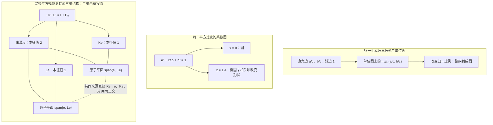
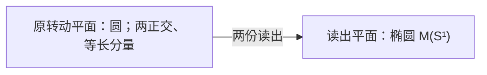

# 两个平方，闭合一个量子基本块

> 来源：用户于 2026-11-05（Asia/Singapore）在本会话提供的 ΩQ-015 LaTeX 研究工作稿；原稿未另署作者或模型。本文为参考输入，Lean 是仓库的数学真源；本次仅转换 Markdown，未作形式化认证。正文中的固定快照、项目核读叙述与理论结论均保留原稿口径；两幅 TikZ 图转换为 Mermaid 示意图，第一幅保留三个面板。

$\Omega Q$-015：共源二次闭合与多边形递归\
从二元混合项、直角归一与原作用，回溯有限量子理论\
2026 年 11 月 5 日（新加坡时间）定义、定理、证明与反模型

**本轮只提出一个新候选。** 在同一完整有限实响应空间中，两个原无穷小变化 $K,L$ 生成全部原变化，并满足

$$
\boxed{-K^2-L^2=I+P_e,\qquad P_ez=B(e,z)e.}
$$

逐向量看，两个变化的平方总量等于原向量的一份平方，加上其来源分量的一份平方。来源系数的一是二元作用能够达到的上界；取等迫出两个正交来源速度，再由完整生成与完整来源轨道排除全部剩余方向。

**主结论：** 在原紧、有限、循环前端中，这个单式选择条件与上一轮两原子圆共径条件等价，准确得到 $\dim W=3$、$\mathfrak g=\mathfrak{so}(3)$。秩二、共同直径、独立性和非交换都由证明恢复。之后原旋转关系给四元数，来源轴给复二维振幅，相位纤维给射线，球面比较给 Born 配对。

本轮新增的直观线索分别落到三个可检验层次：$a^2+xab+b^2$ 是两方向的 Gram 平方型；归一的直角三角形族给一个圆；多边形可以在有足够非零交叉关系时，把闭环相位有限地拆成三角环。素数阶的不可分性属于循环群，不能代替几何三角化或完整原响应的维数条件。

**简化与边界。**

本轮把多项几何约束合并为一个作用于完整空间的二次恒等式，未声称逻辑更弱或证明更短。比较 $B$ 由原轨道内部构造；算子式使用其来源投影。完整性、实际供应、精确与近似的区别继续保留。后半给出完整的有限维条件理论；复合、参考、记录与时钟的接口均明列，没有把数学完成自动当作原装置。

**阅读路径。**

先读二元平方型与主候选，再读“来源极值产生标准三维块”及三维刻画。后面的圆束、点与圆、复振幅、Bargmann 多边形和标准量子接口都从这份原作用继续构造。项目更新单独固定版本；普通证明、既有理论正文和本轮读取的 Lean 源码范围分别说明。

## 1　二元平方关系：圆、椭圆与退化

#### 定义 1.1：二元 Gram 关系

对实数 $x$，置

$$
Q_x(a,b)=a^2+xab+b^2,
\qquad
G_x=\begin{pmatrix}1&x/2\\x/2&1\end{pmatrix}.
$$

若 $u,v$ 是正定空间中的单位向量，令 $x=2B(u,v)$，则

$$
\boxed{Q_x(a,b)=\lVert au+bv\rVert_B^2.}
$$

这里 $x$ 编码两种读出方向的比较，$xab$ 对 $(a,b)$ 是双线性交叉项；固定一个变量后才对另一个变量线性。

#### 命题 1.2：二元平方型的全部分类

令 $c>0$。在固定的欧氏系数坐标 $(a,b)$ 中：

1.  $x=0$ 时，$Q_x=c^2$ 是半径 $c$ 的圆；

2.  $0<|x|<2$ 时是非圆椭圆；

3.  $x=\pm2$ 时为 $(a\pm b)^2=c^2$，即两条平行直线；

4.  $|x|>2$ 时为双曲线。

若 $G_x$ 来自正定比较下的两个单位向量，则必有 $|x|\le2$；取等恰为两个方向平行或反平行。

**证明。**

换坐标 $s=(a+b)/\sqrt2$、$t=(a-b)/\sqrt2$，得

$$
Q_x=(1+x/2)s^2+(1-x/2)t^2.
$$

两个本征值为 $1\pm x/2$，于是得到全部分类。Gram 情形由 Cauchy–Schwarz 不等式及其等号条件得到。 $\square$

因此 $x=2$ 的准确含义是两个读出方向重合，比较秩降为一。对 $|x|<2$，可以用 $G_x^{1/2}/c$ 将 $Q_x=c^2$ 的系数椭圆送到单位圆；这个坐标变换携带了原 Gram 比较，没有删除相关项。若直接把实际向量 $au+bv$ 除以其长度，它当然落在实际二维平面的单位圆上；系数图中的椭圆与实际平面中的圆是同一范数关系的两种坐标表达。$c=0$ 时不能作上述除法，必须保留相应核或零点。

#### 命题 1.3：固定归一下的面积与条件数

当 $|x|<2$ 时，$\operatorname{Tr}G_x=2$ 固定，且

$$
\det G_x=1-x^2/4,\qquad
\operatorname{cond}_2(G_x)=\frac{1+|x|/2}{1-|x|/2}.
$$

系数单位区域 $\{Q_x\le1\}$ 的面积为

$$
\frac{\pi}{\sqrt{1-x^2/4}}\ge\pi,
$$

等号恰在 $x=0$。若 $F(a,b)=au+bv$，则系数单位圆盘在实际平面中的像面积为

$$
\operatorname{Area}(F\{a^2+b^2\le1\})
=\pi\sqrt{1-x^2/4}\le\pi,
$$

同样仅在 $x=0$ 取等。此时条件数为一；$|x|\to2$ 时条件数发散。

**证明。**

本征值公式给出行列式与条件数。系数椭圆的两个半轴为 $(1\pm x/2)^{-1/2}$，故面积是前式。$F^*F=G_x$，其两个奇异值的乘积为 $\sqrt{\det G_x}$，得到像圆盘的面积。 $\square$

这两种面积的极值方向相反，因为一式量的是单位实际范数在系数图中的原像，另一式量的是固定系数圆盘的像。比较极值时必须保留相同的归一预算、坐标与测度。正交平衡使两个奇异值相等；这些代数事实本身还不供应量子概率公理。

#### 命题 1.4：单个直角三角形与三角形族

对 $a,b,c>0$ 且 $a^2+b^2=c^2$，置 $\alpha=a/c$、$\beta=b/c$。单个三角形给第一象限单位圆上的一个点；全部有标号直角三角形按正比例缩放作商，恰好对应开圆弧

$$
\{(\cos\theta,\sin\theta):0<\theta<\pi/2\}.
$$

允许有符号的二元分量及零分量，才得到整个单位圆。

**证明。**

归一后 $\alpha^2+\beta^2=1$，两项严格为正，故唯一对应上述 $\theta$。两份三边比相同恰好相差共同正比例；反过来每个开弧点都给一个非退化直角三角形。零分量是退化边界，有符号分量覆盖其余象限。 $\square$

#### 命题 1.5：固定斜边的面积平衡

在斜边 $c>0$ 固定的直角三角形族中，

$$
\operatorname{Area}=\frac{ab}{2}\le\frac{c^2}{4},
$$

等号当且仅当 $a=b=c/\sqrt2$。

**证明。**

由 $(a-b)^2\ge0$ 与 $a^2+b^2=c^2$，得到 $2ab\le c^2$；等号恰为 $a=b$。 $\square$

“方向正交”是 Gram 交叉项为零；“两读出等幅”是同一正交坐标下 $a=b$。一般直角三角形只满足前者，等腰直角三角形同时满足后者。上述最优性明确限定在固定斜边的直角三角形族中：若只要求最长边长度为 $c$，边长全为 $c$ 的等边三角形面积为 $\sqrt3c^2/4>c^2/4$，已足以排除直角等腰三角形在这个更大类别中的全局最优性。

**图 1：** 左：一个归一三角形只给圆上一点。中：相关项改变系数图的形状。右：本轮完整平方式最终强制两张共源原子平面；数字是平方总量在三个正交方向上的本征值。右图为三维关系的二维示意投影。

## 2　同一完整原响应与来源比较

#### 定义 2.1：原概率行与完整有限前端

在同一原签名 $\Omega$ 内固定一个真实归一来源。对原可逆控制历史 $a$、合法未来请求 $f$ 和原结果标签 $w$，记完整响应行

$$
x_a(f,w)=p(a;f,w),\qquad p\ge0,\quad \sum_w p(a;f,w)=1.
$$

共同未来保留全部合法终端请求、原结果、失败、实际可读旧记录及后续合法性区别；原身份、端口、设备和历史索引继续保留。没有原定义的请求不人为补概率。总可逆连接含空历史、对复合封闭、在同一菜单内有准确统计逆，并在全未来线性关系上良定。

取同一来源的完整原可逆轨道，置

$$
V=\operatorname{span}_{\mathbb R}\{x_a\},\qquad u(x_a)=1,\qquad
W=\ker u=\operatorname{span}\{x_a-x_b\}.
$$

本轮明确要求 $0<\dim W<\infty$。原身份相同与响应相同是不同关系；构造线性表示不删除原索引。若已有可读历史使张成空间更大，使用更大的完整空间。

#### 引理 2.2：紧作用、固定中心与完整循环性

原可逆作用在 $V$ 上的矩阵闭包 $H$ 是紧群。定义

$$
c=\int_Hhx_\epsilon\,dh,\qquad e=x_\epsilon-c,
\qquad G=H|_W,\qquad \mathfrak g=\operatorname{Lie}(G).
$$

则 $G$ 紧、作用有效，$e\ne0$，并且

$$
W=\operatorname{span}(Ge).
$$

**证明。**

有限维中可选有限个实际评价坐标分离 $V$，并从原响应行中选一组基。任一原控制将这些基行送到其他响应行；所选概率坐标有界，故其矩阵一致有界。准确逆也在原集合内，故逆矩阵一致有界；闭包紧且不含奇异矩阵，是群。 Haar 平均固定 $c$，且 $u(c)=1$，故 $V=\mathbb Rc\oplus W$。在 $W$ 上平凡的原矩阵也固定 $c$，因而在 $V$ 上平凡。所有轨道行减去 $c$ 正好张成 $W$；若 $e=0$，轨道只有一点，违背 $W\ne0$。 $\square$

闭包中的极限矩阵与连续生成元首先是原响应的数学表示，不自动成为准确可调用的原装置。Haar 平均也不供应实际随机准备。

#### 定义 2.3：由轨道内生的比较

记 $n=\dim W$。对 $\alpha\in W^*$ 定义

$$
\mathsf C\alpha=\int_G\alpha(ge)\,ge\,dg,
\qquad B(v,w)=\frac1n(\mathsf C^{-1}v)(w).
$$

#### 引理 2.4：规范比较及完整轨道恒等式

$\mathsf C$ 可逆，$B$ 正定且 $G$ 不变，并有

$$
B(e,e)=1,\qquad
\int_Gge\otimes(ge)^{\flat_B}\,dg=\frac1nI_W.
$$

**证明。**

完整循环性给 $\alpha(\mathsf C\alpha)=\int\alpha(ge)^2dg>0$ 对全部 $\alpha\ne0$ 成立。Haar 不变性给 $B$ 不变。取迹有 $\int B(ge,ge)dg=\operatorname{Tr}(B\mathsf C)=1$，而轨道上长度相同，故 $B(e,e)=1$。对任意 $w$，积分算子作用于 $w$ 等于 $\mathsf C(w^{\flat_B})=w/n$。 $\square$

若 $T:W\to W'$ 保来源并共轭全部原作用，则 $\mathsf C'=T\mathsf C T^*$，从而 $B'(Tv,Tw)=B(v,w)$。换源到同一轨道点也只共轭后续关系。删去可读坐标的非单射投影不属于这种同构。

后文的度量表达对*任意*不变正定比较、任意单位循环来源成立。上述规范构造只使比较本身完全由原来源确定。本轮使用同一内生比较定义来源投影与二次算子恒等式；没有另加一份独立度量。

## 3　本轮唯一候选：两个平方合成单位与来源

保留同一完整有限前端：$W$ 是非零有限实响应空间，$B$ 是原来源轨道内生的正定比较，$G\subseteq O(W,B)$ 是完整原可逆矩阵闭包，且

$$
\mathfrak g=\operatorname{Lie}(G),\qquad B(e,e)=1,\qquad W=\operatorname{span}(Ge).
$$

原 $\mathfrak g$ 在选生成元之前已经确定。所有原结果、失败、实际可读历史与合法接续仍留在这个完整空间中。本节中的 $K^2,KL$ 一律指 $W$ 上的原算子复合，不是后面构造的四元数乘法。

#### 定义 3.1：来源投影与二元平方总量

令 $e^{\flat_B}(z)=B(e,z)$，定义

$$
P_e=e\otimes e^{\flat_B},\qquad
M(K,L)=-K^2-L^2\quad(K,L\in\mathfrak g).
$$

$P_e$ 是同一个来源直径的正交投影。$M(K,L)$ 是自伴正半定算子，且

$$
B(z,M(K,L)z)=\lVert Kz\rVert_B^2+\lVert Lz\rVert_B^2.
$$

**本轮唯一候选 $\Omega Q$-015：完整二元作用满足一个平方恒等式。**

$$
\boxed{\exists K,L\in\mathfrak g:\quad
\operatorname{Lie}\langle K,L\rangle=\mathfrak g,\qquad
-K^2-L^2=I_W+P_e.}
\tag{Q15}
$$

不另假定 $K,L$ 独立、秩为二、来源在各自像中、非交换或 $\dim W=3$。这些都将成为结论。

等价的逐向量表述为

$$
\boxed{\lVert Kz\rVert_B^2+\lVert Lz\rVert_B^2
=\lVert z\rVert_B^2+B(e,z)^2\quad\text{对全部 }z\in W.}
\tag{3.1}
$$

**白话：** 两种变化能够生成全部原无穷小变化；它们作用后的平方总量，恰好等于原向量的一份平方，再加上它沿来源方向的一份平方。

式 (3.1) 与算子式由实极化等价：自伴算子的全部二次读数确定其全部双线性配对。这里量化同一完整线性表示中的向量，不把每个形式线性组合都宣称为实际可制备态。原菜单和实际装置仍由其原定义决定。

## 4　为何来源恰好多出一份平方

#### 命题 4.1：二元平方总量的内生上界

设 $K,L$ 为任意实反对称算子，且对某个实数 $\beta$ 有

$$
-K^2-L^2=I_W+\beta P_e.
$$

则

$$
\boxed{-1\le\beta\le1.}
$$

上界不要求完整生成，也不预设维数。Q15 恰好取到来源系数的上界。

**证明。**

令 $E=e^\perp$、$v_1=Ke,v_2=Le$，并记横向反对称块为 $D_1=P_EK|_E,D_2=P_EL|_E$。在分解 $W=\mathbb Re\oplus E$ 下，

$$
K=\begin{pmatrix}0&-v_1^\flat\\v_1&D_1\end{pmatrix},
\qquad
L=\begin{pmatrix}0&-v_2^\flat\\v_2&D_2\end{pmatrix}.
$$

来源分量给

$$
\lVert v_1\rVert_B^2+\lVert v_2\rVert_B^2=1+\beta\ge0,
$$

故 $\beta\ge-1$。压缩到 $E$ 得到

$$
Q-D_1^2-D_2^2=I_E,
\qquad
Q=v_1\otimes v_1^\flat+v_2\otimes v_2^\flat.
$$

因 $-D_1^2-D_2^2\succeq0$，有 $0\preceq Q\preceq I_E$。$Q$ 的秩至多二，故其非零本征值至多两个且均不超过一。因此

$$
1+\beta=\operatorname{Tr}Q\le2,
$$

得到 $\beta\le1$。 $\square$

该命题只给可行系数的必要范围，不宣称区间内每个数都能在指定完整原模型上实现。若先写成 $-K^2-L^2=\alpha I+\gamma P_e$ 且 $\alpha>0$，则共同缩放数学见证后得到 $-1\le\gamma/\alpha\le1$。这种 Lie 向量空间内的参数归一不改写原仪器的时间、能量或原双导子标尺。

#### 引理 4.2：两个反对称平方的奇维障碍

若有限实正定空间 $F$ 上的反对称算子 $A,B$ 满足

$$
-A^2-B^2=I_F,
$$

则 $\dim F$ 为偶数，允许 $F=0$。

**证明。**

由 $A^2=-I-B^2$，有 $[B,A^2]=0$。反对称性给 $\ker A^2=\ker A$，因此 $B$ 保持 $\ker A$，且在此核上满足 $B^2=-I$。实空间若有一个平方为负单位的算子，其维数为偶数：取行列式，奇维会使 $\det(B)^2=\det(-I)<0$。故 $\dim\ker A$ 为偶数。

另一方面，实反对称算子的秩为偶数。事实上，在 $\operatorname{im}A=(\ker A)^\perp$ 上它是非退化反对称矩阵；若该空间为奇维，转置与取负的行列式关系会迫使其行列式为零。由秩–零度公式，$\dim F=\operatorname{rank}A+\dim\ker A$ 为偶数。 $\square$

## 5　从一个平方等式推出完整三维结构

#### 引理 5.1：来源极值产生标准三维块

仅假定 $-K^2-L^2=I+P_e$，尚不假定完整生成与来源循环性。则 $v_1=Ke,v_2=Le$ 正交归一，并且

$$
U=\operatorname{span}\{e,v_1,v_2\}
$$

是一个三维共同不变子空间。在 $U$ 上，

$$
Ke=v_1,\quad Kv_1=-e,\quad Kv_2=0,
\qquad
Le=v_2,\quad Lv_2=-e,\quad Lv_1=0.
$$

在 $F=U^\perp$ 上，两个限制仍反对称，且

$$
-(K|_F)^2-(L|_F)^2=I_F.
$$

因此 $\dim F$ 为偶数。反过来，任何上述标准三维块与这种余项的正交直和，都满足同一个平方等式。

**证明。**

使用命题 4.1 的分块。$\beta=1$ 给 $\operatorname{Tr}Q=2$，而 $Q\preceq I$、$\operatorname{rank}Q\le2$。因此 $Q$ 恰为其二维像 $T$ 的正交投影。

令 $V:\mathbb R^2\to E$ 的两列为 $v_1,v_2$，则 $Q=VV^*$。$Q$ 的秩为二，所以 $V$ 单射；由 $QV=V$ 得 $V(V^*V-I_2)=0$，于是 $V^*V=I_2$。这就证明 $v_1,v_2$ 正交归一。

对于 $z\in T$，横向恒等式给

$$
\lVert D_1z\rVert_B^2+\lVert D_2z\rVert_B^2
=B(z,(I_E-Q)z)=0.
$$

故两个横向算子都消灭 $T$。代入原分块即得 $K,L$ 在 $e,v_1,v_2$ 上的全部作用。$U$ 共同不变，反对称性又使 $U^\perp$ 共同不变；限制平方等式便得到余项关系。偶维性由引理 4.2 得到。反向逐块相加即可。 $\square$

#### 定理 5.2：Q15 的完整三维刻画

在本轮保留的完整有限前端中，下列两项等价：

1.  存在满足 Q15 的 $K,L$；

2.  $\dim W=3$，且 $\mathfrak g=\mathfrak{so}(W,B)$。

此时 $G^\circ=SO(W,B)$，完整群为 $SO(W,B)$ 或 $O(W,B)$。

**证明。**

设 Q15 成立，取引理 5.1 给出的标准三维块 $U$。由于 $K,L$ 完整生成原 $\mathfrak g$，$U$ 被整个 $\mathfrak g$ 保持。

必须处理完整群的不连通分支。任取 $h\in G$，令 $U'=hU$。因为 $h^{-1}\mathfrak gh=\mathfrak g$，$U'$ 也被 $\mathfrak g$ 保持，且维数为三。于是 $K,L$、它们的平方总量，以及

$$
P_e=-K^2-L^2-I
$$

都保持 $U'$。一个被秩一投影 $P_e$ 保持的子空间，或者包含 $e$，或者全部垂直于 $e$：只要其中某个向量与 $e$ 配对非零，投影就把 $e$ 送进该子空间。

若 $e\in U'$，共同不变性给 $Ke,Le\in U'$，故 $U\subseteq U'$，由维数相同得 $U=U'$。若 $U'\subseteq e^\perp$，平方等式在 $U'$ 上变成

$$
-(K|_{U'})^2-(L|_{U'})^2=I_{U'},
$$

与三维的奇数性及引理 4.2 矛盾。因此每个 $h\in G$ 都保持 $U$。由来源循环性，

$$
W=\operatorname{span}(Ge)\subseteq U,
$$

故 $W=U$ 为三维。

在正交基 $e,v_1,v_2$ 下，$K,L$ 是两个不同坐标平面的单位转动。其交换子 $A=[K,L]$ 满足

$$
Ae=0,\qquad Av_1=v_2,\qquad Av_2=-v_1,
$$

三者独立，张成全部 $\mathfrak{so}(W,B)$。因此原 $\mathfrak g$ 正是完整三维旋转代数。

反过来，设第二项成立。取 $e^\perp$ 的正交单位基 $v_1,v_2$，令

$$
K=X_{v_1},\quad L=X_{v_2},\qquad
X_v(te+z)=tv-B(v,z)e\quad(z\perp e).
$$

则 $-K^2=P_e+P_{v_1}$、$-L^2=P_e+P_{v_2}$，故其和为 $I+P_e$。两者及交换子生成全部三维旋转，得到 Q15。完整群的两个可能值由 $SO(3)\subseteq G\subseteq O(3)$ 得到。 $\square$

#### 推论 5.3：与上一轮共径条件的精确等价

在同一完整前端中，Q15 等价于存在一对原变化满足

$$
\operatorname{Lie}\langle K_0,L_0\rangle=\mathfrak g,\qquad
\operatorname{rank}K_0=\operatorname{rank}L_0=2,\qquad
\operatorname{im}K_0\cap\operatorname{im}L_0=\mathbb Re.
$$

因此 Q15 与 Q14 选择相同的准确模型类。Q15 的一组见证本身已经是正交归一的共径对。

**证明。**

Q15 给出三维标准块就是整个 $W$，所以其见证直接满足所列条件。反向令 $U=\operatorname{im}K_0+\operatorname{im}L_0$，有 $\dim U=2+2-1=3$。全部 Lie 字的像都在 $U$，原完整代数的活动支撑恰为 $U$；它被整个 $G$ 保持。来源在其中，循环性给 $W=U$。两个独立三维反对称算子生成全部 $\mathfrak{so}(3)$，故可取主定理反向证明中的归一见证。 $\square$

## 6　源轴、圆束与二元混合项都由同一平方式恢复

#### 命题 6.1：来源直径与最短非交换闭包

Q15 成立后，令 $A=[K,L]$，则

$$
\boxed{\operatorname{im}(M(K,L)-I)=\ker A=\mathbb Re.}
$$

$M(K,L)$ 的本征值为 $2,1,1$，其中唯一的二倍平方方向是原来源直径。并且

$$
[A,K]=L,\qquad [L,A]=K.
$$

**证明。**

第一份像由 $M-I=P_e$ 得到；主定理中 $A$ 在 $e^\perp$ 上为可逆单位转动、固定 $e$，给出其核。其余式子在 $e,v_1,v_2$ 上逐项计算即可。 $\square$

平方式恢复的是无向直径 $\mathbb Re$，原来源仍是指定的 $e$。它没有把 $e$ 与 $-e$ 的概率内容或历史身份合并。

#### 命题 6.2：完整二元圆束的平方公式

令 $v=Ke,w=Le$。对任意实数 $a,b$，置 $T_{a,b}=aK+bL$、$t_{a,b}=av+bw$。则

$$
\begin{aligned}
T_{a,b}e&=t_{a,b},
\end{aligned}
\tag{6.1}
$$

$$
\begin{aligned}
\kappa(T_{a,b},T_{a,b})
&=\lVert t_{a,b}\rVert_B^2=a^2+b^2,
\qquad \kappa(X,Y)=-\tfrac12\operatorname{Tr}_W(XY),
\end{aligned}
\tag{6.2}
$$

$$
\begin{aligned}
-T_{a,b}^2
&=(a^2+b^2)P_e+t_{a,b}\otimes t_{a,b}^{\flat_B}.
\end{aligned}
\tag{6.3}
$$

对于 $(a,b)\ne(0,0)$，$T_{a,b}$ 是准确秩二转动，其像为 $\operatorname{span}\{e,t_{a,b}\}$。对于 $a^2+b^2=1$，其负平方就是该活动平面的正交投影。

**证明。**

主定理给 $K=X_v,L=X_w$，其中 $v,w$ 正交归一。因此 $T_{a,b}=X_{t_{a,b}}$。从定义直接计算 $-X_t^2=\lVert t\rVert^2P_e+t\otimes t^\flat$，取迹后除以二得到式 (6.2)，并得到秩与像。 $\square$

两种算子乘积的对称部分与反对称部分分别为

$$
-(KL+LK)=v\otimes w^\flat+w\otimes v^\flat,
\qquad
[K,L]=w\otimes v^\flat-v\otimes w^\flat.
$$

因此二元平方的混合项与两种先后次序的差，出自同一对原作用。若在这个圆束中改用来源速度为单位向量 $p,q$ 的任意两元 $X_p,X_q$，则

$$
\lVert(aX_p+bX_q)e\rVert_B^2
=a^2+xab+b^2,
\qquad x=2B(p,q)\in[-2,2].
$$

归一见证的 $p\perp q$ 给 $x=0$。$x=2$ 时两速度相同、式子退为 $(a+b)^2$；$x=-2$ 时相反、退为 $(a-b)^2$。两个端点的生成对退化，不能再作为完整二元见证。

#### 命题 6.3：唯一圆束与归一坐标的自由

Q15 的所有见证对都张成同一个内生平面

$$
\mathfrak p_e
=\{X_v:v\in e^\perp\}
=\{0\}\cup\{T\in\mathfrak g:\operatorname{rank}T=2,\ e\in\operatorname{im}T\}.
$$

它们恰是该平面的 $\kappa$-正交单位基。对一组 Q15 见证作实可逆换基，换后的有序对仍满足 Q15，当且仅当换基矩阵属于 $O(2)$。

**证明。**

每个见证的来源速度都为 $e^\perp$ 的正交单位基；$v\mapsto X_v$ 是到 $\mathfrak p_e$ 的线性等距同构，所以全部见证恰是上述正交标架。对于矩阵 $C\in GL_2(\mathbb R)$ 的换基，来源速度的 Gram 矩阵变成 $CC^{\mathsf T}$，故仍为单位矩阵当且仅当 $C\in O(2)$。反向也可直接展开两个新平方，其交叉项因列正交而相消。 $\square$

完整线性表示同构若同时运输 $B,e,G$，就运输 $P_e$、两个原平方及完整生成关系，因此候选保持。同一轨道内换源是其中的特例。$O(2)$ 仍包含反向标架，平方式并未选择绝对手性。

## 7　逆向检查：不能只保留平方的形状

#### 反例 7.1：没有来源增量的平方归一允许四维

取 $W=\mathbb H\cong\mathbb R^4$，单位四元数群左乘，$e=1$，并令

$$
Kq=\frac{\mathbf i q}{\sqrt2},\qquad
Lq=\frac{\mathbf j q}{\sqrt2}.
$$

两个原算子反对称，且 $K^2=L^2=-I_4/2$，故 $-K^2-L^2=I_4$，即 $\beta=0$。它们及其交换子完整生成左乘 $\mathfrak{sp}(1)$，来源轨道是整个 $S^3$，协方差为 $I_4/4$，所以完整循环性与规范比较都成立。这个完整模型维数为四；归一平方相加本身不强迫 Q15 的来源极值。

#### 反例 7.2：平方式准确成立仍需完整生成

在标准 $W=\mathbb R^5$、$G=SO(5)$、$e=e_1$ 上取

$$
K=J_{12}+J_{45},\qquad L=J_{13}.
$$

这里 $J_{ij}e_i=e_j$、$J_{ij}e_j=-e_i$，其余坐标为零。直接相加得

$$
-K^2-L^2=I_5+P_{e_1}.
$$

但生成代数保持前三维与后两维分块，仅为 $\mathfrak{so}(3)\oplus\mathfrak{so}(2)$，没有生成原 $\mathfrak{so}(5)$。若反过来把原群改成该直积，则生成关系准确，但来源轨道不再张成五维。这分别显示完整生成与完整来源循环性的作用。

#### 反例 7.3：完整来源的圆形二次读数仍不够

在标准 $W=\mathbb R^4$、$G=SO(4)$、$e=e_1$ 上，取 $0<|\varepsilon|<1$，令

$$
K=J_{12}+\varepsilon J_{34},\qquad
L=J_{13}+\varepsilon J_{24}.
$$

它们满足

$$
Ke=e_2,\quad Le=e_3,\qquad
\lVert(aK+bL)e\rVert^2=a^2+b^2\quad(a,b\in\mathbb R),
$$

甚至 $K^2e=L^2e=-e$，每条单独来源轨迹都是准确单位大圆。但是

$$
M(K,L)=\operatorname{diag}(2,1+\varepsilon^2,1+\varepsilon^2,2\varepsilon^2)
\ne I_4+P_e.
$$

该对仍完整生成 $\mathfrak{so}(4)$：由

$$
[K,L]=(1-\varepsilon^2)J_{23},\qquad
[J_{23},K]=J_{13}-\varepsilon J_{24}
$$

恢复 $J_{13},J_{24}$，再由 $[J_{13},J_{23}]=J_{12}$、$K-J_{12}=\varepsilon J_{34}$ 及 $[J_{13},J_{34}]=-J_{14}$ 得全部六个方向。

混合历史直接显露第四个方向：

$$
e^{sK}e^{tL}e
=\cos t(\cos s\,e_1+\sin s\,e_2)
 +\sin t(\cos(\varepsilon s)e_3+\sin(\varepsilon s)e_4).
$$

所以只检查来源上的全部二次组合，甚至再检查两个准确圆轨迹与来源向量等式，仍不能替代式 (3.1) 对完整 $W$ 的量化。

这些标准紧作用都可接上合法二结果概率

$$
p_\pm(g;h)=\frac12\bigl(1\pm B(ge,he)\bigr).
$$

单位轨道与 Cauchy–Schwarz 保证非负归一；完整轨道张成保证未来读数分离响应。反模型没有依靠负概率或删除原可读历史。

## 8　准确闭合与近似闭合的区别

#### 定理 8.1：任意高奇维的完整近取等族

对任意 $m\ge1$，令 $n=3+2m$，取标准 $W=\mathbb R^n$、$G=SO(n)$、$e=e_1$。令

$$
r_j=2j+2,\quad s_j=2j+3\quad(1\le j\le m),
$$

并选互不相同的 $b_j\in(0,1)$，置 $c_j=\sqrt{1-b_j^2}$。定义

$$
\begin{aligned}
K_0&=J_{12}+\sum_{j=1}^m b_jJ_{r_j,s_j},\\
L_0&=J_{13}+\sum_{j=1}^m c_jJ_{r_j,s_j},\qquad
Z=\sum_{j=1}^m J_{3,r_j},\qquad
L_\varepsilon=L_0+\varepsilon Z.
\end{aligned}
$$

对每个 $\varepsilon\ne0$，有

$$
\operatorname{Lie}\langle K_0,L_\varepsilon\rangle=\mathfrak{so}(n),
$$

并且完整算子范数满足

$$
\boxed{\lVert-K_0^2-L_\varepsilon^2-(I+P_e)\rVert_{\rm op}
\le2|\varepsilon|\sqrt m+\varepsilon^2m\longrightarrow0.}
\tag{8.1}
$$

因此，仅要求完整平方式误差任意小，不能给完整维数统一上界。

**证明。**

来源前三维给标准平方式；每个剩余二维块满足 $b_j^2+c_j^2=1$。由于这些块相互正交，

$$
-K_0^2-L_0^2=I+P_e.
$$

原 $SO(n)$ 来源轨道的协方差是 $I_n/n$，所以标准比较恰为规范比较。

证明非零扰动后的完整生成。令 $T=\operatorname{ad}_{K_0}^2$，它由对已生成算子反复取交换子实现。$L_\varepsilon$ 的三类分量分别满足

$$
T(J_{13})=-J_{13},\quad
T(J_{3,r_j})=-b_j^2J_{3,r_j},\quad
T\!\left(\sum_jc_jJ_{r_j,s_j}\right)=0.
$$

这些本征值 $-1,-b_1^2,\ldots,-b_m^2,0$ 互不相同。有限 Lagrange 插值多项式因而可从 $L_\varepsilon$ 中分别抽出 $J_{13}$、各个 $\varepsilon J_{3,r_j}$ 及交换余项。多项式在 $T$ 上的作用只是有限线性组合与反复原交换子；常数项作用于已在代数中的 $L_\varepsilon$。由于 $\varepsilon\ne0$，全部 $J_{3,r_j}$ 都在生成代数中。

再用

$$
[K_0,J_{13}]=J_{23},\qquad
[K_0,J_{3,r_j}]=b_jJ_{3,s_j},
$$

得到以第三坐标为共同端点的全部旋转。它们两两取交换子，给出其余所有坐标平面旋转，所以生成整个 $\mathfrak{so}(n)$。

最后，$\lVert L_0\rVert_{\rm op}=1$。$Z$ 只在 $e_3$ 与 $\sum_je_{r_j}$ 张成的平面上旋转，故 $\lVert Z\rVert_{\rm op}=\sqrt m$。展开平方差：

$$
-K_0^2-L_\varepsilon^2-(I+P_e)
=-\varepsilon(L_0Z+ZL_0)-\varepsilon^2Z^2.
$$

取算子范数即得式 (8.1)。 $\square$

在 $\varepsilon=0$ 时，准确平方式成立，但生成元保持前三维与其余偶维的分块，失去对原 $\mathfrak{so}(n)$ 的完整生成。任意小的非零耦合恢复全代数。该族表明：一个准确结构定理与一个有限精度认证定理仍需分别建立。这里既没有声称所有偶数维都有同样的近取等族，也没有把生成多项式的系数增长当成已证明的物理时间或能量下界。

## 9　本轮简化的准确尺度

上一轮用两项秩二与一项来源交线关系描述完整共径对；本轮将原子性、共源性和一组归一标架合并为一个二次算子恒等式。独立性、非交换性、秩二与三维都在证明中恢复。这个意义下，选择式中的关系种类减少，且直接接上 $a^2+xab+b^2$ 的二元平方结构。

代价也要保留：本轮重新使用已经内生构造的 $B$ 与来源投影，归一见证只在 $O(2)$ 下保持该等式，而上一轮的共径见证允许全部 $GL_2(\mathbb R)$ 换基；本轮主证明还增加了正半定压缩与奇维障碍。因而它是*选择式的合并与缩短*，不声称证明长度更短、逻辑条件更弱或已经达到绝对最简。准确模型类仍与 Q14 相同，完整生成和近似稳定性没有被藏进“一个等式”之中。

## 10　把零、无穷远与圆写成同一二元关系

### 10.1　正交读零，平行读无穷远的准确坐标

#### 定义 10.1：同一平面上的两种比较

令 $E$ 是带正定比较 $B$ 的实二维平面，暂选一个取向。令 $J$ 为该取向的正四分之一转动，即 $J^2=-I$、$B(Ju,Jv)=B(u,v)$。置

$$
\omega(u,v)=B(Ju,v),\qquad
a=B(u,v),\quad b=\omega(u,v).
$$

对非零 $u,v$，$(a,b)\ne(0,0)$。其射影比较为

$$
\mathfrak r(u,v)=[a:b]\in\mathbb R\mathbb P^1,
\qquad r(u,v)=\frac{a}{b}\quad(b\ne0),
$$

而 $[1:0]$ 记为 $\infty$。

#### 命题 10.2：二元归一关系

上述两读出满足

$$
\boxed{B(u,v)^2+\omega(u,v)^2=B(u,u)B(v,v).}
$$

因此 $r=\cot\theta$，其中 $\theta$ 是所选取向下从 $u$ 到 $v$ 的角。特别地

$$
u\perp v\iff r=0,
\qquad u\parallel v\iff r=\infty.
$$

把第二个元作四分之一转动，给

$$
(a,b)\longmapsto(-b,a),\qquad
r(u,Jv)=-\frac1{r(u,v)},
$$

其中 $0$ 与 $\infty$ 互换。

**证明。**

在正交单位坐标中，取 $u=(u_1,u_2)$、$v=(v_1,v_2)$，有 $a=u_1v_1+u_2v_2$、$b=u_1v_2-u_2v_1$。展开平方即得恒等式。$b=0$ 恰为线性相关，$a=0$ 恰为正交；非零向量排除二者同时为零。最后 $B(u,Jv)=-B(Ju,v)=-b$、$\omega(u,Jv)=B(Ju,Jv)=a$。 $\square$

上述射影紧化与极性使用标准几何定义，参见 [\[13\]](#ref-projective), [\[14\]](#ref-polarity)；这里的等式均已直接证明。这准确保留了“正交对应零、平行对应无穷远”的图像。这里的零是*同一比较坐标的值*。若把它解释成两条直线的交点位置，便会丢掉角度：任意两条不同的过原点直线都交于原点，它们可以有任意夹角。

仿射平行线 $y=mx+b_1$、$y=mx+b_2$ 在射影平面中确实交于 $[1:m:0]$。但交会关系本身不能恢复正交：剪切 $(x,y)\mapsto(x+y,y)$ 保持直线、平行和交点，却把互相正交的两个坐标轴送到方向 $(1,0)$、$(1,1)$。本轮的正交来自原紧作用所允许的正定比较，而平行来自线性相关。

### 10.2　两端接成圆，不会自动选出手性

#### 定理 10.3：实射影直线的圆表示

映射

$$
\chi:\mathbb R\mathbb P^1\longrightarrow S^1\subset\mathbb C,
\qquad
\chi([a:b])=\frac{(a+ib)^2}{a^2+b^2}
$$

是同胚。它在 $r=a/b$ 坐标中成为

$$
\boxed{\chi(r)=\frac{r+i}{r-i}\quad(r\in\mathbb R),
\qquad\chi(\infty)=1.}
$$

因此 $r=0$ 对应 $-1$，$+\infty$ 与 $-\infty$ 都趋向同一个圆点 $1$。正交补变换 $r\mapsto-1/r$ 对应圆上的对径变换 $\chi\mapsto-\chi$。

**证明。**

共同乘非零实数不改变右侧，所以映射良定，且其模为一。把 $(a,b)$ 归一为 $(\cos\theta,\sin\theta)$，像为 $e^{2i\theta}$。两个单位向量有相同像，当且仅当相差符号，恰为同一个实射影点。映射也满射，故为从紧空间到 Hausdorff 空间的连续双射，因而是同胚。坐标表达由 $(r+i)/(r-i)=(r+i)^2/(r^2+1)$ 得到。四分之一转动使 $a+ib$ 乘 $i$，平方后的像乘 $-1$。 $\square$

上式中的复数只是表示一个实平面及其转动的记号。完全可以把 $\chi$ 写成两项实坐标

$$
\chi([a:b])=
\left(\frac{a^2-b^2}{a^2+b^2},
      \frac{2ab}{a^2+b^2}\right).
$$

此处尚未引入量子复振幅。

#### 命题 10.4：无穷远、方向与手性的区别

以下三个操作不同：

1.  保留两个不同端点的有序扩充 $\mathbb R\cup\{-\infty,+\infty\}$ 是闭区间；

2.  把两端识别为同一点，得到 $\mathbb R\mathbb P^1\cong S^1$；

3.  给这个圆选一个运行方向，是另外的取向数据。

平行、正交与上述端点识别不能单独选出第三项。

**证明。**

第一项由 $r\mapsto (2/\pi)\arctan r$ 延拓为 $[-1,1]$ 可见；识别两个端点给圆。对第三项，$r\mapsto-r$ 保持 $0$、$\infty$ 及正交补关系，却给 $\chi(-r)=\overline{\chi(r)}$，反转圆的取向。因此前两项对两种取向完全对称。 $\square$

有向单位向量 $(\cos\theta,\sin\theta)$ 还形成 $\mathbb R\mathbb P^1$ 的二重覆盖：忘掉箭头时 $v$ 与 $-v$ 被识别。对于单位向量 $(r,1)/\sqrt{r^2+1}$，两个无穷端点趋向相反的有向向量，而在射影商中成为同一点。这种识别正好忘掉一次箭头区别，不能同时作为新增物理手性的证明。

忘掉圆的取向，底层空间仍是圆。把圆按反射作商会得到区间；把整个圆按转动轨道作商才得到一点。因此“一个点上方有一个相位圆”适合解释为纤维关系，不能解释为点与圆本身同胚。

## 11　两张最小作用平面与一个射影线束

本节接续本轮候选已经给出的关系：$K,L$ 是秩二原生成元，

$$
\operatorname{im}K\cap\operatorname{im}L=\mathbb Re,
\qquad \operatorname{Lie}\langle K,L\rangle=\mathfrak g,
$$

其中来源已归一为 $B(e,e)=1$。由紧作用的斜对称性，有

$$
K=X_v,\quad L=X_w,\qquad v=Ke, w=Le,
\qquad X_zx=B(e,x)z-B(z,x)e.
$$

$v,w$ 独立，且 $U=\operatorname{span}\{e,v,w\}$ 为三维。

### 11.1　源圆的交点，与生成平面的参数圆

#### 命题 11.1：同一来源的圆束

令 $S(U)=\{x\in U:B(x,x)=1\}$。两个一参数来源轨道

$$
C_K=\{\exp(tK)e:t\in\mathbb R\},\qquad
C_L=\{\exp(tL)e:t\in\mathbb R\}
$$

分别是 $S(U)$ 上的两个大圆，并且

$$
\boxed{C_K\cap C_L=\{e,-e\}.}
$$

令 $P=\operatorname{span}\{K,L\}$。每个非零 $A=\lambda K+\mu L$ 仍有秩二，且

$$
\operatorname{im}A
=\operatorname{span}\{e,\lambda v+\mu w\}.
$$

所有这类作用平面由 $\mathbb P(P)\cong\mathbb R\mathbb P^1$ 参数化，并都含有来源直线 $\mathbb Re$。

**证明。**

$X_v$ 在 $\operatorname{span}\{e,v\}$ 上是非零旋转生成元，在其正交补上为零，因此 $\exp(tK)e$ 遍历对应单位大圆。两作用平面的交为 $\mathbb Re$，与单位球相交给 $\{e,-e\}$。线性性给 $\lambda K+\mu L=X_{\lambda v+\mu w}$；独立性保证后者在 $(\lambda,\mu)\ne(0,0)$ 时非零且有秩二。乘非零实数不改变作用平面，反过来作用平面相同也只允许该切向量相差非零倍数，所以参数正好是 $\mathbb P(P)$。 $\square$

这里有两个不同的“圆”。$C_K$ 是来源在一个固定生成元下的轨道；$\mathbb P(P)$ 则描述该来源可以选哪些最小作用平面。前者由时间参数遍历，后者是生成元平面的射影化。在参数图 $[\lambda:\mu]$ 中，$0$ 与 $\infty$ 可以分别标记两种生成方向；它们并未成为来源球面上的同一点。

在实射影空间 $\mathbb P(U)$ 中，两条射影作用直线 $\mathbb P(\operatorname{im}K)$、$\mathbb P(\operatorname{im}L)$ 交于一点 $[e]$。回到保留来源符号的单位球，它们相交于 $e$ 和 $-e$ 两点。这个区别需要保持，不能在原状态层上把正反来源识别。

### 11.2　它在更大 Grassmann 几何中的位置

对 $a,b\in W$，定义从二向量到斜对称作用的线性对应

$$
\iota(a\wedge b)x=B(a,x)b-B(b,x)a.
$$

它给出 $\Lambda^2W\cong\mathfrak{so}(W,B)$。非零可分解二向量 $a\wedge b$ 对应秩二作用，其像为 $\operatorname{span}\{a,b\}$。

#### 定理 11.2：Grassmann 图中的射影直线

设 $\beta_1,\beta_2$ 是独立的非零二向量。它们张成的射影直线全部由可分解二向量组成，当且仅当存在一个一维空间 $\ell$ 和一个三维空间 $U$，使该直线恰好参数化全部中间平面

$$
\boxed{\ell\subset M\subset U,\qquad\dim M=2.}
$$

因此每条这样的 Grassmann 射影直线由一个 $(1,3)$ 旗标 $\ell\subset U$ 确定。

**证明。**

正向先写 $\beta_1=a\wedge b$、$\beta_2=c\wedge d$。由于 $\beta_1+\beta_2$ 也可分解，

$$
0=(\beta_1+\beta_2)\wedge(\beta_1+\beta_2)
=2\beta_1\wedge\beta_2.
$$

所以 $a,b,c,d$ 线性相关。两个二维支撑不能相同，否则其二次外幂均为同一条直线，违反 $\beta_1,\beta_2$ 独立。故其交恰为一维 $\ell$，和恰为三维 $U$。取非零 $e\in\ell$，可写 $\beta_1=e\wedge v$、$\beta_2=e\wedge w$，且 $e,v,w$ 独立。任意组合即为 $e\wedge(\lambda v+\mu w)$，覆盖全部中间二维平面。

反向对任意旗标选这样的 $e,v,w$。上述组合显然全部可分解，且每个中间平面正好对应一个 $[\lambda:\mu]$。 $\square$

因此，本轮的简洁几何可以写成

$$
\boxed{\text{一条来源线}\ \ell\quad\subset\quad
\text{两种最小作用生成的三维空间}\ U.}
$$

原候选的“完整生成”和完整来源循环性，继续把这个局部旗标的活动支撑认定为整个响应基本块。仅仅在高维空间内找到这样一个旗标，还不能认定整个空间都是三维。

在三维中，作用平面还可由其正交法线表示。关系 $\ell\subset M$ 等价于 $\ell\perp M^\perp$。这是交会与正交之间的准确对偶：原比较把一个作用平面换成其法线以后，两种关系互相翻译。

### 11.3　实圆与复球的边界

#### 命题 11.3：实二元归一化只给实射影圆

对非零实数对 $(a,b)$，置

$$
X_0=a^2+b^2,\qquad X_1=a^2-b^2,\qquad X_2=2ab.
$$

则 $X_0^2=X_1^2+X_2^2$。归一 $X_0=1$ 后得到圆；对应的秩一投影

$$
P_{a,b}=\frac1{a^2+b^2}
\begin{pmatrix}a^2&ab\\ab&b^2\end{pmatrix}
$$

位于实对称二阶矩阵的迹一平面，其纯态集仍是一维圆。

**证明。**

第一项由 $(a^2+b^2)^2=(a^2-b^2)^2+4a^2b^2$ 得到。投影的迹为一、行列式为零，且依赖的正是实射影方向 $[a:b]$。所有方向形成 $\mathbb R\mathbb P^1\cong S^1$。 $\square$

所以“两个实读出、归一、接起无穷远、选定圆方向”已经能在实二维模型中实现；它们单独不足以推出复二维量子比特。对实平面选定 $J^2=-I$，给出的是一维复空间；其单位向量形成相位圆，而复射影空间只有一点。

后文由完整三维旋转及四元数乘法得到复二维振幅以后，定理 19.2 再给完整复射影球图；额外的虚部方向有明确代数来源，不能只以“手性”一词预先假定。

### 11.4　同一个内容点上方，确实可以有一整个圆

以下给出“点与圆处在不同表示层”的一个内生实例。先只使用已经得到的 $G^\circ=SO(W,B)$，再说明它如何接入后文的振幅提升。

#### 命题 11.4：无穷端点保留的完整转动纤维

设 $A=X_v\ne0$、$\omega=\lVert v\rVert_B$、$M=\operatorname{im}A$。定义实参数 Cayley 转动

$$
\mathcal C_A(t)=(I+tA)(I-tA)^{-1}.
$$

它是 $\mathbb R\cup\{\infty\}$ 到对应旋转圆的连续一一参数化；作用于来源后，同样一一参数化来源大圆。具体地，

$$
\mathcal C_A(t)e
=\frac{1-\omega^2t^2}{1+\omega^2t^2}e
 +\frac{2t}{1+\omega^2t^2}v,
\qquad
\lim_{t\to\pm\infty}\mathcal C_A(t)=H_M:=I-2\Pi_M,
$$

其中 $\Pi_M$ 是 $B$-正交投影。所有来源原子圆的两个无穷端点都把 $e$ 送到 $-e$，但完整转动 $H_M$ 随作用平面 $M$ 而变化。

对评价映射

$$
\operatorname{ev}_e:SO(W,B)\longrightarrow S(W),\qquad g\longmapsto ge,
$$

恰有

$$
\boxed{\operatorname{ev}_e^{-1}(-e)
=\{H_M:\mathbb Re\subset M,\ \dim M=2\}
\cong\mathbb R\mathbb P^1\cong S^1.}
$$

**证明。**

斜对称性保证 $I-tA$ 对每个实数 $t$ 可逆。由 $A^2=-\omega^2\Pi_M$、$A=0$ 于 $M^\perp$，直接求逆得到

$$
\mathcal C_A(t)
=I+\frac{2t}{1+\omega^2t^2}A
  +\frac{2t^2}{1+\omega^2t^2}A^2.
$$

作用于 $e$ 及取极限即得前两式。来源圆上任意非 $-e$ 的点写成 $x=\alpha e+\beta v/\omega$，其参数由 $t=\beta/[\omega(1+\alpha)]$ 唯一恢复；$-e$ 对应唯一无穷点。这证明源圆参数化的一一性及满射性。对应旋转圆上固定 $e$ 的元素只有恒等元，故完整旋转参数化也一一。每个 $H_M$ 在 $M$ 上为 $-I$，在一维 $M^\perp$ 上为 $I$，所以属于 $SO(W,B)$ 并把 $e$ 送到 $-e$。

反过来，若 $g\in SO(W,B)$、$ge=-e$，则 $g$ 保持 $E=e^\perp$，且 $\det(g|_E)=-1$。二维正交算子行列式为 $-1$ 时是一个反射，具有一条 $-1$ 本征线 $\mathbb Rv$ 和一条 $+1$ 本征线。因此 $g$ 恰为 $H_{\operatorname{span}\{e,v\}}$，且该平面唯一。$E$ 内的一维方向组成 $\mathbb R\mathbb P^1$，投影 $\Pi_M$ 随方向连续，故上述参数化是紧域到 Hausdorff 像的连续双射，因而为同胚。最后用定理 10.3。 $\square$

若取 $E$ 的正交单位基 $v_0,w_0$，置 $v_\theta=\cos\theta\,v_0+\sin\theta\,w_0$、 $M_\theta=\operatorname{span}\{e,v_\theta\}$，则在有序基 $(v_0,w_0)$ 中，

$$
H_{M_\theta}|_E=
\begin{pmatrix}-\cos2\theta&-\sin2\theta\\-\sin2\theta&\cos2\theta\end{pmatrix},
\qquad
(H_{M_\theta}H_{M_0})|_E=
\begin{pmatrix}\cos2\theta&-\sin2\theta\\\sin2\theta&\cos2\theta\end{pmatrix}.
$$

所以先作 $H_{M_0}$、再作 $H_{M_\theta}$，在 $E$ 上给正角度 $2\theta$ 的转动。$\theta$ 与 $\theta+\pi$ 给同一作用平面，恰好对应这个二倍角。

一个内容点 $-e$ 的完整转动地址因此形成一个圆：评价映射忘掉了其中的差别，原群与原历史仍保留这些差别。这个结论不把圆与点当成同一个空间，也不把同一末态当成同一原门。若完整原群为 $O(3)$，其完整评价纤维具有 $O(2)$ 的两个分支；上述圆精确属于恒等分支 $SO(3)$。

#### 推论 11.5：每个内容点上方的旋转地址圆

$\operatorname{ev}_e^{-1}(e)=SO(e^\perp)\cong S^1$。对任意 $n\in S(W)$，选 $g_ne=n$，则

$$
\operatorname{ev}_e^{-1}(n)=g_n SO(e^\perp)\cong S^1.
$$

**证明。**

一个保定向正交作用固定 $e$，当且仅当它在 $e^\perp$ 上作任意保定向二维旋转。一般情形由 $ge=n\iff g_n^{-1}g\in\operatorname{Stab}(e)$ 得到。 $\square$

若某张内容坐标把来源标为零，那么这个坐标点上方也有该地址圆。它与前述“正交比例为零”的坐标属于不同对象层次。后文定理 19.4 将两个无穷端点进一步提升为相反单位四元数，并准确说明半角与双覆盖。

## 12　凸多边形的递归与素数阶的准确含义

#### 定理 12.1：凸多边形的扇形三角化

设 $v_1,\ldots,v_n$ 按边界顺序组成严格凸 $n$ 边形，$n\ge3$。三角形

$$
T_j=\operatorname{conv}\{v_1,v_j,v_{j+1}\},
\qquad 2\le j\le n-1,
$$

内点互不相交，其并恰为原多边形；共有 $n-2$ 个三角形和 $n-3$ 条内部对角线。

**证明。**

$n=3$ 显然。$n>3$ 时，凸性保证对角线 $v_1v_{n-1}$ 在多边形内，并把它分成一个三角形与一个凸 $(n-1)$ 边形；二者只沿该对角线相交。归纳给出分解及计数。 $\square$

这个二元递归对素数边数没有例外。$p$ 边形仍可分成 $p-2$ 个三角形。更一般的简单多边形三角化可参见标准计算几何定理；这里所用凸情形已直接证明。[\[20\]](#ref-q15triangulation)

凸性也不保证共圆。例如 $(0,0),(2,0),(2,1),(0,2)$ 构成凸四边形，前三点的圆心为 $(1,1/2)$，第四点却不在该圆上。共同缩放保持共圆与否，不能把任意凸多边形自动变成圆。即使全部顶点共圆，有限顶点集、折线边界与连续圆周也仍是不同对象。

#### 定义 12.2：正多边形的有限转动群

以下复数先只表示一个实定向平面。令

$$
\zeta_n=e^{2\pi i/n},\qquad
C_n=\{1,\zeta_n,\ldots,\zeta_n^{n-1}\}\subset U(1).
$$

当 $n\ge3$ 时，$C_n$ 是单位圆上一个正 $n$ 边形的顶点集，也是其循环转动群的相位表示。

#### 命题 12.3：有限圆子群与素数阶

单位圆的每个有限子群都是某个 $C_n$。若 $n=ab$、$a,b>1$，则

$$
C_n=\bigsqcup_{r=0}^{a-1}\zeta_n^rC_b.
$$

若 $p$ 为素数，$C_p$ 没有非平凡真子群。

**证明。**

平凡子群是 $C_1$。对非平凡有限子群，选其中最小正辐角 $\theta$。把 $2\pi$ 除以 $\theta$，余数所对应的圆点仍在群内，最小性迫使余数为零。把任意其他辐角再除以 $\theta$，同理余数为零。因此全群由 $e^{i\theta}$ 生成，若其阶为 $n$，则 $\theta=2\pi/n$。

当 $n=ab$ 时，$C_b=\langle\zeta_n^a\rangle$，指数按模 $a$ 的余数唯一分组，给出陪集分解。对素数 $p$，任意非单位元 $\zeta_p^j$ 都满足 $\gcd(j,p)=1$，因而它的幂已覆盖整个 $C_p$。 $\square$

这里的素数不可分性属于*子群与陪集分解*。陪集分组划分的是顶点集；它没有把填充多边形切成内部互不重叠的正多边形。三角化允许一般三角形，使用另一种运算，故不受上述素数阶结论限制。

#### 定义 12.4：原始转动与分圆多项式

$n$ 阶原始单位根是准确阶为 $n$ 的圆点。定义

$$
\Phi_n(X)=\prod_{\substack{1\le j\le n\\\gcd(j,n)=1}}(X-\zeta_n^j).
$$

#### 定理 12.5：共同圆结构中的阶分解

有

$$
\boxed{X^n-1=\prod_{d\mid n}\Phi_d(X),\qquad\Phi_n\in\mathbb Z[X].}
$$

对素数 $p$，

$$
\Phi_p(X)=1+X+\cdots+X^{p-1}
$$

在 $\mathbb Q[X]$ 中不可约，所以 $[\mathbb Q(\zeta_p):\mathbb Q]=p-1$。

**证明。**

每个 $n$ 次单位根有唯一准确阶 $d\mid n$，按阶分组即得乘积分解。$\Phi_1=X-1$；归纳时用 $X^n-1$ 除以所有真因子阶的首一整系数 $\Phi_d$。首一多项式除法仍在 $\mathbb Z[X]$ 中，复根分解保证余数为零，故商 $\Phi_n$ 仍为整系数。

素数只有因子 $1,p$，故 $\Phi_p=(X^p-1)/(X-1)$。作平移后

$$
\Phi_p(X+1)=\sum_{k=1}^{p}\binom pkX^{k-1}.
$$

首项系数为一，其余系数均被 $p$ 整除，常数项为 $p$ 而不被 $p^2$ 整除。若有非平凡有理分解，Gauss 引理把它化为两个首一整系数因子的分解。模 $p$ 后乘积为 $X^{p-1}$，所以两个非恒定因子的常数项都被 $p$ 整除，迫使原常数项被 $p^2$ 整除，矛盾。这就是本例的 Eisenstein 证明。这里 Gauss 引理所用的内容公式由“本原整系数多项式模每个素数均非零，其乘积仍非零”直接得到。 $\square$

这些单位根、阶分组与整系数递推可对照 MIT 的分圆多项式讲义。[\[21\]](#ref-q15cyclotomic) $p-1$ 是有理数上的代数扩张次数；所有正 $p$ 边形仍画在同一个实二维平面内。代数次数、顶点数与响应空间维数不应互相代替。

#### 命题 12.6：有限相位与连续圆的边界

$\bigcup_{n\ge1}C_n$ 是 $U(1)$ 的可数稠密真子群。只使用素数阶单位根的有限乘法，仍不能产生阶为 $p^2$ 的圆点；但无界素数阶的正多边形已经能任意精细地逼近整个圆。

**证明。**

全部单位根对应 $\mathbb Q/\mathbb Z$，因此可数且稠密；无理转角不在其中。有限个素数阶元素的乘积，其阶整除这些素数的最小公倍数，后者无平方因子，因此不能产生准确阶 $p^2$。另一方面，$C_n$ 的角度网格宽为 $2\pi/n$，无界素数 $n$ 也使网格宽趋零。 $\square$

取数学闭包可以得到整个圆，这不自动新增准确可调用的原连续门。实二维的 $SO(2)$ 作用已经容纳上述直角三角形族、全部正多边形、素数阶分解和圆周极限；其原 Lie 代数仍然交换。因此这些事实为新候选提供几何坐标和递归结构，但单独不能选择完整非交换量子基本块。

## 13　固定项目版本：三读预算与已有闭环几何

本轮固定 `dev` 于 `46927cc328c58a872092e1d1c3bf102e48fa0426`。 提交时间为 2026 年 11 月 5 日 05:39:40，新加坡时间；版本读取时间为同日 05:41:16。 相对上一轮 `ba97bbfd0aab`，有 6 个新增可达提交；完整 Git 树差分与比较接口均给出 294 个新增路径。 相关理论正文没有变化：C128、C129、C130、C133 及其续篇均保持原内容。 本窗口直接相关的新增，是三读预算必要条件的 Lean 源码及可读陈述；其余两份新增数学模块处理六列避迹数组的递推。[\[1\]](#ref-q015commit), [\[2\]](#ref-q015compare), [\[3\]](#ref-q015threelean)

本节将已读原文与固定树的 blob 标识核对，完整核读了新三读预算源码，并读取下述既有结果的声明与相关证明。没有在本环境重跑 Lean；以下普通证明的结论与源码读取事实分开表述。特别是，新增形式化只覆盖下面完整等价证明的第一步，不能据提交标题把整条量子重构记为本次新认证。

### 13.1　新增声明究竟证明了什么

取任意实向量空间 $V$、任意实双线性形式 $R$ 与任意实线性算子 $U$。不预设有限维、对称性、正性、可逆性或周期。定义

$$
Q(f)=R(f,f),\qquad D=I+U+U^2.
$$

项目的三读预算是

$$
\boxed{2R(f,Ug+nDg)\le Q(f)+Q(g)
\quad(f,g\in V,\ n\in\mathbb N_0).}
\tag{13.1}
$$

这里实数域、双线性、线性推进与全部有限重写倍数是明确输入。没有统一的倍数上界；形式配方也不自动就是实际制备。

新增公开声明 `three_read_budget_nullspace` 的结论准确地是

$$
Q(f)\ge0\quad(\forall f),\qquad R(f,Dg)=0\quad(\forall f,g).
$$

它没有把反槽零差、$R$ 对称、$U$ 等距、商空间或复结构写入该声明。 对应 Blueprint 也明确称它为 C133 定理 2.2 的首个必要条件。[\[3\]](#ref-q015threelean), [\[4\]](#ref-q015threeblueprint)

### 13.2　完整预算定理的普通证明与全部模型

#### 定理 13.1：C133 的完整实双线性等价

在上述准确输入下，预算 (13.1) 等价于以下三个条件同时成立：

$$
R\text{ 对称半正定},\qquad Q(Uf)=Q(f),\qquad D(V)\subseteq\mathcal N,
$$

其中

$$
\mathcal N=\{h:Q(h)=0\}
=\{h:R(h,f)=R(f,h)=0\text{ 对所有 }f\}.
$$

该等价涵盖零读数、奇异读数和无限维实空间。[\[5\]](#ref-q015c133)

**证明。**

*第一步：预算迫出右槽零差与自读非负。* 取 $g=0,n=0$，立即得到 $Q(f)\ge0$。固定 $f,g$，记 $a=R(f,Dg)$、$b=R(f,Ug)$、$M=Q(f)+Q(g)$。若 $a>0$，选自然数

$$
n>\frac{M-2b}{2a},
$$

则双线性展开给 $2R(f,Ug+nDg)=2b+2na>M$，违反预算。因此 $a\le0$；对 $-f$ 重做同一论证，得到 $-a\le0$，故 $a=0$。这正是新增 Lean 声明所覆盖的部分。

*第二步：取得双侧零差，才作合法商。* 令 $L=D(V)$。对 $h\in L$，已有 $R(f,h)=0$ 和 $Q(h)=0$。于是对每个实数 $t$，

$$
0\le Q(f+th)=Q(f)+tR(h,f).
$$

任取正负 $t$ 迫使 $R(h,f)=0$。所以 $L$ 是双侧根子空间。 又因 $UD=DU$，它对 $U$ 稳定；$R,U$ 因而下降到 $W_{\rm ph}=V/L$，记为 $r,T$，并令 $q(w)=r(w,w)$。只有到了这个商上，才有

$$
I+T+T^2=0,\qquad T^3=I.
$$

*第三步：三次回路把收缩迫成等距。* 在 $n=0$ 的预算中取第一配方为 $Tg$，得 $q(Tg)\le q(g)$。连续应用三次，

$$
q(g)=q(T^3g)\le q(T^2g)\le q(Tg)\le q(g),
$$

所以全部等号成立。

*第四步：取等位置的一次项迫出对称。* 仍用 $n=0$，取 $f=Tg+tv$，并使用 $q(Tg)=q(g)$。预算余量成为

$$
t\,[r(Tg,v)-r(v,Tg)]+t^2q(v)\ge0
\qquad(t\in\mathbb R).
$$

一次项若非零，取足够小且符号相反的 $t$ 即矛盾。故 $r(Tg,v)=r(v,Tg)$；$T^3=I$ 保证 $T$ 满射，于是 $r$ 对称。 拉回后 $R$ 对称半正定，且 $Q\circ U=Q$。在对称半正定形式中，若 $Q(h)=0$，则 $Q(h+tf)=2tR(h,f)+t^2Q(f)\ge0$ 对全部 $t$ 成立，故 $R(h,f)=0$。这证明了完整根空间的两种表述一致。

反向，假设三个条件成立。$Dg\in\mathcal N$ 消去重写项，而对称性和等距性给

$$
Q(f)+Q(g)-2R(f,Ug+nDg)=Q(f-Ug)\ge0.
$$

故原预算成立。

$\square$

#### 推论 13.2：复结构与模型分类

预算成立后，在 $V/\mathcal N$ 上仍以 $r,T$ 表示进一步下降的形式与算子，并定义

$$
J=\frac{I+2T}{\sqrt3}.
$$

则 $J^2=-I$，$J$ 是等距的实反对称算子；令 $iw=Jw$，得到复内积

$$
\mathcal B(x,y)=r(x,y)+i\,r(Jx,y).
$$

其完成是复 Hilbert 空间。更精确地，对固定原始 $V,U$，令 $W_{\rm ph}=V/D(V)$，则全部合法 $R$ 恰为 $W_{\rm ph}$ 上任意 Hermitian 半正定形式实部的拉回。若 $\dim_{\mathbb R}W_{\rm ph}=2k<\infty$，全部模型与 $\operatorname{Herm}_k^+(\mathbb C)$ 一一对应。[\[5\]](#ref-q015c133)

**证明。**

商上二次式直接给 $J^2=-I$。等距 $T$ 的逆为 $T^{-1}=-I-T$，故实内积伴随满足 $T^*=-I-T$，从而 $J^*=-J$、$J^*J=I$。这使 $\mathcal B$ 首槽共轭线性、第二槽线性、Hermitian，且 $\mathcal B(x,x)=q(x)>0$ 对非零商向量成立。内积空间完成给出 Hilbert 空间。

在较早的代数商 $W_{\rm ph}=V/D(V)$ 上，同一 $J$ 已定义复标量；$T$ 是乘 $\omega=-\tfrac12+i\tfrac{\sqrt3}{2}$。任意 Hermitian 半正定形式的实部拉回后，预算余量仍为其 $f-Ug$ 的自读，因而合法。反向由定理和上述复化构造得到。非退化内积是在进一步商去该形式自身的根空间后才出现的。

$\square$

这套结果允许任意 $k$，也允许零形式。它没有选出 qubit。 若 $D$ 可逆，则 $W_{\rm ph}=0$，只有零读数；若 $k>0$，选择不同正半定矩阵就得到不同合法读口。 单个相位平面只有一复维；三实方向 $u,Ju,v$ 若独立，在 $J$ 下闭合就必须补上第四实方向。因此 C133 的三读闭合不能与三实维内容空间混为一谈。

**三项究竟在哪个意义下最少。**

在连续、等权、正向时点菜单 $D_m=I+U+\cdots+U^{m-1}$ 中使用同一预算时，无界倍数先迫出 $D_m(V)$ 的双侧零差。 $m=1$ 使全部读数为零；$m=2$ 使商上 $U=-I$，预算化为普通实二元预算，允许 $R(x,y)=xy$ 的实一维模型；$m=3$ 才由不可约多项式 $t^2+t+1$ 强制复二次类型。若允许跳过中间时点，$I+U^2$ 只有两个非零项，也可指定四分之一转动。因此这里的最小性只针对声明过的菜单。[\[5\]](#ref-q015c133)

**与本轮三维候选的准确接点。**

本轮原作用上的关系 $-K^2-L^2=I+P_e$ 与完整生成条件，承担三维内容块的选择。 当后续重构得到四实维振幅空间 $\mathcal H\cong\mathbb C^2$ 及其复结构 $\mathcal J$ 后，可在振幅空间取

$$
U_{\rm ph}=-\tfrac12I+\tfrac{\sqrt3}{2}\mathcal J
=\exp(2\pi\mathcal J/3),
\qquad R_{\rm amp}(f,g)=\Re\langle f,g\rangle.
$$

此时 $I+U_{\rm ph}+U_{\rm ph}^2=0$，而三读预算的余量就是 $\lVert f-U_{\rm ph}g\rVert^2$。这是重构后对既有预算的实现。原三维内容空间、四实维振幅空间与三维 Bloch 归一截面各自承担不同对象；不能把它们都写成同一个三维实空间。

### 13.3　既有 Bargmann 结果：多边形边数无需为素数

项目的 *BargmannImaginaryMaximizers* 模块在本轮比较中没有变化。 这里核读了公开定义 `bargmann`、`tau`、`maximizer`、`claim`、`result`，以及相位整理、Fourier 边界、二模正交和两个主方向的相关证明。源码向量类型明确为 $\mathrm{Fin}\,2\to\mathbb C$，所以下面的 $v_j$ 是两个复分量；不能把显示排版拆行读成三个振幅。[\[6\]](#ref-q015bargmann)

设 $n\ge3$，$\psi_0,\ldots,\psi_{n-1}\in\mathbb C^2$ 都归一，按原顺序定义

$$
\Delta_n=\operatorname{Tr}(P_0P_1\cdots P_{n-1})
=\prod_{j=0}^{n-1}\langle\psi_j,\psi_{j+1}\rangle,
\qquad P_j=\lvert\psi_j\rangle\langle\psi_j\rvert,\quad\psi_n=\psi_0.
$$

记

$$
a=\frac\pi n,\quad b=\frac{\pi}{2(n-1)},\quad
t_n=\frac{1-\tan b/\tan a}{2},\quad
\tau_n=\frac{\cos^n a}{\cos^{n-1}b},
\qquad
v_j=\begin{pmatrix}\sqrt{1-t_n}\\ \sqrt{t_n}\,e^{2\pi i j/n}\end{pmatrix}.
$$

有 $0<t_n<1/2$。源码公开主命题的准确范围是：

$$
\Im\Delta_n=\tau_n
\quad\Longleftrightarrow\quad
\psi_j=\eta_j A v_j\quad(0\le j<n),
\tag{13.2}
$$

其中 $A\in U(2)$ 是一个共同酉矩阵，$|\eta_j|=1$ 是各点独立相位。 它是已给归一 qubit 的完整极值分类，不以素数为前提，也不从裸多边形推导复 Hilbert 结构。[\[6\]](#ref-q015bargmann)

本轮后文在重构后的量子比特上发展其几何和完整证明。此处只确定来源位置：源码已给归一复二分量、原顺序的投影乘积、全部整数 $n\ge3$、共同酉与独立点相位；它并未以素数或高维投影作为前件。复共轭保持态的合法性并反转闭环虚部，因此该分类本身也未选择绝对手性。

### 13.4　项目已有的关系桥：三角相容、行为周期与面积接缝

**饱和相位的三角路径相容。**

V78 续卷固定 $p_j>0$、$\sum_jp_j=1$，并对 $\Gamma_{jk}=\sqrt{p_jp_k}\,\zeta_{jk}$、$|\zeta_{jk}|=1$、 $\zeta_{kj}=\overline{\zeta_{jk}}$ 证明

$$
\det\Gamma_{\{i,j,k\}}
=-p_ip_jp_k\,|\zeta_{ij}\zeta_{jk}-\zeta_{ik}|^2.
$$

因此在这个饱和类，整体正性等价于全部三角的两路径相容，且整体秩一：取锚点 $1$，相容式给 $\zeta_{jk}=\zeta_{j1}\overline{\zeta_{k1}}$，遂有 $\Gamma=vv^*$。一般非饱和核不享有“三阶检查足够”的结论，普通量子 Bargmann 环也不必具有零相位。[\[7\]](#ref-q015circles)

**圆来自哪一种关系商。**

同卷对连续真实读口族 $f_m:\mathbb R\to\mathbb R$ 或 $\mathbb C$ 定义

$$
P=\{T:f_m(t+T)=f_m(t)\ \text{对所有 }m,t\}.
$$

它是闭加法子群，故只有 $\mathbb R$、$T_0\mathbb Z$、$\{0\}$ 三类。 要求全部实参数后续都不可区分时，$s\sim t$ 等价于 $t-s\in P$，参数商分别为点、圆、直线。这里保留连续性、完整读口和全部实参数后续；只给一个圆形图像，不能据此推出动力学必有共同周期。[\[7\]](#ref-q015circles)

**三维面积接缝与点的方向遗忘。**

FIB 多边形卷在已给定向实平面与实际拼接合同下，用端点和有向面积构成三维记录

$$
(q,A)\star(r,B)=(q+r,A+B+\tfrac12\det(q,r)).
$$

它的结合性来自

$$
\det(q,r)+\det(q+r,s)=\det(r,s)+\det(q,r+s),
$$

即同一四点边界的两种三角剖分相容。该关系没有同时供应量子正性、原树重括号或实际逆门。 同卷用 $p+rn$、$n\in S^1,r\ge0$ 表达方向：$r>0$ 可恢复 $n$，$r=0$ 将全部方向压到一点。这是方向信息的遗忘；从裸点恢复圆还需要原有方向环境。[\[8\]](#ref-q015fibgeometry)

**素数周期需要自己的算术来源。**

项目黄金立方块的既有文稿取 $B_j=L_{3^j}^2+3$、$C_j=L_{3^j}^2+1$、$j\ge1$，在各自素因子上得到 Fibonacci 矩阵 $\left(\begin{smallmatrix}1&1\\1&0\end{smallmatrix}\right)$ 模相应素数的精确阶分别为 $2\cdot3^{j+1}$、$4\cdot3^{j+1}$。其前件是具体原始入列秩、Cassini 恒等式和黄金二次代数；并非任意素数或任意多边形都自动带这份周期。[\[9\]](#ref-q015primeperiods)

**本轮承接的白话。** 先保留两份真实内容的全部比较。若把同一份三读余项反复加进去还能始终不超预算，那么这个余项就不能在任何比较方向上留下读数；只在这种看不见的差别合并以后，三步才闭合，平方长度与复相位才被迫出现。它仍允许一份、两份或更多复方向，所以本轮还要用原作用中的两次关系选择三维内容块。得到量子比特以后，三角形、四边形以及任意更多边的相位环都能在同一球上出现；它们的正性、周期、极值和定向，各自由完整的关系约束确定。

## 14　顺序差与球面曲率

对切向量定义 $J_{v,w}z=B(v,z)w-B(w,z)v$，并令 $J_{v,w}e=0$。直接计算给 $[X_v,X_w]=J_{v,w}$。

#### 定理 14.1：原二元闭包的球面曲率

Q15 下取归一见证对 $K=X_v,L=X_w$ 及 $A=[K,L]$。置

$$
\mathfrak h=\mathbb RA,\qquad
\mathfrak m=\{X_z:z\in E\}.
$$

则

$$
[\mathfrak h,\mathfrak h]=0,\quad
[\mathfrak h,\mathfrak m]\subseteq\mathfrak m,\quad
[\mathfrak m,\mathfrak m]\subseteq\mathfrak h.
$$

在 $SO(3)\to SO(3)/SO(2)=S^2$ 上，连接 $\omega=\operatorname{pr}_{\mathfrak h}(g^{-1}dg)$ 的曲率满足

$$
\Omega(X_v,X_w)=-J_{v,w},\qquad
R(v,w)z=B(w,z)v-B(v,z)w.
$$

其诱导连接为单位球面的 Levi–Civita 连接，截面曲率等于一。

**证明。**

前三式由完整三维括号关系成立。对水平左不变场，连接形式为零，因此 $\Omega(X_v,X_w)=-\omega([X_v,X_w])=-J_{v,w}$。在切向表示中作用于 $z$ 即得 $R(v,w)z=-J_{v,w}z$。 写球面路径为 $n=ge$、切向场为 $Y=gz$，若取水平提升 $g^{-1}\dot g=X_v$，则

$$
\dot Y=g(\dot z-B(v,z)e),\qquad
P_n\dot Y=g\dot z.
$$

诱导导数正是欧氏导数的切向投影，因此得到球面的 Levi–Civita 连接。对任意正交单位 $v,w$，曲率公式给出

$$
B(R(v,w)w,v)=1.
$$

$\square$

四个微小原转动的数学乘积满足

$$
e^{sX_v}e^{tX_w}e^{-sX_v}e^{-tX_w}
=I+stJ_{v,w}+O(|s|^2|t|+|s||t|^2).
$$

它到二阶固定来源而转动横向标架。有限四步乘积不被宣称精确回到原来源；实际是否存在每一条连续控制仍要查原菜单。来源上的一点、切向的一对变化、顺序回路的曲率，至此都由同一二元生成关系给出。

## 15　夹持读数成为比较，原交换子直接成为地址

### 15.1　由夹持留下的系数定义比较

#### 定理 15.1：全局夹持律与内生比较

$Q15$ 成立后，对所有 $B,K\in\mathfrak g$，

$$
\boxed{BKB=-\kappa(B,K)B,\qquad
\kappa(B,K)=-\tfrac12\operatorname{Tr}_W(BK).}
\tag{15.1}
$$

所以对 $B\ne0$，可以先把 $\kappa(B,K)$ 定义为夹持后沿 $B$ 剩下的负系数，再由右式证明它对称、双线性且正定。

**证明。**

主定理后选证明用正交取向，将斜对称算子写成 $Bz=b\times z,Kz=k\times z$。向量三重积给

$$
BK=k b^\flat-B(b,k)I,\qquad
BKB=-B(b,k)B.
$$

取迹有 $-\frac12\operatorname{Tr}(BK)=B(b,k)$。此等式对相反取向也相同；迹的坐标不变性与原斜对称性给全部所列性质。

$\square$

这份比较来自同一原作用的返回系数；选择证明用取向没有进入最终定义。极化 (15.1) 得到更完整的关系：

$$
BKC+CKB=-\kappa(B,K)C-\kappa(C,K)B,
\tag{15.2}
$$

$$
[B,[K,C]]
=\kappa(B,C)K-\kappa(B,K)C.
\tag{15.3}
$$

第二式由第一式交换 $K,C$ 后相减得到。因此

$$
\|[B,K]\|_\kappa^2
=\kappa(B,B)\kappa(K,K)-\kappa(B,K)^2.
\tag{15.4}
$$

证明可将 (15.3) 与迹配对的不变性相结合。正交、面积和三重关系均由同一个二元夹持读数恢复。

#### 推论 15.2：自归一夹持就是实转向投影

对 $B\ne0$，定义

$$
\mathcal P_B(K)=-\frac{BKB}{\kappa(B,B)}
=\frac{\kappa(B,K)}{\kappa(B,B)}B.
$$

则 $\mathcal P_B^2=\mathcal P_B$，它是 $(\mathfrak g,\kappa)$ 到 $\mathbb RB$ 的正交投影，且 $B$ 的非零重标不改变它。

这是转向空间里的实轴投影。它的轴无向，因而不等同于后面的量子纯态投影；后者保留相反内容的区别。

### 15.2　原内容加切向变化，给出原地址加交换子变化

从本小节开始固定一个非零原来源稳定生成元 $A\in\mathfrak g_e:=\{K\in\mathfrak g:Ke=0\}$，并记 $E=e^\perp$。三维结论保证该稳定子一维。例如把来源圆束取为正交单位基 $K,L$ 后，可取 $A=[K,L]$。这里固定的是同一原稳定线中的坐标与标定，没有增加 Q15 选择条件。

#### 定理 15.3：不用外给体积形式的地址构造

任何 $w\in W$ 唯一写成

$$
w=t e+K e,
$$

其中 $t$ 唯一、$K$ 只差一个 $A$ 的倍数。定义

$$
\boxed{\Phi(te+Ke)=tA+[K,A].}
\tag{15.5}
$$

则 $\Phi:W\to\mathfrak g$ 为实线性同构，$\Phi(e)=A$，且 $\ker\Phi(w)=\mathbb Rw$ 对 $w\ne0$ 成立。

**证明。**

主定理给 $\mathfrak ge=e^\perp$ 与 $\mathfrak g_e=\mathbb RA$，因此表示及独立性成立。若 $K$ 改成 $K+sA$，交换子不变，所以定义良定。

本段令 $D=A|_E$。写 $v=Ke,K=sA+X_v$，则 $[K,A]=-X_{Dv}$。于是

$$
(tA-X_{Dv})(te+v)
=tDv-tDv+B(Dv,v)e=0.
$$

这同时说明 $\Phi(w)w=0$。若 $\Phi(w)=0$，其对角与非对角块分别给 $t=0,Dv=0$，所以 $w=0$。维数给同构；三维非零斜对称算子的核一维，故核恰为 $\mathbb Rw$。

$\square$

所有保持该核线的线性同构只差非零常数：两份之比保持每条直线，看基向量及其两两之和便知它是标量。条件 $\Phi(e)=A$ 因而固定唯一标定。

#### 推论 15.4：原规范比较的返回表达与转向

原轨道已经定义的规范比较满足下式，并由此定义归一转向：

$$
\boxed{
B(w,z)=\frac{\kappa(\Phi(w),\Phi(z))}{\kappa(A,A)},
\qquad R_w=\frac{\Phi(w)}{\sqrt{\kappa(A,A)}}.}
\tag{15.6}
$$

则 $B$ 是唯一满足 $B(e,e)=1$ 的原不变正比较，并有

$$
\kappa(R_w,R_z)=B(w,z),\quad
[R_w,R_z]=R_{R_wz},\quad
R_wR_zv=B(w,v)z-B(w,z)v.
$$

**证明。**

在主证明的 $B(e,e)=1$ 标定中，$A=\lambda(e\times\cdot)$；(15.5) 给 $\Phi(w)=\lambda(w\times\cdot)$。所以 (15.6) 中的比较恰为原轨道定义的 $B$，并给两种归一取向之一的叉积恒等式。更换来源轴的非零生成元或取向不改变 $B$。

$\square$

若完整 $G=O(3)$，有向提升满足 $\operatorname{Ad}_gR_w=\det(g)R_{gw}$；它不是对反射无扭曲协变的映射。原相反内容、相反转向及原速率均继续保留。

## 16　三项闭合、圆与两个读出的椭圆

#### 定理 16.1：单频与幂递推成为结论

对任意非零 $B\in\mathfrak g$，置 $\lambda=\sqrt{\kappa(B,B)}>0$，则

$$
\boxed{B^3=-\lambda^2B,\qquad B^{r+2}=-\lambda^2B^r\quad(r\ge1).}
\tag{16.1}
$$

因此

$$
e^{tB}=I+\frac{\sin(\lambda t)}{\lambda}B
+\frac{1-\cos(\lambda t)}{\lambda^2}B^2.
\tag{16.2}
$$

**证明。**

在 (15.1) 取 $K=B$ 得第一式，乘幂给递推，按奇偶幂对指数级数求和得到 (16.2)。

$\square$

令

$$
P_\parallel=I+B^2/\lambda^2,\qquad
P_\perp=-B^2/\lambda^2.
$$

由 (16.1) 可核对它们是互补正交投影，秩分别为一、二。置 $w_\parallel=P_\parallel w(0)$、$w_\perp=P_\perp w(0)$，任意内容的轨迹为

$$
w(t)=w_\parallel+
\cos(\lambda t)w_\perp+
\sin(\lambda t)\frac{Bw_\perp}{\lambda}.
\tag{16.3}
$$

横向两向量正交且等长。因而原三维轨迹是平面圆或静止点；在单位球上一般为小圆，$w_\parallel=0$ 时才是大圆。重复关系的幂在 $\{I,B,B^2\}$ 内停止增添新方向，并未由此离散化原转速。

#### 定理 16.2：两线性读出的椭圆

对两份固定仿射读出 $r=(f_1,f_2)$，沿 (16.3) 有

$$
r(t)=r_c+p\cos(\lambda t)+q\sin(\lambda t).
$$

令 $M=[p\ q]$。若 $\operatorname{rank}M=2$，其轨迹满足

$$
\boxed{(r-r_c)^T(MM^T)^{-1}(r-r_c)=1.}
\tag{16.4}
$$

它为圆当且仅当 $MM^T$ 是正标量矩阵；秩一时退化为线段，秩零时为点。

**证明。**

仿射读出施加于 (16.3) 即得前式。可逆 $M$ 把单位圆的两坐标映到读出平面，左乘 $M^{-1}$ 并取平方范数得到 (16.4)。奇异值相等恰为圆；其余秩的结论直接成立。

$\square$

这给“两个读出加一条归一关系”一份准确模型。椭圆形状由读口映射决定；当原生成元随历史改变，候选不强迫任意路径都是椭圆。初始切线也不唯一决定整条后续历史。

**图 2：** 固定生成元给圆；两线性读出一般给椭圆。图示的是准确投影关系，不把任意历史强制为椭圆。

## 17　振幅构造：四个实分量，内生复二维

### 17.1　由比较和交换子定义四元数代数

#### 定义 17.1：四实维振幅代数

在实空间 $\mathcal Q=\mathbb R1\oplus\mathfrak g$ 上定义

$$
(a,B)\star(b,K)
=\bigl(ab-\kappa(B,K),\,aK+bB+[B,K]\bigr),
\qquad (a,B)^*=(a,-B).
\tag{17.1}
$$

#### 定理 17.2：结合性、正范数与四元数

$\mathcal Q$ 是含幺结合实代数，满足

$$
q^*\star q=\|q\|^2\,1,\qquad
\|(a,B)\|^2=a^2+\kappa(B,B),\qquad
\|q\star r\|=\|q\|\|r\|.
$$

每个非零元可逆，且 $\mathcal Q\cong\mathbb H$。

**证明。**

只需验证三个纯转向的结合律。由 (15.3) 与迹配对不变性，$(B\star K)\star C$ 与 $B\star(K\star C)$ 的标量部分同为 $-\kappa([B,K],C)=-\kappa(B,[K,C])$，向量部分同为

$$
-\kappa(B,K)C-\kappa(K,C)B+\kappa(B,C)K.
$$

所以结合。直接代入得 $q^*q=\|q\|^2$，且 $(qr)^*=r^*q^*$；结合性于是给范数乘法。逆为 $q^*/\|q\|^2$。

取 $\kappa$-正交单位 $u,v$，令 $w=[u,v]$。式 (15.3)–(15.4) 给

$$
u^2=v^2=w^2=-1,\quad uv=w,\quad vu=-w
$$

及循环关系。这正是 Hamilton 四元数乘法表。[\[17\]](#ref-baez)

$\square$

从此本节省略 $\star$，但保留类型：$\mathcal Q$ 的乘法由比较和括号新定义。原 $W$ 上的算子顺序乘法仍在 $\operatorname{End}(W)$ 中；原三维斜对称生成元生成的结合代数是 $M_3(\mathbb R)$，不是 $\mathcal Q$ 或 $M_2(\mathbb C)$。具体地，正交单位轴生成元满足 $R_iR_j=E_{ji}$（$i\ne j$）、$R_i^2+I=E_{ii}$，故给全部实矩阵单位。这几种表示通过明确构造相连，不能相互冒名。

### 17.2　原来源挑出相位子代数，得到复二维 Hilbert 空间

取

$$
u=R_e=\frac{A}{\sqrt{\kappa(A,A)}},\qquad u^2=-1.
$$

定义原来源的相位子代数

$$
\mathbb C_u=\{a+bu:a,b\in\mathbb R\}.
$$

它在 $\mathcal Q$ 内已经存在。为固定通常复符号的取向，取

$$
j:\mathbb C\to\mathbb C_u,\qquad j(a+ib)=a-bu.
$$

将同一个四实维空间 $\mathcal Q$ 看成右复向量空间

$$
q\cdot z=q\,j(z).
$$

定义

$$
\pi_u(q)=\tfrac12(q-uqu),\qquad
\langle q,r\rangle=j^{-1}\!\left(\pi_u(q^*r)\right).
\tag{17.2}
$$

对 $q=a+K$，还有直接连接原作用的等式

$$
\boxed{\pi_u(a+K)=a+\kappa(u,K)u
=a-(uKu)_{\operatorname{End}(W)}.}
$$

最后一项用的是原算子夹持，中间和左侧在 $\mathcal Q$ 中。相位平面正是“原夹持留下的那根轴，加上单位方向”；两种乘法的类型保持明确。

#### 定理 17.3：复二维振幅

该空间是复二维 Hilbert 空间 $\mathcal H\cong\mathbb C^2$。若 $v\perp u$ 为单位纯转向，则

$$
\mathcal Q=\mathbb C_u\oplus v\mathbb C_u
$$

是两份正交实二维平面；写 $q=j(z_1)+v j(z_2)$，便有

$$
\|q\|^2=|z_1|^2+|z_2|^2.
$$

**证明。**

$\pi_u$ 保留 $1,u$ 分量并消去垂直纯转向，故值在 $\mathbb C_u$。对 $c,d\in\mathbb C_u$，因它们与 $u$ 交换， $\pi_u(csd)=c\pi_u(s)d$。这给内积的共轭线性、线性与共轭对称；$q^*q=\|q\|^2$ 给正定。四元数正交基 $1,u,v,uv$ 给所列直和、复维数二与范数式。有限维保证完备。

$\square$

$\mathbb C_u$ 不是四元数的中心。它的单位范数元素构成保持原来源读出不变的右相位圈；复线性算子代数 $\operatorname{End}_\mathbb C(\mathcal H)$ 的标量中心才是通常的 $\mathbb CI$。这里明确区分两者。

### 17.3　同一内容的全部振幅代表，恰好只差相位

#### 定义 17.4：内容读出

对单位振幅 $q\in\mathcal Q$，定义

$$
X(q)=q u q^*\in\mathfrak g,\qquad n(q)=R^{-1}(X(q))\in W.
\tag{17.3}
$$

#### 定理 17.5：Hopf 读出与复射线

$X(q)$ 为单位纯转向，读出覆盖整个 $S(W)$。两份单位振幅读出相同，当且仅当

$$
r=q\,j(e^{i\theta})
$$

对某个 $\theta$ 成立。因此

$$
\boxed{S^1\longrightarrow S^3\longrightarrow S^2,\qquad
\mathbb CP^1\cong S^2.}
$$

**证明。**

共轭保持纯转向与范数。对任一单位 $X\ne-u$，取

$$
q=\frac{1-Xu}{\sqrt{2(1+\kappa(X,u))}}.
$$

它范数一，且 $qu=Xq$，因此 $quq^*=X$。对 $X=-u$，取单位 $v\perp u$ 即可。

若 $quq^*=rur^*$，则 $q^*r$ 与 $u$ 交换。纯转向部分与 $u$ 的交换子为零，按 (15.4) 必平行于 $u$，所以 $q^*r\in\mathbb C_u$。它范数一，恰为所列相位。反向直接成立。

$\square$

因此保留内容的连续相位圈由原来源的稳定关系决定。把全部单位四元数都当成无差别标量，会把不同内容一起合并，违背同一读出。三维 $W$ 是内容嵌入空间；其纯态球面二维，单位振幅球面三维，去掉一个相位维后恰好二维。

### 17.4　Born 平方律的直接四元数证明

#### 定理 17.6：半角平方

对单位振幅 $q,r$，

$$
\boxed{
|\langle q,r\rangle|^2
=\frac{1+\kappa(X(q),X(r))}{2}
=\frac{1+B(n(q),n(r))}{2}.}
\tag{17.4}
$$

**证明。**

写单位 $p=q^*r=a+bu+cv+d\,uv$。则

$$
|\pi_u(p)|^2=a^2+b^2,\qquad
a^2+b^2+c^2+d^2=1.
$$

由四元数乘法直接算得

$$
\kappa(u,pup^*)=a^2+b^2-c^2-d^2.
$$

共轭保持 $\kappa$，所以该量就是 $\kappa(quq^*,rur^*)$。联立两式得到 (17.4)。

$\square$

若两份有向内容夹角为 $\theta$，则 (17.4) 为 $\cos^2(\theta/2)$。前述实转向轴投影给的是 $\cos^2\theta$；这里加回了有向内容、归一化与相位纤维，两个投影的类型不同。相反内容 $n,-n$ 对应正交纯态。

### 17.5　自伴算子与原概率的准确保持

对 $X\in\mathfrak g$，定义复线性算子

$$
\widehat X(r)=-Xru.
$$

记左、右乘为 $L_X,R_u$，则复结构 $i=-R_u$，有 $\widehat X=L_Xi$。

#### 定理 17.7：Pauli 关系与原 Born 配对

上述算子自伴，并满足

$$
\widehat X\widehat Y
=\kappa(X,Y)I+i\widehat{[X,Y]},\qquad
\operatorname{Tr}\widehat X=0,\quad
\operatorname{Tr}(\widehat X\widehat Y)=2\kappa(X,Y).
\tag{17.5}
$$

对单位 $X=X(q)$，

$$
P_X=\tfrac12(I+\widehat X)
$$

恰为振幅 $q$ 的复秩一正交投影。

**证明。**

左乘纯转向和右乘 $u$ 都反自伴且彼此交换，故它们的负乘积自伴。四元数乘法给 (17.5) 的乘法式。取单位 $Y\perp X$，$\widehat Y\widehat X\widehat Y=-\widehat X$，所以迹为零，再由乘法式得迹配对。

对任意 $r$，有

$$
P_{X(q)}r
=\tfrac12(r-quq^*ru)
=q\,\pi_u(q^*r)
=q\cdot\langle q,r\rangle.
$$

这正是复秩一正交投影公式。

$\square$

$I,\widehat{\mathfrak g}$ 张成全部自伴 $2\times2$ 复算子，因为它们四实维且线性独立。因此 $\operatorname{End}_\mathbb C(\mathcal H)\cong M_2(\mathbb C)$。由乘法式还直接得到反对易关系

$$
\widehat X\widehat Y+\widehat Y\widehat X=2\kappa(X,Y)I.
$$

这正是相应的 Clifford 关系；本稿从四元数直接构造振幅与自伴算子。

原轨道闭包为 $c+S(W)$，最小闭凸完成为 $c+\overline B(W)$。任一原事件唯一写成

$$
f(tc+w)=\alpha t+B(b,w).
$$

原概率界给 $\|b\|\le\min(\alpha,1-\alpha)$。对 $\|w\|_B\le1$，令

$$
\rho_w=\tfrac12(I+\widehat{R_w}),\qquad
E_f=\alpha I+\widehat{R_b}.
$$

则 $\rho_w\ge0,\operatorname{Tr}\rho_w=1,0\le E_f\le I$，由 (17.5) 得

$$
\boxed{f(c+w)=\operatorname{Tr}(\rho_wE_f).}
\tag{17.6}
$$

原完整标签归一化给 $\sum_kE_k=I$，失败标签继续保留。数学闭凸完成及全部锐效果的存在，不自动供应原随机准备、读口或原分支过程。

### 17.6　更多原准备的统一外半径

上述单位球首先是同一来源可逆轨道的闭凸完成。固定项目定理 7.2 已指出：若同一完整空间内实际还有更外面的准备，必须一并校准，不能把原来源直接宣布为全系统纯态。下面将这一结论接到本文坐标。 [\[11\]](#ref-q010latest)

#### 定理 17.8：同一原空间全部准备的 Born 校准

设 $\mathcal S\subset\{x\in V:u(x)=1\}$ 是同一 $V$ 内全部指定归一准备，包含原来源控制行；每个原概率坐标在 $\mathcal S$ 上仍取值于 $[0,1]$，原可逆接续保持其闭凸包。则存在有限 $R\ge1$，使

$$
\overline{\operatorname{conv}}(\mathcal S-c)=R\overline B(W).
$$

对每个原结果评价 $f(tc+w)=\alpha t+B(b,w)$ 及 $w\in R\overline B(W)$，定义

$$
\rho^{(R)}_w=\tfrac12(I+\widehat{R_{w/R}}),\qquad
E_f^{(R)}=\alpha I+R\,\widehat{R_b}.
\tag{17.7}
$$

它们保持全部指定准备和全部原结果概率：

$$
\rho^{(R)}_w\ge0,\quad\operatorname{Tr}\rho^{(R)}_w=1,\quad
0\le E_f^{(R)}\le I,\quad
f(c+w)=\operatorname{Tr}(\rho^{(R)}_wE_f^{(R)}).
$$

原来源的像 $\rho_e^{(R)}$ 为纯态，当且仅当 $R=1$。

**证明。**

有限组实际评价坐标分离 $V$；在这些坐标均有界使 $\mathcal S$ 有界。故 $C_{\mathcal S}=\overline{\operatorname{conv}}(\mathcal S-c)$ 紧。 原控制和准确逆保持它，连续性使闭包 $SO(3)$ 也保持它。其包含来源轨道的闭凸球，所以最大范数 $R$ 存在且至少一。最大范数向量的完整旋转轨道是半径 $R$ 的球面，凸包为 $R\overline B(W)$；最大性又给反向包含，得到等式。

每个原概率在该闭球上介于零和一，故

$$
R\|b\|\le\min(\alpha,1-\alpha).
$$

谱值计算给正性与效果界，Pauli 迹配对给 (17.7) 的概率等式。对每个固定完整测试的结果族 $\{f_k\}$，原归一化仍给 $\sum_kE_{f_k}^{(R)}=I$。 映射 $tc+w\mapsto\tfrac12(tI+\widehat{R_{w/R}})$ 为四实维线性同构，全部完整响应区别保持。来源矩阵的本征值是 $(1\pm1/R)/2$，其秩一恰在 $R=1$ 时成立。

$\square$

最大半径可只在数学闭凸完成中达到，不保证某个实际准备达到。若更多准备或可读历史扩大了 $V$，就须在扩大后的完整空间重新检查 Q15，不能只调一个半径。下文谈纯态相位时，指归一边界的数学表示；原起点是否纯由此定理判定。

### 17.7　同一原双导子的局部协变

本次固定版本的 C128 已在其完整保留背景中从 Z、SC 证明原全对象协变，并进一步取得全网共同尺度 $\varkappa$；S、S2 与 SJ 在该背景上都恰好选择 $\varkappa=1$。新具名闭准备背景则通过统一平方近零估计和固定原联合极限接回相应结论。这里保留一个不依赖高秩分类的三维直接证明，用来展示同一个原关系如何与本轮几何相接。导子律与 SC 始终针对同一原乘法和原 $D$，不以本文新构造的叉积替换它们。 [\[16\]](#ref-c128new)

#### 定义 17.9：同一原 Jordan 块的对齐条件

本小节要求一个实际原对象的含幺 Jordan 代数已经与

$$
\mathcal J_{\rm sp}=\mathbb R\oplus W,\qquad
(t,v)\circ(s,w)=(ts+B(v,w),tw+sv)
$$

同构，且同构逐项运输原 $F(a,b)=D_ab$。要求 $a\mapsto D_a$ 实线性、每个 $D_a$ 是这个同一乘法的导子，并且 $D_a a=0$。这里 $L_a$ 专指 Jordan 左乘，迹取在完整 $\mathcal J_{\rm sp}$ 上。对任意 $v,w\in W$，沿用公式 $J_{v,w}z=B(v,z)w-B(w,z)v$，并把 $R_v,J_{v,w}$ 在单位方向零延拓。向量 $v$ 在本小节可简记其嵌入 $(0,v)$。Q15 的预测行表示本身不供应这份原乘法对齐。

#### 定理 17.10：原双导子在基本块上自动协变

在上述条件下，有一个实数 $\lambda$，使原映射恰为

$$
F((t,v),(s,w))=(0,\lambda R_vw).
\tag{17.8}
$$

因此对所有原内导子 $K\in\operatorname{Der}(\mathcal J_{\rm sp})$，

$$
K F(a,b)=F(Ka,b)+F(a,Kb).
$$

若在这个同一对象上存在非零 $x=(0,v)$ 满足

$$
-\operatorname{Tr}_\mathbb R(D_x^2)=\operatorname{Tr}_\mathbb R(L_x^2),
$$

则 $\lambda=\pm1$，无需重标原 $D$，并且全部原曲率关系 $[D_a,D_b]=-[L_a,L_b]$ 在该同一对象上成立。

**证明。**

先求全部 Jordan 导子。任意导子 $\delta$ 满足 $\delta(1)=\delta(1\circ1)=2\delta(1)$，故消灭单位。 写 $\delta(0,v)=(a(v),Mv)$。对 $(0,v)^2=B(v,v)1$ 求导，得到

$$
0=2(0,v)\circ(a(v),Mv)
=(2B(v,Mv),\,2a(v)v).
$$

所以 $a=0$，并由极化得 $M$ 斜对称。反向每个这样的 $M$ 都是导子，故 $\operatorname{Der}(\mathcal J_{\rm sp})=\mathfrak{so}(W,B)$。 同时 $[L_{(0,v)},L_{(0,w)}]=-J_{v,w}$，这些算子张成全部 $\mathfrak{so}(W,B)$，所以这里全部导子也正是原内导子。

SC 极化给 $F(a,b)=-F(b,a)$。每个 $D_a$ 消灭单位，交替性又给 $F(1,b)=0$，所以只需考察向量部分。定义

$$
\tau(v,w,z)=B(F(v,w),z).
$$

交替性使它对前两槽反号，$D_v$ 的斜对称性使它对后两槽反号，所以它是三形式。在三维空间，全部三形式构成一维，故 $\tau(v,w,z)=\lambda B(R_vw,z)$，即得 (17.8)。 对 $K\in\mathfrak{so}(W)$，$\operatorname{Tr}K=0$，它在三形式上的无穷小作用为零；再用 $B$ 不变性便得所列协变等式。

最后，$D_x$ 在向量部分为 $\lambda R_v$、在单位方向为零，故

$$
-\operatorname{Tr}_\mathbb R(D_x^2)=2\lambda^2B(v,v).
$$

而 $L_x(t,w)=(B(v,w),tv)$，直接平方取迹给 $\operatorname{Tr}_\mathbb R(L_x^2)=2B(v,v)$。$v\ne0$ 使两式相等恰等价于 $\lambda^2=1$。 对一般 $a=(s,v),b=(t,w)$，$[D_a,D_b]=\lambda^2J_{v,w}$ 而 $[L_a,L_b]=-J_{v,w}$，故得全部曲率式。

$\square$

这份三维证明保留原 $F,D$，结论是它们在该原块中必已具有所列形式。全对象、中心、跨块与实际联合的结论使用本次固定版本的 C128 的完整前件和全局证明；本节的单块推导没有自动供应这些前件。原指针在另一个对象上的 S 不能移用为这里的局部迹等式。Lie 协变也不自动成为非零 $F$ 对整个 $O(3)$ 的无扭曲协变：反射仍带取向符号。 [\[16\]](#ref-c128new)

#### 命题 17.11：共径关系不标定原有向尺度

在上述同一三维 Jordan 块中，每个实数 $\lambda$ 都给一个原关系赋值

$$
F_\lambda((t,v),(s,w))=(0,\lambda R_vw),
$$

满足导子律与 SC，而 Q15 的原作用几何可以保持不变。其曲率为

$$
[D_a,D_b]=-\lambda^2[L_a,L_b].
$$

所以 Q15 本身不能强迫这个既定原关系的单位尺度；对一个给定对象，不能靠改写 $\lambda$ 冒充已经验证标定。

**证明。**

每个 $R_v$ 都是同一 Jordan 乘法的导子，且 $R_vv=0$，故任意实倍数保留导子律与 SC。前一定理的计算给曲率系数 $\lambda^2$。Q15 只读取原 $G,e,B$、来源投影、两个见证的平方恒等式与完整生成关系；它没有引入 $F_\lambda$ 作为自动确定的有向标尺。项目在完整多对象背景上的同类尺度族与 SJ 独立性见其原证明。[\[16\]](#ref-c128new) $\square$

## 18　更大几何：锥、旋转、相位与路径

自伴矩阵 $aI+\widehat{R_w}$ 的本征值是 $a\pm\|w\|$，正锥为

$$
C=\{(a,w):a\ge\|w\|\},\qquad
\det(aI+\widehat{R_w})=a^2-B(w,w).
$$

其归一截面是三维球。定义

$$
L_w(t,z)=(B(w,z),tw),\qquad
\mathcal R_w(t,z)=(0,R_wz).
$$

由 (15.6) 逐项计算，

$$
[\mathcal R_w,\mathcal R_z]=\mathcal R_{R_wz},\quad
[\mathcal R_w,L_z]=L_{R_wz},\quad
[L_w,L_z]=-\mathcal R_{R_wz}.
$$

六个方向保持 $t^2-B(z,z)$，线性独立，故为 $\mathfrak{so}(1,3)$。其复矩阵实现是

$$
\mathcal R_w\mapsto-\tfrac i2\widehat{R_w},\qquad
L_w\mapsto\tfrac12\widehat{R_w}.
$$

这说明三维内容、四实维振幅和四维正锥属于同一组比较关系。这里未将响应总量 $t$ 认作物理时间。

#### 命题 18.1：旋转的半角提升

给定原生成元 $M=R_a$，单位振幅满足

$$
\dot q=\tfrac12M q
\quad\Longrightarrow\quad
\dot X=[M,X],\qquad
i\hbar\dot q=\tfrac\hbar2\widehat M q.
$$

因此内容转一圈时，振幅可得到负号；两圈才在该提升中返回。

**证明。**

微分 $X=quq^*$，四元数纯转向的乘法交换子是 $2[M,X]$，所以得到第一式。由 $\widehat M=L_Mi$ 得 $L_M=-i\widehat M$，给第二式。取单位轴 $v$，振幅 $q(t)=\cos(t/2)+v\sin(t/2)$ 直接显示 $2\pi$ 与 $4\pi$ 的区别。

$\square$

这给指定参数后的数学表示；实际连续控制、原速率及 $\hbar$ 的数值仍由原接口承担。

#### 命题 18.2：历史搬运与相位曲率

沿给定单位内容路径 $n(t)$，令 $A(t)=\lambda(t)R_{n(t)}\ne0$。则

$$
M_{\rm hor}
=\frac{[A,\dot A]}{\kappa(A,A)}
=R_{n\times\dot n},\qquad
M_{\rm hor}n=\dot n.
$$

全部搬运为 $M_{\rm hor}+\alpha R_n$，其中水平者唯一最小化瞬时 $\kappa$-范数。

**证明。**

$[A,\dot A]=\lambda^2R_{n\times\dot n}$、$\kappa(A,A)=\lambda^2$，故公式成立。两份搬运之差固定 $n$，所以属于 $\mathbb RR_n$。两项正交，范数平方为 $\|\dot n\|^2+\alpha^2$。

$\square$

若 $X(q)=R_n$ 且 $\dot q=\frac12M_{\rm hor}q$，则

$$
\langle q,\dot q\rangle
=\tfrac12j^{-1}\pi_u(q^*M_{\rm hor}q)
=-\tfrac i2\kappa(M_{\rm hor},R_n)=0.
$$

所以这份最小原搬运，确实提升为复振幅的水平连接。

在复二维坐标取局部单位代表

$$
\psi(\theta,\phi)=
\begin{pmatrix}\cos(\theta/2)\\e^{i\phi}\sin(\theta/2)\end{pmatrix}.
$$

直接微分给

$$
a=i\psi^\dagger d\psi=-\tfrac12(1-\cos\theta)d\phi,\qquad
da=-\tfrac12\sin\theta\,d\theta\wedge d\phi.
$$

水平提升 $\Psi=e^{i\chi}\psi$ 满足 $\Psi^\dagger d\Psi=0$，等价于 $d\chi=a$。因此闭路的几何相位为

$$
\boxed{\gamma=-\Omega_{\rm solid}/2\pmod{2\pi}.}
$$

跨图时加入过渡相位；两份跨面相差整球，曲率积分为 $-2\pi$，所以该相位模 $2\pi$ 良定。该积分也由 Stokes 定理排除全球光滑单位振幅截面。Hopf 几何恢复熟知的半立体角相位；Berry 原文讨论相应绝热量子相位。[\[19\]](#ref-berry) 实际干涉实现仍需原相干参考。给定路径与起始单位振幅后，水平提升唯一；终点内容却不包含全部路径相位。

## 19　复射影、双覆盖与定向：零和圆各在哪一层

前面的四元数构造已经给出复二维 Hilbert 空间、单位振幅球 $S^3$ 及内容球 $S^2$。本节将开始时的零与无穷远图准确放回这些已推得的对象中；这里使用的复数结构不再只是实平面记号。

#### 命题 19.1：在实层正交，在复层同一射线

在已经构造的复 Hilbert 空间中，记底层实比较为 $g_{\mathbb R}(v,w)=\Re\langle v,w\rangle$，并记 $Jv=iv$。对任意非零 $v$，有

$$
\boxed{g_{\mathbb R}(v,Jv)=0,\qquad \mathbb Cv=\mathbb C(Jv).}
$$

同一复射线上的单位代表构成一个圆；该圆在内容射影中全部成为一个点。

**证明。**

复内积在第二项线性，故 $\langle v,iv\rangle=i\|v\|^2$，其实部为零。$i\ne0$ 又使两者复张成相同。若 $\psi=v/\|v\|$，该射线的全部单位代表恰为 $e^{i\theta}\psi$，而每个代表都投到 $[\psi]$。 $\square$

因此，“正交与平行可以同时描述同一对”有一个准确版本：底层实比较中的正交，与复射线中的平行同时成立。实正交的 $\psi,i\psi$ 的 Born 配对仍为一。这里保留了不同比较层的类型，也解释了同一内容为何在振幅层展开为相位圆。忘掉圆的取向仍保留一个圆；把整个相位轨道作商才得到这个点。

#### 定理 19.2：复比例的有限三维读出

对非零振幅 $\psi=(a,b)\in\mathbb C^2$，定义

$$
n(\psi)=\frac{(2\Re(\overline ab),\,2\Im(\overline ab),\,|a|^2-|b|^2)}{|a|^2+|b|^2}.
$$

该映射给出 $\mathbb C\mathbb P^1\cong S^2$。在 $a\ne0$ 的比例图 $z=b/a$ 中，

$$
n(z)=\frac{(2\Re z,2\Im z,1-|z|^2)}{1+|z|^2},
\qquad n(\infty)=(0,0,-1).
$$

其中 $z=0$ 对应非零射线 $[(1,0)]$，$z=\infty$ 对应 $[(0,1)]$。它们是正交量子态，始终是两个不同的内容点。

**证明。**

恒等式

$$
(|a|^2+|b|^2)^2
=(|a|^2-|b|^2)^2+4|\overline ab|^2
$$

给出单位长度，非零复数缩放不改变 $n$。若 $n_3\ne-1$，反解 $z=(n_1+in_2)/(1+n_3)$，南极单独给 $\infty$。因此射影点与球面点一一对应，两个图及其倒数过渡给连续双向映射。 $\square$

#### 命题 19.3：正交补、平行与 Born 配对

振幅 $(a,b)$ 的正交补由 $(-\overline b,\overline a)$ 表示，因此

$$
z\longmapsto-\frac1{\overline z},\qquad n\longmapsto-n.
$$

对于有限比例 $z,w$，数学纯射线与秩一测试的 Born 配对为

$$
\boxed{
p(z,w)=\frac{|1+\overline zw|^2}{(1+|z|^2)(1+|w|^2)}
=\frac{1+n(z)\cdot n(w)}2.
}
$$

复平行射线给 $p=1$，正交射线给 $p=0$。

**证明。**

直接内积为零给正交补公式；代入 $n$ 给对径。把两份代表分别按 $\sqrt{1+|z|^2}$ 与 $\sqrt{1+|w|^2}$ 归一，复内积平方即给第一个表达，展开后得到第二个表达。无穷点通过另一坐标图或直接使用 $(0,1)$ 处理。 $\square$

上式中的秩一测试首先是数学效果；它是否属于实际原菜单、原来源是否位于纯边界，仍按前面的完整准备半径与效果接口判断。

所以零是比例坐标，非零射线才是量子态；零振幅没有可归一射线。实比例连同无穷点给出一个大圆，额外的 $2\Im(\overline ab)$ 方向把它展开为整个球面。正交与平行被同一几何表达，但概率一与概率零的区别被准确保留。射影直线、Hopf 束和除环投影的经典结构可参见 Baez。[\[15\]](#ref-baezproj)

#### 定理 19.4：同一个无穷端点的两份旋量提升

取来源原子生成元 $A$，令 $\omega^2=\kappa(A,A)>0$，把 $A$ 视为已构造的四元数代数的纯部分。定义

$$
q_A(t)=\frac{1+tA}{\sqrt{1+\omega^2t^2}}.
$$

经既有等距地址 $R:W\to\mathfrak g$ 识别，其共轭作用满足

$$
q_A(t)R_xq_A(t)^*=R_{(I+tA)(I-tA)^{-1}x}.
$$

两个无穷端点满足

$$
\lim_{t\to+\infty}q_A(t)=\frac A\omega,
\qquad
\lim_{t\to-\infty}q_A(t)=-\frac A\omega,
$$

在三维旋转层却给出同一个半转动。

**证明。**

在四元数乘法中 $A^2=-\omega^2$，故 $q_A(t)$ 为单位元。令 $\phi=\arctan(\omega t)$，则 $q_A(t)=\cos\phi+(A/\omega)\sin\phi$。由 $[A,R_x]=R_{Ax}$，地址对恒等分支等变。它在纯部分上的共轭作用旋转角为 $2\phi$。前面 Cayley 公式在同一活动平面上具有余弦 $(1-\omega^2t^2)/(1+\omega^2t^2)$ 与正弦 $2\omega t/(1+\omega^2t^2)$，两者相同，且都固定旋转轴。极限由公式直接得到。相反单位四元数的共轭作用相同，因此两端在 $SO(3)$ 中合并。 $\square$

沿一个完整转动连续提升，$q(\theta)=\cos(\theta/2)+(A/\omega)\sin(\theta/2)$ 在 $\theta=2\pi$ 时为 $-1$，在 $4\pi$ 时回到 $1$。这给出双覆盖的符号信息，并未在 $A$ 与 $-A$ 之间选择绝对手性。对于单条内容射线，$-1$ 属于其相位纤维；要把它作为相对相位读出，仍须原相干参考。

#### 定理 19.5：二元概率不选手性，三元环可以记录定向

设 $\psi_1,\psi_2,\psi_3$ 为单位 qubit 振幅，$P_j=\lvert\psi_j\rangle\langle\psi_j\rvert$，$n_j$ 为其 Bloch 内容。三元环

$$
\mathcal B_{123}
=\langle\psi_1,\psi_2\rangle
\langle\psi_2,\psi_3\rangle
\langle\psi_3,\psi_1\rangle
$$

满足

$$
\boxed{
\mathcal B_{123}
=\frac{1+n_1\cdot n_2+n_2\cdot n_3+n_3\cdot n_1
+i\,n_1\cdot(n_2\times n_3)}4.
}
$$

它对各振幅独立重相位不变；反序或整个复共轭使它共轭。

**证明。**

三个独立相位在环乘积中抵消。由秩一乘法，环乘积等于 $\operatorname{Tr}(P_1P_2P_3)$。代入 $P_j=(I+\sigma(n_j))/2$，使用 $\sigma(a)\sigma(b)=a\cdot b\,I+i\sigma(a\times b)$，并取迹即得公式。反序的内积逐项共轭，得到最后的结论。 $\square$

该结果是项目 C129 已有命题在本轮推得结构中的恢复。[\[10\]](#ref-q015c129theory) 例如 $\lvert 0\rangle,\lvert+\rangle, (\lvert 0\rangle\pm i\lvert 1\rangle)/\sqrt2$ 的所有成对跃迁概率相同，三元环却分别为 $(1\pm i)/4$。由振幅重叠边组成的二点闭环给 $|\langle\psi_1,\psi_2\rangle|^2$，没有虚部；最短可能留下复定向的闭环因此有三个顶点。只有 $\mathcal B_{123}\ne0$ 时才定义其相位。若某些重叠为零，更长闭环仍可能承担未被三角形覆盖的相位。

这里的三个层次各有准确映射：来源内容 $S^2$；完整旋转的来源评价束 $SO(3)\to S^2$；单位振幅的 Hopf 束 $S^3\to S^2$。后两者的纤维都为圆，但旋量到旋转的二重覆盖在纤维上也有二重性。把纤维的圆投影到内容点，给“点上方展开成圆”的准确表述；它没有将完整的关系数据压成同一个零对象。

## 20　二元 Gram 表的归一化：第三坐标从哪里来

前文已经由本轮候选构造出复二维振幅。本节才使用这个复结构，将“二元关系归一提升到有限三维”写成准确等式；不把复交叉项当作未经说明的外部输入。

#### 定理 20.1：归一二元比较与有限三维球

设一个 Hermitian 二元比较表为

$$
G=\begin{pmatrix}p&\overline z\\z&q\end{pmatrix},\qquad
p,q\ge0,\quad |z|^2\le pq,\quad s=p+q>0.
$$

定义

$$
X=\frac{2\Re z}{s},\quad Y=\frac{2\Im z}{s},\quad
Z=\frac{p-q}{s}.
$$

则

$$
\boxed{1-X^2-Y^2-Z^2=\frac{4\det G}{s^2}\ge0.}
\tag{20.1}
$$

此变换给归一正表与闭三维球的一一对应；球面恰为非零秩一表，内部恰为秩二表。

**证明。**

直接展开 $(p+q)^2-(p-q)^2-4|z|^2=4(pq-|z|^2)$，即得等式。反解为

$$
\frac Gs=\frac12\begin{pmatrix}1+Z&X-iY\\X+iY&1-Z\end{pmatrix}.
$$

其本征值为 $(1\pm\sqrt{X^2+Y^2+Z^2})/2$，故正性、秩与双向对应成立。 $\square$

#### 命题 20.2：球内余量就是一份正交剩余

若 $G$ 是两个向量 $u,v$ 的 Gram 表，即 $p=\lVert u\rVert^2$、$q=\lVert v\rVert^2$、$\overline z=\langle u,v\rangle$，且 $p>0$，令 $v_\perp=v-u\langle u,v\rangle/p$，则

$$
\det G=p\lVert v_\perp\rVert^2.
$$

因此式 (20.1) 的球内余量为 $4p\lVert v_\perp\rVert^2/s^2$。若 $p=0$，正性迫使交叉项为零；此边界单独处理，不作除法。

**证明。**

$v_\perp\perp u$，Pythagoras 给 $\lVert v_\perp\rVert^2=q-|\langle u,v\rangle|^2/p$。乘以 $p$ 即得结论。 $\square$

这把“还有没有未解释的方向”变成一个准确非负剩余。二元表饱和时剩余为零；对更大表是否已经完整，仍须检查原来的全部行与交叉关系。一个二元窗口不能代替整个原档案。

若限定交叉关系本身为实数 $z\in\mathbb R$，便得到 $Y=0$ 的圆盘截面；该截面边界是一个圆。若只是不读取虚部，则得到遗忘 $Y$ 的投影，不能由缺少该读口断言 $Y=0$。完整三维坐标须保留相应虚部关系。对两份实振幅 $a,b$，

$$
(X,Y,Z)=\frac{(2ab,0,a^2-b^2)}{a^2+b^2},\qquad
(a^2+b^2)^2=(a^2-b^2)^2+(2ab)^2.
$$

这就是直角三角形族的二倍角圆读出。对两份复振幅，取 $\psi=(a,b)^{\mathsf T}$、$G=\psi\psi^*$，此时 $z=\overline ab$，额外的 $2\Im(\overline ab)$ 给球面剩下的方向。共同复相位整圈被读成同一内容点；不是把圆的无定向性等同于一个点。

## 21　同一个复平面中的直角坐标与三读闭合

令已构造振幅空间上的实复结构为 $\mathcal J$，即 $\mathcal Jf=if$，实比较为 $r(f,g)=\Re\langle f,g\rangle$。取

$$
U=-\frac12 I+\frac{\sqrt3}{2}\mathcal J.
$$

#### 命题 21.1：本轮振幅实现项目三读预算

有 $U^*U=I$、$I+U+U^2=0$，而对任意 $f,g$ 和 $n\in\mathbb N_0$，

$$
\lVert f\rVert^2+\lVert g\rVert^2-2r\bigl(f,Ug+n(I+U+U^2)g\bigr)
=\lVert f-Ug\rVert^2\ge0.
$$

若 $h\ne0$，三向量 $h,Uh,U^2h$ 等长、相邻夹角 $120^\circ$，其和为零；而 $h,\mathcal Jh$ 是同一平面的正交等长坐标。

**证明。**

$\mathcal J^2=-I$ 与 $\mathcal J^*=-\mathcal J$ 直接给两条算子恒等式。余量式由实内积展开。并且 $r(h,Uh)=-\lVert h\rVert^2/2$，对其 $U$ 变换同理，故夹角为 $120^\circ$。零和与正交结论亦由原恒等式直接得到。 $\square$

在 $h,Uh$ 两方向的系数坐标中，平方型为 $\lVert h\rVert^2(a^2-ab+b^2)$；在 $h,\mathcal Jh$ 坐标中则为 $\lVert h\rVert^2(a^2+b^2)$。椭圆系数图和圆系数图描述同一个实际相位平面。三条首尾相接的边给等边闭合，直角坐标给 Pythagoras；两者可由 $\mathcal J=(I+2U)/\sqrt3$ 相互恢复。

更一般地，$U_\theta=\cos\theta I+\sin\theta\mathcal J$ 满足 $U_\theta^2-2\cos\theta U_\theta+I=0$。若 $\sin\theta\ne0$，可以由该推进恢复 $\mathcal J$；若 $\theta=0,\pi$，只留下实的平行或反平行方向。选 $\theta=2\pi/n$ 给正多边形采样，所有这些非退化角度使用同一个复平面。

在通常五边形坐标中 $2\cos(2\pi/5)=1/\phi$，$\phi=(1+\sqrt5)/2$。项目加权闭合 $I+\lambda U+U^2=0$ 使用 $\lambda=-2\cos\theta$；因此 $\lambda=1/\phi$ 对应 $108^\circ$ 的基本角及十阶转动，不能与 $72^\circ$ 的五阶转动混同。它们共享黄金比较值，符号与原时点关系仍然保留。[\[5\]](#ref-q015c133)

这里的 $U$ 在振幅层是公共相位，投到一个内容点后不改变它；原日志仍可保留每一步。来源内容的两种原转动 $K,L$、相位层的 $\mathcal J,U$ 与读口的可见商是不同类型，均通过本文构造相接，而不通过改名相互替代。

## 22　三角形的量子平衡与全部规则多边形

#### 命题 22.1：三条正交内容的三角闭环极值

对三个单位 Bloch 内容 $n_1,n_2,n_3$，三元环满足

$$
|\Im\Delta_3|=\frac14|\det[n_1\ n_2\ n_3]|\le\frac14.
$$

等号恰在三个内容向量两两正交时成立。选定正向时， $\Delta_3=(1+i)/4$；反向时为其共轭。本轮候选所得的 $e,Ke,Le$ 正好给这样的正交三向量。

**证明。**

由三元 Bargmann 公式，虚部是三重积的四分之一。Gram–Schmidt 分解给行列式绝对值至多为三向量范数的乘积一；等号恰在每次投影都没有削减长度时，即两两正交。此时全部两点点积为零，再代入三元公式即得完整复数。 $\square$

这些向量的端点在欧氏弦几何中构成边长 $\sqrt2$ 的等边三角形；在单位球面上用短大圆弧连接，则构成三个角都为直角的球面三角形，面积为 $\pi/2$。后者可看作单位球八个正交卦限之一。重叠环相位 $\arg\Delta_3=\pm\pi/4$，相应水平几何相位 $\gamma=-\arg\Delta_3=\mp\pi/4$，与既有半立体角关系一致。这里的实内容正交使量子跃迁概率为 $1/2$，不能把它误写成振幅射线的量子正交。

#### 定义 22.2：规则纬线多边形

对 $n\ge3$、$0\le t\le1$，设 $\zeta=e^{2\pi i/n}$，并定义

$$
\psi_j(t)=\begin{pmatrix}\sqrt{1-t}\\\sqrt t\,\zeta^j\end{pmatrix},
\qquad j=0,\ldots,n-1.
$$

其 Bloch 内容为

$$
n_j(t)=\bigl(2\sqrt{t(1-t)}\cos(2\pi j/n),\,
2\sqrt{t(1-t)}\sin(2\pi j/n),\,1-2t\bigr).
$$

#### 命题 22.3：多边形的准确闭环读数

该族全部相邻重叠相同，且

$$
\boxed{\Delta_n(t)=\bigl((1-t)+t\zeta\bigr)^n.}
$$

当 $0<t<1$ 时，内容在一个纬线圆上等间隔排列；$t=0,1$ 时全部内容分别退化到同一个极点。$t=1/2$ 时，

$$
\Delta_n=-\cos^n(\pi/n).
$$

**证明。**

直接内积给 $\langle\psi_j,\psi_{j+1}\rangle=(1-t)+t\zeta$，闭边也由 $\zeta^n=1$ 满足同式。乘积即得。Bloch 坐标给纬线与端点结论；$(1+\zeta)/2=e^{i\pi/n}\cos(\pi/n)$ 给赤道式。 $\square$

正 $n$ 边形只改变同一圆上的采样和同一闭环的长度。$n$ 为素数与否不改变这条公式。极点退化说明，一个振幅相位多边形可以投成单个内容点；这是一份确定的内容投影，不是把所有方向数据从原层删除。

#### 定理 22.4：全部 qubit 多边形的虚部极值与取等分类

令 $n\ge3$，定义

$$
a=\frac\pi n,\quad b=\frac\pi{2(n-1)},\quad
t_n=\frac{1-\tan b/\tan a}{2},\quad
\tau_n=\frac{\cos^n a}{\cos^{n-1}b}.
$$

对任意归一 $\psi_0,\ldots,\psi_{n-1}\in\mathbb C^2$，有

$$
\Im\Delta_n\le\tau_n.
$$

等号成立，当且仅当存在同一个 $A\in U(2)$ 和独立点相位 $|\eta_j|=1$，使

$$
\psi_j=\eta_j A\psi_j(t_n).
$$

这恢复项目既有源码中的完整 qubit 结论；不把它记作本轮新发现。[\[6\]](#ref-q015bargmann)

**证明。**

*把环上相位整理到同一条射线上。* 若 $\Im\Delta_n\le0$，上界直接成立；若为正，全部相邻重叠非零。取 $\varphi=\arg\Delta_n/n\in(0,\pi/n)$。逐点重相位可使全部相邻重叠成为 $r_je^{i\varphi}$、$r_j>0$：从顶点零开始递归修正每条边的相位，最后一条因闭环总相位为 $n\varphi$ 而自动一致。记重相位后的向量为 $\widetilde\psi_j$，并置 $R=n^{-1}\sum_jr_j$。AM–GM 给

$$
\Im\Delta_n=\sin(n\varphi)\prod_jr_j\le R^n\sin(n\varphi).
$$

*Fourier 能量落在同一正多边形内。* 定义有限 Fourier 模

$$
f_k=\frac1n\sum_{j=0}^{n-1}\zeta^{-jk}\widetilde\psi_j.
$$

有限单位根求和恒等式给逆变换与 Parseval：

$$
\widetilde\psi_j=\sum_k\zeta^{jk}f_k,\qquad
\sum_k\lVert f_k\rVert^2=1,
$$

$$
Re^{i\varphi}
=\frac1n\sum_j\langle\widetilde\psi_j,\widetilde\psi_{j+1}\rangle
=\sum_k\zeta^k\lVert f_k\rVert^2.
$$

因此平均重叠是正 $n$ 边形顶点的凸组合。支撑边不等式 $\Re(e^{-ia}\zeta^k)\le\cos a$ 给

$$
R\cos(a-\varphi)\le\cos a.
$$

对 $n\ge3$，取等只允许 $k=0,1$ 的模保留非零能量。

*一元极值。* 于是

$$
\Im\Delta_n\le F(\varphi)
:=\frac{\cos^n a\,\sin(n\varphi)}{\cos^n(a-\varphi)}.
$$

在 $0<\varphi<a$ 内，$F$ 的对数导数为

$$
\frac{F'(\varphi)}{F(\varphi)}
=n\{\cot(n\varphi)-\tan(a-\varphi)\}
=\frac{n\cos((n-1)\varphi+a)}{\sin(n\varphi)\cos(a-\varphi)}.
$$

分母为正，余弦只过零一次，所以唯一最大点为 $\varphi=a-b$。此时 $\sin(n\varphi)=\cos b$，故最大值为 $\tau_n$。

*所有等号强制同一个两模结构。* 若 $\Im\Delta_n=\tau_n$，前述每条上界都取等；特别是只剩

$$
\widetilde\psi_j=f_0+\zeta^j f_1,
\qquad \lVert f_0\rVert^2+\lVert f_1\rVert^2=1.
$$

顶点 $j=0$ 的单位长度迫使 $\Re\langle f_0,f_1\rangle=0$；顶点 $j=1$ 再给 $\Re(\zeta\langle f_0,f_1\rangle)=0$。因为 $\sin(2\pi/n)\ne0$，两模正交。令 $t=\lVert f_1\rVert^2$，则

$$
Re^{i\varphi}=(1-t)+t\zeta,
\qquad
e^{-ia}Re^{i\varphi}=\cos a+i(2t-1)\sin a.
$$

$\varphi=a-b$ 给 $(2t-1)\tan a=-\tan b$，所以 $t=t_n$。又 $0<t_n<1/2$，故两个非零正交模归一后是一组 $\mathbb C^2$ 正交基，存在共同酉矩阵 $A$ 将标准基送到它们。撤销逐点相位，得到所列全部取等向量。

反过来，规则纬线族的相邻重叠为 $(\cos a/\cos b)e^{i(a-b)}$，故其环虚部为 $\tau_n$；共同酉和逐点相位都不改变环乘积。因此所列族全部取等。 $\square$

在 $n=3$ 时，$t_3=(1-1/\sqrt3)/2$、$\tau_3=1/4$。相应纬线的高度为 $1/\sqrt3$，三个 Bloch 向量恰好两两正交，回到命题 22.1。这个例子把实正交、等边弦三角形、球面直角三角形、相位和多边形极值接在同一结构内，且完整保留每一层的比较方式。

## 23　多边形相位怎样由三角关系递归

本节以前文推得的复 Hilbert 表示为前件，并允许一般有限维。这里的相位分解是该理论的后果，不反过来用作新候选的未经证明前提。

#### 定义 23.1：多边形 Bargmann 环

对单位向量 $\psi_1,\ldots,\psi_n$，$n\ge3$，置

$$
g_{jk}=\langle\psi_j,\psi_k\rangle,
\qquad
\Delta_n=g_{12}g_{23}\cdots g_{n-1,n}g_{n1},
\qquad
\Delta_3(i,j,k)=g_{ij}g_{jk}g_{ki}.
$$

只有 $\Delta_n\ne0$ 时才讨论其相位。各顶点独立重相位给 $g_{jk}\mapsto e^{i(\theta_k-\theta_j)}g_{jk}$，故闭环乘积不变。

#### 定理 23.2：准确扇形分解及其定义域

恒有不含除法的恒等式

$$
\boxed{\prod_{j=2}^{n-1}\Delta_3(1,j,j+1)
=\Delta_n\prod_{j=3}^{n-1}|g_{1j}|^2.}
$$

若相邻重叠以及全部所用内部弦 $g_{1j}$、$3\le j\le n-1$ 均非零，则

$$
\arg\Delta_n
=\sum_{j=2}^{n-1}\arg\Delta_3(1,j,j+1)
\pmod{2\pi}.
$$

**证明。**

展开左侧后，外边界因子各出现一次，内部弦各以 $g_{1j}g_{j1}=|g_{1j}|^2$ 出现一次。非零条件保证可以除去严格为正的内部因子并取相位。 $\square$

对以适当无相位测地线连接相邻射线的闭多边形，几何相位为 $-\arg\Delta_n$；这是标准 Bargmann–几何相位关系。[\[22\]](#ref-q15bargmann1999) 任意实际历史曲线还包含其边段信息，不能只凭顶点替换整条路径。

#### 反例 23.3：qubit 四边形的零弦

取

$$
\psi_1=\lvert 0\rangle,\quad
\psi_2=(\lvert 0\rangle+\lvert 1\rangle)/\sqrt2,\quad
\psi_3=\lvert 1\rangle,\quad
\psi_4=(\lvert 0\rangle-\lvert 1\rangle)/\sqrt2.
$$

四条边的重叠均非零，而两条对角弦均为零。直接得到 $\Delta_4=-1/4$，任意三个不同顶点的三元环却都为零。几何四边形可以三角化，但这两种指定扇形的相位除法都不成立。

#### 定理 23.4：没有非零弦时，任意长的独立环相位

对任意 $n\ge4$、$0<\varepsilon<1/2$ 和任意实数 $\phi$，存在 $\mathbb C^n$ 中的 $n$ 个单位向量，满足：所有成对跃迁概率与 $\phi$ 无关；所有不同三顶点的环乘积为零；但

$$
\Delta_n=\varepsilon^n e^{i\phi}.
$$

更短闭游走可以有非零实值，但均看不见这个独立环相位。

**证明。**

构造 Hermitian 矩阵 $G$，令 $G_{jj}=1$，沿循环边令

$$
G_{j,j+1}=\varepsilon e^{i\theta_j},\qquad
G_{j+1,j}=\varepsilon e^{-i\theta_j},
\qquad \sum_{j=1}^n\theta_j=\phi,
$$

下标按模 $n$ 理解，其余非对角项为零。对任意 $z\in\mathbb C^n$，

$$
\begin{split}
z^*Gz
&\ge\sum_j|z_j|^2-2\varepsilon\sum_j|z_j||z_{j+1}|\\
&\ge(1-2\varepsilon)\sum_j|z_j|^2>0\qquad(z\ne0).
\end{split}
$$

因此 $G$ 正定，其平方根的列向量给所需 Gram 实现，且对角一保证单位长度。所有成对模方显然与相位无关。长度 $n\ge4$ 的循环图不含三角形，所以任意三个不同顶点至少缺一条重叠边。完整有向循环的乘积则恰为所列 $\Delta_n$。

对一个非零闭游走，流量守恒使每条循环边的净有向经过数相同，记为整数 $q$。若游走长度小于 $n$，必有 $q=0$，否则至少经过 $n|q|$ 条边。其相位 $q\sum\theta_j$ 因而为零；回溯边仍可贡献非零的正实模方。 $\square$

这是一般维的正 Gram 模型，不把 $n$ 个状态预设为一个 qubit。上面的 qubit 四环只反驳无条件的指定扇形除法；本定理才证明可变的长环相位能逃过全部更短环读出。障碍来自零重叠形成的缺弦，不取决于 $n$ 是否为素数。

#### 定理 23.5：有限内部锚点与三角递归

给定任意 $n\ge3$ 个单位向量 $\psi_1,\ldots,\psi_n$，其线性张成内存在单位向量 $\chi$，满足 $\langle\psi_i,\chi\rangle\ne0$ 对全部 $i$ 成立。具体地，令

$$
V(t)=\sum_{j=1}^nt^{j-1}\psi_j.
$$

整数集合 $\{0,1,\ldots,n(n-1)\}$ 中至少有一个 $t$，使全部 $\langle\psi_i,V(t)\rangle\ne0$；可取 $\chi=V(t)/\lVert V(t)\rVert$。

对这个锚点，有准确恒等式

$$
\boxed{\prod_{j=1}^n\Delta_3(\chi,\psi_j,\psi_{j+1})
=\Delta_n\prod_{j=1}^n|\langle\chi,\psi_j\rangle|^2,}
$$

其中 $\psi_{n+1}=\psi_1$。若相邻重叠非零，整个环相位因此是这 $n$ 个锚定三角相位之和。

**证明。**

对每个 $i$，复系数多项式

$$
f_i(t)=\langle\psi_i,V(t)\rangle
=\sum_{j=1}^n t^{j-1}\langle\psi_i,\psi_j\rangle
$$

不是零多项式，因为 $t^{i-1}$ 的系数为一。它的次数至多为 $n-1$，故至多有 $n-1$ 个实根；复系数不会增加实根个数。全部坏参数的并至多包含 $n(n-1)$ 个实数，给定整数候选却有 $n(n-1)+1$ 个，所以至少一个可用。此时 $V(t)\ne0$，归一合法。

展开锚定三元环乘积，每条原边出现一次，每条锚定边与其共轭各出现一次，即得恒等式。所有锚定模方严格为正，所以在原环非零时可以相除并取相位。 $\square$

“内部”在这个定理中准确指 $\chi$ 位于原向量的线性张成内。它不保证位于原态的凸混合族内，也不保证原装置已供应对应相干准备。原向量独立重相位后，上述具体多项式和所选整数可以改变；定理给存在性及有限候选构造，没有声称唯一规范锚点。只要原准备、相干参考和读出接口供应这个锚点，任意有限多边形的相位都可用同一条三角规则展开；缺少这些供应时，长环反模型保留其区别。

## 24　完整有限量子理论：定义、定理与接口

本节把基本块发展为完整的有限数学理论，并列出把它接回原实际对象的一组充分关系；这些接口不被声称为量子数学的必要条件。$Q15$ 只选择基本窗口，不重复施加于全部复合内容。

### 24.1　复合与任意有限维系统

#### 定理 24.1：复张量的唯一性

若 $M_m(\mathbb C)$、$M_n(\mathbb C)$ 以同一复中心含幺 $*$-嵌入联合代数，两个像交换，且乘积复线性张成联合代数，则联合代数同构于 $M_{mn}(\mathbb C)$。

**证明。**

$a\otimes b\mapsto\iota_A(a)\iota_B(b)$ 为满射含幺 $*$-同态。源 $M_m\otimes_\mathbb CM_n\cong M_{mn}$ 单，核为零或全体；含幺排除全体，故为同构。

$\square$

量子位张量幂给 $M_{2^N}$，秩 $d\le2^N$ 的数学投影角给 $M_d$，再取有限直和，得到

$$
\mathcal A=\bigoplus_sM_{d_s}(\mathbb C).
$$

这给全部有限复矩阵代数的数学完成；实际支持角、实际复合与共用复中心仍须原接口供应。完整 C127 的某些满足族只有 $3^k$ 大小的块，并无实际 $M_2$ 对象；本文不能把数学角冒充原对象。[\[16\]](#ref-c128new)

### 24.2　状态、效果与观测量

#### 定理 24.2：密度与迹配对

标准正锥上的归一正线性泛函恰为

$$
\omega(a)=\sum_s\operatorname{Tr}(\rho_sa_s),\qquad
\rho_s\ge0,\quad\sum_s\operatorname{Tr}\rho_s=1.
$$

效果是 $0\le E\le I$，完整 POVM 满足 $\sum_kE_k=I$。自伴量 $H=\sum_kh_kP_k$ 的谱概率与均值分别为 $\operatorname{Tr}(\rho P_k)$、$\operatorname{Tr}(\rho H)$。

**证明。**

非退化迹配对给唯一自伴 $\rho_s$。在全部秩一正投影上非负等价于 $\rho_s\ge0$，单位评价给总迹一。反向直接成立。自伴谱分解给观测量结论。

$\square$

### 24.3　完整参考推出 CP 与一般仪器

#### 定理 24.3：参考保正与 Kraus 表示

设同一原分支在自伴部分实线性，作唯一复线性延拓 $\mathcal E:M_d\to M_n$。若有实际完整矩阵参考 $M_r$、$r\ge d$，使 $\mathcal E\otimes\operatorname{id}_r$ 在完整联合标准正锥上保正，则

$$
\mathcal E(\rho)=\sum_\mu K_\mu\rho K_\mu^*.
$$

在全部归一态上迹不增，等价于 $\sum_\mu K_\mu^*K_\mu\le I$。完整仪器归一，等价于

$$
\sum_{k,\mu}K_{k\mu}^*K_{k\mu}=I.
$$

**证明。**

在参考中取 $d$ 维子空间，并取 $\lvert\Gamma\rangle=\sum_i\lvert i\rangle\otimes\lvert i\rangle$。联合保正使 Choi 矩阵 $C_{\mathcal E}=(\mathcal E\otimes\operatorname{id})(\lvert\Gamma\rangle\langle\Gamma\rvert)$ 为正。将其谱分解向量重排为矩阵 $K_\mu$，比较矩阵单位即得表示。反向的共轭和在任意参考上保正。迹配对给所列不等式与等式。

$\square$

这是标准有限维 Choi–Kraus 等价关系，参见 Watrous 定理 2.22。使用本定理这条充分路线时，原参考条件必须覆盖全部联合正锥，单有经典参考、乘积态或线性分离不足；数学 CP 本身不反推原设备确有这样的实际旁接接口。原标签 $k$ 与数学 Kraus 索引 $\mu$ 也不能自动合并为可访问的细记录。[\[18\]](#ref-watrous)

#### 推论 24.4：排除反射作为可附接的量子过程

如果原反射也满足完整量子参考条件，就产生矛盾。

**证明。**

Bloch 的一个反射由转置代表。对 Bell 态的一半转置得到 $\tfrac12\operatorname{Swap}$，有特征值 $-1/2$。任意其它反射只相差旋转，结论不变。

$\square$

这排除某类实际可附接过程，不选择一种绝对坐标手性。若原菜单真的有反射，则该原实例不满足后续完整参考接口，不能通过删去原门声称已经重建。

#### 命题 24.5：仪器的有限酉扩张

任一完整 Kraus 仪器都有一个数学等距扩张

$$
V\psi=\sum_{k,\mu}K_{k\mu}\psi\otimes\lvert k,\mu\rangle,
\qquad V^*V=I.
$$

在环境读出投影 $Q_k=\sum_\mu\lvert k,\mu\rangle\langle k,\mu\rvert$ 后取偏迹，得到原分支 $\mathcal E_k(\rho)=\sum_\mu K_{k\mu}\rho K_{k\mu}^*$。

**证明。**

由完整性， $V^*V=\sum_{k,\mu}K_{k\mu}^*K_{k\mu}=I$。 展开 $V\rho V^*$，投影 $Q_k$ 并对环境取迹即得分支。将输入、输出嵌入足够大的同维空间，补齐正交基，可将该等距映射延拓为一个酉算子。反向，任何这种酉扩张和环境读出都给 Kraus 仪器。

$\square$

任一数学 POVM 也有实现：取 $K_k=\sqrt{E_k}$，便有 $\sum K_k^*K_k=I$。实际原设备是否供应该环境、耦合与读出，是同一原过程接口的实现问题。数学环境索引 $\mu$ 不因此成为实际可读标签。

### 24.4　Lüders 更新的准确前提

#### 定理 24.6：理想投影更新

CP 分支的效果为投影 $P$，并且不扰动每个支撑于 $P$ 的态，则

$$
\mathcal E(\rho)=P\rho P.
$$

**证明。**

$\sum_\mu K_\mu^*K_\mu=P$ 给 $K_\mu=K_\mu P$。对 $\psi\in P\mathcal H$，秩一正和 $\sum_\mu\lvert K_\mu\psi\rangle\langle K_\mu\psi\rvert=\lvert\psi\rangle\langle\psi\rvert$ 迫使每项的向量与 $\psi$ 共线。对独立向量及其和用线性，得到 $K_\mu=c_\mu P$、$\sum_\mu|c_\mu|^2=1$。零投影和秩一情形直接包含。

$\square$

成功概率非零时，条件态为 $P\rho P/\operatorname{Tr}(\rho P)$。只可重复、或仅保持某组基态，不足以推出此定理：支撑内退相干提供反例。

### 24.5　连续可逆过程与 Schrödinger 形式

#### 定理 24.7：连续幺正演化

同一简单块上的连续 CPTP 单参数群，若逆也 CP，则存在自伴 $H$，使

$$
\mathcal E_t(\rho)=U_t\rho U_t^*,\quad
U_t=e^{-itH/\hbar},\quad
i\hbar\dot\psi=H\psi.
$$

相应密度方程为 $\dot\rho=-i[H,\rho]/\hbar$。

**证明。**

令 $F$ 为 Heisenberg 对偶，$S=F^{-1}$。两者都保单位且 CP，故

$$
F(a)^*F(a)\le F(a^*a),\qquad
a^*a\le S(F(a)^*F(a)).
$$

把第一式施加 $S$，与第二式合并，迫使两式取等。$S$ 单射，故 $F(a)^*F(a)=F(a^*a)$。对 $a+b$ 与 $a+ib$ 极化，得到 $F(a)^*F(b)=F(a^*b)$，所以 $F$ 为 $*$-自同构。

有限维连续单参数矩阵群可写成指数，生成元 $\delta$ 是保持 $*$ 的导子。它必为内导子：对矩阵单位，置

$$
B=\sum_i\delta(E_{i1})E_{1i}.
$$

微分恒等式 $E_{kl}E_{i1}=\delta_{li}E_{k1}$，右乘 $E_{1i}$ 并求和，得到 $[B,E_{kl}]=\delta(E_{kl})$。故 $\delta(a)=[B,a]$。 保持 $*$ 又给 $[B+B^*,a]=0$，所以减去一个中心标量后可取 $B^*=-B$。写 $B=iH/\hbar$，即得 Heisenberg 指数式及其 Schrödinger 对偶。直和的有限中心不能被连续群非平凡置换，逐块论证。

$\square$

该结论给定连续参数后的结构形式，不计算实际时钟、原生成元的速度、具体 $H$ 或 $\hbar$。

### 24.6　两个可检验的理论后果

完整局部 CPTP 操作并遗忘全部结果时，

$$
\operatorname{Tr}_B[(\operatorname{id}\otimes\mathcal E_B)(\rho_{AB})]=\operatorname{Tr}_B\rho_{AB},
$$

由 $\sum K_\mu^*K_\mu=I$ 直接推出无信号性。后选择不属于该命题。

正半内积 $\langle X,Y\rangle_\rho=\operatorname{Tr}(\rho X^*Y)$ 的 Cauchy–Schwarz 不等式给

$$
\operatorname{Var}_\rho(H)\operatorname{Var}_\rho(K)
\ge\left|\frac1{2i}\operatorname{Tr}(\rho[H,K])\right|^2.
$$

不确定性来自同一正比较与非交换乘法，不需要另立一条概率公理。

### 24.7　复合的实质后果：纠缠与 Bell 相关

在两个基本块的标准联合完成中，定义

$$
\lvert\Psi^-\rangle=\frac{\lvert 01\rangle-\lvert 10\rangle}{\sqrt2}.
$$

它的两个约化态都是 $I/2$，而联合态是秩一投影，不能是乘积态；也不能是乘积态的凸组合，因为秩一正和中的每项必须支撑在同一条射线上。

Pauli 矩阵直接给

$$
\langle\Psi^-|(a\cdot\sigma)\otimes(b\cdot\sigma)|\Psi^-\rangle=-B(a,b).
$$

取 $A_0=\sigma_z,A_1=\sigma_x$， $B=(\sigma_z+\sigma_x)/\sqrt2$、 $B_1=(\sigma_z-\sigma_x)/\sqrt2$，得到

$$
\langle A_0B\rangle+\langle A_0B_1\rangle+
\langle A_1B\rangle-\langle A_1B_1\rangle=-2\sqrt2.
$$

对共同概率空间中预先给定的 $a_0,a_1,b_0,b_1\in\{\pm1\}$，相同组合 $a_0(b_0+b_1)+a_1(b_0-b_1)$ 的绝对值恒为二，平均后仍不超过二。因此标准联合完成包含超过该共同赋值模型的相关；同时上节已证明完整局部操作不发信号。

这是复合接口与联合正锥的结果，不是单个三维球或 $Q15$ 单独保证原环境中已经存在 Bell 实验。

## 25　把公理锁成定义间关系：本轮完成到哪里

#### 定义 25.1：内部选择条件的含义

固定同一个 $\Omega$ 原签名后，$W,G,e,B$ 由前端定义；$\mathfrak g$ 是完整作用的无穷小代数；$P_e$ 是来源投影；平方、加法和 Lie 生成都是这个同一有限表示内部的运算。Q15 是这些已定义对象之间的一条兼容条件。

把兼容条件写成内部关系，不会使全部原模型自动满足它。本稿给出的四维、五维与任意高奇维反模型说明了这件事。若要证明量子结构是整个 $\Omega$ 的唯一可能结果，还须从项目更基础的原关系排除这些模型。这里不把定义重写当成这份唯一性证明。

素数的类比也有一份准确落点：无穷多个实例可以由一个有限关系规则指定。例如

$$
\operatorname{Prime}(p)\iff p>1\ \land\
\bigl(ab=p\Rightarrow a=1\text{ 或 }b=1\bigr)
\quad(a,b\in\mathbb N_{>0}).
$$

每一个新素数并不增加一条独立的素数定义。正多边形的阶分解同样归于 $X^n-1=\prod_{d\mid n}\Phi_d(X)$。这支持“无穷读出来自有限关系”，而“全部素数是某个指定高维对象的投影”仍需给出该对象与映射才成为确定命题。

### 25.1　标准量子公理的依赖表

| 结构 | 本稿已给的推导 | 保留的原条件或范围 |
|:---|:---|:---|
| 三维基本块 | Q15 单式、来源上界取等、奇维障碍、完整循环 | 原有限完整响应与完整生成 |
| 复二维振幅 | 比较与交换子定义四元数，来源稳定轴定义复子代数 | 坐标取向可反转，不选绝对手性 |
| 射线与相位圈 | $q\mapsto quq^*$ 的准确纤维 | 内容同一不删除原操作或历史索引 |
| Born 配对 | 四元数半角恒等式及原仿射概率的迹保持 | 全部原准备半径、实际效果与来源是否纯 |
| 一般密度态与 POVM | 有限正锥的迹对偶与完整标签归一 | 全效果完成和实际菜单分开 |
| 张量联合 | 同中心、可交换、乘积张成的矩阵子代数 | 原联合接口确实供应这些关系 |
| CP 与一般测量 | 完整相关参考正性、Choi 分解、Kraus 仪器 | 实际参考、完整结果与失败支继续保留 |
| Lüders 更新 | 投影效果加支持子空间内逐态不扰动 | 仅可重复不够 |
| 幺正与连续时间 | CPTP 群及 CP 逆，内导子生成 | 连续原时钟、原速率与具体 Hamiltonian |
| 多边形相位递归 | 非零弦扇形或有限内部相干锚点 | 缺弦时不能除零；锚点供应不自动成立 |

本稿的三维是基本内容块，复二维是其振幅表示。全部复合响应不继续受同一个三维断言限制。有限矩阵满足 $\operatorname{Tr}[Q,P]=0$，因此不能有非零 $\hbar$ 下的准确 $[Q,P]=i\hbar I$；连续位置、动量和场论需要进一步的无限维表示与极限。具体物理常数、实际时钟及全部原接口的存在，也不由一个归一式单独给出。

### 25.2　本轮完整白话

把一个直角三角形的两条边都除以斜边，得到的是圆上的一个点；让边的比例变化，整族点才铺成圆。两条方向若不正交，同一个平方长度在系数图里就显成椭圆；方向重合时，它退成一条关系。现在回到完整的原作用，找两种变化：让它们作用后的平方加起来，除了共同来源方向恰好多算一份，其余方向都只算一份。来源多出的这一份已经是二元作用的允许上限，达到上限便迫使两条来源变化互相正交；完整生成和完整来源轨道再把剩余方向排掉，于是来源加两条变化恰好闭合成三维。三维旋转的完整地址提升后，有四个实分量；来源轴在内部把它们配成两个复分量。同一内容上方的相位代表组成圆，读内容时整圈成为一个点，实层的正交也可以是复层的同一射线。把更多态首尾比较，就得到多边形相位；有非零接缝时，整个环可以由三角环拼成，接缝缺失时要保留长环信息。素数边数只让循环群少一层子群分解，不阻止几何三角化，也不增加新的量子公理。所有多边形继续使用同一个比较、同一个相位圈和同一条闭合规则；这些规则是否覆盖实际的准备、联合、参考和历史，始终回到同一个整体内部核对。

## 参考文献

\[1\] Trureturing，固定提交 `46927cc328c58a872092e1d1c3bf102e48fa0426`，2026-11-05 05:39:40（新加坡）。<https://github.com/the-omega-institute/trureturing/commit/46927cc328c58a872092e1d1c3bf102e48fa0426>。

\[2\] Trureturing，固定两端版本比较。完整 Git 树核对：6 个新增可达提交、294 个新增路径。<https://github.com/the-omega-institute/trureturing/compare/ba97bbfd0aab3adfa5f6a3d6621495ef96c06597...46927cc328c58a872092e1d1c3bf102e48fa0426>。

\[3\] Trureturing，*ThreeReadBudget.lean*，公开声明 `three_read_budget_nullspace`。本轮核读源代码，未重新运行 Lean。<https://github.com/the-omega-institute/trureturing/blob/46927cc328c58a872092e1d1c3bf102e48fa0426/D5/S0/Observation/ThreeReadBudget.lean>。

\[4\] Trureturing，*Three-Read Budget Nullspace*，新声明的准确范围及首个必要条件说明。<https://github.com/the-omega-institute/trureturing/blob/46927cc328c58a872092e1d1c3bf102e48fa0426/Blueprint/D5/S0/Observation/ThreeReadBudget.md>。

\[5\] Trureturing，*三读闭合与可见复几何：C133*，§§2–3、6。本轮相关正文未改变，普通证明与本次新增 Lean 子命题的范围分开。<https://github.com/the-omega-institute/trureturing/blob/46927cc328c58a872092e1d1c3bf102e48fa0426/docs/develop/theory/AURIC_C133_THREE_READ_CLOSURE_VISIBLE_COMPLEX_GEOMETRY.md>。

\[6\] Trureturing，*BargmannImaginaryMaximizers.lean*，公开定义与 `result`，及 Fourier 边界、二模正交、主证明相关段。固定源的向量类型为 $\mathrm{Fin}\,2\to\mathbb C$，本窗口无变化，未重新编译。<https://github.com/the-omega-institute/trureturing/blob/46927cc328c58a872092e1d1c3bf102e48fa0426/D5/S3/Quantum/Information/BargmannImaginaryMaximizers.lean>。

\[7\] Trureturing，*圆、周期与内生时钟：V78 续卷*，§§3–6，饱和相位路径、频率相容与闭周期群。<https://github.com/the-omega-institute/trureturing/blob/46927cc328c58a872092e1d1c3bf102e48fa0426/docs/develop/theory/AURIC_CIRCLES_PERIODS_AND_ENDOGENOUS_CLOCKS_V78_CONTINUATION.md>。

\[8\] Trureturing，*FIB ATOM：内生分类、相对补集与多边形几何*，B-4.2、B-8.2、B-9.2–9.3。<https://github.com/the-omega-institute/trureturing/blob/46927cc328c58a872092e1d1c3bf102e48fa0426/docs/develop/theory/AURIC_FIB_ATOM_INTRINSIC_CLASSIFICATION_AND_POLYGON_GEOMETRY.md>。

\[9\] Trureturing，*Prime periods of the golden cubic blocks*，仅核读 §§1–4 的原始入列秩、素因子精确矩阵阶与块幂条件；未全面审查其后扩展。<https://github.com/the-omega-institute/trureturing/blob/46927cc328c58a872092e1d1c3bf102e48fa0426/docs/develop/theory/GOLDEN_CUBIC_BLOCK_PRIME_PERIODS.md>。

\[10\] Trureturing，*旧比较不动，新历史续添：C129*，特别是三元 Bargmann 关系。<https://github.com/the-omega-institute/trureturing/blob/46927cc328c58a872092e1d1c3bf102e48fa0426/docs/develop/theory/AURIC_C129_HISTORY_KERNEL_EXTENSION_QUANTUM_RELATIONS.md>。

\[11\] trureturing，[OmegaQ-010：一种横向顺序差](https://github.com/the-omega-institute/trureturing/blob/46927cc328c58a872092e1d1c3bf102e48fa0426/docs/develop/theory/OMEGAQ_010_ONE_TRANSVERSE_COMMUTATOR_RELATION.md)；完整有限前端、原比较与完整支撑的既有背景。

\[12\] 本对话上一轮工作稿，*OmegaQ-014：两圆共径，三维闭合*，2026-11-05，33 页；完整有限前端、共径支撑定理、射影关系与有限量子理论。

\[13\] UCR 射影几何讲义，*Projective Geometry, Chapter VI: Multidimensional Projective Geometry*，[作者讲义](https://math.ucr.edu/~res/progeom/oldversions/pgnotes06.pdf)，实射影直线的圆表示与射影子空间。

\[14\] A. I. Bobenko / TU Berlin，*Geometry I, Winter 2016/17*，[讲义第 2.17 节：Polarity](https://www3.math.tu-berlin.de/geometrie/Lehre/WS16/GeometryI/geometry1-ws16.pdf)；非退化比较诱导的点与超平面对偶。

\[15\] J. C. Baez，*The Octonions*, [3.1 Projective Lines](https://math.ucr.edu/home/baez/octonions/node9.html)，射影线、单位纤维和 Hopf 束。

\[16\] trureturing，[原 C123–C128 卷](https://github.com/the-omega-institute/trureturing/blob/46927cc328c58a872092e1d1c3bf102e48fa0426/docs/develop/theory/AURIC_NATIVE_RECIPROCAL_COMPARISON_AND_FINITE_ENDPOINT_QUANTUM_C123.md)，特别是 §§63–75、原定义 41.1 与上游协变接口。

\[17\] J. C. Baez，*The Octonions*，[作者全文](https://math.ucr.edu/home/baez/octonions/octonions.pdf)；四元数、Clifford、射影与 Lorentz 几何背景。

\[18\] J. Watrous，*The Theory of Quantum Information*，[第 2 章](https://cs.uwaterloo.ca/~watrous/TQI/TQI.2.pdf)，特别是有限维 Choi–Kraus–Stinespring 等价。

\[19\] M. V. Berry，*Quantal phase factors accompanying adiabatic changes*，Proc. R. Soc. A 392 (1984)，[作者归档版本](https://michaelberryphysics.wordpress.com/wp-content/uploads/2013/07/berry120.pdf)。

\[20\] MIT CSAIL，*Polygon Triangulation, Theorem 3.1*，计算几何讲义。<https://groups.csail.mit.edu/graphics/classes/6.838/F01/lectures/PolygonTriangulation/theorem_3_1.html>。

\[21\] MIT OpenCourseWare，*18.781 Theory of Numbers, Lecture 12: Cyclotomic Polynomials*，2012。<https://ocw.mit.edu/courses/18-781-theory-of-numbers-spring-2012/7312c3e8e2dbb9af9a1677425fc3a0e7_MIT18_781S12_lec12.pdf>。

\[22\] E. M. Rabei, Arvind, N. Mukunda, R. Simon，*Bargmann Invariants and Geometric Phases: A Generalised Connection*，Phys. Rev. A 60 (1999), 3397；式 (2.8)–(2.9)。<https://arxiv.org/pdf/quant-ph/9907080>。
