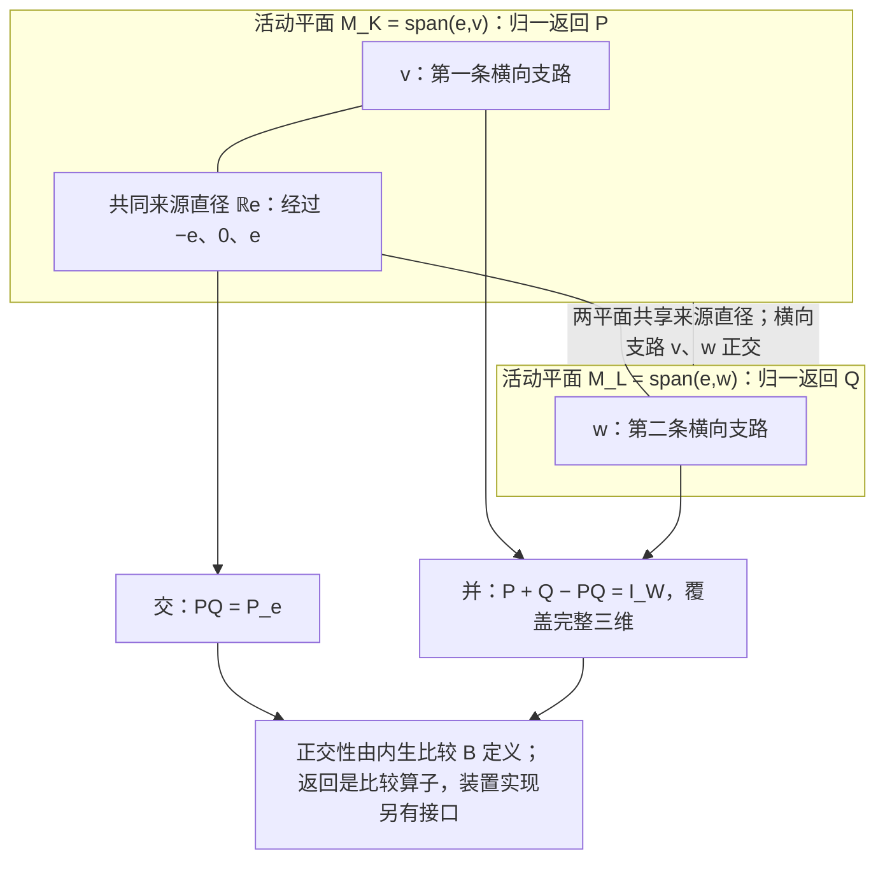

# 两份返回，只共同留下来源

> 来源：用户于 2026-11-05（Asia/Singapore）在本会话提供的 ΩQ-016 LaTeX 研究工作稿；原稿未另署作者或模型。本文为参考输入，Lean 是仓库的数学真源；本次仅转换 Markdown，未作形式化认证。正文中的固定快照、项目核读叙述与理论结论均保留原稿口径；一幅 TikZ 图转换为 Mermaid 示意图，保留两张共源活动平面、来源直径、交并关系及原图注。

量子起源回溯工作稿 $\Omega Q$-016

从一个二元乘积，到完整三维、相位与有限量子理论

**本轮只提出一个候选。** 在同一完整有限响应空间上，以来源内生的比较定义

$$
\mathcal R(T)=T^*T=-T^2,\qquad P_ez=B(e,z)e.
$$

要求存在生成全部原连续变化的 $K,L$，满足

$$
\boxed{\operatorname{Lie}\langle K,L\rangle=\mathfrak g,\qquad
\mathcal R(K)\mathcal R(L)=P_e.}
$$

证明结果为

$$
\dim W=3,\qquad \mathfrak g=\mathfrak{so}(W,B).
$$

三维、两个正交支路、非交换及来源圆都不另列为公理。

2026 年 11 月 5 日（新加坡）

固定项目版本：。

提交时间：2026-11-04 22:29:05 UTC／2026-11-05 06:29:05 新加坡。

本稿为普通数学证明与来源核对；本轮新定理未提交为项目结果，也未声称已经 Lean 形式验证。

## 本轮摘要与阅读路径

上一轮用 $-K^2-L^2=I+P_e$ 描述整体。本轮往回退一步，先定义每种变化在同一比较下的返回 $\mathcal R(T)=T^*T$，只要求两份返回的乘积恰好是共同来源。完整生成与完整来源轨道迫使这个来源伸出两条正交支路，整体因此只有三维。对归一后的两份平面投影，上一轮的加法式正是容斥：交集为来源，并集为整体，来源在相加时被数了两次。

这里的简化有可核查的范围：选择式不再显式输入整份单位算子，主证明也不再需要上一轮的奇维障碍；原生成元的多项式次数则从二升为四。两轮选择同一个准确模型类。本稿不把等价改写说成条件变弱，也不声称找到了绝对最短表达。

全文保持三个层次：原响应与历史；由关系构造的数学表示；把表示接回实际制备、读出、复合与时钟的接口。前者不因一个表示变短而被删除。由同一三维旋转构造复二维振幅、Hopf 读出与 Born 配对以后，进一步给出密度矩阵、POVM、张量、CP 仪器、Lüders 更新与连续酉演化的有限理论，并分别证明各自所用的前件。

一项过程检查值得提前指出：两张平面的几何投影虽然都是正的 Bloch 映射，却各有一个负的 Choi 本征值，不能直接当成可附接的量子装置；其平方返回的指数则确实生成完全正的去相干半群。这使“比较关系”和“物理过程”有了明确可检验的分界。

| 本轮新结论 | 证据及范围 |
|:---|:---|
| 二元共同返回选择三维 | 局部分块、导出代数的规范活动支撑、完整来源循环性 |
| 上一轮系数成为推论 | 归一投影的交、并与容斥；三份有序返回恢复单位 |
| 反向检验 | 精确四维反例、生成与循环性反例、每个高维的近返回族 |
| 更大有限结构 | 旗标平面族、九矩阵单位、四元数振幅、Hopf 束、正锥 |
| 标准有限量子理论 | 全部证明，并显式保留复合、完整正锥、参考与实际过程接口 |

## 1　项目快照与本轮候选的准确位置

本轮将项目 `dev` 固定在 。 提交时间为 2026 年 11 月 4 日 22:29:05 UTC，即新加坡时间 11 月 5 日 06:29:05。 相对上一轮 ， 公开比较页列出 13 个新增可达提交、12 个变更路径，共增加 1285 行、删除 47 行。 同时核对了两级首父链，确认前一版本确是本版本的祖先。[\[1\]](#ref-q016commit), [\[2\]](#ref-q016compare)

全部变更中，4 个是 Circle/FourNegative 下两个 Endpoint 的 Blueprint 说明及其配套源文件；其余 8 个是工作树活动检测与测试工具。 因此本次增量没有改动 C128、C129、C130、C133 及其全部续篇，没有新增或修改量子 Lean 声明。 本节沿用上一轮已保存并核对哈希的相关原文，以完整版本差异确认其继续有效；四个新说明文件另从固定版本下载原始字节。 **这是源文档与版本的核对，本环境没有重新运行 Lean。**

**新增圆周文字的范围。**

两份 Endpoint 新增文字保存了旧的自适应掩码与向上取整构造。 它们同时明确区分：现有端点的存在性见证，与旧构造指定的掩码和固定排列，不应认作同一个见证；旧构造全部整数区域及不等式的当前完整验证也未在此确立。 这些内容属于指定离散来源的圆周排列问题，未给出新的量子起源定理，亦未解决不受限制的 Circle J/C3.1。[\[3\]](#ref-q016circle)

### 1.1　已有三读声明，不能扩大成整条量子认证

最近一份直接相关的 Lean 模块仍是上一轮新增的 *ThreeReadBudget*。 其准确输入为任意实向量空间、实双线性形式 $R$ 和实线性算子 $U$。定义

$$
Q(f)=R(f,f),\qquad D=I+U+U^2.
$$

公开定理 `three_read_budget_nullspace` 从

$$
2R(f,Ug+nDg)\le Q(f)+Q(g)
\quad(\forall f,g,\ \forall n\in\mathbb N_0)
$$

得到且仅在该声明中列出

$$
Q(f)\ge0\quad(\forall f),\qquad
R(f,Dg)=0\quad(\forall f,g).
$$

关键是所有自然数倍数，没有统一上界：任何非零 $R(f,Dg)$ 都可通过选择 $f$ 的符号与足够大的 $n$ 违反预算。 源码明确把后续对称性、等距性、商与复结构留给母卷的其他结果。[\[4\]](#ref-q016threelean)

C133 母卷的完整普通证明进一步给出：预算等价于 $R$ 对称半正定、$U$ 保持 $Q$，且 $D(V)$ 落在完整根空间中。 商去根空间后，$J=(I+2U)/\sqrt3$ 满足 $J^2=-I$。 这里的 $U$ 已是商上的诱导算子。该分类允许任意复维及零模型，故它供应相位可见的内积几何，不选择三实维内容空间或 qubit。[\[5\]](#ref-q016c133)

### 1.2　更靠近原始二元关系的入口，仍有明确前件

C133 续卷 V 已把聚合的结合律与交换律撤出原始前件： 原载体 $M$ 仅有二元运算、双侧单位 $1$，以及满足 $U1=1$ 的标记； 比较 $c:M^2\to[0,\infty)$ 处处有限且对角为零。 其完整关系是

$$
\sum_{k=0}^{2}c(a\mathbin{\cdot}U^ku,b\mathbin{\cdot}U^kv)
=3c(a,b)+3c(u,v)\quad(\forall a,b,u,v).
$$

该卷定理 1.3 的普通证明将此关系刻画为 $F(a\cdot b)=F(a)+F(b)$、$F(Ua)=\omega F(a)$ 及 $c(a,b)=\|F(a)-F(b)\|^2$ 的复 Hilbert 表示。 这里每个配方有限，但不设统一深度上限；可见商中的代数性质不删除原始括号与档案。[\[6\]](#ref-q016c133v)

若连 $U1=1$ 也撤去，另一篇五点正性桥梁保留了额外条件：比较对称，且所有至多五个标签上的零和实系数组合满足负型不等式。 在完整配平关系下，它与整体负型及仿射相位表示等价；原文问题 7.1 仍未证明配平关系单独供应这个五点条件。 不能把这个尚待证明的输入藏进“全部内生”的说法。[\[7\]](#ref-q016c133n5)

**与本轮平方返回关系的接点。**

C128 第 1.3 节已有一项相关限制：算符平方的极化恢复两种顺序之和，并不恢复它们的有向差。 因此下文的 $K^2L^2=P_e$ 应作为本文独立提出和证明的选择关系。 对反对称 $K,L$，它使两个正算子 $-K^2,-L^2$ 的乘积为自伴投影，因而二者交换；这一步本身不说明 $K,L$ 交换，也不确定绝对手性。 完整作用及完整 Lie 生成仍须在后文定理的前件中保留。[\[8\]](#ref-q016c128)

**白话。** 项目已经把“比较要像量子读数”向前退到了两份配方怎样共同配平；这轮我们继续问的是，两种转动各自留下的返回量接起来，为什么只剩同一个来源方向。前一个关系负责把读数变成相位几何，后一个关系负责选择完整内容的形状。两层可以接上，但不能靠把它们都叫“三维”就视为同一件事。

## 2　同一完整原响应与来源比较

#### 定义 2.1：原概率行与完整有限前端

在同一原签名 $\Omega$ 内固定一个真实归一来源。对原可逆控制历史 $a$、合法未来请求 $f$ 和原结果标签 $w$，记完整响应行

$$
x_a(f,w)=p(a;f,w),\qquad p\ge0,\quad \sum_w p(a;f,w)=1.
$$

共同未来保留全部合法终端请求、原结果、失败、实际可读旧记录及后续合法性区别；原身份、端口、设备和历史索引继续保留。没有原定义的请求不人为补概率。总可逆连接含空历史、对复合封闭、在同一菜单内有准确统计逆，并在全未来线性关系上良定。

取同一来源的完整原可逆轨道，置

$$
V=\operatorname{span}_{\mathbb R}\{x_a\},\qquad u(x_a)=1,\qquad
W=\ker u=\operatorname{span}\{x_a-x_b\}.
$$

本轮明确要求 $0<\dim W<\infty$。原身份相同与响应相同是不同关系；构造线性表示不删除原索引。若已有可读历史使张成空间更大，使用更大的完整空间。

#### 引理 2.2：紧作用、固定中心与完整循环性

原可逆作用在 $V$ 上的矩阵闭包 $H$ 是紧群。定义

$$
c=\int_Hhx_\epsilon\,dh,\qquad e=x_\epsilon-c,
\qquad G=H|_W,\qquad \mathfrak g=\operatorname{Lie}(G).
$$

则 $G$ 紧、作用有效，$e\ne0$，并且

$$
W=\operatorname{span}(Ge).
$$

**证明。**

有限维中可选有限个实际评价坐标分离 $V$，并从原响应行中选一组基。任一原控制将这些基行送到其他响应行；所选概率坐标有界，故其矩阵一致有界。准确逆也在原集合内，故逆矩阵一致有界；闭包紧且不含奇异矩阵，是群。 Haar 平均固定 $c$，且 $u(c)=1$，故 $V=\mathbb Rc\oplus W$。在 $W$ 上平凡的原矩阵也固定 $c$，因而在 $V$ 上平凡。所有轨道行减去 $c$ 正好张成 $W$；若 $e=0$，轨道只有一点，违背 $W\ne0$。 $\square$

闭包中的极限矩阵与连续生成元首先是原响应的数学表示，不自动成为准确可调用的原装置。Haar 平均也不供应实际随机准备。

#### 定义 2.3：由轨道内生的比较

记 $n=\dim W$。对 $\alpha\in W^*$ 定义

$$
\mathsf C\alpha=\int_G\alpha(ge)\,ge\,dg,
\qquad B(v,w)=\frac1n(\mathsf C^{-1}v)(w).
$$

#### 引理 2.4：规范比较及完整轨道恒等式

$\mathsf C$ 可逆，$B$ 正定且 $G$ 不变，并有

$$
B(e,e)=1,\qquad
\int_Gge\otimes(ge)^{\flat_B}\,dg=\frac1nI_W.
$$

**证明。**

完整循环性给 $\alpha(\mathsf C\alpha)=\int\alpha(ge)^2dg>0$ 对全部 $\alpha\ne0$ 成立。Haar 不变性给 $B$ 不变。取迹有 $\int B(ge,ge)dg=\operatorname{Tr}(B\mathsf C)=1$，而轨道上长度相同，故 $B(e,e)=1$。对任意 $w$，积分算子作用于 $w$ 等于 $\mathsf C(w^{\flat_B})=w/n$。 $\square$

若 $T:W\to W'$ 保来源并共轭全部原作用，则 $\mathsf C'=T\mathsf C T^*$，从而 $B'(Tv,Tw)=B(v,w)$。换源到同一轨道点也只共轭后续关系。删去可读坐标的非单射投影不属于这种同构。

后文的度量表达对*任意*不变正定比较、任意单位循环来源成立。上述规范构造只使比较本身完全由原来源确定。本轮使用同一内生比较定义来源投影与二元平方返回乘积；没有另加一份独立度量。

## 3　本轮唯一候选：两个原平方返回，只共同留下来源

保留同一完整有限前端：$W\ne0$ 是有限实响应空间，$B$ 是原来源轨道内生的正定比较，原完整可逆矩阵闭包满足

$$
G\subseteq O(W,B),\qquad \mathfrak g=\operatorname{Lie}(G),\qquad
B(e,e)=1,\qquad W=\operatorname{span}(Ge).
$$

$\mathfrak g$ 在选择任何见证之前已经确定。下面的乘法始终是这个完整 $W$ 上的原算子复合；没有先把原空间换成一个较小的有效块。

#### 定义 3.1：同一原变化的平方返回

对于 $T\in\mathfrak g$，以原比较 $B$ 定义伴随，令

$$
\mathcal R(T)=T^*T=-T^2,\qquad
P_e=e\otimes e^{\flat_B},\qquad e^{\flat_B}(z)=B(e,z).
$$

$\mathcal R(T)$ 自伴且正半定，并有

$$
B(z,\mathcal R(T)z)=\lVert Tz\rVert_B^2,\quad
\ker\mathcal R(T)=\ker T,\quad
\operatorname{im}\mathcal R(T)=\operatorname{im}T.
$$

这里的“返回”指先作用、再以同一比较取伴随的算子关系。它没有额外宣称 $T$、$T^*$ 或这个乘积本身是一件原菜单已供应的测量装置。

**本轮唯一候选 $\Omega Q$-016：完整二元变化的平方返回相交于来源。**

$$
\boxed{\exists K,L\in\mathfrak g:\qquad
\operatorname{Lie}\langle K,L\rangle=\mathfrak g,\qquad
\mathcal R(K)\mathcal R(L)=P_e.}
\tag{Q16}
$$

即

$$
\boxed{K^2L^2=P_e.}
\tag{3.1}
$$

不另假定秩二、三维、正交、非交换或两个方向具有相同速率。

**白话：** 把两种变化各自的作用量折回原空间，再把这两份返回接起来，最后只剩来源那一条直径；两种变化还要生成全部原连续变化。后面的证明会说明：由来源伸出的两条支路必须互相垂直；它们之间只经来源交接，不能再藏着一条会参与整体运动的旁路。

与 Q15 的 $-K^2-L^2=I+P_e$ 相比，这次去掉了加法预算中的整份单位算子，改为两个已经定义的返回之间的一次乘法关系。**这是表达与几何组织的简化，不是所有复杂度指标都同时下降：** 按 $\mathcal R(K),\mathcal R(L)$ 计只是一项二元乘积；按原生成元 $K,L$ 计，多项式次数由二升为四。两轮将选择同一准确模型类；本轮不会把这种等价改写说成逻辑条件变弱。

## 4　自伴乘积把共同支撑锁成一条原来源直径

#### 引理 4.1：纯返回的全部分块

设 $K,L$ 是有限正定实空间上的反对称算子，且 $K^2L^2=P_e$。暂不假定完整生成或来源循环性。则存在正数 $a,b$ 与单位向量 $v,w$，使

$$
ab=1,\qquad e,v,w\text{ 正交归一},
$$

并且 $U=\operatorname{span}\{e,v,w\}$ 是共同不变的三维空间，其上

$$
\begin{aligned}
Ke&=av,& Kv&=-ae,& Kw&=0,\\
Le&=bw,& Lw&=-be,& Lv&=0.
\end{aligned}
\tag{4.1}
$$

在 $F=U^\perp$ 上，两个限制满足

$$
K_FL_F=L_FK_F=0.
\tag{4.2}
$$

反过来，任何这样的标准三维块与这样的余项正交直和，都满足 $K^2L^2=P_e$。

**证明。**

令

$$
P=-K^2\succeq0,\qquad Q=-L^2\succeq0.
$$

假设给出 $PQ=P_e$。取伴随得到

$$
QP=(PQ)^*=P_e=PQ.
\tag{4.3}
$$

因此 $P,Q$ 可交换，并分别与其乘积 $P_e$ 可交换。它们保持 $\mathbb Re$，于是

$$
Pe=\alpha e,\qquad Qe=\beta e,\qquad
\alpha,\beta\ge0,\qquad \alpha\beta=1.
$$

故 $a=\sqrt\alpha>0$、$b=\sqrt\beta>0$，且 $ab=1$。定义

$$
v=Ke/a,\qquad w=Le/b.
$$

反对称性及上述平方关系说明 $v,w$ 都是单位向量，且都垂直于 $e$。又因 $K$ 与 $P=-K^2$ 可交换，

$$
P(Ke)=KPe=\alpha Ke.
$$

故

$$
\alpha QKe=QPKe=P_eKe=0.
$$

由 $\alpha>0$ 得 $QKe=0$，再由 $\ker Q=\ker L$ 得 $LKe=0$。同理 $KLe=0$。于是

$$
B(Ke,Le)=-B(LKe,e)=0,
$$

即 $v\perp w$。而

$$
Kv=K^2e/a=-ae,\qquad Lw=L^2e/b=-be,
$$

连同 $Kw=Lv=0$，给出全部标准作用式。因此 $U$ 共同不变；反对称性使其正交补 $F$ 也共同不变。

在 $F$ 上，$P_FQ_F=0$。于是

$$
\operatorname{im}L_F=\operatorname{im}Q_F
\subseteq\ker P_F=\ker K_F,
$$

所以 $K_FL_F=0$；取伴随得到 $L_FK_F=0$。反向在 $U$ 上直接计算 $K^2L^2=P_e$，在 $F$ 上则两个乘积都为零，合并即可。

$\square$

#### 推论 4.2：共同返回与各自旁支的准确区别

在引理的条件下，

$$
\operatorname{im}K\cap\operatorname{im}L=\mathbb Re.
\tag{4.4}
$$

更准确地，存在正交分解

$$
W=U\oplus F_K\oplus F_L\oplus F_0,
$$

其中 $K$ 只在 $U\oplus F_K$ 上活动，$L$ 只在 $U\oplus F_L$ 上活动；$F_0$ 被两者共同固定。$F_K,F_L$ 的维数为偶数，$F_0$ 可为任意维数。

**证明。**

令 $F_K=\operatorname{im}K_F$、$F_L=\operatorname{im}L_F$。式 (4.2) 给 $F_K\perp F_L$，并且两者分别被另一个算子消灭。取 $F_0=(F_K\oplus F_L)^\perp\cap F$，即得分解。在各自像上，反对称算子非退化，因此像的维数为偶数。在 $U$ 上，两份像为 $\operatorname{span}\{e,v\}$、$\operatorname{span}\{e,w\}$，相交于 $\mathbb Re$；旁支互相正交，故没有增加交线。

$\square$

这个分块说明乘积式比“两个像碰到一条线”多约束了什么：平方返回可交换，而且原来源是它们共同的本征方向。两者相交的那条线不会被其中一个返回再推向旁支。独有旁支仍可能存在；要排除它们，需要下一步对同一原整体使用完整生成与来源循环性。

## 5　用顺序差的规范支撑，一次处理整个原群

#### 引理 5.1：非交换部分恰好支撑三维块

在引理 4.1 的条件下，令

$$
\mathfrak a=\operatorname{Lie}\langle K,L\rangle,
\qquad \mathfrak a'=[\mathfrak a,\mathfrak a].
$$

则

$$
\mathfrak a=\mathfrak{so}(U,B|_U)\oplus
\operatorname{span}\{K_F,L_F\},\qquad
\mathfrak a'=\mathfrak{so}(U,B|_U)\oplus0_F.
\tag{5.1}
$$

这里右侧均视作原 $W$ 上的块算子；第二项是一个至多二维的交换代数。因此

$$
S(\mathfrak a'):=\operatorname{span}\{Az:A\in\mathfrak a',\ z\in W\}=U.
\tag{5.2}
$$

**证明。**

记 $J_{ev}e=v,J_{ev}v=-e$，类似定义 $J_{ew},J_{vw}$，并令它们在其余正交方向上为零。局部分块给

$$
K=aJ_{ev}\oplus K_F,\qquad
L=bJ_{ew}\oplus L_F,
\qquad ab=1.
$$

因为余项乘积为零，

$$
C=[K,L]=J_{vw}\oplus0,
\quad [L,C]=bJ_{ev}\oplus0,
\quad [C,K]=aJ_{ew}\oplus0.
$$

这三个非零转动张成 $\mathfrak{so}(U)\oplus0$，且全都属于 $\mathfrak a'$。从 $K,L$ 减掉各自的 $U$ 块，得到 $0\oplus K_F,0\oplus L_F\in\mathfrak a$。它们互相交换，并与前三维块交换，故生成的整个代数恰为式 (5.1)，其导出代数也正如所列。三个坐标平面转动的像张成 $U$，给出活动支撑式。

$\square$

#### 定理 5.2：Q16 的完整三维刻画

在本轮保留的完整有限前端中，以下两项等价：

1.  存在满足 Q16 的 $K,L$；

2.  $\dim W=3$，且 $\mathfrak g=\mathfrak{so}(W,B)$。

此时

$$
G^\circ=SO(W,B),\qquad G=SO(W,B)\ \text{或}\ O(W,B).
$$

**证明。**

设 Q16 成立。完整生成使上一个引理中的 $\mathfrak a$ 就是原 $\mathfrak g$，于是原导出代数 $\mathfrak g'=[\mathfrak g,\mathfrak g]$ 的全部活动支撑恰为三维块 $U$。

对完整群中的任意 $h\in G$，包括不连通分支，都有

$$
h\mathfrak gh^{-1}=\mathfrak g,\qquad h\mathfrak g'h^{-1}=\mathfrak g'.
$$

因此 $hS(\mathfrak g')=S(\mathfrak g')$，即 $hU=U$。因为原来源 $e\in U$，来源循环性给

$$
W=\operatorname{span}(Ge)\subseteq U.
$$

所以 $W=U$；余项全部消失，上一个引理立即给出 $\mathfrak g=\mathfrak{so}(W,B)$。这一步使用的是整个 $G$ 的规范支撑，而不只是连通分支的轨道。

反过来，设 $W$ 为三维且原代数是全部反对称算子。取 $e^\perp$ 的正交单位基 $v,w$，定义

$$
X_t(se+z)=st-B(t,z)e\qquad(t,z\perp e).
$$

取任意 $a>0$，令 $K=aX_v,L=a^{-1}X_w$。则

$$
K^2=-a^2(P_e+P_v),\qquad
L^2=-a^{-2}(P_e+P_w),
$$

所以 $K^2L^2=P_e$。两个坐标转动与其交换子张成全部 $\mathfrak{so}(W,B)$，得到完整生成。最后 $SO(3)\subseteq G\subseteq O(3)$，故完整群只有所列两种可能。

$\square$

**这一轮的三维画面。** 一条来源直径接出两条正交支路。两种平方返回只在来源上重合；在所有其他方向上，至多有一种变化能够通过。交换两种变化的先后次序，只会在这三条方向之间产生转动。这个“先后差能够活动的地方”是整个原群都认得的同一个空间；来源既然能生成全部可读内容，整体就只能是这三维。

## 6　同一个乘积恢复三份正交返回与旧候选

#### 命题 6.1：两种先后次序与三份返回

Q16 成立后，取引理 4.1 的正交标架 $e,v,w$。则

$$
\begin{aligned}
KL&=-v\otimes w^{\flat_B},&
LK&=-w\otimes v^{\flat_B},
\end{aligned}
\tag{6.1}
$$

$$
\begin{aligned}
K^2L^2&=P_e,&
KL^2K&=P_v,&
LK^2L&=P_w.
\end{aligned}
\tag{6.2}
$$

因此

$$
\boxed{I_W=K^2L^2+KL^2K+LK^2L.}
\tag{6.3}
$$

三项是互相正交的秩一投影。并且

$$
\operatorname{rank}(KL)=1,\qquad (KL)^2=(LK)^2=0,
\qquad KLK=LKL=0.
$$

**证明。**

在正交基 $e,v,w$ 上应用式 (4.1)，并使用 $ab=1$，直接得到式 (6.1)。两种顺序互为伴随，故

$$
(KL)(LK)=P_v,\qquad (LK)(KL)=P_w.
$$

连同候选中的 $K^2L^2=P_e$，给出三份返回。三维正交分解给出其和为单位；其余零乘积由 $v\perp w$、$Kv\parallel e$、$Ke\parallel v$、$Kw=Lv=0$ 逐项得到。

$\square$

原来在 Q15 中显式出现的整份单位，现在由同样两个原生成元的三种四字返回次序恢复。这里的“第三方向”不是增加一个独立生成元：它由 $[K,L]$ 读出，而三份正交投影也都来自同一对原算子的乘积。

#### 命题 6.2：与 Q15、Q14 的精确等价及速率自由

在同一完整前端中，Q16 与 Q15、Q14 等价。具体而言，任一 Q16 见证可写成

$$
\boxed{K=aX_v,\qquad L=a^{-1}X_w,\qquad
a>0,\quad (v,w)\text{ 为 }e^\perp\text{ 的正交单位基}.}
\tag{6.4}
$$

令 $K_0=a^{-1}K$、$L_0=aL$，就得到 Q15 的归一见证

$$
-K_0^2-L_0^2=I_W+P_e.
$$

反之，Q15 的归一见证本身满足 Q16。两者也都给出 Q14 的秩二共源对。

**证明。**

Q16 的见证分类来自局部分块与 $W=U$。重标后 $K_0=X_v,L_0=X_w$，所以负平方之和为

$$
(P_e+P_v)+(P_e+P_w)=I_W+P_e.
$$

附录第 A 节完整重证了 Q15、Q14 的三维刻画。反向使用 Q15 的该结论，得到同样的两个平方，其乘积为 $P_e$。Q14 与 Q15 的等价已由各自完整三维刻画给出；也可直接看两个像都是二维且仅交于 $\mathbb Re$，其交换子补足全部三维旋转。

$\square$

Q16 对任意非零实数 $t$ 的相反重标

$$
(K,L)\longmapsto(tK,t^{-1}L)
$$

保持。它固定两种返回速率的乘积，没有把两种速率分别定成一。Q15 的见证则额外选择了两速率相等的归一坐标。这里的重标发生在原 Lie 向量空间内，不改写原装置的时间、能量或来源双导子的物理标尺。正交标架仍有 $O(2)$ 自由，因而没有选出绝对手性。

#### 命题 6.3：去掉数值标尺的同一结构表述

在完整生成条件下，Q16 的存在性等价于存在 $K,L\in\mathfrak g$，使

$$
(K^2L^2)^*=K^2L^2,
\qquad \operatorname{im}(K^2L^2)=\mathbb Re.
$$

此时必有 $K^2L^2=\lambda P_e$、$\lambda>0$，作共同重标 $(K,L)\mapsto(\lambda^{-1/4}K,\lambda^{-1/4}L)$ 便得到 Q16 的数值归一。

**证明。**

自伴性与像为 $\mathbb Re$ 给出 $K^2L^2=\lambda P_e$，其中 $\lambda\ne0$。令 $P=-K^2,Q=-L^2$，自伴性给 $PQ=QP$。可交换的两个正半定算子可共同正交对角化，其乘积的本征值都是两个非负数之积，故 $PQ\succeq0$，从而 $\lambda>0$。重标及反向均直接成立。

$\square$

这个等价表述描述同一个候选的无标尺内容，不是再增加一个量子公理。所用来源必须是前端已经指定的 $e$；不能发现任意一条秩一像之后，再把它改名成原来源。

## 7　逆向检查：秩一互动和源点返回为什么仍然不够

下面统一采用 $J_{ij}e_i=e_j,J_{ij}e_j=-e_i$，其余坐标为零。

#### 反例 7.1：秩一二元乘积与来源固定轴，仍允许完整四维

取 $W=\mathbb R^4,G=SO(4),e=e_1$，并令

$$
K=J_{12}+cJ_{23},\qquad L=J_{14},\qquad c\ne0.
$$

直接计算

$$
KL=-e_2\otimes e_4^{\flat},\quad [K,L]=J_{24},\quad
[K,L]e=0,\quad Ke=e_2,\quad Le=e_4.
$$

所以 $\operatorname{rank}(KL)=1$，来源被交换子固定，且两个来源速度正交归一。但

$$
K^2L^2=(e_1-ce_3)\otimes e_1^{\flat}\ne P_e.
$$

这份返回从来源泄漏到第三坐标。事实上 $[L,[K,L]]=J_{12}$，所以从 $K$ 中又能取出 $J_{23}$；连通边 $12,23,14$ 的转动生成全部 $\mathfrak{so}(4)$。来源轨道是 $S^3$，完整循环性成立。该反例已经使用连通完整群，不是由离散分支造成的例外。

#### 反例 7.2：两个源点都准确返回，仍不能替代全算子关系

取 $W=\mathbb R^4,G=SO(4),e=e_1$，并令 $0<|\varepsilon|<1$，

$$
K=J_{12}+\varepsilon J_{34},\qquad
L=J_{13}+\varepsilon J_{24}.
$$

则 $K^2e=L^2e=-e$，所以两种顺序在源点都准确满足

$$
K^2L^2e=L^2K^2e=e.
$$

两条单独来源轨迹也都是准确单位大圆。两个平方甚至在整个空间上可交换，却有

$$
K^2L^2=\operatorname{diag}(1,\varepsilon^2,\varepsilon^2,\varepsilon^4)\ne P_e.
\tag{7.1}
$$

这对生成元完整生成 $\mathfrak{so}(4)$：

$$
[K,L]=(1-\varepsilon^2)J_{23},\qquad
[J_{23},K]=J_{13}-\varepsilon J_{24}.
$$

由此与 $L$ 分离出 $J_{13},J_{24}$；再由 $[J_{13},J_{23}]=J_{12}$ 及 $K$ 得到 $J_{34}$。这些边连通所有四个坐标，故生成全部旋转。于是正定、完整性、来源大圆、源点返回和平方可交换都不能单独排除四维。

#### 反例 7.3：纯返回准确成立，仍需完整生成与来源循环性

在 $W=\mathbb R^4,G=SO(4),e=e_1$ 上，取 $K=J_{12},L=J_{13}$。有 $K^2L^2=P_e$，但两者只生成前三维的 $\mathfrak{so}(3)$，没有生成原 $\mathfrak{so}(4)$。

另在 $W=\mathbb R^5,G=SO(3)\times SO(2),e=e_1$ 上，取

$$
K=J_{12}+J_{45},\qquad L=J_{13}.
$$

同一纯返回仍准确成立，而且两个生成元生成了这个原直积 Lie 代数。然而来源轨道只张成前三维，违反 $W=\operatorname{span}(Ge)$。两种前端条件承担不同任务，都不能从乘积式中直接删除。

#### 反例 7.4：纯返回必须指向同一个原来源

取

$$
W=\mathbb R^3\oplus\mathbb R,\qquad
G=SO(3)\times\{\pm1\},\qquad
e=\frac{\sqrt3}{2}e_1+\frac12e_4,
$$

并令 $K=J_{12},L=J_{13}$。它们完整生成原连续代数，乘积 $K^2L^2=P_{e_1}$ 自伴且秩一，但并不是 $P_e$。完整来源轨道张成四维，平均为零，协方差为 $I_4/4$，因此标准比较也符合原协方差归一。不能把乘积发现的 $e_1$ 擅自替换成原来源 $e$；这里的第四个响应确由原离散分支读出。

#### 反例 7.5：多条共同返回线允许任意多个三维块

令整数 $r\ge2$，在

$$
W=\bigoplus_{j=1}^r\mathbb R^3,
\qquad G=\prod_{j=1}^r SO(3),
\qquad e=r^{-1/2}\sum_{j=1}^r e_1^{(j)}
$$

上，取互不相同的正数 $a_j$，并令

$$
K=\bigoplus_j a_jJ_{12}^{(j)},\qquad
L=\bigoplus_j a_j^{-1}J_{13}^{(j)}.
$$

则

$$
K^2L^2=\sum_{j=1}^rP_{e_1^{(j)}}
$$

是秩 $r$ 的正交投影，而来源轨道张成全部 $3r$ 维。两者也完整生成原直积代数：$\operatorname{ad}_K^2$ 在 $J_{13}^{(j)}$ 上的本征值为 $-a_j^2$，互不相同；对这些有限个值作实多项式插值，从 $L$ 中逐块分离 $J_{13}^{(j)}$，再与 $K$ 取交换子得到各块的全部 $\mathfrak{so}(3)$。因此“共同返回是一个投影”仍太弱，准确的一条原来源线承担了选择作用。

对以上满足完整来源循环性的标准紧作用，均可接上合法二结果读数

$$
p_\pm(g;h)=\tfrac12\bigl(1\pm B(ge,he)\bigr).
$$

单位来源保证概率非负且归一；完整来源轨道张成保证相应未来读数分离响应。反例因而不是依靠非法概率或删去失败历史构成的。

## 8　准确关系不自动给出维数的近似稳定性

式 (7.1) 已给出一个直接障碍：对每个非零 $\varepsilon$，原整体都是完整四维，然而

$$
\lVert K^2L^2-P_e\rVert_{\mathrm{op}}=\varepsilon^2\longrightarrow0.
$$

下面进一步给出任意有限高维的版本。

#### 命题 8.1：任意高维的完整近返回族

对每个整数 $n\ge4$，存在 $W=\mathbb R^n,G=SO(n),e=e_1$ 上的反对称算子族 $K_0,L_\varepsilon$，使所有 $\varepsilon\ne0$ 都满足

$$
\operatorname{Lie}\langle K_0,L_\varepsilon\rangle=\mathfrak{so}(n),
\qquad
\lVert K_0^2L_\varepsilon^2-P_e\rVert_{\mathrm{op}}\longrightarrow0
\quad(\varepsilon\longrightarrow0).
$$

在 $\varepsilon=0$ 时乘积准确等于 $P_e$，但完整生成失效。

**证明。**

把剩余坐标 $4,\ldots,n$ 配成互不重叠的对 $(r_j,s_j)$，$1\le j\le m$，其中 $m=\lfloor(n-3)/2\rfloor$；若还剩一个坐标，就记为 $q$。令 $\delta=0$ 或 $1$ 表示是否存在这个余轴，故 $n-3=2m+\delta$。取互不相同的 $b_j\in(0,1)$，并定义

$$
K_0=J_{12}+\sum_{j=1}^m b_jJ_{r_js_j},\qquad
L_0=J_{13},
$$

$$
Z=\sum_{j=1}^mJ_{3r_j}
+\begin{cases}0,&\delta=0,\\J_{3q},&\delta=1,\end{cases}
\qquad L_\varepsilon=L_0+\varepsilon Z.
$$

在 $\varepsilon=0$ 时，$L_0$ 的余项为零，故 $K_0^2L_0^2=P_e$。

考察原线性算子 $\operatorname{ad}_{K_0}^2$ 对 $L_\varepsilon$ 各分量的作用。$J_{13}$ 的本征值为 $-1$，$J_{3r_j}$ 的本征值为 $-b_j^2$，存在余轴时 $J_{3q}$ 的本征值为 $0$。这些值彼此不同。对这份有限谱作多项式插值，并使用 $\varepsilon\ne0$，就能在生成代数中分别恢复

$$
J_{13},\quad J_{3r_j}\ (1\le j\le m),\quad
\text{以及存在时的 }J_{3q}.
$$

再与 $K_0$ 取交换子，恢复 $J_{23}$ 和各 $J_{3s_j}$。于是以坐标 $3$ 为中心、通往其他每个坐标的全部星形边转动均在生成代数中。任意两条星边的交换子给出相应的两叶边转动，因此生成全部 $\mathfrak{so}(n)$。

最后记 $N=m+\delta\ge1$。有

$$
\lVert K_0\rVert_{\mathrm{op}}=\lVert L_0\rVert_{\mathrm{op}}=1,
\qquad \lVert Z\rVert_{\mathrm{op}}=\sqrt N.
$$

这是因为 $Z$ 只在 $e_3$ 与 $N$ 个单位正交叶向量之和之间转动。展开平方并使用算子范数的次乘性，得到

$$
\begin{aligned}
\lVert K_0^2L_\varepsilon^2-P_e\rVert_{\mathrm{op}}
&=\lVert K_0^2\bigl[\varepsilon(L_0Z+ZL_0)+\varepsilon^2Z^2\bigr]\rVert_{\mathrm{op}}\\
&\le2|\varepsilon|\sqrt N+\varepsilon^2N\longrightarrow0.
\end{aligned}
$$

对每个非零 $\varepsilon$，原 $SO(n)$ 的来源轨道为整个 $S^{n-1}$，所以完整来源循环性同时成立。基点 $\varepsilon=0$ 则保持前三维与旁支分块，不能生成 $\mathfrak{so}(n)$。

$\square$

因此本轮证明是一条准确结构定理。若将等式改成有限误差，就还需要一份控制生成病态或有效维数的定量前提；单独测到返回乘积很接近 $P_e$，不能据此宣称完整原响应空间已经接近三维。这个限制也是逆向检查的一部分，并不增加第二个候选。

## 9　返回可交换，原变化仍有先后：同一结构的几何

本节始终在定理 5.2 已证明的完整三维空间中工作。沿用正交单位标架 $e,v,w$ 与正数 $a,b$，其中

$$
K=aX_v,\qquad L=bX_w,\qquad ab=1.
$$

若记平方返回速率为 $\alpha=a^2,\beta=b^2$，则 $\alpha\beta=1$。以下只把本轮已经得到的关系继续展开，不增加新的选择公理。

### 9.1　四个布尔角只有三个活动：Q15 的系数从哪里来

#### 命题 9.1：返回的交、并与容斥

归一平方返回

$$
P=a^{-2}\mathcal R(K)=P_e+P_v,\qquad
Q=b^{-2}\mathcal R(L)=P_e+P_w
$$

是两个可交换的正交投影。它们的交与并分别满足

$$
P\wedge Q=PQ=P_e,\qquad
P\vee Q=P+Q-PQ=I_W.
\tag{9.1}
$$

相应四个布尔角为

$$
PQ=P_e,\quad P(I-Q)=P_v,\quad
(I-P)Q=P_w,\quad (I-P)(I-Q)=0.
\tag{9.2}
$$

因此，取 $\bar K=K/a,\bar L=L/b$，必有

$$
-\bar K^2-\bar L^2=P+Q=I_W+P_e.
$$

**证明。**

三个来源标架投影互相正交，和为 $I_W$。把它们代入 $P,Q$，各式即逐项成立。一般地，对两个可交换的正交投影，$PQ$ 的像是两像的交；$P+Q-PQ$ 在两像之和上为恒等，在共同正交补上为零，所以是两像之和的正交投影。这里两个像共同覆盖全部三维，故其并为单位。

$\square$

这个容斥关系解释了上一轮的两个系数 $1$：每条支路各被计一次，来源线则被两份返回各计一次。整份单位加一份来源，正是“两份覆盖相加，把重叠多算一次”。这两个系数来自同一投影交并关系，没有再为三个坐标分别指定权重。

|     原方向     | $\mathcal R(K)$ | $\mathcal R(L)$ | 归一返回所属的角 |
|:--------------:|:-----------------:|:-----------------:|:----------------:|
|     $e$      |      $a^2$      |      $b^2$      |   两者共同通过   |
|     $v$      |      $a^2$      |       $0$       |  只有第一份通过  |
|     $w$      |       $0$       |      $b^2$      |  只有第二份通过  |
| 不存在的第四角 |       $0$       |       $0$       |  无剩余响应方向  |

#### 推论 9.2：同一对原算子的平方比较恒等式

每个 $z\in W$ 都满足

$$
\boxed{\lVert z\rVert_B^2=B(e,z)^2+\lVert KLz\rVert_B^2+\lVert LKz\rVert_B^2.}
\tag{9.3}
$$

**证明。**

由命题 6.1，$KLz=-B(w,z)v$、$LKz=-B(v,z)w$。故右侧恰为正交基 $e,v,w$ 中三个实坐标的平方和。

$\square$

这是一条**实内容空间的平方比较式**。它尚未把三项宣布为三种互斥测量结果，也不是另加一条概率公理。这里的 $P_e$ 作用在三维实空间 $W$ 上；后续复二维表示中的纯态投影

$$
\rho_e=\tfrac12(I_{\mathbb C^2}+\sigma_e)
$$

作用在不同空间上，具有不同类型。尤其 $P_e=P_{-e}$，而 $\rho_e$ 与 $\rho_{-e}$ 是两个互相正交的量子纯态投影。来源线的平方信息不能替代来源自身的正负区别。

**图 1：** 两张活动平面共享来源直径，合起来覆盖完整三维。图是三维关系的平面示意；$e,v,w$ 的正交性由内生比较 $B$ 定义。两份返回是比较算子，不直接代表两件测量装置。

### 9.2　平方比较的兼容与有向运动的不交换

#### 命题 9.3：顺序差自动给出归一来源稳定子

令 $C=[K,L]$。则

$$
Ce=0,\qquad Cv=w,\qquad Cw=-v,
\tag{9.4}
$$

$$
-C^2=I_W-P_e,\qquad
\kappa(C,C)=1,\qquad
\kappa(A,D):=-\tfrac12\operatorname{Tr}_W(AD),
\tag{9.5}
$$

$$
[C,K]=a^2L,\qquad [L,C]=b^2K.
\tag{9.6}
$$

归一之后，$\bar K,\bar L,C$ 是 $\kappa$-正交单位基，并满足

$$
[\bar K,\bar L]=C,\qquad
[C,\bar K]=\bar L,\qquad
[\bar L,C]=\bar K.
$$

**证明。**

由命题 6.1 的两种有序混合式，

$$
C=w\otimes v^{\flat_B}-v\otimes w^{\flat_B}.
$$

所以它在 $v,w$ 平面上是单位转动，在来源线上为零。平方、迹与各交换子均由这三个基向量上的作用逐项得到。三个归一算子分别在三个坐标平面上转动，负半迹内积给出所述正交归一性。

$\square$

返回的 $\mathcal R(K),\mathcal R(L)$ 可交换，原有向变化 $K,L$ 却不交换。两者描述不同层次的关系：平方返回只记录各方向的作用量，交换子还记录先后顺序。不能从两个实平面投影可交换，跳到“两个量子实验都可以同时测量”。

“返回”的准确含义由伴随比较给出：

$$
B(x,\mathcal R(K)y)=B(Kx,Ky).
$$

这不是把一件物理门连续执行两次。原算子平方是 $K\circ K=K^2$，平方比较是 $K^*K=-K^2$，而数学流的原路反向是 $e^{-tK}e^{tK}=I_W$。三种表达各有自己的类型；实自伴正半定性也不自动构成量子操作所需的完全正性。原菜单是否供应相应制备、读数或仪器，仍由原接口决定。

### 9.3　互反速率、标架自由与来源换位

式 (6.4) 给出了全部见证。它允许

$$
(K,L)\longmapsto(tK,t^{-1}L),\qquad t\in\mathbb R\setminus\{0\},
$$

使平方速率变为 $(t^2\alpha,t^{-2}\beta)$，仍保持 $\alpha\beta=1$。这是一对 Lie 向量在选择式中的互反重标；若原过程已经携带不同的实际速率、时间或能量标签，这个存在性自由没有授权抹去那些标签。

#### 命题 9.4：正交自由作用于归一标架

对归一对 $(\bar K,\bar L)$ 作任意 $O(2)$ 基变换，仍得到 Q16 的归一见证；其交换子乘以该基变换的行列式。因此选择式不确定绝对手性。对尚未等速归一的原对 $(K,L)$，一般的 $O(2)$ 混合则未必保持 Q16。

**证明。**

映射 $t\mapsto X_t$ 线性，故对 $(\bar K,\bar L)=(X_v,X_w)$ 的正交混合恰对应切平面中另一组正交单位基；其负平方乘积仍为 $P_e$。交换子的双线性与交替性给出行列式因子。

后一结论可直接检验。取 $a\ne1$，作四十五度混合

$$
K'=(K+L)/\sqrt2,\qquad L'=(-K+L)/\sqrt2.
$$

则

$$
B(K'e,L'e)=\tfrac12(a^{-2}-a^2)\ne0.
$$

而引理 4.1 证明每个 Q16 见证都必须具有正交的来源速度，故这份原速率混合不满足 Q16。

$\square$

#### 命题 9.5：同一完整原群下的来源换位协变

对任意 $h\in G$，同时令

$$
e'=he,\qquad K'=hKh^{-1},\qquad L'=hLh^{-1}.
$$

则 $e',K',L'$ 满足同一 Q16 关系，且 $a,b$ 不变。此结论包括 $G$ 的不连通分支。

**证明。**

由 $h$ 保持 $B$，有 $P_{e'}=hP_eh^{-1}$。所以

$$
(K')^2(L')^2=hK^2L^2h^{-1}=P_{e'}.
$$

完整生成由 $h\mathfrak gh^{-1}=\mathfrak g$ 保持。又 $K'e'=hKe,L'e'=hLe$，其长度不变，故速率不变。

$\square$

这里移动的是来源及其全部关系标架。若只改变实际来源而保持装置与标签不动，便是在考虑另一个实验输入；协变性没有把两个输入认成同一个历史。类似地，交换见证或改变一条有向支路会反转 $C$，但先前可读的方向标记仍保留。

### 9.4　两平面的交线与更大的旗标结构

两个活动平面为

$$
M_K=\operatorname{span}\{e,v\},\qquad M_L=\operatorname{span}\{e,w\}.
$$

它们共享来源直径 $\mathbb Re$，横向的两条支路彼此正交。相应来源运动

$$
e^{tK}e=\cos(at)e+\sin(at)v,\qquad
e^{sL}e=\cos(bs)e+\sin(bs)w
$$

是相交于 $e,-e$ 的两条大圆，在交点的切线正交。圆并非一个原点附加手性之后自动变出的新维数；这里各圆都有完整的二维活动平面，来源与支路给出该平面的两个方向。

这两份平面又属于同一个二维线性族。对 $(r,s)\ne(0,0)$，令

$$
t=ra\,v+sb\,w\ne0.
$$

则 $rK+sL=X_t$，而

$$
\operatorname{im}(rK+sL)=\operatorname{span}\{e,t\},\qquad
X_t^2=-\lVert t\rVert_B^2P_{\operatorname{span}\{e,t\}}.
\tag{9.7}
$$

证明只需使用 $X_te=t$、$X_tt=-\lVert t\rVert_B^2e$，以及 $X_t$ 在两者共同正交补上为零。

因此这整个二元线性族对应于所有旗标

$$
\mathbb Re\ \subset\ M\ \subset\ W,\qquad \dim M=2.
$$

这些平面由切平面的无向直线参数化，参数空间为 $\mathbb RP^1$。在外积表示

$$
e\wedge t\ \longmapsto\ X_t,
$$

它们是二维平面 Grassmann 空间 $\operatorname{Gr}(2,W)$ 中的一条射影直线。这里的“更大结构”是同一完整三维空间内部的平面关系，并没有再假设一个不可读的高维容器。选定的两个返回，只是这条平面族中横向方向正交的一对。

## 10　任意长的有限有序词，有限套乘法规则

#### 定理 10.1：九个矩阵单位给出全部原实算子

令 $f_0=e,f_1=v,f_2=w$，并定义

$$
E_{ij}=f_i\otimes f_j^{\flat_B},\qquad 0\le i,j\le2.
$$

全部九个矩阵单位都在原 $K,L$ 生成的实结合代数中。其表达为

$$
\begin{aligned}
E_{00}&=K^2L^2,& E_{11}&=KL^2K,& E_{22}&=LK^2L,
\end{aligned}
\tag{10.1}
$$

$$
\begin{aligned}
E_{12}&=-KL,& E_{21}&=-LK,
\end{aligned}
\tag{10.2}
$$

$$
\begin{aligned}
E_{10}&=\bar K E_{00},& E_{01}&=-E_{00}\bar K,
\end{aligned}
\tag{10.3}
$$

$$
\begin{aligned}
E_{20}&=\bar L E_{00},& E_{02}&=-E_{00}\bar L.
\end{aligned}
\tag{10.4}
$$

它们满足有限乘法表

$$
\boxed{E_{ij}E_{k\ell}=\delta_{jk}E_{i\ell},\qquad
E_{ij}^*=E_{ji}.}
\tag{10.5}
$$

因此

$$
\operatorname{Alg}_{\mathbb R}(K,L)=\operatorname{End}_{\mathbb R}(W)\cong M_3(\mathbb R),
\qquad \dim_{\mathbb R}\operatorname{Alg}_{\mathbb R}(K,L)=9.
$$

**证明。**

前三份投影来自命题 6.1；两种横向单位来自同一命题的混合式。其余四式只使用 $\bar Ke=v,\bar Kv=-e,\bar Le=w,\bar Lw=-e$。复合两个秩一算子时，中间标架向量的内积为 $\delta_{jk}$，给出乘法表；伴随式同样直接成立。

任意 $T\in\operatorname{End}_{\mathbb R}(W)$ 都有唯一展开

$$
T=\sum_{i,j=0}^2t_{ij}E_{ij},\qquad
t_{ij}=B(f_i,Tf_j).
\tag{10.6}
$$

所以九个矩阵单位线性无关且张成全部原实算子。它们都由 $K,L$ 的实线性组合与乘积得到；连单位也由三份对角单位之和得到。故无论把生成代数起初定义为含单位或不要求含单位，最终均得到全部 $M_3(\mathbb R)$。

$\square$

#### 推论 10.2：完整有序词的有限重写

每个由 $K,L$ 构成的有限有序乘积及其有限实线性组合，都可由同一套九个符号与式 (10.5) 化为唯一九坐标式。若

$$
T=\sum t_{ij}E_{ij},\qquad S=\sum s_{ij}E_{ij},
$$

则接续关系仍是有限规则

$$
(TS)_{i\ell}=\sum_{j=0}^2t_{ij}s_{j\ell}.
\tag{10.7}
$$

**证明。**

先替换

$$
K=a(E_{10}-E_{01}),\qquad L=b(E_{20}-E_{02}),
$$

再按乘法表收缩相邻矩阵单位。长度为 $m\ge1$ 的矩阵单位词

$$
E_{i_1j_1}E_{i_2j_2}\cdots E_{i_mj_m}
$$

在某个相邻匹配 $j_r=i_{r+1}$ 失败时为零；全部匹配成功时为 $E_{i_1j_m}$。每次收缩减少词长，所以过程终止；非零结果只依赖这串相邻匹配与首尾指标，不依赖括号顺序。线性展开后，唯一性由式 (10.6) 给出。两份九坐标式相乘即得式 (10.7)。

$\square$

数学上的有限旋转也在同一表示中。例如 $K^3=-a^2K$，所以幂级数逐项合并为

$$
e^{tK}=I_W+\frac{\sin(at)}{a}K+
\frac{1-\cos(at)}{a^2}K^2.
\tag{10.8}
$$

对 $L$ 同理。因此任意有限段这些数学流的接续也可用同一九坐标乘法计算。全群中若有离散分支，其原实算子当然也有九坐标；但“属于实线性张成”并不等于原装置可以把这些算子线性相加，或已经供应任意指定的连续门。

这项有限闭合有两条必须保持的类型区别。第一，$M_3(\mathbb R)$ 是**原响应算子的普通复合代数**，具有九个实维度；后面由三维旋转括号构造的四元数振幅代数具有四个实维度，使用另一种定义好的乘法。不能把两套乘法直接认成一套。第二，九坐标压缩的是当前表示中的作用，原有的词、顺序、失败读数与速率标签仍随历史保留；两个词表示同一个算子，不表示它们作为原历史已经没有可读区别。若未来真实读数要求扩大原响应空间，就应在扩大的完整空间上重新检验 Q16。

**这一轮继续展开后的白话。** 两份返回像两张共用一条直径的圆面：它们重叠的是来源，各自还带着一条支路，两张合起来刚好覆盖整体。因为重叠部分被数了两次，上一轮的“整体加来源”就出现了。只看覆盖，两份返回相容；保留转动方向与先后，两种变化又能互相生成第三种转动。路径可以越接越长，但每次接法都由同一套有限乘法规则结算；被结算的是作用的表示，走过的原路径仍然留在记录里。

## 11　同一对返回直接给出归一旋转地址与夹持比较

Q16 已经给出正交单位标架 $e,v,w$、归一生成元 $\bar K=K/a,\bar L=L/b$，以及单位来源稳定子 $C=[K,L]=[\bar K,\bar L]$。这里直接使用它们，不再另选一个稳定生成元或附加标尺。对于 $u\perp e$，记 $X_u e=u$、$X_u z=-B(u,z)e$（$z\perp e$）。

#### 定义 11.1：原内容的归一旋转地址

对 $z=se+u=se+xv+yw$，定义

$$
\boxed{R_z=sC+[X_u,C]=sC-x\bar L+y\bar K.}
\tag{11.1}
$$

右侧只使用原 Lie 线性结构、来源分解与原交换子。

#### 定理 11.2：地址、比较与三重乘积

映射 $R:W\to\mathfrak g$ 是实线性同构，且

$$
R_e=C,\qquad R_z z=0,\qquad
\ker R_z=\mathbb Rz\quad(z\ne0).
$$

对全部 $z,t,u\in W$，有

$$
\boxed{\begin{aligned}
\kappa(R_z,R_t)&=B(z,t),\qquad
\kappa(S,T):=-\tfrac12\operatorname{Tr}_W(ST),\\
R_zR_tu&=B(z,u)t-B(z,t)u.
\end{aligned}}
\tag{11.2}
$$

原交换子还满足

$$
[R_z,R_t]=R_{R_z t}.
\tag{11.3}
$$

因此原正比较 $B$ 就是同一地址下的迹比较，没有重新定义另一份内容度量。

**证明。**

在已证明的正交标架 $(e,v,w)$ 中，式 (11.1) 的矩阵为

$$
R_{se+xv+yw}=
\begin{pmatrix}
0&-y&x\\ y&0&-s\\ -x&s&0
\end{pmatrix}.
$$

三个坐标系数线性独立，且所有三维反对称矩阵均为此形，故 $R$ 为同构；矩阵乘以 $(s,x,y)^{\mathsf T}$ 给零。直接乘两个这样的矩阵，得到原算子恒等式

$$
R_zR_t=t\otimes z^{\flat_B}-B(z,t)I_W.
$$

其迹为 $-2B(z,t)$，所以比较式与三重乘积式同时成立。取 $t=z$，平方在 $z^\perp$ 上为 $-\lVert z\rVert_B^2I$，故非零 $z$ 的核恰为 $\mathbb Rz$。

交换子式的双方对 $z,t$ 双线性且交替。检查三组基向量即可：$R_e=C,R_v=-\bar L,R_w=\bar K$，其循环交换子分别为 $R_w,R_e,R_v$，恰与 $R_ev=w,R_vw=e,R_we=v$ 一致。因此式 (11.3) 对全部向量成立。

$\square$

#### 定理 11.3：夹持、双交换子与面积恒等式

对任意原生成元 $S,T,D\in\mathfrak g$，有

$$
\boxed{STS=-\kappa(S,T)S,\qquad
\kappa(S,T)=-\tfrac12\operatorname{Tr}_W(ST).}
\tag{11.4}
$$

因此当 $S\ne0$ 时，$\kappa(S,T)$ 可由夹持后沿 $S$ 剩下的负系数读出。极化及顺序差进一步给出

$$
STD+DTS=-\kappa(S,T)D-\kappa(D,T)S,
\tag{11.5}
$$

$$
\boxed{[S,[T,D]]=\kappa(S,D)T-\kappa(S,T)D,}
\tag{11.6}
$$

$$
\boxed{\lVert[S,T]\rVert_\kappa^2
=\kappa(S,S)\kappa(T,T)-\kappa(S,T)^2.}
\tag{11.7}
$$

**证明。**

唯一写成 $S=R_z,T=R_t,D=R_u$。乘积公式与 $B(z,R_zq)=0$ 给

$$
R_zR_tR_zq=-B(z,t)R_zq,
$$

即夹持律。将 $S$ 替换为 $S+D$，减去各自夹持项，得极化式。再由地址交换子与三重乘积，

$$
[R_z,[R_t,R_u]]=R_{R_zR_tu}
=B(z,u)R_t-B(z,t)R_u,
$$

得到双交换子式。最后由反对称性与平方公式，

$$
\lVert R_z t\rVert_B^2=-B(t,R_z^2t)
=\lVert z\rVert_B^2\lVert t\rVert_B^2-B(z,t)^2.
$$

结合 $[S,T]=R_{R_z t}$ 与比较式即得面积恒等式。$\kappa$ 的对称、双线性与正定性也由其等于原 $B$ 的拉回得到；迹的循环性给 $\kappa([S,T],D)=\kappa(S,[T,D])$。

$\square$

对 $S\ne0$，同一夹持律还给出实转向轴投影

$$
\mathcal P_S(T)=-\frac{STS}{\kappa(S,S)}
=\frac{\kappa(S,T)}{\kappa(S,S)}S.
$$

右式表明它是 $(\mathfrak g,\kappa)$ 到 $\mathbb RS$ 的正交投影。若 $T\ne0$，投影范数平方占原范数平方的比例为 $\cos^2\theta$，其中 $\theta$ 是两个实转向的夹角；这个无向实轴投影仍不同于后续的量子纯态投影。

**见证给出取向，原比较不依赖取向。**

归一见证作 $O(2)$ 变换时，$C$ 变为 $\delta C$，其中 $\delta=\pm1$ 为该变换的行列式。由式 (11.1)，整个地址相应变为 $R'_z=\delta R_z$，而 $\kappa(R'_z,R'_t)=B(z,t)$ 不变。对于固定的这份地址和任意 $h\in O(W,B)$，

$$
\boxed{\operatorname{Ad}_hR_z=(\det h)R_{hz}.}
\tag{11.8}
$$

为核证此式，令 $\tau(z,t,u)=B(R_z t,u)$。上述矩阵说明 $\tau$ 是交替三线性式，且 $\tau(e,v,w)=1$；按行列式的多线性展开，$\tau(hz,ht,hu)=(\det h)\tau(z,t,u)$。再用 $h$ 保持 $B$，即得式 (11.8)。这里交替三次读数由原交换子派生，并未外给体积形式。

原内容的正负、转向的正负与实际速率仍然保留。以上 $STS$、$R_zR_t$ 均是九维原实算子代数中的普通复合；下一步的四维振幅代数会明确引入另一种乘法。

## 12　振幅构造：四个实分量，内生复二维

### 12.1　由比较和交换子定义四元数代数

#### 定义 12.1：四实维振幅代数

在实空间 $\mathcal Q=\mathbb R1\oplus\mathfrak g$ 上定义

$$
(a,B)\star(b,K)
=\bigl(ab-\kappa(B,K),\,aK+bB+[B,K]\bigr),
\qquad (a,B)^*=(a,-B).
\tag{12.1}
$$

#### 定理 12.2：结合性、正范数与四元数

$\mathcal Q$ 是含幺结合实代数，满足

$$
q^*\star q=\|q\|^2\,1,\qquad
\|(a,B)\|^2=a^2+\kappa(B,B),\qquad
\|q\star r\|=\|q\|\|r\|.
$$

每个非零元可逆，且 $\mathcal Q\cong\mathbb H$。

**证明。**

只需验证三个纯转向的结合律。由 (11.6) 与迹配对不变性，$(B\star K)\star C$ 与 $B\star(K\star C)$ 的标量部分同为 $-\kappa([B,K],C)=-\kappa(B,[K,C])$，向量部分同为

$$
-\kappa(B,K)C-\kappa(K,C)B+\kappa(B,C)K.
$$

所以结合。直接代入得 $q^*q=\|q\|^2$，且 $(qr)^*=r^*q^*$；结合性于是给范数乘法。逆为 $q^*/\|q\|^2$。

取 $\kappa$-正交单位 $u,v$，令 $w=[u,v]$。式 (11.6)–(11.7) 给

$$
u^2=v^2=w^2=-1,\quad uv=w,\quad vu=-w
$$

及循环关系。这正是 Hamilton 四元数乘法表。[\[10\]](#ref-baez)

$\square$

从此本节省略 $\star$，但保留类型：$\mathcal Q$ 的乘法由比较和括号新定义。原 $W$ 上的算子顺序乘法仍在 $\operatorname{End}(W)$ 中；第 10 节已经证明：原三维斜对称生成元生成的结合代数是 $M_3(\mathbb R)$，不是 $\mathcal Q$ 或 $M_2(\mathbb C)$。具体地，正交单位轴生成元满足 $R_iR_j=E_{ji}$（$i\ne j$）、$R_i^2+I=E_{ii}$，故给全部实矩阵单位。这几种表示通过明确构造相连，不能相互冒名。

### 12.2　原来源挑出相位子代数，得到复二维 Hilbert 空间

取

$$
u=R_e=C,\qquad u^2=-1.
$$

定义原来源的相位子代数

$$
\mathbb C_u=\{a+bu:a,b\in\mathbb R\}.
$$

它在 $\mathcal Q$ 内已经存在。为固定通常复符号的取向，取

$$
j:\mathbb C\to\mathbb C_u,\qquad j(a+ib)=a-bu.
$$

将同一个四实维空间 $\mathcal Q$ 看成右复向量空间

$$
q\cdot z=q\,j(z).
$$

定义

$$
\pi_u(q)=\tfrac12(q-uqu),\qquad
\langle q,r\rangle=j^{-1}\!\left(\pi_u(q^*r)\right).
\tag{12.2}
$$

对 $q=a+K$，还有直接连接原作用的等式

$$
\boxed{\pi_u(a+K)=a+\kappa(u,K)u
=a-(uKu)_{\operatorname{End}(W)}.}
$$

最后一项用的是原算子夹持，中间和左侧在 $\mathcal Q$ 中。相位平面正是“原夹持留下的那根轴，加上单位方向”；两种乘法的类型保持明确。

#### 定理 12.3：复二维振幅

该空间是复二维 Hilbert 空间 $\mathcal H\cong\mathbb C^2$。若 $v\perp u$ 为单位纯转向，则

$$
\mathcal Q=\mathbb C_u\oplus v\mathbb C_u
$$

是两份正交实二维平面；写 $q=j(z_1)+v j(z_2)$，便有

$$
\|q\|^2=|z_1|^2+|z_2|^2.
$$

**证明。**

$\pi_u$ 保留 $1,u$ 分量并消去垂直纯转向，故值在 $\mathbb C_u$。对 $c,d\in\mathbb C_u$，因它们与 $u$ 交换， $\pi_u(csd)=c\pi_u(s)d$。这给内积的共轭线性、线性与共轭对称；$q^*q=\|q\|^2$ 给正定。四元数正交基 $1,u,v,uv$ 给所列直和、复维数二与范数式。有限维保证完备。

$\square$

$\mathbb C_u$ 不是四元数的中心。它的单位范数元素构成保持原来源读出不变的右相位圈；复线性算子代数 $\operatorname{End}_\mathbb C(\mathcal H)$ 的标量中心才是通常的 $\mathbb CI$。这里明确区分两者。

### 12.3　同一内容的全部振幅代表，恰好只差相位

#### 定义 12.4：内容读出

对单位振幅 $q\in\mathcal Q$，定义

$$
X(q)=q u q^*\in\mathfrak g,\qquad n(q)=R^{-1}(X(q))\in W.
\tag{12.3}
$$

#### 定理 12.5：Hopf 读出与复射线

$X(q)$ 为单位纯转向，读出覆盖整个 $S(W)$。两份单位振幅读出相同，当且仅当

$$
r=q\,j(e^{i\theta})
$$

对某个 $\theta$ 成立。因此

$$
\boxed{S^1\longrightarrow S^3\longrightarrow S^2,\qquad
\mathbb CP^1\cong S^2.}
$$

**证明。**

共轭保持纯转向与范数。对任一单位 $X\ne-u$，取

$$
q=\frac{1-Xu}{\sqrt{2(1+\kappa(X,u))}}.
$$

它范数一，且 $qu=Xq$，因此 $quq^*=X$。对 $X=-u$，取单位 $v\perp u$ 即可。

若 $quq^*=rur^*$，则 $q^*r$ 与 $u$ 交换。纯转向部分与 $u$ 的交换子为零，按 (11.7) 必平行于 $u$，所以 $q^*r\in\mathbb C_u$。它范数一，恰为所列相位。反向直接成立。

$\square$

因此保留内容的连续相位圈由原来源的稳定关系决定。把全部单位四元数都当成无差别标量，会把不同内容一起合并，违背同一读出。三维 $W$ 是内容嵌入空间；其纯态球面二维，单位振幅球面三维，去掉一个相位维后恰好二维。

### 12.4　Born 平方律的直接四元数证明

#### 定理 12.6：半角平方

对单位振幅 $q,r$，

$$
\boxed{
|\langle q,r\rangle|^2
=\frac{1+\kappa(X(q),X(r))}{2}
=\frac{1+B(n(q),n(r))}{2}.}
\tag{12.4}
$$

**证明。**

写单位 $p=q^*r=a+bu+cv+d\,uv$。则

$$
|\pi_u(p)|^2=a^2+b^2,\qquad
a^2+b^2+c^2+d^2=1.
$$

由四元数乘法直接算得

$$
\kappa(u,pup^*)=a^2+b^2-c^2-d^2.
$$

共轭保持 $\kappa$，所以该量就是 $\kappa(quq^*,rur^*)$。联立两式得到 (12.4)。

$\square$

若两份有向内容夹角为 $\theta$，则 (12.4) 为 $\cos^2(\theta/2)$。前述实转向轴投影给的是 $\cos^2\theta$；这里加回了有向内容、归一化与相位纤维，两个投影的类型不同。相反内容 $n,-n$ 对应正交纯态。

### 12.5　自伴算子与原概率的准确保持

对 $X\in\mathfrak g$，定义复线性算子

$$
\widehat X(r)=-Xru.
$$

记左、右乘为 $L_X,R_u$，则复结构 $i=-R_u$，有 $\widehat X=L_Xi$。

#### 定理 12.7：Pauli 关系与原 Born 配对

上述算子自伴，并满足

$$
\widehat X\widehat Y
=\kappa(X,Y)I+i\widehat{[X,Y]},\qquad
\operatorname{Tr}\widehat X=0,\quad
\operatorname{Tr}(\widehat X\widehat Y)=2\kappa(X,Y).
\tag{12.5}
$$

对单位 $X=X(q)$，

$$
P_X=\tfrac12(I+\widehat X)
$$

恰为振幅 $q$ 的复秩一正交投影。

**证明。**

左乘纯转向和右乘 $u$ 都反自伴且彼此交换，故它们的负乘积自伴。四元数乘法给 (12.5) 的乘法式。取单位 $Y\perp X$，$\widehat Y\widehat X\widehat Y=-\widehat X$，所以迹为零，再由乘法式得迹配对。

对任意 $r$，有

$$
P_{X(q)}r
=\tfrac12(r-quq^*ru)
=q\,\pi_u(q^*r)
=q\cdot\langle q,r\rangle.
$$

这正是复秩一正交投影公式。

$\square$

$I,\widehat{\mathfrak g}$ 张成全部自伴 $2\times2$ 复算子，因为它们四实维且线性独立。因此 $\operatorname{End}_\mathbb C(\mathcal H)\cong M_2(\mathbb C)$。由乘法式还直接得到反对易关系

$$
\widehat X\widehat Y+\widehat Y\widehat X=2\kappa(X,Y)I.
$$

这正是相应的 Clifford 关系；本稿从四元数直接构造振幅与自伴算子。

原轨道闭包为 $c+S(W)$，最小闭凸完成为 $c+\overline B(W)$。任一原事件唯一写成

$$
f(tc+w)=\alpha t+B(b,w).
$$

原概率界给 $\|b\|\le\min(\alpha,1-\alpha)$。对 $\|w\|_B\le1$，令

$$
\rho_w=\tfrac12(I+\widehat{R_w}),\qquad
E_f=\alpha I+\widehat{R_b}.
$$

则 $\rho_w\ge0,\operatorname{Tr}\rho_w=1,0\le E_f\le I$，由 (12.5) 得

$$
\boxed{f(c+w)=\operatorname{Tr}(\rho_wE_f).}
\tag{12.6}
$$

原完整标签归一化给 $\sum_kE_k=I$，失败标签继续保留。数学闭凸完成及全部锐效果的存在，不自动供应原随机准备、读口或原分支过程。

### 12.6　更多原准备的统一外半径

上述单位球首先是同一来源可逆轨道的闭凸完成。固定项目定理 7.2 已指出：若同一完整空间内实际还有更外面的准备，必须一并校准，不能把原来源直接宣布为全系统纯态。下面将这一结论接到本文坐标。 [\[9\]](#ref-q010latest)

#### 定理 12.8：同一原空间全部准备的 Born 校准

设 $\mathcal S\subset\{x\in V:u(x)=1\}$ 是同一 $V$ 内全部指定归一准备，包含原来源控制行；每个原概率坐标在 $\mathcal S$ 上仍取值于 $[0,1]$，原可逆接续保持其闭凸包。则存在有限 $R\ge1$，使

$$
\overline{\operatorname{conv}}(\mathcal S-c)=R\overline B(W).
$$

对每个原结果评价 $f(tc+w)=\alpha t+B(b,w)$ 及 $w\in R\overline B(W)$，定义

$$
\rho^{(R)}_w=\tfrac12(I+\widehat{R_{w/R}}),\qquad
E_f^{(R)}=\alpha I+R\,\widehat{R_b}.
\tag{12.7}
$$

它们保持全部指定准备和全部原结果概率：

$$
\rho^{(R)}_w\ge0,\quad\operatorname{Tr}\rho^{(R)}_w=1,\quad
0\le E_f^{(R)}\le I,\quad
f(c+w)=\operatorname{Tr}(\rho^{(R)}_wE_f^{(R)}).
$$

原来源的像 $\rho_e^{(R)}$ 为纯态，当且仅当 $R=1$。

**证明。**

有限组实际评价坐标分离 $V$；在这些坐标均有界使 $\mathcal S$ 有界。故 $C_{\mathcal S}=\overline{\operatorname{conv}}(\mathcal S-c)$ 紧。 原控制和准确逆保持它，连续性使闭包 $SO(3)$ 也保持它。其包含来源轨道的闭凸球，所以最大范数 $R$ 存在且至少一。最大范数向量的完整旋转轨道是半径 $R$ 的球面，凸包为 $R\overline B(W)$；最大性又给反向包含，得到等式。

每个原概率在该闭球上介于零和一，故

$$
R\|b\|\le\min(\alpha,1-\alpha).
$$

谱值计算给正性与效果界，Pauli 迹配对给 (12.7) 的概率等式。对每个固定完整测试的结果族 $\{f_k\}$，原归一化仍给 $\sum_kE_{f_k}^{(R)}=I$。 映射 $tc+w\mapsto\tfrac12(tI+\widehat{R_{w/R}})$ 为四实维线性同构，全部完整响应区别保持。来源矩阵的本征值是 $(1\pm1/R)/2$，其秩一恰在 $R=1$ 时成立。

$\square$

最大半径可只在数学闭凸完成中达到，不保证某个实际准备达到。若更多准备或可读历史扩大了 $V$，就须在扩大后的完整空间重新检查 Q16，不能只调一个半径。下文谈纯态相位时，指归一边界的数学表示；原起点是否纯由此定理判定。

## 13　三实维内容与四实维振幅：接回项目的三读关系

本节区分两个由同一构造得到的实空间。内容空间 $W$ 的维数是三；振幅空间 $\mathcal H\cong\mathbb C^2$ 的底层实维数是四。前者的某个来源切平面有圆转向，后者整体有复结构。不能把这两个命题都简称为“三维提升”后视为同一个结论。

#### 命题 13.1：本轮振幅实现三读预算与原始配平关系

在已经构造的 $\mathcal H$ 上，视 $J\psi=i\psi$ 为实线性算子，并定义

$$
R(f,g)=\operatorname{Re}\langle f,g\rangle,\qquad
U=-\tfrac12I+\tfrac{\sqrt3}{2}J,\qquad D=I+U+U^2.
$$

则 $U$ 为实等距、$U^3=I$、$D=0$，并对全部 $f,g$ 与 $n\in\mathbb N_0$ 有

$$
R(f,f)+R(g,g)-2R(f,Ug+nDg)=\lVert f-Ug\rVert^2\ge0.
$$

再取载体为 $\mathcal H$、二元运算为加法、单位为零，比较 $c(a,b)=\lVert a-b\rVert^2$，则

$$
\sum_{k=0}^2c(a+U^ku,b+U^kv)=3c(a,b)+3c(u,v).
$$

**证明。**

复结构满足 $J^2=-I$、$J^*=-J$。代入可得 $U^2=-I/2-\sqrt3J/2$，故 $D=0$、$U^*U=I$、$U^3=I$。第一份等式由范数展开给出。 令 $x=a-b,y=u-v$，则第二份左边为

$$
\sum_{k=0}^2\bigl(\lVert x\rVert^2+\lVert U^ky\rVert^2+2R(x,U^ky)\bigr)
=3\lVert x\rVert^2+3\lVert y\rVert^2+2R(x,Dy),
$$

最后一项为零，证明完成。

$\square$

这构造了 C133 的一个具体满足模型，并逐项检验了它的关系；它没有从本轮乘积式证明“任何原二元操作都自动满足三读配平”。项目的一般分类另有自己的完整前件，范围已在第 1 节说明。[\[5\]](#ref-q016c133), [\[6\]](#ref-q016c133v)

这里 $U=e^{2\pi i/3}I$ 是振幅层面的共同相位，在 $\mathbb CP^1$ 的内容读出上为恒等。因此它不是内容空间 $W$ 的一项 $120^\circ$ 物理旋转；相位差能否实际读出，仍要看原对象是否有相干参考。

特别地，三维实空间 $W$ 不可能有全空间复结构：若 $J_W^2=-I_W$，取行列式会给 $(\det J_W)^2=\det(-I_3)=-1$，矛盾。复相位属于由三维关系生成的四实维振幅，而非在三维实空间上直接放入一个未证明的虚数轴。

## 14　二元比例的有限三维图：圆、零与无穷各有什么含义

#### 定理 14.1：二元复比例的归一读出

对非零 $(z_1,z_2)\in\mathbb C^2$，令 $N=|z_1|^2+|z_2|^2$，定义

$$
x=\frac{2\operatorname{Re}(\overline z_1z_2)}{N},\quad
y=\frac{2\operatorname{Im}(\overline z_1z_2)}{N},\quad
z=\frac{|z_1|^2-|z_2|^2}{N}.
$$

则 $x^2+y^2+z^2=1$，且该读出只依赖复比例 $[z_1:z_2]$。它给出 $\mathbb CP^1\cong S^2$。在图 $\zeta=z_2/z_1$ 中，

$$
(x,y,z)=\frac{(2\operatorname{Re}\zeta,2\operatorname{Im}\zeta,1-|\zeta|^2)}{1+|\zeta|^2};
$$

唯一遗漏的点为 $\zeta=\infty$，对应南极 $(0,0,-1)$。

**证明。**

恒等式

$$
4|z_1|^2|z_2|^2+(|z_1|^2-|z_2|^2)^2=N^2
$$

给出球面。非零复共同缩放同时给分子分母乘以同一个正数，故读出良定。除南极外，可反解 $\zeta=(x+iy)/(1+z)$；南极唯一来自 $[0:1]$。这也给出两个相容连续坐标图及逆映射。

$\square$

#### 命题 14.2：正交补与射影端点

单位代表 $\psi=(z_1,z_2)$ 的正交射线由 $\psi^\perp=(-\overline z_2,\overline z_1)$ 表示。在比例图中

$$
\zeta\longmapsto-1/\overline\zeta,
$$

在球面上则是 $n\mapsto-n$。因此 $0$ 与 $\infty$ 对应互相正交的复射线。

**证明。**

直接计算 $\psi^*\psi^\perp=0$，并代入三个球坐标，各分量均反号。比例变换由两个分量相除得到；在零与无穷处用另一张图解释。

$\square$

这把零与无穷放在同一紧致几何中的两个对跖点上，但正交仍由内积决定。若把 $\zeta$ 限制为实数，得到球上的一个大圆；$+\infty$ 与 $-\infty$ 在这张实射影图中是同一点，这种识别本身没有选出手性。选取行进方向或一份定向才增加有向信息。

点与圆也有一条准确关系：一个内容点 $n\in S^2$ 的全部单位振幅代表是 $\{e^{i\theta}\psi:\theta\in\mathbb R\}\cong S^1$。这里的圆是读出映射的纤维，点是它的读数；点与圆不因此成为同一个空间。事实上 $\psi$ 与 $i\psi$ 在底层实内积下正交，却位于同一条复射线：

$$
\operatorname{Re}\langle\psi,i\psi\rangle=0,\qquad
[\psi]=[i\psi]\in\mathbb CP^1.
$$

这给“平行与正交可能对应同一件事”一份有明确类型的实现。Hopf 纤维与复射影的标准几何背景见 [\[11\]](#ref-baezproj)。

#### 命题 14.3：二元平方式的准确几何范围

在同一正比较中，若 $u,v$ 为单位实向量，置 $\xi=2B(u,v)$，则

$$
\lVert au+bv\rVert^2=a^2+\xi ab+b^2,
\qquad -2\le\xi\le2.
$$

该二元形式的本征值为 $1+\xi/2,1-\xi/2$。$\xi=0$ 时单位水平集为圆；$|\xi|<2$ 时为椭圆；$|\xi|=2$ 时比较退化为一条方向的平方。

**证明。**

展开内积给公式；Cauchy–Schwarz 给区间。其对称矩阵为 $\begin{psmallmatrix}1&\xi/2\\\xi/2&1\end{psmallmatrix}$，以 $(1,1),(1,-1)$ 对角化即得全部结论。

$\square$

本轮来源速度 $Ke=av,Le=bw$ 已由候选迫成正交。取归一生成元时，有

$$
\lVert(r\bar K+s\bar L)e\rVert^2=r^2+s^2;
$$

保持原速率时则为

$$
\lVert(rK+sL)e\rVert^2=a^2r^2+b^2s^2.
$$

因此无混合项并不自动表示原控制参数的单位水平集为圆；两速率不等时仍为椭圆。完整内容按同一比较归一后是球面。

圆上的规则多边形可以有任意边数，素数边数表示循环阶的算术性质。它不会单凭自身增加一个量子自由度。本轮证明的是一份有限关系如何控制任意长的有限作用词，而非“所有素数来自某个高维投影”的未定义断言。

对一个直角三角形，$a^2+b^2=c^2$ 给 $(a/c)^2+(b/c)^2=1$：一只固定三角形对应单位圆上的一个点，全部归一比例才描出圆；若两条边长均取非负数，只得到第一象限的圆弧。这份准确关系已经足够表达归一化，不需要把一个三角形本身说成整个圆。

## 15　更大几何：锥、旋转、相位与路径

本节使用归一矩阵坐标；若全部原准备的外半径为 $R>1$，这里的内容坐标已按前节使用 $w_{\rm original}/R$，并不把原来源误当成全部准备的边界。

自伴矩阵 $aI+\widehat{R_w}$ 的本征值是 $a\pm\|w\|$，正锥为

$$
C=\{(a,w):a\ge\|w\|\},\qquad
\det(aI+\widehat{R_w})=a^2-B(w,w).
$$

其归一截面是三维球。定义

$$
L_w(t,z)=(B(w,z),tw),\qquad
\mathcal R_w(t,z)=(0,R_wz).
$$

由 (11.2) 逐项计算，

$$
[\mathcal R_w,\mathcal R_z]=\mathcal R_{R_wz},\quad
[\mathcal R_w,L_z]=L_{R_wz},\quad
[L_w,L_z]=-\mathcal R_{R_wz}.
$$

六个方向保持 $t^2-B(z,z)$，线性独立，故为 $\mathfrak{so}(1,3)$。其复矩阵实现是

$$
\mathcal R_w\mapsto-\tfrac i2\widehat{R_w},\qquad
L_w\mapsto\tfrac12\widehat{R_w}.
$$

这说明三维内容、四实维振幅和四维正锥属于同一组比较关系。这里未将响应总量 $t$ 认作物理时间。

#### 命题 15.1：旋转的半角提升

给定原生成元 $M=R_a$，单位振幅满足

$$
\dot q=\tfrac12M q
\quad\Longrightarrow\quad
\dot X=[M,X],\qquad
i\hbar\dot q=\tfrac\hbar2\widehat M q.
$$

因此内容转一圈时，振幅可得到负号；两圈才在该提升中返回。

**证明。**

微分 $X=quq^*$，四元数纯转向的乘法交换子是 $2[M,X]$，所以得到第一式。由 $\widehat M=L_Mi$ 得 $L_M=-i\widehat M$，给第二式。取单位轴 $v$，振幅 $q(t)=\cos(t/2)+v\sin(t/2)$ 直接显示 $2\pi$ 与 $4\pi$ 的区别。

$\square$

这给指定参数后的数学表示；实际连续控制、原速率及 $\hbar$ 的数值仍由原接口承担。

#### 命题 15.2：历史搬运与相位曲率

沿给定单位内容路径 $n(t)$，令 $A(t)=\lambda(t)R_{n(t)}\ne0$。则

$$
M_{\rm hor}
=\frac{[A,\dot A]}{\kappa(A,A)}
=R_{n\times\dot n},\qquad
M_{\rm hor}n=\dot n.
$$

全部搬运为 $M_{\rm hor}+\alpha R_n$，其中水平者唯一最小化瞬时 $\kappa$-范数。

**证明。**

$[A,\dot A]=\lambda^2R_{n\times\dot n}$、$\kappa(A,A)=\lambda^2$，故公式成立。两份搬运之差固定 $n$，所以属于 $\mathbb RR_n$。两项正交，范数平方为 $\|\dot n\|^2+\alpha^2$。

$\square$

若 $X(q)=R_n$ 且 $\dot q=\frac12M_{\rm hor}q$，则

$$
\langle q,\dot q\rangle
=\tfrac12j^{-1}\pi_u(q^*M_{\rm hor}q)
=-\tfrac i2\kappa(M_{\rm hor},R_n)=0.
$$

所以这份最小原搬运，确实提升为复振幅的水平连接。

在复二维坐标取局部单位代表

$$
\psi(\theta,\phi)=
\begin{pmatrix}\cos(\theta/2)\\e^{i\phi}\sin(\theta/2)\end{pmatrix}.
$$

直接微分给

$$
a=i\psi^\dagger d\psi=-\tfrac12(1-\cos\theta)d\phi,\qquad
da=-\tfrac12\sin\theta\,d\theta\wedge d\phi.
$$

水平提升 $\Psi=e^{i\chi}\psi$ 满足 $\Psi^\dagger d\Psi=0$，等价于 $d\chi=a$。因此闭路的几何相位为

$$
\boxed{\gamma=-\Omega_{\rm solid}/2\pmod{2\pi}.}
$$

跨图时加入过渡相位；两份跨面相差整球，曲率积分为 $-2\pi$，所以该相位模 $2\pi$ 良定。该积分也由 Stokes 定理排除全球光滑单位振幅截面。Hopf 几何恢复熟知的半立体角相位；Berry 原文讨论相应绝热量子相位。[\[13\]](#ref-berry) 实际干涉实现仍需原相干参考。给定路径与起始单位振幅后，水平提升唯一；终点内容却不包含全部路径相位。

## 16　平方返回的过程边界与可构造的去相干半群

本节是 Q16 三维结论及振幅构造之后的推论与反例，不增加候选公理。 取 Q16 的正交单位标架 $(e,v,w)$，写

$$
\mathcal R(K)=\alpha(P_e+P_v),\qquad
\mathcal R(L)=\beta(P_e+P_w),\qquad
\alpha,\beta>0,\quad\alpha\beta=1.
$$

归一返回

$$
P=\alpha^{-1}\mathcal R(K)=P_e+P_v,\qquad
Q=\beta^{-1}\mathcal R(L)=P_e+P_w
$$

是 $W$ 上的正交投影，且 $PQ=QP=P_e$。这个几何事实本身还没有把 $P,Q$ 指定为量子装置。

### 16.1　实空间上的正交投影不必成为完全正通道

在已经构造的 $\mathbb C^2$ 振幅空间上，记

$$
\rho(n)=\frac{I_2+\sigma_n}{2},\qquad
\sigma_n=n_x\sigma_x+n_y\sigma_y+n_z\sigma_z.
$$

取 $v=x,w=y,e=z$ 的标准 Pauli 坐标。对任意实线性 $A:W\to W$，以

$$
\Phi_A(I_2)=I_2,\qquad \Phi_A(\sigma_n)=\sigma_{An}
$$

定义唯一的复线性映射 $\Phi_A:M_2(\mathbb C)\to M_2(\mathbb C)$。 它保迹、保伴随，并满足 $\Phi_A\circ\Phi_B=\Phi_{AB}$。 这里的 $\Phi_A$ 是明确新定义的矩阵映射；它是否对应原菜单中的过程，需另外检查。

#### 引理 16.1：Bloch 收缩与普通正性

$\Phi_A$ 为正映射，当且仅当 $\lVert A\rVert_{\rm op}\le1$。

**证明。**

$\rho(n)$ 的特征值为 $(1\pm\lVert n\rVert)/2$，故它为态当且仅当 $\lVert n\rVert\le1$。 又有 $\Phi_A(\rho(n))=\rho(An)$。 收缩因此保持所有密度矩阵为正；任意非零正矩阵是其迹乘一个密度矩阵，零矩阵也保持，故得到整个正锥的正性。 反向，若存在单位 $n$ 满足 $\lVert An\rVert>1$，输出 $\rho(An)$ 有负特征值。

$\square$

#### 反例 16.2：两份平面返回都正且保迹，却都不完全正

$$
P=\operatorname{diag}(1,0,1),\qquad Q=\operatorname{diag}(0,1,1).
$$

$\Phi_P,\Phi_Q$ 都正、保迹、保单位且幂等；二者都不是完全正映射。 其归一 Choi 矩阵的谱均为

$$
\left\{\frac34,\frac14,\frac14,-\frac14\right\}.
$$

**证明。**

$P,Q$ 为收缩，故普通正性由引理给出；其余保迹、保单位及幂等性质由定义直接成立。 为检查参考系统上的正性，定义

$$
\lvert\Phi^\pm\rangle=\frac{\lvert 00\rangle\pm\lvert 11\rangle}{\sqrt2},\qquad
\lvert\Psi^\pm\rangle=\frac{\lvert 01\rangle\pm\lvert 10\rangle}{\sqrt2},
\qquad
C_A=(\operatorname{id}_2\otimes\Phi_A)
\bigl(\lvert\Phi^+\rangle\langle\Phi^+\rvert\bigr).
$$

这里 $\operatorname{Tr}C_A=1$，使用的是归一 Choi 约定。 若 $A=\operatorname{diag}(\lambda_x,\lambda_y,\lambda_z)$，直接展开 Bell 投影得到

$$
C_A=\frac14\left(
I_2\otimes I_2+\lambda_x\sigma_x\otimes\sigma_x
-\lambda_y\sigma_y\otimes\sigma_y
+\lambda_z\sigma_z\otimes\sigma_z\right).
$$

四个 Bell 向量同时对角化这三个张量算子，代入后为

|         | $\Phi^+$ | $\Phi^-$ | $\Psi^+$ | $\Psi^-$ |
|:-------:|:----------:|:----------:|:----------:|:----------:|
| $C_P$ |  $3/4$   |  $1/4$   |  $1/4$   |  $-1/4$  |
| $C_Q$ |  $3/4$   |  $1/4$   |  $-1/4$  |  $1/4$   |

因此一个合法的双 qubit 输入 $\lvert\Phi^+\rangle\langle\Phi^+\rvert$，在上述两个候选局部映射下分别产生负的 $\Psi^-$ 或 $\Psi^+$ 方向。 它们连二阶矩阵放大的正性都不满足，故不完全正。这个结论直接使用完全正性的定义，不依赖把 Choi 判据当作额外公理。

$\square$

#### 命题 16.3：共同轴返回却有完全正实现

两映射的复合满足

$$
\Phi_P\circ\Phi_Q=\Phi_Q\circ\Phi_P=\Phi_{P_e},
\qquad
\Phi_{P_e}(X)=\frac{X+\sigma_eX\sigma_e}{2}.
$$

此映射是完全正、保迹的轴去相干通道。

**证明。**

$PQ=QP=P_e$ 给出复合等式。 共轭 $X\mapsto\sigma_eX\sigma_e$ 保持 $I_2,\sigma_e$，并使另两个 Pauli 分量反号，故其与恒等映射的平均恰好留下轴 $e$。 其 Kraus 算子可取 $I_2/\sqrt2,\sigma_e/\sqrt2$，两者的 $A^*A$ 之和为 $I_2$。 在任意辅助维数上，Kraus 公式仍是正矩阵的共轭之和，故完全正；迹保持由同一归一等式给出。

$\square$

这里的数学复合不意味着两件中间装置已经可实施。 若一个实际局部装置可以与独立参考共同使用，并由 $\operatorname{id}\otimes\Phi$ 描述其作用，就必须保持这些联合正输入为正；上面的 Bell 反例排除了将 $\Phi_P,\Phi_Q$ 解释为这样的装置。 C128 第 3 节也是在原单事件自己的完整相干历史上选择完全正性；普通正性、合法的粗结果或一个正的返回算子，都不能替代该条件。[\[8\]](#ref-q016c128)

### 16.2　同一平方返回的指数给出完全正耗散

#### 命题 16.4：由返回算子构造的去相干半群

对 $s,t\ge0$，令

$$
A_K(s)=\exp[-s\mathcal R(K)]=\exp(sK^2),\qquad
A_L(t)=\exp[-t\mathcal R(L)]=\exp(tL^2).
$$

则 $\Phi^K_s=\Phi_{A_K(s)}$、$\Phi^L_t=\Phi_{A_L(t)}$ 分别是保迹、保单位的完全正半群，且

$$
\begin{aligned}
\Phi^K_s(X)&=\frac{1+e^{-\alpha s}}2X
+\frac{1-e^{-\alpha s}}2\sigma_wX\sigma_w,\\
\Phi^L_t(X)&=\frac{1+e^{-\beta t}}2X
+\frac{1-e^{-\beta t}}2\sigma_vX\sigma_v.
\end{aligned}
$$

两半群彼此交换，其复合在 $(e,v,w)$ 标架上的 Bloch 缩放为

$$
\boxed{\operatorname{diag}\bigl(e^{-(\alpha s+\beta t)},
                  e^{-\alpha s},e^{-\beta t}\bigr).}
$$

**证明。**

因为 $\mathcal R(K)=\alpha(I_W-P_w)$，其谱分解直接给

$$
A_K(s)=P_w+e^{-\alpha s}(I_W-P_w).
$$

Pauli 恒等式 $\sigma_w\sigma_n\sigma_w=\sigma_{2B(w,n)w-n}$ 表明上述凸组合正好保留 $w$ 分量，并将另两分量乘 $e^{-\alpha s}$。 两个权重非负且和为一，因此这是两个酉共轭的概率混合；取相应权重的平方根即得到归一 Kraus 族，证明完全正及保迹。 $L$ 的证明相同。指数的乘法性质给各自的半群律。 $\mathcal R(K),\mathcal R(L)$ 在同一标架上对角化，故指数交换；逐方向相乘即得所列三个缩放因子。

$\square$

其发生器也有直接的双交换子形式。取

$$
H_K=\frac{\sqrt\alpha}{2}\sigma_w,\qquad
H_L=\frac{\sqrt\beta}{2}\sigma_v.
$$

符号选择不影响以下双交换子。由 $H_K^2=\alpha I_2/4$，对全部矩阵 $X$ 有

$$
\left.\frac{d}{ds}\Phi^K_s(X)\right|_{s=0}
=\frac\alpha2(\sigma_wX\sigma_w-X)
=-[H_K,[H_K,X]],
$$

$L$ 同理。这也等于单个跳跃算子 $\sqrt{\alpha/2}\,\sigma_w$ 的 Lindblad 发生器。 原 $K,L$ 的交换子非零，其旋转及酉提升一般不交换；两个平方返回及这里的耗散半群却交换。 因此保留有向变化与只保留其平方作用量，确实给出不同的过程结构。

当 $s\to\infty$ 时，$\Phi^K_s$ 的极限保留 $w$ 轴，成为该轴的去相干；若 $s,t$ 同时趋于无穷，复合把 Bloch 向量送到零。 这些都是已构造矩阵代数上的完全正数学映射。 参数与真实时间的对应、给定速率以及相应随机或环境装置的实际供应，仍需原过程接口；Q16 没有自动供应这些实验步骤。

### 16.3　一条实返回轴与一个纯量子态的类型区别

$P_e$ 是 $W$ 上实秩一的算子

$$
P_en=B(e,n)e,\qquad P_e=P_{-e}.
$$

而量子投影

$$
P_e^+=\rho(e)=\frac{I_2+\sigma_e}{2},\qquad
P_e^-=\rho(-e)=\frac{I_2-\sigma_e}{2}
$$

作用于 $\mathbb C^2$，各有复秩一，并满足 $P_e^+P_e^-=0$、$P_e^++P_e^-=I_2$。 改变 $e$ 的符号会交换这两个纯态；单独的实算子 $P_e$ 保留的是无向直径。 具体地，

$$
\Phi_{P_e}(\rho(n))
=\frac{1+B(e,n)}2P_e^+
+\frac{1-B(e,n)}2P_e^-.
$$

这是保留两个结果的去相干。 若指定单个结果，其未归一分支是 $X\mapsto P_e^+XP_e^+$，它完全正但一般不保迹；其迹就是该结果的 Born 权重。 这三个对象的作用空间、归一规则和过程含义都已经明确，不能因同用一个字母 $P$ 而合并。

**白话。** 两张垂直平面都经过来源那条直径，在三维内容里接起来，确实只剩这条线。但把一个量子球硬压到其中一张平面，会在它与另一个系统纠缠时露出负读数。来源轴的去相干本身是合法的；每张平面的平方返回也能生成另一种合法过程：逐渐淡化这个平面，留下垂直于它的轴。这个渐变可以写成两个酉操作的概率混合。于是同一几何既告诉我们哪些形式投影不能冒充装置，也给出可实现为量子通道的数学候选；实际装置和实际时钟仍须有自己的来源。

## 17　完整有限量子理论：定义、定理与接口

本节把基本块发展为完整的有限数学理论，并列出把它接回原实际对象的一组充分关系；这些接口不被声称为量子数学的必要条件。$Q16$ 只选择基本窗口，不重复施加于全部复合内容。

### 17.1　复合与任意有限维系统

#### 定理 17.1：复张量的唯一性

若 $M_m(\mathbb C)$、$M_n(\mathbb C)$ 以同一复中心含幺 $*$-嵌入联合代数，两个像交换，且乘积复线性张成联合代数，则联合代数同构于 $M_{mn}(\mathbb C)$。

**证明。**

$a\otimes b\mapsto\iota_A(a)\iota_B(b)$ 为满射含幺 $*$-同态。源 $M_m\otimes_\mathbb CM_n\cong M_{mn}$ 单，核为零或全体；含幺排除全体，故为同构。

$\square$

量子位张量幂给 $M_{2^N}$，秩 $d\le2^N$ 的数学投影角给 $M_d$，再取有限直和，得到

$$
\mathcal A=\bigoplus_sM_{d_s}(\mathbb C).
$$

这给全部有限复矩阵代数的数学完成；实际支持角、实际复合与共用复中心仍须原接口供应。一个数学投影角不是凭定义已经存在的原对象。

### 17.2　状态、效果与观测量

#### 定理 17.2：密度与迹配对

标准正锥上的归一正线性泛函恰为

$$
\omega(a)=\sum_s\operatorname{Tr}(\rho_sa_s),\qquad
\rho_s\ge0,\quad\sum_s\operatorname{Tr}\rho_s=1.
$$

效果是 $0\le E\le I$，完整 POVM 满足 $\sum_kE_k=I$。自伴量 $H=\sum_kh_kP_k$ 的谱概率与均值分别为 $\operatorname{Tr}(\rho P_k)$、$\operatorname{Tr}(\rho H)$。

**证明。**

非退化迹配对给唯一自伴 $\rho_s$。在全部秩一正投影上非负等价于 $\rho_s\ge0$，单位评价给总迹一。反向直接成立。自伴谱分解给观测量结论。密度矩阵按谱值为秩一投影的凸组合；一个具有至少两个正谱值的矩阵可沿两谱值作相反小扰动，故不是极点，而秩一正和的各项必须支撑在同一条射线上。因此纯态恰为复秩一投影。

$\square$

### 17.3　完整参考推出 CP 与一般仪器

#### 定理 17.3：参考保正与 Kraus 表示

设同一原分支在自伴部分实线性，作唯一复线性延拓 $\mathcal E:M_d\to M_n$。若有实际完整矩阵参考 $M_r$、$r\ge d$，使 $\mathcal E\otimes\operatorname{id}_r$ 在完整联合标准正锥上保正，则

$$
\mathcal E(\rho)=\sum_\mu K_\mu\rho K_\mu^*.
$$

在全部归一态上迹不增，等价于 $\sum_\mu K_\mu^*K_\mu\le I$。完整仪器归一，等价于

$$
\sum_{k,\mu}K_{k\mu}^*K_{k\mu}=I.
$$

**证明。**

在参考中取 $d$ 维子空间，并取 $\lvert\Gamma\rangle=\sum_i\lvert i\rangle\otimes\lvert i\rangle$。联合保正使 Choi 矩阵 $C_{\mathcal E}=(\mathcal E\otimes\operatorname{id})(\lvert\Gamma\rangle\langle\Gamma\rvert)$ 为正。将其谱分解向量重排为矩阵 $K_\mu$，比较矩阵单位即得表示。反向的共轭和在任意参考上保正。迹配对给所列不等式与等式。

$\square$

有限直和的过程可逐个输入块、输出块应用同一证明，再对各输出求和；完整性按每个输入块分别成立。这是标准有限维 Choi–Kraus 等价关系，参见 Watrous 定理 2.22。使用本定理这条充分路线时，原参考条件必须覆盖全部联合正锥，单有经典参考、乘积态或线性分离不足；数学 CP 本身不反推原设备确有这样的实际旁接接口。原标签 $k$ 与数学 Kraus 索引 $\mu$ 也不能自动合并为可访问的细记录。[\[12\]](#ref-watrous)

#### 推论 17.4：排除反射作为可附接的量子过程

如果原反射也满足完整量子参考条件，就产生矛盾。

**证明。**

Bloch 的一个反射由转置代表。对 Bell 态的一半转置得到 $\tfrac12\operatorname{Swap}$，有特征值 $-1/2$。任意其它反射只相差旋转，结论不变。

$\square$

这排除某类实际可附接过程，不选择一种绝对坐标手性。若原菜单真的有反射，则该原实例不满足后续完整参考接口，不能通过删去原门声称已经重建。

#### 命题 17.5：仪器的有限酉扩张

任一完整 Kraus 仪器都有一个数学等距扩张

$$
V\psi=\sum_{k,\mu}K_{k\mu}\psi\otimes\lvert k,\mu\rangle,
\qquad V^*V=I.
$$

在环境读出投影 $Q_k=\sum_\mu\lvert k,\mu\rangle\langle k,\mu\rvert$ 后取偏迹，得到原分支 $\mathcal E_k(\rho)=\sum_\mu K_{k\mu}\rho K_{k\mu}^*$。

**证明。**

由完整性， $V^*V=\sum_{k,\mu}K_{k\mu}^*K_{k\mu}=I$。 展开 $V\rho V^*$，投影 $Q_k$ 并对环境取迹即得分支。将输入、输出嵌入足够大的同维空间，补齐正交基，可将该等距映射延拓为一个酉算子。反向，任何这种酉扩张和环境读出都给 Kraus 仪器。

$\square$

任一数学 POVM 也有实现：取 $K_k=\sqrt{E_k}$，便有 $\sum K_k^*K_k=I$。实际原设备是否供应该环境、耦合与读出，是同一原过程接口的实现问题。数学环境索引 $\mu$ 不因此成为实际可读标签。

### 17.4　Lüders 更新的准确前提

#### 定理 17.6：理想投影更新

CP 分支的效果为投影 $P$，并且不扰动每个支撑于 $P$ 的态，则

$$
\mathcal E(\rho)=P\rho P.
$$

**证明。**

$\sum_\mu K_\mu^*K_\mu=P$ 给 $K_\mu=K_\mu P$。对 $\psi\in P\mathcal H$，秩一正和 $\sum_\mu\lvert K_\mu\psi\rangle\langle K_\mu\psi\rvert=\lvert\psi\rangle\langle\psi\rvert$ 迫使每项的向量与 $\psi$ 共线。对独立向量及其和用线性，得到 $K_\mu=c_\mu P$、$\sum_\mu|c_\mu|^2=1$。零投影和秩一情形直接包含。

$\square$

成功概率非零时，条件态为 $P\rho P/\operatorname{Tr}(\rho P)$。只可重复、或仅保持某组基态，不足以推出此定理：支撑内退相干提供反例。

### 17.5　连续可逆过程与 Schrödinger 形式

#### 定理 17.7：连续幺正演化

同一简单块上的连续 CPTP 单参数群，若逆也 CP，则存在自伴 $H$，使

$$
\mathcal E_t(\rho)=U_t\rho U_t^*,\quad
U_t=e^{-itH/\hbar},\quad
i\hbar\dot\psi=H\psi.
$$

相应密度方程为 $\dot\rho=-i[H,\rho]/\hbar$。

**证明。**

令 $F$ 为 Heisenberg 对偶，$S=F^{-1}$。两者都保单位且 CP，故

$$
F(a)^*F(a)\le F(a^*a),\qquad
a^*a\le S(F(a)^*F(a)).
$$

这里的 Schwarz 不等式也直接来自二阶保正：把 $F\otimes\operatorname{id}_2$ 施加于正块矩阵 $\begin{psmallmatrix}a^*a&a^*\\a&I\end{psmallmatrix}$，再取 Schur 补；对 $S$ 同理。把第一式施加 $S$，与第二式合并，迫使两式取等。$S$ 单射，故 $F(a)^*F(a)=F(a^*a)$。对 $a+b$ 与 $a+ib$ 极化，得到 $F(a)^*F(b)=F(a^*b)$，所以 $F$ 为 $*$-自同构。

有限维连续单参数矩阵群可写成指数，生成元 $\delta$ 是保持 $*$ 的导子。它必为内导子：对矩阵单位，置

$$
B=\sum_i\delta(E_{i1})E_{1i}.
$$

微分恒等式 $E_{kl}E_{i1}=\delta_{li}E_{k1}$，右乘 $E_{1i}$ 并求和，得到 $[B,E_{kl}]=\delta(E_{kl})$。故 $\delta(a)=[B,a]$。 保持 $*$ 又给 $[B+B^*,a]=0$，所以减去一个中心标量后可取 $B^*=-B$。写 $B=iH/\hbar$，即得 Heisenberg 指数式及其 Schrödinger 对偶。直和的有限中心不能被连续群非平凡置换，逐块论证。

$\square$

该结论给定连续参数后的结构形式，不计算实际时钟、原生成元的速度、具体 $H$ 或 $\hbar$。

### 17.6　两个可检验的理论后果

完整局部 CPTP 操作并遗忘全部结果时，

$$
\operatorname{Tr}_B[(\operatorname{id}\otimes\mathcal E_B)(\rho_{AB})]=\operatorname{Tr}_B\rho_{AB},
$$

由 $\sum K_\mu^*K_\mu=I$ 直接推出无信号性。后选择不属于该命题。

正半内积 $\langle X,Y\rangle_\rho=\operatorname{Tr}(\rho X^*Y)$ 的 Cauchy–Schwarz 不等式给

$$
\operatorname{Var}_\rho(H)\operatorname{Var}_\rho(K)
\ge\left|\frac1{2i}\operatorname{Tr}(\rho[H,K])\right|^2.
$$

不确定性来自同一正比较与非交换乘法，不需要另立一条概率公理。

### 17.7　复合的实质后果：纠缠与 Bell 相关

在两个基本块的标准联合完成中，定义

$$
\lvert\Psi^-\rangle=\frac{\lvert 01\rangle-\lvert 10\rangle}{\sqrt2}.
$$

它的两个约化态都是 $I/2$，而联合态是秩一投影，不能是乘积态；也不能是乘积态的凸组合，因为秩一正和中的每项必须支撑在同一条射线上。

Pauli 矩阵直接给

$$
\langle\Psi^-|(a\cdot\sigma)\otimes(b\cdot\sigma)|\Psi^-\rangle=-B(a,b).
$$

取 $A_0=\sigma_z,A_1=\sigma_x$， $B=(\sigma_z+\sigma_x)/\sqrt2$、 $B_1=(\sigma_z-\sigma_x)/\sqrt2$，得到

$$
\langle A_0B\rangle+\langle A_0B_1\rangle+
\langle A_1B\rangle-\langle A_1B_1\rangle=-2\sqrt2.
$$

对共同概率空间中预先给定的 $a_0,a_1,b_0,b_1\in\{\pm1\}$，相同组合 $a_0(b_0+b_1)+a_1(b_0-b_1)$ 的绝对值恒为二，平均后仍不超过二。因此标准联合完成包含超过该共同赋值模型的相关；同时上节已证明完整局部操作不发信号。

这是复合接口与联合正锥的结果，不是单个三维球或 $Q16$ 单独保证原环境中已经存在 Bell 实验。

## 18　公理作为内生定义之间的约束：完成与边界

#### 定义 18.1：内生选择条件

设 $\Omega$ 已给出原来源、原请求、原结果与合法历史。由它们按固定规则形成

$$
W(\Omega),\ e(\Omega),\ G(\Omega),\ B(\Omega),\
\mathfrak g(\Omega),\ \mathcal R_\Omega,\ P_{e(\Omega)}.
$$

称 $\mathsf C_{16}(\Omega)$ 成立，当且仅当存在该 $\mathfrak g(\Omega)$ 内的一对元，使完整生成和 Q16 乘积式同时成立。

上述表达已经把“公理”锁成同一个原对象中各项定义之间的关系。它在保来源、完整响应和可逆作用的同构下不变。每个符号都能追溯到原签名；不需要外面再提供一个三维空间、复平面或独立的相位常数。

但是“关系里的对象都可内生定义”与“每个 $\Omega$ 都满足这条关系”是不同命题。本稿已经构造出完整四维及更高维反例，所以单凭当前前端不能证明 $\forall\Omega\,\mathsf C_{16}(\Omega)$。可以严格定义满足它的量子基本窗口；若要证明自然界或项目某个特定对象必须属于这个窗口，还须在那个对象自身的原关系中排除反例。这是下一步实际待证的选择命题，不能通过换名处理。

### 18.1　与标准量子公理逐项对接

| 通常的量子结构 | 本稿的推导 | 原实例还需满足的接口 |
|:---|:---|:---|
| 复 Hilbert 振幅 | Q16 的三维旋转；$\mathbb R\oplus\mathfrak g$ 的四元数乘法；来源稳定子给复二维 | 这是基本块的数学表示；不自动声明所有向量都是实际准备 |
| 纯态为复射线 | 同一内容读出的全部代表恰为一个相位圈 | 原来源是全系统纯态还要求完整准备半径 $R=1$ |
| Born 概率 | 四元数半角平方；原仿射读数映为 $\operatorname{Tr}(\rho E)$ | 保留全部原结果与失败；全部效果的实际供应另行检查 |
| 混合态与观测量 | 旋转不变闭凸球；正迹泛函；自伴谱分解 | 随机准备、锐读数及可读标签由原菜单供应 |
| 张量复合 | 共同复中心、交换嵌入、乘积张成推出矩阵张量积 | 这些联合关系不是单个 Q16 窗口的结论 |
| CP 与一般仪器 | 完整矩阵参考上的保正给 Choi–Kraus；归一给完整性 | 必须检查同一原事件自己的完整联合正锥 |
| Lüders 更新 | 结果效果为 $P$ 且分支在整个 $P$ 角上不扰动 | 仅重复得到同一结果不够 |
| Schrödinger 形式 | 连续可逆 CPTP 群为内自同构，再取内导子 | 实际时钟、生成元、速度与 $\hbar$ 数值仍需物理来源 |

这是一门闭合的有限数学理论：基本几何、振幅、状态、读数、过程、复合与理论后果都有定义和证明。它还没有覆盖无限维场论、非有界观测量、空间时间动力学或具体相互作用。一个直接边界是：有限矩阵不能满足非零常数的准确正则对易式 $[X,P]=i\hbar I$，因为左侧迹为零，右侧迹为 $i\hbar d\ne0$。处理连续位置与动量需要另行给出无限维表示及算子定义域，不能从有限块省略掉这一步。

### 18.2　下一轮怎样判断是否真的更简洁

新的表达应减少相互独立的选择，或使已有系数成为其他关系的定理；不能只是把一串条件装进一个新名词。本轮在固定前端下完成了一次这样的回溯：上一轮的显式单位预算成为二元返回交并的推论。九个矩阵单位还说明，作用词可以无限增多，而每一个有限词都由同一张有限乘法表结算；新词不必新增一个独立公理。

这没有证明任意回溯都会结束。若下一轮只把 Q16 改写成更高次数且引入更强的隐藏接口，即使字面更短，也不能算结构上的进步。下一轮最有内容的问题是：能否从某份已经独立定义、已经在项目原对象中成立的关系，证明共同返回必只有来源一条线，同时保留完整生成与所有真实读数。现在的反例给出了这条待证定理必须跨过的准确障碍。

### 18.3　本轮完整白话

先不把三维、复数和概率平方写进去，只看同一个来源能够发生的两种变化。每种变化都有一份按同一比较折回来的作用量；如果这两份返回接起来，只共同留下来源那条直径，而两种变化又确实覆盖了整体的连续运动，那么来源旁边就只能伸出两条互相垂直的支路。这三条方向转起来，形成两张共径的圆面。两张面相加时来源被数了两次，所以原来的“整体再加一份来源”自然出现。只看返回量，两张面可以交换；保留转动的先后，就出现第三种转动。再把这些转动与一个单位方向装进同一份四实维乘法，来源自己挑出相位圈，得到复二维振幅；一个球面内容可以有一圈相位代表，而两份内容的比较正好成为振幅内积的模平方。更大的系统怎样接上、哪些投影真能当装置、实际时间怎样走，仍由它们各自的原关系回答。我们这一轮收紧的是：许多原来分开说的性质，能够由“两份返回只共同留下来源”这一份完整二元关系展开。

## A　前两轮选择式的独立等价审核

本附录补全前轮引用的证明。保留同一前端

$$
0<\dim W<\infty,\quad G\subseteq O(W,B),\quad
\mathfrak g=\operatorname{Lie}(G),\quad B(e,e)=1,\quad W=\operatorname{span}(Ge).
$$

Q15 与 Q14 各自要求存在 $K,L\in\mathfrak g$ 完整生成已经确定的原 $\mathfrak g$，并分别满足

$$
\begin{aligned}
\mathrm{Q15}:&\quad -K^2-L^2=I_W+P_e,\\
\mathrm{Q14}:&\quad \operatorname{rank}K=\operatorname{rank}L=2,\qquad
\operatorname{im}K\cap\operatorname{im}L=\mathbb Re.
\end{aligned}
$$

下面证明两者都等价于 $\dim W=3,\ \mathfrak g=\mathfrak{so}(W,B)$。 这是前轮条件的审核，没有要求本轮 Q16 再同时附加这些条件。

**一、两个反对称平方的奇维障碍。**

若有限实正定空间 $F$ 上的反对称算子 $A_1,A_2$ 满足 $-A_1^2-A_2^2=I_F$，则 $\dim F$ 为偶数。 事实上，$[A_2,A_1^2]=0$ 且 $\ker A_1^2=\ker A_1$，所以 $A_2$ 保持 $\ker A_1$，并在其上满足 $A_2^2=-I$。 取行列式可知该核不可能为奇维。 另一方面，$\operatorname{im}A_1=(\ker A_1)^\perp$，其上的限制是可逆反对称算子；若其维数为奇数，转置与取负的行列式关系会使行列式等于自己的负数，矛盾。 故 $\operatorname{rank}A_1$ 也为偶数，秩–零度公式完成证明。零维包含在内。

**二、Q15 的来源极值产生标准三维块。**

令 $E=e^\perp$、$u=Ke,v=Le$。在 $\mathbb Re\oplus E$ 中写

$$
K=\begin{pmatrix}0&-u^\flat\\u&D_1\end{pmatrix},\qquad
L=\begin{pmatrix}0&-v^\flat\\v&D_2\end{pmatrix},
$$

其中 $D_1,D_2$ 反对称，$u^\flat(z)=B(u,z)$。来源分量与横向分量分别给

$$
\lVert u\rVert_B^2+\lVert v\rVert_B^2=2,\qquad
C-D_1^2-D_2^2=I_E,\qquad C=u\otimes u^\flat+v\otimes v^\flat.
$$

因此 $0\preceq C\preceq I_E$、$\operatorname{rank}C\le2$，而 $\operatorname{Tr}C=2$。 两个可能的非零特征值只能同时取一；$C$ 恰为其二维像的正交投影。 令 $T:\mathbb R^2\to E$ 的两列为 $u,v$，则 $C=TT^*$，$T$ 单射且 $CT=T$。 所以 $T(T^*T-I_2)=0$，从而 $T^*T=I_2$：$u,v$ 正交归一。

对 $z\in\operatorname{span}\{u,v\}$，横向恒等式又给

$$
\lVert D_1z\rVert_B^2+\lVert D_2z\rVert_B^2=B(z,(I_E-C)z)=0.
$$

故两个横向算子均消灭这张平面。于是 $U=\operatorname{span}\{e,u,v\}$ 是共同不变的三维块，且

$$
Ke=u,\ Ku=-e,\ Kv=0;\qquad
Le=v,\ Lv=-e,\ Lu=0.
$$

反对称性使 $U^\perp$ 也共同不变；其限制满足两个负平方之和为单位，故余项维数为偶数。

**三、完整群与来源循环性排除整个余项。**

完整 Lie 生成使 $U$ 被原 $\mathfrak g$ 保持。 任取 $h\in G$，由 $h^{-1}\mathfrak gh=\mathfrak g$，三维空间 $U'=hU$ 也被 $\mathfrak g$ 保持。 因此 $K,L$ 以及 $P_e=-K^2-L^2-I$ 均保持 $U'$。 一个被 $P_e$ 保持的空间，若有向量与 $e$ 配对非零便包含 $e$；否则全部垂直于 $e$。 前者使 $e,Ke,Le\in U'$，因而 $U'=U$。 后者使平方等式在三维 $U'$ 上成为 $-K^2-L^2=I$，违反第一段的奇维障碍。 故整个 $G$，包括其不连通分支，都保持 $U$。来源循环性随即给 $W=\operatorname{span}(Ge)\subseteq U$，所以 $W=U$。 在上述正交基中，$K,L,[K,L]$ 分别给三张坐标平面的转动，线性独立；故原 $\mathfrak g=\mathfrak{so}(W,B)$。

**四、Q14 的完整活动支撑证明。**

现在独立假定 Q14，令

$$
U=\operatorname{im}K+\operatorname{im}L,\qquad
S(\mathfrak g)=\operatorname{span}\{Az:A\in\mathfrak g,\ z\in W\}.
$$

秩与交线条件给 $\dim U=2+2-1=3$。 任意正长度的 $K,L$ 算子字都把 $W$ 映入 $U$，每个 Lie 字是这些字的线性组合；完整生成遂给 $S(\mathfrak g)\subseteq U$。 反向，生成元自身属于 $\mathfrak g$，故 $U\subseteq S(\mathfrak g)$，得到相等。 又因 $h\mathfrak gh^{-1}=\mathfrak g$，对每个 $h\in G$ 有 $hS(\mathfrak g)=S(\mathfrak g)$。因此 $U$ 被完整 $G$ 保持；$e\in U$ 和来源循环性给 $W=U$。

$K,L$ 若成比例，像的交便为二维，故它们独立。 任选三维定向正交坐标，把两者写成 $z\mapsto a\times z$、$z\mapsto b\times z$。 其交换子为 $z\mapsto(a\times b)\times z$，而独立的 $a,b$ 与 $a\times b$ 张成三维。 所以 $K,L,[K,L]$ 张成全部 $\mathfrak{so}(W,B)$。坐标定向仅用于这个恒等式的计算，不选择绝对手性。

**五、共同逆向构造与本轮等价。**

若 $\dim W=3$ 且 $\mathfrak g=\mathfrak{so}(W,B)$，取 $e^\perp$ 的正交单位基 $u,v$，定义

$$
X_u(te+z)=tu-B(u,z)e\quad(z\perp e),\qquad K=X_u,\ L=X_v.
$$

它们及交换子生成原 $\mathfrak g$，且

$$
-K^2=P_e+P_u,\qquad -L^2=P_e+P_v.
$$

因此其和为 $I_W+P_e$，其像都为二维且交于 $\mathbb Re$，其乘积还满足 $K^2L^2=P_e$。 这同时构造了 Q15、Q14 和 Q16 的见证。 结合正文定理 5.2 已证明的 Q16 三维刻画，三种选择式在同一完整前端上等价。 这里等价的是存在适当见证的模型类；允许重选见证，不把任意 Q16 见证的两种速率另行设为相等。

## 参考文献

\[1\] Trureturing，固定提交 ，2026-11-04 22:29:05 UTC。公开页面的提交时间与父节点已核对。<https://github.com/the-omega-institute/trureturing/commit/b1d673668c6d1bc06a152e4607048833d830ca53>。

\[2\] Trureturing，固定两端的完整公开比较：13 个新增可达提交、12 个路径，增加 1285 行、删除 47 行。<https://github.com/the-omega-institute/trureturing/compare/46927cc328c58a872092e1d1c3bf102e48fa0426...b1d673668c6d1bc06a152e4607048833d830ca53>。

\[3\] Trureturing，*SecondPeakEqualTail/Endpoint*，新增原构造与验证范围说明；同次变更还含 *SecondPeakSecondMaximum/Endpoint*。本次无相应 Lean 源变更。<https://github.com/the-omega-institute/trureturing/blob/b1d673668c6d1bc06a152e4607048833d830ca53/Blueprint/D5/S3/Combinatorics/Circle/FourNegative/SecondPeakEqualTail/Endpoint.md>。

\[4\] Trureturing，*ThreeReadBudget.lean*，`three_read_budget_nullspace`。本窗口未改变；核读其完整源码，未重新编译。<https://github.com/the-omega-institute/trureturing/blob/b1d673668c6d1bc06a152e4607048833d830ca53/D5/S0/Observation/ThreeReadBudget.lean>。

\[5\] Trureturing，*三读闭合与可见复几何：C133*，定理 2.2–2.3、3.1。相关普通证明与 Lean 子命题的范围分开。<https://github.com/the-omega-institute/trureturing/blob/b1d673668c6d1bc06a152e4607048833d830ca53/docs/develop/theory/AURIC_C133_THREE_READ_CLOSURE_VISIBLE_COMPLEX_GEOMETRY.md>。

\[6\] Trureturing，*无结合律的双端三相比较：可见代数与复几何共同生成*，定义 1.1、关系 (R)、定理 1.3。<https://github.com/the-omega-institute/trureturing/blob/b1d673668c6d1bc06a152e4607048833d830ca53/docs/develop/theory/AURIC_C133_THREE_READ_CLOSURE_VISIBLE_COMPLEX_GEOMETRY_CONTINUATION_V.md>。

\[7\] Trureturing，*任意标记的五点正性桥梁与仿射复几何*，定义 1.2、定理 1.3、问题 7.1。<https://github.com/the-omega-institute/trureturing/blob/b1d673668c6d1bc06a152e4607048833d830ca53/docs/develop/theory/AURIC_C133_UNANCHORED_MARKER_FINITE_POSITIVITY_BRIDGE.md>。

\[8\] Trureturing，*互补微移与量子正关系：C128*，第 1.3 节及第 3 节，算符平方、有向关系与原事件完全正条件。<https://github.com/the-omega-institute/trureturing/blob/b1d673668c6d1bc06a152e4607048833d830ca53/docs/develop/theory/AURIC_C128_COMPLEMENTARY_MICROSHIFTS_QUANTUM_POSITIVE_RELATIONS.md>。

\[9\] trureturing，[OmegaQ-010：一种横向顺序差](https://github.com/the-omega-institute/trureturing/blob/b1d673668c6d1bc06a152e4607048833d830ca53/docs/develop/theory/OMEGAQ_010_ONE_TRANSVERSE_COMMUTATOR_RELATION.md)；完整有限前端、原比较与完整支撑的既有背景。

\[10\] J. C. Baez，*The Octonions*，[作者全文](https://math.ucr.edu/home/baez/octonions/octonions.pdf)；四元数、Clifford、射影与 Lorentz 几何背景。

\[11\] J. C. Baez，*The Octonions*, [3.1 Projective Lines](https://math.ucr.edu/home/baez/octonions/node9.html)，射影线、单位纤维和 Hopf 束。

\[12\] J. Watrous，*The Theory of Quantum Information*，[第 2 章](https://cs.uwaterloo.ca/~watrous/TQI/TQI.2.pdf)，特别是有限维 Choi–Kraus–Stinespring 等价。

\[13\] M. V. Berry，*Quantal phase factors accompanying adiabatic changes*，Proc. R. Soc. A 392 (1984)，[作者归档版本](https://michaelberryphysics.wordpress.com/wp-content/uploads/2013/07/berry120.pdf)。

\[14\] 本对话上一轮工作稿，*OmegaQ-015：共源二次闭合与多边形递归*，2026-11-05，43 页。附录重证本轮使用的前轮选择式，以使本文独立可读。
