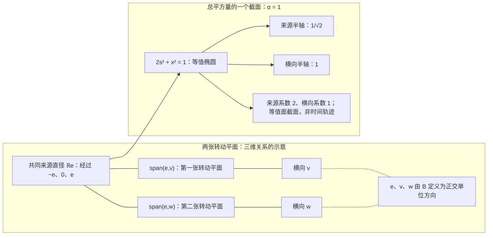

# 两种变化合起来，只有来源不同

> 来源：用户于 2026-11-05（Asia/Singapore）在本会话提供的 ΩQ-017 LaTeX 研究工作稿；原稿未另署作者或模型。本文为参考输入，Lean 是仓库的数学真源；本次仅转换 Markdown，未作形式化认证。正文中的固定快照、项目核读叙述与理论结论均保留原稿口径；一幅双面板 TikZ 图转换为 Mermaid 示意图，保留共源转动平面、正交轴、平方总量椭圆及原图注。

量子起源回溯工作稿 $\Omega Q$-017

从一个未定差额，到三维、相位与有限量子理论

**本轮唯一候选。** 在同一完整原响应空间内，由来源定义比较 $B$、单位向量 $e$ 与投影 $P_e$。要求原可逆作用闭包中有两个连续生成元 $K,L$，生成该完整 Lie 代数，且

$$
\boxed{-K^2-L^2\in\operatorname{span}_{\mathbb R}\{I,P_e\}\setminus\mathbb RI.}
$$

先不规定来源差额的大小、正负或总体尺度。

**本轮证明。** 若写作 $-K^2-L^2=\alpha I+\gamma P_e$，则

$$
\alpha>0,\quad \gamma=\alpha,\qquad
\dim W=3,\quad \mathfrak g=\mathfrak{so}(W,B).
$$

差额恰好多一份、两条正交支路与三维整体，均由同一关系及完整来源推出。

2026 年 11 月 5 日（新加坡）

固定项目版本：。

提交时间：2026-11-05 07:22:18 UTC／15:22:18 新加坡。

本稿包含自足的普通数学证明。新候选未提交到项目，也未声明已经 Lean 形式验证。

## 本轮结论与阅读路径

这一轮回溯的是系数的来处。Q15 曾直接要求来源方向得到两份平方、其他方向得到一份；Q16 用两份返回的特定乘积表达共同来源。本轮只要求：两份平方合起来，只有来源方向与其余方向不同。*差额有多大、是多还是少，暂时都不输入。*

关键证明只有两条有限事实：实转动的每个非零平方谱总是成双；秩一改变至多让每个谱值的重数差一。两者结合，把未知差额从连续区间锁定为 $\pm1$。少一份会让来源被全部连续变化固定，与完整来源循环性冲突；所以只能多一份。随后同一平方式迫出一个三维块，完整原群排除一切额外可读方向。

| 本轮工作的层次 | 已证明内容与准确边界 |
|:---|:---|
| 新的回溯 | 非标量来源差额的谱系数只能为 $\pm1$，再由原完整性选择 $+1$。 |
| 三维完整刻画 | 在原完整有限前端上，唯一候选当且仅当 $W$ 为三维且原连续代数为全部旋转。 |
| 更大结构 | 不作完整来源选择时，平坦余项分解为二维复平面块或四维四元数块。 |
| 概率与相位 | 从原三维比较构造 $\mathbb C^2$、Hopf 相位纤维、密度矩阵，并保持原概率坐标。 |
| 完整有限理论 | 证明张量、正态与效果、CP 仪器、Lüders 更新、连续酉演化及其必要的实际接口。 |
| 尚未完成 | 不从本轮前端反推任意 $\Omega$ 的有限性、完整参考、全部装置或实际时钟。 |

本稿的“平方总量”专指 $\|Kz\|_B^2+\|Lz\|_B^2$。它不是物理作用量、Hamilton 能量或 $\hbar$ 的定义。这里得到的是有限谱重数的刚性，不是已测物理能级的量子化。

**为什么这一轮确有简化。**

相对 Q16，选择式从原生成元的四次降为二次；相对 Q15，不再预设来源额外那份平方的量值。代价是重新显式使用单位算子来表达“其他方向相同”。三轮在同一前端上选出同一准确模型类；本轮不宣称逻辑条件更弱、不宣称所有复杂度指标都下降，也不把完整背景藏进一个新名词。这是一项可核查的系数回溯。

## 1　固定项目来源与本轮回溯位置

**固定版本与实际检索范围。**

本轮固定 `dev` 为 `00e86d6353be562f0aa7caa23f7544e0fb65e69f`； 公共 GitHub 页面所示提交时间为 2026 年 11 月 5 日 07:22:18 UTC， 即新加坡时间 15:22:18。 完整 `docs` 目录树有 1,401 项，其中理论文件 1,286 份； 本轮按明确前缀下载并全文检索其中 322 份 AURIC、OmegaQ、CSA、 ContextualSpacetimeQuantum 及相关量子原子文稿，共 32,351,912 字节， 另下载 9 份有关三读、历史核、共同相位、正细化及补空间的 Lean 源码。 331 份原文的 Git blob 哈希均与固定树对应。 全文关键词检索不等于逐篇数学审核；本文精读所引用定义、定理及其证明。 全仓递归树在 56,644 项处截断；Problems 树和比较 API 遇公共 IP 速率限制，未重试。 没有据此声称覆盖全仓，也没有重新运行 Lean 或审核全部导入公理。[\[1\]](#ref-q17commit), [\[16\]](#ref-threelean)

相对前轮固定提交 `b1d673668c6d1bc06a152e4607048833d830ca53`， GitHub 比较页显示 697 个提交、4,068 个变更文件。 本轮逐字比较的 50 条重点路径中，17 条在旧提交没有该路径，2 条修改，31 条不变； 这不是全仓差异计数。[\[2\]](#ref-q17compare)两个修改均为纯追加：C123 母卷增加第 76–84 节， C133 未锚定正性桥增加第 8–16 节。 完整 `docs` 文件名中没有 OmegaQ-017； 所检索语料中未见本轮完整谱结论。这只定位本轮增量，不建立全球新颖性或优先权。

**Q15 的连续必要区间与本轮的离散增量。**

项目 Q15 第 4 节已经考虑

$$
-K^2-L^2=I+\beta P_e
$$

并证明 $-1\le\beta\le1$；同节明确写出一般 $\alpha I+\gamma P_e$ 在 $\alpha>0$ 时的共同缩放。 原文强调该必要区间没有证明其中每个系数可实现。 其奇维障碍仅断言 $-A^2-B^2=I$ 的实空间必须为偶维。 因此本轮应把增量表述为：由两个反对称平方的非零谱偶重及秩一谱差， 把非标量情形从连续必要区间收紧到 $\gamma/\alpha\in\{-1,1\}$， 再由原完整来源排除负分支；不能把一般 $\alpha I+\gamma P_e$ 形式本身称为本轮首创。 这里仍须使用本轮自己的完整生成和完整来源前件。[\[3\]](#ref-q15), [\[4\]](#ref-q16)

**四项最新对应与不能挪用的前件。**

1.  **C128 原生续卷第 166–172 节。** 最新候选把正交输入的读回限制在同一谱框架，保留半重叠圆和秩二内部自问。 定理 167.1 在有限 EJA、正 Frobenius 比较、实双线性 $D$、 $D_a u=0$ 及秩至少三下恢复全部切口关系；第三颗框架原子使非负平方逐项归零。 裸秩二没有此局部结论，定理 168.1 消费原实际联合补足。 最终量子回接仍保留母卷定义 41.1 的完整 $B$ 或另名定义 67.1 的 $B_{\rm cl}$， 包括实际准备、参考、全事件 R、原 $D$ 保持、失败、细记录和合法历史。 这是缩小测试域的已证明进展，不能用来删除 Q17 自有前端。[\[7\]](#ref-c128native)

2.  **C139 第 21 节及固定词续卷。** 两个四模相干盒可在二十七模数学补全中给同一个全载体锐利成功投影。 但定义 21.6 仍另要求实际叶与原独立九旗事件在全部准备、参考及合法前接后绑定： $\widehat p_h(M_j)=p_h(Q_{s_j})/9$，另一表同理。 定理 21.7 先用共同锐利事件的有限可加性，再用该实际绑定，才推出原 QC。 几何压缩 $J^*M_jJ=Q_{s_j}/9$ 不单独供应绑定； 定理 21.9–21.10a 的有限横向扰动保留全部角内 Born 数据仍可改变新叶或总成功率。 固定词续卷另证明：若比较只连续依赖两端当前射线、标记是一个固定原门字， 则一致缺陷满足 $3d+2c_w\ge1$，所以精确 C12 在该实现类不可能。 这些结果限制具体消费者，不是所有原实现均不可能。[\[14\]](#ref-c139), [\[15\]](#ref-c139word)

3.  **C133 原生正性仍有明确缺口。** 在任意有单位 magma、任意标记和有限非负零对角比较上， 四变量三读关系 R 加全域五点负型 $N_5$ 才有完整复 Hilbert 表示。 最新 W 续卷第 23–26 节无条件保留有限比较矩阵并归约到零漂移模型； 第 30 节仍未证明零配方可在所有外部上下文中替换。 当前完整条件几何候选仍保留一个统一 $\eta>0$，使 $c^\eta$ 满足所有三点三角； R 单独是否供应该条件或 $N_5$ 未决。 这条未决的原始正性来源支线，不能由 Q17 的既有正定紧群前端反向补证。[\[10\]](#ref-c133n5), [\[11\]](#ref-c133w)

4.  **C123 原 $D$ 的输出扭转。** 母卷新第 76–79 节给同一完整 tagged 矩阵/CP 世界的两个扩张 $D^+=\delta$ 与 $D^-=J\delta$。 两者保留所有面积读数、SC、指针 S/S2 及全部非 $D$ 接口， 但坏扩张有原准备与原正效果满足 $\alpha(x)=0$ 而 $\alpha(D^-_a x)=1/4$。 因此平方或面积不能忠实确定另名原有向关系。 Q17 若确实从固定 $\mathfrak g$ 中的原反对称 $K,L$ 出发，其有限定理不受此例反驳； 但它不能据此声称已经重构项目任意原 $D$、实际事件和物理时钟。[\[6\]](#ref-c123)

**最新有限平均入口。**

C123 第 80–82 节已在与 $D$ 无关的原子实基上，以 $e_{ij}=(b_i+b_j)/2$ 要求 $[D_{e_{ij}},L_{e_{ij}}]b_k=0$。 局部恢复只需有限实含幺交换代数、双线性 $D$ 及 $D_a u=0$， 经二次极化得到全部导子律与 SC；量子回接仍保留完整 $B_R/B_{\rm cl}$ 和独立 SJ。 第 83–84 节另证明：普通实际效果证书加 aNU 逼近仍不足，须付衰减相对速率或更强加权证书。 这是已有入口，只能与 Q17 的二次闭合对应；不能替换成所谓本轮新公理，亦未证明两候选强弱可比。[\[6\]](#ref-c123)

## 2　同一完整原响应与来源比较

#### 定义 2.1：原概率行与完整有限前端

在同一原签名 $\Omega$ 内固定一个真实归一来源。对原可逆控制历史 $a$、合法未来请求 $f$ 和原结果标签 $w$，记完整响应行

$$
x_a(f,w)=p(a;f,w),\qquad p\ge0,\quad \sum_w p(a;f,w)=1.
$$

共同未来保留全部合法终端请求、原结果、失败、实际可读旧记录及后续合法性区别；原身份、端口、设备和历史索引继续保留。没有原定义的请求不人为补概率。总可逆连接含空历史、对复合封闭、在同一菜单内有准确统计逆，并在全未来线性关系上良定。

取同一来源的完整原可逆轨道，置

$$
V=\operatorname{span}_{\mathbb R}\{x_a\},\qquad u(x_a)=1,\qquad
W=\ker u=\operatorname{span}\{x_a-x_b\}.
$$

本轮明确要求 $0<\dim W<\infty$。原身份相同与响应相同是不同关系；构造线性表示不删除原索引。若已有可读历史使张成空间更大，使用更大的完整空间。

#### 引理 2.2：紧作用、固定中心与完整循环性

原可逆作用在 $V$ 上的矩阵闭包 $H$ 是紧群。定义

$$
c=\int_Hhx_\epsilon\,dh,\qquad e=x_\epsilon-c,
\qquad G=H|_W,\qquad \mathfrak g=\operatorname{Lie}(G).
$$

则 $G$ 紧、作用有效，$e\ne0$，并且

$$
W=\operatorname{span}(Ge).
$$

**证明。**

有限维中可选有限个实际评价坐标分离 $V$，并从原响应行中选一组基。任一原控制将这些基行送到其他响应行；所选概率坐标有界，故其矩阵一致有界。准确逆也在原集合内，故逆矩阵一致有界；闭包紧且不含奇异矩阵，是群。 Haar 平均固定 $c$，且 $u(c)=1$，故 $V=\mathbb Rc\oplus W$。在 $W$ 上平凡的原矩阵也固定 $c$，因而在 $V$ 上平凡。所有轨道行减去 $c$ 正好张成 $W$；若 $e=0$，轨道只有一点，违背 $W\ne0$。 $\square$

闭包中的极限矩阵与连续生成元首先是原响应的数学表示，不自动成为准确可调用的原装置。Haar 平均也不供应实际随机准备。

#### 定义 2.3：由轨道内生的比较

记 $n=\dim W$。对 $\alpha\in W^*$ 定义

$$
\mathsf C\alpha=\int_G\alpha(ge)\,ge\,dg,
\qquad B(v,w)=\frac1n(\mathsf C^{-1}v)(w).
$$

#### 引理 2.4：规范比较及完整轨道恒等式

$\mathsf C$ 可逆，$B$ 正定且 $G$ 不变，并有

$$
B(e,e)=1,\qquad
\int_Gge\otimes(ge)^{\flat_B}\,dg=\frac1nI_W.
$$

**证明。**

完整循环性给 $\alpha(\mathsf C\alpha)=\int\alpha(ge)^2dg>0$ 对全部 $\alpha\ne0$ 成立。Haar 不变性给 $B$ 不变。取迹有 $\int B(ge,ge)dg=\operatorname{Tr}(B\mathsf C)=1$，而轨道上长度相同，故 $B(e,e)=1$。对任意 $w$，积分算子作用于 $w$ 等于 $\mathsf C(w^{\flat_B})=w/n$。 $\square$

若 $T:W\to W'$ 保来源并共轭全部原作用，则 $\mathsf C'=T\mathsf C T^*$，从而 $B'(Tv,Tw)=B(v,w)$。换源到同一轨道点也只共轭后续关系。删去可读坐标的非单射投影不属于这种同构。

后文的算子表达对*任意*不变正定比较、任意单位循环来源成立。上述规范构造只使比较本身完全由原来源确定。本轮使用同一内生比较定义来源投影与二元平方总量；没有另加一份独立度量。

## 3　本轮唯一候选：两份作用量合在一起，只有来源不同

保留同一完整有限前端：$W\ne0$ 是有限实响应空间，$B$ 是由原来源轨道内生的正定比较，$G\subseteq O(W,B)$ 是完整原可逆矩阵闭包，且

$$
\mathfrak g=\operatorname{Lie}(G),\qquad B(e,e)=1,\qquad W=\operatorname{span}(Ge).
$$

原 $\mathfrak g$ 在选择任何见证之前已经确定。全部原响应、失败、实际可读历史及原索引继续保留；本节不先换成一个更小的有效块。

#### 定义 3.1：来源比较代数与二元平方总量

由同一个来源定义

$$
P_ez=B(e,z)e,\qquad
\mathcal A_e=\operatorname{span}_{\mathbb R}\{I_W,P_e\}\subseteq\operatorname{End}_{\mathbb R}(W).
$$

对 $K,L\in\mathfrak g$，定义二元平方总量

$$
M(K,L)=K^*K+L^*L=-K^2-L^2.
$$

它是自伴正半定算子，并满足

$$
B(z,M(K,L)z)=\lVert Kz\rVert_B^2+\lVert Lz\rVert_B^2.
$$

$\mathcal A_e$ 由已经定义的单位与来源投影生成；没有预先给其中两个方向指定系数。

**本轮唯一候选 $\Omega Q$-017：二元平方总量的唯一异常来自原来源。**

$$
\boxed{\exists K,L\in\mathfrak g:\qquad
\operatorname{Lie}\langle K,L\rangle=\mathfrak g,\qquad
M(K,L)\in\mathcal A_e\setminus\mathbb RI_W.}
\tag{Q17}
$$

即存在实数 $\alpha,\gamma$，使

$$
-K^2-L^2=\alpha I_W+\gamma P_e,
\qquad M(K,L)\notin\mathbb RI_W.
\tag{3.1}
$$

不预置 $\alpha$、$\gamma$ 的数值或相对正负，不预设三维、秩二、正交、来源圆或非交换。

**白话：** 把两种原变化的作用量合在一起。除了来源这一条方向，其余方向完全一样；来源确实不同，但先不规定它多多少或少多少。两种变化还要生成全部原连续变化，全部可读方向也都来自这个来源。下面证明，这个唯一差额必恰好多一份，而且整体只能是三维。

非标量条件本身排除 $\dim W=1$，故候选成立时 $n=\dim W\ge2$，$I_W,P_e$ 线性独立，系数唯一。它们均可从原平方总量定义：

$$
\alpha=\frac{\operatorname{Tr}M-B(e,Me)}{n-1},\qquad
\gamma=B(e,Me)-\alpha.
\tag{3.2}
$$

因此式 (3.1) 中的系数是原关系的读数，而不是另外输入的参数。

与 Q16 相比，本轮把原生成元次数从四降回二，并把上一轮仍需直接要求的特定返回结构，退回到一个*尚未指定差额大小*的来源各向同性条件。它重新使用单位算子来表达“其余方向相同”；因此不宣称每一个符号计数指标都同时下降。其新的数学工作是证明唯一差额的量值由谱的成对性强制，而非把旧的归一系数藏在定义中。

## 4　秩一的谱变化与旋转的成对性

#### 引理 4.1：实反对称平方的谱成对

设 $T$ 是有限实正定空间上的反对称算子。$-T^2$ 的每个非零特征值为正，且其特征空间维数为偶数。若空间维数为 $n$，则

$$
\dim\ker T\equiv n\pmod2.
$$

**证明。**

$-T^2=T^*T$ 自伴正半定。若 $\lambda>0$，$T$ 保持其特征空间 $E_\lambda$，并且其上的 $J=T/\sqrt\lambda$ 满足 $J^2=-I$。若 $d=\dim E_\lambda$ 为奇数，取行列式得到 $(\det J)^2=(-1)^d=-1$，矛盾。因此所有非零特征空间均为偶维。实自伴谱分解给出正交直和，再对维数取模二，即得核维数的奇偶性。又 $\ker(-T^2)=\ker T$，因为 $B(z,-T^2z)=\lVert Tz\rVert^2$。

$\square$

#### 引理 4.2：固定谱值的重数差至多一

设 $A,D$ 是同一有限实正定空间上的自伴算子，且 $\operatorname{rank}(A-D)\le1$。对每个实数 $\lambda$，若 $m_A(\lambda),m_D(\lambda)$ 表示相应特征值的重数，不在谱中时取零，则

$$
|m_A(\lambda)-m_D(\lambda)|\le1.
$$

**证明。**

有

$$
\ker(A-\lambda I)\cap\ker(A-D)\subseteq\ker(D-\lambda I).
$$

$\ker(A-D)$ 的余维至多一，所以左侧维数至少为 $m_A(\lambda)-1$。得到 $m_D(\lambda)\ge m_A(\lambda)-1$。交换两算子再作同一论证，给出反向不等式。自伴性保证特征值的代数重数就是这些核的维数。

$\square$

#### 定理 4.3：二元平方的唯一谱差额只有两种符号

设 $e$ 为单位向量，$K,L$ 为有限实正定空间上的反对称算子，且

$$
-K^2-L^2=I_W+\beta P_e.
\tag{4.1}
$$

则

$$
\boxed{\begin{cases}
\beta=0,&\dim W\text{ 为偶数},\\
\beta\in\{-1,+1\},&\dim W\text{ 为奇数}.
\end{cases}}
$$

结论不需要 Lie 完整生成、来源循环性或预设维数。

**证明。**

定义

$$
A=-K^2,\qquad D=I_W+L^2.
$$

于是 $A-D=\beta P_e$，秩至多一。对每个实数 $\lambda$，记重数差为 $d_\lambda=m_A(\lambda)-m_D(\lambda)$。引理 4.2 给 $|d_\lambda|\le1$。

除 $\lambda=0,1$ 外，两份重数都为偶数：$A$ 的非零谱来自 $-K^2$；$D$ 在 $\lambda\ne1$ 的特征空间就是 $-L^2$ 在非零值 $1-\lambda$ 的特征空间，若该值不存在则重数为零。因此 $d_\lambda$ 既为偶数又绝对值至多一，只能为零。

在 $0$ 处，$m_A(0)\equiv n\pmod2$，而 $m_D(0)$ 是 $-L^2$ 在值 $1$ 的偶重数；在 $1$ 处，$m_A(1)$ 为偶数，而 $m_D(1)=\dim\ker L\equiv n\pmod2$。故

$$
d_0\equiv d_1\equiv n\pmod2.
$$

两个空间总维数相同，所以 $d_0+d_1=0$。迹之差则为

$$
\beta=\operatorname{Tr}(A-D)=\sum_\lambda\lambda d_\lambda=d_1.
$$

若 $n$ 偶，$d_0,d_1$ 均偶且绝对值至多一，只能同为零。若 $n$ 奇，二者均为 $\pm1$，且符号相反，故 $\beta=\pm1$。证明完成。

$\square$

这是一条有限谱重数定理，不是对物理能级或作用量单位的量子化主张。所有可能的中间谱值都在两份自伴谱中成对抵消，最后只剩零与一处各一个方向的差额；差额的大小因而是一份，而不是任意连续参数。

#### 推论 4.4：两个平方的奇维障碍

若有限实正定空间 $F$ 上的反对称算子 $A_1,A_2$ 满足

$$
-A_1^2-A_2^2=I_F,
$$

则 $\dim F$ 为偶数，允许 $F=0$。

**证明。**

非零空间中任选一个单位向量，把此式视为定理 4.3 的 $\beta=0$ 情形，即得偶维。零维直接成立。

$\square$

## 5　来源必须多一份，且完整整体只有三维

#### 引理 5.1：尺度为正，来源的负差额被完整性排除

在本轮完整前端中，Q17 的系数必满足

$$
\boxed{\alpha>0,\qquad\gamma=\alpha.}
$$

因此共同重标 $\bar K=K/\sqrt\alpha,\bar L=L/\sqrt\alpha$ 后，

$$
-\bar K^2-\bar L^2=I_W+P_e.
$$

**证明。**

非标量性给 $n\ge2$ 与 $\gamma\ne0$。在 $E=e^\perp\ne0$ 上，正半定性给 $\alpha\ge0$。若 $\alpha=0$，则对每个 $z\in E$，

$$
\lVert Kz\rVert^2+\lVert Lz\rVert^2=B(z,Mz)=0,
$$

故 $K,L$ 均消灭 $E$。反对称性使 $Ke$ 与 $e$ 及 $E$ 都正交，故 $Ke=0$，同理 $Le=0$。于是 $K=L=0$、$M=0$，违反非标量性。因此 $\alpha>0$。

共同重标不改变所生成的 Lie 代数。定理 4.3 给 $\gamma/\alpha=\pm1$，并说明 $n$ 为奇数。若 $\gamma=-\alpha$，则 $Me=0$，故 $Ke=Le=0$。完整生成给 $Ae=0$ 对全部 $A\in\mathfrak g$ 成立。

对任意 $h\in G$，包括不连通分支，$h^{-1}\mathfrak gh=\mathfrak g$。因此

$$
A(he)=h(h^{-1}Ah)e=0\qquad(A\in\mathfrak g).
$$

来源循环性遂使全部 $A\in\mathfrak g$ 消灭 $W=\operatorname{span}(Ge)$，即 $\mathfrak g=0$。于是 $K=L=0$，再次违反 $M$ 非标量。负支被排除，只能 $\gamma=\alpha$。

$\square$

#### 定理 5.2：Q17 的完整三维刻画

在本轮保留的完整有限前端中，以下两项等价：

1.  存在满足 Q17 的 $K,L$；

2.  $\dim W=3$，且 $\mathfrak g=\mathfrak{so}(W,B)$。

此时

$$
G^\circ=SO(W,B),\qquad G=SO(W,B)\text{ 或 }O(W,B).
$$

全部 Q17 见证恰为

$$
K=\sqrt\alpha X_v,\qquad L=\sqrt\alpha X_w,
\qquad \alpha>0,
\tag{5.1}
$$

其中 $(v,w)$ 是 $e^\perp$ 的正交单位基，

$$
X_t(se+z)=st-B(t,z)e\qquad(t,z\perp e).
$$

**证明。**

**一、标准三维块。** 由上引理，共同重标后可令 $-K^2-L^2=I+P_e$。本段省略重标记号。令

$$
E=e^\perp,\qquad v=Ke,\quad w=Le,
$$

并写成原正交分块

$$
K=\begin{pmatrix}0&-v^\flat\\v&D_1\end{pmatrix},\qquad
L=\begin{pmatrix}0&-w^\flat\\w&D_2\end{pmatrix},
$$

其中 $D_1,D_2$ 在 $E$ 上反对称。来源分量与横向分量给

$$
\lVert v\rVert^2+\lVert w\rVert^2=2,
\qquad T-D_1^2-D_2^2=I_E,
\qquad T=v\otimes v^\flat+w\otimes w^\flat.
$$

所以 $0\preceq T\preceq I_E$、$\operatorname{rank}T\le2$，且 $\operatorname{Tr}T=2$。两个可能的非零特征值只能都为一，故 $T$ 是其二维像的正交投影。

令 $V:\mathbb R^2\to E$ 的两列为 $v,w$。由 $T=VV^*$、$TV=V$ 和 $V$ 单射，得到 $V^*V=I_2$。所以 $v,w$ 正交归一。 对 $z\in\operatorname{span}\{v,w\}$，

$$
\lVert D_1z\rVert^2+\lVert D_2z\rVert^2=B(z,(I_E-T)z)=0.
$$

因此 $D_1,D_2$ 都消灭这张平面。于是

$$
U=\operatorname{span}\{e,v,w\}
$$

是共同不变的三维块，且

$$
Ke=v,\quad Kv=-e,\quad Kw=0;
\qquad Le=w,\quad Lw=-e,\quad Lv=0.
$$

其正交补也共同不变，限制满足两个负平方之和为单位。

**二、处理整个原群。** 完整 Lie 生成使 $U$ 被原 $\mathfrak g$ 保持。 任取 $h\in G$，由 $h^{-1}\mathfrak gh=\mathfrak g$，空间 $U'=hU$ 也被 $\mathfrak g$ 保持。因此 $K,L$ 与

$$
P_e=-K^2-L^2-I
$$

均保持 $U'$。被 $P_e$ 保持的空间，或者包含 $e$，或者全部垂直于 $e$：只要某个向量与 $e$ 配对非零，投影便把 $e$ 送入该空间。

若 $e\in U'$，共同不变性给 $e,Ke,Le\in U'$，于是 $U\subseteq U'$，两者同为三维，故 $U'=U$。若 $U'\subseteq e^\perp$，原平方等式限制为

$$
-(K|_{U'})^2-(L|_{U'})^2=I_{U'},
$$

违背推论 4.4，因为 $\dim U'=3$。所以全部 $h\in G$ 都保持 $U$。来源循环性遂给

$$
W=\operatorname{span}(Ge)\subseteq U,
$$

故 $W=U$。三个独立算子 $K,L,[K,L]$ 是三张坐标平面的转动，所以原 $\mathfrak g=\mathfrak{so}(W,B)$。恢复共同尺度便得到式 (5.1)。

**三、逆向。** 若 $W$ 为三维且 $\mathfrak g$ 为全部反对称算子，取 $e^\perp$ 的正交单位基 $v,w$，令 $K=\sqrt\alpha X_v,L=\sqrt\alpha X_w$，其中 $\alpha>0$。则

$$
-K^2=\alpha(P_e+P_v),\qquad
-L^2=\alpha(P_e+P_w).
$$

两者和为 $\alpha(I+P_e)$，非标量；两者及交换子生成全部 $\mathfrak{so}(3)$。因此 Q17 成立。最后 $SO(3)\subseteq G\subseteq O(3)$，完整群只有所列两种可能。

$\square$

#### 推论 5.3：与 Q16 的模型类等价及见证区别

Q17 与 Q16 在同一完整前端上选择同一个准确模型类。Q17 的共同归一见证 $\bar K=K/\sqrt\alpha,\bar L=L/\sqrt\alpha$ 满足

$$
\bar K^2\bar L^2=P_e.
$$

反之，Q16 见证 $(aX_v,a^{-1}X_w)$ 可在原 Lie 空间中重选为 $(X_v,X_w)$，成为 Q17 见证。

**证明。**

由主定理，Q17 的归一平方分别为 $-(P_e+P_v)$、$-(P_e+P_w)$，其乘积为 $P_e$。Q16 的完整三维刻画给反向的标准见证；完整生成保持。[\[4\]](#ref-q16)

$\square$

这里等价的是*存在适当见证的模型类*。Q16 允许互反的两速率，Q17 的见证则具有同一尺度；不声称一个未经重标的 Q16 原对自动满足 Q17。原装置已经携带的时间、能量、速度和历史标签继续保留，数学见证的重选不改写这些原标签。

**本轮核心白话。** 两种变化的作用量合起来，除了来源以外处处相同。单个实转动总是成对占据方向；如果两份平方之间只剩一个来源差额，其余成对方向都必须互相抵消，差额便只能是一整份。少一份会让来源完全不动，无法生成这个完整系统；所以只能多一份。取到这一份以后，来源就分出两条正交支路。它们和来源共同组成一个三维块，而整个原群与来源完整性不容许再留下别的可读块。上一轮的特定返回乘积于是成为结论。

## 6　更大的有限结构：平坦总量的圆块与四元数块

前面的谱定理还可以展开成一份完整的有限分块理论。这里暂不使用完整来源循环性，也不假定整体只有三维；研究同一类原反对称算子在旁支上究竟能形成什么结构。

#### 定义 6.1：平坦二元块

设 $F$ 为有限实正定空间。称反对称算子对 $(A,D)$ 为平坦二元块，如果

$$
-A^2-D^2=I_F.
\tag{6.1}
$$

其含义是：两种变化合起来的平方量在每个方向上相同。允许 $F=0$。

#### 定理 6.2：平坦二元块的完整正交分解

每个满足式 (6.1) 的有限实反对称对，都可正交分解为以下两类共同不变块的直和：

1.  **二维圆块：** 在某个二维正定平面上，

    $$
    A=aJ,\qquad D=dJ,\qquad J^2=-I,\quad J^*=-J,
    \qquad a,d\in\mathbb R,\quad a^2+d^2=1.
    $$

2.  **四维四元数块：** 在某个四维正定空间上，

    $$
    \begin{aligned}
    A&=\sqrt\lambda\,J_1,\\
    D&=\sqrt{1-\lambda}\bigl(tJ_1+\sqrt{1-t^2}\,J_2\bigr),
    \end{aligned}
    \qquad 0<\lambda<1,\quad -1<t<1,
    \tag{6.2}
    $$

    其中

    $$
    J_1^2=J_2^2=-I,\qquad J_1J_2=-J_2J_1,
    \qquad J_1^*=-J_1,\quad J_2^*=-J_2.
    $$

每个所列块都满足式 (6.1)。因此这是全部有限模式的刻画；本定理不要求这些块的排列或重复次数唯一。

**证明。**

**一、先由平方作内部谱分解。** 置 $P=-A^2$。式 (6.1) 给

$$
0\preceq P\preceq I_F,\qquad P=I_F+D^2.
$$

所以 $P$ 与 $A,D$ 都可交换。实自伴谱分解把 $F$ 正交分成共同不变的 $E_\lambda$，其中 $\lambda\in[0,1]$。在 $E_\lambda$ 上，

$$
A^2=-\lambda I,\qquad D^2=-(1-\lambda)I.
$$

若 $\lambda=0$，反对称性给 $A=0$，而 $D^2=-I$；若 $\lambda=1$，则 $D=0$、$A^2=-I$。两种情形均可选单位向量 $q$，以 $q,Jq$ 张成一个不变正交平面，再在共同不变的正交补上重复，得到第一类块。

**二、再由两种复转向的相对关系分解。** 现设 $0<\lambda<1$，定义

$$
J_1=A/\sqrt\lambda,\qquad J=D/\sqrt{1-\lambda}.
$$

两者均反对称且平方为 $-I$。定义其原对称混合

$$
T=-\tfrac12(J_1J+JJ_1).
\tag{6.3}
$$

它自伴，且分别与 $J_1,J$ 可交换；例如 $J_1(J_1J+JJ_1)=-J+J_1JJ_1=(J_1J+JJ_1)J_1$。 对任意 $z$，

$$
\lVert(J_1+J)z\rVert^2=2\lVert z\rVert^2+2B(z,Tz),
\qquad
\lVert(J_1-J)z\rVert^2=2\lVert z\rVert^2-2B(z,Tz).
$$

故 $-I\preceq T\preceq I$。再按 $T$ 的谱正交分解，每块共同保持 $J_1,J$，并且有 $T=tI$、$-1\le t\le1$。

若 $t=1$，第二份范数式给 $J=J_1$；若 $t=-1$，第一份范数式给 $J=-J_1$。这又回到两算子都是同一个复转向的实倍数，分解为第一类二维块。

若 $|t|<1$，定义

$$
J_2=\frac{J-tJ_1}{\sqrt{1-t^2}}.
$$

因为 $J_1J+JJ_1=-2tI$，直接展开得到

$$
J_2^2=-I,\qquad J_1J_2+J_2J_1=0.
$$

$J_2$ 仍反对称。重新解出 $J$，即得到式 (6.2)。

**三、把每个相对块分成四维。** 任选一个单位向量 $q$。四个向量

$$
q,\qquad J_1q,\qquad J_2q,\qquad J_1J_2q
$$

正交归一。其范数保持，因为 $J_1,J_2$ 正交；各交叉内积为零，因为 $J_1,J_2,J_1J_2$ 都反对称，并可用反交换式把任意交叉配对约到这些零对角配对。

这四个向量的张成同时被 $J_1,J_2$ 保持：$J_1$ 把它们依次送到 $J_1q,-q,J_1J_2q,-J_2q$，$J_2$ 则送到 $J_2q,-J_1J_2q,-q,J_1q$。 反对称性使正交补仍共同不变，有限维归纳给全部四维块。其乘法表正是左乘四元数 $i,j$ 的实四维表示。

最后，第一类直接有 $-A^2-D^2=(a^2+d^2)I=I$。第二类中 $tJ_1+\sqrt{1-t^2}J_2$ 的平方为 $-I$，所以两份负平方分别为 $\lambda I$、$(1-\lambda)I$，和也为单位。逆向成立。

$\square$

这个分解给“两个变化的关系”一个更大的位置：先看它们各自的平方份额 $\lambda,1-\lambda$，再看归一转向之间的对称混合 $t$。$t=\pm1$ 时，两者沿同一张圆面转动；$|t|<1$ 时，去掉共有部分后出现两个反交换的复转向，形成四维四元数块。两个参数都来自原算子的谱，未从外面给每块增加一份乘法。

必须区分类型：这里的四元数块是*原响应空间上*两算子的共同不变表示。后面从三维旋转代数另行构造的四实维振幅代数，是另一种明确构造的对象。抽象同构于四元数并不把两者自动认成同一个原系统。

## 7　三个差额分支组成完整的有限结构图

#### 定理 7.1：来源差额的全部分块

设有限实正定空间中 $e$ 单位，$K,L$ 反对称，且

$$
-K^2-L^2=I_W+\beta P_e.
$$

则恰有以下三种可能：

1.  $\beta=0$：整个空间由定理 6.2 的二维圆块与四维四元数块组成，故维数为偶数。

2.  $\beta=-1$：来源线 $\mathbb Re$ 被两者共同固定，其正交补为平坦二元块，因而由上述二维、四维块组成。

3.  $\beta=+1$：存在 $e^\perp$ 中的正交单位向量 $v,w$，使

    $$
    U=\operatorname{span}\{e,v,w\},
    $$
    在 $U$ 上有

    $$
    Ke=v,\ Kv=-e,\ Kw=0;
    \qquad Le=w,\ Lw=-e,\ Lv=0,
    $$
    而 $U^\perp$ 为平坦二元块，故也只含上述二维、四维块。

反向，任意所列正交直和均满足对应的同一个平方恒等式。

**证明。**

定理 4.3 已穷尽 $\beta$ 的可能值。$\beta=0$ 直接使用平坦分类。若 $\beta=-1$，来源配对给 $\lVert Ke\rVert^2+\lVert Le\rVert^2=B(e,(I-P_e)e)=0$，故 $Ke=Le=0$。反对称性保持 $e^\perp$，限制恒等式后得到平坦块。

若 $\beta=1$，定理 5.2 证明的第一段只使用这一平方等式，尚未使用任何完整生成或来源循环性。它以横向正算子 $T=Ke\otimes(Ke)^\flat+Le\otimes(Le)^\flat$ 的 $0\preceq T\preceq I$、$\operatorname{rank}T\le2$、$\operatorname{Tr}T=2$ 迫出所列正交标准三维块。其正交补限制后满足两个负平方之和为单位，再应用平坦分类即可。

反向在固定来源线或标准三维块上直接计算，在其余各块使用平坦恒等式，取正交直和便得到相应公式。

$\square$

| 来源差额 | 含来源的基本结构     | 允许的其余结构         |
|:--------:|:---------------------|:-----------------------|
|  $0$   | 无唯一来源异常       | 二维圆块、四维四元数块 |
|  $-1$  | 一条共同固定的来源线 | 二维圆块、四维四元数块 |
|  $+1$  | 一个标准三维来源块   | 二维圆块、四维四元数块 |

所以本轮的三维结构是这份完整有限分类中的正来源分支。Q17 的非标量条件排除平坦的零差额，完整来源条件排除固定来源的负差额；完整生成与完整来源轨道再排除正分支中的全部旁块。没有任意丢掉一块已存在的原响应：若旁块仍真实可读，候选的完整前件就不成立。

平坦分类也再次解释为什么只要求非交换不够。四维四元数块中 $K,L$ 非交换，来源还可以有完整四维轨道；它仍没有本轮的单一来源异常。真正承担选择作用的是*同一原来源上的非标量差额与完整关系*，而非单独某个交换子非零。

**更大结构的白话。** 两种变化合起来处处一样时，内部可以是一张张圆面，也可以是两种互相反交换的转向组成的四维块。现在只允许来源比别处不同，于是原有的成对结构只能多出一个来源差额：少一份，来源就不动；多一份，来源会带出两条正交支路，合成三维。若整体确实全部来自这个来源，另外那些圆块和四维块便不能悄悄留在旁边。这让“三维”成为完整结构分类中的一个可证明分支。

## 8　来源之外没有另一个偏向：几何表述与实际读数

#### 命题 8.1：来源稳定比较的精确含义

设 $n=\dim W\ge2$，并由同一 $B,e$ 定义几何稳定子

$$
H_e=\{h\in O(W,B):he=e\},\qquad
\mathcal E(z)=\lVert Kz\rVert_B^2+\lVert Lz\rVert_B^2.
$$

以下三项等价：

1.  $M(K,L)\in\operatorname{span}\{I_W,P_e\}$；

2.  对全部 $h\in H_e,z\in W$，$\mathcal E(hz)=\mathcal E(z)$；

3.  若 $\lVert z\rVert=\lVert z'\rVert$ 且 $B(e,z)^2=B(e,z')^2$，则 $\mathcal E(z)=\mathcal E(z')$。

**证明。**

第一项给 $\mathcal E(z)=\alpha\lVert z\rVert^2+\gamma B(e,z)^2$，故推出第三项；第三项立即推出第二项。 第二项经实极化给 $h^*Mh=M$。稳定子中的 $P_e-(I-P_e)$ 使 $M$ 的来源–横向交叉块为零。 而 $H_e$ 在 $E=e^\perp$ 上包含全部 $O(E)$，故 $B(z,Mz)$ 在 $E$ 的单位球上为常数。再由极化，$M|_E=\alpha I_E$。来源块是一维标量，于是 $M=\alpha I+\gamma P_e$。

$\square$

$H_e$ 是由比较与来源定义的数学对称群；此处没有宣称原菜单已供应其中每个变换。候选只要求原二元平方总量在这些比较下没有另一个偏向。非标量条件再要求来源确实与其余方向不同。

仅检查 $e^\perp$ 内的等长方向仍不够。例如在标准 $\mathbb R^3$ 中取

$$
e=e_1,\qquad K=J_{12},\qquad L=J_{13}+cJ_{23},\qquad c\ne0,
$$

其中 $J_{ij}e_i=e_j,J_{ij}e_j=-e_i$。直接计算

$$
M=\begin{pmatrix}2&c&0\\c&1+c^2&0\\0&0&1+c^2\end{pmatrix}.
$$

横向压缩为 $(1+c^2)I_{e^\perp}$，但来源–横向交叉块非零；$e+e_2$ 与 $e-e_2$ 的长度及来源平方投影相同，作用量却相差 $4c$。所以必须比较完整向量，不能只保留一个横截面。这是当前见证对的反例；同一个三维模型仍可重选另一对合格见证。

### 8.1　同一个结构中的椭球、控制圆和内容球

定理 5.2 已给出正交标架 $(e,v,w)$ 及共同尺度 $\alpha>0$。因此对 $z=se+xv+yw$，

$$
\boxed{\mathcal E(z)=\alpha(2s^2+x^2+y^2).}
\tag{8.1}
$$

来源的平方总量是每个单位横向的两倍。这份比例由谱重数证明强制，未在候选中指定。

$\mathcal E(z)=1$ 的水平集是一张椭球：来源半轴为 $1/\sqrt{2\alpha}$，两个横向半轴均为 $1/\sqrt\alpha$。它表示*平方总量的等值面*，不是自动给出一条实际时间轨迹。 另一方面，

$$
\lVert(rK+tL)e\rVert_B^2=\alpha(r^2+t^2),
\tag{8.2}
$$

所以归一控制参数是一个圆；完整来源的归一轨道则是 $S(W)\cong S^2$。三个图形分别属于作用量水平集、二元控制参数、完整来源内容，不能混作同一层的维数。

#### 命题 8.2：见证的共同尺度和正交自由

任意 $O(2)$ 变换混合 $(K,L)$，都保持 $M(K,L)$ 及完整生成。任意共同非零重标 $(K,L)\mapsto(tK,tL)$ 仍给 Q17 见证，尺度变为 $t^2\alpha$。令

$$
\bar K=K/\sqrt\alpha,\qquad \bar L=L/\sqrt\alpha,
\qquad C=[\bar K,\bar L],
$$

则

$$
Ce=0,\quad Cv=w,\quad Cw=-v,\qquad C^2=-(I-P_e).
$$

正交混合使 $C$ 乘以混合矩阵的行列式，所以选择式不确定绝对手性。

**证明。**

设 $K_i'=\sum_jO_{ij}K_j$，其中 $K_1=K,K_2=L$。展开平方并用 $\sum_iO_{ij}O_{ik}=\delta_{jk}$，得到 $\sum_i(K_i')^2=K^2+L^2$；无需假定生成元可交换。两对线性张成相同，因此生成的 Lie 代数相同。共同重标的结论直接成立。最后在已证明的标准标架上计算交换子，即得各式；双线性与交替性给行列式因子。

$\square$

这里的尺度与标架变化发生在数学见证内。原装置的实际速度、原结果和可读历史仍随各自标签保留。 对任意 $h\in G$，同时共轭 $K,L$ 并把来源变为 $he$，则 $M\mapsto hMh^{-1}$、$P_e\mapsto P_{he}$；所以同一选择式对完整原群协变，包括不连通分支。

### 8.2　成对的实转动与后续复振幅各在哪一层

谱引理在每个正特征空间中使用 $J=T/\sqrt\lambda$、$J^2=-I$，以证明该空间必须偶维。这是局部转动平面的性质，并未把整个 $W$ 预先设成复向量空间。 结论中的 $W$ 恰为三实维；若其上有全空间 $J_W^2=-I_W$，行列式会给 $(\det J_W)^2=-1$，矛盾。 已有的 $C|_{e^\perp}$ 则确实在二维切平面上平方为负单位。

后续由 $\mathbb R\oplus\mathfrak g$ 构造的振幅具有四实维，才成为复二维 Hilbert 空间。三读关系中的 $U=e^{2\pi i/3}I$ 可以在这份振幅空间实现；它在内容射线读出上是共同相位，不是三实维内容的一次 $120^\circ$ 旋转。源比较代数 $\mathcal A_e\cong\mathbb R\oplus\mathbb R$ 也应与复相位子代数区分：前者有非零零因子，后者是复数域。

## 9　反向核查：每项约束排除了什么

#### 反例 9.1：删去非标量条件：完整四实维旋量内容

令 $W=\mathbb H$ 视为四实维欧氏空间，$e=1$，$G=\mathrm{Sp}(1)$ 以左乘作用。取

$$
K=L_i/\sqrt2,\qquad L=L_j/\sqrt2.
$$

二者及交换子生成全部左乘纯四元数代数，且 $G e=S^3$ 张成全部 $W$。但

$$
M(K,L)=I_4.
$$

它在 $\mathcal A_e$ 内，却没有来源差额。故非交换、完整生成及完整来源轨道仍允许四维；必须保留非标量条件。用基 $(1,i,j,k)$，可把同一见证明确写成

$$
K=(J_{12}+J_{34})/\sqrt2,\qquad
L=(J_{13}-J_{24})/\sqrt2.
$$

#### 反例 9.2：完整生成与来源循环性分别不可删除

在 $W=\mathbb R^5,e=e_1$ 上取

$$
K=J_{12}+J_{45},\qquad L=J_{13}.
$$

直接计算 $M=I_5+P_e$。其生成代数是 $\mathfrak{so}(\operatorname{span}\{e_1,e_2,e_3\})\oplus\mathfrak{so}(\operatorname{span}\{e_4,e_5\})$：交换子及再交换子恢复前三维全部转动，再从 $K$ 减去 $J_{12}$ 得 $J_{45}$。

若原 $G=SO(5)$，来源循环性成立，但这对见证没有生成原全代数。 若原 $G=SO(3)\times SO(2)$，完整生成成立，但来源轨道仅张成前三维。 这两种失败发生在不同前件，不能相互替代。

#### 反例 9.3：来源不能由找到的异常轴事后改名

仍取上述 $W,K,L$ 和 $G=SO(3)\times SO(2)$，但原来源为

$$
e=\sqrt{\frac35}\,e_1+\sqrt{\frac25}\,e_4.
$$

完整来源轨道现在张成全部五维，且轨道协方差为 $I_5/5$，所以内生比较就是标准欧氏比较。两个原生成元也完整生成原代数。 然而 $M=I_5+P_{e_1}$ 的唯一异常轴不是原来源线 $\mathbb Re$，因此 $M\notin\mathcal A_e$。 要求“存在某条异常线”会接纳这个完整五维模型；要求异常来自*同一个原来源*才排除它。

#### 反例 9.4：负差额确实存在，但来源不动

在 $W=\mathbb R^3,e=e_1$ 中取 $K=J_{23},L=0$，则

$$
M=I_3-P_e.
$$

它满足谱定理的负支。以 $G=SO(2)$ 作用于横向平面时，二者生成全部原代数，但来源固定，不能张成这个三维空间。 因此正差额是完整前端排除负支后的结论；单独的反对称平方关系并不排除负支。

以上满足来源循环性的标准紧作用，都可以使用合法二结果读数

$$
p_\pm(g;h)=\tfrac12\bigl(1\pm B(ge,he)\bigr).
$$

概率非负且归一；来源轨道张成使这些未来读数分离响应。所以反例不依赖非法概率，也不需要删除原历史。

#### 命题 9.5：任意精确附近仍可完整五维

在 $W=\mathbb R^5,G=SO(5),e=e_1$ 中，对 $0<\varepsilon<1/2$ 定义

$$
K_\varepsilon=J_{12}+(1+\varepsilon)J_{45},\qquad
L_\varepsilon=J_{13}+\varepsilon J_{34}.
$$

这对见证完整生成 $\mathfrak{so}(5)$，且

$$
\lVert M(K_\varepsilon,L_\varepsilon)-(I_5+P_e)\rVert_{\rm op}
\le3\varepsilon+2\varepsilon^2\longrightarrow0.
$$

**证明。**

算子 $\operatorname{ad}_{K_\varepsilon}^2$ 在 $J_{13}$、$J_{34}$ 上的本征值分别为 $-1$、$-(1+\varepsilon)^2$，彼此不同。 有限多项式插值从 $L_\varepsilon$ 分别恢复 $J_{13},J_{34}$。再与 $K_\varepsilon$ 取交换子得到 $J_{23},J_{35}$，因此以坐标 $3$ 为中心的四条星边均在生成代数中。任意两条星边的交换子给相应叶边，故生成全部 $\mathfrak{so}(5)$。

记 $P_j=e_j e_j^{\mathsf T}$、$E_{ij}=e_i e_j^{\mathsf T}$。直接展开得

$$
M-(I_5+P_1)
=2\varepsilon(P_4+P_5)
 +\varepsilon^2(P_3+2P_4+P_5)
 -\varepsilon(E_{14}+E_{41}).
$$

三项的算子范数分别为 $2\varepsilon$、$2\varepsilon^2$、$\varepsilon$，得到所列上界。来源在完整 $SO(5)$ 下循环；$\varepsilon=0$ 时等式准确，但完整生成退化成前述直积代数。

$\square$

所以准确的谱差额定理不自动给出稳健的维数认证。误差容许下，仍需控制生成关系的退化；这项限制也属于本轮逆向核查。

## 10　同一来源给出旋转地址与夹持比较

Q17 已经给出正交单位标架 $e,v,w$、归一生成元 $\bar K=K/\sqrt\alpha,\bar L=L/\sqrt\alpha$，以及单位来源稳定子 $C=[K,L]/\alpha=[\bar K,\bar L]$。这里直接使用它们，不再另选一个稳定生成元或附加标尺。对于 $u\perp e$，记 $X_u e=u$、$X_u z=-B(u,z)e$（$z\perp e$）。

#### 定义 10.1：原内容的归一旋转地址

对 $z=se+u=se+xv+yw$，定义

$$
\boxed{R_z=sC+[X_u,C]=sC-x\bar L+y\bar K.}
\tag{10.1}
$$

右侧只使用原 Lie 线性结构、来源分解与原交换子。

#### 定理 10.2：地址、比较与三重乘积

映射 $R:W\to\mathfrak g$ 是实线性同构，且

$$
R_e=C,\qquad R_z z=0,\qquad
\ker R_z=\mathbb Rz\quad(z\ne0).
$$

对全部 $z,t,u\in W$，有

$$
\boxed{\begin{aligned}
\kappa(R_z,R_t)&=B(z,t),\qquad
\kappa(S,T):=-\tfrac12\operatorname{Tr}_W(ST),\\
R_zR_tu&=B(z,u)t-B(z,t)u.
\end{aligned}}
\tag{10.2}
$$

原交换子还满足

$$
[R_z,R_t]=R_{R_z t}.
\tag{10.3}
$$

因此原正比较 $B$ 就是同一地址下的迹比较，没有重新定义另一份内容度量。

**证明。**

在已证明的正交标架 $(e,v,w)$ 中，式 (10.1) 的矩阵为

$$
R_{se+xv+yw}=
\begin{pmatrix}
0&-y&x\\ y&0&-s\\ -x&s&0
\end{pmatrix}.
$$

三个坐标系数线性独立，且所有三维反对称矩阵均为此形，故 $R$ 为同构；矩阵乘以 $(s,x,y)^{\mathsf T}$ 给零。直接乘两个这样的矩阵，得到原算子恒等式

$$
R_zR_t=t\otimes z^{\flat_B}-B(z,t)I_W.
$$

其迹为 $-2B(z,t)$，所以比较式与三重乘积式同时成立。取 $t=z$，平方在 $z^\perp$ 上为 $-\lVert z\rVert_B^2I$，故非零 $z$ 的核恰为 $\mathbb Rz$。

交换子式的双方对 $z,t$ 双线性且交替。检查三组基向量即可：$R_e=C,R_v=-\bar L,R_w=\bar K$，其循环交换子分别为 $R_w,R_e,R_v$，恰与 $R_ev=w,R_vw=e,R_we=v$ 一致。因此式 (10.3) 对全部向量成立。

$\square$

#### 定理 10.3：夹持、双交换子与面积恒等式

对任意原生成元 $S,T,D\in\mathfrak g$，有

$$
\boxed{STS=-\kappa(S,T)S,\qquad
\kappa(S,T)=-\tfrac12\operatorname{Tr}_W(ST).}
\tag{10.4}
$$

因此当 $S\ne0$ 时，$\kappa(S,T)$ 可由夹持后沿 $S$ 剩下的负系数读出。极化及顺序差进一步给出

$$
STD+DTS=-\kappa(S,T)D-\kappa(D,T)S,
\tag{10.5}
$$

$$
\boxed{[S,[T,D]]=\kappa(S,D)T-\kappa(S,T)D,}
\tag{10.6}
$$

$$
\boxed{\lVert[S,T]\rVert_\kappa^2
=\kappa(S,S)\kappa(T,T)-\kappa(S,T)^2.}
\tag{10.7}
$$

**证明。**

唯一写成 $S=R_z,T=R_t,D=R_u$。乘积公式与 $B(z,R_zq)=0$ 给

$$
R_zR_tR_zq=-B(z,t)R_zq,
$$

即夹持律。将 $S$ 替换为 $S+D$，减去各自夹持项，得极化式。再由地址交换子与三重乘积，

$$
[R_z,[R_t,R_u]]=R_{R_zR_tu}
=B(z,u)R_t-B(z,t)R_u,
$$

得到双交换子式。最后由反对称性与平方公式，

$$
\lVert R_z t\rVert_B^2=-B(t,R_z^2t)
=\lVert z\rVert_B^2\lVert t\rVert_B^2-B(z,t)^2.
$$

结合 $[S,T]=R_{R_z t}$ 与比较式即得面积恒等式。$\kappa$ 的对称、双线性与正定性也由其等于原 $B$ 的拉回得到；迹的循环性给 $\kappa([S,T],D)=\kappa(S,[T,D])$。

$\square$

对 $S\ne0$，同一夹持律还给出实转向轴投影

$$
\mathcal P_S(T)=-\frac{STS}{\kappa(S,S)}
=\frac{\kappa(S,T)}{\kappa(S,S)}S.
$$

右式表明它是 $(\mathfrak g,\kappa)$ 到 $\mathbb RS$ 的正交投影。若 $T\ne0$，投影范数平方占原范数平方的比例为 $\cos^2\theta$，其中 $\theta$ 是两个实转向的夹角；这个无向实轴投影仍不同于后续的量子纯态投影。

**见证给出取向，原比较不依赖取向。**

归一见证作 $O(2)$ 变换时，$C$ 变为 $\delta C$，其中 $\delta=\pm1$ 为该变换的行列式。由式 (10.1)，整个地址相应变为 $R'_z=\delta R_z$，而 $\kappa(R'_z,R'_t)=B(z,t)$ 不变。对于固定的这份地址和任意 $h\in O(W,B)$，

$$
\boxed{\operatorname{Ad}_hR_z=(\det h)R_{hz}.}
\tag{10.8}
$$

为核证此式，令 $\tau(z,t,u)=B(R_z t,u)$。上述矩阵说明 $\tau$ 是交替三线性式，且 $\tau(e,v,w)=1$；按行列式的多线性展开，$\tau(hz,ht,hu)=(\det h)\tau(z,t,u)$。再用 $h$ 保持 $B$，即得式 (10.8)。这里交替三次读数由原交换子派生，并未外给体积形式。

原内容的正负、转向的正负与实际速率仍然保留。以上 $STS$、$R_zR_t$ 均是九维原实算子代数中的普通复合；下一步的四维振幅代数会明确引入另一种乘法。

## 11　任意长的有限词，在九个矩阵单位内闭合

#### 命题 11.1：任意有限词在九个实矩阵单位内闭合

原三维算子 $\bar K,\bar L$ 生成的含幺结合实代数为 $M_3(\mathbb R)$。

**证明。**

已得 $\bar K^2\bar L^2=P_e$，再用

$$
P_v=-\bar K^2-P_e,\qquad P_w=-\bar L^2-P_e
$$

取得三个坐标投影。$\bar K,\bar L,C$ 分别是 $(e,v),(e,w),(v,w)$ 平面转动。对任意两条不同坐标轴 $a_i,a_j$，选对应 $J_{ij}$ 使 $J_{ij}a_i=a_j$，则

$$
P_{a_j}J_{ij}P_{a_i}=a_j a_i^{\flat_B}.
$$

故九个矩阵单位都在生成代数中。它们满足 $E_{ij}E_{kl}=\delta_{jk}E_{il}$，已张成全部三阶实矩阵。任意长但有限的算子词因此按这一张有限乘法表归约。

$\square$

算子表示相等不删除产生它的原历史、装置或参考索引。此处有限闭合的对象是同一响应上的矩阵，不是把所有原档案变成九个数。

## 12　振幅构造：四个实分量，内生复二维

### 12.1　由比较和交换子定义四元数代数

#### 定义 12.1：四实维振幅代数

在实空间 $\mathcal Q=\mathbb R1\oplus\mathfrak g$ 上定义

$$
(a,B)\star(b,K)
=\bigl(ab-\kappa(B,K),\,aK+bB+[B,K]\bigr),
\qquad (a,B)^*=(a,-B).
\tag{12.1}
$$

#### 定理 12.2：结合性、正范数与四元数

$\mathcal Q$ 是含幺结合实代数，满足

$$
q^*\star q=\|q\|^2\,1,\qquad
\|(a,B)\|^2=a^2+\kappa(B,B),\qquad
\|q\star r\|=\|q\|\|r\|.
$$

每个非零元可逆，且 $\mathcal Q\cong\mathbb H$。

**证明。**

只需验证三个纯转向的结合律。由 (10.6) 与迹配对不变性，$(B\star K)\star C$ 与 $B\star(K\star C)$ 的标量部分同为 $-\kappa([B,K],C)=-\kappa(B,[K,C])$，向量部分同为

$$
-\kappa(B,K)C-\kappa(K,C)B+\kappa(B,C)K.
$$

所以结合。直接代入得 $q^*q=\|q\|^2$，且 $(qr)^*=r^*q^*$；结合性于是给范数乘法。逆为 $q^*/\|q\|^2$。

取 $\kappa$-正交单位 $\iota ,v$，令 $w=[\iota ,v]$。式 (10.6)–(10.7) 给

$$
\iota ^2=v^2=w^2=-1,\quad \iota v=w,\quad v\iota =-w
$$

及循环关系。这正是 Hamilton 四元数乘法表。[\[17\]](#ref-baez)

$\square$

从此本节省略 $\star$，但保留类型：$\mathcal Q$ 的乘法由比较和括号新定义。原 $W$ 上的算子顺序乘法仍在 $\operatorname{End}(W)$ 中；第 11 节已经证明：原三维斜对称生成元生成的结合代数是 $M_3(\mathbb R)$，不是 $\mathcal Q$ 或 $M_2(\mathbb C)$。具体地，正交单位轴生成元满足 $R_iR_j=E_{ji}$（$i\ne j$）、$R_i^2+I=E_{ii}$，故给全部实矩阵单位。这几种表示通过明确构造相连，不能相互冒名。

### 12.2　原来源挑出相位子代数，得到复二维 Hilbert 空间

取与原总质量泛函 $u$ 不同的纯转向单位

$$
\iota =R_e=C,\qquad \iota ^2=-1.
$$

这里把 $C$ 嵌为 $(0,C)\in\mathcal Q$；$\iota^2=-1$ 使用振幅乘法，而原算子平方仍为 $C^2=-(I-P_e)$。定义原来源的相位子代数

$$
\mathbb C_\iota =\{a+b\iota :a,b\in\mathbb R\}.
$$

它在 $\mathcal Q$ 内已经存在。为固定通常复符号的取向，取

$$
j:\mathbb C\to\mathbb C_\iota ,\qquad j(a+ib)=a-b\iota .
$$

将同一个四实维空间 $\mathcal Q$ 看成右复向量空间

$$
q\cdot z=q\,j(z).
$$

定义

$$
\pi_\iota (q)=\tfrac12(q-\iota q\iota ),\qquad
\langle q,r\rangle=j^{-1}\!\left(\pi_\iota (q^*r)\right).
\tag{12.2}
$$

对 $q=a+K$，还有直接连接原作用的等式

$$
\boxed{\pi_\iota (a+K)=a+\kappa(\iota ,K)\iota
=a-(\iota K\iota )_{\operatorname{End}(W)}.}
$$

最后一项用的是原算子夹持，中间和左侧在 $\mathcal Q$ 中。相位平面正是“原夹持留下的那根轴，加上单位方向”；两种乘法的类型保持明确。

#### 定理 12.3：复二维振幅

该空间是复二维 Hilbert 空间 $\mathcal H\cong\mathbb C^2$。若 $v\perp \iota$ 为单位纯转向，则

$$
\mathcal Q=\mathbb C_\iota \oplus v\mathbb C_\iota
$$

是两份正交实二维平面；写 $q=j(z_1)+v j(z_2)$，便有

$$
\|q\|^2=|z_1|^2+|z_2|^2.
$$

**证明。**

$\pi_\iota$ 保留 $1,\iota$ 分量并消去垂直纯转向，故值在 $\mathbb C_\iota$。对 $c,d\in\mathbb C_\iota$，因它们与 $\iota$ 交换， $\pi_\iota (csd)=c\pi_\iota (s)d$。这给内积的共轭线性、线性与共轭对称；$q^*q=\|q\|^2$ 给正定。四元数正交基 $1,\iota ,v,\iota v$ 给所列直和、复维数二与范数式。有限维保证完备。

$\square$

$\mathbb C_\iota$ 不是四元数的中心。它的单位范数元素构成保持原来源读出不变的右相位圈；复线性算子代数 $\operatorname{End}_\mathbb C(\mathcal H)$ 的标量中心才是通常的 $\mathbb CI$。这里明确区分两者。

### 12.3　同一内容的全部振幅代表，恰好只差相位

#### 定义 12.4：内容读出

对单位振幅 $q\in\mathcal Q$，定义

$$
X(q)=q \iota  q^*\in\mathfrak g,\qquad n(q)=R^{-1}(X(q))\in W.
\tag{12.3}
$$

#### 定理 12.5：Hopf 读出与复射线

$X(q)$ 为单位纯转向，读出覆盖整个 $S(W)$。两份单位振幅读出相同，当且仅当

$$
r=q\,j(e^{i\theta})
$$

对某个 $\theta$ 成立。因此

$$
\boxed{S^1\longrightarrow S^3\longrightarrow S^2,\qquad
\mathbb CP^1\cong S^2.}
$$

**证明。**

共轭保持纯转向与范数。对任一单位 $X\ne-\iota$，取

$$
q=\frac{1-X\iota }{\sqrt{2(1+\kappa(X,\iota ))}}.
$$

它范数一，且 $q\iota =Xq$，因此 $q\iota q^*=X$。对 $X=-\iota$，取单位 $v\perp \iota$ 即可。

若 $q\iota q^*=r\iota r^*$，则 $q^*r$ 与 $\iota$ 交换。纯转向部分与 $\iota$ 的交换子为零，按 (10.7) 必平行于 $\iota$，所以 $q^*r\in\mathbb C_\iota$。它范数一，恰为所列相位。反向直接成立。

$\square$

因此保留内容的连续相位圈由原来源的稳定关系决定。把全部单位四元数都当成无差别标量，会把不同内容一起合并，违背同一读出。三维 $W$ 是内容嵌入空间；其纯态球面二维，单位振幅球面三维，去掉一个相位维后恰好二维。

### 12.4　Born 平方律的直接四元数证明

#### 定理 12.6：半角平方

对单位振幅 $q,r$，

$$
\boxed{
|\langle q,r\rangle|^2
=\frac{1+\kappa(X(q),X(r))}{2}
=\frac{1+B(n(q),n(r))}{2}.}
\tag{12.4}
$$

**证明。**

写单位 $p=q^*r=a+b\iota +cv+d\,\iota v$。则

$$
|\pi_\iota (p)|^2=a^2+b^2,\qquad
a^2+b^2+c^2+d^2=1.
$$

由四元数乘法直接算得

$$
\kappa(\iota ,p\iota p^*)=a^2+b^2-c^2-d^2.
$$

共轭保持 $\kappa$，所以该量就是 $\kappa(q\iota q^*,r\iota r^*)$。联立两式得到 (12.4)。

$\square$

若两份有向内容夹角为 $\theta$，则 (12.4) 为 $\cos^2(\theta/2)$。前述实转向轴投影给的是 $\cos^2\theta$；这里加回了有向内容、归一化与相位纤维，两个投影的类型不同。相反内容 $n,-n$ 对应正交纯态。

### 12.5　自伴算子与原概率的准确保持

对 $X\in\mathfrak g$，定义复线性算子

$$
\widehat X(r)=-Xr\iota .
$$

记左、右乘为 $L_X,R_\iota$，则复结构 $i=-R_\iota$，有 $\widehat X=L_Xi$。

#### 定理 12.7：Pauli 关系与原 Born 配对

上述算子自伴，并满足

$$
\widehat X\widehat Y
=\kappa(X,Y)I+i\widehat{[X,Y]},\qquad
\operatorname{Tr}\widehat X=0,\quad
\operatorname{Tr}(\widehat X\widehat Y)=2\kappa(X,Y).
\tag{12.5}
$$

对单位 $X=X(q)$，

$$
P_X=\tfrac12(I+\widehat X)
$$

恰为振幅 $q$ 的复秩一正交投影。

**证明。**

左乘纯转向和右乘 $\iota$ 都反自伴且彼此交换，故它们的负乘积自伴。四元数乘法给 (12.5) 的乘法式。取单位 $Y\perp X$，$\widehat Y\widehat X\widehat Y=-\widehat X$，所以迹为零，再由乘法式得迹配对。

对任意 $r$，有

$$
P_{X(q)}r
=\tfrac12(r-q\iota q^*r\iota )
=q\,\pi_\iota (q^*r)
=q\cdot\langle q,r\rangle.
$$

这正是复秩一正交投影公式。

$\square$

$I,\widehat{\mathfrak g}$ 张成全部自伴 $2\times2$ 复算子，因为它们四实维且线性独立。因此 $\operatorname{End}_\mathbb C(\mathcal H)\cong M_2(\mathbb C)$。由乘法式还直接得到反对易关系

$$
\widehat X\widehat Y+\widehat Y\widehat X=2\kappa(X,Y)I.
$$

这正是相应的 Clifford 关系；本稿从四元数直接构造振幅与自伴算子。

原轨道闭包为 $c+S(W)$，最小闭凸完成为 $c+\overline B(W)$。任一原事件唯一写成

$$
f(tc+w)=\eta t+B(b,w).
$$

原概率界给 $\|b\|\le\min(\eta,1-\eta)$。对 $\|w\|_B\le1$，令

$$
\rho_w=\tfrac12(I+\widehat{R_w}),\qquad
E_f=\eta I+\widehat{R_b}.
$$

则 $\rho_w\ge0,\operatorname{Tr}\rho_w=1,0\le E_f\le I$，由 (12.5) 得

$$
\boxed{f(c+w)=\operatorname{Tr}(\rho_wE_f).}
\tag{12.6}
$$

原完整标签归一化给 $\sum_kE_k=I$，失败标签继续保留。数学闭凸完成及全部锐效果的存在，不自动供应原随机准备、读口或原分支过程。

### 12.6　更多原准备的统一外半径

上述单位球首先是同一来源可逆轨道的闭凸完成。固定项目定理 7.2 已指出：若同一完整空间内实际还有更外面的准备，必须一并校准，不能把原来源直接宣布为全系统纯态。下面将这一结论接到本文坐标。 [\[5\]](#ref-q010latest)

#### 定理 12.8：同一原空间全部准备的 Born 校准

设 $\mathcal S\subset\{x\in V:u(x)=1\}$ 是同一 $V$ 内全部指定归一准备，包含原来源控制行；每个原概率坐标在 $\mathcal S$ 上仍取值于 $[0,1]$，原可逆接续保持其闭凸包。则存在有限 $R_*\ge1$，使

$$
\overline{\operatorname{conv}}(\mathcal S-c)=R_*\overline B(W).
$$

对每个原结果评价 $f(tc+w)=\eta t+B(b,w)$ 及 $w\in R_*\overline B(W)$，定义

$$
\rho^{(R_*)}_w=\tfrac12(I+\widehat{R_{w/R_*}}),\qquad
E_f^{(R_*)}=\eta I+R_*\,\widehat{R_b}.
\tag{12.7}
$$

它们保持全部指定准备和全部原结果概率：

$$
\rho^{(R_*)}_w\ge0,\quad\operatorname{Tr}\rho^{(R_*)}_w=1,\quad
0\le E_f^{(R_*)}\le I,\quad
f(c+w)=\operatorname{Tr}(\rho^{(R_*)}_wE_f^{(R_*)}).
$$

原来源的像 $\rho_e^{(R_*)}$ 为纯态，当且仅当 $R_*=1$。

**证明。**

有限组实际评价坐标分离 $V$；在这些坐标均有界使 $\mathcal S$ 有界。故 $C_{\mathcal S}=\overline{\operatorname{conv}}(\mathcal S-c)$ 紧。 原控制和准确逆保持它，连续性使闭包 $SO(3)$ 也保持它。其包含来源轨道的闭凸球，所以最大范数 $R_*$ 存在且至少一。最大范数向量的完整旋转轨道是半径 $R_*$ 的球面，凸包为 $R_*\overline B(W)$；最大性又给反向包含，得到等式。

每个原概率在该闭球上介于零和一，故

$$
R_*\|b\|\le\min(\eta,1-\eta).
$$

谱值计算给正性与效果界，Pauli 迹配对给 (12.7) 的概率等式。对每个固定完整测试的结果族 $\{f_k\}$，原归一化仍给 $\sum_kE_{f_k}^{(R_*)}=I$。 映射 $tc+w\mapsto\tfrac12(tI+\widehat{R_{w/R_*}})$ 为四实维线性同构，全部完整响应区别保持。来源矩阵的本征值是 $(1\pm1/R_*)/2$，其秩一恰在 $R_*=1$ 时成立。

$\square$

最大半径可只在数学闭凸完成中达到，不保证某个实际准备达到。若更多准备或可读历史扩大了 $V$，就须在扩大后的完整空间重新检查 Q17，不能只调一个半径。下文谈纯态相位时，指归一边界的数学表示；原起点是否纯由此定理判定。

为简化后续记号，定义 $\sigma_z=\widehat{R_z}$；这里下标是内容向量，不限于某个坐标轴。

## 13　二元二次式、有限三维读出与更大的正锥

### 13.1　$a^2+xab+b^2$ 在完整分块理论中的位置

平坦分类里的归一转向满足

$$
J_1^2=J^2=-I,\qquad J_1J+JJ_1=-2tI,
\qquad -1\le t\le1.
$$

直接展开给

$$
\boxed{-(aJ_1+bJ)^2=(a^2+2tab+b^2)I.}
\tag{13.1}
$$

所以用户提出的混合系数有准确内部含义：$x=2t$，来自两种转向的对称混合。$t=0$ 时二元平方为 $a^2+b^2$，两转向反交换；$t=\pm1$ 时两转向相同或相反，二次式退化为 $(a\pm b)^2$。

这也给一个关键反向检验：*圆形二元读数可以存在于四维四元数块。* 圆、直角、非交换单独都不选择三维；Q17 要求的原来源差额与完整关系才作出选择。在 Q17 已选出的来源处，另有

$$
\|(a\bar K+b\bar L)e\|_B^2=a^2+b^2,
$$

其原因是来源确实分出两条正交单位支路，而非预先规定一个圆。

固定直角三角形在 $c>0$ 时满足 $(a/c)^2+(b/c)^2=1$，对应圆上的*一个点*；让归一比例变化才描出圆。若边长非负，只得到第一象限圆弧。零三角形不能除以 $c$。一般 $|x|<2$ 的正二次式可经线性换坐标化为圆，但在原参数坐标中的等值线通常是椭圆；这份坐标改变不能改写原装置的标尺。

### 13.2　二元复比例的有限三维读出

取 $\sigma_e$ 的单位 $+1$ 本征向量 $\lvert 0\rangle$，令 $\lvert 1\rangle=\sigma_v\lvert 0\rangle$。Pauli 关系使它们正交归一，并使 $(\sigma_v,\sigma_w,\sigma_e)$ 在这组复基下成为标准 $(\sigma_x,\sigma_y,\sigma_z)$。以下三坐标按 $(v,w,e)$ 排列，与前面构造的内容读出一致。

#### 定理 13.1：复射影直线的球面坐标

对 $(a,b)\in\mathbb C^2\setminus\{0\}$ 定义

$$
N(a,b)=\frac{(2\Re(\bar a b),\,2\Im(\bar a b),\,|a|^2-|b|^2)}{|a|^2+|b|^2}.
$$

则 $N$ 的值为单位球面，且恰把同一非零复比例类合为同一点。若 $a\ne0$、$z=b/a$，则

$$
N(z)=\frac{(2\Re z,\,2\Im z,\,1-|z|^2)}{1+|z|^2},
\qquad N(\infty)=(0,0,-1).
$$

**证明。**

恒等式

$$
4|a|^2|b|^2+(|a|^2-|b|^2)^2=(|a|^2+|b|^2)^2
$$

证明单位长度；共同非零复缩放约去。对任意球面点 $(X,Y,Z)\ne(0,0,-1)$，取

$$
a=\sqrt{(1+Z)/2},\qquad b=\frac{X+iY}{\sqrt{2(1+Z)}}.
$$

其范数为一且读出原点；南极取 $(0,1)$。除南极外唯一比例为 $z=(X+iY)/(1+Z)$，南极只有比例 $[0:1]$，故纤维恰是非零复比例类。

$\square$

这正是二元关系提升为有限三维内容坐标；三维球面仍只有两个实自由度。单位振幅则在 $S^3$ 上，沿同一内容的 $S^1$ 相位纤维运动不会改变球面点。这里“点与圆”有一个准确说法：*一个内容点的全部单位振幅代表形成一条圆。* 它不是说单点与圆本身同胚，也不是只靠添加一个手性就证明它们相同。

比例 $0$ 与 $\infty$ 在球面上是相对两极，对应正交纯态；它们不是同一点。平行属于射影关联，正交属于内积比较；选定正定极性后，可以在二者之间建立对应，不能直接把两种定义等同。实射影直线 $\mathbb R\cup\{\infty\}\cong\mathbb RP^1\cong S^1$ 把正负无穷视为同一个方向点；圆的取向仍须另行选择，因而这项紧化本身不产生绝对手性。项目 C137 的零读极性与 C138 的互不减关系分别在自己的实线性、范数前端下恢复平方几何，不能省略这些前件。[\[12\]](#ref-c137), [\[13\]](#ref-c138)

### 13.3　从三维球进入四维正锥

在上节已构造的振幅表示中，记 $\sigma_z=\widehat{R_z}$。 对归一内容坐标 $z$ 与未归一总质量 $t$，定义

$$
Q(t,z)=\tfrac12(tI+\sigma_z).
$$

$\sigma_z^2=\|z\|^2I$、$\operatorname{Tr}\sigma_z=0$ 给

$$
\operatorname{spec}Q(t,z)=\left\{\frac{t+\|z\|}{2},\frac{t-\|z\|}{2}\right\},
$$

故

$$
\boxed{Q(t,z)\succeq0\iff t\ge\|z\|,\qquad
\det Q(t,z)=\tfrac14(t^2-\|z\|^2).}
\tag{13.2}
$$

这是一张四实维 Lorentz 正锥；$t=1$ 的截面为三维态球，锥面非零点对应秩一正矩阵。若全部原准备外半径为 $R_*$，此处 $z$ 已是 $w/R_*$，不是未标定的原来源坐标。

对任意 $A\in SL_2(\mathbb C)$，$Q\mapsto AQA^*$ 保持正锥与行列式，因为 $\det A=1$。这给更大的保锥几何；酉子群保 $t$，在归一截面上给旋转。$t$ 在此是概率总质量，不是从该恒等式推出来的物理时间。

#### 命题 13.2：旋转的半角提升

若 $M=R_a$ 是给定原连续生成元，单位振幅满足

$$
\dot q=\tfrac12Mq,
$$

则内容满足 $\dot X=[M,X]$，且

$$
i\hbar\dot q=\tfrac\hbar2\widehat M q.
$$

单位轴的振幅 $q(t)=\cos(t/2)+M\sin(t/2)$ 在 $2\pi$ 时变号、$4\pi$ 时回到原代表。

**证明。**

微分 $X=q\iota q^*$，四元数乘法的交换子为原 Lie 括号的两倍，故得 $\dot X=[M,X]$。复线性定义 $\widehat M=-L_MR_{\iota}=iL_M$ 给相应振幅方程。最后一式直接由 $M^2=-1$ 的指数展开得到；此处该句取 $\kappa(M,M)=1$。

$\square$

这证明半角表示的结构。实际时钟、原速度与作用量单位仍由原接口承担。

**图 1：** 同一关系的两种视图。三维中的两张转动平面共有来源直径；平方总量的来源系数因而多一份。右图取 $\alpha=1$，是等值面截面，不是一条时间轨迹。

## 14　三实维内容与四实维振幅：接回项目的三读关系

本节区分两个由同一构造得到的实空间。内容空间 $W$ 的维数是三；振幅空间 $\mathcal H\cong\mathbb C^2$ 的底层实维数是四。前者的某个来源切平面有圆转向，后者整体有复结构。不能把这两个命题都简称为“三维提升”后视为同一个结论。

#### 命题 14.1：本轮振幅实现三读预算与原始配平关系

在已经构造的 $\mathcal H$ 上，视 $J\psi=i\psi$ 为实线性算子，并定义

$$
R(f,g)=\operatorname{Re}\langle f,g\rangle,\qquad
U=-\tfrac12I+\tfrac{\sqrt3}{2}J,\qquad D=I+U+U^2.
$$

则 $U$ 为实等距、$U^3=I$、$D=0$，并对全部 $f,g$ 与 $n\in\mathbb N_0$ 有

$$
R(f,f)+R(g,g)-2R(f,Ug+nDg)=\lVert f-Ug\rVert^2\ge0.
$$

再取载体为 $\mathcal H$、二元运算为加法、单位为零，比较 $c(a,b)=\lVert a-b\rVert^2$，则

$$
\sum_{k=0}^2c(a+U^ku,b+U^kv)=3c(a,b)+3c(u,v).
$$

**证明。**

复结构满足 $J^2=-I$、$J^*=-J$。代入可得 $U^2=-I/2-\sqrt3J/2$，故 $D=0$、$U^*U=I$、$U^3=I$。第一份等式由范数展开给出。 令 $x=a-b,y=u-v$，则第二份左边为

$$
\sum_{k=0}^2\bigl(\lVert x\rVert^2+\lVert U^ky\rVert^2+2R(x,U^ky)\bigr)
=3\lVert x\rVert^2+3\lVert y\rVert^2+2R(x,Dy),
$$

最后一项为零，证明完成。

$\square$

这构造了 C133 的一个具体满足模型，并逐项检验了它的关系；它没有从本轮平方总量关系证明“任何原二元操作都自动满足三读配平”。项目的一般分类另有自己的完整前件，范围已在项目来源一节说明。[\[8\]](#ref-c133), [\[9\]](#ref-c133v)

这里 $U=e^{2\pi i/3}I$ 是振幅层面的共同相位，在 $\mathbb CP^1$ 的内容读出上为恒等。因此它不是内容空间 $W$ 的一项 $120^\circ$ 物理旋转；相位差能否实际读出，仍要看原对象是否有相干参考。

特别地，三维实空间 $W$ 不可能有全空间复结构：若 $J_W^2=-I_W$，取行列式会给 $(\det J_W)^2=\det(-I_3)=-1$，矛盾。复相位属于由三维关系生成的四实维振幅，而非在三维实空间上直接放入一个未证明的虚数轴。

## 15　归一平方总量给出一条确定的去相干通道

本节发展 Q17 的已证结论，不另加候选。 记 $\rho(n)=(I_2+\sigma_n)/2$，并对实线性内容算子 $T$ 定义复线性 Bloch 提升

$$
\Phi_T(I_2)=I_2,\qquad \Phi_T(\sigma_n)=\sigma_{Tn}.
$$

这是一份明确的矩阵构造；实际装置的供应另由原接口决定。

#### 定理 15.1：总量归一后的完全正性与递归

令

$$
T=\frac{M(K,L)}{B(e,M(K,L)e)}.
$$

则 Q17 强制

$$
\boxed{T=\frac{I_W+P_e}{2},\qquad
\Phi_T(X)=\frac34X+\frac14\sigma_eX\sigma_e.}
\tag{15.1}
$$

因此 $\Phi_T$ 完全正、保迹且保单位，保持来源轴的两个端点，横向内容减半。对每个整数 $m\ge0$，有

$$
\begin{aligned}
T^m&=P_e+2^{-m}(I_W-P_e),\\
\Phi_T^m(X)
&=\frac{1+2^{-m}}2X+\frac{1-2^{-m}}2\sigma_eX\sigma_e.
\end{aligned}
\tag{15.2}
$$

特别地，$\lVert T^m-P_e\rVert_{\rm op}=2^{-m}$。

**证明。**

主定理给 $M=\alpha(I+P_e)$ 及 $B(e,Me)=2\alpha=\lVert M\rVert_{\rm op}$，所以总量按自身来源读数归一即得第一式。 Pauli 关系给

$$
\sigma_e\sigma_n\sigma_e=\sigma_{2B(e,n)e-n}.
$$

因此两份酉共轭按权重 $3/4,1/4$ 混合，恰好保留来源分量、把横向分量减半，证明第二式。Kraus 算子为 $\sqrt3 I_2/2$、$\sigma_e/2$，其 $A^*A$ 之和为单位；任意参考上的作用仍是正矩阵的共轭之和，所以完全正且保迹。

因为 $P_e$ 与 $I-P_e$ 为互补投影，幂运算逐块给出 $T^m$。Bloch 提升保复合，遂得过程公式。最后两个块上的本征值分别为 $0,2^{-m}$，给出范数等式。

$\square$

这里的两个端点指归一矩阵球的边界。若全部原准备的外半径为 $R_*>1$，原来源本身位于同一轴的内部；线性缩放不改变 $T$ 保持这条轴的结论。

归一后的两份平面返回为

$$
P=-\bar K^2=P_e+P_v,\qquad
Q=-\bar L^2=P_e+P_w,
\qquad T=\tfrac12(P+Q).
$$

在 $(v,w,e)=(x,y,z)$ 坐标中，$P=\operatorname{diag}(1,0,1)$、$Q=\operatorname{diag}(0,1,1)$。各自的 Bloch 提升都只有普通正性：其归一 Choi 谱为 $\{3/4,1/4,1/4,-1/4\}$。这里可以直接将

$$
\tfrac14(I\otimes I+\lambda_x\sigma_x\otimes\sigma_x
-\lambda_y\sigma_y\otimes\sigma_y+\lambda_z\sigma_z\otimes\sigma_z)
$$

代入各自的三个 $\lambda$，在 Bell 基逐项求值。 两份负方向不同；等权平均正好得到 $T$ 的 Choi 谱 $\{3/4,1/4,0,0\}$。因此两张形式平面投影各自不能直接作可附接的量子装置，其由 Q17 固定的总量归一却具有完全正实现。

反复作用的极限是来源轴去相干

$$
\Phi_{P_e}(X)=\frac{X+\sigma_eX\sigma_e}{2}.
$$

有限次数时 $T^m$ 在实内容空间仍可逆；降秩只发生在极限。极限也保留两个来源端点的 Born 加权混合，并未替代一个指定结果的条件更新。 若把 $m$ 延拓为非负实参数，$2^{-m}$ 给出一条连续去相干半群；这个数学参数与实际时间的关系仍需原时钟供应。

**白话。** 两种变化的平方总量，在来源方向是两份，在其他方向是一份。把来源读数归一为一，其他方向就恰好减半。这给出一条确定的量子通道：来源轴保留，横向相干逐步淡化。不断接续可以由同一条减半规则计算；每一步的实际装置、结果标签与时间仍须保留。

## 16　完整有限量子理论：定义、定理与接口

本节把基本块发展为完整的有限数学理论，并列出把它接回原实际对象的一组充分关系；这些接口不被声称为量子数学的必要条件。$Q17$ 只选择基本窗口，不重复施加于全部复合内容。

### 16.1　复合与任意有限维系统

#### 定理 16.1：复张量的唯一性

若 $M_m(\mathbb C)$、$M_n(\mathbb C)$ 以同一复中心含幺 $*$-嵌入联合代数，两个像交换，且乘积复线性张成联合代数，则联合代数同构于 $M_{mn}(\mathbb C)$。

**证明。**

$a\otimes b\mapsto\iota_A(a)\iota_B(b)$ 为满射含幺 $*$-同态。源 $M_m\otimes_\mathbb CM_n\cong M_{mn}$ 单，核为零或全体；含幺排除全体，故为同构。

$\square$

量子位张量幂给 $M_{2^N}$，秩 $d\le2^N$ 的数学投影角给 $M_d$，再取有限直和，得到

$$
\mathcal A=\bigoplus_sM_{d_s}(\mathbb C).
$$

这给全部有限复矩阵代数的数学完成；实际支持角、实际复合与共用复中心仍须原接口供应。一个数学投影角不是凭定义已经存在的原对象。

### 16.2　状态、效果与观测量

#### 定理 16.2：密度与迹配对

标准正锥上的归一正线性泛函恰为

$$
\omega(a)=\sum_s\operatorname{Tr}(\rho_sa_s),\qquad
\rho_s\ge0,\quad\sum_s\operatorname{Tr}\rho_s=1.
$$

效果是 $0\le E\le I$，完整 POVM 满足 $\sum_kE_k=I$。自伴量 $H=\sum_kh_kP_k$ 的谱概率与均值分别为 $\operatorname{Tr}(\rho P_k)$、$\operatorname{Tr}(\rho H)$。

**证明。**

非退化迹配对给唯一自伴 $\rho_s$。在全部秩一正投影上非负等价于 $\rho_s\ge0$，单位评价给总迹一。反向直接成立。自伴谱分解给观测量结论。密度矩阵按谱值为秩一投影的凸组合；一个具有至少两个正谱值的矩阵可沿两谱值作相反小扰动，故不是极点，而秩一正和的各项必须支撑在同一条射线上。因此纯态恰为复秩一投影。

$\square$

### 16.3　完整参考推出 CP 与一般仪器

#### 定理 16.3：参考保正与 Kraus 表示

设同一原分支在自伴部分实线性，作唯一复线性延拓 $\mathcal E:M_d\to M_n$。若有实际完整矩阵参考 $M_r$、$r\ge d$，使 $\mathcal E\otimes\operatorname{id}_r$ 在完整联合标准正锥上保正，则

$$
\mathcal E(\rho)=\sum_\mu K_\mu\rho K_\mu^*.
$$

在全部归一态上迹不增，等价于 $\sum_\mu K_\mu^*K_\mu\le I$。完整仪器归一，等价于

$$
\sum_{k,\mu}K_{k\mu}^*K_{k\mu}=I.
$$

**证明。**

在参考中取 $d$ 维子空间，并取 $\lvert\Gamma\rangle=\sum_i\lvert i\rangle\otimes\lvert i\rangle$。联合保正使 Choi 矩阵 $C_{\mathcal E}=(\mathcal E\otimes\operatorname{id})(\lvert\Gamma\rangle\langle\Gamma\rvert)$ 为正。将其谱分解向量重排为矩阵 $K_\mu$，比较矩阵单位即得表示。反向的共轭和在任意参考上保正。迹配对给所列不等式与等式。

$\square$

有限直和的过程可逐个输入块、输出块应用同一证明，再对各输出求和；完整性按每个输入块分别成立。这是标准有限维 Choi–Kraus 等价关系，参见 Watrous 定理 2.22。使用本定理这条充分路线时，原参考条件必须覆盖全部联合正锥，单有经典参考、乘积态或线性分离不足；数学 CP 本身不反推原设备确有这样的实际旁接接口。原标签 $k$ 与数学 Kraus 索引 $\mu$ 也不能自动合并为可访问的细记录。[\[18\]](#ref-watrous)

#### 推论 16.4：排除反射作为可附接的量子过程

如果原反射也满足完整量子参考条件，就产生矛盾。

**证明。**

Bloch 的一个反射由转置代表。对 Bell 态的一半转置得到 $\tfrac12\operatorname{Swap}$，有特征值 $-1/2$。任意其它反射只相差旋转，结论不变。

$\square$

这排除某类实际可附接过程，不选择一种绝对坐标手性。若原菜单真的有反射，则该原实例不满足后续完整参考接口，不能通过删去原门声称已经重建。

#### 命题 16.5：仪器的有限酉扩张

任一完整 Kraus 仪器都有一个数学等距扩张

$$
V\psi=\sum_{k,\mu}K_{k\mu}\psi\otimes\lvert k,\mu\rangle,
\qquad V^*V=I.
$$

在环境读出投影 $Q_k=\sum_\mu\lvert k,\mu\rangle\langle k,\mu\rvert$ 后取偏迹，得到原分支 $\mathcal E_k(\rho)=\sum_\mu K_{k\mu}\rho K_{k\mu}^*$。

**证明。**

由完整性， $V^*V=\sum_{k,\mu}K_{k\mu}^*K_{k\mu}=I$。 展开 $V\rho V^*$，投影 $Q_k$ 并对环境取迹即得分支。将输入、输出嵌入足够大的同维空间，补齐正交基，可将该等距映射延拓为一个酉算子。反向，任何这种酉扩张和环境读出都给 Kraus 仪器。

$\square$

任一数学 POVM 也有实现：取 $K_k=\sqrt{E_k}$，便有 $\sum K_k^*K_k=I$。实际原设备是否供应该环境、耦合与读出，是同一原过程接口的实现问题。数学环境索引 $\mu$ 不因此成为实际可读标签。

### 16.4　Lüders 更新的准确前提

#### 定理 16.6：理想投影更新

CP 分支的效果为投影 $P$，并且不扰动每个支撑于 $P$ 的态，则

$$
\mathcal E(\rho)=P\rho P.
$$

**证明。**

$\sum_\mu K_\mu^*K_\mu=P$ 给 $K_\mu=K_\mu P$。对 $\psi\in P\mathcal H$，秩一正和 $\sum_\mu\lvert K_\mu\psi\rangle\langle K_\mu\psi\rvert=\lvert\psi\rangle\langle\psi\rvert$ 迫使每项的向量与 $\psi$ 共线。对独立向量及其和用线性，得到 $K_\mu=c_\mu P$、$\sum_\mu|c_\mu|^2=1$。零投影和秩一情形直接包含。

$\square$

成功概率非零时，条件态为 $P\rho P/\operatorname{Tr}(\rho P)$。只可重复、或仅保持某组基态，不足以推出此定理：支撑内退相干提供反例。

### 16.5　连续可逆过程与 Schrödinger 形式

#### 定理 16.7：连续幺正演化

同一简单块上的连续 CPTP 单参数群，若逆也 CP，则存在自伴 $H$，使

$$
\mathcal E_t(\rho)=U_t\rho U_t^*,\quad
U_t=e^{-itH/\hbar},\quad
i\hbar\dot\psi=H\psi.
$$

相应密度方程为 $\dot\rho=-i[H,\rho]/\hbar$。

**证明。**

令 $F$ 为 Heisenberg 对偶，$S=F^{-1}$。两者都保单位且 CP，故

$$
F(a)^*F(a)\le F(a^*a),\qquad
a^*a\le S(F(a)^*F(a)).
$$

这里的 Schwarz 不等式也直接来自二阶保正：把 $F\otimes\operatorname{id}_2$ 施加于正块矩阵 $\begin{psmallmatrix}a^*a&a^*\\a&I\end{psmallmatrix}$，再取 Schur 补；对 $S$ 同理。把第一式施加 $S$，与第二式合并，迫使两式取等。$S$ 单射，故 $F(a)^*F(a)=F(a^*a)$。对 $a+b$ 与 $a+ib$ 极化，得到 $F(a)^*F(b)=F(a^*b)$，所以 $F$ 为 $*$-自同构。

有限维连续单参数矩阵群可写成指数，生成元 $\delta$ 是保持 $*$ 的导子。它必为内导子：对矩阵单位，置

$$
B=\sum_i\delta(E_{i1})E_{1i}.
$$

微分恒等式 $E_{kl}E_{i1}=\delta_{li}E_{k1}$，右乘 $E_{1i}$ 并求和，得到 $[B,E_{kl}]=\delta(E_{kl})$。故 $\delta(a)=[B,a]$。 保持 $*$ 又给 $[B+B^*,a]=0$，所以减去一个中心标量后可取 $B^*=-B$。写 $B=iH/\hbar$，即得 Heisenberg 指数式及其 Schrödinger 对偶。直和的有限中心不能被连续群非平凡置换，逐块论证。

$\square$

该结论给定连续参数后的结构形式，不计算实际时钟、原生成元的速度、具体 $H$ 或 $\hbar$。

### 16.6　两个可检验的理论后果

完整局部 CPTP 操作并遗忘全部结果时，

$$
\operatorname{Tr}_B[(\operatorname{id}\otimes\mathcal E_B)(\rho_{AB})]=\operatorname{Tr}_B\rho_{AB},
$$

由 $\sum K_\mu^*K_\mu=I$ 直接推出无信号性。后选择不属于该命题。

正半内积 $\langle X,Y\rangle_\rho=\operatorname{Tr}(\rho X^*Y)$ 的 Cauchy–Schwarz 不等式给

$$
\operatorname{Var}_\rho(H)\operatorname{Var}_\rho(K)
\ge\left|\frac1{2i}\operatorname{Tr}(\rho[H,K])\right|^2.
$$

不确定性来自同一正比较与非交换乘法，不需要另立一条概率公理。

### 16.7　复合的实质后果：纠缠与 Bell 相关

在两个基本块的标准联合完成中，定义

$$
\lvert\Psi^-\rangle=\frac{\lvert 01\rangle-\lvert 10\rangle}{\sqrt2}.
$$

它的两个约化态都是 $I/2$，而联合态是秩一投影，不能是乘积态；也不能是乘积态的凸组合，因为秩一正和中的每项必须支撑在同一条射线上。

Pauli 矩阵直接给

$$
\langle\Psi^-|(a\cdot\sigma)\otimes(b\cdot\sigma)|\Psi^-\rangle=-B(a,b).
$$

取 $A_0=\sigma_z,A_1=\sigma_x$， $B_0=(\sigma_z+\sigma_x)/\sqrt2$、 $B_1=(\sigma_z-\sigma_x)/\sqrt2$，得到

$$
\langle A_0B_0\rangle+\langle A_0B_1\rangle+
\langle A_1B_0\rangle-\langle A_1B_1\rangle=-2\sqrt2.
$$

对共同概率空间中预先给定的 $a_0,a_1,b_0,b_1\in\{\pm1\}$，相同组合 $a_0(b_0+b_1)+a_1(b_0-b_1)$ 的绝对值恒为二，平均后仍不超过二。因此标准联合完成包含超过该共同赋值模型的相关；同时上节已证明完整局部操作不发信号。

这是复合接口与联合正锥的结果，不是单个三维球或 $Q17$ 单独保证原环境中已经存在 Bell 实验。

## 17　把公理写成内部约束，仍须保留它选择了什么

#### 定义 17.1：由同一来源定义的量子基本块判据

令 $\mathcal C$ 为本稿完整有限前端组成的模型类。对 $\Omega\in\mathcal C$，按原响应、完整可逆轨道、Haar 中心与协方差依次定义

$$
\Omega\longmapsto(V,u,W,e,G,B,\mathfrak g)
\longmapsto(P_e,\mathcal A_e,M).
$$

定义 $\chi(\Omega)$ 为 Q17 的存在式。这里没有在最后一步加入一个独立的内积、复数域、维数三、手性符号或来源差额系数。

#### 命题 17.2：判据内生且对原来源同构不变

保留原来源、原评价与全部原控制的线性同构，把 $\chi$ 的见证双射地送到 $\chi$ 的见证。因此 $\chi$ 只取决于原关系的同构类。

**证明。**

若 $T$ 为这样的同构，则轨道中心、协方差依次满足 $c'=Tc$、$\mathsf C'=T\mathsf CT^*$，故 $T$ 是对应 $B,B'$ 的等距同构，且 $e'=Te$。于是

$$
P_{e'}=TP_eT^{-1},\quad \mathfrak g'=T\mathfrak gT^{-1},\quad
M(TKT^{-1},TLT^{-1})=TM(K,L)T^{-1}.
$$

单位、非标量性、来源比较代数与完整 Lie 生成都被保持。反向用 $T^{-1}$。

$\square$

**内生可定义不等于无条件成立。** 圆上的旋转响应已经满足完整有限前端，却使全部二元平方总量为标量，违反 Q17。因而前端本身不推出 $\chi$。把“量子基本块”定义成满足 $\chi$ 的模型，只固定了这个词的用法；要证明指定的实际 $\Omega$ 属于它，仍须从该 $\Omega$ 的原关系证明 $\chi$，或给出相应来源证据。将公理移入定义不会消灭这一选择任务。

本轮真正减少的外部指定，是*来源差额的数值与符号*。正定比较来自完整原概率轨道；非标量平方和属于来源比较代数；两种变化的谱成对性把自由差额逼成一份。这条依赖链没有循环使用 Born 公式来证明核心三维定理。

### 17.1　为什么单个基本块还没有自动供应全部量子装置

#### 命题 17.3：三项不能由 Q17 单独补出的接口

局部 Q17 及其原 Born 表示，不能单独推出实际锐测量、纠缠联合正锥或精确连续时钟的供应。

**证明。**

**锐测量。** 取标准量子位的全部单位球准备与旋转，但实际二结果读口仅供应

$$
E_{n,\pm}=\tfrac12(I\pm\eta\sigma_n),\qquad
\|n\|=1,\quad 0<\eta<1.
$$

固定同一个 $\eta$，把读口作终端测试或测后重置；其他允许操作仅为旋转、随机化、保留全部结果的粗化与这些操作的有限复合。读口仍分离三维响应，来源轨道与 Lie 代数照常满足 Q17；其非平凡效果的本征值 $(1\pm\eta)/2$ 均严格介于零一之间。经典后处理给 $F=s_+E_{n,+}+s_-E_{n,-}$、$0\le s_\pm\le1$；于是 $F\ne0\Rightarrow F\succ0$，$F\ne I\Rightarrow I-F\succ0$。旋转、有限随机化和完整历史的后处理继续保持此性质，测后重置也不保留可供重复锐化的未知态。因此只有 $0,I$ 是可用投影。数学上可以定义全部投影，不代表原菜单已经安装它们。

**联合正锥。** 两个基本块各自不变，联合只允许可分离态锥

$$
C_{\rm sep}=\operatorname{cone}\{A\otimes B:A\succeq0,\ B\succeq0\}.
$$

原局部旋转、乘积准备及局部读数都一致，却没有 singlet 等纠缠纯态。具体地，对任意 Bloch 向量 $a,b$ 的归一乘积态，

$$
\operatorname{Tr}(P_{\rm singlet}\rho_a\otimes\rho_b)=\frac{1-a\cdot b}{4}\le\frac12.
$$

凸混合仍不超过 $1/2$，而 singlet 对自身的评价为一，故不属于此锥的归一截面。联合矩阵的乘积张成不能独自选出全部标准正锥。这是从局部几何到实际复合所缺的关系。

**时钟。** 令原可执行旋转只是两条正交轴的有理倍 $2\pi$ 转角生成的有限字。闭包含两条整圆转动，其 Lie 代数生成 $\mathfrak{so}(3)$，所以矩阵闭包为 $SO(3)$。同一个 $W,e,\mathfrak g$ 仍满足 Q17；原菜单却仅有可数个操作，而非平凡连续实参数矩阵群的像不可数，故不包含这样的完整精确流。闭包中的数学流不能凭定义成为原精确时钟。

$\square$

若原实际菜单还允许 Bloch 反射，Q17 本身也容许 $G=O(3)$。后续完整量子参考会检测它的非完全正性；正确结论是该原实例不满足这一后续接口，不能删去原反射来伪装满足。实际失败、记录、参考与历史的保留贯穿上述所有判断。

### 17.2　现有量子公理逐项从哪里来

| 标准表述 | 本稿给出的证明 | 用于回接原 $\Omega$ 的前件 |
|:---|:---|:---|
| 复 Hilbert 基本态 | 三维旋转比较生成四元数；来源选复平面，得 $\mathbb C^2$ | 同一完整有限前端与 Q17；振幅纤维首先是数学表示。 |
| 纯态与相位 | $S^3/S^1\cong S^2$，纯态为复秩一投影 | 全准备外半径需一致标定；原来源未必是全准备的纯态。 |
| Born 与 POVM | 原线性概率坐标等于 $\operatorname{Tr}(\rho E)$，原归一给 $\sum E_k=I$ | 全部原结果、失败及相关准备；任意新效果的实际实现另须供应。 |
| 张量复合 | 交换且共同生成的同中心复矩阵子代数给 $M_m\otimes M_n$ | 同一实际联合、复中心、联合全正锥；支持角不是自动原对象。 |
| 一般量子过程 | 完整矩阵参考保正给 Choi 正性及 Kraus 形式 | 同一原分支、完整联合正锥；仅对乘积态保正不够。 |
| 理想测量更新 | 投影效果与整个投影角内不扰动给 $P\rho P$ | 不扰动每一条射线；只可重复不够。 |
| Schrödinger 演化 | 连续 CPTP 群及 CP 逆给内导子和酉指数 | 原精确连续参数、实际时间及单位；不计算具体 Hamiltonian。 |
| 不确定性、无信号、Bell 相关 | 正比较、非交换、Kraus 完整性和张量联合的直接推论 | 相应读口、联合与原可执行过程；局部球面不独自供应 Bell 实验。 |

这给一门完整的*有限维数学理论及其逐项回接定理*。无限维位置、动量、量子场和具体物理常数不在本轮结论中。特别地，有限矩阵不可能满足 $[X,P]=i\hbar I$ 且 $\hbar\ne0$，因为左边迹为零、右边迹非零。不能把有限基本块的分类说成已经完成所有物理理论。

### 17.3　有限规则、素数类比与回溯的停止标准

一个有限定义可以有无限多个推论：素数是否出现新的值，与是否需要每次增添一条新公理，是两件不同的事。素数的定义和检验规则不逐个输入素数；这并不证明素数已经由某个特定的有限维几何投影表示。这里也只作严格对应：一组有限乘法规则可以控制任意长但有限的关系词，而每个新词不需要新增一条基本律。

在本稿的三维块里，$P_e,P_v,P_w$ 与原转动已经生成全部九个实矩阵单位；振幅侧只有四个实基元及四元数乘法表。更长的词在同一个有限代数内计算。这是已经证明的有限闭合，不是给整个 $\Omega$ 添加一个不可核验的“最高维”。

下一次回溯只有在*保留同一完整对象与接口*的前提下，把当前还需指定的一项结构由更少关系推出，才算取得进展。若只是把若干条件合并命名、把实际历史换成更小投影，或把完整正性改成有限样本通过，都不算简化。没有定理保证这种简化可以严格无限进行，也没有定理保证目前的候选已是终点。

**本轮完整白话。** 把同一个来源受到的两种变化放在一起看。只要求它们合起来除了来源这条线，其他方向都一样；先不规定来源多多少、少多少，也不规定维数。真实转动总是两个方向一起动，两份平方的成对部分对齐后，若只留一条来源差额，它就只能是一整份。少一份会把来源冻住，带不出整个系统，所以只能多一份。这多出的一份让来源长出两条正交支路，三者形成三维；完整来源又排除旁块。同一内容的全部相位代表形成一条圆，进一步给出四个实分量的振幅与平方概率。复合、测量、时间演化各有明确推导，并逐项保留原世界的实际接口。这一轮把原先指定的系数，变成了关系自己必须留下的差额。

## 参考文献

\[1\] Trureturing，固定 `dev` 提交 ，2026-11-05 07:22:18 UTC。[固定提交](https://github.com/the-omega-institute/trureturing/commit/00e86d6353be562f0aa7caa23f7544e0fb65e69f)。本轮所有下列项目文稿均固定在此提交；下载字节与该树的 Git blob 标识核对。

\[2\] Trureturing，[Q16 与本轮两端固定比较](https://github.com/the-omega-institute/trureturing/compare/b1d673668c6d1bc06a152e4607048833d830ca53...00e86d6353be562f0aa7caa23f7544e0fb65e69f)。公开比较页的总计与本文逐字审阅的重点路径是不同统计范围。

\[3\] Trureturing，[OmegaQ-015：共源二次闭合与多边形递归](https://github.com/the-omega-institute/trureturing/blob/00e86d6353be562f0aa7caa23f7544e0fb65e69f/docs/develop/theory/OMEGAQ_015_COMMON_SOURCE_QUADRATIC_CLOSURE_AND_POLYGON_RECURSION.md)，第 3–5 节。第 4 节已有 $\alpha I+\gamma P_e$ 形式与连续必要区间；本稿补强其谱约束。

\[4\] Trureturing，[OmegaQ-016：共同返回与有限量子理论](https://github.com/the-omega-institute/trureturing/blob/00e86d6353be562f0aa7caa23f7544e0fb65e69f/docs/develop/theory/OMEGAQ_016_COMMON_RETURN_AND_FINITE_QUANTUM_THEORY.md)，第 3–7、16–18 节及附录 A。本文迁移其已建立的完整前端、振幅与有限量子理论，并按本轮共同尺度重证所需关系。

\[5\] Trureturing，[OmegaQ-010：一种横向顺序差](https://github.com/the-omega-institute/trureturing/blob/00e86d6353be562f0aa7caa23f7544e0fb65e69f/docs/develop/theory/OMEGAQ_010_ONE_TRANSVERSE_COMMUTATOR_RELATION.md)，完整有限前端及全部原准备的半径标定。

\[6\] Trureturing，[C123：原生互易比较与有限端点量子关系](https://github.com/the-omega-institute/trureturing/blob/00e86d6353be562f0aa7caa23f7544e0fb65e69f/docs/develop/theory/AURIC_NATIVE_RECIPROCAL_COMPARISON_AND_FINITE_ENDPOINT_QUANTUM_C123.md)，定义 41.1、67.1，定理 77.1，定义 80.1、定理 80.2 及第 81–84 节。原方向扭转反例与有限平均入口分别按其完整背景使用。

\[7\] Trureturing，[C128：原生切口配平续卷](https://github.com/the-omega-institute/trureturing/blob/00e86d6353be562f0aa7caa23f7544e0fb65e69f/docs/develop/theory/AURIC_C128_NATIVE_CUT_BALANCE_CONTINUATION.md)，第 166–172 节，特别是定理 167.1、168.1 与 171.1。

\[8\] Trureturing，[C133：三读闭合与可见复几何](https://github.com/the-omega-institute/trureturing/blob/00e86d6353be562f0aa7caa23f7544e0fb65e69f/docs/develop/theory/AURIC_C133_THREE_READ_CLOSURE_VISIBLE_COMPLEX_GEOMETRY.md)，三读预算及复几何的各层前件。

\[9\] Trureturing，[C133 续卷 V：无结合律的双端三相比较](https://github.com/the-omega-institute/trureturing/blob/00e86d6353be562f0aa7caa23f7544e0fb65e69f/docs/develop/theory/AURIC_C133_THREE_READ_CLOSURE_VISIBLE_COMPLEX_GEOMETRY_CONTINUATION_V.md)，原二元来源、完整三读关系与复表示。

\[10\] Trureturing，[C133：任意标记的五点正性桥梁](https://github.com/the-omega-institute/trureturing/blob/00e86d6353be562f0aa7caa23f7544e0fb65e69f/docs/develop/theory/AURIC_C133_UNANCHORED_MARKER_FINITE_POSITIVITY_BRIDGE.md)，定义 1.2、定理 1.3、问题 16.4。

\[11\] Trureturing，[C133 续卷 W：无锚三相配平的有界轨道](https://github.com/the-omega-institute/trureturing/blob/00e86d6353be562f0aa7caa23f7544e0fb65e69f/docs/develop/theory/AURIC_C133_UNANCHORED_MARKER_BOUNDED_ORBITS_CONTINUATION_W.md)，第 23–30 节；有限矩阵归约与完整正性边界。

\[12\] Trureturing，[C137：零读极性、射影圆与相位纤维](https://github.com/the-omega-institute/trureturing/blob/00e86d6353be562f0aa7caa23f7544e0fb65e69f/docs/develop/theory/AURIC_C137_ZERO_READOUT_POLARITY_PROJECTIVE_CIRCLE_AND_PHASE_FIBRES.md)，定义 3.1、定理 3.2 及第 4–5 节。

\[13\] Trureturing，[C138：互不减、凸多边形与三维平方闭合](https://github.com/the-omega-institute/trureturing/blob/00e86d6353be562f0aa7caa23f7544e0fb65e69f/docs/develop/theory/AURIC_C138_MUTUAL_NONDECREASE_CONVEX_POLYGONS_AND_THREE_DIMENSIONAL_SQUARE_CLOSURE.md)，定义 3.1–3.2、引理 3.4 及第 4 节。其三维窗口刻画不等于本稿整个基本块维数恰为三。

\[14\] Trureturing，[C139：互探与原平方几何恢复](https://github.com/the-omega-institute/trureturing/blob/00e86d6353be562f0aa7caa23f7544e0fb65e69f/docs/develop/theory/AURIC_C139_MUTUAL_PROBES_AND_INTRINSIC_RECOVERY_OF_SQUARE_GEOMETRY.md)，第 21 节，特别是定义 21.6、定理 21.7、21.9 及推论 21.10a。

\[15\] Trureturing，[C139 续卷：固定原门字的连续射线比较障碍](https://github.com/the-omega-institute/trureturing/blob/00e86d6353be562f0aa7caa23f7544e0fb65e69f/docs/develop/theory/AURIC_C139_FIXED_WORD_COMPARATOR_OBSTRUCTION.md)，定理 1.2 及定义 1.5 的范围。

\[16\] Trureturing，[ThreeReadBudget.lean](https://github.com/the-omega-institute/trureturing/blob/00e86d6353be562f0aa7caa23f7544e0fb65e69f/D5/S0/Observation/ThreeReadBudget.lean)；[HistoryKernelExtension.lean](https://github.com/the-omega-institute/trureturing/blob/00e86d6353be562f0aa7caa23f7544e0fb65e69f/D5/S3/Quantum/Completion/HistoryKernelExtension.lean)。本轮读取原文，未重建 Lean 环境；源码中的预算与核延拓量词不被缩小为一份既有有限日志。

\[17\] J. C. Baez，*The Octonions*，[作者全文](https://math.ucr.edu/home/baez/octonions/octonions.pdf)，四元数、射影线及相关几何。本文的四元数乘法与 Hopf 结构是标准数学；不作历史原创主张。

\[18\] J. Watrous，*The Theory of Quantum Information*，[作者第 2 章全文](https://cs.uwaterloo.ca/~watrous/TQI/TQI.2.pdf)，定理 2.22：有限维完全正性、Choi、Kraus 与 Stinespring 表示的等价。本文给出实际接口所需的有限证明。
